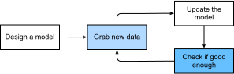
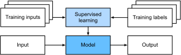
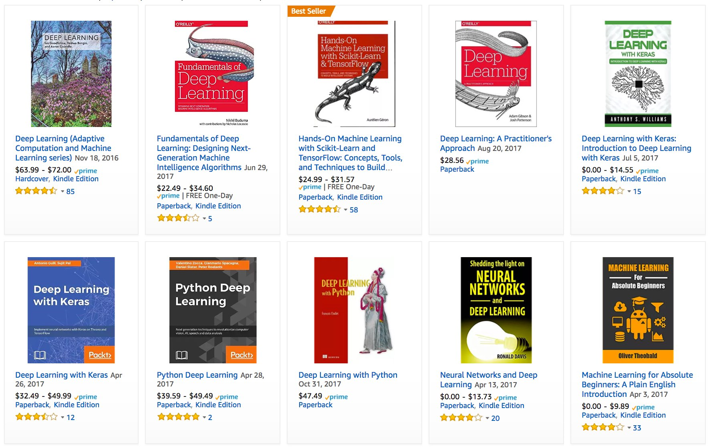
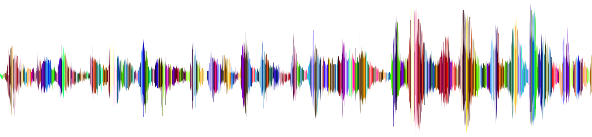
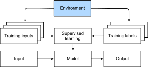
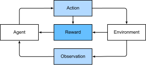

# Chương 1 Giới thiệu

> Ghi chú của người biên soạn: trang này dịch nguyên văn từ sách *Dive into Deep Learning* của **Aston Zhang, Zachary C. Lipton, Mu Li và Alexander J. Smola** ([bản gốc](https://d2l.ai/chapter_introduction/index.html), [mã nguồn](https://github.com/d2l-ai/d2l-en), giấy phép [CC BY-SA 4.0](https://creativecommons.org/licenses/by-sa/4.0/); code theo giấy phép MIT-0). Chỉ giữ code PyTorch. Số mục, hình và công thức giữ như bản HTML d2l.ai; thuật ngữ đối chiếu với bản dịch [Đắm mình vào Học Sâu](https://github.com/aivivn/d2l-vn).

Cho đến gần đây, gần như mọi chương trình máy tính mà bạn có thể tương tác trong một ngày bình thường đều được lập trình như một tập quy tắc cứng nhắc, chỉ định chính xác cách chương trình phải hành xử. Giả sử ta muốn viết một ứng dụng quản lý một nền tảng thương mại điện tử. Sau vài giờ quây quần quanh tấm bảng trắng để suy ngẫm về bài toán, ta có thể chốt được những nét chính của một giải pháp khả thi, chẳng hạn: (i) người dùng tương tác với ứng dụng qua một giao diện chạy trên trình duyệt web hoặc ứng dụng di động; (ii) ứng dụng của ta tương tác với một hệ quản trị cơ sở dữ liệu cấp thương mại để theo dõi trạng thái của mỗi người dùng và lưu giữ hồ sơ các giao dịch trong quá khứ; và (iii) ở trung tâm của ứng dụng, *logic nghiệp vụ* (có thể gọi là *bộ não*) của ứng dụng đặt ra một tập quy tắc ánh xạ mọi tình huống có thể nghĩ đến thành hành động tương ứng mà chương trình của ta nên thực hiện.

Để xây dựng bộ não của ứng dụng, ta có thể liệt kê mọi sự kiện thông thường mà chương trình cần xử lý. Chẳng hạn, mỗi khi khách hàng bấm để thêm một món hàng vào giỏ, chương trình của ta nên thêm một mục vào bảng giỏ hàng trong cơ sở dữ liệu, liên kết ID của người dùng đó với ID của sản phẩm được yêu cầu. Sau đó ta có thể cố gắng đi qua từng trường hợp biên có thể xảy ra, kiểm tra xem các quy tắc của mình có thích hợp không và chỉnh sửa khi cần. Điều gì xảy ra nếu người dùng bắt đầu thanh toán với một giỏ hàng trống? Dù hiếm có nhà phát triển nào làm đúng hoàn toàn ngay lần đầu (có thể phải chạy thử vài lần để gỡ hết các trục trặc), phần lớn ta có thể viết những chương trình như vậy và tự tin đưa chúng vào vận hành *trước khi* gặp một khách hàng thực sự nào. Khả năng tự tay thiết kế các hệ thống tự động vận hành những sản phẩm và hệ thống hoạt động được, thường là trong những tình huống mới lạ, là một kỳ công nhận thức đáng nể. Và khi bạn có thể nghĩ ra những giải pháp hoạt động đúng $100\%$ thời gian, bạn thường không cần bận tâm đến học máy.

May mắn cho cộng đồng các nhà khoa học học máy đang ngày càng lớn mạnh, nhiều tác vụ mà ta muốn tự động hóa không dễ dàng khuất phục trước sự khéo léo của con người. Hãy tưởng tượng quây quần quanh tấm bảng trắng cùng những bộ óc thông minh nhất mà bạn biết, nhưng lần này bạn đang giải quyết một trong những bài toán sau:

* Viết một chương trình dự báo thời tiết ngày mai dựa trên thông tin địa lý, ảnh vệ tinh và thời tiết trong một khoảng thời gian gần đây.
* Viết một chương trình nhận một câu hỏi về sự kiện, được diễn đạt bằng văn bản tự do, và trả lời đúng câu hỏi đó.
* Viết một chương trình mà, cho một bức ảnh, xác định mọi người xuất hiện trong ảnh và vẽ đường viền quanh từng người.
* Viết một chương trình giới thiệu cho người dùng những sản phẩm họ có khả năng thích nhưng khó có khả năng tự bắt gặp khi lướt xem thông thường.

Với những bài toán này, ngay cả các lập trình viên hàng đầu cũng sẽ chật vật khi tự viết giải pháp từ đầu. Lý do có thể khác nhau. Đôi khi chương trình mà ta tìm kiếm tuân theo một khuôn mẫu thay đổi theo thời gian, nên không có câu trả lời đúng cố định nào cả! Trong những trường hợp như vậy, mọi giải pháp thành công đều phải thích nghi nhuần nhuyễn với một thế giới luôn thay đổi. Vào những lúc khác, mối quan hệ (chẳng hạn giữa các điểm ảnh và các phạm trù trừu tượng) có thể quá phức tạp, đòi hỏi hàng nghìn hay hàng triệu phép tính và tuân theo những nguyên lý chưa được biết đến. Trong trường hợp nhận dạng ảnh, các bước chính xác cần thiết để thực hiện tác vụ nằm ngoài tầm hiểu biết có ý thức của ta, dù các quá trình nhận thức tiềm thức của ta thực hiện tác vụ đó một cách dễ dàng.

*Học máy* (machine learning) là ngành nghiên cứu các thuật toán có thể học từ kinh nghiệm. Khi một thuật toán học máy tích lũy thêm kinh nghiệm, thường dưới dạng dữ liệu quan sát hoặc tương tác với một môi trường, hiệu năng của nó được cải thiện. Hãy so sánh điều này với nền tảng thương mại điện tử tất định của ta, vốn tuân theo cùng một logic nghiệp vụ dù tích lũy bao nhiêu kinh nghiệm đi nữa, cho đến khi chính các nhà phát triển học hỏi và quyết định rằng đã đến lúc cập nhật phần mềm. Trong cuốn sách này, chúng tôi sẽ dạy bạn những kiến thức nền tảng của học máy, đặc biệt tập trung vào *học sâu* (deep learning), một tập hợp các kỹ thuật mạnh mẽ đang thúc đẩy đổi mới trong những lĩnh vực đa dạng như thị giác máy tính, xử lý ngôn ngữ tự nhiên, chăm sóc sức khỏe và hệ gen học.

## 1.1 Một Ví dụ Truyền cảm hứng

Trước khi bắt đầu viết, các tác giả của cuốn sách này, giống như phần lớn người lao động, phải nạp caffeine. Chúng tôi nhảy lên xe và bắt đầu lái. Dùng một chiếc iPhone, Alex gọi "Hey Siri", đánh thức hệ thống nhận dạng giọng nói của điện thoại. Sau đó Mu ra lệnh "chỉ đường đến quán cà phê Blue Bottle". Điện thoại nhanh chóng hiển thị bản chép lời của câu lệnh. Nó cũng nhận ra rằng chúng tôi đang hỏi đường và khởi chạy ứng dụng Bản đồ để đáp ứng yêu cầu. Sau khi khởi chạy, ứng dụng Bản đồ xác định một số tuyến đường. Bên cạnh mỗi tuyến đường, điện thoại hiển thị thời gian di chuyển dự đoán. Dù câu chuyện này được dựng lên cho tiện việc giảng giải, nó cho thấy chỉ trong vài giây, những tương tác hằng ngày của ta với một chiếc điện thoại thông minh có thể huy động nhiều mô hình học máy.

Hãy tưởng tượng chỉ riêng việc viết một chương trình phản hồi một *từ đánh thức* (wake word) như "Alexa", "OK Google" và "Hey Siri". Hãy thử tự viết nó trong một căn phòng chỉ có một chiếc máy tính và một trình soạn thảo code, như minh họa trong [Hình 1.1.1](dl/ch01_vi?id=fig-wake-word). Bạn sẽ viết một chương trình như vậy từ các nguyên lý cơ bản như thế nào? Hãy nghĩ xem... bài toán này khó. Mỗi giây, micro sẽ thu khoảng 44 000 mẫu. Mỗi mẫu là một phép đo biên độ của sóng âm. Quy tắc nào có thể ánh xạ một cách đáng tin cậy từ một đoạn âm thanh thô thành những dự đoán chắc chắn $\{\textrm{có}, \textrm{không}\}$ về việc đoạn âm thanh có chứa từ đánh thức hay không? Nếu bạn bế tắc, đừng lo. Chúng tôi cũng không biết cách viết một chương trình như vậy từ đầu. Đó là lý do ta dùng học máy.

<div align=center id="fig-wake-word">

</div>
<div align=center>Hình 1.1.1: Nhận dạng một từ đánh thức.</div>

Mẹo ở đây là thế này. Thường thì, ngay cả khi không biết cách chỉ bảo máy tính một cách tường minh làm sao để ánh xạ từ đầu vào sang đầu ra, bản thân ta vẫn có khả năng thực hiện kỳ công nhận thức đó. Nói cách khác, dù bạn không biết cách lập trình cho máy tính nhận ra từ "Alexa", bản thân bạn vẫn nhận ra được từ đó. Với khả năng này, ta có thể thu thập một *tập dữ liệu* (dataset) khổng lồ chứa các ví dụ về đoạn âm thanh cùng nhãn tương ứng, cho biết đoạn nào chứa từ đánh thức. Trong cách tiếp cận đang thống trị học máy hiện nay, ta không cố thiết kế một hệ thống nhận dạng từ đánh thức một cách *tường minh*. Thay vào đó, ta định nghĩa một chương trình linh hoạt có hành vi được xác định bởi một số *tham số* (parameter). Sau đó ta dùng tập dữ liệu để xác định giá trị tham số tốt nhất có thể, tức là những giá trị cải thiện hiệu năng của chương trình theo một thước đo hiệu năng đã chọn.

Bạn có thể coi các tham số như những núm vặn mà ta có thể xoay để điều khiển hành vi của chương trình. Khi các tham số đã được cố định, ta gọi chương trình là một *mô hình* (model). Tập hợp mọi chương trình khác nhau (các ánh xạ đầu vào–đầu ra) mà ta có thể tạo ra chỉ bằng cách điều chỉnh các tham số được gọi là một *họ* (family) mô hình. Và "siêu chương trình" dùng tập dữ liệu để chọn tham số được gọi là một *thuật toán học* (learning algorithm).

Trước khi có thể tiến hành và áp dụng thuật toán học, ta phải định nghĩa bài toán một cách chính xác, xác định rõ bản chất của đầu vào và đầu ra, và chọn một họ mô hình thích hợp. Trong trường hợp này, mô hình nhận một đoạn âm thanh làm *đầu vào*, và mô hình đưa ra một lựa chọn trong $\{\textrm{có}, \textrm{không}\}$ làm *đầu ra*. Nếu mọi thứ diễn ra đúng kế hoạch, các phỏng đoán của mô hình thường sẽ đúng về việc đoạn âm thanh có chứa từ đánh thức hay không.

Nếu ta chọn đúng họ mô hình, sẽ tồn tại một cách thiết lập các núm vặn sao cho mô hình bật "có" mỗi khi nghe thấy từ "Alexa". Vì việc chọn chính xác từ đánh thức nào là tùy ý, có lẽ ta sẽ cần một họ mô hình đủ phong phú để, với một cách thiết lập núm vặn khác, nó có thể bật "có" chỉ khi nghe thấy từ "Apricot". Ta mong rằng cùng một họ mô hình sẽ phù hợp cho cả việc nhận dạng "Alexa" lẫn "Apricot" vì theo trực giác, chúng có vẻ là những tác vụ tương tự nhau. Tuy nhiên, ta có thể cần một họ mô hình hoàn toàn khác nếu muốn xử lý những đầu vào hoặc đầu ra khác biệt về bản chất, chẳng hạn nếu muốn ánh xạ từ ảnh sang chú thích, hay từ câu tiếng Anh sang câu tiếng Trung.

Như bạn có thể đoán, nếu ta chỉ đặt mọi núm vặn một cách ngẫu nhiên, khó có khả năng mô hình sẽ nhận ra "Alexa", "Apricot" hay bất kỳ từ tiếng Anh nào khác. Trong học máy, *việc học* là quá trình mà qua đó ta tìm ra cách thiết lập đúng các núm vặn để buộc mô hình có hành vi mong muốn. Nói cách khác, ta *huấn luyện* mô hình bằng dữ liệu. Như minh họa trong [Hình 1.1.2](dl/ch01_vi?id=fig-ml-loop), quá trình huấn luyện thường diễn ra như sau:

1. Bắt đầu với một mô hình được khởi tạo ngẫu nhiên, chưa làm được gì hữu ích.
1. Lấy một phần dữ liệu (chẳng hạn các đoạn âm thanh và nhãn $\{\textrm{có}, \textrm{không}\}$ tương ứng).
1. Tinh chỉnh các núm vặn để mô hình hoạt động tốt hơn khi được đánh giá trên những ví dụ đó.
1. Lặp lại Bước 2 và 3 cho đến khi mô hình hoạt động tuyệt vời.

<div align=center id="fig-ml-loop">

</div>
<div align=center>Hình 1.1.2: Một quá trình huấn luyện điển hình.</div>

Tóm lại, thay vì lập trình một bộ nhận dạng từ đánh thức, ta lập trình một chương trình có thể *học* cách nhận dạng từ đánh thức nếu được cung cấp một tập dữ liệu lớn đã gán nhãn. Bạn có thể coi hành động xác định hành vi của một chương trình bằng cách cung cấp cho nó một tập dữ liệu là *lập trình bằng dữ liệu*. Nghĩa là, ta có thể "lập trình" một bộ phát hiện mèo bằng cách cung cấp cho hệ thống học máy thật nhiều ví dụ về mèo và chó. Bằng cách này, cuối cùng bộ phát hiện sẽ học được cách đưa ra một số dương rất lớn nếu đó là mèo, một số âm rất lớn nếu đó là chó, và một giá trị gần không hơn nếu nó không chắc chắn. Điều này mới chỉ chạm đến bề mặt của những gì học máy có thể làm. Học sâu, mà ta sẽ giải thích chi tiết hơn sau này, chỉ là một trong nhiều phương pháp phổ biến để giải các bài toán học máy.

## 1.2 Các Thành phần Then chốt

Trong ví dụ từ đánh thức, ta đã mô tả một tập dữ liệu gồm các đoạn âm thanh và nhãn nhị phân, và đã phác họa sơ qua cách ta có thể huấn luyện một mô hình để xấp xỉ ánh xạ từ các đoạn âm thanh sang các kết quả phân loại. Loại bài toán này, trong đó ta cố gắng dự đoán một nhãn chưa biết được chỉ định dựa trên các đầu vào đã biết, với một tập dữ liệu gồm những ví dụ đã biết nhãn, được gọi là *học có giám sát* (supervised learning). Đây chỉ là một trong nhiều loại bài toán học máy. Trước khi khám phá các loại khác, chúng tôi muốn làm rõ hơn một số thành phần cốt lõi sẽ theo ta suốt chặng đường, bất kể ta giải quyết loại bài toán học máy nào:

1. *Dữ liệu* mà ta có thể học từ đó.
1. Một *mô hình* về cách biến đổi dữ liệu.
1. Một *hàm mục tiêu* định lượng mô hình đang hoạt động tốt (hay tệ) đến mức nào.
1. Một *thuật toán* để điều chỉnh các tham số của mô hình nhằm tối ưu hàm mục tiêu.

### 1.2.1 Dữ liệu

Có lẽ không cần nói cũng biết rằng bạn không thể làm khoa học dữ liệu mà không có dữ liệu. Ta có thể tốn hàng trăm trang để suy ngẫm chính xác dữ liệu *là gì*, nhưng tạm thời, ta sẽ tập trung vào những đặc tính then chốt của các tập dữ liệu mà ta quan tâm. Nhìn chung, ta quan tâm đến một tập hợp các mẫu. Để làm việc với dữ liệu một cách hữu ích, ta thường cần nghĩ ra một biểu diễn số thích hợp. Mỗi *mẫu* (example, hay *điểm dữ liệu*, *thực thể dữ liệu*, *mẫu dữ liệu*) thường gồm một tập thuộc tính gọi là *đặc trưng* (feature, đôi khi gọi là *hiệp biến* – covariate hay *đầu vào*), mà dựa vào đó mô hình phải đưa ra dự đoán. Trong các bài toán học có giám sát, mục tiêu của ta là dự đoán giá trị của một thuộc tính đặc biệt, gọi là *nhãn* (label, hay *mục tiêu* – target), vốn không thuộc đầu vào của mô hình.

Nếu ta làm việc với dữ liệu ảnh, mỗi mẫu có thể gồm một bức ảnh riêng lẻ (các đặc trưng) và một con số cho biết phạm trù mà bức ảnh thuộc về (nhãn). Bức ảnh sẽ được biểu diễn dưới dạng số bằng ba lưới giá trị số biểu diễn độ sáng của ánh sáng đỏ, lục và lam tại mỗi vị trí điểm ảnh. Chẳng hạn, một bức ảnh màu $200\times 200$ điểm ảnh sẽ gồm $200\times200\times3=120000$ giá trị số.

Hoặc, ta có thể làm việc với dữ liệu hồ sơ sức khỏe điện tử và giải quyết tác vụ dự đoán khả năng một bệnh nhân nào đó sẽ sống sót trong 30 ngày tới. Ở đây, các đặc trưng của ta có thể gồm một tập hợp các thuộc tính sẵn có và các phép đo được ghi nhận thường xuyên, gồm tuổi, các dấu hiệu sinh tồn, các bệnh đi kèm, các loại thuốc đang dùng và các thủ thuật gần đây. Nhãn có sẵn để huấn luyện sẽ là một giá trị nhị phân cho biết mỗi bệnh nhân trong dữ liệu lịch sử có sống sót trong khoảng 30 ngày hay không.

Trong những trường hợp như vậy, khi mọi mẫu được mô tả bởi cùng một số lượng đặc trưng số, ta nói rằng đầu vào là các vector có độ dài cố định và ta gọi độ dài (không đổi) của các vector là *số chiều* (dimensionality) của dữ liệu. Như bạn có thể hình dung, đầu vào có độ dài cố định có thể rất tiện lợi, giúp ta bớt đi một mối phức tạp phải lo. Tuy nhiên, không phải dữ liệu nào cũng dễ dàng biểu diễn được dưới dạng vector có *độ dài cố định*. Dù ta có thể mong rằng ảnh hiển vi đến từ các thiết bị tiêu chuẩn, ta không thể mong rằng các bức ảnh thu thập từ Internet đều có cùng độ phân giải hay hình dạng. Với ảnh, ta có thể cân nhắc cắt chúng về một kích thước chuẩn, nhưng chiến lược đó chỉ giúp được đến một mức nào đó. Ta có nguy cơ mất thông tin ở những phần bị cắt bỏ. Hơn nữa, dữ liệu văn bản còn cứng đầu hơn trong việc chống lại biểu diễn có độ dài cố định. Hãy xem các bài đánh giá của khách hàng trên những trang thương mại điện tử như Amazon, IMDb và TripAdvisor. Có bài thì ngắn: "dở tệ!". Có bài thì dài lê thê hàng trang. Một ưu thế lớn của học sâu so với các phương pháp truyền thống là sự uyển chuyển tương đối mà các mô hình hiện đại có được khi xử lý dữ liệu có *độ dài thay đổi*.

Nhìn chung, càng có nhiều dữ liệu, công việc của ta càng dễ dàng. Khi có nhiều dữ liệu hơn, ta có thể huấn luyện những mô hình mạnh hơn và ít phải dựa vào các giả định định sẵn. Sự chuyển đổi từ dữ liệu (tương đối) nhỏ sang dữ liệu lớn là một yếu tố đóng góp chính vào thành công của học sâu hiện đại. Nói cho rõ, nhiều mô hình thú vị nhất trong học sâu không hoạt động được nếu thiếu các tập dữ liệu lớn. Một số mô hình khác có thể hoạt động khi dữ liệu nhỏ, nhưng không tốt hơn các cách tiếp cận truyền thống.

Cuối cùng, có thật nhiều dữ liệu và xử lý nó một cách khéo léo là chưa đủ. Ta cần dữ liệu *đúng*. Nếu dữ liệu đầy lỗi, hoặc nếu các đặc trưng được chọn không có khả năng dự đoán đại lượng mục tiêu mà ta quan tâm, việc học sẽ thất bại. Tình huống này được tóm gọn trong câu sáo ngữ: *rác vào, rác ra* (garbage in, garbage out). Hơn nữa, hiệu năng dự đoán kém không phải là hệ quả tiềm tàng duy nhất. Trong những ứng dụng nhạy cảm của học máy, như dự đoán tội phạm, sàng lọc hồ sơ xin việc và các mô hình rủi ro dùng trong cho vay, ta phải đặc biệt cảnh giác với hệ quả của dữ liệu rác. Một kiểu thất bại thường gặp liên quan đến những tập dữ liệu mà một số nhóm người không được đại diện trong dữ liệu huấn luyện. Hãy tưởng tượng áp dụng một hệ thống nhận dạng ung thư da chưa từng thấy làn da đen. Thất bại cũng có thể xảy ra khi dữ liệu không chỉ đại diện thiếu cho một số nhóm mà còn phản ánh những định kiến xã hội. Chẳng hạn, nếu các quyết định tuyển dụng trong quá khứ được dùng để huấn luyện một mô hình dự đoán dùng để sàng lọc hồ sơ, các mô hình học máy có thể vô tình nắm bắt và tự động hóa những bất công trong lịch sử. Lưu ý rằng tất cả những điều này có thể xảy ra mà nhà khoa học dữ liệu không hề chủ động âm mưu, thậm chí không hề nhận ra.

### 1.2.2 Mô hình

Phần lớn học máy liên quan đến việc biến đổi dữ liệu theo một nghĩa nào đó. Ta có thể muốn xây dựng một hệ thống nhận ảnh và dự đoán mức độ tươi cười. Hoặc, ta có thể muốn nhận một tập các số đo cảm biến và dự đoán các số đo đó bình thường hay bất thường đến mức nào. Với *mô hình*, ta muốn nói đến bộ máy tính toán nhận dữ liệu thuộc một kiểu và đưa ra các dự đoán thuộc một kiểu có thể khác. Cụ thể, ta quan tâm đến các *mô hình thống kê* có thể được ước lượng từ dữ liệu. Dù các mô hình đơn giản hoàn toàn có khả năng giải quyết những bài toán đơn giản tương xứng, các bài toán mà ta tập trung vào trong cuốn sách này đẩy các phương pháp cổ điển đến giới hạn. Học sâu khác các cách tiếp cận cổ điển chủ yếu ở tập hợp các mô hình mạnh mẽ mà nó tập trung vào. Những mô hình này gồm nhiều phép biến đổi dữ liệu nối tiếp nhau, được xâu chuỗi từ trên xuống dưới, vì thế mới có tên gọi *học sâu*. Trên đường đi đến việc thảo luận các mô hình sâu, ta cũng sẽ thảo luận một số phương pháp truyền thống hơn.

### 1.2.3 Hàm Mục tiêu

Trước đó, ta đã giới thiệu học máy là việc học từ kinh nghiệm. *Học* ở đây nghĩa là tiến bộ dần ở một tác vụ nào đó theo thời gian. Nhưng ai sẽ quyết định thế nào là một sự tiến bộ? Bạn có thể hình dung rằng ta đề xuất cập nhật mô hình, và một số người có thể không đồng ý về việc đề xuất đó có phải là một sự cải thiện hay không.

Để phát triển một hệ thống toán học hình thức cho các máy học, ta cần có những thước đo hình thức về mức độ tốt (hay tệ) của mô hình. Trong học máy, và rộng hơn là trong tối ưu hóa, ta gọi chúng là *hàm mục tiêu* (objective function). Theo quy ước, ta thường định nghĩa hàm mục tiêu sao cho càng thấp càng tốt. Đây chỉ đơn thuần là một quy ước. Bạn có thể lấy bất kỳ hàm nào mà càng cao càng tốt và biến nó thành một hàm mới giống hệt về bản chất nhưng càng thấp càng tốt bằng cách đổi dấu. Vì ta chọn càng thấp càng tốt, những hàm này đôi khi được gọi là *hàm mất mát* (loss function).

Khi cố gắng dự đoán các giá trị số, hàm mất mát phổ biến nhất là *bình phương sai số* (squared error), tức là bình phương hiệu giữa giá trị dự đoán và giá trị mục tiêu thực tế. Với bài toán phân loại, mục tiêu phổ biến nhất là cực tiểu hóa tỉ lệ lỗi, tức là tỉ lệ các mẫu mà dự đoán của ta không khớp với giá trị thực tế. Một số hàm mục tiêu (chẳng hạn bình phương sai số) dễ tối ưu, trong khi những hàm khác (chẳng hạn tỉ lệ lỗi) khó tối ưu trực tiếp do không khả vi hoặc những phức tạp khác. Trong những trường hợp này, người ta thường tối ưu một *hàm mục tiêu thay thế* (surrogate objective).

Trong quá trình tối ưu, ta coi mất mát là một hàm của các tham số mô hình, và coi tập dữ liệu huấn luyện là hằng số. Ta học được giá trị tốt nhất cho các tham số mô hình bằng cách cực tiểu hóa mất mát trên một tập gồm một số lượng mẫu nhất định được thu thập để huấn luyện. Tuy nhiên, làm tốt trên dữ liệu huấn luyện không đảm bảo rằng ta sẽ làm tốt trên dữ liệu chưa thấy. Vì vậy ta thường muốn chia dữ liệu sẵn có thành hai phần: *tập dữ liệu huấn luyện* (training dataset, hay *tập huấn luyện*), dùng để học các tham số mô hình; và *tập dữ liệu kiểm tra* (test dataset, hay *tập kiểm tra*), được giữ riêng để đánh giá. Sau cùng, ta thường báo cáo mô hình hoạt động thế nào trên cả hai phần. Bạn có thể coi hiệu năng huấn luyện tương tự như điểm số mà một học sinh đạt được trong các đề thi thử dùng để ôn luyện cho một kỳ thi cuối kỳ thật sự. Ngay cả khi kết quả đáng khích lệ, điều đó cũng không đảm bảo thành công trong kỳ thi cuối kỳ. Trong quá trình ôn tập, học sinh có thể bắt đầu học thuộc lòng các câu hỏi luyện tập, trông như đã nắm vững chủ đề nhưng lại chùn bước khi đối mặt với những câu hỏi chưa từng gặp trong kỳ thi cuối kỳ thực sự. Khi một mô hình hoạt động tốt trên tập huấn luyện nhưng không tổng quát hóa được cho dữ liệu chưa thấy, ta nói rằng nó đang *quá khớp* (overfitting) dữ liệu huấn luyện.

### 1.2.4 Thuật toán Tối ưu

Khi đã có nguồn dữ liệu và cách biểu diễn, một mô hình và một hàm mục tiêu được định nghĩa rõ ràng, ta cần một thuật toán có khả năng tìm kiếm các tham số tốt nhất có thể để cực tiểu hóa hàm mất mát. Các thuật toán tối ưu phổ biến cho học sâu dựa trên một cách tiếp cận gọi là *hạ gradient* (gradient descent). Nói ngắn gọn, ở mỗi bước, phương pháp này kiểm tra, với từng tham số, mất mát trên tập huấn luyện sẽ thay đổi thế nào nếu bạn nhiễu tham số đó đi một lượng rất nhỏ. Sau đó nó sẽ cập nhật tham số theo hướng làm giảm mất mát.

## 1.3 Các Loại Bài toán Học máy

Bài toán từ đánh thức trong ví dụ truyền cảm hứng chỉ là một trong rất nhiều bài toán mà học máy có thể giải quyết. Để thúc đẩy người đọc hơn nữa và cung cấp cho chúng ta một số ngôn ngữ chung sẽ theo suốt cuốn sách, giờ chúng tôi đưa ra một cái nhìn tổng quan rộng về bức tranh các bài toán học máy.

### 1.3.1 Học có Giám sát

Học có giám sát mô tả những tác vụ trong đó ta được cho một tập dữ liệu chứa cả đặc trưng lẫn nhãn và được yêu cầu tạo ra một mô hình dự đoán nhãn khi được cho các đặc trưng đầu vào. Mỗi cặp đặc trưng–nhãn được gọi là một mẫu. Đôi khi, khi ngữ cảnh đã rõ, ta có thể dùng thuật ngữ *các mẫu* để chỉ một tập hợp các đầu vào, ngay cả khi chưa biết các nhãn tương ứng. Sự giám sát xuất hiện là vì, để chọn các tham số, chúng ta (những người giám sát) cung cấp cho mô hình một tập dữ liệu gồm các mẫu đã gán nhãn. Theo ngôn ngữ xác suất, ta thường quan tâm đến việc ước lượng xác suất có điều kiện của nhãn khi biết các đặc trưng đầu vào. Dù chỉ là một trong vài mô thức, học có giám sát chiếm phần lớn các ứng dụng thành công của học máy trong công nghiệp. Một phần là vì nhiều tác vụ quan trọng có thể được mô tả rõ ràng là ước lượng xác suất của một điều chưa biết khi cho trước một tập dữ liệu sẵn có cụ thể:

* Dự đoán có ung thư hay không, dựa trên một ảnh chụp cắt lớp vi tính.
* Dự đoán bản dịch tiếng Pháp đúng, dựa trên một câu tiếng Anh.
* Dự đoán giá một cổ phiếu tháng tới dựa trên dữ liệu báo cáo tài chính tháng này.

Dù mọi bài toán học có giám sát đều được gói gọn trong mô tả đơn giản "dự đoán nhãn khi biết các đặc trưng đầu vào", bản thân học có giám sát có thể mang nhiều hình thức đa dạng và đòi hỏi vô số quyết định mô hình hóa, tùy thuộc vào (cùng những yếu tố khác) loại, kích thước và số lượng của đầu vào và đầu ra. Chẳng hạn, ta dùng các mô hình khác nhau để xử lý chuỗi có độ dài tùy ý và các biểu diễn vector có độ dài cố định. Ta sẽ đi sâu vào nhiều bài toán như vậy xuyên suốt cuốn sách.

Một cách không chính thức, quá trình học trông đại khái như sau. Trước tiên, lấy một tập hợp lớn các mẫu đã biết đặc trưng và chọn ra từ đó một tập con ngẫu nhiên, thu thập nhãn thực tế cho từng mẫu. Đôi khi những nhãn này có thể là dữ liệu sẵn có đã được thu thập (chẳng hạn, bệnh nhân có tử vong trong năm tiếp theo không?) và những lúc khác ta có thể cần thuê người chú thích để gán nhãn dữ liệu (chẳng hạn, xếp ảnh vào các phạm trù). Cùng nhau, các đầu vào này và nhãn tương ứng tạo thành tập huấn luyện. Ta đưa tập dữ liệu huấn luyện vào một thuật toán học có giám sát, một hàm nhận đầu vào là một tập dữ liệu và đưa ra một hàm khác: mô hình đã học. Cuối cùng, ta có thể đưa những đầu vào chưa thấy trước đó vào mô hình đã học, dùng đầu ra của nó làm dự đoán cho nhãn tương ứng. Toàn bộ quá trình được vẽ trong [Hình 1.3.1](dl/ch01_vi?id=fig-supervised-learning).

<div align=center id="fig-supervised-learning">

</div>
<div align=center>Hình 1.3.1: Học có giám sát.</div>

#### 1.3.1.1 Hồi quy

Có lẽ tác vụ học có giám sát đơn giản nhất để nắm bắt là *hồi quy* (regression). Hãy xét, chẳng hạn, một tập dữ liệu thu thập từ cơ sở dữ liệu mua bán nhà. Ta có thể lập một bảng, trong đó mỗi hàng tương ứng với một ngôi nhà khác nhau, và mỗi cột tương ứng với một thuộc tính liên quan nào đó, như diện tích sàn của ngôi nhà, số phòng ngủ, số phòng tắm và số phút (đi bộ) đến trung tâm thị trấn. Trong tập dữ liệu này, mỗi mẫu sẽ là một ngôi nhà cụ thể, và vector đặc trưng tương ứng sẽ là một hàng trong bảng. Nếu bạn sống ở New York hay San Francisco, và bạn không phải CEO của Amazon, Google, Microsoft hay Facebook, vector đặc trưng (diện tích sàn tính theo feet vuông, số phòng ngủ, số phòng tắm, khoảng cách đi bộ) của ngôi nhà bạn có thể trông đại loại như: $[600, 1, 1, 60]$. Tuy nhiên, nếu bạn sống ở Pittsburgh, nó có thể trông giống $[3000, 4, 3, 10]$ hơn. Những vector đặc trưng có độ dài cố định như thế này là thiết yếu với hầu hết các thuật toán học máy cổ điển.

Điều khiến một bài toán trở thành bài toán hồi quy thực ra là dạng của giá trị mục tiêu. Giả sử bạn đang tìm mua một ngôi nhà mới. Bạn có thể muốn ước lượng giá trị thị trường hợp lý của một ngôi nhà, dựa trên một số đặc trưng như trên. Dữ liệu ở đây có thể gồm các tin rao bán nhà trong quá khứ và nhãn có thể là giá bán quan sát được. Khi nhãn nhận các giá trị số tùy ý (kể cả trong một khoảng nào đó), ta gọi đây là bài toán *hồi quy*. Mục tiêu là tạo ra một mô hình có dự đoán xấp xỉ sát với giá trị nhãn thực tế.

Rất nhiều bài toán thực tế dễ dàng được mô tả dưới dạng bài toán hồi quy. Dự đoán điểm số mà một người dùng sẽ chấm cho một bộ phim có thể được coi là một bài toán hồi quy, và nếu bạn thiết kế được một thuật toán tuyệt vời làm được điều này vào năm 2009, có lẽ bạn đã giành được [giải thưởng Netflix trị giá 1 triệu đô la](https://en.wikipedia.org/wiki/Netflix_Prize). Dự đoán thời gian nằm viện của bệnh nhân cũng là một bài toán hồi quy. Một quy tắc kinh nghiệm tốt là mọi bài toán *bao nhiêu?* đều có khả năng là hồi quy. Chẳng hạn:

* Ca phẫu thuật này sẽ mất bao nhiêu giờ?
* Thị trấn này sẽ có bao nhiêu lượng mưa trong sáu giờ tới?

Ngay cả khi chưa từng làm việc với học máy, có lẽ bạn đã từng giải một bài toán hồi quy một cách không chính thức. Chẳng hạn, hãy tưởng tượng bạn thuê thợ sửa đường ống thoát nước và người thợ đã mất 3 giờ để thông chất bẩn khỏi ống cống. Sau đó họ gửi cho bạn hóa đơn 350 đô la. Giờ hãy tưởng tượng bạn của bạn thuê cùng người thợ đó trong 2 giờ và nhận hóa đơn 250 đô la. Nếu sau đó có ai hỏi bạn nên dự tính bao nhiêu cho hóa đơn thông cống sắp tới của họ, bạn có thể đưa ra một số giả định hợp lý, chẳng hạn làm càng nhiều giờ thì càng tốn nhiều tiền. Bạn cũng có thể giả định rằng có một khoản phí cơ bản và sau đó người thợ tính tiền theo giờ. Nếu những giả định này đúng, thì với hai mẫu dữ liệu này, bạn đã có thể xác định được cấu trúc giá của người thợ: 100 đô la mỗi giờ cộng 50 đô la phí đến nhà. Nếu bạn theo kịp đến đây, bạn đã hiểu ý tưởng cấp cao đằng sau hồi quy *tuyến tính*.

Trong trường hợp này, ta có thể tìm ra các tham số khớp chính xác với giá của người thợ. Đôi khi điều này là không thể, chẳng hạn khi một phần biến thiên đến từ những yếu tố nằm ngoài hai đặc trưng của bạn. Trong những trường hợp này, ta sẽ cố gắng học các mô hình cực tiểu hóa khoảng cách giữa dự đoán của ta và các giá trị quan sát được. Trong hầu hết các chương, ta sẽ tập trung vào việc cực tiểu hóa hàm mất mát bình phương sai số. Như ta sẽ thấy sau này, hàm mất mát này tương ứng với giả định rằng dữ liệu của ta bị nhiễu bởi nhiễu Gauss.

#### 1.3.1.2 Phân loại

Dù các mô hình hồi quy rất tốt cho việc trả lời câu hỏi *bao nhiêu?*, rất nhiều bài toán không vừa vặn với khuôn mẫu này. Hãy xét, chẳng hạn, một ngân hàng muốn phát triển tính năng quét séc cho ứng dụng di động của mình. Lý tưởng nhất, khách hàng chỉ cần chụp ảnh tấm séc và ứng dụng sẽ tự động nhận dạng chữ trong ảnh. Giả sử ta có khả năng tách ra các mảng ảnh tương ứng với từng ký tự viết tay, thì tác vụ chính còn lại sẽ là xác định ký tự nào trong một tập ký tự đã biết được thể hiện trong mỗi mảng ảnh. Những bài toán *cái nào?* như vậy được gọi là *phân loại* (classification) và đòi hỏi một bộ công cụ khác với bộ công cụ dùng cho hồi quy, dù nhiều kỹ thuật vẫn áp dụng được.

Trong *phân loại*, ta muốn mô hình nhìn vào các đặc trưng, chẳng hạn giá trị điểm ảnh trong một bức ảnh, rồi dự đoán một mẫu thuộc về *phạm trù* (category, đôi khi gọi là *lớp* – class) nào trong một tập hữu hạn các lựa chọn. Với chữ số viết tay, ta có thể có mười lớp, tương ứng với các chữ số từ 0 đến 9. Dạng đơn giản nhất của phân loại là khi chỉ có hai lớp, bài toán mà ta gọi là *phân loại nhị phân* (binary classification). Chẳng hạn, tập dữ liệu của ta có thể gồm ảnh các loài vật và nhãn có thể là các lớp $\textrm{\{mèo, chó\}}$. Trong khi ở hồi quy ta tìm một bộ hồi quy cho ra một giá trị số, ở phân loại ta tìm một bộ phân loại có đầu ra là lớp được dự đoán.

Vì những lý do mà ta sẽ tìm hiểu khi cuốn sách đi vào kỹ thuật hơn, có thể khó tối ưu một mô hình chỉ có thể đưa ra một kết quả phân loại *dứt khoát*, chẳng hạn hoặc "mèo" hoặc "chó". Trong những trường hợp này, thường dễ hơn nhiều khi biểu diễn mô hình bằng ngôn ngữ xác suất. Cho các đặc trưng của một mẫu, mô hình gán một xác suất cho mỗi lớp có thể. Quay lại ví dụ phân loại động vật với các lớp $\textrm{\{mèo, chó\}}$, một bộ phân loại có thể nhìn một bức ảnh và đưa ra xác suất bức ảnh là mèo bằng 0.9. Ta có thể diễn giải con số này bằng cách nói rằng bộ phân loại chắc chắn 90% rằng bức ảnh thể hiện một con mèo. Độ lớn của xác suất cho lớp được dự đoán truyền đạt một khái niệm về sự bất định. Đó không phải khái niệm duy nhất và ta sẽ thảo luận những khái niệm khác trong các chương về chủ đề nâng cao hơn.

Khi có nhiều hơn hai lớp có thể, ta gọi bài toán là *phân loại đa lớp* (multiclass classification). Các ví dụ thường gặp gồm nhận dạng ký tự viết tay $\textrm{\{0, 1, 2, ... 9, a, b, c, ...\}}$. Trong khi ta giải các bài toán hồi quy bằng cách cố gắng cực tiểu hóa hàm mất mát bình phương sai số, hàm mất mát thông dụng cho các bài toán phân loại được gọi là *entropy chéo* (cross-entropy), cái tên sẽ được giải thích khi ta giới thiệu lý thuyết thông tin trong các chương sau.

Lưu ý rằng lớp có khả năng xảy ra cao nhất không nhất thiết là lớp mà bạn sẽ dùng để ra quyết định. Giả sử bạn tìm thấy một cây nấm tuyệt đẹp ở sân sau nhà như trong [Hình 1.3.2](dl/ch01_vi?id=fig-death-cap).

<div align=center id="fig-death-cap">

</div>
<div align=center>Hình 1.3.2: Nấm độc tử thần (death cap): đừng ăn!</div>

Giờ, giả sử bạn đã xây dựng một bộ phân loại và huấn luyện nó để dự đoán một cây nấm có độc hay không dựa trên một bức ảnh. Giả sử bộ phân loại phát hiện chất độc của ta cho ra xác suất [Hình 1.3.2](dl/ch01_vi?id=fig-death-cap) là nấm độc tử thần bằng 0.2. Nói cách khác, bộ phân loại chắc chắn 80% rằng cây nấm của ta không phải nấm độc tử thần. Dù vậy, bạn phải thật ngốc mới ăn nó. Đó là vì lợi ích chắc chắn của một bữa tối ngon miệng không đáng để đánh đổi với rủi ro 20% tử vong. Nói cách khác, tác động của rủi ro bất định lớn hơn rất nhiều so với lợi ích. Do đó, để quyết định có ăn nấm hay không, ta cần tính thiệt hại kỳ vọng gắn với mỗi hành động, vốn phụ thuộc cả vào các kết quả có thể xảy ra lẫn lợi ích hay tác hại gắn với từng kết quả. Trong trường hợp này, thiệt hại phải chịu khi ăn nấm có thể là $0.2 \times \infty + 0.8 \times 0 = \infty$, trong khi tổn thất khi bỏ nó đi là $0.2 \times 0 + 0.8 \times 1 = 0.8$. Sự thận trọng của ta là có cơ sở: như bất kỳ nhà nấm học nào cũng sẽ nói với ta, cây nấm trong [Hình 1.3.2](dl/ch01_vi?id=fig-death-cap) thực sự là nấm độc tử thần.

Phân loại có thể phức tạp hơn nhiều so với chỉ phân loại nhị phân hay đa lớp. Chẳng hạn, có một số biến thể của phân loại xử lý các lớp có cấu trúc phân cấp. Trong những trường hợp như vậy, không phải lỗi nào cũng như nhau: nếu buộc phải sai, ta có thể thích phân loại nhầm sang một lớp có liên quan hơn là sang một lớp xa lạ. Thông thường, điều này được gọi là *phân loại phân cấp* (hierarchical classification). Để lấy cảm hứng, bạn có thể nghĩ đến [Linnaeus](https://en.wikipedia.org/wiki/Carl_Linnaeus), người đã sắp xếp các loài động vật theo một hệ thống phân cấp.

Trong trường hợp phân loại động vật, nhầm một con chó poodle thành chó schnauzer có thể không quá tệ, nhưng mô hình của ta sẽ phải trả giá đắt nếu nhầm một con poodle với một con khủng long. Hệ thống phân cấp nào là phù hợp có thể phụ thuộc vào cách bạn định dùng mô hình. Chẳng hạn, rắn đuôi chuông và rắn sọc có thể ở gần nhau trên cây phát sinh chủng loài, nhưng nhầm một con rắn đuôi chuông thành rắn sọc có thể gây hậu quả chết người.

#### 1.3.1.3 Gắn thẻ

Một số bài toán phân loại vừa vặn với khung phân loại nhị phân hoặc đa lớp. Chẳng hạn, ta có thể huấn luyện một bộ phân loại nhị phân thông thường để phân biệt mèo với chó. Với trình độ hiện nay của thị giác máy tính, ta có thể làm điều này dễ dàng bằng các công cụ có sẵn. Dù vậy, cho dù mô hình chính xác đến đâu, ta vẫn có thể gặp rắc rối khi bộ phân loại bắt gặp một bức ảnh về *Những nhạc sĩ thành Bremen*, một truyện cổ tích nổi tiếng của Đức có bốn con vật ([Hình 1.3.3](dl/ch01_vi?id=fig-stackedanimals)).

<div align=center id="fig-stackedanimals">

</div>
<div align=center>Hình 1.3.3: Một con lừa, một con chó, một con mèo và một con gà trống.</div>

Như bạn có thể thấy, bức ảnh có một con mèo, một con gà trống, một con chó và một con lừa, với vài cái cây ở phía sau. Nếu dự kiến sẽ gặp những bức ảnh như vậy, phân loại đa lớp có thể không phải là cách phát biểu bài toán đúng. Thay vào đó, ta có thể muốn cho mô hình lựa chọn nói rằng bức ảnh thể hiện một con mèo, một con chó, một con lừa *và* một con gà trống.

Bài toán học cách dự đoán các lớp không loại trừ lẫn nhau được gọi là *phân loại đa nhãn* (multi-label classification). Các bài toán tự động gắn thẻ thường được mô tả tốt nhất dưới dạng phân loại đa nhãn. Hãy nghĩ đến các thẻ mà người ta có thể gắn cho các bài viết trên một blog kỹ thuật, chẳng hạn "học máy", "công nghệ", "thiết bị", "ngôn ngữ lập trình", "Linux", "điện toán đám mây", "AWS". Một bài viết điển hình có thể được gắn 5–10 thẻ. Thông thường, các thẻ sẽ thể hiện một cấu trúc tương quan nào đó. Các bài viết về "điện toán đám mây" có khả năng nhắc đến "AWS" và các bài viết về "học máy" có khả năng nhắc đến "GPU".

Đôi khi những bài toán gắn thẻ như vậy dựa trên những tập nhãn khổng lồ. Thư viện Y khoa Quốc gia (Hoa Kỳ) thuê nhiều người chú thích chuyên nghiệp để gắn mỗi bài báo cần được lập chỉ mục trong PubMed với một tập thẻ lấy từ hệ thống bản thể học Medical Subject Headings (MeSH), một tập hợp khoảng 28 000 thẻ. Gắn thẻ đúng cho các bài báo là quan trọng vì nó cho phép các nhà nghiên cứu tiến hành tổng quan tài liệu một cách đầy đủ. Đây là một quá trình tốn thời gian và thường có độ trễ một năm giữa lúc lưu trữ và lúc gắn thẻ. Học máy có thể cung cấp các thẻ tạm thời cho đến khi mỗi bài báo được xem xét thủ công đúng mức. Thật vậy, trong vài năm, tổ chức BioASQ đã [tổ chức các cuộc thi](http://bioasq.org/) cho tác vụ này.

#### 1.3.1.4 Tìm kiếm

Trong lĩnh vực truy xuất thông tin, ta thường xếp hạng các tập hợp mục. Lấy tìm kiếm web làm ví dụ. Mục tiêu không hẳn là xác định *liệu* một trang cụ thể có liên quan đến truy vấn hay không, mà đúng hơn là trong một tập kết quả liên quan, kết quả nào nên được hiển thị nổi bật nhất cho một người dùng cụ thể. Một cách để làm điều này có thể là trước tiên gán điểm cho mọi phần tử trong tập rồi truy xuất các phần tử có điểm cao nhất. [PageRank](https://en.wikipedia.org/wiki/PageRank), bí quyết ban đầu đằng sau công cụ tìm kiếm Google, là một ví dụ sớm về hệ thống chấm điểm như vậy. Kỳ lạ là, điểm số do PageRank đưa ra không phụ thuộc vào truy vấn thực tế. Thay vào đó, họ dựa vào một bộ lọc mức độ liên quan đơn giản để xác định tập ứng viên liên quan rồi dùng PageRank để ưu tiên các trang có uy tín hơn. Ngày nay, các công cụ tìm kiếm dùng học máy và các mô hình hành vi để có được điểm liên quan phụ thuộc vào truy vấn. Có cả những hội nghị khoa học dành riêng cho chủ đề này.

#### 1.3.1.5 Hệ thống Gợi ý

Hệ thống gợi ý là một dạng bài toán khác liên quan đến tìm kiếm và xếp hạng. Các bài toán này giống nhau ở chỗ mục tiêu là hiển thị một tập các mục liên quan đến người dùng. Khác biệt chính là sự nhấn mạnh vào *cá nhân hóa* cho từng người dùng cụ thể trong bối cảnh hệ thống gợi ý. Chẳng hạn, với gợi ý phim, trang kết quả cho một người hâm mộ khoa học viễn tưởng và trang kết quả cho một người sành phim hài của Peter Sellers có thể khác nhau đáng kể. Những bài toán tương tự xuất hiện trong các bối cảnh gợi ý khác, chẳng hạn gợi ý sản phẩm bán lẻ, âm nhạc và tin tức.

Trong một số trường hợp, khách hàng cung cấp phản hồi tường minh, cho biết họ thích một sản phẩm cụ thể đến mức nào (chẳng hạn điểm đánh giá và nhận xét sản phẩm trên Amazon, IMDb hay Goodreads). Trong những trường hợp khác, họ cung cấp phản hồi ngầm định, chẳng hạn bằng cách bỏ qua các bài trong một danh sách phát, điều có thể cho thấy sự không hài lòng hoặc có thể chỉ cho thấy bài hát không phù hợp với bối cảnh. Trong những cách phát biểu đơn giản nhất, các hệ thống này được huấn luyện để ước lượng một điểm số nào đó, chẳng hạn số sao đánh giá kỳ vọng hoặc xác suất một người dùng cho trước sẽ mua một mặt hàng cụ thể.

Với một mô hình như vậy, cho bất kỳ người dùng nào, ta có thể truy xuất tập các đối tượng có điểm cao nhất, rồi gợi ý chúng cho người dùng. Các hệ thống dùng trong thực tế tiên tiến hơn đáng kể và tính đến hoạt động chi tiết của người dùng cũng như đặc điểm của các mặt hàng khi tính những điểm số này. [Hình 1.3.4](dl/ch01_vi?id=fig-deeplearning-amazon) hiển thị các cuốn sách học sâu được Amazon gợi ý dựa trên các thuật toán cá nhân hóa được tinh chỉnh để nắm bắt sở thích của Aston.

<div align=center id="fig-deeplearning-amazon">

</div>
<div align=center>Hình 1.3.4: Các cuốn sách học sâu được Amazon gợi ý.</div>

Dù có giá trị kinh tế to lớn, các hệ thống gợi ý được xây dựng một cách ngây thơ dựa trên các mô hình dự đoán mắc phải một số khiếm khuyết nghiêm trọng về mặt khái niệm. Để bắt đầu, ta chỉ quan sát được *phản hồi bị kiểm duyệt* (censored feedback): người dùng thường chỉ chấm điểm những bộ phim mà họ có cảm nhận mạnh mẽ. Chẳng hạn, trên thang điểm năm, bạn có thể để ý thấy các mặt hàng nhận được nhiều đánh giá một sao và năm sao nhưng lại có ít đến lạ lùng các đánh giá ba sao. Hơn nữa, thói quen mua sắm hiện tại thường là kết quả của thuật toán gợi ý đang được áp dụng, nhưng các thuật toán học không phải lúc nào cũng tính đến chi tiết này. Do đó có thể hình thành các vòng phản hồi, trong đó một hệ thống gợi ý ưu tiên đẩy một mặt hàng, mặt hàng đó sau đó được coi là tốt hơn (do được mua nhiều hơn) và đến lượt nó lại càng được gợi ý thường xuyên hơn. Nhiều vấn đề trong số này, về cách xử lý sự kiểm duyệt, các động cơ khuyến khích và các vòng phản hồi, là những câu hỏi nghiên cứu mở quan trọng.

#### 1.3.1.6 Học Chuỗi

Cho đến nay, ta đã xem xét những bài toán trong đó ta có một số lượng đầu vào cố định và tạo ra một số lượng đầu ra cố định. Chẳng hạn, ta đã xét việc dự đoán giá nhà dựa trên một tập đặc trưng cố định: diện tích sàn, số phòng ngủ, số phòng tắm và thời gian di chuyển đến trung tâm. Ta cũng đã thảo luận việc ánh xạ từ một bức ảnh (có số chiều cố định) sang các xác suất dự đoán rằng nó thuộc về từng lớp trong một số lượng lớp cố định, và việc dự đoán số sao đánh giá gắn với các lượt mua chỉ dựa trên ID người dùng và ID sản phẩm. Trong những trường hợp này, khi mô hình đã được huấn luyện, sau khi mỗi mẫu kiểm tra được đưa vào mô hình, nó sẽ bị quên ngay lập tức. Ta đã giả định rằng các quan sát liên tiếp là độc lập và do đó không cần giữ lại ngữ cảnh này.

Nhưng ta nên xử lý các đoạn video như thế nào? Trong trường hợp này, mỗi đoạn có thể gồm số khung hình khác nhau. Và phỏng đoán của ta về điều đang diễn ra trong mỗi khung hình có thể mạnh hơn nhiều nếu ta tính đến các khung hình trước hoặc sau. Ngôn ngữ cũng vậy. Chẳng hạn, một bài toán học sâu phổ biến là dịch máy: tác vụ nhận các câu trong một ngôn ngữ nguồn và dự đoán bản dịch của chúng sang một ngôn ngữ khác.

Những bài toán như vậy cũng xuất hiện trong y khoa. Ta có thể muốn một mô hình theo dõi bệnh nhân trong phòng chăm sóc đặc biệt và phát cảnh báo bất cứ khi nào nguy cơ tử vong của họ trong 24 giờ tới vượt quá một ngưỡng nào đó. Ở đây, ta sẽ không vứt bỏ mọi thứ ta biết về bệnh sử của bệnh nhân mỗi giờ, vì ta có thể không muốn đưa ra dự đoán chỉ dựa trên các số đo gần nhất.

Những câu hỏi như thế này nằm trong số những ứng dụng thú vị nhất của học máy và chúng là các ví dụ của *học chuỗi* (sequence learning). Chúng đòi hỏi mô hình hoặc nhận vào các chuỗi đầu vào hoặc đưa ra các chuỗi đầu ra (hoặc cả hai). Cụ thể, *học chuỗi sang chuỗi* (sequence-to-sequence learning) xét các bài toán trong đó cả đầu vào và đầu ra đều gồm các chuỗi có độ dài thay đổi. Các ví dụ gồm dịch máy và chép lời từ giọng nói sang văn bản. Dù không thể xét hết mọi loại biến đổi chuỗi, những trường hợp đặc biệt sau đây đáng được nhắc tới.

**Gắn thẻ và Phân tích Cú pháp**. Việc này liên quan đến chú thích một chuỗi văn bản bằng các thuộc tính. Ở đây, đầu vào và đầu ra được *căn chỉnh* (aligned), tức là chúng có cùng số lượng và xuất hiện theo thứ tự tương ứng. Chẳng hạn, trong *gắn nhãn từ loại* (part-of-speech tagging, PoS tagging), ta chú thích mỗi từ trong câu bằng từ loại tương ứng, chẳng hạn "danh từ" hoặc "tân ngữ trực tiếp". Hoặc, ta có thể muốn biết những nhóm từ liền kề nào chỉ các thực thể có tên, như *người*, *địa điểm* hay *tổ chức*. Trong ví dụ đơn giản kiểu hoạt hình dưới đây, ta có thể chỉ muốn chỉ ra liệu mỗi từ trong câu có phải là một phần của một thực thể có tên hay không (được gắn thẻ "Ent").

```text
Tom has dinner in Washington with Sally
Ent  -    -    -     Ent      -    Ent
```

**Nhận dạng Tiếng nói Tự động**. Với nhận dạng tiếng nói, chuỗi đầu vào là bản ghi âm của một người nói ([Hình 1.3.5](dl/ch01_vi?id=fig-speech)), và đầu ra là bản chép lại những gì người đó nói. Thách thức nằm ở chỗ số khung âm thanh nhiều hơn rất nhiều so với văn bản (âm thanh thường được lấy mẫu ở 8kHz hoặc 16kHz), tức là không có tương ứng 1:1 giữa âm thanh và văn bản, vì hàng nghìn mẫu có thể tương ứng với một từ được nói ra. Đây là các bài toán học chuỗi sang chuỗi, trong đó đầu ra ngắn hơn nhiều so với đầu vào. Dù con người cực kỳ giỏi nhận dạng tiếng nói, kể cả từ âm thanh chất lượng thấp, việc khiến máy tính làm được điều tương tự là một thách thức đáng gờm.

<div align=center id="fig-speech">

</div>
<div align=center>Hình 1.3.5: `-D-e-e-p- L-ea-r-ni-ng-` trong một bản ghi âm.</div>

**Chuyển Văn bản thành Tiếng nói**. Đây là bài toán ngược của nhận dạng tiếng nói tự động. Ở đây, đầu vào là văn bản và đầu ra là một tệp âm thanh. Trong trường hợp này, đầu ra dài hơn nhiều so với đầu vào.

**Dịch Máy**. Khác với trường hợp nhận dạng tiếng nói, nơi đầu vào và đầu ra tương ứng xuất hiện theo cùng thứ tự, trong dịch máy, dữ liệu không được căn chỉnh đặt ra một thách thức mới. Ở đây các chuỗi đầu vào và đầu ra có thể có độ dài khác nhau, và các vùng tương ứng của mỗi chuỗi có thể xuất hiện theo thứ tự khác nhau. Hãy xem ví dụ minh họa sau về xu hướng đặc biệt của người Đức là đặt động từ ở cuối câu:

```text
Tiếng Đức:        Haben Sie sich schon dieses grossartige Lehrwerk angeschaut?
Tiếng Anh:        Have you already looked at this excellent textbook?
Căn chỉnh sai:    Have you yourself already this excellent textbook looked at?
```

Nhiều bài toán liên quan xuất hiện trong các tác vụ học khác. Chẳng hạn, xác định thứ tự mà người dùng đọc một trang web là một bài toán phân tích bố cục hai chiều. Các bài toán hội thoại thể hiện đủ loại phức tạp bổ sung, trong đó việc xác định nên nói gì tiếp theo đòi hỏi phải tính đến kiến thức về thế giới thực và trạng thái trước đó của cuộc hội thoại qua những khoảng thời gian dài. Những chủ đề như vậy là các lĩnh vực nghiên cứu sôi nổi.

### 1.3.2 Học Không Giám sát và Học Tự Giám sát

Các ví dụ trước tập trung vào học có giám sát, trong đó ta đưa cho mô hình một tập dữ liệu khổng lồ chứa cả đặc trưng lẫn giá trị nhãn tương ứng. Bạn có thể coi người học có giám sát như có một công việc cực kỳ chuyên biệt và một ông chủ cực kỳ độc đoán. Ông chủ đứng sau lưng người học và bảo họ chính xác phải làm gì trong mọi tình huống cho đến khi họ học được cách ánh xạ từ tình huống sang hành động. Làm việc cho một ông chủ như vậy nghe khá chán. Mặt khác, làm hài lòng một ông chủ như vậy lại khá dễ. Bạn chỉ cần nhận ra khuôn mẫu càng nhanh càng tốt và bắt chước hành động của ông chủ.

Xét tình huống ngược lại, làm việc cho một ông chủ không biết mình muốn bạn làm gì có thể rất bực bội. Tuy nhiên, nếu bạn định trở thành nhà khoa học dữ liệu, tốt hơn hết là hãy làm quen với điều đó. Ông chủ có thể chỉ đưa cho bạn một đống dữ liệu khổng lồ và bảo bạn *làm chút khoa học dữ liệu với nó!* Điều này nghe mơ hồ vì nó thực sự mơ hồ. Ta gọi lớp bài toán này là *học không giám sát* (unsupervised learning), và loại cũng như số lượng câu hỏi mà ta có thể đặt ra chỉ bị giới hạn bởi sự sáng tạo của ta. Ta sẽ đề cập đến các kỹ thuật học không giám sát trong các chương sau. Để bạn nếm thử trước, chúng tôi mô tả một vài câu hỏi sau mà bạn có thể đặt ra.

* Ta có thể tìm một số ít nguyên mẫu tóm tắt chính xác dữ liệu không? Cho một tập ảnh, ta có thể nhóm chúng thành ảnh phong cảnh, ảnh chó, em bé, mèo và đỉnh núi không? Tương tự, cho một tập hợp các hoạt động duyệt web của người dùng, ta có thể nhóm họ thành những người dùng có hành vi tương tự không? Bài toán này thường được gọi là *phân cụm* (clustering).
* Ta có thể tìm một số ít tham số nắm bắt chính xác các đặc tính liên quan của dữ liệu không? Quỹ đạo của một quả bóng được mô tả tốt bởi vận tốc, đường kính và khối lượng của quả bóng. Các thợ may đã phát triển một số ít tham số mô tả khá chính xác hình dáng cơ thể người nhằm mục đích may quần áo vừa vặn. Những bài toán này được gọi là *ước lượng không gian con* (subspace estimation). Nếu sự phụ thuộc là tuyến tính, nó được gọi là *phân tích thành phần chính* (principal component analysis).
* Có tồn tại một biểu diễn của các đối tượng (có cấu trúc tùy ý) trong không gian Euclid sao cho các đặc tính biểu tượng có thể được khớp tốt không? Điều này có thể dùng để mô tả các thực thể và quan hệ giữa chúng, chẳng hạn "Rome" $-$ "Ý" $+$ "Pháp" $=$ "Paris".
* Có tồn tại một mô tả về nguyên nhân gốc rễ của phần lớn dữ liệu mà ta quan sát được không? Chẳng hạn, nếu có dữ liệu nhân khẩu học về giá nhà, ô nhiễm, tội phạm, vị trí, giáo dục và lương bổng, ta có thể khám phá cách chúng liên hệ với nhau chỉ dựa trên dữ liệu thực nghiệm không? Các lĩnh vực liên quan đến *quan hệ nhân quả* (causality) và *mô hình đồ thị xác suất* (probabilistic graphical model) giải quyết những câu hỏi như vậy.
* Một bước phát triển quan trọng và thú vị khác gần đây trong học không giám sát là sự ra đời của các *mô hình sinh sâu* (deep generative model). Những mô hình này ước lượng mật độ của dữ liệu, hoặc tường minh hoặc *ngầm định*. Sau khi huấn luyện, ta có thể dùng một mô hình sinh để chấm điểm các mẫu theo khả năng xảy ra của chúng, hoặc để lấy mẫu các ví dụ tổng hợp từ phân phối đã học. Những đột phá đầu tiên của học sâu trong mô hình hóa sinh đến với việc phát minh ra *bộ tự mã hóa biến phân* (variational autoencoder) ([Kingma và Welling, ](dl/ch01_vi?id=ref-kingma-welling-2014); [Rezende *et al.*, 2014](dl/ch01_vi?id=ref-rezende2014stochastic)) và tiếp tục với sự phát triển của *mạng đối sinh* (generative adversarial network) ([Goodfellow *et al.*, 2014](dl/ch01_vi?id=ref-goodfellow-pouget-abadie-mirza-ea-2014)). Những tiến bộ gần đây hơn gồm các luồng chuẩn hóa (normalizing flow) ([Dinh *et al.*, 2014](dl/ch01_vi?id=ref-dinh2014nice); [Dinh *et al.*, 2017](dl/ch01_vi?id=ref-dinh2017density)) và các mô hình khuếch tán (diffusion model) ([Sohl-Dickstein *et al.*, 2015](dl/ch01_vi?id=ref-sohl2015deep); [Song và Ermon, 2019](dl/ch01_vi?id=ref-song2019generative); [Ho *et al.*, 2020](dl/ch01_vi?id=ref-ho2020denoising); [Song *et al.*, 2021](dl/ch01_vi?id=ref-song2021score)).

Một bước phát triển xa hơn trong học không giám sát là sự trỗi dậy của *học tự giám sát* (self-supervised learning), các kỹ thuật tận dụng một khía cạnh nào đó của dữ liệu chưa gán nhãn để cung cấp sự giám sát. Với văn bản, ta có thể huấn luyện mô hình "điền vào chỗ trống" bằng cách dự đoán các từ bị che ngẫu nhiên dựa trên các từ xung quanh (ngữ cảnh) trong các kho ngữ liệu lớn mà không cần công sức gán nhãn nào ([Devlin *et al.*, 2018](dl/ch01_vi?id=ref-devlin-chang-lee-ea-2018))! Với ảnh, ta có thể huấn luyện mô hình để cho biết vị trí tương đối giữa hai vùng được cắt ra từ cùng một bức ảnh ([Doersch *et al.*, 2015](dl/ch01_vi?id=ref-doersch-gupta-efros-2015)), để dự đoán một phần bị che của bức ảnh dựa trên phần còn lại, hoặc để dự đoán liệu hai mẫu có phải là các phiên bản bị nhiễu của cùng một bức ảnh gốc hay không. Các mô hình tự giám sát thường học được những biểu diễn mà sau đó được tận dụng bằng cách tinh chỉnh (fine-tuning) mô hình thu được cho một tác vụ hạ nguồn nào đó mà ta quan tâm.

### 1.3.3 Tương tác với Môi trường

Cho đến nay, ta chưa thảo luận dữ liệu thực sự đến từ đâu, hay điều gì thực sự xảy ra khi một mô hình học máy tạo ra đầu ra. Đó là vì học có giám sát và học không giám sát không giải quyết những vấn đề này theo cách tinh vi lắm. Trong mỗi trường hợp, ta lấy trước một đống dữ liệu lớn, rồi cho các cỗ máy nhận dạng khuôn mẫu chạy mà không bao giờ tương tác với môi trường nữa. Vì toàn bộ việc học diễn ra sau khi thuật toán đã ngắt kết nối với môi trường, điều này đôi khi được gọi là *học ngoại tuyến* (offline learning). Chẳng hạn, học có giám sát giả định mô thức tương tác đơn giản được mô tả trong [Hình 1.3.6](dl/ch01_vi?id=fig-data-collection).

<div align=center id="fig-data-collection">

</div>
<div align=center>Hình 1.3.6: Thu thập dữ liệu cho học có giám sát từ một môi trường.</div>

Sự đơn giản này của học ngoại tuyến có sức hấp dẫn riêng. Mặt tích cực là ta có thể lo về việc nhận dạng khuôn mẫu một cách tách biệt, không phải bận tâm đến những phức tạp phát sinh từ tương tác với một môi trường động. Nhưng cách phát biểu bài toán này có hạn chế. Nếu bạn lớn lên cùng những cuốn tiểu thuyết về Robot của Asimov, có lẽ bạn hình dung các tác tử trí tuệ nhân tạo không chỉ có khả năng đưa ra dự đoán mà còn có thể hành động trong thế giới. Ta muốn nghĩ về các *tác tử* (agent) thông minh, không chỉ các mô hình dự đoán. Điều này nghĩa là ta cần nghĩ đến việc chọn *hành động*, không chỉ đưa ra dự đoán. Khác với những dự đoán đơn thuần, hành động thực sự tác động đến môi trường. Nếu muốn huấn luyện một tác tử thông minh, ta phải tính đến cách các hành động của nó có thể ảnh hưởng đến những quan sát trong tương lai của tác tử, và vì vậy học ngoại tuyến là không phù hợp.

Việc xét đến tương tác với môi trường mở ra cả một loạt câu hỏi mô hình hóa mới. Sau đây chỉ là một vài ví dụ.

* Môi trường có nhớ những gì ta đã làm trước đó không?
* Môi trường có muốn giúp ta không, chẳng hạn một người dùng đọc văn bản vào một bộ nhận dạng tiếng nói?
* Môi trường có muốn đánh bại ta không, chẳng hạn những kẻ gửi thư rác điều chỉnh email của họ để lách qua bộ lọc thư rác?
* Môi trường có động lực học thay đổi không? Chẳng hạn, dữ liệu tương lai có luôn giống quá khứ không hay các khuôn mẫu sẽ thay đổi theo thời gian, một cách tự nhiên hoặc để phản ứng lại các công cụ tự động của ta?

Những câu hỏi này đặt ra vấn đề *dịch chuyển phân phối* (distribution shift), khi dữ liệu huấn luyện và dữ liệu kiểm tra khác nhau. Một ví dụ mà nhiều người trong chúng ta có thể đã gặp là khi làm bài thi do giảng viên ra đề, trong khi bài tập về nhà lại do các trợ giảng soạn. Tiếp theo, chúng tôi mô tả ngắn gọn học tăng cường, một khuôn khổ phong phú để phát biểu các bài toán học trong đó một tác tử tương tác với một môi trường.

### 1.3.4 Học Tăng cường

Nếu bạn quan tâm đến việc dùng học máy để phát triển một tác tử tương tác với môi trường và thực hiện hành động, có lẽ cuối cùng bạn sẽ tập trung vào *học tăng cường* (reinforcement learning). Điều này có thể gồm các ứng dụng cho robot, cho hệ thống hội thoại, và thậm chí cho việc phát triển trí tuệ nhân tạo (AI) cho trò chơi điện tử. *Học tăng cường sâu* (deep reinforcement learning), áp dụng học sâu vào các bài toán học tăng cường, đã tăng vọt về mức độ phổ biến. Mạng Q sâu (deep Q-network) mang tính đột phá đã đánh bại con người ở các trò chơi Atari chỉ bằng đầu vào hình ảnh ([Mnih *et al.*, 2015](dl/ch01_vi?id=ref-mnih2015human)), và chương trình AlphaGo đã truất ngôi nhà vô địch thế giới môn cờ vây ([Silver *et al.*, 2016](dl/ch01_vi?id=ref-silver-huang-maddison-ea-2016)), là hai ví dụ nổi bật.

Học tăng cường đưa ra một phát biểu rất tổng quát cho một bài toán trong đó một tác tử tương tác với môi trường qua một chuỗi các bước thời gian. Tại mỗi bước thời gian, tác tử nhận được một *quan sát* (observation) nào đó từ môi trường và phải chọn một *hành động* (action), hành động này sau đó được truyền ngược lại môi trường thông qua một cơ chế nào đó (đôi khi được gọi là *cơ cấu chấp hành* – actuator), và sau mỗi vòng lặp, tác tử nhận được một phần thưởng từ môi trường. Quá trình này được minh họa trong [Hình 1.3.7](dl/ch01_vi?id=fig-rl-environment). Sau đó tác tử nhận được quan sát tiếp theo, chọn hành động tiếp theo, và cứ thế. Hành vi của một tác tử học tăng cường được điều khiển bởi một *chính sách* (policy). Nói ngắn gọn, *chính sách* chỉ là một hàm ánh xạ từ các quan sát về môi trường sang các hành động. Mục tiêu của học tăng cường là tạo ra những chính sách tốt.

<div align=center id="fig-rl-environment">

</div>
<div align=center>Hình 1.3.7: Tương tác giữa học tăng cường và môi trường.</div>

Thật khó để nói quá về tính tổng quát của khuôn khổ học tăng cường. Chẳng hạn, học có giám sát có thể được phát biểu lại thành học tăng cường. Giả sử ta có một bài toán phân loại. Ta có thể tạo một tác tử học tăng cường với mỗi hành động tương ứng với một lớp. Sau đó ta có thể tạo một môi trường trả về phần thưởng bằng đúng hàm mất mát của bài toán học có giám sát ban đầu.

Hơn nữa, học tăng cường còn có thể giải quyết nhiều bài toán mà học có giám sát không giải được. Chẳng hạn, trong học có giám sát, ta luôn mong đợi rằng đầu vào huấn luyện đi kèm với nhãn đúng. Nhưng trong học tăng cường, ta không giả định rằng với mỗi quan sát, môi trường cho ta biết hành động tối ưu. Nói chung, ta chỉ nhận được một phần thưởng nào đó. Hơn nữa, môi trường thậm chí có thể không cho ta biết hành động nào đã dẫn đến phần thưởng.

Hãy xét trò chơi cờ vua. Tín hiệu phần thưởng thực sự duy nhất đến vào cuối ván cờ, khi ta hoặc thắng, nhận được phần thưởng chẳng hạn $1$, hoặc thua, nhận phần thưởng chẳng hạn $-1$. Vì vậy các tác tử học tăng cường phải đối phó với bài toán *phân bổ công trạng* (credit assignment): xác định hành động nào được ghi công hay bị quy lỗi cho một kết quả. Điều tương tự cũng đúng với một nhân viên được thăng chức vào ngày 11 tháng 10. Sự thăng chức đó có lẽ phản ánh một số hành động được lựa chọn tốt trong năm trước đó. Để được thăng chức trong tương lai, cần tìm ra những hành động nào trên đường đi đã dẫn đến các lần thăng chức trước.

Các tác tử học tăng cường cũng có thể phải đối phó với vấn đề quan sát được một phần (partial observability). Nghĩa là, quan sát hiện tại có thể không cho bạn biết mọi điều về trạng thái hiện tại. Giả sử robot dọn dẹp của bạn bị mắc kẹt trong một trong nhiều tủ quần áo giống hệt nhau trong nhà. Giải cứu robot đòi hỏi suy ra vị trí chính xác của nó, điều có thể cần xét đến những quan sát trước khi nó đi vào tủ.

Cuối cùng, tại bất kỳ thời điểm nào, các tác tử học tăng cường có thể biết một chính sách tốt, nhưng có thể có nhiều chính sách khác tốt hơn mà tác tử chưa bao giờ thử. Tác tử học tăng cường phải liên tục lựa chọn giữa *khai thác* (exploit) chiến lược tốt nhất đã biết (hiện tại) làm chính sách, hay *khám phá* (explore) không gian các chiến lược, có thể phải từ bỏ một phần phần thưởng ngắn hạn để đổi lấy hiểu biết.

Bài toán học tăng cường tổng quát có một bối cảnh rất tổng quát. Hành động ảnh hưởng đến các quan sát tiếp theo. Phần thưởng chỉ được quan sát khi chúng tương ứng với các hành động đã chọn. Môi trường có thể được quan sát toàn bộ hoặc một phần. Tính đến toàn bộ sự phức tạp này cùng lúc có thể là đòi hỏi quá nhiều. Hơn nữa, không phải bài toán thực tế nào cũng thể hiện toàn bộ sự phức tạp này. Vì vậy, các nhà nghiên cứu đã nghiên cứu một số trường hợp đặc biệt của bài toán học tăng cường.

Khi môi trường được quan sát toàn bộ, ta gọi bài toán học tăng cường là một *quá trình quyết định Markov* (Markov decision process). Khi trạng thái không phụ thuộc vào các hành động trước đó, ta gọi nó là *bài toán bandit theo ngữ cảnh* (contextual bandit problem). Khi không có trạng thái, chỉ có một tập hành động sẵn có với phần thưởng ban đầu chưa biết, ta có bài toán kinh điển *bandit nhiều tay* (multi-armed bandit problem).

## 1.4 Cội nguồn

Ta vừa điểm qua một tập con nhỏ các bài toán mà học máy có thể giải quyết. Với một tập hợp đa dạng các bài toán học máy, học sâu cung cấp những công cụ mạnh mẽ để giải chúng. Dù nhiều phương pháp học sâu là những phát minh gần đây, các ý tưởng cốt lõi đằng sau việc học từ dữ liệu đã được nghiên cứu qua nhiều thế kỷ. Thực ra, con người đã ấp ủ mong muốn phân tích dữ liệu và dự đoán kết quả tương lai từ rất lâu, và chính mong muốn này là gốc rễ của phần lớn khoa học tự nhiên và toán học. Hai ví dụ là phân phối Bernoulli, được đặt theo tên [Jacob Bernoulli (1655–1705)](https://en.wikipedia.org/wiki/Jacob_Bernoulli), và phân phối Gauss do [Carl Friedrich Gauss (1777–1855)](https://en.wikipedia.org/wiki/Carl_Friedrich_Gauss) khám phá. Chẳng hạn, Gauss đã phát minh ra thuật toán bình phương tối thiểu, đến nay vẫn được dùng cho vô số bài toán, từ tính toán bảo hiểm đến chẩn đoán y khoa. Những công cụ như vậy đã nâng tầm cách tiếp cận thực nghiệm trong khoa học tự nhiên: chẳng hạn, định luật Ohm liên hệ dòng điện và hiệu điện thế trên một điện trở được mô tả hoàn hảo bằng một mô hình tuyến tính.

Ngay cả vào thời Trung Cổ, các nhà toán học đã có trực giác nhạy bén về ước lượng. Chẳng hạn, cuốn sách hình học của [Jacob Köbel (1460–1533)](https://www.maa.org/press/periodicals/convergence/mathematical-treasures-jacob-kobels-geometry) minh họa việc lấy trung bình độ dài bàn chân của 16 người đàn ông trưởng thành để ước lượng độ dài bàn chân điển hình trong dân chúng ([Hình 1.4.1](dl/ch01_vi?id=fig-koebel)).

<div align=center id="fig-koebel">

</div>
<div align=center>Hình 1.4.1: Ước lượng độ dài một bàn chân.</div>

Khi một nhóm người bước ra khỏi nhà thờ, 16 người đàn ông trưởng thành được yêu cầu đứng xếp thành một hàng và đo bàn chân. Tổng các số đo này sau đó được chia cho 16 để có được một ước lượng cho thứ mà ngày nay được gọi là một foot (bàn chân). "Thuật toán" này sau đó được cải tiến để xử lý những bàn chân dị dạng: hai người có bàn chân ngắn nhất và dài nhất bị cho ra khỏi hàng, chỉ lấy trung bình trên những người còn lại. Đây là một trong những ví dụ sớm nhất về ước lượng trung bình cắt bỏ (trimmed mean).

Thống kê thực sự cất cánh khi dữ liệu trở nên sẵn có và được thu thập. Một trong những người tiên phong của nó, [Ronald Fisher (1890–1962)](https://en.wikipedia.org/wiki/Ronald_Fisher), đã đóng góp đáng kể vào lý thuyết thống kê cũng như các ứng dụng của nó trong di truyền học. Nhiều thuật toán của ông (như phân tích biệt thức tuyến tính) và khái niệm của ông (như ma trận thông tin Fisher) vẫn giữ vị trí nổi bật trong nền tảng của thống kê hiện đại. Ngay cả các nguồn dữ liệu của ông cũng có tác động lâu dài. Tập dữ liệu Iris mà Fisher công bố năm 1936 đôi khi vẫn được dùng để minh họa các thuật toán học máy. Fisher cũng là người ủng hộ thuyết ưu sinh, điều này nhắc nhở ta rằng việc sử dụng khoa học dữ liệu một cách đáng ngờ về đạo đức có lịch sử dài lâu và dai dẳng không kém việc sử dụng nó một cách hữu ích trong công nghiệp và khoa học tự nhiên.

Những ảnh hưởng khác đến học máy đến từ lý thuyết thông tin của [Claude Shannon (1916–2001)](https://en.wikipedia.org/wiki/Claude_Shannon) và lý thuyết tính toán do [Alan Turing (1912–1954)](https://en.wikipedia.org/wiki/Alan_Turing) đề xuất. Turing đặt ra câu hỏi "máy móc có thể suy nghĩ không?" trong bài báo nổi tiếng *Computing Machinery and Intelligence* ([Turing, 1950](dl/ch01_vi?id=ref-turing-1950)). Khi mô tả thứ mà ngày nay được gọi là phép thử Turing, ông đề xuất rằng một cỗ máy có thể được coi là *thông minh* nếu một người đánh giá khó phân biệt được câu trả lời của cỗ máy với câu trả lời của con người, chỉ dựa trên các tương tác bằng văn bản.

Những ảnh hưởng tiếp theo đến từ khoa học thần kinh và tâm lý học. Suy cho cùng, con người rõ ràng thể hiện hành vi thông minh. Nhiều học giả đã đặt câu hỏi liệu có thể giải thích và có thể là thiết kế ngược khả năng này không. Một trong những thuật toán đầu tiên lấy cảm hứng từ sinh học được [Donald Hebb (1904–1985)](https://en.wikipedia.org/wiki/Donald_O._Hebb) đưa ra. Trong cuốn sách mang tính đột phá *The Organization of Behavior* ([Hebb, 1949](dl/ch01_vi?id=ref-hebb-1949)), ông cho rằng các neuron học thông qua sự củng cố tích cực. Điều này được biết đến với tên gọi quy tắc học Hebb. Những ý tưởng này đã truyền cảm hứng cho các công trình sau đó, như thuật toán học perceptron của Rosenblatt, và đặt nền móng cho nhiều thuật toán hạ gradient ngẫu nhiên làm nền tảng cho học sâu ngày nay: củng cố hành vi mong muốn và giảm bớt hành vi không mong muốn để có được các thiết lập tốt cho tham số của mạng neuron.

Cảm hứng sinh học chính là điều đã mang lại cái tên *mạng neuron*. Trong hơn một thế kỷ (bắt nguồn từ các mô hình của Alexander Bain năm 1873 và James Sherrington năm 1890), các nhà nghiên cứu đã cố gắng lắp ráp những mạch tính toán giống các mạng neuron tương tác với nhau. Theo thời gian, cách diễn giải sinh học trở nên ít sát nghĩa đen hơn, nhưng cái tên vẫn được giữ lại. Cốt lõi của nó là một vài nguyên lý then chốt có thể tìm thấy trong hầu hết các mạng ngày nay:

* Sự xen kẽ giữa các đơn vị xử lý tuyến tính và phi tuyến, thường được gọi là các *tầng* (layer).
* Việc dùng quy tắc dây chuyền (còn được gọi là *lan truyền ngược*) để điều chỉnh các tham số trong toàn bộ mạng cùng một lúc.

Sau giai đoạn tiến bộ nhanh chóng ban đầu, nghiên cứu về mạng neuron rơi vào trì trệ từ khoảng năm 1995 đến năm 2005. Điều này chủ yếu do hai lý do. Thứ nhất, huấn luyện một mạng rất tốn kém về mặt tính toán. Trong khi bộ nhớ truy cập ngẫu nhiên khá dồi dào vào cuối thế kỷ trước, năng lực tính toán lại khan hiếm. Thứ hai, các tập dữ liệu tương đối nhỏ. Thực ra, tập dữ liệu Iris của Fisher từ năm 1936 vẫn là một công cụ phổ biến để kiểm tra hiệu quả của các thuật toán. Tập dữ liệu MNIST với 60 000 chữ số viết tay được coi là khổng lồ.

Với sự khan hiếm dữ liệu và năng lực tính toán, các công cụ thống kê mạnh như phương pháp kernel, cây quyết định và mô hình đồ thị đã chứng tỏ vượt trội về mặt thực nghiệm trong nhiều ứng dụng. Hơn nữa, khác với mạng neuron, chúng không cần hàng tuần để huấn luyện và mang lại kết quả có thể dự đoán được, với những đảm bảo lý thuyết vững chắc.

## 1.5 Con đường đến Học sâu

Phần lớn điều này đã thay đổi nhờ sự sẵn có của lượng dữ liệu khổng lồ, nhờ World Wide Web, sự ra đời của các công ty phục vụ hàng trăm triệu người dùng trực tuyến, sự phổ biến của các cảm biến giá rẻ, chất lượng cao, lưu trữ dữ liệu rẻ (định luật Kryder) và tính toán rẻ (định luật Moore). Đặc biệt, bức tranh tính toán trong học sâu đã được cách mạng hóa nhờ những tiến bộ của GPU, vốn ban đầu được thiết kế cho trò chơi điện tử. Bỗng nhiên, những thuật toán và mô hình tưởng như bất khả thi về mặt tính toán đã nằm trong tầm với. Điều này được minh họa rõ nhất trong [Bảng 1.5.1](dl/ch01_vi?id=tab-intro-decade).

<div align=center id="tab-intro-decade">Bảng 1.5.1: Kích thước tập dữ liệu so với bộ nhớ máy tính và năng lực tính toán</div>

|Thập kỷ|Tập dữ liệu|Bộ nhớ|Số phép tính dấu phẩy động mỗi giây|
|:--|:-|:-|:-|
|1970|100 (Iris)|1 KB|100 KF (Intel 8080)|
|1980|1 K (giá nhà ở Boston)|100 KB|1 MF (Intel 80186)|
|1990|10 K (nhận dạng ký tự quang học)|10 MB|10 MF (Intel 80486)|
|2000|10 M (trang web)|100 MB|1 GF (Intel Core)|
|2010|10 G (quảng cáo)|1 GB|1 TF (NVIDIA C2050)|
|2020|1 T (mạng xã hội)|100 GB|1 PF (NVIDIA DGX-2)|

Lưu ý rằng bộ nhớ truy cập ngẫu nhiên đã không theo kịp tốc độ tăng của dữ liệu. Đồng thời, năng lực tính toán tăng nhanh hơn kích thước các tập dữ liệu. Điều này nghĩa là các mô hình thống kê cần trở nên hiệu quả hơn về bộ nhớ, và nhờ ngân sách tính toán tăng lên, chúng có thể thoải mái dành nhiều chu kỳ máy tính hơn để tối ưu tham số. Do đó, điểm cân bằng lý tưởng trong học máy và thống kê đã dịch chuyển từ các mô hình tuyến tính (tổng quát hóa) và phương pháp kernel sang các mạng neuron sâu. Đây cũng là một trong những lý do vì sao nhiều trụ cột của học sâu, như perceptron đa tầng ([McCulloch và Pitts, 1943](dl/ch01_vi?id=ref-mcculloch-pitts-1943)), mạng neuron tích chập ([LeCun *et al.*, 1998](dl/ch01_vi?id=ref-lecun-bottou-bengio-ea-1998)), bộ nhớ ngắn hạn dài (long short-term memory) ([Hochreiter và Schmidhuber, 1997](dl/ch01_vi?id=ref-hochreiter-schmidhuber-1997)) và Q-Learning ([Watkins và Dayan, 1992](dl/ch01_vi?id=ref-watkins-dayan-1992)), về cơ bản đã được "tái khám phá" trong thập kỷ qua, sau khi tương đối im lìm trong một thời gian đáng kể.

Tiến bộ gần đây trong các mô hình thống kê, ứng dụng và thuật toán đôi khi được ví như vụ bùng nổ kỷ Cambri: một thời điểm tiến bộ nhanh chóng trong quá trình tiến hóa của các loài. Thật vậy, trình độ hiện đại nhất không chỉ đơn thuần là kết quả của việc áp dụng các tài nguyên sẵn có cho những thuật toán đã có từ hàng chục năm. Lưu ý rằng danh sách ý tưởng dưới đây mới chỉ chạm đến bề mặt của những gì đã giúp các nhà nghiên cứu đạt được tiến bộ to lớn trong thập kỷ qua.

* Các phương pháp mới để kiểm soát năng lực mô hình, như *dropout* ([Srivastava *et al.*, 2014](dl/ch01_vi?id=ref-srivastava-hinton-krizhevsky-ea-2014)), đã giúp giảm thiểu quá khớp. Ở đây, nhiễu được đưa vào ([Bishop, 1995](dl/ch01_vi?id=ref-bishop-1995)) khắp mạng neuron trong quá trình huấn luyện.
* *Cơ chế tập trung* (attention mechanism) đã giải quyết vấn đề thứ hai đã đeo bám thống kê suốt hơn một thế kỷ: làm thế nào để tăng bộ nhớ và độ phức tạp của một hệ thống mà không tăng số tham số học được. Các nhà nghiên cứu đã tìm ra một giải pháp tinh tế bằng cách dùng thứ chỉ có thể được coi là một *cấu trúc con trỏ có thể học được* ([Bahdanau *et al.*, 2014](dl/ch01_vi?id=ref-bahdanau-cho-bengio-2014)). Thay vì phải ghi nhớ cả một chuỗi văn bản, chẳng hạn trong dịch máy, dưới dạng một biểu diễn có số chiều cố định, tất cả những gì cần lưu trữ là một con trỏ tới trạng thái trung gian của quá trình dịch. Điều này giúp tăng độ chính xác đáng kể với các chuỗi dài, vì mô hình không còn cần ghi nhớ toàn bộ chuỗi trước khi bắt đầu sinh ra một chuỗi mới.
* Được xây dựng hoàn toàn dựa trên cơ chế tập trung, kiến trúc *Transformer* ([Vaswani *et al.*, 2017](dl/ch01_vi?id=ref-vaswani-shazeer-parmar-ea-2017)) đã thể hiện khả năng *mở rộng quy mô* (scaling) vượt trội: nó hoạt động tốt hơn khi tăng kích thước tập dữ liệu, kích thước mô hình và lượng tính toán dùng để huấn luyện ([Kaplan *et al.*, 2020](dl/ch01_vi?id=ref-kaplan2020scaling)). Kiến trúc này đã cho thấy thành công thuyết phục trong nhiều lĩnh vực, như xử lý ngôn ngữ tự nhiên ([Devlin *et al.*, 2018](dl/ch01_vi?id=ref-devlin-chang-lee-ea-2018); [Brown *et al.*, 2020](dl/ch01_vi?id=ref-brown2020language)), thị giác máy tính ([Dosovitskiy *et al.*, 2021](dl/ch01_vi?id=ref-dosovitskiy-beyer-kolesnikov-ea-2021); [Liu *et al.*, 2021](dl/ch01_vi?id=ref-liu2021swin)), nhận dạng tiếng nói ([Gulati *et al.*, 2020](dl/ch01_vi?id=ref-gulati2020conformer)), học tăng cường ([Chen *et al.*, 2021](dl/ch01_vi?id=ref-chen2021decision)) và mạng neuron đồ thị ([Dwivedi và Bresson, 2020](dl/ch01_vi?id=ref-dwivedi2020generalization)). Chẳng hạn, một Transformer duy nhất được tiền huấn luyện trên những dạng dữ liệu đa dạng như văn bản, hình ảnh, mô-men khớp và các lần bấm nút có thể chơi Atari, chú thích ảnh, trò chuyện và điều khiển robot ([Reed *et al.*, 2022](dl/ch01_vi?id=ref-reed2022generalist)).
* Mô hình hóa xác suất của các chuỗi văn bản, *mô hình ngôn ngữ* (language model) có thể dự đoán văn bản khi cho trước văn bản khác. Việc mở rộng quy mô dữ liệu, mô hình và tính toán đã mở khóa ngày càng nhiều khả năng của mô hình ngôn ngữ trong việc thực hiện các tác vụ mong muốn thông qua sinh văn bản giống con người dựa trên văn bản đầu vào ([Brown *et al.*, 2020](dl/ch01_vi?id=ref-brown2020language); [Rae *et al.*, 2021](dl/ch01_vi?id=ref-rae2021scaling); [Hoffmann *et al.*, 2022](dl/ch01_vi?id=ref-hoffmann2022training); [Chowdhery *et al.*, 2022](dl/ch01_vi?id=ref-chowdhery2022palm); [OpenAI, 2023](dl/ch01_vi?id=ref-openai2023gpt4); [Anil *et al.*, 2023](dl/ch01_vi?id=ref-anil2023palm); [Touvron *et al.*, 2023a](dl/ch01_vi?id=ref-touvron2023llama); [Touvron *et al.*, 2023b](dl/ch01_vi?id=ref-touvron2023llama2)). Chẳng hạn, nhờ căn chỉnh mô hình ngôn ngữ với ý định của con người ([Ouyang *et al.*, 2022](dl/ch01_vi?id=ref-ouyang2022training)), [ChatGPT](https://chat.openai.com/) của OpenAI cho phép người dùng tương tác với nó theo kiểu hội thoại để giải quyết vấn đề, như gỡ lỗi code và viết sáng tạo.
* Các thiết kế nhiều giai đoạn, chẳng hạn thông qua mạng bộ nhớ (memory network) ([Sukhbaatar *et al.*, 2015](dl/ch01_vi?id=ref-sukhbaatar-weston-fergus-ea-2015)) và bộ lập trình–thông dịch neuron (neural programmer-interpreter) ([Reed và De Freitas, 2015](dl/ch01_vi?id=ref-reed-de-freitas-2015)), đã cho phép những người mô hình hóa thống kê mô tả các cách tiếp cận lặp để suy luận. Những công cụ này cho phép trạng thái bên trong của mạng neuron sâu được sửa đổi lặp đi lặp lại, qua đó thực hiện các bước tiếp theo trong một chuỗi suy luận, giống như một bộ xử lý có thể sửa đổi bộ nhớ cho một phép tính.
* Một bước phát triển then chốt trong *mô hình hóa sinh sâu* là việc phát minh ra *mạng đối sinh* ([Goodfellow *et al.*, 2014](dl/ch01_vi?id=ref-goodfellow-pouget-abadie-mirza-ea-2014)). Theo truyền thống, các phương pháp thống kê cho ước lượng mật độ và mô hình sinh tập trung vào việc tìm các phân phối xác suất phù hợp và các thuật toán (thường là xấp xỉ) để lấy mẫu từ chúng. Kết quả là những thuật toán này phần lớn bị giới hạn bởi sự thiếu linh hoạt vốn có của các mô hình thống kê. Đổi mới then chốt trong mạng đối sinh là thay bộ lấy mẫu bằng một thuật toán tùy ý có tham số khả vi. Các tham số này sau đó được điều chỉnh sao cho bộ phân biệt (về bản chất là một phép kiểm định hai mẫu) không thể phân biệt được dữ liệu giả với dữ liệu thật. Nhờ khả năng dùng các thuật toán tùy ý để sinh dữ liệu, ước lượng mật độ đã được mở ra cho rất nhiều kỹ thuật. Những ví dụ về ngựa vằn phi nước đại ([Zhu *et al.*, 2017](dl/ch01_vi?id=ref-zhu-park-isola-ea-2017)) và khuôn mặt người nổi tiếng giả ([Karras *et al.*, 2017](dl/ch01_vi?id=ref-karras-aila-laine-ea-2017)) đều là minh chứng cho tiến bộ này. Ngay cả những người vẽ nguệch ngoạc nghiệp dư cũng có thể tạo ra những bức ảnh chân thực chỉ dựa trên các bản phác thảo mô tả bố cục của một cảnh ([Park *et al.*, 2019](dl/ch01_vi?id=ref-park-liu-wang-ea-2019)).
* Hơn nữa, trong khi quá trình khuếch tán dần dần thêm nhiễu ngẫu nhiên vào các mẫu dữ liệu, *mô hình khuếch tán* ([Sohl-Dickstein *et al.*, 2015](dl/ch01_vi?id=ref-sohl2015deep); [Ho *et al.*, 2020](dl/ch01_vi?id=ref-ho2020denoising)) học quá trình khử nhiễu để dần dần dựng nên các mẫu dữ liệu từ nhiễu ngẫu nhiên, đảo ngược quá trình khuếch tán. Chúng đã bắt đầu thay thế mạng đối sinh trong các mô hình sinh sâu gần đây hơn, như DALL-E 2 ([Ramesh *et al.*, 2022](dl/ch01_vi?id=ref-ramesh2022hierarchical)) và Imagen ([Saharia *et al.*, 2022](dl/ch01_vi?id=ref-saharia2022photorealistic)) cho nghệ thuật sáng tạo và sinh ảnh dựa trên mô tả văn bản.
* Trong nhiều trường hợp, một GPU duy nhất không đủ để xử lý lượng dữ liệu lớn sẵn có cho huấn luyện. Trong thập kỷ qua, khả năng xây dựng các thuật toán huấn luyện song song và phân tán đã được cải thiện đáng kể. Một trong những thách thức then chốt trong thiết kế các thuật toán có khả năng mở rộng là "con ngựa thồ" của tối ưu hóa học sâu, hạ gradient ngẫu nhiên, dựa vào việc xử lý những minibatch dữ liệu tương đối nhỏ. Đồng thời, các batch nhỏ lại hạn chế hiệu quả của GPU. Do đó, huấn luyện trên 1024 GPU với kích thước minibatch chẳng hạn 32 ảnh mỗi batch tương đương với một minibatch tổng hợp khoảng 32 000 ảnh. Các công trình, trước tiên là của [Li (2017)](dl/ch01_vi?id=ref-li-2017) và sau đó của [You *et al.* (2017)](dl/ch01_vi?id=ref-you-gitman-ginsburg-2017) và [Jia *et al.* (2018)](dl/ch01_vi?id=ref-jia-song-he-ea-2018), đã đẩy kích thước này lên 64 000 quan sát, giảm thời gian huấn luyện mô hình ResNet-50 trên tập dữ liệu ImageNet xuống dưới 7 phút. Để so sánh, thời gian huấn luyện ban đầu tính bằng ngày.
* Khả năng song song hóa tính toán cũng đã góp phần vào tiến bộ trong *học tăng cường*. Điều này đã dẫn đến những tiến bộ đáng kể trong việc máy tính đạt hiệu năng siêu phàm ở các tác vụ như cờ vây, trò chơi Atari, Starcraft, và trong các mô phỏng vật lý (chẳng hạn dùng MuJoCo) nơi có sẵn bộ mô phỏng môi trường. Xem, chẳng hạn, [Silver *et al.* (2016)](dl/ch01_vi?id=ref-silver-huang-maddison-ea-2016) để biết mô tả về những thành tựu như vậy của AlphaGo. Nói ngắn gọn, học tăng cường hoạt động tốt nhất khi có sẵn thật nhiều bộ (trạng thái, hành động, phần thưởng). Mô phỏng mang lại một con đường như vậy.
* Các framework học sâu đã đóng vai trò then chốt trong việc phổ biến ý tưởng. Thế hệ đầu tiên của các framework mã nguồn mở cho mô hình hóa mạng neuron gồm [Caffe](https://github.com/BVLC/caffe), [Torch](https://github.com/torch) và [Theano](https://github.com/Theano/Theano). Nhiều bài báo có tính bước ngoặt đã được viết bằng các công cụ này. Giờ đây chúng đã được thay thế bởi [TensorFlow](https://github.com/tensorflow/tensorflow) (thường được dùng qua API cấp cao [Keras](https://github.com/keras-team/keras)), [CNTK](https://github.com/Microsoft/CNTK), [Caffe 2](https://github.com/caffe2/caffe2) và [Apache MXNet](https://github.com/apache/incubator-mxnet). Thế hệ framework thứ ba gồm những công cụ học sâu được gọi là *mệnh lệnh* (imperative), một xu hướng mà có thể nói được khơi mào bởi [Chainer](https://github.com/chainer/chainer), framework dùng cú pháp tương tự NumPy của Python để mô tả mô hình. Ý tưởng này đã được cả [PyTorch](https://github.com/pytorch/pytorch), [Gluon API](https://github.com/apache/incubator-mxnet) của MXNet và [JAX](https://github.com/google/jax) áp dụng.

Sự phân công lao động giữa các nhà nghiên cứu hệ thống xây dựng công cụ tốt hơn và những người mô hình hóa thống kê xây dựng mạng neuron tốt hơn đã đơn giản hóa mọi thứ rất nhiều. Chẳng hạn, huấn luyện một mô hình hồi quy logistic tuyến tính từng là một bài tập về nhà không hề đơn giản, đủ sức để giao cho các nghiên cứu sinh tiến sĩ học máy mới vào Đại học Carnegie Mellon năm 2014. Giờ đây, tác vụ này có thể hoàn thành với chưa đến 10 dòng code, nằm vững trong tầm tay của bất kỳ lập trình viên nào.

## 1.6 Những Câu chuyện Thành công

Trí tuệ nhân tạo có một lịch sử dài mang lại những kết quả khó có thể đạt được bằng cách khác. Chẳng hạn, các hệ thống phân loại thư dùng nhận dạng ký tự quang học đã được triển khai từ những năm 1990. Suy cho cùng, đây chính là nguồn gốc của tập dữ liệu chữ số viết tay MNIST nổi tiếng. Điều tương tự cũng áp dụng cho việc đọc séc khi gửi tiền vào ngân hàng và chấm điểm tín dụng của người nộp đơn. Các giao dịch tài chính được tự động kiểm tra gian lận. Điều này tạo nên xương sống của nhiều hệ thống thanh toán thương mại điện tử, như PayPal, Stripe, AliPay, WeChat, Apple, Visa và MasterCard. Các chương trình máy tính chơi cờ vua đã có sức cạnh tranh trong nhiều thập kỷ. Học máy cung cấp năng lượng cho tìm kiếm, gợi ý, cá nhân hóa và xếp hạng trên Internet. Nói cách khác, học máy có mặt khắp nơi, dù thường ẩn khỏi tầm mắt.

Chỉ gần đây AI mới trở thành tâm điểm chú ý, chủ yếu nhờ các giải pháp cho những bài toán trước đây được coi là không thể giải quyết và có liên quan trực tiếp đến người tiêu dùng. Nhiều tiến bộ như vậy được cho là nhờ học sâu.

* Các trợ lý thông minh, như Siri của Apple, Alexa của Amazon và trợ lý của Google, có thể phản hồi các yêu cầu bằng giọng nói với độ chính xác khá hợp lý. Điều này gồm những việc vặt, như bật công tắc đèn, và những tác vụ phức tạp hơn, như đặt lịch hẹn cắt tóc và hỗ trợ hội thoại qua điện thoại. Đây có lẽ là dấu hiệu dễ nhận thấy nhất cho thấy AI đang ảnh hưởng đến cuộc sống của chúng ta.
* Một thành phần then chốt trong các trợ lý số là khả năng nhận dạng tiếng nói chính xác. Độ chính xác của những hệ thống như vậy đã dần tăng lên đến mức ngang bằng con người trong một số ứng dụng nhất định ([Xiong *et al.*, 2018](dl/ch01_vi?id=ref-xiong-wu-alleva-ea-2018)).
* Nhận dạng vật thể cũng đã có một chặng đường dài tương tự. Xác định vật thể trong một bức ảnh là một tác vụ khá khó khăn vào năm 2010. Trên bộ đánh giá chuẩn ImageNet, các nhà nghiên cứu từ NEC Labs và Đại học Illinois tại Urbana-Champaign đạt tỉ lệ lỗi top-5 là 28% ([Lin *et al.*, 2010](dl/ch01_vi?id=ref-lin-lv-zhu-ea-2010)). Đến năm 2017, tỉ lệ lỗi này đã giảm xuống 2.25% ([Hu *et al.*, 2018](dl/ch01_vi?id=ref-hu-shen-sun-2018)). Tương tự, những kết quả đáng kinh ngạc đã đạt được trong việc nhận dạng tiếng chim hót và chẩn đoán ung thư da.
* Tài năng trong các trò chơi từng là thước đo cho khả năng của con người. Bắt đầu từ TD-Gammon, một chương trình chơi cờ thỏ cáo (backgammon) dùng học tăng cường sai phân thời gian, tiến bộ về thuật toán và tính toán đã dẫn đến những thuật toán cho rất nhiều ứng dụng. So với cờ thỏ cáo, cờ vua có không gian trạng thái và tập hành động phức tạp hơn nhiều. DeepBlue đánh bại Garry Kasparov bằng tính toán song song quy mô lớn, phần cứng chuyên dụng và tìm kiếm hiệu quả trên cây trò chơi ([Campbell *et al.*, 2002](dl/ch01_vi?id=ref-campbell-hoane-jr-hsu-2002)). Cờ vây còn khó hơn nữa do không gian trạng thái khổng lồ. AlphaGo đạt trình độ ngang con người năm 2015, dùng học sâu kết hợp với lấy mẫu cây Monte Carlo ([Silver *et al.*, 2016](dl/ch01_vi?id=ref-silver-huang-maddison-ea-2016)). Thách thức trong Poker là không gian trạng thái lớn và chỉ quan sát được một phần (ta không biết bài của đối thủ). Libratus đã vượt qua hiệu năng của con người trong Poker bằng các chiến lược có cấu trúc hiệu quả ([Brown và Sandholm, 2017](dl/ch01_vi?id=ref-brown-sandholm-2017)).
* Một dấu hiệu khác của tiến bộ trong AI là sự xuất hiện của xe tự lái. Dù khả năng tự hành hoàn toàn chưa nằm trong tầm với, đã có những tiến bộ xuất sắc theo hướng này, với các công ty như Tesla, NVIDIA và Waymo đưa ra sản phẩm cho phép tự hành một phần. Điều khiến tự hành hoàn toàn trở nên đầy thách thức là việc lái xe đúng cách đòi hỏi khả năng nhận thức, suy luận và tích hợp các quy tắc vào một hệ thống. Hiện nay, học sâu được dùng chủ yếu cho khía cạnh thị giác của những bài toán này. Phần còn lại được các kỹ sư tinh chỉnh rất kỹ.

Điều này mới chỉ chạm đến bề mặt của các ứng dụng quan trọng của học máy. Chẳng hạn, robot, hậu cần, sinh học tính toán, vật lý hạt và thiên văn học có được một số tiến bộ ấn tượng nhất gần đây, ít nhất một phần, là nhờ học máy, và vì thế học máy đang trở thành một công cụ phổ biến khắp nơi cho các kỹ sư và nhà khoa học.

Các câu hỏi về một ngày tận thế do AI gây ra và khả năng xảy ra *điểm kỳ dị* (singularity) thường được nêu ra trong các bài báo phi kỹ thuật. Nỗi sợ là bằng cách nào đó, các hệ thống học máy sẽ trở nên có tri giác và đưa ra quyết định, độc lập với những người lập trình chúng, tác động trực tiếp đến cuộc sống của con người. Ở một mức độ nào đó, AI đã ảnh hưởng trực tiếp đến sinh kế của con người: điểm tín dụng được đánh giá tự động, hệ thống lái tự động điều khiển phương tiện phần lớn thời gian, các quyết định về việc có cho tại ngoại hay không dùng dữ liệu thống kê làm đầu vào. Một cách tầm phào hơn, ta có thể nhờ Alexa bật máy pha cà phê.

May mắn thay, ta còn cách rất xa một hệ thống AI có tri giác có thể cố ý thao túng những người tạo ra nó. Thứ nhất, các hệ thống AI được thiết kế, huấn luyện và triển khai theo một cách cụ thể, hướng đến mục tiêu. Dù hành vi của chúng có thể tạo ảo giác về trí thông minh tổng quát, nền tảng của thiết kế là sự kết hợp các quy tắc, phương pháp kinh nghiệm và mô hình thống kê. Thứ hai, hiện nay đơn giản là chưa có công cụ nào cho *trí tuệ nhân tạo tổng quát* (artificial general intelligence) có khả năng tự cải thiện, tự suy luận về bản thân, và có khả năng sửa đổi, mở rộng và cải thiện kiến trúc của chính mình trong khi cố gắng giải quyết các tác vụ tổng quát.

Một mối lo cấp bách hơn nhiều là AI đang được sử dụng như thế nào trong cuộc sống hằng ngày của chúng ta. Nhiều khả năng là nhiều công việc thường nhật hiện do con người đảm nhận có thể và sẽ được tự động hóa. Robot nông nghiệp có lẽ sẽ giảm chi phí cho nông dân hữu cơ nhưng chúng cũng sẽ tự động hóa các khâu thu hoạch. Giai đoạn này của cuộc cách mạng công nghiệp có thể có những hệ quả sâu sắc đối với nhiều tầng lớp xã hội, vì các công việc chân tay mang lại nhiều việc làm ở nhiều quốc gia. Hơn nữa, các mô hình thống kê, khi được áp dụng thiếu cẩn trọng, có thể dẫn đến thiên kiến về chủng tộc, giới tính hoặc tuổi tác và làm dấy lên những lo ngại hợp lý về sự công bằng trong quy trình nếu được tự động hóa để đưa ra những quyết định hệ trọng. Điều quan trọng là đảm bảo các thuật toán này được sử dụng một cách cẩn trọng. Với những gì ta biết hôm nay, đây có vẻ là mối lo cấp bách hơn nhiều so với khả năng một siêu trí tuệ độc ác hủy diệt nhân loại.

## 1.7 Bản chất của Học sâu

Cho đến giờ, ta đã nói về học máy theo nghĩa rộng. Học sâu là tập con của học máy liên quan đến các mô hình dựa trên mạng neuron nhiều tầng. Nó *sâu* chính xác theo nghĩa các mô hình của nó học nhiều *tầng* biến đổi. Dù điều này nghe có vẻ hẹp, học sâu đã sinh ra vô số mô hình, kỹ thuật, cách phát biểu bài toán và ứng dụng đến chóng mặt. Nhiều trực giác đã được phát triển để giải thích lợi ích của độ sâu. Có thể nói, mọi phương pháp học máy đều có nhiều tầng tính toán, tầng đầu tiên gồm các bước xử lý đặc trưng. Điều làm nên sự khác biệt của học sâu là các phép toán được học ở mỗi tầng trong nhiều tầng biểu diễn đều được học cùng nhau từ dữ liệu.

Những bài toán mà ta đã thảo luận cho đến nay, như học từ tín hiệu âm thanh thô, giá trị điểm ảnh thô của ảnh, hay ánh xạ giữa các câu có độ dài tùy ý và các câu tương ứng trong ngôn ngữ khác, chính là những bài toán mà học sâu vượt trội còn các phương pháp truyền thống chùn bước. Hóa ra những mô hình nhiều tầng này có khả năng xử lý dữ liệu cảm nhận cấp thấp theo cách mà các công cụ trước đây không làm được. Có thể nói điểm chung quan trọng nhất trong các phương pháp học sâu là *huấn luyện đầu-cuối* (end-to-end training). Nghĩa là, thay vì lắp ráp một hệ thống dựa trên các thành phần được tinh chỉnh riêng lẻ, người ta xây dựng hệ thống rồi tinh chỉnh hiệu năng của chúng cùng nhau. Chẳng hạn, trong thị giác máy tính, các nhà khoa học từng tách quá trình *thiết kế đặc trưng* (feature engineering) khỏi quá trình xây dựng mô hình học máy. Bộ phát hiện cạnh Canny ([Canny, 1987](dl/ch01_vi?id=ref-canny-1987)) và bộ trích xuất đặc trưng SIFT của Lowe ([Lowe, 2004](dl/ch01_vi?id=ref-lowe-2004)) đã thống trị suốt hơn một thập kỷ như những thuật toán ánh xạ ảnh thành vector đặc trưng. Ngày trước, phần then chốt của việc áp dụng học máy cho những bài toán này là nghĩ ra những cách thiết kế thủ công để biến đổi dữ liệu thành một dạng phù hợp với các mô hình nông. Đáng tiếc là, con người chỉ có thể đạt được đến một mức nào đó bằng sự khéo léo khi so với việc đánh giá nhất quán trên hàng triệu lựa chọn được một thuật toán thực hiện tự động. Khi học sâu lên ngôi, những bộ trích xuất đặc trưng này được thay thế bằng các bộ lọc được tinh chỉnh tự động, mang lại độ chính xác vượt trội.

Do đó, một ưu điểm then chốt của học sâu là nó không chỉ thay thế các mô hình nông ở cuối các quy trình học truyền thống mà còn thay thế cả quá trình thiết kế đặc trưng tốn nhiều công sức. Hơn nữa, bằng cách thay thế phần lớn khâu tiền xử lý đặc thù cho từng lĩnh vực, học sâu đã xóa bỏ nhiều ranh giới trước đây ngăn cách thị giác máy tính, nhận dạng tiếng nói, xử lý ngôn ngữ tự nhiên, tin học y tế và các lĩnh vực ứng dụng khác, qua đó cung cấp một bộ công cụ thống nhất để giải quyết các bài toán đa dạng.

Ngoài huấn luyện đầu-cuối, chúng ta đang trải qua sự chuyển dịch từ các mô tả thống kê có tham số sang các mô hình hoàn toàn phi tham số. Khi dữ liệu khan hiếm, người ta cần dựa vào các giả định đơn giản hóa về thực tế để có được những mô hình hữu ích. Khi dữ liệu dồi dào, những giả định này có thể được thay thế bằng các mô hình phi tham số khớp dữ liệu tốt hơn. Ở một mức độ nào đó, điều này phản ánh tiến bộ mà vật lý đã trải qua vào giữa thế kỷ trước khi máy tính trở nên sẵn có. Thay vì giải bằng tay các xấp xỉ có tham số về cách electron hành xử, giờ đây người ta có thể dùng đến mô phỏng số các phương trình đạo hàm riêng liên quan. Điều này đã dẫn đến những mô hình chính xác hơn nhiều, dù thường phải đánh đổi khả năng diễn giải.

Một khác biệt nữa so với các công trình trước đây là việc chấp nhận các nghiệm chưa tối ưu, làm việc với các bài toán tối ưu phi tuyến không lồi, và sẵn sàng thử nghiệm trước khi chứng minh. Chủ nghĩa thực nghiệm mới này trong việc xử lý các bài toán thống kê, kết hợp với dòng nhân tài đổ về nhanh chóng, đã dẫn đến tiến bộ nhanh trong việc phát triển các thuật toán thực tiễn, dù trong nhiều trường hợp phải đánh đổi bằng việc sửa đổi và phát minh lại những công cụ đã tồn tại hàng thập kỷ.

Cuối cùng, cộng đồng học sâu tự hào về việc chia sẻ công cụ vượt qua ranh giới giữa học thuật và doanh nghiệp, công bố nhiều thư viện, mô hình thống kê và mạng đã huấn luyện xuất sắc dưới dạng mã nguồn mở. Chính trên tinh thần này mà các notebook tạo nên cuốn sách này được tự do phân phối và sử dụng. Chúng tôi đã nỗ lực để hạ thấp rào cản tiếp cận cho bất kỳ ai muốn học về học sâu và hy vọng độc giả sẽ được hưởng lợi từ điều này.

## 1.8 Tóm tắt

Học máy nghiên cứu cách các hệ thống máy tính có thể tận dụng kinh nghiệm (thường là dữ liệu) để cải thiện hiệu năng ở các tác vụ cụ thể. Nó kết hợp các ý tưởng từ thống kê, khai phá dữ liệu và tối ưu hóa. Thường thì nó được dùng như một phương tiện để hiện thực hóa các giải pháp AI. Là một nhánh của học máy, học biểu diễn (representational learning) tập trung vào cách tự động tìm ra cách thích hợp để biểu diễn dữ liệu. Được xem như học biểu diễn đa cấp thông qua việc học nhiều tầng biến đổi, học sâu không chỉ thay thế các mô hình nông ở cuối các quy trình học máy truyền thống mà còn thay thế cả quá trình thiết kế đặc trưng tốn nhiều công sức. Phần lớn tiến bộ gần đây trong học sâu được kích hoạt bởi sự dồi dào của dữ liệu đến từ các cảm biến giá rẻ và các ứng dụng quy mô Internet, cùng với tiến bộ đáng kể về tính toán, chủ yếu thông qua GPU. Hơn nữa, sự sẵn có của các framework học sâu hiệu quả đã giúp việc thiết kế và cài đặt tối ưu hóa toàn hệ thống trở nên dễ dàng hơn đáng kể, và đây là một thành phần then chốt để đạt được hiệu năng cao.

## 1.9 Bài tập

1. Những phần nào của đoạn code mà bạn đang viết có thể được "học", tức là được cải thiện bằng cách học và tự động xác định các lựa chọn thiết kế trong code của bạn? Code của bạn có chứa các lựa chọn thiết kế dựa trên kinh nghiệm không? Bạn có thể cần dữ liệu gì để học được hành vi mong muốn?
1. Những bài toán nào mà bạn gặp có nhiều ví dụ về cách giải, nhưng lại không có cách cụ thể nào để tự động hóa chúng? Đây có thể là những ứng viên hàng đầu cho việc dùng học sâu.
1. Mô tả mối quan hệ giữa thuật toán, dữ liệu và tính toán. Các đặc điểm của dữ liệu và tài nguyên tính toán hiện có ảnh hưởng thế nào đến mức độ phù hợp của các thuật toán khác nhau?
1. Nêu một số bối cảnh mà huấn luyện đầu-cuối hiện chưa phải là cách tiếp cận mặc định nhưng có thể hữu ích.

[Thảo luận (tiếng Anh)](https://discuss.d2l.ai/t/22)

## Các mục trong chương


## Tài liệu tham khảo

- <a id="ref-kingma-welling-2014"></a>Kingma, Diederik P., Welling, Max (). *Auto-encoding variational Bayes*. International Conference on Learning Representations (ICLR).
- <a id="ref-rezende2014stochastic"></a>Rezende, Danilo Jimenez, Mohamed, Shakir, Wierstra, Daan (2014). *Stochastic backpropagation and approximate inference in deep generative models*. International Conference on Machine Learning.
- <a id="ref-goodfellow-pouget-abadie-mirza-ea-2014"></a>Goodfellow, Ian, Pouget-Abadie, Jean, Mirza, Mehdi, ... (2014). *Generative adversarial nets*. Advances in Neural Information Processing Systems.
- <a id="ref-dinh2014nice"></a>Dinh, Laurent, Krueger, David, Bengio, Yoshua (2014). *NICE: Non-linear independent components estimation*. ArXiv:1410.8516.
- <a id="ref-dinh2017density"></a>Dinh, Laurent, Sohl-Dickstein, Jascha, Bengio, Samy (2017). *Density estimation using Real NVP*. International Conference on Learning Representations.
- <a id="ref-sohl2015deep"></a>Sohl-Dickstein, Jascha, Weiss, Eric, Maheswaranathan, Niru, ... (2015). *Deep unsupervised learning using nonequilibrium thermodynamics*. International Conference on Machine Learning.
- <a id="ref-song2019generative"></a>Song, Yang, Ermon, Stefano (2019). *Generative modeling by estimating gradients of the data distribution*. Advances in Neural Information Processing Systems.
- <a id="ref-ho2020denoising"></a>Ho, Jonathan, Jain, Ajay, Abbeel, Pieter (2020). *Denoising diffusion probabilistic models*. Advances in Neural Information Processing Systems.
- <a id="ref-song2021score"></a>Song, Yang, Sohl-Dickstein, Jascha, Kingma, Diederik P, ... (2021). *Score-Based Generative Modeling through Stochastic Differential Equations*. International Conference on Learning Representations.
- <a id="ref-devlin-chang-lee-ea-2018"></a>Devlin, Jacob, Chang, Ming-Wei, Lee, Kenton, ... (2018). *BERT: Pre-training of deep bidirectional transformers for language understanding*. ArXiv:1810.04805.
- <a id="ref-doersch-gupta-efros-2015"></a>Doersch, Carl, Gupta, Abhinav, Efros, Alexei A (2015). *Unsupervised visual representation learning by context prediction*. Proceedings of the IEEE International Conference on Computer Vision.
- <a id="ref-mnih2015human"></a>Mnih, Volodymyr, Kavukcuoglu, Koray, Silver, David, ... (2015). *Human-level control through deep reinforcement learning*. Nature.
- <a id="ref-silver-huang-maddison-ea-2016"></a>Silver, David, Huang, Aja, Maddison, Chris J, ... (2016). *Mastering the game of Go with deep neural networks and tree search*. Nature.
- <a id="ref-turing-1950"></a>Turing, Alan (1950). *Computing machinery and intelligence*. Mind.
- <a id="ref-hebb-1949"></a>Hebb, Donald Olding (1949). *The Organization of Behavior*. Wiley.
- <a id="ref-mcculloch-pitts-1943"></a>McCulloch, Warren S, Pitts, Walter (1943). *A logical calculus of the ideas immanent in nervous activity*. Bulletin of Mathematical Biophysics.
- <a id="ref-lecun-bottou-bengio-ea-1998"></a>LeCun, Yann, Bottou, L\'eon, Bengio, Yoshua, ... (1998). *Gradient-based learning applied to document recognition*. Proceedings of the IEEE.
- <a id="ref-hochreiter-schmidhuber-1997"></a>Hochreiter, Sepp, Schmidhuber, J\"urgen (1997). *Long short-term memory*. Neural Computation.
- <a id="ref-watkins-dayan-1992"></a>Watkins, Christopher JCH, Dayan, Peter (1992). *Q-learning*. Machine Learning.
- <a id="ref-srivastava-hinton-krizhevsky-ea-2014"></a>Srivastava, Nitish, Hinton, Geoffrey, Krizhevsky, Alex, ... (2014). *Dropout: a simple way to prevent neural networks from overfitting*. Journal of Machine Learning Research.
- <a id="ref-bishop-1995"></a>Bishop, Chris M (1995). *Training with noise is equivalent to Tikhonov regularization*. Neural Computation.
- <a id="ref-bahdanau-cho-bengio-2014"></a>Bahdanau, Dzmitry, Cho, Kyunghyun, Bengio, Yoshua (2014). *Neural machine translation by jointly learning to align and translate*. ArXiv:1409.0473.
- <a id="ref-vaswani-shazeer-parmar-ea-2017"></a>Vaswani, Ashish, Shazeer, Noam, Parmar, Niki, ... (2017). *Attention is all you need*. Advances in Neural Information Processing Systems.
- <a id="ref-kaplan2020scaling"></a>Kaplan, Jared, McCandlish, Sam, Henighan, Tom, ... (2020). *Scaling laws for neural language models*. ArXiv:2001.08361.
- <a id="ref-brown2020language"></a>Brown, Tom, Mann, Benjamin, Ryder, Nick, ... (2020). *Language models are few-shot learners*. Advances in Neural Information Processing Systems.
- <a id="ref-dosovitskiy-beyer-kolesnikov-ea-2021"></a>Dosovitskiy, Alexey, Beyer, Lucas, Kolesnikov, Alexander, ... (2021). *An image is worth 16 x 16 words: Transformers for image recognition at scale*. International Conference on Learning Representations.
- <a id="ref-liu2021swin"></a>Liu, Ze, Lin, Yutong, Cao, Yue, ... (2021). *Swin transformer: Hierarchical vision transformer using shifted windows*. Proceedings of the IEEE/CVF International Conference on Computer Vision.
- <a id="ref-gulati2020conformer"></a>Gulati, Anmol, Qin, James, Chiu, Chung-Cheng, ... (2020). *Conformer: Convolution-augmented Transformer for Speech Recognition*. Proc. Interspeech 2020.
- <a id="ref-chen2021decision"></a>Chen, Lili, Lu, Kevin, Rajeswaran, Aravind, ... (2021). *Decision transformer: Reinforcement learning via sequence modeling*. Advances in Neural Information Processing Systems.
- <a id="ref-dwivedi2020generalization"></a>Dwivedi, Vijay Prakash, Bresson, Xavier (2020). *A generalization of transformer networks to graphs*. ArXiv:2012.09699.
- <a id="ref-reed2022generalist"></a>Reed, Scott, Zolna, Konrad, Parisotto, Emilio, ... (2022). *A generalist agent*. ArXiv:2205.06175.
- <a id="ref-rae2021scaling"></a>Rae, Jack W, Borgeaud, Sebastian, Cai, Trevor, ... (2021). *Scaling language models: Methods, analysis \& insights from training gopher*. ArXiv:2112.11446.
- <a id="ref-hoffmann2022training"></a>Hoffmann, Jordan, Borgeaud, Sebastian, Mensch, Arthur, ... (2022). *Training compute-optimal large language models*. ArXiv:2203.15556.
- <a id="ref-chowdhery2022palm"></a>Chowdhery, Aakanksha, Narang, Sharan, Devlin, Jacob, ... (2022). *PaLM: Scaling language modeling with pathways*. ArXiv:2204.02311.
- <a id="ref-openai2023gpt4"></a>OpenAI (2023). *GPT-4 Technical Report*. ArXiv:2303.08774.
- <a id="ref-anil2023palm"></a>Anil, Rohan, Dai, Andrew M, Firat, Orhan, ... (2023). *PaLM 2 Technical Report*. ArXiv:2305.10403.
- <a id="ref-touvron2023llama"></a>Touvron, Hugo, Lavril, Thibaut, Izacard, Gautier, ... (2023a). *LLaMA: Open and efficient foundation language models*. ArXiv:2302.13971.
- <a id="ref-touvron2023llama2"></a>Touvron, Hugo, Martin, Louis, Stone, Kevin, ... (2023b). *LLaMA 2: Open foundation and fine-tuned chat models*. ArXiv:2307.09288.
- <a id="ref-ouyang2022training"></a>Ouyang, Long, Wu, Jeff, Jiang, Xu, ... (2022). *Training language models to follow instructions with human feedback*. ArXiv:2203.02155.
- <a id="ref-sukhbaatar-weston-fergus-ea-2015"></a>Sukhbaatar, Sainbayar, Weston, Jason, Fergus, Rob (2015). *End-to-end memory networks*. Advances in Neural Information Processing Systems.
- <a id="ref-reed-de-freitas-2015"></a>Reed, Scott, De Freitas, Nando (2015). *Neural programmer-interpreters*. ArXiv:1511.06279.
- <a id="ref-zhu-park-isola-ea-2017"></a>Zhu, Jun-Yan, Park, Taesung, Isola, Phillip, ... (2017). *Unpaired image-to-image translation using cycle-consistent adversarial networks*. Proceedings of the IEEE International Conference on Computer Vision.
- <a id="ref-karras-aila-laine-ea-2017"></a>Karras, Tero, Aila, Timo, Laine, Samuli, ... (2017). *Progressive growing of GANs for improved quality, stability, and variation*. ArXiv:1710.10196.
- <a id="ref-park-liu-wang-ea-2019"></a>Park, Taesung, Liu, Ming-Yu, Wang, Ting-Chun, ... (2019). *Semantic image synthesis with spatially-adaptive normalization*. Proceedings of the IEEE Conference on Computer Vision and Pattern Recognition.
- <a id="ref-ramesh2022hierarchical"></a>Ramesh, Aditya, Dhariwal, Prafulla, Nichol, Alex, ... (2022). *Hierarchical text-conditional image generation with clip latents*. ArXiv:2204.06125.
- <a id="ref-saharia2022photorealistic"></a>Saharia, Chitwan, Chan, William, Saxena, Saurabh, ... (2022). *Photorealistic text-to-image diffusion models with deep language understanding*. ArXiv:2205.11487.
- <a id="ref-xiong-wu-alleva-ea-2018"></a>Xiong, Wayne, Wu, Lingfeng, Alleva, Fil, ... (2018). *The Microsoft 2017 conversational speech recognition system*. 2018 IEEE International Conference on Acoustics, Speech and Signal Processing (ICASSP).
- <a id="ref-lin-lv-zhu-ea-2010"></a>Lin, Yuanqing, Lv, F, Zhu, S, ... (2010). *ImageNet classification: fast descriptor coding and large-scale SVM training*. Large Scale Visual Recognition Challenge.
- <a id="ref-hu-shen-sun-2018"></a>Hu, Jie, Shen, Li, Sun, Gang (2018). *Squeeze-and-excitation networks*. Proceedings of the IEEE Conference on Computer Vision and Pattern Recognition.
- <a id="ref-campbell-hoane-jr-hsu-2002"></a>Campbell, Murray, Hoane Jr, A Joseph, Hsu, Feng-hsiung (2002). *Deep blue*. Artificial Intelligence.
- <a id="ref-brown-sandholm-2017"></a>Brown, Noam, Sandholm, Tuomas (2017). *Libratus: The superhuman AI for no-limit poker.*. IJCAI.
- <a id="ref-canny-1987"></a>Canny, John (1987). *A computational approach to edge detection*. Readings in Computer Vision.
- <a id="ref-lowe-2004"></a>Lowe, David G (2004). *Distinctive image features from scale-invariant keypoints*. International Journal of Computer Vision.
- <a id="ref-li-2017"></a>Li, Mu (2017). *Scaling Distributed Machine Learning with System and Algorithm Co-design*.
- <a id="ref-you-gitman-ginsburg-2017"></a>You, Yang, Gitman, Igor, Ginsburg, Boris (2017). *Large batch training of convolutional networks*. ArXiv:1708.03888.
- <a id="ref-jia-song-he-ea-2018"></a>Jia, Xianyan, Song, Shutao, He, Wei, ... (2018). *Highly scalable deep learning training system with mixed-precision: Training ImageNet in four minutes*. ArXiv:1807.11205.
