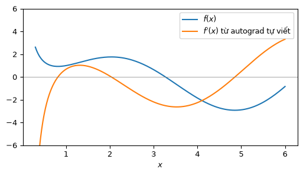

# Chương 2 · Code từ đầu

> Ghi chú của người biên soạn: trang này do người biên soạn viết thêm, không có trong sách gốc. Trang tự viết một bộ tính vi phân tự động (autograd) nhỏ bằng NumPy theo đúng ý tưởng của [mục 2.5](dl/ch02_s5_vi): ghi lại đồ thị tính toán khi tính xuôi, rồi đi ngược đồ thị và áp dụng quy tắc dây chuyền. Kết quả được so với `torch.autograd`.

## Cách dùng trang này

Các khối chạy lần lượt từ trên xuống và dùng chung biến. Cần `numpy`, `torch` (chỉ để đối chiếu) và `matplotlib`.

Ý tưởng cốt lõi: mỗi phép toán vừa tính kết quả, vừa nhớ **các đầu vào** và **cách chuyển gradient** từ đầu ra về đầu vào. Gọi $\bar{v} = \partial L / \partial v$ là gradient của hàm mất mát $L$ theo một nút $v$ trong đồ thị (còn gọi là *adjoint*). Nếu $z = f(x, y)$ thì quy tắc dây chuyền cho

$$
\bar{x} \mathrel{+}= \bar{z}\, \frac{\partial z}{\partial x}, \qquad \bar{y} \mathrel{+}= \bar{z}\, \frac{\partial z}{\partial y}.
$$

Dấu $\mathrel{+}=$ là vì một nút có thể được dùng ở nhiều chỗ: gradient từ mọi nơi dùng nó được cộng dồn. Đây cũng là lý do PyTorch *cộng dồn* vào `x.grad` thay vì ghi đè ([mục 2.5.1](dl/ch02_s5_vi)).

## 1. Lớp `Tensor` có ghi đồ thị

<small class="viz-ref">Mục 2.5.1</small>

<!-- run -->
```python
import numpy as np
import torch
import matplotlib.pyplot as plt

def unbroadcast(g, shape):
    """Cơ chế lan truyền (mục 2.1.4) sao chép giá trị theo các trục; khi đi ngược phải cộng gộp lại."""
    while g.ndim > len(shape):
        g = g.sum(0)
    for ax, n in enumerate(shape):
        if n == 1 and g.shape[ax] != 1:
            g = g.sum(ax, keepdims=True)
    return g

class Tensor:
    def __init__(self, data, parents=(), requires_grad=False):
        self.data = np.asarray(data, dtype=float)
        self.parents = parents            # các cặp (nút cha, hàm chuyển gradient)
        self.requires_grad = requires_grad or any(p.requires_grad for p, _ in parents)
        self.grad = None

    # --- các phép toán: mỗi phép trả về Tensor mới cùng hàm chuyển gradient cho từng đầu vào ---
    def __add__(self, o):
        o = o if isinstance(o, Tensor) else Tensor(o)
        return Tensor(self.data + o.data, ((self, lambda g: unbroadcast(g, self.data.shape)),
                                           (o, lambda g: unbroadcast(g, o.data.shape))))
    def __mul__(self, o):
        o = o if isinstance(o, Tensor) else Tensor(o)
        return Tensor(self.data * o.data, ((self, lambda g: unbroadcast(g * o.data, self.data.shape)),
                                           (o, lambda g: unbroadcast(g * self.data, o.data.shape))))
    def __neg__(self): return self * -1.0
    def __sub__(self, o): return self + (-o if isinstance(o, Tensor) else Tensor(-np.asarray(o, float)))
    def __truediv__(self, o): return self * (o ** -1.0 if isinstance(o, Tensor) else Tensor(1.0 / np.asarray(o, float)))
    __radd__, __rmul__ = __add__, __mul__
    def __pow__(self, k):
        return Tensor(self.data ** k, ((self, lambda g: g * k * self.data ** (k - 1)),))
    def __matmul__(self, o):
        return Tensor(self.data @ o.data, ((self, lambda g: g @ o.data.T), (o, lambda g: self.data.T @ g)))
    def sum(self, axis=None, keepdims=False):
        def back(g):
            if axis is not None and not keepdims:
                g = np.expand_dims(g, axis)
            return np.broadcast_to(g, self.data.shape)
        return Tensor(self.data.sum(axis=axis, keepdims=keepdims), ((self, back),))
    def exp(self):
        out = np.exp(self.data)
        return Tensor(out, ((self, lambda g: g * out),))
    def log(self):
        return Tensor(np.log(self.data), ((self, lambda g: g / self.data),))
    def sin(self):
        return Tensor(np.sin(self.data), ((self, lambda g: g * np.cos(self.data)),))
    def relu(self):
        return Tensor(np.maximum(self.data, 0), ((self, lambda g: g * (self.data > 0)),))
    def detach(self):
        return Tensor(self.data)          # cùng giá trị, không có cha: gradient không chảy qua

    # --- lan truyền ngược ---
    def backward(self, gradient=None):
        if gradient is None:
            assert self.data.size == 1, "chỉ gọi backward() không đối số cho số vô hướng (mục 2.5.2)"
            gradient = np.ones_like(self.data)
        # sắp xếp topo: một nút chỉ được xử lý sau mọi nút dùng nó
        order, seen = [], set()
        def visit(v):
            if id(v) in seen:
                return
            seen.add(id(v))
            for p, _ in v.parents:
                visit(p)
            order.append(v)
        visit(self)
        adj = {id(self): gradient}
        for v in reversed(order):
            g = adj.pop(id(v), None)
            if g is None:
                continue
            if not v.parents and v.requires_grad:          # lá cần gradient: cộng dồn vào .grad
                v.grad = g if v.grad is None else v.grad + g
            for p, f in v.parents:
                if p.requires_grad:
                    adj[id(p)] = adj.get(id(p), 0) + f(g)

    def __repr__(self):
        return f"Tensor({np.round(self.data, 4).tolist()})"
```

Thử lại ví dụ đầu tiên của [mục 2.5.1](dl/ch02_s5_vi): $y = 2\mathbf{x}^\top\mathbf{x}$ có gradient $4\mathbf{x}$. Phép nhân vô hướng $\mathbf{x}^\top\mathbf{x}$ viết bằng `(x * x).sum()`:

<!-- run -->
```python
x = Tensor(np.arange(4.0), requires_grad=True)
y = 2 * (x * x).sum()
y.backward()
print("y =", y.data, "  x.grad =", x.grad, "  4x =", 4 * x.data)

# Gọi thêm một lần với hàm khác mà không đặt lại: gradient được cộng dồn, giống PyTorch
(x.sum()).backward()
print("sau khi cộng dồn gradient của x.sum():", x.grad)
```

<!-- output -->
```output
y = 28.0   x.grad = [ 0.  4.  8. 12.]   4x = [ 0.  4.  8. 12.]
sau khi cộng dồn gradient của x.sum(): [ 1.  5.  9. 13.]
```
<!-- /output -->

## 2. Đối chiếu với `torch.autograd`

<small class="viz-ref">Mục 2.5.2–2.5.4</small>

Ba ví dụ còn lại của mục 2.5: lan truyền ngược cho biến không phải số vô hướng (truyền `gradient`), tách phép tính bằng `detach`, và luồng điều khiển Python. Mỗi ví dụ chạy cả bản tự viết lẫn PyTorch:

<!-- run -->
```python
def both(fn, x0):
    xm = Tensor(x0, requires_grad=True)
    xt = torch.tensor(x0, dtype=torch.float64, requires_grad=True)
    fn(xm, mine=True); fn(xt, mine=False)
    return xm.grad, xt.grad.numpy()

def nonscalar(x, mine):                       # mục 2.5.2: y = x * x, backward với gradient = 1
    y = x * x
    y.backward(np.ones(4) if mine else torch.ones(4, dtype=torch.float64))

def detached(x, mine):                        # mục 2.5.3: z = u * x với u = (x * x) tách khỏi đồ thị
    u = (x * x).detach()
    (u * x).sum().backward()

def control_flow(a, mine):                    # mục 2.5.4: số vòng lặp phụ thuộc vào giá trị đầu vào
    norm = lambda t: float(np.sqrt((t.data ** 2).sum())) if mine else t.norm()
    b = a * 2
    while norm(b) < 1000:
        b = b * 2
    c = b if (float(b.sum().data) if mine else b.sum().item()) > 0 else b * 100
    c.sum().backward()

x0 = np.arange(4.0)
for name, fn, inp in [("2.5.2 không vô hướng", nonscalar, x0), ("2.5.3 detach", detached, x0),
                      ("2.5.4 luồng điều khiển", control_flow, np.array([0.37, -1.2]))]:
    g_mine, g_torch = both(fn, inp)
    print(f"{name:24s} tự viết {np.round(g_mine, 3)}   torch {np.round(g_torch, 3)}")
```

<!-- output -->
```output
2.5.2 không vô hướng     tự viết [0. 2. 4. 6.]   torch [0. 2. 4. 6.]
2.5.3 detach             tự viết [0. 1. 4. 9.]   torch [0. 1. 4. 9.]
2.5.4 luồng điều khiển   tự viết [102400. 102400.]   torch [102400. 102400.]
```
<!-- /output -->

Ở ví dụ `detach`, gradient bằng $u = x^2$ (chứ không phải $3x^2$), đúng như sách giải thích: gradient không chảy qua `u`.

## 3. Một MLP nhỏ và hàm mất mát entropy chéo

Bộ autograd tự viết đủ để tính gradient của một mạng thật. Một MLP hai tầng với softmax và entropy chéo, so với PyTorch trên cùng dữ liệu và trọng số:

<!-- run -->
```python
rng = np.random.default_rng(0)
X = rng.normal(size=(8, 5)); y = rng.integers(0, 3, size=8)
W1, b1 = rng.normal(size=(5, 16)) * 0.5, np.zeros((1, 16))
W2, b2 = rng.normal(size=(16, 3)) * 0.5, np.zeros((1, 3))
onehot = np.eye(3)[y]

def loss_mine(params):
    W1_, b1_, W2_, b2_ = params
    Z = (Tensor(X) @ W1_ + b1_).relu() @ W2_ + b2_
    Z = Z - Tensor(Z.data.max(1, keepdims=True))                  # ổn định số, hằng số với gradient
    log_p = Z - Z.exp().sum(axis=1, keepdims=True).log()
    return -(log_p * Tensor(onehot)).sum() / len(y)

P = [Tensor(w, requires_grad=True) for w in (W1, b1, W2, b2)]
L = loss_mine(P); L.backward()

T = [torch.tensor(w, requires_grad=True) for w in (W1, b1, W2, b2)]
Zt = torch.relu(torch.tensor(X) @ T[0] + T[1]) @ T[2] + T[3]
Lt = torch.nn.functional.cross_entropy(Zt, torch.tensor(y)); Lt.backward()
print(f"mất mát: tự viết {L.data:.6f}, torch {Lt.item():.6f}")
for name, p, t in zip(["W1", "b1", "W2", "b2"], P, T):
    print(f"  {name}: sai khác gradient lớn nhất {np.abs(p.grad - t.grad.numpy()).max():.1e}")
```

<!-- output -->
```output
mất mát: tự viết 1.209574, torch 1.209574
  W1: sai khác gradient lớn nhất 3.1e-17
  b1: sai khác gradient lớn nhất 2.8e-17
  W2: sai khác gradient lớn nhất 4.5e-17
  b2: sai khác gradient lớn nhất 5.6e-17
```
<!-- /output -->

## 4. Vi phân xuôi và vi phân ngược

<small class="viz-ref">Mục 2.5 · bài tập 5–8</small>

Bài tập 5–8 của mục 2.5 hỏi về hàm $f(x) = (\log x^2) \cdot \sin x + x^{-1}$ và hai cách lần theo đồ thị. Vi phân **ngược** là cách bộ autograd ở trên làm: một lần tính xuôi, một lần đi ngược, được gradient theo **mọi** đầu vào. Vi phân **xuôi** mang đạo hàm đi cùng giá trị từ đầu vào ra đầu ra, dùng *số đối ngẫu* (dual number) $a + b\varepsilon$ với $\varepsilon^2 = 0$: phần $b$ chính là đạo hàm.

<!-- run -->
```python
class Dual:
    """Số đối ngẫu: val là giá trị, der là đạo hàm theo đầu vào đang xét."""
    def __init__(self, val, der=0.0): self.val, self.der = val, der
    def __add__(self, o): o = o if isinstance(o, Dual) else Dual(o); return Dual(self.val + o.val, self.der + o.der)
    def __mul__(self, o): o = o if isinstance(o, Dual) else Dual(o); return Dual(self.val * o.val, self.der * o.val + self.val * o.der)
    __radd__, __rmul__ = __add__, __mul__
    def __pow__(self, k): return Dual(self.val ** k, k * self.val ** (k - 1) * self.der)

def dlog(d): return Dual(np.log(d.val), d.der / d.val)
def dsin(d): return Dual(np.sin(d.val), np.cos(d.val) * d.der)

x0 = 1.7
fwd = dlog(Dual(x0, 1.0) ** 2) * dsin(Dual(x0, 1.0)) + Dual(x0, 1.0) ** -1   # vi phân xuôi
xr = Tensor(x0, requires_grad=True)
((xr ** 2).log() * xr.sin() + xr ** -1).backward()                           # vi phân ngược
exact = 2 / x0 * np.sin(x0) + np.log(x0 ** 2) * np.cos(x0) - x0 ** -2        # đạo hàm tính tay
print(f"f'({x0}): xuôi {fwd.der:.10f}, ngược {float(xr.grad):.10f}, giải tích {exact:.10f}")

xs = np.linspace(0.3, 6, 200)
grads = []
for v in xs:
    t = Tensor(v, requires_grad=True); ((t ** 2).log() * t.sin() + t ** -1).backward(); grads.append(float(t.grad))
f = np.log(xs ** 2) * np.sin(xs) + 1 / xs
plt.figure(figsize=(6, 3))
plt.plot(xs, f, label="$f(x)$"); plt.plot(xs, grads, label="$f'(x)$ từ autograd tự viết")
plt.axhline(0, color='gray', lw=0.5); plt.ylim(-6, 6); plt.legend(); plt.xlabel('$x$')
```

<!-- output -->
```output
f'(1.7): xuôi 0.6839066643, ngược 0.6839066643, giải tích 0.6839066643
```

<div align=center></div>
<!-- /output -->

Với một đầu vào và một đầu ra, hai cách cho cùng kết quả và cùng chi phí. Khác biệt xuất hiện khi số đầu vào và đầu ra chênh nhau: vi phân xuôi cần **một lần chạy cho mỗi đầu vào**, vi phân ngược cần **một lần chạy cho mỗi đầu ra**. Một mạng neuron có hàng triệu tham số (đầu vào của phép lấy đạo hàm) nhưng chỉ một hàm mất mát vô hướng (đầu ra), nên học sâu dùng vi phân ngược. Cái giá là phải lưu lại các giá trị trung gian của lần tính xuôi để dùng khi đi ngược (trong code trên là các biến được các hàm `lambda` giữ lại), nên vi phân ngược tốn bộ nhớ hơn (bài tập 8).

## Tóm tắt

- Autograd chỉ gồm hai phần: mỗi phép toán nhớ đầu vào và đạo hàm cục bộ của nó; `backward` sắp xếp topo đồ thị rồi nhân dồn các đạo hàm cục bộ theo quy tắc dây chuyền, cộng dồn ở những nút được dùng nhiều lần.
- Cơ chế lan truyền ở chiều xuôi trở thành phép cộng gộp ở chiều ngược.
- `detach` chỉ là tạo một nút mới không có cha.
- Học sâu dùng vi phân ngược vì có rất nhiều tham số nhưng chỉ một giá trị mất mát.
