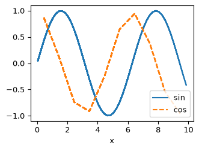

# 3.2 Thiết kế Hướng đối tượng cho việc Cài đặt

> Ghi chú của người biên soạn: trang này dịch nguyên văn từ sách *Dive into Deep Learning* của **Aston Zhang, Zachary C. Lipton, Mu Li và Alexander J. Smola** ([bản gốc](https://d2l.ai/chapter_linear-regression/oo-design.html), [mã nguồn](https://github.com/d2l-ai/d2l-en), giấy phép [CC BY-SA 4.0](https://creativecommons.org/licenses/by-sa/4.0/); code theo giấy phép MIT-0). Chỉ giữ code PyTorch. Số mục, hình và công thức giữ như bản HTML d2l.ai; thuật ngữ đối chiếu với bản dịch [Đắm mình vào Học Sâu](https://github.com/aivivn/d2l-vn).

Trong phần giới thiệu về hồi quy tuyến tính, ta đã đi qua nhiều thành phần khác nhau, gồm dữ liệu, mô hình, hàm mất mát và thuật toán tối ưu. Thật vậy, hồi quy tuyến tính là một trong những mô hình học máy đơn giản nhất. Tuy nhiên, việc huấn luyện nó dùng nhiều thành phần giống với những gì các mô hình khác trong cuốn sách này cần. Vì vậy, trước khi đi sâu vào chi tiết cài đặt, đáng để thiết kế một số API mà ta sẽ dùng xuyên suốt. Coi các thành phần trong học sâu là các đối tượng, ta có thể bắt đầu bằng việc định nghĩa các lớp cho những đối tượng này và tương tác giữa chúng. Thiết kế hướng đối tượng cho việc cài đặt này sẽ giúp trình bày gọn gàng hơn rất nhiều, và có thể bạn còn muốn dùng nó trong các dự án của mình.

Lấy cảm hứng từ các thư viện mã nguồn mở như [PyTorch Lightning](https://www.pytorchlightning.ai/), ở mức tổng quát ta muốn có ba lớp: (i) `Module` chứa mô hình, hàm mất mát và phương pháp tối ưu; (ii) `DataModule` cung cấp các bộ nạp dữ liệu cho huấn luyện và xác thực; (iii) cả hai lớp được kết hợp bằng lớp `Trainer`, cho phép ta huấn luyện mô hình trên nhiều nền tảng phần cứng khác nhau. Phần lớn code trong cuốn sách này điều chỉnh `Module` và `DataModule`. Ta sẽ chỉ đề cập đến lớp `Trainer` khi thảo luận về GPU, CPU, huấn luyện song song và các thuật toán tối ưu.

<!-- run -->
```python
import time
import numpy as np
from d2l import torch as d2l
import torch
from torch import nn
```

## 3.2.1 Các Tiện ích

Ta cần một vài tiện ích để đơn giản hóa việc lập trình hướng đối tượng trong Jupyter notebook. Một trong những thách thức là định nghĩa lớp thường là những khối code khá dài. Khả năng đọc của notebook đòi hỏi các đoạn code ngắn, xen kẽ với lời giải thích, một yêu cầu không tương thích với phong cách lập trình phổ biến trong các thư viện Python. Hàm tiện ích đầu tiên cho phép ta đăng ký các hàm làm phương thức của một lớp *sau khi* lớp đã được tạo. Thực ra, ta có thể làm vậy *ngay cả sau khi* đã tạo các thực thể của lớp! Nó cho phép ta chia việc cài đặt một lớp thành nhiều khối code.

<!-- run -->
```python
def add_to_class(Class):  #@save
    """Đăng ký các hàm làm phương thức của một lớp đã được tạo."""
    def wrapper(obj):
        setattr(Class, obj.__name__, obj)
    return wrapper
```

Hãy xem nhanh cách dùng nó. Ta định cài đặt một lớp `A` với một phương thức `do`. Thay vì viết code cho cả `A` và `do` trong cùng một khối code, trước tiên ta có thể khai báo lớp `A` và tạo một thực thể `a`.

<!-- run -->
```python
class A:
    def __init__(self):
        self.b = 1

a = A()
```

Tiếp theo, ta định nghĩa phương thức `do` như bình thường, nhưng không nằm trong phạm vi của lớp `A`. Thay vào đó, ta trang trí (decorate) phương thức này bằng `add_to_class` với đối số là lớp `A`. Làm vậy, phương thức có thể truy cập các biến thành viên của `A` đúng như ta mong đợi nếu nó được đưa vào định nghĩa của `A`. Hãy xem điều gì xảy ra khi ta gọi nó với thực thể `a`.

<!-- run -->
```python
@add_to_class(A)
def do(self):
    print('Class attribute "b" is', self.b)

a.do()
```

<!-- output -->
```output
Class attribute "b" is 1
```
<!-- /output -->

Tiện ích thứ hai là một lớp tiện ích lưu mọi đối số trong phương thức `__init__` của một lớp thành thuộc tính của lớp. Điều này cho phép ta mở rộng chữ ký lời gọi hàm khởi tạo một cách ngầm định mà không cần code bổ sung.

<!-- run -->
```python
class HyperParameters:  #@save
    """Lớp cơ sở của các siêu tham số."""
    def save_hyperparameters(self, ignore=[]):
        raise NotImplemented
```

Ta để phần cài đặt của nó đến [Mục B.7](https://d2l.ai/chapter_appendix-tools-for-deep-learning/utils.html). Để dùng nó, ta định nghĩa lớp của mình kế thừa từ `HyperParameters` và gọi `save_hyperparameters` trong phương thức `__init__`.

<!-- run -->
```python
# Gọi lớp HyperParameters đã được cài đặt đầy đủ và lưu trong d2l
class B(d2l.HyperParameters):
    def __init__(self, a, b, c):
        self.save_hyperparameters(ignore=['c'])
        print('self.a =', self.a, 'self.b =', self.b)
        print('There is no self.c =', not hasattr(self, 'c'))

b = B(a=1, b=2, c=3)
```

<!-- output -->
```output
self.a = 1 self.b = 2
There is no self.c = True
```
<!-- /output -->

Tiện ích cuối cùng cho phép ta vẽ tiến trình thí nghiệm một cách tương tác trong khi nó đang diễn ra. Để tỏ lòng kính trọng với [TensorBoard](https://www.tensorflow.org/tensorboard) mạnh mẽ (và phức tạp) hơn nhiều, ta đặt tên nó là `ProgressBoard`. Phần cài đặt được để đến [Mục B.7](https://d2l.ai/chapter_appendix-tools-for-deep-learning/utils.html). Tạm thời, hãy chỉ xem nó hoạt động.

Phương thức `draw` vẽ một điểm `(x, y)` lên hình, với `label` được chỉ định trong chú giải. Tham số tùy chọn `every_n` làm mượt đường bằng cách chỉ hiển thị $1/n$ số điểm trên hình. Giá trị của chúng được lấy trung bình từ $n$ điểm lân cận trong hình gốc.

<!-- run -->
```python
class ProgressBoard(d2l.HyperParameters):  #@save
    """Bảng vẽ các điểm dữ liệu dưới dạng hoạt hình."""
    def __init__(self, xlabel=None, ylabel=None, xlim=None,
                 ylim=None, xscale='linear', yscale='linear',
                 ls=['-', '--', '-.', ':'], colors=['C0', 'C1', 'C2', 'C3'],
                 fig=None, axes=None, figsize=(3.5, 2.5), display=True):
        self.save_hyperparameters()

    def draw(self, x, y, label, every_n=1):
        raise NotImplemented
```

Trong ví dụ sau, ta vẽ `sin` và `cos` với độ mượt khác nhau. Nếu chạy khối code này, bạn sẽ thấy các đường lớn dần dưới dạng hoạt hình.

<!-- run -->
```python
board = d2l.ProgressBoard('x')
for x in np.arange(0, 10, 0.1):
    board.draw(x, np.sin(x), 'sin', every_n=2)
    board.draw(x, np.cos(x), 'cos', every_n=10)
```

<!-- output -->
<div align=center></div>
<!-- /output -->

## 3.2.2 Mô hình

Lớp `Module` là lớp cơ sở của mọi mô hình mà ta sẽ cài đặt. Tối thiểu ta cần ba phương thức. Phương thức thứ nhất, `__init__`, lưu các tham số có thể học; phương thức `training_step` nhận một batch dữ liệu và trả về giá trị mất mát; và cuối cùng, `configure_optimizers` trả về phương pháp tối ưu, hoặc một danh sách các phương pháp, dùng để cập nhật các tham số có thể học. Ta có thể tùy chọn định nghĩa `validation_step` để báo cáo các thước đo đánh giá. Đôi khi ta đặt code tính đầu ra vào một phương thức `forward` riêng để dễ tái sử dụng hơn.

<!-- run -->
```python
class Module(d2l.nn_Module, d2l.HyperParameters):  #@save
    """Lớp cơ sở của các mô hình."""
    def __init__(self, plot_train_per_epoch=2, plot_valid_per_epoch=1):
        super().__init__()
        self.save_hyperparameters()
        self.board = ProgressBoard()

    def loss(self, y_hat, y):
        raise NotImplementedError

    def forward(self, X):
        assert hasattr(self, 'net'), 'Neural network is defined'
        return self.net(X)

    def plot(self, key, value, train):
        """Vẽ một điểm dưới dạng hoạt hình."""
        assert hasattr(self, 'trainer'), 'Trainer is not inited'
        self.board.xlabel = 'epoch'
        if train:
            x = self.trainer.train_batch_idx / \
                self.trainer.num_train_batches
            n = self.trainer.num_train_batches / \
                self.plot_train_per_epoch
        else:
            x = self.trainer.epoch + 1
            n = self.trainer.num_val_batches / \
                self.plot_valid_per_epoch
        self.board.draw(x, d2l.numpy(d2l.to(value, d2l.cpu())),
                        ('train_' if train else 'val_') + key,
                        every_n=int(n))

    def training_step(self, batch):
        l = self.loss(self(*batch[:-1]), batch[-1])
        self.plot('loss', l, train=True)
        return l

    def validation_step(self, batch):
        l = self.loss(self(*batch[:-1]), batch[-1])
        self.plot('loss', l, train=False)

    def configure_optimizers(self):
        raise NotImplementedError
```

Có thể bạn để ý rằng `Module` là một lớp con của `nn.Module`, lớp cơ sở của các mạng neuron trong PyTorch. Nó cung cấp các tính năng tiện lợi để xử lý mạng neuron. Chẳng hạn, nếu ta định nghĩa một phương thức `forward`, như `forward(self, X)`, thì với một thực thể `a`, ta có thể gọi phương thức này bằng `a(X)`. Điều này hoạt động vì phương thức `__call__` có sẵn gọi đến phương thức `forward`. Bạn có thể tìm thêm chi tiết và ví dụ về `nn.Module` trong [Mục 6.1](dl/ch06_s1_vi).

## 3.2.3 Dữ liệu

Lớp `DataModule` là lớp cơ sở cho dữ liệu. Khá thường xuyên, phương thức `__init__` được dùng để chuẩn bị dữ liệu. Việc này gồm tải về và tiền xử lý nếu cần. Phương thức `train_dataloader` trả về bộ nạp dữ liệu cho tập huấn luyện. Bộ nạp dữ liệu là một generator (của Python) trả ra một batch dữ liệu mỗi lần được dùng. Batch này sau đó được đưa vào phương thức `training_step` của `Module` để tính mất mát. Có một phương thức tùy chọn `val_dataloader` trả về bộ nạp cho tập xác thực. Nó hoạt động theo cùng cách, chỉ khác là nó trả ra các batch dữ liệu cho phương thức `validation_step` của `Module`.

<!-- run -->
```python
class DataModule(d2l.HyperParameters):  #@save
    """Lớp cơ sở của dữ liệu."""
    def __init__(self, root='../data', num_workers=4):
        self.save_hyperparameters()

    def get_dataloader(self, train):
        raise NotImplementedError

    def train_dataloader(self):
        return self.get_dataloader(train=True)

    def val_dataloader(self):
        return self.get_dataloader(train=False)
```

## 3.2.4 Huấn luyện

Lớp `Trainer` huấn luyện các tham số có thể học trong lớp `Module` với dữ liệu được chỉ định trong `DataModule`. Phương thức then chốt là `fit`, nhận hai đối số: `model`, một thực thể của `Module`, và `data`, một thực thể của `DataModule`. Sau đó nó duyệt qua toàn bộ tập dữ liệu `max_epochs` lần để huấn luyện mô hình. Như trước, ta sẽ để phần cài đặt phương thức này đến các chương sau.

<!-- run -->
```python
class Trainer(d2l.HyperParameters):  #@save
    """Lớp cơ sở để huấn luyện mô hình với dữ liệu."""
    def __init__(self, max_epochs, num_gpus=0, gradient_clip_val=0):
        self.save_hyperparameters()
        assert num_gpus == 0, 'No GPU support yet'

    def prepare_data(self, data):
        self.train_dataloader = data.train_dataloader()
        self.val_dataloader = data.val_dataloader()
        self.num_train_batches = len(self.train_dataloader)
        self.num_val_batches = (len(self.val_dataloader)
                                if self.val_dataloader is not None else 0)

    def prepare_model(self, model):
        model.trainer = self
        model.board.xlim = [0, self.max_epochs]
        self.model = model

    def fit(self, model, data):
        self.prepare_data(data)
        self.prepare_model(model)
        self.optim = model.configure_optimizers()
        self.epoch = 0
        self.train_batch_idx = 0
        self.val_batch_idx = 0
        for self.epoch in range(self.max_epochs):
            self.fit_epoch()

    def fit_epoch(self):
        raise NotImplementedError
```

## 3.2.5 Tóm tắt

Để làm nổi bật thiết kế hướng đối tượng cho các cài đặt học sâu sau này, các lớp ở trên chỉ đơn giản cho thấy cách các đối tượng của chúng lưu trữ dữ liệu và tương tác với nhau. Ta sẽ tiếp tục làm phong phú thêm phần cài đặt của các lớp này, chẳng hạn qua `@add_to_class`, trong phần còn lại của cuốn sách. Hơn nữa, các lớp đã được cài đặt đầy đủ này được lưu trong [thư viện D2L](https://github.com/d2l-ai/d2l-en/tree/master/d2l), một *bộ công cụ gọn nhẹ* giúp việc mô hình hóa có cấu trúc cho học sâu trở nên dễ dàng. Cụ thể, nó giúp tái sử dụng nhiều thành phần giữa các dự án mà hầu như không phải thay đổi gì. Chẳng hạn, ta có thể chỉ thay bộ tối ưu, chỉ thay mô hình, chỉ thay tập dữ liệu, v.v.; mức độ mô-đun hóa này mang lại lợi ích xuyên suốt cuốn sách về sự súc tích và đơn giản (đó là lý do chúng tôi thêm nó) và nó cũng có thể làm được điều tương tự cho các dự án của riêng bạn.

## 3.2.6 Bài tập

1. Tìm phần cài đặt đầy đủ của các lớp trên được lưu trong [thư viện D2L](https://github.com/d2l-ai/d2l-en/tree/master/d2l). Chúng tôi đặc biệt khuyến khích bạn xem kỹ phần cài đặt khi đã quen thuộc hơn với việc mô hình hóa học sâu.
1. Bỏ câu lệnh `save_hyperparameters` trong lớp `B`. Bạn có còn in được `self.a` và `self.b` không? Tùy chọn: nếu bạn đã tìm hiểu phần cài đặt đầy đủ của lớp `HyperParameters`, bạn có giải thích được vì sao không?

[Thảo luận (tiếng Anh)](https://discuss.d2l.ai/t/6646)
