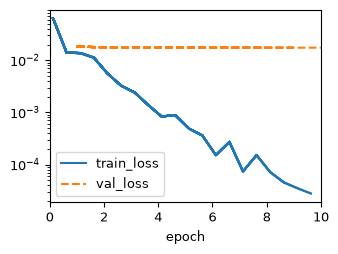
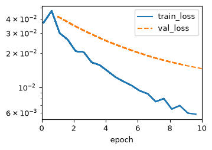
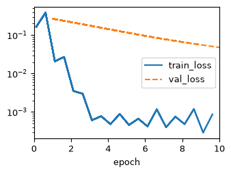

# 3.7 Suy giảm Trọng số

> Ghi chú của người biên soạn: trang này dịch nguyên văn từ sách *Dive into Deep Learning* của **Aston Zhang, Zachary C. Lipton, Mu Li và Alexander J. Smola** ([bản gốc](https://d2l.ai/chapter_linear-regression/weight-decay.html), [mã nguồn](https://github.com/d2l-ai/d2l-en), giấy phép [CC BY-SA 4.0](https://creativecommons.org/licenses/by-sa/4.0/); code theo giấy phép MIT-0). Chỉ giữ code PyTorch. Số mục, hình và công thức giữ như bản HTML d2l.ai; thuật ngữ đối chiếu với bản dịch [Đắm mình vào Học Sâu](https://github.com/aivivn/d2l-vn).
>
> **Đính chính** *(người biên soạn)*:
>
> - Mục 3.7.4: sách nói đồ thị của bản súc tích "trông tương tự" bản cài đặt từ đầu, nhưng chuẩn $\ell_2$ in ra ở cuối lớn gần gấp 10 lần (khoảng 0.015 so với 0.0016 khi chạy trên trang này). Nguyên nhân không nằm ở suy giảm trọng số mà ở cách khởi tạo: `d2l.LinearRegression` dùng `nn.LazyLinear` rồi gọi `self.net.weight.data.normal_(0, 0.01)` **trước khi** tham số được tạo. Lệnh này không có tác dụng; khi tham số được tạo trễ ở lần chạy xuôi đầu tiên, PyTorch khởi tạo theo mặc định (độ lệch chuẩn khoảng 0.043 với 200 đầu vào). Bản súc tích vì vậy bắt đầu từ $\|\mathbf{w}\|^2/2 \approx 0.18$ thay vì $0.01$, và sau 40 bước cập nhật với hệ số co $(1 - 0.01 \times 3)$ mỗi bước thì còn khoảng $0.18 \times 0.97^{80} \approx 0.015$, khớp với kết quả chạy. Muốn so sánh công bằng, hãy khởi tạo lại trọng số **sau** lần chạy xuôi đầu tiên (chẳng hạn bằng `apply_init` của mục 6.4).
> - Hai phiên bản còn khác nhau ở hàm mất mát: bản từ đầu dùng $\frac{1}{2}(\hat y - y)^2$, còn `nn.MSELoss` của bản súc tích không có hệ số $\frac{1}{2}$.

Giờ khi đã mô tả được vấn đề quá khớp, ta có thể giới thiệu kỹ thuật *điều chuẩn* đầu tiên. Hãy nhớ lại rằng ta luôn có thể giảm thiểu quá khớp bằng cách thu thập thêm dữ liệu huấn luyện. Tuy nhiên, việc đó có thể tốn kém, mất thời gian, hoặc hoàn toàn nằm ngoài tầm kiểm soát của ta, khiến nó không thể thực hiện trong ngắn hạn. Tạm thời, ta có thể giả định rằng đã có nhiều dữ liệu chất lượng cao nhất mà nguồn lực cho phép và tập trung vào những công cụ có sẵn khi tập dữ liệu là cố định.

Hãy nhớ lại rằng trong ví dụ hồi quy đa thức ([Mục 3.6.2.1](dl/ch03_s6_vi)), ta có thể giới hạn năng lực của mô hình bằng cách điều chỉnh bậc của đa thức được khớp. Thật vậy, giới hạn số lượng đặc trưng là một kỹ thuật phổ biến để giảm thiểu quá khớp. Tuy nhiên, chỉ đơn giản vứt bỏ các đặc trưng có thể là một công cụ quá thô. Tiếp tục với ví dụ hồi quy đa thức, hãy xét điều gì có thể xảy ra với đầu vào nhiều chiều. Sự mở rộng tự nhiên của đa thức cho dữ liệu nhiều biến được gọi là *đơn thức* (monomial), đơn giản là tích của các lũy thừa của các biến. Bậc của một đơn thức là tổng các số mũ. Chẳng hạn, $x_1^2 x_2$ và $x_3 x_5^2$ đều là đơn thức bậc 3.

Lưu ý rằng số lượng số hạng bậc $d$ tăng bùng nổ khi $d$ lớn dần. Với $k$ biến, số đơn thức bậc $d$ là ${k - 1 + d} \choose {k - 1}$. Ngay cả những thay đổi nhỏ về bậc, chẳng hạn từ $2$ lên $3$, cũng làm tăng mạnh độ phức tạp của mô hình. Do đó ta thường cần một công cụ tinh tế hơn để điều chỉnh độ phức tạp của hàm số.

<!-- run -->
```python
from d2l import torch as d2l
import torch
from torch import nn
```

## 3.7.1 Chuẩn và Suy giảm Trọng số

Thay vì trực tiếp thay đổi số lượng tham số, *suy giảm trọng số* (weight decay) hoạt động bằng cách giới hạn các giá trị mà tham số có thể nhận. Thường được gọi là điều chuẩn $\ell_2$ bên ngoài giới học sâu khi được tối ưu bằng hạ gradient ngẫu nhiên theo minibatch, suy giảm trọng số có lẽ là kỹ thuật được dùng rộng rãi nhất để điều chuẩn các mô hình học máy có tham số. Kỹ thuật này xuất phát từ trực giác cơ bản rằng trong mọi hàm $f$, hàm $f = 0$ (gán giá trị $0$ cho mọi đầu vào) theo một nghĩa nào đó là *đơn giản nhất*, và ta có thể đo độ phức tạp của một hàm bằng khoảng cách từ các tham số của nó đến không. Nhưng chính xác thì ta nên đo khoảng cách giữa một hàm và không như thế nào? Không có một câu trả lời đúng duy nhất. Thực ra, cả những nhánh toán học, gồm một phần của giải tích hàm và lý thuyết không gian Banach, được dành để giải quyết những vấn đề như vậy.

Một cách diễn giải đơn giản có thể là đo độ phức tạp của một hàm tuyến tính $f(\mathbf{x}) = \mathbf{w}^\top \mathbf{x}$ bằng một chuẩn nào đó của vector trọng số, chẳng hạn $\| \mathbf{w} \|^2$. Hãy nhớ lại rằng ta đã giới thiệu chuẩn $\ell_2$ và chuẩn $\ell_1$, là những trường hợp đặc biệt của chuẩn $\ell_p$ tổng quát hơn, trong [Mục 2.3.11](https://d2l.ai/chapter_preliminaries/linear-algebra.html). Phương pháp phổ biến nhất để đảm bảo vector trọng số nhỏ là thêm chuẩn của nó làm một số hạng phạt vào bài toán cực tiểu hóa mất mát. Do đó ta thay mục tiêu ban đầu, *cực tiểu hóa mất mát dự đoán trên các nhãn huấn luyện*, bằng mục tiêu mới, *cực tiểu hóa tổng của mất mát dự đoán và số hạng phạt*. Giờ, nếu vector trọng số trở nên quá lớn, thuật toán học có thể tập trung vào việc cực tiểu hóa chuẩn trọng số $\| \mathbf{w} \|^2$ thay vì cực tiểu hóa lỗi huấn luyện. Đó chính xác là điều ta muốn. Để minh họa bằng code, ta dùng lại ví dụ hồi quy tuyến tính trước đó từ [Mục 3.1](https://d2l.ai/chapter_linear-regression/linear-regression.html). Ở đó, mất mát được cho bởi

$$
L(\mathbf{w}, b) = \frac{1}{n}\sum_{i=1}^n \frac{1}{2}\left(\mathbf{w}^\top \mathbf{x}^{(i)} + b - y^{(i)}\right)^2.
$$

Hãy nhớ lại rằng $\mathbf{x}^{(i)}$ là các đặc trưng, $y^{(i)}$ là nhãn của mẫu dữ liệu thứ $i$, và $(\mathbf{w}, b)$ lần lượt là trọng số và hệ số điều chỉnh. Để phạt kích thước của vector trọng số, bằng cách nào đó ta phải thêm $\| \mathbf{w} \|^2$ vào hàm mất mát, nhưng mô hình nên cân bằng giữa mất mát tiêu chuẩn và số hạng phạt cộng thêm mới này như thế nào? Trong thực tế, ta mô tả sự đánh đổi này qua *hằng số điều chuẩn* (regularization constant) $\lambda$, một siêu tham số không âm mà ta khớp bằng dữ liệu xác thực:

$$
L(\mathbf{w}, b) + \frac{\lambda}{2} \|\mathbf{w}\|^2.
$$

Với $\lambda = 0$, ta thu lại hàm mất mát ban đầu. Với $\lambda > 0$, ta giới hạn kích thước của $\| \mathbf{w} \|$. Ta chia cho $2$ theo quy ước: khi lấy đạo hàm của một hàm bậc hai, $2$ và $1/2$ triệt tiêu nhau, giúp biểu thức cập nhật trông gọn gàng và đơn giản. Độc giả tinh ý có thể thắc mắc vì sao ta làm việc với bình phương của chuẩn chứ không phải chuẩn thông thường (tức khoảng cách Euclid). Ta làm vậy cho tiện tính toán. Bằng cách bình phương chuẩn $\ell_2$, ta loại bỏ căn bậc hai, chỉ còn lại tổng bình phương của từng thành phần của vector trọng số. Điều này giúp đạo hàm của số hạng phạt dễ tính: tổng các đạo hàm bằng đạo hàm của tổng.

Hơn nữa, bạn có thể hỏi vì sao ngay từ đầu ta lại làm việc với chuẩn $\ell_2$ mà không phải, chẳng hạn, chuẩn $\ell_1$. Thực ra, những lựa chọn khác cũng hợp lệ và phổ biến trong thống kê. Trong khi các mô hình tuyến tính điều chuẩn $\ell_2$ tạo nên thuật toán *hồi quy ridge* (ridge regression) kinh điển, hồi quy tuyến tính điều chuẩn $\ell_1$ là một phương pháp nền tảng tương tự trong thống kê, thường được biết đến với tên *hồi quy lasso* (lasso regression). Một lý do để làm việc với chuẩn $\ell_2$ là nó đặt mức phạt lớn bất thường lên những thành phần lớn của vector trọng số. Điều này khiến thuật toán học thiên về những mô hình phân bổ trọng số đồng đều trên nhiều đặc trưng hơn. Trong thực tế, điều này có thể khiến chúng bền vững hơn trước sai số đo lường ở một biến đơn lẻ. Ngược lại, mức phạt $\ell_1$ dẫn đến những mô hình tập trung trọng số vào một tập nhỏ các đặc trưng bằng cách đưa các trọng số khác về không. Điều này cho ta một phương pháp hiệu quả để *chọn đặc trưng* (feature selection), có thể đáng mong muốn vì những lý do khác. Chẳng hạn, nếu mô hình chỉ dựa vào vài đặc trưng, ta có thể không cần thu thập, lưu trữ hoặc truyền dữ liệu cho các đặc trưng khác (bị loại bỏ).

Dùng cùng ký hiệu như trong [(3.1.5)](https://d2l.ai/chapter_linear-regression/linear-regression.html), các cập nhật của hạ gradient ngẫu nhiên theo minibatch cho hồi quy điều chuẩn $\ell_2$ như sau:

$$
\begin{aligned}
\mathbf{w} & \leftarrow \left(1- \eta\lambda \right) \mathbf{w} - \frac{\eta}{|\mathcal{B}|} \sum_{i \in \mathcal{B}} \mathbf{x}^{(i)} \left(\mathbf{w}^\top \mathbf{x}^{(i)} + b - y^{(i)}\right).
\end{aligned}
$$

Như trước, ta cập nhật $\mathbf{w}$ dựa trên mức chênh lệch giữa ước lượng và giá trị quan sát. Tuy nhiên, ta cũng co kích thước của $\mathbf{w}$ về phía không. Đó là lý do phương pháp này đôi khi được gọi là "suy giảm trọng số": chỉ với số hạng phạt, thuật toán tối ưu của ta làm trọng số *suy giảm* ở mỗi bước huấn luyện. Khác với chọn đặc trưng, suy giảm trọng số cho ta một cơ chế để điều chỉnh liên tục độ phức tạp của một hàm. Giá trị $\lambda$ nhỏ hơn tương ứng với $\mathbf{w}$ ít bị ràng buộc hơn, trong khi giá trị $\lambda$ lớn hơn ràng buộc $\mathbf{w}$ đáng kể hơn. Việc có đưa vào mức phạt tương ứng cho hệ số điều chỉnh $b^2$ hay không có thể khác nhau giữa các cách cài đặt, và có thể khác nhau giữa các tầng của một mạng neuron. Thường thì ta không điều chuẩn hệ số điều chỉnh. Ngoài ra, dù điều chuẩn $\ell_2$ có thể không tương đương với suy giảm trọng số đối với các thuật toán tối ưu khác, ý tưởng điều chuẩn bằng cách co nhỏ kích thước trọng số vẫn đúng.

## 3.7.2 Hồi quy Tuyến tính Nhiều chiều

Ta có thể minh họa lợi ích của suy giảm trọng số qua một ví dụ tổng hợp đơn giản.

Trước tiên, ta sinh một số dữ liệu như trước:

$$
y = 0.05 + \sum_{i = 1}^d 0.01 x_i + \epsilon \textrm{ với }
\epsilon \sim \mathcal{N}(0, 0.01^2).
$$

Trong tập dữ liệu tổng hợp này, nhãn được cho bởi một hàm tuyến tính nền tảng của đầu vào, bị nhiễu bởi nhiễu Gauss có trung bình không và độ lệch chuẩn 0.01. Nhằm mục đích minh họa, ta có thể làm cho hiệu ứng quá khớp rõ rệt hơn bằng cách tăng số chiều của bài toán lên $d = 200$ và làm việc với một tập huấn luyện nhỏ chỉ gồm 20 mẫu.

<!-- run -->
```python
class Data(d2l.DataModule):
    def __init__(self, num_train, num_val, num_inputs, batch_size):
        self.save_hyperparameters()                
        n = num_train + num_val 
        self.X = d2l.randn(n, num_inputs)
        noise = d2l.randn(n, 1) * 0.01
        w, b = d2l.ones((num_inputs, 1)) * 0.01, 0.05
        self.y = d2l.matmul(self.X, w) + b + noise

    def get_dataloader(self, train):
        i = slice(0, self.num_train) if train else slice(self.num_train, None)
        return self.get_tensorloader([self.X, self.y], train, i)
```

## 3.7.3 Cài đặt từ Đầu

Giờ hãy thử cài đặt suy giảm trọng số từ đầu. Vì bộ tối ưu của ta là hạ gradient ngẫu nhiên theo minibatch, ta chỉ cần thêm số hạng phạt bình phương chuẩn $\ell_2$ vào hàm mất mát ban đầu.

### 3.7.3.1 Định nghĩa Số hạng Phạt Chuẩn $\ell_2$

Có lẽ cách tiện lợi nhất để cài đặt số hạng phạt này là bình phương tại chỗ mọi số hạng rồi lấy tổng.

<!-- run -->
```python
def l2_penalty(w):
    return d2l.reduce_sum(w**2) / 2
```

### 3.7.3.2 Định nghĩa Mô hình

Trong mô hình cuối cùng, hồi quy tuyến tính và mất mát bình phương không thay đổi so với [Mục 3.4](https://d2l.ai/chapter_linear-regression/linear-regression-scratch.html), nên ta chỉ cần định nghĩa một lớp con của `d2l.LinearRegressionScratch`. Thay đổi duy nhất ở đây là mất mát giờ có thêm số hạng phạt.

<!-- run -->
```python
class WeightDecayScratch(d2l.LinearRegressionScratch):
    def __init__(self, num_inputs, lambd, lr, sigma=0.01):
        super().__init__(num_inputs, lr, sigma)
        self.save_hyperparameters()
        
    def loss(self, y_hat, y):
        return (super().loss(y_hat, y) +
                self.lambd * l2_penalty(self.w))
```

Đoạn code sau khớp mô hình trên tập huấn luyện gồm 20 mẫu và đánh giá nó trên tập xác thực gồm 100 mẫu.

<!-- run -->
```python
data = Data(num_train=20, num_val=100, num_inputs=200, batch_size=5)
trainer = d2l.Trainer(max_epochs=10)

def train_scratch(lambd):    
    model = WeightDecayScratch(num_inputs=200, lambd=lambd, lr=0.01)
    model.board.yscale='log'
    trainer.fit(model, data)
    print('L2 norm of w:', float(l2_penalty(model.w)))
```

### 3.7.3.3 Huấn luyện không Điều chuẩn

Giờ ta chạy đoạn code này với `lambd = 0`, tắt suy giảm trọng số. Lưu ý rằng mô hình quá khớp nặng, lỗi huấn luyện giảm nhưng lỗi xác thực thì không, một trường hợp quá khớp điển hình như sách giáo khoa.

<!-- run -->
```python
train_scratch(0)
```

<!-- output -->
```output
L2 norm of w: 0.010722247883677483
```

<div align=center></div>
<!-- /output -->

### 3.7.3.4 Dùng Suy giảm Trọng số

Dưới đây, ta chạy với mức suy giảm trọng số đáng kể. Lưu ý rằng lỗi huấn luyện tăng nhưng lỗi xác thực giảm. Đây chính xác là hiệu ứng ta mong đợi từ điều chuẩn.

<!-- run -->
```python
train_scratch(3)
```

<!-- output -->
```output
L2 norm of w: 0.0015599661273881793
```

<div align=center></div>
<!-- /output -->

## 3.7.4 Cài đặt Súc tích

Vì suy giảm trọng số có mặt khắp nơi trong tối ưu mạng neuron, framework học sâu khiến nó đặc biệt tiện dụng, tích hợp suy giảm trọng số vào chính thuật toán tối ưu để dễ dùng kết hợp với bất kỳ hàm mất mát nào. Hơn nữa, sự tích hợp này mang lại lợi ích tính toán, cho phép dùng các thủ thuật cài đặt để thêm suy giảm trọng số vào thuật toán mà không tốn thêm chi phí tính toán nào. Vì phần suy giảm trọng số của bước cập nhật chỉ phụ thuộc vào giá trị hiện tại của mỗi tham số, bộ tối ưu dù sao cũng phải chạm đến mỗi tham số một lần.

Dưới đây, ta chỉ định siêu tham số suy giảm trọng số trực tiếp qua `weight_decay` khi khởi tạo bộ tối ưu. Theo mặc định, PyTorch làm suy giảm đồng thời cả trọng số lẫn hệ số điều chỉnh, nhưng ta có thể cấu hình bộ tối ưu để xử lý các tham số khác nhau theo những chính sách khác nhau. Ở đây, ta chỉ đặt `weight_decay` cho trọng số (tham số `net.weight`), do đó hệ số điều chỉnh (tham số `net.bias`) sẽ không bị suy giảm.

<!-- run -->
```python
class WeightDecay(d2l.LinearRegression):
    def __init__(self, wd, lr):
        super().__init__(lr)
        self.save_hyperparameters()
        self.wd = wd

    def configure_optimizers(self):
        return torch.optim.SGD([
            {'params': self.net.weight, 'weight_decay': self.wd},
            {'params': self.net.bias}], lr=self.lr)
```

Đồ thị trông tương tự như khi ta cài đặt suy giảm trọng số từ đầu. Tuy nhiên, phiên bản này chạy nhanh hơn và dễ cài đặt hơn, những lợi ích sẽ trở nên rõ rệt hơn khi bạn giải quyết những bài toán lớn hơn và công việc này trở nên thường xuyên hơn.

<!-- run -->
```python
model = WeightDecay(wd=3, lr=0.01)
model.board.yscale='log'
trainer.fit(model, data)

print('L2 norm of w:', float(l2_penalty(model.get_w_b()[0])))
```

<!-- output -->
```output
L2 norm of w: 0.014661216177046299
```

<div align=center></div>
<!-- /output -->

Cho đến nay, ta mới chạm đến một khái niệm về thế nào là một hàm tuyến tính đơn giản. Tuy nhiên, ngay cả với những hàm phi tuyến đơn giản, tình huống có thể phức tạp hơn nhiều. Để thấy điều này, khái niệm [không gian Hilbert với kernel tái sinh (RKHS)](https://en.wikipedia.org/wiki/Reproducing_kernel_Hilbert_space) cho phép áp dụng những công cụ được giới thiệu cho hàm tuyến tính vào bối cảnh phi tuyến. Đáng tiếc là các thuật toán dựa trên RKHS thường mở rộng kém với dữ liệu lớn, nhiều chiều. Trong cuốn sách này, ta sẽ thường áp dụng một quy tắc kinh nghiệm phổ biến là áp dụng suy giảm trọng số cho mọi tầng của một mạng sâu.

## 3.7.5 Tóm tắt

Điều chuẩn là một phương pháp phổ biến để xử lý quá khớp. Các kỹ thuật điều chuẩn cổ điển thêm một số hạng phạt vào hàm mất mát (khi huấn luyện) để giảm độ phức tạp của mô hình học được. Một lựa chọn cụ thể để giữ mô hình đơn giản là dùng số hạng phạt $\ell_2$. Điều này dẫn đến suy giảm trọng số trong các bước cập nhật của thuật toán hạ gradient ngẫu nhiên theo minibatch. Trong thực tế, chức năng suy giảm trọng số được cung cấp sẵn trong các bộ tối ưu của framework học sâu. Các tập tham số khác nhau có thể có hành vi cập nhật khác nhau trong cùng một vòng lặp huấn luyện.

## 3.7.6 Bài tập

1. Thử nghiệm với giá trị $\lambda$ trong bài toán ước lượng của mục này. Vẽ độ chính xác huấn luyện và xác thực theo $\lambda$. Bạn quan sát thấy gì?
1. Dùng một tập xác thực để tìm giá trị tối ưu của $\lambda$. Nó có thực sự là giá trị tối ưu không? Điều này có quan trọng không?
1. Các phương trình cập nhật sẽ trông như thế nào nếu thay vì $\|\mathbf{w}\|^2$ ta dùng $\sum_i |w_i|$ làm số hạng phạt (điều chuẩn $\ell_1$)?
1. Ta biết rằng $\|\mathbf{w}\|^2 = \mathbf{w}^\top \mathbf{w}$. Bạn có thể tìm một đẳng thức tương tự cho ma trận không (xem chuẩn Frobenius trong [Mục 2.3.11](https://d2l.ai/chapter_preliminaries/linear-algebra.html))?
1. Xem lại mối quan hệ giữa lỗi huấn luyện và lỗi tổng quát hóa. Ngoài suy giảm trọng số, tăng cường huấn luyện và dùng mô hình có độ phức tạp phù hợp, còn những cách nào khác có thể giúp ta xử lý quá khớp?
1. Trong thống kê Bayes, ta dùng tích của tiên nghiệm và hàm hợp lý để đi đến hậu nghiệm qua $P(w \mid x) \propto P(x \mid w) P(w)$. Bạn có thể đồng nhất $P(w)$ với điều chuẩn như thế nào?

[Thảo luận (tiếng Anh)](https://discuss.d2l.ai/t/99)
