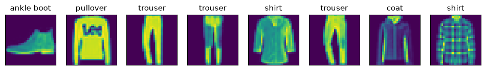

# 4.2 Tập dữ liệu Phân loại Ảnh

> Ghi chú của người biên soạn: trang này dịch nguyên văn từ sách *Dive into Deep Learning* của **Aston Zhang, Zachary C. Lipton, Mu Li và Alexander J. Smola** ([bản gốc](https://d2l.ai/chapter_linear-classification/image-classification-dataset.html), [mã nguồn](https://github.com/d2l-ai/d2l-en), giấy phép [CC BY-SA 4.0](https://creativecommons.org/licenses/by-sa/4.0/); code theo giấy phép MIT-0). Chỉ giữ code PyTorch. Số mục, hình và công thức giữ như bản HTML d2l.ai; thuật ngữ đối chiếu với bản dịch [Đắm mình vào Học Sâu](https://github.com/aivivn/d2l-vn).

Một tập dữ liệu được dùng rộng rãi cho phân loại ảnh là [tập dữ liệu MNIST](https://en.wikipedia.org/wiki/MNIST_database) ([LeCun *et al.*, 1998](dl/ch04_s2_vi?id=ref-lecun-bottou-bengio-ea-1998)) gồm các chữ số viết tay. Vào thời điểm ra mắt những năm 1990, nó đặt ra một thách thức đáng gờm cho hầu hết các thuật toán học máy, gồm 60 000 ảnh có độ phân giải $28 \times 28$ điểm ảnh (cùng một tập kiểm tra 10 000 ảnh). Để dễ hình dung, vào năm 1995, một máy Sun SPARCStation 5 với RAM "khủng" 64MB và tốc độ "chóng mặt" 5 MFLOPs được coi là thiết bị hiện đại nhất cho học máy tại AT&T Bell Laboratories. Đạt độ chính xác cao trong nhận dạng chữ số là một thành phần then chốt để tự động hóa việc phân loại thư cho Bưu điện Hoa Kỳ (USPS) vào những năm 1990. Các mạng sâu như LeNet-5 ([LeCun *et al.*, 1995](dl/ch04_s2_vi?id=ref-lecun-jackel-bottou-ea-1995)), máy vector hỗ trợ có tính bất biến ([Sch\"olkopf *et al.*, 1996](dl/ch04_s2_vi?id=ref-scholkopf-burges-vapnik-1996)) và các bộ phân loại khoảng cách tiếp tuyến ([Simard *et al.*, 1998](dl/ch04_s2_vi?id=ref-simard-lecun-denker-ea-1998)) đều có thể đạt tỉ lệ lỗi dưới 1%.

Trong hơn một thập kỷ, MNIST là *điểm* tham chiếu để so sánh các thuật toán học máy. Dù đã có một thời gian dài làm tập dữ liệu đánh giá chuẩn, ngay cả những mô hình đơn giản theo tiêu chuẩn ngày nay cũng đạt độ chính xác phân loại trên 95%, khiến nó không còn phù hợp để phân biệt mô hình mạnh với mô hình yếu hơn. Hơn nữa, tập dữ liệu này cho phép đạt độ chính xác *rất* cao, điều thường không thấy trong nhiều bài toán phân loại. Điều này đã khiến việc phát triển thuật toán lệch về những họ thuật toán cụ thể có thể tận dụng tập dữ liệu sạch, như các phương pháp tập hoạt động (active set) và các thuật toán tập hoạt động tìm biên. Ngày nay, MNIST giống một phép kiểm tra nhanh tính đúng đắn hơn là một tập đánh giá chuẩn. ImageNet ([Deng *et al.*, 2009](dl/ch04_s2_vi?id=ref-deng-dong-socher-ea-2009)) đặt ra một thách thức phù hợp hơn nhiều. Đáng tiếc là ImageNet quá lớn cho nhiều ví dụ và minh họa trong cuốn sách này, vì sẽ mất quá lâu để huấn luyện, không thể làm cho các ví dụ mang tính tương tác. Thay vào đó, trong các mục tiếp theo ta sẽ tập trung thảo luận trên tập dữ liệu Fashion-MNIST ([Xiao *et al.*, 2017](dl/ch04_s2_vi?id=ref-xiao-rasul-vollgraf-2017)), tương tự về bản chất nhưng nhỏ hơn nhiều, được công bố năm 2017. Nó chứa ảnh của 10 loại quần áo ở độ phân giải $28 \times 28$ điểm ảnh.

<!-- run -->
```python
import time
from d2l import torch as d2l
import torch
import torchvision
from torchvision import transforms

d2l.use_svg_display()
```

## 4.2.1 Nạp Tập dữ liệu

Vì tập dữ liệu Fashion-MNIST rất hữu ích, mọi framework lớn đều cung cấp các phiên bản đã tiền xử lý của nó. Ta có thể tải về và đọc nó vào bộ nhớ bằng các tiện ích có sẵn của framework.

<!-- run -->
```python
class FashionMNIST(d2l.DataModule):  #@save
    """Tập dữ liệu Fashion-MNIST."""
    def __init__(self, batch_size=64, resize=(28, 28)):
        super().__init__()
        self.save_hyperparameters()
        trans = transforms.Compose([transforms.Resize(resize),
                                    transforms.ToTensor()])
        self.train = torchvision.datasets.FashionMNIST(
            root=self.root, train=True, transform=trans, download=True)
        self.val = torchvision.datasets.FashionMNIST(
            root=self.root, train=False, transform=trans, download=True)
```

Fashion-MNIST gồm ảnh thuộc 10 loại, mỗi loại có 6000 ảnh trong tập huấn luyện và 1000 ảnh trong tập kiểm tra. Một *tập kiểm tra* được dùng để đánh giá hiệu năng mô hình (không được dùng để huấn luyện). Do đó tập huấn luyện và tập kiểm tra lần lượt chứa 60 000 và 10 000 ảnh.

<!-- run -->
```python
data = FashionMNIST(resize=(32, 32))
len(data.train), len(data.val)
```

<!-- output -->
```output
(60000, 10000)
```
<!-- /output -->

Các ảnh là ảnh xám và đã được phóng lên độ phân giải $32 \times 32$ điểm ảnh ở trên. Điều này tương tự tập dữ liệu MNIST gốc, vốn gồm các ảnh đen trắng (nhị phân). Tuy nhiên, lưu ý rằng hầu hết dữ liệu ảnh hiện đại có ba kênh (đỏ, lục, lam) và các ảnh siêu phổ có thể có hơn 100 kênh (cảm biến HyMap có 126 kênh). Theo quy ước, ta lưu một ảnh dưới dạng tensor $c \times h \times w$, trong đó $c$ là số kênh màu, $h$ là chiều cao và $w$ là chiều rộng.

<!-- run -->
```python
data.train[0][0].shape
```

<!-- output -->
```output
torch.Size([1, 32, 32])
```
<!-- /output -->

Các loại trong Fashion-MNIST có tên mà con người hiểu được. Phương thức tiện lợi sau chuyển đổi giữa nhãn số và tên của chúng.

<!-- run -->
```python
@d2l.add_to_class(FashionMNIST)  #@save
def text_labels(self, indices):
    """Trả về nhãn dạng chữ."""
    labels = ['t-shirt', 'trouser', 'pullover', 'dress', 'coat',
              'sandal', 'shirt', 'sneaker', 'bag', 'ankle boot']
    return [labels[int(i)] for i in indices]
```

## 4.2.2 Đọc một Minibatch

Để việc đọc từ tập huấn luyện và tập kiểm tra dễ dàng hơn, ta dùng bộ duyệt dữ liệu có sẵn thay vì tự viết từ đầu. Hãy nhớ lại rằng ở mỗi vòng lặp, một bộ duyệt dữ liệu đọc một minibatch dữ liệu có kích thước `batch_size`. Ta cũng xáo trộn ngẫu nhiên các mẫu cho bộ duyệt dữ liệu huấn luyện.

<!-- run -->
```python
@d2l.add_to_class(FashionMNIST)  #@save
def get_dataloader(self, train):
    data = self.train if train else self.val
    return torch.utils.data.DataLoader(data, self.batch_size, shuffle=train,
                                       num_workers=self.num_workers)
```

Để xem cách hoạt động, hãy nạp một minibatch ảnh bằng cách gọi phương thức `train_dataloader`. Nó chứa 64 ảnh.

<!-- run -->
```python
X, y = next(iter(data.train_dataloader()))
print(X.shape, X.dtype, y.shape, y.dtype)
```

<!-- output -->
```output
torch.Size([64, 1, 32, 32]) torch.float32 torch.Size([64]) torch.int64
```
<!-- /output -->

Hãy xem thời gian cần để đọc các ảnh. Dù là bộ nạp có sẵn, nó không nhanh như chớp. Dù vậy, như thế là đủ vì xử lý ảnh bằng một mạng sâu tốn thời gian hơn khá nhiều. Do đó nó đủ tốt để việc huấn luyện mạng không bị giới hạn bởi tốc độ vào/ra dữ liệu.

<!-- run -->
```python
tic = time.time()
for X, y in data.train_dataloader():
    continue
f'{time.time() - tic:.2f} sec'
```

<!-- output -->
```output
'1.70 sec'
```
<!-- /output -->

## 4.2.3 Trực quan hóa

Ta sẽ thường xuyên dùng tập dữ liệu Fashion-MNIST. Một hàm tiện lợi `show_images` có thể được dùng để trực quan hóa các ảnh và nhãn tương ứng. Bỏ qua chi tiết cài đặt, dưới đây ta chỉ trình bày giao diện: với những hàm tiện ích như vậy, ta chỉ cần biết cách gọi `d2l.show_images` chứ không cần biết nó hoạt động thế nào.

<!-- run -->
```python
def show_images(imgs, num_rows, num_cols, titles=None, scale=1.5):  #@save
    """Vẽ một danh sách ảnh."""
    raise NotImplementedError
```

Hãy dùng nó một cách hữu ích. Nói chung, trực quan hóa và kiểm tra dữ liệu mà bạn đang huấn luyện là một ý hay. Con người rất giỏi phát hiện những điều bất thường và vì thế, trực quan hóa đóng vai trò như một lớp bảo vệ bổ sung chống lại sai lầm và lỗi trong thiết kế thí nghiệm. Đây là các ảnh và nhãn tương ứng (dạng chữ) của vài mẫu đầu tiên trong tập dữ liệu huấn luyện.

<!-- run -->
```python
@d2l.add_to_class(FashionMNIST)  #@save
def visualize(self, batch, nrows=1, ncols=8, labels=[]):
    X, y = batch
    if not labels:
        labels = self.text_labels(y)
    d2l.show_images(X.squeeze(1), nrows, ncols, titles=labels)

batch = next(iter(data.val_dataloader()))
data.visualize(batch)
```

<!-- output -->
<div align=center></div>
<!-- /output -->

Giờ ta đã sẵn sàng làm việc với tập dữ liệu Fashion-MNIST trong các mục tiếp theo.

## 4.2.4 Tóm tắt

Giờ ta đã có một tập dữ liệu thực tế hơn một chút để dùng cho phân loại. Fashion-MNIST là một tập dữ liệu phân loại trang phục gồm các ảnh thuộc 10 loại. Ta sẽ dùng tập dữ liệu này trong các mục và chương tiếp theo để đánh giá nhiều thiết kế mạng khác nhau, từ một mô hình tuyến tính đơn giản đến các mạng phần dư tiên tiến. Như thường làm với ảnh, ta đọc chúng dưới dạng tensor có kích thước (kích thước batch, số kênh, chiều cao, chiều rộng). Hiện tại, ta chỉ có một kênh vì các ảnh là ảnh xám (phần trực quan hóa ở trên dùng một bảng màu giả để dễ nhìn hơn).

Cuối cùng, các bộ duyệt dữ liệu là một thành phần then chốt để đạt hiệu năng cao. Chẳng hạn, ta có thể dùng GPU để giải nén ảnh, chuyển mã video hoặc các bước tiền xử lý khác một cách hiệu quả. Bất cứ khi nào có thể, bạn nên dựa vào những bộ duyệt dữ liệu được cài đặt tốt, khai thác tính toán hiệu năng cao để tránh làm chậm vòng lặp huấn luyện.

## 4.2.5 Bài tập

1. Giảm `batch_size` (chẳng hạn xuống 1) có ảnh hưởng đến hiệu năng đọc dữ liệu không?
1. Hiệu năng của bộ duyệt dữ liệu là quan trọng. Bạn có nghĩ cách cài đặt hiện tại đủ nhanh không? Hãy khám phá các lựa chọn khác nhau để cải thiện nó. Dùng một công cụ phân tích hiệu năng hệ thống (profiler) để tìm ra các điểm nghẽn.
1. Xem tài liệu API trực tuyến của framework. Còn những tập dữ liệu nào khác có sẵn?

[Thảo luận (tiếng Anh)](https://discuss.d2l.ai/t/49)

## Tài liệu tham khảo

- <a id="ref-lecun-bottou-bengio-ea-1998"></a>LeCun, Yann, Bottou, L\'eon, Bengio, Yoshua, ... (1998). *Gradient-based learning applied to document recognition*. Proceedings of the IEEE.
- <a id="ref-lecun-jackel-bottou-ea-1995"></a>LeCun, Yann, Jackel, LD, Bottou, Leon, ... (1995). *Comparison of learning algorithms for handwritten digit recognition*. International Conference on Artificial Neural Networks.
- <a id="ref-scholkopf-burges-vapnik-1996"></a>Sch\"olkopf, Bernhard, Burges, Chris, Vapnik, Vladimir (1996). *Incorporating invariances in support vector learning machines*. International Conference on Artificial Neural Networks.
- <a id="ref-simard-lecun-denker-ea-1998"></a>Simard, Patrice Y, LeCun, Yann A, Denker, John S, ... (1998). *Transformation invariance in pattern recognition -- tangent distance and tangent propagation*. Neural Networks: Tricks of the Trade.
- <a id="ref-deng-dong-socher-ea-2009"></a>Deng, Jia, Dong, Wei, Socher, Richard, ... (2009). *Imagenet: A large-scale hierarchical image database*. 2009 IEEE Conference on Computer Vision and Pattern Recognition.
- <a id="ref-xiao-rasul-vollgraf-2017"></a>Xiao, Han, Rasul, Kashif, Vollgraf, Roland (2017). *Fashion-MNIST: a novel image dataset for benchmarking machine learning algorithms*. ArXiv:1708.07747.
