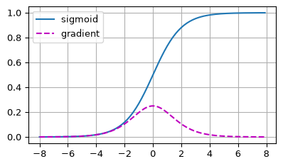

# 5.4 Ổn định Số và Khởi tạo

> Ghi chú của người biên soạn: trang này dịch nguyên văn từ sách *Dive into Deep Learning* của **Aston Zhang, Zachary C. Lipton, Mu Li và Alexander J. Smola** ([bản gốc](https://d2l.ai/chapter_multilayer-perceptrons/numerical-stability-and-init.html), [mã nguồn](https://github.com/d2l-ai/d2l-en), giấy phép [CC BY-SA 4.0](https://creativecommons.org/licenses/by-sa/4.0/); code theo giấy phép MIT-0). Chỉ giữ code PyTorch. Số mục, hình và công thức giữ như bản HTML d2l.ai; thuật ngữ đối chiếu với bản dịch [Đắm mình vào Học Sâu](https://github.com/aivivn/d2l-vn).

Cho đến nay, mọi mô hình mà ta cài đặt đều đòi hỏi khởi tạo tham số theo một phân phối định trước nào đó. Đến giờ, ta vẫn coi sơ đồ khởi tạo là điều hiển nhiên, lướt qua chi tiết về cách đưa ra những lựa chọn này. Có thể bạn thậm chí có ấn tượng rằng những lựa chọn này không quan trọng lắm. Ngược lại, việc chọn sơ đồ khởi tạo đóng vai trò đáng kể trong việc học của mạng neuron, và có thể then chốt để duy trì ổn định số. Hơn nữa, những lựa chọn này có thể gắn với việc chọn hàm kích hoạt phi tuyến theo những cách thú vị. Hàm nào ta chọn và cách ta khởi tạo tham số có thể quyết định thuật toán tối ưu hội tụ nhanh đến đâu. Những lựa chọn kém ở đây có thể khiến ta gặp phải hiện tượng bùng nổ hoặc tiêu biến gradient trong khi huấn luyện. Trong mục này, ta đi sâu hơn vào những chủ đề này và thảo luận một số phương pháp kinh nghiệm hữu ích mà bạn sẽ thấy có ích suốt sự nghiệp học sâu.

<!-- run -->
```python
from d2l import torch as d2l
import torch
```

## 5.4.1 Tiêu biến và Bùng nổ Gradient

Hãy xét một mạng sâu có $L$ tầng, đầu vào $\mathbf{x}$ và đầu ra $\mathbf{o}$. Với mỗi tầng $l$ được định nghĩa bởi một phép biến đổi $f_l$ tham số hóa bởi trọng số $\mathbf{W}^{(l)}$, có đầu ra tầng ẩn là $\mathbf{h}^{(l)}$ (đặt $\mathbf{h}^{(0)} = \mathbf{x}$), mạng của ta có thể được biểu diễn như sau:

$$
\mathbf{h}^{(l)} = f_l (\mathbf{h}^{(l-1)}) \textrm{ và do đó } \mathbf{o} = f_L \circ \cdots \circ f_1(\mathbf{x}).
$$

Nếu mọi đầu ra tầng ẩn và đầu vào đều là vector, ta có thể viết gradient của $\mathbf{o}$ theo bất kỳ tập tham số $\mathbf{W}^{(l)}$ nào như sau:

$$
\partial_{\mathbf{W}^{(l)}} \mathbf{o} = \underbrace{\partial_{\mathbf{h}^{(L-1)}} \mathbf{h}^{(L)}}_{ \mathbf{M}^{(L)} \stackrel{\textrm{def}}{=}} \cdots \underbrace{\partial_{\mathbf{h}^{(l)}} \mathbf{h}^{(l+1)}}_{ \mathbf{M}^{(l+1)} \stackrel{\textrm{def}}{=}} \underbrace{\partial_{\mathbf{W}^{(l)}} \mathbf{h}^{(l)}}_{ \mathbf{v}^{(l)} \stackrel{\textrm{def}}{=}}.
$$

Nói cách khác, gradient này là tích của $L-l$ ma trận $\mathbf{M}^{(L)} \cdots \mathbf{M}^{(l+1)}$ và vector gradient $\mathbf{v}^{(l)}$. Do đó ta dễ gặp phải cùng những vấn đề tràn số dưới (underflow) thường xảy ra khi nhân quá nhiều xác suất với nhau. Khi làm việc với xác suất, một thủ thuật phổ biến là chuyển sang không gian log, tức là chuyển áp lực từ phần định trị sang phần số mũ của biểu diễn số. Đáng tiếc là vấn đề ở trên nghiêm trọng hơn: ban đầu các ma trận $\mathbf{M}^{(l)}$ có thể có những trị riêng rất đa dạng. Chúng có thể nhỏ hoặc lớn, và tích của chúng có thể *rất lớn* hoặc *rất nhỏ*.

Những rủi ro do gradient không ổn định gây ra vượt ra ngoài vấn đề biểu diễn số. Gradient có độ lớn khó lường cũng đe dọa sự ổn định của các thuật toán tối ưu. Ta có thể đối mặt với các lần cập nhật tham số hoặc (i) quá lớn, phá hủy mô hình (vấn đề *bùng nổ gradient* – exploding gradient); hoặc (ii) quá nhỏ (vấn đề *tiêu biến gradient* – vanishing gradient), khiến việc học không thể diễn ra vì tham số hầu như không nhúc nhích ở mỗi lần cập nhật.

### 5.4.1.1 Tiêu biến Gradient

Một thủ phạm thường gặp gây ra vấn đề tiêu biến gradient là việc chọn hàm kích hoạt $\sigma$ được thêm vào sau các phép toán tuyến tính của mỗi tầng. Trong lịch sử, hàm sigmoid $1/(1 + \exp(-x))$ (đã giới thiệu trong [Mục 5.1](https://d2l.ai/chapter_multilayer-perceptrons/mlp.html)) từng phổ biến vì nó giống một hàm ngưỡng. Vì các mạng neuron nhân tạo thời kỳ đầu lấy cảm hứng từ mạng neuron sinh học, ý tưởng về các neuron hoặc phát xung *hoàn toàn* hoặc *không phát gì cả* (giống neuron sinh học) có vẻ hấp dẫn. Hãy xem kỹ hơn hàm sigmoid để thấy vì sao nó có thể gây ra tiêu biến gradient.

<!-- run -->
```python
x = torch.arange(-8.0, 8.0, 0.1, requires_grad=True)
y = torch.sigmoid(x)
y.backward(torch.ones_like(x))

d2l.plot(x.detach().numpy(), [y.detach().numpy(), x.grad.numpy()],
         legend=['sigmoid', 'gradient'], figsize=(4.5, 2.5))
```

<!-- output -->
<div align=center></div>
<!-- /output -->

Như bạn có thể thấy, gradient của sigmoid tiêu biến cả khi đầu vào của nó lớn lẫn khi đầu vào nhỏ. Hơn nữa, khi lan truyền ngược qua nhiều tầng, trừ khi ta ở trong vùng "vừa vặn", nơi đầu vào của nhiều hàm sigmoid gần bằng không, gradient của toàn bộ tích có thể tiêu biến. Khi mạng có nhiều tầng, nếu không cẩn thận, gradient nhiều khả năng sẽ bị cắt đứt ở một tầng nào đó. Thật vậy, vấn đề này từng đeo bám việc huấn luyện mạng sâu. Do đó, ReLU, vốn ổn định hơn (nhưng kém hợp lý về mặt thần kinh học hơn), đã trở thành lựa chọn mặc định của những người làm thực tế.

### 5.4.1.2 Bùng nổ Gradient

Vấn đề ngược lại, khi gradient bùng nổ, cũng có thể gây khó chịu tương tự. Để minh họa điều này rõ hơn một chút, ta lấy 100 ma trận ngẫu nhiên Gauss và nhân chúng với một ma trận ban đầu nào đó. Với thang đo mà ta chọn (chọn phương sai $\sigma^2=1$), tích ma trận bùng nổ. Khi điều này xảy ra do cách khởi tạo một mạng sâu, ta không có cơ hội nào để bộ tối ưu hạ gradient hội tụ.

<!-- run -->
```python
M = torch.normal(0, 1, size=(4, 4))
print('a single matrix \n',M)
for i in range(100):
    M = M @ torch.normal(0, 1, size=(4, 4))
print('after multiplying 100 matrices\n', M)
```

<!-- output -->
```output
a single matrix 
 tensor([[-0.9958, -0.6912,  1.1696,  0.2067],
        [-0.4972, -2.0427, -1.0798, -0.9263],
        [ 1.3286,  2.3151, -0.7959, -0.1947],
        [-0.8445,  0.3815, -0.3424, -0.4339]])
after multiplying 100 matrices
 tensor([[-4.3904e+24,  1.9494e+24,  2.2408e+24,  2.2230e+24],
        [-1.6621e+24,  7.3797e+23,  8.4831e+23,  8.4156e+23],
        [ 7.3215e+24, -3.2508e+24, -3.7368e+24, -3.7071e+24],
        [ 1.0076e+24, -4.4739e+23, -5.1428e+23, -5.1019e+23]])
```
<!-- /output -->

### 5.4.1.3 Phá vỡ Tính Đối xứng

Một vấn đề khác trong thiết kế mạng neuron là tính đối xứng vốn có trong cách tham số hóa của chúng. Giả sử ta có một MLP đơn giản với một tầng ẩn và hai nút. Trong trường hợp này, ta có thể hoán vị các trọng số $\mathbf{W}^{(1)}$ của tầng thứ nhất và cũng hoán vị tương ứng các trọng số của tầng đầu ra để thu được cùng một hàm. Không có gì đặc biệt phân biệt nút ẩn thứ nhất với nút ẩn thứ hai. Nói cách khác, ta có tính đối xứng hoán vị giữa các nút ẩn của mỗi tầng.

Đây không chỉ là một phiền toái về mặt lý thuyết. Hãy xét MLP một tầng ẩn với hai nút ẩn đã nói ở trên. Để minh họa, giả sử tầng đầu ra biến đổi hai nút ẩn thành chỉ một nút đầu ra. Hãy tưởng tượng điều gì sẽ xảy ra nếu ta khởi tạo mọi tham số của tầng ẩn là $\mathbf{W}^{(1)} = c$ với một hằng số $c$ nào đó. Trong trường hợp này, trong lan truyền xuôi, cả hai nút ẩn nhận cùng đầu vào và tham số, tạo ra cùng một giá trị kích hoạt được đưa vào nút đầu ra. Trong lan truyền ngược, lấy đạo hàm của nút đầu ra theo các tham số $\mathbf{W}^{(1)}$ cho một gradient mà mọi phần tử đều có cùng giá trị. Do đó, sau các vòng lặp dựa trên gradient (chẳng hạn hạ gradient ngẫu nhiên theo minibatch), mọi phần tử của $\mathbf{W}^{(1)}$ vẫn có cùng giá trị. Những vòng lặp như vậy sẽ không bao giờ tự *phá vỡ tính đối xứng* và ta có thể không bao giờ khai thác được khả năng biểu diễn của mạng. Tầng ẩn sẽ hoạt động như thể nó chỉ có một nút duy nhất. Lưu ý rằng dù hạ gradient ngẫu nhiên theo minibatch không phá vỡ được tính đối xứng này, điều chuẩn dropout (sẽ được giới thiệu sau) thì có thể!

## 5.4.2 Khởi tạo Tham số

Một cách để giải quyết, hoặc ít nhất là giảm thiểu, những vấn đề nêu trên là khởi tạo một cách cẩn thận. Như ta sẽ thấy sau này, sự cẩn trọng bổ sung trong quá trình tối ưu và điều chuẩn phù hợp có thể tăng cường thêm tính ổn định.

### 5.4.2.1 Khởi tạo Mặc định

Trong các mục trước, chẳng hạn trong [Mục 3.5](https://d2l.ai/chapter_linear-regression/linear-regression-concise.html), ta đã dùng phân phối chuẩn để khởi tạo giá trị của các trọng số. Nếu ta không chỉ định phương thức khởi tạo, framework sẽ dùng một phương thức khởi tạo ngẫu nhiên mặc định, thường hoạt động tốt trong thực tế với các bài toán có kích thước vừa phải.

### 5.4.2.2 Khởi tạo Xavier

Hãy xem phân phối thang đo của một đầu ra $o_{i}$ của một tầng kết nối đầy đủ nào đó *không có hàm phi tuyến*. Với $n_\textrm{in}$ đầu vào $x_j$ và các trọng số tương ứng $w_{ij}$ của tầng này, một đầu ra được cho bởi

$$
o_{i} = \sum_{j=1}^{n_\textrm{in}} w_{ij} x_j.
$$

Các trọng số $w_{ij}$ đều được lấy độc lập từ cùng một phân phối. Hơn nữa, giả sử phân phối này có trung bình không và phương sai $\sigma^2$. Lưu ý rằng điều này không có nghĩa phân phối phải là phân phối Gauss, chỉ cần trung bình và phương sai tồn tại. Tạm thời, hãy giả sử rằng các đầu vào $x_j$ của tầng cũng có trung bình không và phương sai $\gamma^2$, và chúng độc lập với $w_{ij}$ cũng như độc lập với nhau. Trong trường hợp này, ta có thể tính trung bình của $o_i$:

$$
\begin{aligned}
    E[o_i] & = \sum_{j=1}^{n_\textrm{in}} E[w_{ij} x_j] \\&= \sum_{j=1}^{n_\textrm{in}} E[w_{ij}] E[x_j] \\&= 0, \end{aligned}
$$

và phương sai:

$$
\begin{aligned}
    \textrm{Var}[o_i] & = E[o_i^2] - (E[o_i])^2 \\
        & = \sum_{j=1}^{n_\textrm{in}} E[w^2_{ij} x^2_j] - 0 \\
        & = \sum_{j=1}^{n_\textrm{in}} E[w^2_{ij}] E[x^2_j] \\
        & = n_\textrm{in} \sigma^2 \gamma^2.
\end{aligned}
$$

Một cách để giữ phương sai cố định là đặt $n_\textrm{in} \sigma^2 = 1$. Giờ hãy xét lan truyền ngược. Ở đó ta đối mặt với một vấn đề tương tự, dù với gradient được lan truyền từ các tầng gần đầu ra hơn. Dùng cùng lập luận như cho lan truyền xuôi, ta thấy phương sai của gradient có thể bùng nổ trừ khi $n_\textrm{out} \sigma^2 = 1$, trong đó $n_\textrm{out}$ là số đầu ra của tầng này. Điều này đặt ta vào thế khó: ta không thể nào thỏa mãn đồng thời cả hai điều kiện. Thay vào đó, ta chỉ đơn giản cố gắng thỏa mãn:

$$
\begin{aligned}
\frac{1}{2} (n_\textrm{in} + n_\textrm{out}) \sigma^2 = 1 \textrm{ hay tương đương }
\sigma = \sqrt{\frac{2}{n_\textrm{in} + n_\textrm{out}}}.
\end{aligned}
$$

Đây là lập luận làm nền tảng cho *khởi tạo Xavier* (Xavier initialization), giờ đã trở thành tiêu chuẩn và có lợi trong thực tế, được đặt theo tên tác giả thứ nhất trong số những người tạo ra nó ([Glorot và Bengio, 2010](dl/ch05_s4_vi?id=ref-glorot-bengio-2010)). Thông thường, khởi tạo Xavier lấy mẫu trọng số từ một phân phối Gauss có trung bình không và phương sai $\sigma^2 = \frac{2}{n_\textrm{in} + n_\textrm{out}}$. Ta cũng có thể điều chỉnh điều này để chọn phương sai khi lấy mẫu trọng số từ phân phối đều. Lưu ý rằng phân phối đều $U(-a, a)$ có phương sai $\frac{a^2}{3}$. Thay $\frac{a^2}{3}$ vào điều kiện của ta về $\sigma^2$ dẫn đến việc khởi tạo theo

$$
U\left(-\sqrt{\frac{6}{n_\textrm{in} + n_\textrm{out}}}, \sqrt{\frac{6}{n_\textrm{in} + n_\textrm{out}}}\right).
$$

Dù giả định không có hàm phi tuyến trong lập luận toán học ở trên có thể dễ dàng bị vi phạm trong mạng neuron, phương pháp khởi tạo Xavier hóa ra hoạt động tốt trong thực tế.

### 5.4.2.3 Xa hơn nữa

Lập luận ở trên mới chỉ chạm đến bề mặt của các cách tiếp cận hiện đại trong khởi tạo tham số. Một framework học sâu thường cài đặt hơn một tá phương pháp kinh nghiệm khác nhau. Hơn nữa, khởi tạo tham số tiếp tục là một lĩnh vực nghiên cứu cơ bản sôi nổi trong học sâu. Trong số đó có những phương pháp kinh nghiệm chuyên biệt cho tham số ràng buộc (dùng chung), siêu phân giải, mô hình chuỗi và những tình huống khác. Chẳng hạn, [Xiao *et al.* (2018)](dl/ch05_s4_vi?id=ref-xiao-bahri-sohl-dickstein-ea-2018) đã chứng minh khả năng huấn luyện mạng neuron 10 000 tầng mà không cần thủ thuật kiến trúc nào, bằng cách dùng một phương pháp khởi tạo được thiết kế cẩn thận.

Nếu chủ đề này làm bạn hứng thú, chúng tôi gợi ý tìm hiểu sâu những gì mô-đun này cung cấp, đọc các bài báo đã đề xuất và phân tích từng phương pháp kinh nghiệm, rồi khám phá những công bố mới nhất về chủ đề này. Biết đâu bạn sẽ tình cờ gặp, hoặc thậm chí phát minh ra, một ý tưởng thông minh và đóng góp một cài đặt cho các framework học sâu.

## 5.4.3 Tóm tắt

Tiêu biến và bùng nổ gradient là những vấn đề thường gặp trong mạng sâu. Cần hết sức cẩn thận khi khởi tạo tham số để đảm bảo gradient và tham số được kiểm soát tốt. Các phương pháp khởi tạo kinh nghiệm là cần thiết để đảm bảo gradient ban đầu không quá lớn cũng không quá nhỏ. Khởi tạo ngẫu nhiên là then chốt để đảm bảo tính đối xứng bị phá vỡ trước khi tối ưu. Khởi tạo Xavier gợi ý rằng, với mỗi tầng, phương sai của bất kỳ đầu ra nào không bị ảnh hưởng bởi số đầu vào, và phương sai của bất kỳ gradient nào không bị ảnh hưởng bởi số đầu ra. Hàm kích hoạt ReLU giảm thiểu vấn đề tiêu biến gradient. Điều này có thể giúp tăng tốc hội tụ.

## 5.4.4 Bài tập

1. Bạn có thể thiết kế những trường hợp khác mà mạng neuron có thể thể hiện tính đối xứng cần được phá vỡ, ngoài tính đối xứng hoán vị trong các tầng của MLP không?
1. Ta có thể khởi tạo mọi tham số trọng số trong hồi quy tuyến tính hoặc hồi quy softmax bằng cùng một giá trị không?
1. Tra cứu các cận giải tích cho trị riêng của tích hai ma trận. Điều này cho bạn biết gì về việc đảm bảo gradient có điều kiện tốt?
1. Nếu biết một số số hạng phân kỳ, ta có thể khắc phục điều này sau đó không? Hãy xem bài báo về thay đổi tốc độ học thích ứng theo từng tầng (layerwise adaptive rate scaling) để lấy cảm hứng ([You *et al.*, 2017](dl/ch05_s4_vi?id=ref-you-gitman-ginsburg-2017)).

[Thảo luận (tiếng Anh)](https://discuss.d2l.ai/t/104)

## Tài liệu tham khảo

- <a id="ref-glorot-bengio-2010"></a>Glorot, Xavier, Bengio, Yoshua (2010). *Understanding the difficulty of training deep feedforward neural networks*. Proceedings of the 13th International Conference on Artificial Intelligence and Statistics.
- <a id="ref-you-gitman-ginsburg-2017"></a>You, Yang, Gitman, Igor, Ginsburg, Boris (2017). *Large batch training of convolutional networks*. ArXiv:1708.03888.
- <a id="ref-xiao-bahri-sohl-dickstein-ea-2018"></a>Xiao, Lechao, Bahri, Yasaman, Sohl-Dickstein, Jascha, ... (2018). *Dynamical isometry and a mean field theory of CNNs: How to train 10,000-layer vanilla convolutional neural networks*. International Conference on Machine Learning.
