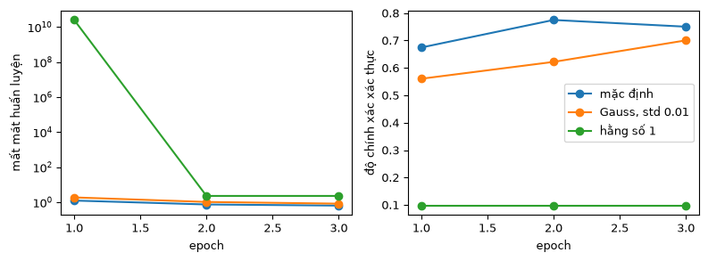

# Chương 6 · Ví dụ áp dụng: khởi tạo, checkpoint và huấn luyện tiếp

> Ghi chú của người biên soạn: trang này do người biên soạn viết thêm, không có trong sách gốc. Trang ghép các công cụ của chương 6 vào một quy trình huấn luyện thật trên *Fashion-MNIST* (Xiao, Rasul và Vollgraf, 2017): một khối tùy chỉnh (mục 6.5), khởi tạo tham số (mục 6.3), lưu và nạp (mục 6.6), chọn thiết bị (mục 6.7). Để chạy nhanh trên CPU, trang chỉ dùng 12 000 ảnh huấn luyện và một MLP nhỏ.

## Bài toán

[Mục 6.6](dl/ch06_s6_vi) khuyên lưu kết quả trung gian (checkpoint) khi huấn luyện lâu, để không mất công nếu máy bị ngắt. Nhưng chỉ lưu `state_dict` của mô hình là **chưa đủ** để huấn luyện tiếp như chưa từng bị ngắt. Trang này trả lời:

- Cách khởi tạo (mục 6.3) ảnh hưởng thế nào đến việc học? Khởi tạo hằng số có vấn đề gì?
- Một checkpoint cần chứa những gì để huấn luyện tiếp cho **đúng cùng kết quả** với lúc chạy liền một mạch?

## 1. Dữ liệu và mô hình

<!-- run -->
```python
import os
import time
import tempfile
import torch
import torchvision
from torch import nn
from torch.nn import functional as F
from torchvision import transforms
import matplotlib.pyplot as plt

root = os.path.expanduser('~/.cache/d2l-data')
full = torchvision.datasets.FashionMNIST(root, train=True, transform=transforms.ToTensor(), download=True)
g = torch.Generator().manual_seed(0)
idx = torch.randperm(len(full), generator=g)
train = torch.utils.data.Subset(full, idx[:12000].tolist())
val = torch.utils.data.Subset(full, idx[12000:14000].tolist())
Xval = torch.stack([x for x, _ in val]); yval = torch.tensor([y for _, y in val])
print(len(train), "ảnh huấn luyện,", len(val), "ảnh xác thực")

def try_gpu(i=0):                                    # như mục 6.7
    return torch.device(f'cuda:{i}') if torch.cuda.device_count() > i else torch.device('cpu')
device = try_gpu()
print("thiết bị:", device)
```

<!-- output -->
```output
12000 ảnh huấn luyện, 2000 ảnh xác thực
thiết bị: cpu
```
<!-- /output -->

Mô hình dùng một khối tùy chỉnh: tầng kết nối đầy đủ có *kết nối tắt* (skip connection) $\mathbf{h} + \mathrm{ReLU}(\mathbf{W}\mathbf{h} + \mathbf{b})$, ý tưởng mà chương 8 sẽ dùng trong ResNet. Đây là một mô-đun có tham số như [mục 6.5.2](dl/ch06_s5_vi), nhưng không lặp lại lỗi `.data`:

<!-- run -->
```python
class ResidualDense(nn.Module):
    def __init__(self, width):
        super().__init__()
        self.linear = nn.Linear(width, width)
    def forward(self, H):
        return H + F.relu(self.linear(H))

def make_net():
    return nn.Sequential(nn.Flatten(), nn.Linear(784, 128), nn.ReLU(),
                         ResidualDense(128), ResidualDense(128), nn.Linear(128, 10))

net = make_net()
print(net)
print("số tham số:", sum(p.numel() for p in net.parameters()))
```

<!-- output -->
```output
Sequential(
  (0): Flatten(start_dim=1, end_dim=-1)
  (1): Linear(in_features=784, out_features=128, bias=True)
  (2): ReLU()
  (3): ResidualDense(
    (linear): Linear(in_features=128, out_features=128, bias=True)
  )
  (4): ResidualDense(
    (linear): Linear(in_features=128, out_features=128, bias=True)
  )
  (5): Linear(in_features=128, out_features=10, bias=True)
)
số tham số: 134794
```
<!-- /output -->

## 2. Ảnh hưởng của cách khởi tạo

<small class="viz-ref">Mục 6.3</small>

Ba cách khởi tạo của mục 6.3: mặc định của PyTorch, Gauss với độ lệch chuẩn 0.01, và hằng số 1. Mỗi cách huấn luyện 3 epoch với cùng thứ tự dữ liệu:

<!-- run -->
```python
def init_normal(m):
    if isinstance(m, nn.Linear):
        nn.init.normal_(m.weight, std=0.01); nn.init.zeros_(m.bias)

def init_constant(m):
    if isinstance(m, nn.Linear):
        nn.init.constant_(m.weight, 1); nn.init.zeros_(m.bias)

def evaluate(net):
    net.eval()
    with torch.no_grad():
        acc = (net(Xval.to(device)).argmax(1).cpu() == yval).float().mean().item()
    net.train()
    return acc

def run_epochs(net, opt, loader, epochs, log=None):
    for _ in range(epochs):
        total = n = 0
        for X, y in loader:
            X, y = X.to(device), y.to(device)
            loss = F.cross_entropy(net(X), y)
            opt.zero_grad(); loss.backward(); opt.step()
            total += loss.item() * len(y); n += len(y)
        if log is not None:
            log.append((total / n, evaluate(net)))

results = {}
for name, init in [("mặc định", None), ("Gauss, std 0.01", init_normal), ("hằng số 1", init_constant)]:
    torch.manual_seed(0)
    net = make_net()
    if init is not None:
        net.apply(init)
    net.to(device)
    opt = torch.optim.SGD(net.parameters(), lr=0.05)
    loader = torch.utils.data.DataLoader(train, batch_size=128, shuffle=True)
    log = []
    run_epochs(net, opt, loader, 3, log)
    results[name] = (net, log)
    w = net[1].weight.detach()
    print(f"{name:16s} mất mát {log[-1][0]:.3f}, độ chính xác xác thực {log[-1][1]:.3f}, "
          f"số hàng khác nhau trong W của tầng đầu: {torch.unique(w, dim=0).shape[0]}/128")
```

<!-- output -->
```output
mặc định         mất mát 0.646, độ chính xác xác thực 0.751, số hàng khác nhau trong W của tầng đầu: 128/128
Gauss, std 0.01  mất mát 0.834, độ chính xác xác thực 0.701, số hàng khác nhau trong W của tầng đầu: 128/128
hằng số 1        mất mát 2.302, độ chính xác xác thực 0.097, số hàng khác nhau trong W của tầng đầu: 2/128
```
<!-- /output -->

Cột cuối đếm số hàng khác nhau trong ma trận trọng số $128 \times 784$ của tầng ẩn đầu tiên, tức là số neuron ẩn thực sự khác nhau.

Với khởi tạo hằng số, mất mát đứng yên ở $\log 10 \approx 2.302$ (đoán đều 10 lớp) và độ chính xác xác thực ngang đoán bừa. Ngay sau khi khởi tạo, 128 hàng của ma trận trọng số giống hệt nhau, và về lý thuyết chúng nhận cùng gradient nên giữ nguyên giống nhau mãi. Sau 3 epoch, chúng chỉ tách thành 2 nhóm (116 và 12 neuron, lệch nhau tối đa 0.75): nhiều khả năng là sai số làm tròn khi tính toán bị khuếch đại, chứ không phải mạng học được các đặc trưng khác nhau.

## 3. Checkpoint đủ để huấn luyện tiếp

<small class="viz-ref">Mục 6.6</small>

Huấn luyện 6 epoch theo hai cách: (A) liền một mạch; (B) 3 epoch, lưu checkpoint, "mất điện" (xóa hết đối tượng), dựng lại từ đầu, nạp checkpoint, rồi chạy thêm 3 epoch. Ta muốn (A) và (B) cho **cùng tham số đến từng bit**. Thử hai loại checkpoint: chỉ có `state_dict` của mô hình, và checkpoint đầy đủ.

Dùng SGD có động lượng (sẽ học ở chương 12): bộ tối ưu này có trạng thái riêng (vector vận tốc) cần lưu cùng mô hình.

<!-- run -->
```python
def fresh(seed=0):
    torch.manual_seed(seed)
    net = make_net().to(device)
    opt = torch.optim.SGD(net.parameters(), lr=0.05, momentum=0.9)
    return net, opt

def loader():
    return torch.utils.data.DataLoader(train, batch_size=128, shuffle=True)

ckpt_dir = tempfile.mkdtemp()
path = os.path.join(ckpt_dir, 'ckpt.pt')

# (A) liền một mạch
net_a, opt_a = fresh()
run_epochs(net_a, opt_a, loader(), 6)

def interrupted(full_ckpt):
    net, opt = fresh()
    run_epochs(net, opt, loader(), 3)
    ckpt = {'model': net.state_dict()}
    if full_ckpt:
        ckpt.update(optimizer=opt.state_dict(), epoch=3,
                    rng=torch.get_rng_state())          # thứ tự xáo trộn dữ liệu của các epoch sau
    torch.save(ckpt, path)
    del net, opt                                        # "mất điện"

    net, opt = fresh(seed=123)                          # dựng lại từ đầu, khởi tạo khác hẳn
    ckpt = torch.load(path, map_location=device)        # map_location: nạp được cả khi lưu trên GPU
    net.load_state_dict(ckpt['model'])
    if full_ckpt:
        opt.load_state_dict(ckpt['optimizer'])
        torch.set_rng_state(ckpt['rng'])
    run_epochs(net, opt, loader(), 3)
    return net

for full_ckpt in (False, True):
    net_b = interrupted(full_ckpt)
    same = all(torch.equal(p, q) for p, q in zip(net_a.parameters(), net_b.parameters()))
    diff = max((p - q).abs().max().item() for p, q in zip(net_a.parameters(), net_b.parameters()))
    kind = "đầy đủ (mô hình + bộ tối ưu + RNG)" if full_ckpt else "chỉ state_dict mô hình        "
    print(f"checkpoint {kind}: trùng (A) từng bit: {same}, sai khác lớn nhất {diff:.2e}, "
          f"độ chính xác xác thực {evaluate(net_b):.4f} (A: {evaluate(net_a):.4f})")
print("kích thước tệp checkpoint đầy đủ:", round(os.path.getsize(path) / 1024), "KB")
```

<!-- output -->
```output
checkpoint chỉ state_dict mô hình        : trùng (A) từng bit: False, sai khác lớn nhất 9.73e-02, độ chính xác xác thực 0.8455 (A: 0.8405)
checkpoint đầy đủ (mô hình + bộ tối ưu + RNG): trùng (A) từng bit: True, sai khác lớn nhất 0.00e+00, độ chính xác xác thực 0.8405 (A: 0.8405)
kích thước tệp checkpoint đầy đủ: 1063 KB
```
<!-- /output -->

## 4. Đọc kết quả

<!-- run -->
```python
fig, ax = plt.subplots(1, 2, figsize=(8, 3))
for name, (_, log) in results.items():
    ax[0].plot(range(1, 4), [l for l, _ in log], 'o-', label=name)
    ax[1].plot(range(1, 4), [a for _, a in log], 'o-', label=name)
ax[0].set(xlabel='epoch', ylabel='mất mát huấn luyện', yscale='log')
ax[1].set(xlabel='epoch', ylabel='độ chính xác xác thực'); ax[1].legend()
plt.tight_layout()
```

<!-- output -->
<div align=center></div>
<!-- /output -->

## Tóm tắt

- Khởi tạo hằng số làm mọi neuron trong một tầng giống hệt nhau và nhận cùng gradient, nên chúng gần như giữ nguyên giống nhau: mạng 128 neuron chỉ còn tương đương vài neuron và không học được gì. Khởi tạo ngẫu nhiên phá vỡ sự đối xứng này. (Phân tích kỹ hơn ở [mục 5.4](https://d2l.ai/chapter_multilayer-perceptrons/numerical-stability-and-init.html) của sách.)
- Muốn huấn luyện tiếp đúng như chưa từng bị ngắt, checkpoint phải chứa trạng thái của mô hình, của bộ tối ưu và của bộ sinh số ngẫu nhiên (thứ tự dữ liệu). Chỉ lưu `state_dict` của mô hình thì tham số sau khi huấn luyện tiếp lệch khỏi lần chạy liền một mạch (ở đây lệch tới gần 0.1).
- `torch.load(..., map_location=device)` cho phép nạp checkpoint lưu trên GPU vào máy chỉ có CPU, và ngược lại.
