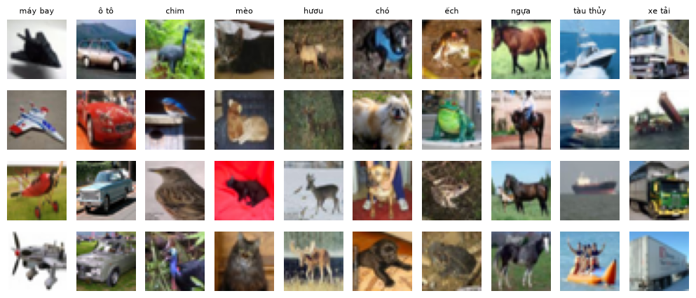

# Chương 7 · Ví dụ áp dụng: phân loại ảnh màu CIFAR-10

> Ghi chú của người biên soạn: trang này do người biên soạn viết thêm, không có trong sách gốc. Trang dùng bộ dữ liệu *CIFAR-10* (Krizhevsky, 2009): 60 000 ảnh màu $32 \times 32$ thuộc 10 lớp. Bộ này cũng xuất hiện ở [chương 29 khoá Học máy](ml/ch29_app_vi), nơi SVM đa lớp dùng đặc trưng thiết kế bằng tay.

## Bài toán

Fashion-MNIST là ảnh xám, vật thể luôn nằm giữa khung hình trên nền đen. CIFAR-10 khó hơn nhiều: ảnh màu (3 kênh), vật thể ở nhiều vị trí, nhiều góc nhìn, nền phức tạp. Câu hỏi đặt ra:

- LeNet, được thiết kế cho chữ số viết tay, làm được gì với ảnh màu?
- Một CNN sâu hơn một chút, chỉ dùng các khối của chương này (tích chập $3 \times 3$, ReLU, gộp cực đại), cải thiện được bao nhiêu?
- Mạng nhầm những lớp nào, và vì sao?

## 1. Dữ liệu

<!-- run -->
```python
import os
import time
import torch
import torchvision
from torch import nn
from torchvision import transforms
import matplotlib.pyplot as plt

root = os.path.expanduser('~/.cache/cifar10')
raw_train = torchvision.datasets.CIFAR10(root, train=True, download=True, transform=transforms.ToTensor())
classes = ['máy bay', 'ô tô', 'chim', 'mèo', 'hươu', 'chó', 'ếch', 'ngựa', 'tàu thủy', 'xe tải']
print(len(raw_train), "ảnh huấn luyện, mỗi ảnh", tuple(raw_train[0][0].shape))
print("Số ảnh mỗi lớp:", torch.bincount(torch.tensor(raw_train.targets)).tolist())

fig, ax = plt.subplots(4, 10, figsize=(10, 4.4))
targets = torch.tensor(raw_train.targets)
for c in range(10):
    idx = (targets == c).nonzero()[:4, 0]
    for r, i in enumerate(idx):
        ax[r, c].imshow(raw_train[i][0].permute(1, 2, 0)); ax[r, c].axis('off')
    ax[0, c].set_title(classes[c], fontsize=8)
plt.tight_layout()
```

<!-- output -->
```output
50000 ảnh huấn luyện, mỗi ảnh (3, 32, 32)
Số ảnh mỗi lớp: [5000, 5000, 5000, 5000, 5000, 5000, 5000, 5000, 5000, 5000]
```

<div align=center></div>
<!-- /output -->

Chuẩn hoá từng kênh màu về trung bình 0, độ lệch chuẩn 1 (như [chương 6 khoá Học máy](ml/ch06_vi) chuẩn hoá đặc trưng). Trung bình và độ lệch chuẩn tính trên tập huấn luyện:

<!-- run -->
```python
data = torch.tensor(raw_train.data, dtype=torch.float32) / 255     # (50000, 32, 32, 3)
mean, std = data.mean((0, 1, 2)), data.std((0, 1, 2))
print("trung bình (R, G, B):", [round(v, 3) for v in mean.tolist()])
print("độ lệch chuẩn       :", [round(v, 3) for v in std.tolist()])

normalize = transforms.Normalize(mean.tolist(), std.tolist())
# Tăng cường dữ liệu: lật ngang ngẫu nhiên và cắt ngẫu nhiên sau khi đệm 4 điểm ảnh.
# Một con mèo lật ngang vẫn là mèo; dịch đi vài điểm ảnh vẫn là mèo (mục 14.1 của sách).
train_tf = transforms.Compose([transforms.RandomCrop(32, padding=4), transforms.RandomHorizontalFlip(),
                               transforms.ToTensor(), normalize])
test_tf = transforms.Compose([transforms.ToTensor(), normalize])
train = torchvision.datasets.CIFAR10(root, train=True, transform=train_tf)
test = torchvision.datasets.CIFAR10(root, train=False, transform=test_tf)
```

<!-- output -->
```output
trung bình (R, G, B): [0.491, 0.482, 0.447]
độ lệch chuẩn       : [0.247, 0.243, 0.262]
```
<!-- /output -->

## 2. Hai mạng

<small class="viz-ref">Mục 7.3–7.6</small>

**LeNet cho ảnh màu**: giống mục 7.6 nhưng có 3 kênh vào, ReLU và gộp cực đại. **CNN nhỏ**: ba khối, mỗi khối gồm hai tầng tích chập $3 \times 3$ có đệm 1 (giữ nguyên kích thước, [mục 7.3.1](dl/ch07_s3_vi)) rồi một tầng gộp cực đại $2 \times 2$ (giảm một nửa kích thước). Số kênh tăng gấp đôi sau mỗi lần giảm kích thước ([mục 7.4.2](dl/ch07_s4_vi)). Kiểu thiết kế xếp chồng các khối giống nhau này chính là VGG, sẽ học ở chương 8.

<!-- run -->
```python
def lenet_color():
    return nn.Sequential(
        nn.Conv2d(3, 6, 5), nn.ReLU(), nn.MaxPool2d(2),        # 32 -> 28 -> 14
        nn.Conv2d(6, 16, 5), nn.ReLU(), nn.MaxPool2d(2),       # 14 -> 10 -> 5
        nn.Flatten(),
        nn.Linear(16 * 5 * 5, 120), nn.ReLU(),
        nn.Linear(120, 84), nn.ReLU(),
        nn.Linear(84, 10))

def block(c_in, c_out):
    return nn.Sequential(
        nn.Conv2d(c_in, c_out, 3, padding=1), nn.ReLU(),
        nn.Conv2d(c_out, c_out, 3, padding=1), nn.ReLU(),
        nn.MaxPool2d(2))

def small_cnn():
    return nn.Sequential(
        block(3, 32), block(32, 64), block(64, 128),           # 32 -> 16 -> 8 -> 4
        nn.Flatten(),
        nn.Linear(128 * 4 * 4, 256), nn.ReLU(),
        nn.Linear(256, 10))

X = torch.randn(1, 3, 32, 32)
for name, make in [("LeNet màu", lenet_color), ("CNN nhỏ", small_cnn)]:
    net = make()
    print(f"{name:10s} đầu ra {tuple(net(X).shape)}, {sum(p.numel() for p in net.parameters()):,} tham số")
h = X
for layer in small_cnn():
    h = layer(h)
    print(f"  {layer.__class__.__name__:10s} {tuple(h.shape)}")
```

<!-- output -->
```output
LeNet màu  đầu ra (1, 10), 62,006 tham số
CNN nhỏ    đầu ra (1, 10), 814,122 tham số
  Sequential (1, 32, 16, 16)
  Sequential (1, 64, 8, 8)
  Sequential (1, 128, 4, 4)
  Flatten    (1, 2048)
  Linear     (1, 256)
  ReLU       (1, 256)
  Linear     (1, 10)
```
<!-- /output -->

## 3. Huấn luyện

Dùng SGD có động lượng (momentum) và suy giảm trọng số, giảm dần tốc độ học theo hàm cosin. Các kỹ thuật này được giải thích ở chương 12 của sách; ở đây chỉ cần biết chúng giúp huấn luyện nhanh và ổn định hơn SGD thường. 30 epoch cho mỗi mạng:

<!-- run -->
```python
device = 'cuda' if torch.cuda.is_available() else 'cpu'

def evaluate(net, loader):
    net.eval()
    correct = n = 0
    with torch.no_grad():
        for X, y in loader:
            correct += (net(X.to(device)).argmax(1) == y.to(device)).sum().item()
            n += len(y)
    return correct / n

def fit(net, epochs=30, lr=0.05):
    torch.manual_seed(0)
    net = net.to(device)
    loader = torch.utils.data.DataLoader(train, 128, shuffle=True, num_workers=4)
    test_loader = torch.utils.data.DataLoader(test, 512, num_workers=4)
    opt = torch.optim.SGD(net.parameters(), lr=lr, momentum=0.9, weight_decay=5e-4)
    sched = torch.optim.lr_scheduler.CosineAnnealingLR(opt, epochs)
    loss_fn = nn.CrossEntropyLoss()
    hist, t0 = [], time.time()
    for epoch in range(epochs):
        net.train()
        total = correct = n = 0
        for X, y in loader:
            X, y = X.to(device), y.to(device)
            out = net(X)
            loss = loss_fn(out, y)
            opt.zero_grad(); loss.backward(); opt.step()
            total += loss.item() * len(y); correct += (out.argmax(1) == y).sum().item(); n += len(y)
        sched.step()
        hist.append((total / n, correct / n, evaluate(net, test_loader)))
        if (epoch + 1) % 5 == 0:
            print(f"  epoch {epoch + 1}: mất mát {hist[-1][0]:.3f}, "
                  f"chính xác huấn luyện {hist[-1][1]:.3f}, kiểm tra {hist[-1][2]:.3f}")
    print(f"  {time.time() - t0:.0f} s trên {device}")
    return net, hist
```

<!-- run gpu -->
```python
print("LeNet màu:")
lenet_net, h_lenet = fit(lenet_color())
print("CNN nhỏ:")
cnn_net, h_cnn = fit(small_cnn())

fig, ax = plt.subplots(1, 2, figsize=(8, 3))
for h, name in [(h_lenet, 'LeNet màu'), (h_cnn, 'CNN nhỏ')]:
    ax[0].plot([r[0] for r in h], label=name)
    ax[1].plot([r[2] for r in h], label=name + ' (kiểm tra)')
    ax[1].plot([r[1] for r in h], '--', label=name + ' (huấn luyện)')
ax[0].set(xlabel='epoch', ylabel='mất mát huấn luyện'); ax[1].set(xlabel='epoch', ylabel='độ chính xác')
ax[1].legend(fontsize=7); plt.tight_layout()
```

<!-- output -->
<div class="gpu-pending">Chưa có kết quả: khối này huấn luyện mô hình nên sẽ được chạy trên máy có GPU. Bạn có thể tự chạy code trên Colab hoặc máy của mình.</div>
<!-- /output -->

## 4. Đọc kết quả

Độ chính xác theo từng lớp và những cặp lớp hay bị nhầm nhất của CNN nhỏ:

<!-- run gpu -->
```python
conf = torch.zeros(10, 10, dtype=torch.long)
cnn_net.eval()
with torch.no_grad():
    for X, y in torch.utils.data.DataLoader(test, 512):
        pred = cnn_net(X.to(device)).argmax(1).cpu()
        conf += torch.bincount(y * 10 + pred, minlength=100).reshape(10, 10)
acc = conf.diag() / conf.sum(1)
for c in acc.argsort(descending=True):
    print(f"{classes[c]:9s} {acc[c]:.3f}")
off = conf.clone().fill_diagonal_(0)
print("Các cặp nhầm nhiều nhất (thật → đoán):")
for k in off.flatten().argsort(descending=True)[:5]:
    i, j = divmod(k.item(), 10)
    print(f"  {classes[i]} → {classes[j]}: {off[i, j].item()} ảnh")
```

<!-- output -->
<div class="gpu-pending">Chưa có kết quả: khối này huấn luyện mô hình nên sẽ được chạy trên máy có GPU. Bạn có thể tự chạy code trên Colab hoặc máy của mình.</div>
<!-- /output -->

Một số ảnh kiểm tra bị đoán sai, kèm xác suất mà mạng gán cho lớp đã đoán:

<!-- run gpu -->
```python
raw_test = torchvision.datasets.CIFAR10(root, train=False, transform=transforms.ToTensor())
wrong = []
with torch.no_grad():
    for i in range(2000):
        x, y = test[i]
        p = cnn_net(x[None].to(device)).softmax(1)[0].cpu()
        if p.argmax() != y:
            wrong.append((i, y, p.argmax().item(), p.max().item()))
fig, ax = plt.subplots(2, 8, figsize=(10, 3.2))
for a, (i, y, yhat, prob) in zip(ax.flat, wrong[:16]):
    a.imshow(raw_test[i][0].permute(1, 2, 0)); a.axis('off')
    a.set_title(f"{classes[y]}\n→ {classes[yhat]} ({prob:.2f})", fontsize=7)
plt.tight_layout()
```

<!-- output -->
<div class="gpu-pending">Chưa có kết quả: khối này huấn luyện mô hình nên sẽ được chạy trên máy có GPU. Bạn có thể tự chạy code trên Colab hoặc máy của mình.</div>
<!-- /output -->

## Tóm tắt

- Ảnh màu chỉ khác ảnh xám ở số kênh vào: tầng tích chập đầu tiên có $c_\textrm{i} = 3$, mọi thứ khác giữ nguyên ([mục 7.4](dl/ch07_s4_vi)).
- Xếp chồng nhiều tích chập $3 \times 3$ có đệm, xen kẽ gộp cực đại, là cách đơn giản để có mạng sâu hơn mà kích thước vẫn dễ kiểm soát. Chương 8 đi tiếp hướng này với VGG, ResNet và chuẩn hoá theo batch.
- Tăng cường dữ liệu (lật, cắt ngẫu nhiên) mã hoá đúng tính bất biến tịnh tiến mà [mục 7.1](dl/ch07_s1_vi) mong muốn ở mạng.
