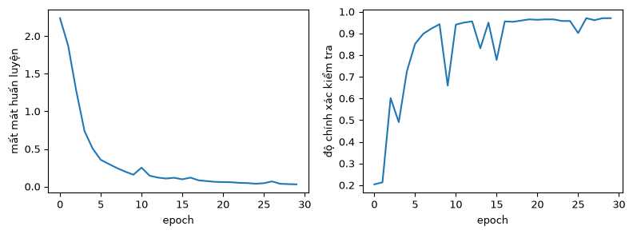

# Chương 7 · Bổ sung: lan truyền ngược qua tích chập

> Ghi chú của người biên soạn: trang này do người biên soạn viết thêm, không có trong sách gốc. Trong cả khoá, gradient do autograd của PyTorch tính. Trang này làm một lần bằng tay cho tầng tích chập và tầng gộp, để thấy autograd thực sự tính gì. Lan truyền ngược cho tầng kết nối đầy đủ đã có ở [chương 16 khoá Học máy](ml/ch16_vi) và [trang Code từ đầu](ml/ch16_code_vi) của chương đó.

## Cách dùng trang này

Các khối chạy lần lượt từ trên xuống và dùng chung biến. Cần `torch`, `scikit-learn` (bộ chữ số viết tay $8 \times 8$) và `matplotlib`. Mọi khối chạy được trên CPU trong vài giây.

Ký hiệu: $L$ là hàm mất mát, $\mathbf{G} = \partial L / \partial \mathbf{Y}$ là gradient đi vào một tầng từ phía sau (cùng kích thước với đầu ra $\mathbf{Y}$ của tầng). Lan truyền ngược của một tầng nhận $\mathbf{G}$ và trả về gradient theo tham số của tầng và theo đầu vào $\mathbf{X}$, để chuyển tiếp cho tầng trước.

## 1. Đạo hàm của tầng tích chập

<small class="viz-ref">Mục 7.2–7.4 · công thức (7.1.3)</small>

Xét một mẫu, đầu vào đã đệm $\mathbf{X}$ có $c_\textrm{i}$ kênh, kernel $\mathsf{W}$ kích thước $c_\textrm{o} \times c_\textrm{i} \times k_\textrm{h} \times k_\textrm{w}$, sải bước $s$. Lan truyền xuôi là

$$
Y_{o,i,j} = b_o + \sum_{c}\sum_{a}\sum_{b} W_{o,c,a,b}\, X_{c,\; si+a,\; sj+b}.
$$

Mỗi tham số và mỗi phần tử đầu vào xuất hiện trong nhiều số hạng, nên gradient theo chúng là tổng của $\mathbf{G}$ trên mọi vị trí mà chúng góp mặt (quy tắc chuỗi).

**Hệ số điều chỉnh.** $b_o$ được cộng vào mọi vị trí của kênh ra $o$:

$$
\frac{\partial L}{\partial b_o} = \sum_{i,j} G_{o,i,j}.
$$

**Kernel.** $W_{o,c,a,b}$ nhân với $X_{c, si+a, sj+b}$ tại mọi vị trí $(i, j)$:

$$
\frac{\partial L}{\partial W_{o,c,a,b}} = \sum_{i,j} G_{o,i,j}\, X_{c,\; si+a,\; sj+b}.
$$

Với $s = 1$, đây chính là **tương quan chéo giữa đầu vào $\mathbf{X}$ và gradient $\mathbf{G}$**: $\mathbf{G}$ đóng vai trò kernel.

**Đầu vào.** Phần tử $X_{c,p,q}$ góp mặt ở mọi $(o, i, j, a, b)$ với $si + a = p$ và $sj + b = q$:

$$
\frac{\partial L}{\partial X_{c,p,q}} = \sum_{o}\sum_{\substack{i, j, a, b \\ si+a = p,\; sj+b = q}} G_{o,i,j}\, W_{o,c,a,b}.
$$

Với $s = 1$, công thức này là **tích chập "đầy đủ" (full) của $\mathbf{G}$ với kernel lật ngược** (lật theo cả hai trục, như phép tích chập thật trong [mục 7.2.6](dl/ch07_s2_vi)): đệm $\mathbf{G}$ thêm $k-1$ ô mỗi phía rồi tương quan chéo với $\mathsf{W}$ lật. Đây là lý do gradient của một tầng tích chập lại là một phép tích chập, và cũng là nguồn gốc của *tích chập chuyển vị* (transposed convolution) mà ta sẽ gặp ở chương 14.

Khi cài đặt, không cần lật hay đệm gì cả. Lan truyền xuôi ở [trang Code từ đầu](dl/ch07_code_vi) lặp trên các độ lệch $(a, b)$: với mỗi độ lệch, *đọc* một lát cắt của $\mathbf{X}$ rồi cộng vào $\mathbf{Y}$. Lan truyền ngược dùng đúng vòng lặp đó, chỉ đổi chiều: với mỗi độ lệch, *cộng* $\mathbf{G} \cdot W_{:,:,a,b}$ vào đúng lát cắt đó của $\partial L / \partial \mathbf{X}$, và lấy tổng của $\mathbf{G}$ nhân lát cắt để được $\partial L / \partial W_{:,:,a,b}$. Cuối cùng cắt bỏ phần đệm.

<!-- run -->
```python
import torch
import torch.nn.functional as F
import matplotlib.pyplot as plt

torch.manual_seed(0)

def pair(v):
    return (v, v) if isinstance(v, int) else tuple(v)

def pad2d(X, padding, value=0.0):
    ph, pw = pair(padding)
    n, c, h, w = X.shape
    Xp = torch.full((n, c, h + 2 * ph, w + 2 * pw), value, dtype=X.dtype)
    Xp[:, :, ph:ph + h, pw:pw + w] = X
    return Xp

def window(a, b, oh, ow, sh, sw):
    """Lát cắt của đầu vào đã đệm ứng với độ lệch (a, b) trong cửa sổ."""
    return (slice(None), slice(None),
            slice(a, a + sh * (oh - 1) + 1, sh), slice(b, b + sw * (ow - 1) + 1, sw))

class Conv2d:
    def __init__(self, c_in, c_out, k, padding=0, stride=1, dtype=torch.float32):
        kh, kw = pair(k)
        bound = (6 / ((c_in + c_out) * kh * kw)) ** 0.5            # Xavier đều
        self.W = torch.empty(c_out, c_in, kh, kw, dtype=dtype).uniform_(-bound, bound)
        self.b = torch.zeros(c_out, dtype=dtype)
        self.padding, self.stride = padding, stride

    def forward(self, X):
        sh, sw = pair(self.stride)
        _, _, kh, kw = self.W.shape
        Xp = pad2d(X, self.padding)
        oh, ow = (Xp.shape[2] - kh) // sh + 1, (Xp.shape[3] - kw) // sw + 1
        Y = self.b.view(1, -1, 1, 1).expand(X.shape[0], -1, oh, ow).clone()
        for a in range(kh):
            for b in range(kw):
                Y += torch.einsum('ncij,oc->noij', Xp[window(a, b, oh, ow, sh, sw)], self.W[:, :, a, b])
        self.cache = (X.shape, Xp, oh, ow)                         # giữ lại cho lan truyền ngược
        return Y

    def backward(self, G):
        X_shape, Xp, oh, ow = self.cache
        sh, sw = pair(self.stride)
        ph, pw = pair(self.padding)
        _, _, kh, kw = self.W.shape
        self.db = G.sum((0, 2, 3))                                 # tổng trên batch và mọi vị trí
        self.dW = torch.zeros_like(self.W)
        dXp = torch.zeros_like(Xp)
        for a in range(kh):
            for b in range(kw):
                sl = window(a, b, oh, ow, sh, sw)
                self.dW[:, :, a, b] = torch.einsum('noij,ncij->oc', G, Xp[sl])
                dXp[sl] += torch.einsum('noij,oc->ncij', G, self.W[:, :, a, b])
        h, w = X_shape[2:]
        return dXp[:, :, ph:ph + h, pw:pw + w]                     # bỏ phần đệm
```

Kiểm tra với autograd trên nhiều cấu hình. Dùng số thực 64 bit để sai số làm tròn không che lấp lỗi:

<!-- run -->
```python
def check_conv(c_in, c_out, k, padding, stride, size=(7, 9)):
    X = torch.randn(3, c_in, *size, dtype=torch.float64)
    layer = Conv2d(c_in, c_out, k, padding, stride, dtype=torch.float64)
    Y = layer.forward(X)
    G = torch.randn_like(Y)                                        # gradient bất kỳ từ phía sau
    dX = layer.backward(G)
    # Autograd: L = sum(G * Y) có dL/dY = G
    Xa, Wa, ba = (t.clone().requires_grad_() for t in (X, layer.W, layer.b))
    (F.conv2d(Xa, Wa, ba, stride=stride, padding=padding) * G).sum().backward()
    errs = [(dX - Xa.grad).abs().max(), (layer.dW - Wa.grad).abs().max(), (layer.db - ba.grad).abs().max()]
    print(f"k={k}, đệm={padding}, sải bước={stride}: sai khác dX {errs[0]:.1e}, dW {errs[1]:.1e}, db {errs[2]:.1e}")

check_conv(1, 1, 2, 0, 1, size=(3, 3))
check_conv(3, 4, 3, 1, 1)
check_conv(3, 4, (5, 3), (2, 1), 1)
check_conv(2, 5, 3, 1, 2)
check_conv(2, 3, (3, 5), (0, 1), (3, 4), size=(8, 8))
```

<!-- output -->
```output
k=2, đệm=0, sải bước=1: sai khác dX 0.0e+00, dW 1.8e-15, db 0.0e+00
k=3, đệm=1, sải bước=1: sai khác dX 8.9e-16, dW 1.8e-14, db 0.0e+00
k=(5, 3), đệm=(2, 1), sải bước=1: sai khác dX 8.9e-16, dW 1.8e-14, db 0.0e+00
k=3, đệm=1, sải bước=2: sai khác dX 2.2e-16, dW 3.6e-15, db 0.0e+00
k=(3, 5), đệm=(0, 1), sải bước=(3, 4): sai khác dX 2.2e-16, dW 5.3e-15, db 0.0e+00
```
<!-- /output -->

## 2. Đạo hàm của tầng gộp

<small class="viz-ref">Mục 7.5</small>

Tầng gộp không có tham số, chỉ cần gradient theo đầu vào.

**Gộp trung bình.** Mỗi đầu ra là trung bình của $k_\textrm{h} k_\textrm{w}$ phần tử, nên mỗi phần tử trong cửa sổ nhận $\mathbf{G}$ chia đều:

$$
\frac{\partial Y_{i,j}}{\partial X_{si+a,\; sj+b}} = \frac{1}{k_\textrm{h} k_\textrm{w}}.
$$

**Gộp cực đại.** $Y_{i,j} = \max_{a,b} X_{si+a, sj+b}$. Đạo hàm của hàm max theo phần tử lớn nhất bằng 1, theo các phần tử khác bằng 0. Vì vậy gradient $G_{i,j}$ được **chuyển nguyên vẹn về đúng vị trí đạt cực đại** trong cửa sổ, các vị trí khác nhận 0. Khi cửa sổ chồng lấn (sải bước nhỏ hơn cửa sổ), một phần tử có thể là cực đại của nhiều cửa sổ và nhận tổng các gradient tương ứng. Khi có nhiều phần tử cùng bằng giá trị lớn nhất, PyTorch chọn phần tử xuất hiện đầu tiên; cài đặt dưới đây cũng vậy (`argmax` trả về chỉ số đầu tiên).

<!-- run -->
```python
class Pool2d:
    def __init__(self, k, stride=None, padding=0, mode='max'):
        self.k, self.stride, self.padding, self.mode = pair(k), pair(stride or k), padding, mode

    def forward(self, X):
        (kh, kw), (sh, sw) = self.k, self.stride
        Xp = pad2d(X, self.padding, float('-inf') if self.mode == 'max' else 0.0)
        oh, ow = (Xp.shape[2] - kh) // sh + 1, (Xp.shape[3] - kw) // sw + 1
        patches = torch.stack([Xp[window(a, b, oh, ow, sh, sw)] for a in range(kh) for b in range(kw)])
        self.cache = (X.shape, Xp.shape, oh, ow)
        if self.mode == 'max':
            self.argmax = patches.argmax(0)                        # vị trí cực đại trong mỗi cửa sổ
            return patches.amax(0)
        return patches.mean(0)

    def backward(self, G):
        (kh, kw), (sh, sw) = self.k, self.stride
        X_shape, Xp_shape, oh, ow = self.cache
        dXp = torch.zeros(Xp_shape, dtype=G.dtype)
        for t, (a, b) in enumerate((a, b) for a in range(kh) for b in range(kw)):
            share = G * (self.argmax == t) if self.mode == 'max' else G / (kh * kw)
            dXp[window(a, b, oh, ow, sh, sw)] += share
        ph, pw = pair(self.padding)
        return dXp[:, :, ph:ph + X_shape[2], pw:pw + X_shape[3]]

def check_pool(k, stride, padding, mode, X=None):
    X = torch.randn(2, 3, 7, 7, dtype=torch.float64) if X is None else X
    layer = Pool2d(k, stride, padding, mode)
    Y = layer.forward(X)
    G = torch.randn_like(Y)
    dX = layer.backward(G)
    Xa = X.clone().requires_grad_()
    ref = F.max_pool2d if mode == 'max' else F.avg_pool2d
    (ref(Xa, k, stride, padding) * G).sum().backward()
    print(f"{mode}, cửa sổ {k}, sải bước {stride}, đệm {padding}: sai khác dX {(dX - Xa.grad).abs().max():.1e}")

check_pool(2, None, 0, 'max')
check_pool(3, 2, 1, 'max')                      # cửa sổ chồng lấn
check_pool(3, 1, 1, 'max')
check_pool(3, 2, 1, 'avg')
check_pool((2, 3), (2, 3), (0, 1), 'avg')
```

<!-- output -->
```output
max, cửa sổ 2, sải bước None, đệm 0: sai khác dX 0.0e+00
max, cửa sổ 3, sải bước 2, đệm 1: sai khác dX 4.4e-16
max, cửa sổ 3, sải bước 1, đệm 1: sai khác dX 1.8e-15
avg, cửa sổ 3, sải bước 2, đệm 1: sai khác dX 1.1e-16
avg, cửa sổ (2, 3), sải bước (2, 3), đệm (0, 1): sai khác dX 0.0e+00
```
<!-- /output -->

Nhìn trực tiếp đường đi của gradient trên ví dụ $3 \times 3$ của [hình 7.5.1](dl/ch07_s5_vi?id=fig-pooling), cửa sổ $2 \times 2$, sải bước 1 (bốn cửa sổ chồng lấn nhau), với $\mathbf{G}$ gồm toàn số 1:

<!-- run -->
```python
X = torch.tensor([[0.0, 1.0, 2.0], [3.0, 4.0, 5.0], [6.0, 7.0, 8.0]]).reshape(1, 1, 3, 3)
for mode in ['max', 'avg']:
    layer = Pool2d(2, stride=1, mode=mode)
    Y = layer.forward(X)
    print(f"{mode}: Y =", Y[0, 0].tolist(), "\n  dL/dX =", layer.backward(torch.ones_like(Y))[0, 0].tolist())
```

<!-- output -->
```output
max: Y = [[4.0, 5.0], [7.0, 8.0]] 
  dL/dX = [[0.0, 0.0, 0.0], [0.0, 1.0, 1.0], [0.0, 1.0, 1.0]]
avg: Y = [[2.0, 3.0], [5.0, 6.0]] 
  dL/dX = [[0.25, 0.5, 0.25], [0.5, 1.0, 0.5], [0.25, 0.5, 0.25]]
```
<!-- /output -->

Với gộp cực đại, mỗi cửa sổ có cực đại ở góc dưới phải của nó (4, 5, 7, 8), nên chỉ bốn phần tử đó nhận gradient; các phần tử 0, 1, 2, 3, 6 nhận 0. Với gộp trung bình, phần tử ở giữa (4) thuộc cả bốn cửa sổ nên nhận $4 \times 0.25 = 1$, phần tử ở góc chỉ thuộc một cửa sổ nên nhận $0.25$.

## 3. Một CNN nhỏ huấn luyện không cần autograd

<small class="viz-ref">Mục 7.6</small>

Ghép các tầng trên với ReLU, trải phẳng, tầng kết nối đầy đủ và entropy chéo. Mỗi tầng có `forward` và `backward`; lan truyền ngược của cả mạng là gọi `backward` theo thứ tự ngược lại. Gradient của softmax kết hợp entropy chéo là $(\hat{\mathbf{y}} - \mathbf{y}) / n$ như ở [chương 15 khoá Học máy](ml/ch15_vi).

<!-- run -->
```python
class ReLU:
    def forward(self, X):
        self.mask = X > 0
        return X * self.mask
    def backward(self, G):
        return G * self.mask

class Flatten:
    def forward(self, X):
        self.shape = X.shape
        return X.reshape(X.shape[0], -1)
    def backward(self, G):
        return G.reshape(self.shape)

class Linear:
    def __init__(self, d_in, d_out, dtype=torch.float32):
        bound = (6 / (d_in + d_out)) ** 0.5
        self.W = torch.empty(d_in, d_out, dtype=dtype).uniform_(-bound, bound)
        self.b = torch.zeros(d_out, dtype=dtype)
    def forward(self, X):
        self.X = X
        return X @ self.W + self.b
    def backward(self, G):
        self.dW, self.db = self.X.T @ G, G.sum(0)
        return G @ self.W.T

def softmax_cross_entropy(Z, y):
    """Trả về mất mát và gradient theo Z."""
    Z = Z - Z.max(1, keepdim=True).values
    P = Z.exp() / Z.exp().sum(1, keepdim=True)
    n = len(y)
    loss = -P[torch.arange(n), y].log().mean()
    dZ = P.clone()
    dZ[torch.arange(n), y] -= 1
    return loss, dZ / n

class Net:
    def __init__(self, layers):
        self.layers = layers
    def forward(self, X):
        for layer in self.layers:
            X = layer.forward(X)
        return X
    def backward(self, G):
        for layer in reversed(self.layers):
            G = layer.backward(G)
    def params(self):
        """Các cặp (tham số, gradient) của những tầng có tham số."""
        return [(l, n) for l in self.layers for n in ('W', 'b') if hasattr(l, n)]

def small_cnn(dtype=torch.float32):
    return Net([Conv2d(1, 8, 3, padding=1, dtype=dtype), ReLU(), Pool2d(2),     # 8x8 -> 4x4
                Conv2d(8, 16, 3, padding=1, dtype=dtype), ReLU(), Pool2d(2),    # 4x4 -> 2x2
                Flatten(), Linear(16 * 2 * 2, 10, dtype=dtype)])
```

Trước khi huấn luyện, kiểm tra gradient của cả mạng theo hai cách: so với autograd, và so với *sai phân hữu hạn* $\big(L(w + \epsilon) - L(w - \epsilon)\big) / 2\epsilon$ tại vài phần tử ngẫu nhiên của mỗi tham số. Cách thứ hai không dựa vào bất kỳ thư viện đạo hàm nào.

<!-- run -->
```python
torch.manual_seed(1)
net = small_cnn(torch.float64)
X = torch.randn(16, 1, 8, 8, dtype=torch.float64)
y = torch.randint(0, 10, (16,))
loss, dZ = softmax_cross_entropy(net.forward(X), y)
net.backward(dZ)

# Autograd trên cùng trọng số, dựng từ các hàm của PyTorch
c1, c2, fc = net.layers[0], net.layers[3], net.layers[7]
leaves = [t.clone().requires_grad_() for t in (c1.W, c1.b, c2.W, c2.b, fc.W, fc.b)]
h = F.max_pool2d(F.relu(F.conv2d(X, leaves[0], leaves[1], padding=1)), 2)
h = F.max_pool2d(F.relu(F.conv2d(h, leaves[2], leaves[3], padding=1)), 2)
F.cross_entropy(h.flatten(1) @ leaves[4] + leaves[5], y).backward()
checks = [('conv1.W', c1, 'W'), ('conv1.b', c1, 'b'), ('conv2.W', c2, 'W'),
          ('conv2.b', c2, 'b'), ('fc.W', fc, 'W'), ('fc.b', fc, 'b')]
for (name, layer, attr), leaf in zip(checks, leaves):
    P, g = getattr(layer, attr), getattr(layer, 'd' + attr)
    print(f"{name:8s} sai khác với autograd {(g - leaf.grad).abs().max():.1e}", end="")
    # sai phân hữu hạn tại 3 phần tử ngẫu nhiên
    worst = 0.0
    for idx in torch.randint(0, P.numel(), (3,)):
        old = P.view(-1)[idx].item(); eps = 1e-6
        P.view(-1)[idx] = old + eps; lp, _ = softmax_cross_entropy(net.forward(X), y)
        P.view(-1)[idx] = old - eps; lm, _ = softmax_cross_entropy(net.forward(X), y)
        P.view(-1)[idx] = old
        worst = max(worst, abs((lp - lm).item() / (2 * eps) - g.view(-1)[idx].item()))
    print(f", với sai phân hữu hạn {worst:.1e}")
```

<!-- output -->
```output
conv1.W  sai khác với autograd 6.9e-17, với sai phân hữu hạn 1.6e-10
conv1.b  sai khác với autograd 4.2e-17, với sai phân hữu hạn 2.0e-10
conv2.W  sai khác với autograd 8.3e-17, với sai phân hữu hạn 2.9e-10
conv2.b  sai khác với autograd 5.6e-17, với sai phân hữu hạn 8.6e-11
fc.W     sai khác với autograd 5.6e-17, với sai phân hữu hạn 1.6e-10
fc.b     sai khác với autograd 5.6e-17, với sai phân hữu hạn 8.4e-11
```
<!-- /output -->

Giờ huấn luyện trên bộ chữ số viết tay $8 \times 8$ của scikit-learn (1 797 ảnh, 10 lớp), hạ gradient ngẫu nhiên theo minibatch, toàn bộ gradient tính bằng tay:

<!-- run -->
```python
from sklearn.datasets import load_digits
from sklearn.model_selection import train_test_split

digits = load_digits()
Xd = torch.tensor(digits.images / 16.0, dtype=torch.float32).unsqueeze(1)   # (1797, 1, 8, 8), giá trị trong [0, 1]
yd = torch.tensor(digits.target)
X_tr, X_te, y_tr, y_te = train_test_split(Xd, yd, test_size=0.3, random_state=0, stratify=yd)

torch.manual_seed(0)
net = small_cnn()
lr, batch, hist = 0.1, 32, []
for epoch in range(1, 31):
    perm = torch.randperm(len(X_tr))
    total = 0.0
    for k in range(0, len(X_tr), batch):
        idx = perm[k:k + batch]
        loss, dZ = softmax_cross_entropy(net.forward(X_tr[idx]), y_tr[idx])
        net.backward(dZ)
        for layer, name in net.params():
            setattr(layer, name, getattr(layer, name) - lr * getattr(layer, 'd' + name))
        total += loss.item() * len(idx)
    acc = (net.forward(X_te).argmax(1) == y_te).float().mean().item()
    hist.append((total / len(X_tr), acc))
    if epoch % 5 == 0:
        print(f"epoch {epoch}: mất mát huấn luyện {hist[-1][0]:.3f}, độ chính xác kiểm tra {acc:.3f}")

fig, ax = plt.subplots(1, 2, figsize=(8, 3))
ax[0].plot([h[0] for h in hist]); ax[0].set(xlabel='epoch', ylabel='mất mát huấn luyện')
ax[1].plot([h[1] for h in hist]); ax[1].set(xlabel='epoch', ylabel='độ chính xác kiểm tra')
plt.tight_layout()
```

<!-- output -->
```output
epoch 5: mất mát huấn luyện 0.506, độ chính xác kiểm tra 0.726
epoch 10: mất mát huấn luyện 0.158, độ chính xác kiểm tra 0.659
epoch 15: mất mát huấn luyện 0.117, độ chính xác kiểm tra 0.950
epoch 20: mất mát huấn luyện 0.063, độ chính xác kiểm tra 0.965
epoch 25: mất mát huấn luyện 0.038, độ chính xác kiểm tra 0.957
epoch 30: mất mát huấn luyện 0.030, độ chính xác kiểm tra 0.970
```

<div align=center></div>
<!-- /output -->

Mạng nhỏ này (khoảng 1 900 tham số) đạt khoảng 97% trên tập kiểm tra sau 30 epoch, dù đường độ chính xác dao động khá mạnh ở các epoch đầu.

## Tóm tắt

- Gradient theo kernel là tương quan chéo giữa đầu vào và gradient đầu ra; gradient theo đầu vào là tích chập đầy đủ của gradient đầu ra với kernel lật. Khi cài đặt, cả hai chỉ là vòng lặp lan truyền xuôi chạy ngược chiều: *đọc* lát cắt thành *cộng vào* lát cắt.
- Gộp cực đại chuyển gradient về đúng vị trí cực đại, gộp trung bình chia đều gradient cho cả cửa sổ.
- Gradient viết tay khớp autograd và sai phân hữu hạn, và đủ để huấn luyện một CNN nhỏ. Từ đây trở đi, cả khoá để autograd làm việc này.
