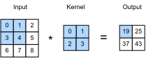
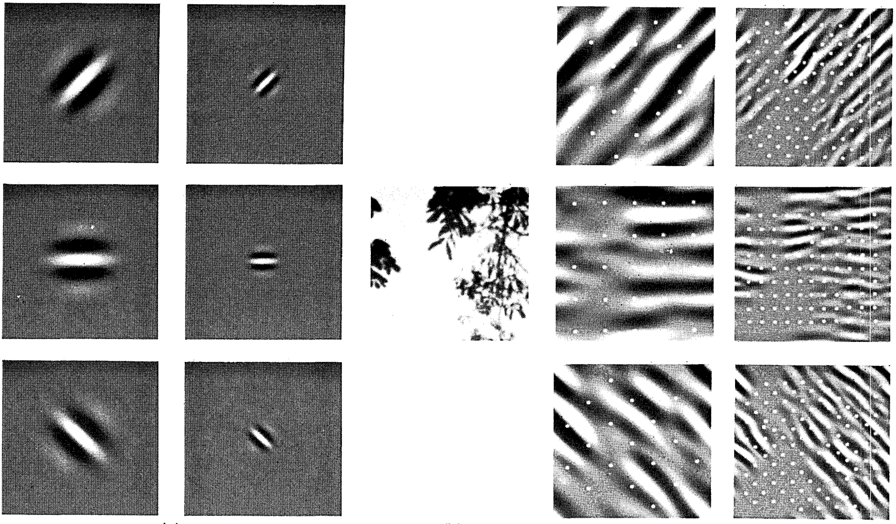

# 7.2 Tích chập cho Ảnh

> Ghi chú của người biên soạn: trang này dịch nguyên văn từ sách *Dive into Deep Learning* của **Aston Zhang, Zachary C. Lipton, Mu Li và Alexander J. Smola** ([bản gốc](https://d2l.ai/chapter_convolutional-neural-networks/conv-layer.html), [mã nguồn](https://github.com/d2l-ai/d2l-en), giấy phép [CC BY-SA 4.0](https://creativecommons.org/licenses/by-sa/4.0/); code theo giấy phép MIT-0). Chỉ giữ code PyTorch. Số mục, hình và công thức giữ như bản HTML d2l.ai; thuật ngữ đối chiếu với bản dịch [Đắm mình vào Học Sâu](https://github.com/aivivn/d2l-vn).

Giờ đây khi đã hiểu cách các tầng tích chập hoạt động về mặt lý thuyết, ta đã sẵn sàng để xem chúng hoạt động trong thực tế như thế nào. Dựa trên động lực coi mạng neuron tích chập là kiến trúc hiệu quả để khai thác cấu trúc trong dữ liệu ảnh, ta tiếp tục dùng ảnh làm ví dụ xuyên suốt.

<!-- run -->
```python
from d2l import torch as d2l
import torch
from torch import nn
```

## 7.2.1 Phép Tương quan Chéo

Hãy nhớ lại rằng, nói một cách chặt chẽ, tên gọi tầng tích chập là không chính xác, vì phép toán mà chúng thực hiện được mô tả chính xác hơn là phép tương quan chéo. Dựa trên mô tả về tầng tích chập trong [Mục 7.1](dl/ch07_s1_vi), trong một tầng như vậy, một tensor đầu vào và một tensor kernel được kết hợp để tạo ra một tensor đầu ra thông qua một phép tương quan chéo.

Tạm thời hãy bỏ qua các kênh và xem phép toán này hoạt động như thế nào với dữ liệu và biểu diễn ẩn hai chiều. Trong [Hình 7.2.1](dl/ch07_s2_vi?id=fig-correlation), đầu vào là một tensor hai chiều có chiều cao bằng 3 và chiều rộng bằng 3. Ta ký hiệu kích thước của tensor là $3 \times 3$ hoặc ($3$, $3$). Chiều cao và chiều rộng của kernel đều bằng 2. Kích thước của *cửa sổ kernel* (kernel window) (hay *cửa sổ tích chập* – convolution window) được xác định bởi chiều cao và chiều rộng của kernel (ở đây là $2 \times 2$).

<div align=center id="fig-correlation">

</div>
<div align=center>Hình 7.2.1: Phép tương quan chéo hai chiều. Các phần tô đậm là phần tử đầu ra đầu tiên cùng với các phần tử của tensor đầu vào và tensor kernel được dùng để tính đầu ra đó: $0\times0+1\times1+3\times2+4\times3=19$.</div>

Trong phép tương quan chéo hai chiều, ta bắt đầu với cửa sổ tích chập đặt ở góc trên bên trái của tensor đầu vào và trượt nó qua tensor đầu vào, cả từ trái sang phải lẫn từ trên xuống dưới. Khi cửa sổ tích chập trượt đến một vị trí nhất định, tensor con của đầu vào nằm trong cửa sổ đó và tensor kernel được nhân theo từng phần tử, rồi tensor kết quả được lấy tổng để cho ra một giá trị số vô hướng duy nhất. Kết quả này là giá trị của tensor đầu ra tại vị trí tương ứng. Ở đây, tensor đầu ra có chiều cao bằng 2 và chiều rộng bằng 2, và bốn phần tử của nó được tính từ phép tương quan chéo hai chiều:

$$
\begin{gathered}
0\times0+1\times1+3\times2+4\times3=19,\\
1\times0+2\times1+4\times2+5\times3=25,\\
3\times0+4\times1+6\times2+7\times3=37,\\
4\times0+5\times1+7\times2+8\times3=43.
\end{gathered}
$$

Lưu ý rằng dọc theo mỗi trục, kích thước đầu ra nhỏ hơn kích thước đầu vào một chút. Vì kernel có chiều rộng và chiều cao lớn hơn $1$, ta chỉ có thể tính đúng phép tương quan chéo tại những vị trí mà kernel nằm trọn trong ảnh, nên kích thước đầu ra bằng kích thước đầu vào $n_\textrm{h} \times n_\textrm{w}$ trừ đi kích thước kernel tích chập $k_\textrm{h} \times k_\textrm{w}$ theo công thức

$$
(n_\textrm{h}-k_\textrm{h}+1) \times (n_\textrm{w}-k_\textrm{w}+1).
$$

Điều này là do ta cần đủ chỗ để "dịch" kernel tích chập qua ảnh. Sau này ta sẽ thấy cách giữ nguyên kích thước bằng cách đệm các số không quanh biên ảnh để có đủ chỗ dịch kernel. Tiếp theo, ta cài đặt quá trình này trong hàm `corr2d`, hàm nhận một tensor đầu vào `X` và một tensor kernel `K` rồi trả về một tensor đầu ra `Y`.

<!-- run -->
```python
def corr2d(X, K):  #@save
    """Tính tương quan chéo hai chiều."""
    h, w = K.shape
    Y = d2l.zeros((X.shape[0] - h + 1, X.shape[1] - w + 1))
    for i in range(Y.shape[0]):
        for j in range(Y.shape[1]):
            Y[i, j] = d2l.reduce_sum((X[i: i + h, j: j + w] * K))
    return Y
```

Ta có thể dựng tensor đầu vào `X` và tensor kernel `K` từ [Hình 7.2.1](dl/ch07_s2_vi?id=fig-correlation) để kiểm chứng đầu ra của cách cài đặt trên cho phép tương quan chéo hai chiều.

<!-- run -->
```python
X = d2l.tensor([[0.0, 1.0, 2.0], [3.0, 4.0, 5.0], [6.0, 7.0, 8.0]])
K = d2l.tensor([[0.0, 1.0], [2.0, 3.0]])
corr2d(X, K)
```

<!-- output -->
```output
tensor([[19., 25.],
        [37., 43.]])
```
<!-- /output -->

## 7.2.2 Tầng Tích chập

Một tầng tích chập thực hiện phép tương quan chéo giữa đầu vào và kernel rồi cộng thêm một hệ số điều chỉnh vô hướng để tạo ra đầu ra. Hai tham số của một tầng tích chập là kernel và hệ số điều chỉnh vô hướng. Khi huấn luyện các mô hình dựa trên tầng tích chập, ta thường khởi tạo các kernel một cách ngẫu nhiên, giống như với một tầng kết nối đầy đủ.

Giờ ta đã sẵn sàng để cài đặt một tầng tích chập hai chiều dựa trên hàm `corr2d` định nghĩa ở trên. Trong phương thức khởi tạo `__init__`, ta khai báo `weight` và `bias` là hai tham số của mô hình. Phương thức lan truyền xuôi gọi hàm `corr2d` và cộng thêm hệ số điều chỉnh.

<!-- run -->
```python
class Conv2D(nn.Module):
    def __init__(self, kernel_size):
        super().__init__()
        self.weight = nn.Parameter(torch.rand(kernel_size))
        self.bias = nn.Parameter(torch.zeros(1))

    def forward(self, x):
        return corr2d(x, self.weight) + self.bias
```

Trong phép tích chập $h \times w$ hay một kernel tích chập $h \times w$, chiều cao và chiều rộng của kernel tích chập lần lượt là $h$ và $w$. Ta cũng gọi một tầng tích chập có kernel tích chập $h \times w$ đơn giản là một tầng tích chập $h \times w$.

## 7.2.3 Phát hiện Biên của Vật thể trong Ảnh

Hãy dành chút thời gian để phân tích một ứng dụng đơn giản của tầng tích chập: phát hiện biên của một vật thể trong ảnh bằng cách tìm vị trí mà điểm ảnh thay đổi. Trước tiên, ta dựng một "ảnh" kích thước $6\times 8$ điểm ảnh. Bốn cột ở giữa có màu đen ($0$) và phần còn lại màu trắng ($1$).

<!-- run -->
```python
X = d2l.ones((6, 8))
X[:, 2:6] = 0
X
```

<!-- output -->
```output
tensor([[1., 1., 0., 0., 0., 0., 1., 1.],
        [1., 1., 0., 0., 0., 0., 1., 1.],
        [1., 1., 0., 0., 0., 0., 1., 1.],
        [1., 1., 0., 0., 0., 0., 1., 1.],
        [1., 1., 0., 0., 0., 0., 1., 1.],
        [1., 1., 0., 0., 0., 0., 1., 1.]])
```
<!-- /output -->

Tiếp theo, ta dựng một kernel `K` có chiều cao bằng 1 và chiều rộng bằng 2. Khi thực hiện phép tương quan chéo với đầu vào, nếu các phần tử kề nhau theo chiều ngang bằng nhau thì đầu ra bằng 0. Ngược lại, đầu ra khác không. Lưu ý rằng kernel này là một trường hợp đặc biệt của toán tử sai phân hữu hạn. Tại vị trí $(i,j)$ nó tính $x_{i,j} - x_{(i+1),j}$, tức là nó tính hiệu giữa giá trị của các điểm ảnh kề nhau theo chiều ngang. Đây là một xấp xỉ rời rạc của đạo hàm bậc nhất theo phương ngang. Suy cho cùng, với một hàm $f(i,j)$, đạo hàm của nó là $-\partial_i f(i,j) = \lim_{\epsilon \to 0} \frac{f(i,j) - f(i+\epsilon,j)}{\epsilon}$. Hãy xem điều này hoạt động thế nào trong thực tế.

<!-- run -->
```python
K = d2l.tensor([[1.0, -1.0]])
```

Ta đã sẵn sàng thực hiện phép tương quan chéo với các đối số `X` (đầu vào) và `K` (kernel). Như bạn có thể thấy, ta phát hiện được $1$ ở biên chuyển từ trắng sang đen và $-1$ ở biên chuyển từ đen sang trắng. Mọi đầu ra khác đều có giá trị $0$.

<!-- run -->
```python
Y = corr2d(X, K)
Y
```

<!-- output -->
```output
tensor([[ 0.,  1.,  0.,  0.,  0., -1.,  0.],
        [ 0.,  1.,  0.,  0.,  0., -1.,  0.],
        [ 0.,  1.,  0.,  0.,  0., -1.,  0.],
        [ 0.,  1.,  0.,  0.,  0., -1.,  0.],
        [ 0.,  1.,  0.,  0.,  0., -1.,  0.],
        [ 0.,  1.,  0.,  0.,  0., -1.,  0.]])
```
<!-- /output -->

Giờ ta có thể áp dụng kernel này lên ảnh đã chuyển vị. Đúng như dự đoán, kết quả triệt tiêu. Kernel `K` chỉ phát hiện được các biên dọc.

<!-- run -->
```python
corr2d(d2l.transpose(X), K)
```

<!-- output -->
```output
tensor([[0., 0., 0., 0., 0.],
        [0., 0., 0., 0., 0.],
        [0., 0., 0., 0., 0.],
        [0., 0., 0., 0., 0.],
        [0., 0., 0., 0., 0.],
        [0., 0., 0., 0., 0.],
        [0., 0., 0., 0., 0.],
        [0., 0., 0., 0., 0.]])
```
<!-- /output -->

## 7.2.4 Học một Kernel

Thiết kế một bộ phát hiện biên bằng sai phân hữu hạn `[1, -1]` là gọn gàng nếu ta biết chính xác đây là thứ ta đang tìm. Tuy nhiên, khi xét những kernel lớn hơn và các tầng tích chập nối tiếp nhau, có thể không thể chỉ định thủ công chính xác mỗi bộ lọc nên làm gì.

Giờ hãy xem liệu ta có thể học được kernel đã tạo ra `Y` từ `X` chỉ bằng cách nhìn vào các cặp đầu vào–đầu ra hay không. Đầu tiên, ta dựng một tầng tích chập và khởi tạo kernel của nó bằng một tensor ngẫu nhiên. Tiếp theo, trong mỗi vòng lặp, ta sẽ dùng sai số bình phương để so sánh `Y` với đầu ra của tầng tích chập. Sau đó ta có thể tính gradient để cập nhật kernel. Để đơn giản, dưới đây ta dùng lớp có sẵn cho tầng tích chập hai chiều và bỏ qua hệ số điều chỉnh.

<!-- run -->
```python
# Dựng một tầng tích chập hai chiều với 1 kênh đầu ra và kernel kích thước
# (1, 2). Để đơn giản, ở đây ta bỏ qua hệ số điều chỉnh
conv2d = nn.LazyConv2d(1, kernel_size=(1, 2), bias=False)

# Tầng tích chập hai chiều dùng đầu vào và đầu ra bốn chiều theo định dạng
# (mẫu, kênh, chiều cao, chiều rộng), trong đó kích thước batch (số mẫu
# trong batch) và số kênh đều bằng 1
X = X.reshape((1, 1, 6, 8))
Y = Y.reshape((1, 1, 6, 7))
lr = 3e-2  # Tốc độ học

for i in range(10):
    Y_hat = conv2d(X)
    l = (Y_hat - Y) ** 2
    conv2d.zero_grad()
    l.sum().backward()
    # Cập nhật kernel
    conv2d.weight.data[:] -= lr * conv2d.weight.grad
    if (i + 1) % 2 == 0:
        print(f'epoch {i + 1}, loss {l.sum():.3f}')
```

<!-- output -->
```output
epoch 2, loss 12.996
epoch 4, loss 2.199
epoch 6, loss 0.377
epoch 8, loss 0.066
epoch 10, loss 0.012
```
<!-- /output -->

Lưu ý rằng sai số đã giảm xuống một giá trị nhỏ sau 10 vòng lặp. Giờ ta sẽ xem tensor kernel mà ta đã học được.

<!-- run -->
```python
d2l.reshape(conv2d.weight.data, (1, 2))
```

<!-- output -->
```output
tensor([[ 0.9861, -0.9765]])
```
<!-- /output -->

Quả thật, tensor kernel học được rất gần với tensor kernel `K` mà ta đã định nghĩa trước đó.

## 7.2.5 Tương quan Chéo và Tích chập

Hãy nhớ lại nhận xét của ta trong [Mục 7.1](dl/ch07_s1_vi) về sự tương ứng giữa phép tương quan chéo và phép tích chập. Ở đây ta tiếp tục xét các tầng tích chập hai chiều. Điều gì sẽ xảy ra nếu các tầng này thực hiện phép tích chập chặt chẽ như được định nghĩa trong [(7.1.2)](dl/ch07_s1_vi) thay vì phép tương quan chéo? Để có được đầu ra của phép *tích chập* chặt chẽ, ta chỉ cần lật tensor kernel hai chiều theo cả chiều ngang lẫn chiều dọc, rồi thực hiện phép *tương quan chéo* với tensor đầu vào.

Đáng chú ý là vì các kernel được học từ dữ liệu trong học sâu, đầu ra của các tầng tích chập không bị ảnh hưởng dù các tầng đó thực hiện phép tích chập chặt chẽ hay phép tương quan chéo.

Để minh họa điều này, giả sử một tầng tích chập thực hiện phép *tương quan chéo* và học được kernel trong [Hình 7.2.1](dl/ch07_s2_vi?id=fig-correlation), ở đây được ký hiệu là ma trận $\mathbf{K}$. Giả sử các điều kiện khác không đổi, khi tầng này thay vào đó thực hiện phép *tích chập* chặt chẽ, kernel học được $\mathbf{K}'$ sẽ giống $\mathbf{K}$ sau khi $\mathbf{K}'$ được lật theo cả chiều ngang lẫn chiều dọc. Nghĩa là, khi tầng tích chập thực hiện phép *tích chập* chặt chẽ với đầu vào trong [Hình 7.2.1](dl/ch07_s2_vi?id=fig-correlation) và $\mathbf{K}'$, ta sẽ thu được cùng đầu ra như trong [Hình 7.2.1](dl/ch07_s2_vi?id=fig-correlation) (tương quan chéo của đầu vào và $\mathbf{K}$).

Để nhất quán với thuật ngữ tiêu chuẩn trong tài liệu học sâu, ta sẽ tiếp tục gọi phép tương quan chéo là tích chập dù, nói một cách chặt chẽ, nó hơi khác một chút. Ngoài ra, ta dùng thuật ngữ *phần tử* (element) để chỉ một mục (hay thành phần) của bất kỳ tensor nào biểu diễn một biểu diễn của tầng hoặc một kernel tích chập.

## 7.2.6 Ánh xạ Đặc trưng và Vùng Tiếp nhận

Như đã mô tả trong [Mục 7.1.4](dl/ch07_s1_vi), đầu ra của tầng tích chập trong [Hình 7.2.1](dl/ch07_s2_vi?id=fig-correlation) đôi khi được gọi là một *ánh xạ đặc trưng* (feature map), vì nó có thể được xem là các biểu diễn (đặc trưng) đã học được theo các chiều không gian (chẳng hạn chiều rộng và chiều cao) để truyền cho tầng tiếp theo. Trong CNN, với bất kỳ phần tử $x$ nào của một tầng, *vùng tiếp nhận* (receptive field) của nó là tất cả các phần tử (từ tất cả các tầng phía trước) có thể ảnh hưởng đến việc tính $x$ trong quá trình lan truyền xuôi. Lưu ý rằng vùng tiếp nhận có thể lớn hơn kích thước thực tế của đầu vào.

Hãy tiếp tục dùng [Hình 7.2.1](dl/ch07_s2_vi?id=fig-correlation) để giải thích vùng tiếp nhận. Với kernel tích chập $2 \times 2$, vùng tiếp nhận của phần tử đầu ra được tô đậm (có giá trị $19$) là bốn phần tử trong phần tô đậm của đầu vào. Giờ hãy ký hiệu đầu ra $2 \times 2$ là $\mathbf{Y}$ và xét một CNN sâu hơn với một tầng tích chập $2 \times 2$ bổ sung nhận $\mathbf{Y}$ làm đầu vào và cho ra một phần tử duy nhất $z$. Trong trường hợp này, vùng tiếp nhận của $z$ trên $\mathbf{Y}$ gồm cả bốn phần tử của $\mathbf{Y}$, còn vùng tiếp nhận trên đầu vào gồm cả chín phần tử đầu vào. Do đó, khi bất kỳ phần tử nào trong một ánh xạ đặc trưng cần một vùng tiếp nhận lớn hơn để phát hiện các đặc trưng đầu vào trên một vùng rộng hơn, ta có thể xây dựng một mạng sâu hơn.

Vùng tiếp nhận lấy tên từ ngành sinh lý học thần kinh. Một loạt thí nghiệm trên nhiều loài động vật với các kích thích khác nhau ([Hubel và Wiesel, 1959](dl/ch07_s2_vi?id=ref-hubel-wiesel-1959); [Hubel và Wiesel, 1962](dl/ch07_s2_vi?id=ref-hubel-wiesel-1962); [Hubel và Wiesel, 1968](dl/ch07_s2_vi?id=ref-hubel-wiesel-1968)) đã khảo sát phản ứng của vùng được gọi là vỏ não thị giác với các kích thích đó. Nhìn chung, họ phát hiện rằng các cấp thấp phản ứng với các cạnh và những hình dạng liên quan. Sau đó, [Field (1987)](dl/ch07_s2_vi?id=ref-field-1987) đã minh họa hiệu ứng này trên ảnh tự nhiên bằng những thứ chỉ có thể gọi là kernel tích chập. Chúng tôi in lại một hình quan trọng trong [Hình 7.2.2](dl/ch07_s2_vi?id=field-visual) để minh họa những điểm tương đồng nổi bật.

<div align=center id="field-visual">

</div>
<div align=center>Hình 7.2.2: Hình và chú thích lấy từ [Field (1987)](dl/ch07_s2_vi?id=ref-field-1987): Một ví dụ về mã hóa với sáu kênh khác nhau. (Trái) Ví dụ về sáu loại cảm biến gắn với mỗi kênh. (Phải) Tích chập của ảnh ở (Giữa) với sáu cảm biến ở (Trái). Phản hồi của từng cảm biến được xác định bằng cách lấy mẫu các ảnh đã lọc này tại các khoảng cách tỉ lệ với kích thước của cảm biến (biểu diễn bằng các chấm). Sơ đồ này chỉ thể hiện phản hồi của các cảm biến đối xứng chẵn.</div>

Hóa ra mối quan hệ này còn đúng cả với các đặc trưng được tính bởi các tầng sâu hơn của những mạng được huấn luyện cho bài toán phân loại ảnh, như được chứng minh trong, chẳng hạn, [Kuzovkin *et al.* (2018)](dl/ch07_s2_vi?id=ref-kuzovkin-vicente-petton-ea-2018). Chỉ cần nói rằng tích chập đã chứng tỏ là một công cụ cực kỳ mạnh mẽ cho thị giác máy tính, cả trong sinh học lẫn trong code. Vì thế, (nhìn lại thì) không có gì ngạc nhiên khi chúng mở đường cho thành công gần đây của học sâu.

## 7.2.7 Tóm tắt

Phép tính cốt lõi cần cho một tầng tích chập là phép tương quan chéo. Ta đã thấy rằng chỉ cần một vòng lặp for lồng nhau đơn giản để tính giá trị của nó. Nếu có nhiều kênh đầu vào và nhiều kênh đầu ra, ta đang thực hiện một phép toán ma trận–ma trận giữa các kênh. Có thể thấy, phép tính này đơn giản và, quan trọng nhất, có tính *cục bộ* cao. Điều này cho phép tối ưu hóa phần cứng đáng kể và nhiều kết quả gần đây trong thị giác máy tính chỉ có được nhờ điều đó. Suy cho cùng, điều này có nghĩa là các nhà thiết kế chip có thể đầu tư vào tính toán nhanh thay vì bộ nhớ khi tối ưu cho tích chập. Dù điều này có thể không dẫn đến các thiết kế tối ưu cho những ứng dụng khác, nó mở ra cánh cửa cho thị giác máy tính phổ biến và giá cả phải chăng.

Về bản thân tích chập, chúng có thể được dùng cho nhiều mục đích, chẳng hạn phát hiện cạnh và đường thẳng, làm mờ ảnh, hoặc làm sắc nét ảnh. Quan trọng nhất, nhà thống kê (hay kỹ sư) không cần phải tự nghĩ ra các bộ lọc phù hợp. Thay vào đó, ta có thể đơn giản *học* chúng từ dữ liệu. Điều này thay thế các phương pháp kinh nghiệm trong thiết kế đặc trưng bằng thống kê dựa trên bằng chứng. Cuối cùng, và khá thú vị, những bộ lọc này không chỉ có lợi cho việc xây dựng mạng sâu mà còn tương ứng với vùng tiếp nhận và ánh xạ đặc trưng trong não bộ. Điều này cho ta niềm tin rằng mình đang đi đúng hướng.

## 7.2.8 Bài tập

1. Dựng một ảnh `X` có các biên chéo.
    1. Điều gì xảy ra nếu bạn áp dụng kernel `K` trong mục này lên nó?
    1. Điều gì xảy ra nếu bạn chuyển vị `X`?
    1. Điều gì xảy ra nếu bạn chuyển vị `K`?
1. Tự thiết kế một số kernel.
    1. Cho một vector chỉ phương $\mathbf{v} = (v_1, v_2)$, hãy suy ra một kernel phát hiện biên có khả năng phát hiện các biên vuông góc với $\mathbf{v}$, tức là các biên theo hướng $(v_2, -v_1)$.
    1. Suy ra một toán tử sai phân hữu hạn cho đạo hàm bậc hai. Kích thước tối thiểu của kernel tích chập tương ứng là bao nhiêu? Những cấu trúc nào trong ảnh phản hồi mạnh nhất với nó?
    1. Bạn sẽ thiết kế một kernel làm mờ như thế nào? Vì sao bạn có thể muốn dùng một kernel như vậy?
    1. Kích thước tối thiểu của một kernel để thu được đạo hàm bậc $d$ là bao nhiêu?
1. Khi bạn cố tự động tìm gradient cho lớp `Conv2D` mà ta đã tạo, bạn thấy thông báo lỗi loại gì?
1. Làm thế nào để biểu diễn phép tương quan chéo dưới dạng một phép nhân ma trận bằng cách thay đổi tensor đầu vào và tensor kernel?

[Thảo luận (tiếng Anh)](https://discuss.d2l.ai/t/66)

## Tài liệu tham khảo

- <a id="ref-hubel-wiesel-1959"></a>Hubel, David H, Wiesel, Torsten N (1959). *Receptive fields of single neurones in the cat's striate cortex*. Journal of Physiology.
- <a id="ref-hubel-wiesel-1962"></a>Hubel, David H, Wiesel, Torsten N (1962). *Receptive fields, binocular interaction and functional architecture in the cat's visual cortex*. Journal of Physiology.
- <a id="ref-hubel-wiesel-1968"></a>Hubel, David H, Wiesel, Torsten N (1968). *Receptive fields and functional architecture of monkey striate cortex*. Journal of Physiology.
- <a id="ref-field-1987"></a>Field, David J (1987). *Relations between the statistics of natural images and the response properties of cortical cells*. JOSA A.
- <a id="ref-kuzovkin-vicente-petton-ea-2018"></a>Kuzovkin, Ilya, Vicente, Raul, Petton, Mathilde, ... (2018). *Activations of deep convolutional neural networks are aligned with gamma band activity of human visual cortex*. Communications Biology.
