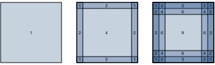
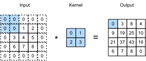
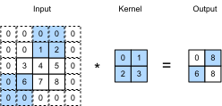

# 7.3 Đệm và Sải bước

> Ghi chú của người biên soạn: trang này dịch nguyên văn từ sách *Dive into Deep Learning* của **Aston Zhang, Zachary C. Lipton, Mu Li và Alexander J. Smola** ([bản gốc](https://d2l.ai/chapter_convolutional-neural-networks/padding-and-strides.html), [mã nguồn](https://github.com/d2l-ai/d2l-en), giấy phép [CC BY-SA 4.0](https://creativecommons.org/licenses/by-sa/4.0/); code theo giấy phép MIT-0). Chỉ giữ code PyTorch. Số mục, hình và công thức giữ như bản HTML d2l.ai; thuật ngữ đối chiếu với bản dịch [Đắm mình vào Học Sâu](https://github.com/aivivn/d2l-vn).
>
> **Đính chính** *(người biên soạn)*:
>
> - Mục 7.3.3, đoạn thứ hai: bản gốc viết "sải bước ngang $s_\textrm{h}$ và sải bước dọc $s_\textrm{w}$". Theo ký hiệu của chính mục này, $s_\textrm{h}$ là sải bước theo chiều cao (chiều **dọc**) và $s_\textrm{w}$ là sải bước theo chiều rộng (chiều **ngang**). Bản dịch giữ nguyên văn; ý của câu không đổi vì chỉ xét trường hợp hai sải bước bằng nhau.

Hãy nhớ lại ví dụ về tích chập trong [Hình 7.2.1](dl/ch07_s2_vi?id=fig-correlation). Đầu vào có chiều cao và chiều rộng đều bằng 3 và kernel tích chập có chiều cao và chiều rộng đều bằng 2, cho ra một biểu diễn đầu ra có kích thước $2\times2$. Giả sử kích thước đầu vào là $n_\textrm{h}\times n_\textrm{w}$ và kích thước kernel tích chập là $k_\textrm{h}\times k_\textrm{w}$, kích thước đầu ra sẽ là $(n_\textrm{h}-k_\textrm{h}+1) \times (n_\textrm{w}-k_\textrm{w}+1)$: ta chỉ có thể dịch kernel tích chập đến khi hết điểm ảnh để áp dụng tích chập.

Sau đây ta sẽ tìm hiểu một số kỹ thuật, gồm đệm (padding) và tích chập có sải bước (strided convolution), giúp kiểm soát tốt hơn kích thước của đầu ra. Về động lực, lưu ý rằng vì kernel thường có chiều rộng và chiều cao lớn hơn $1$, sau khi áp dụng nhiều phép tích chập liên tiếp, ta thường thu được đầu ra nhỏ hơn đáng kể so với đầu vào. Nếu bắt đầu với một ảnh $240 \times 240$ điểm ảnh, mười tầng tích chập $5 \times 5$ sẽ thu nhỏ ảnh xuống $200 \times 200$ điểm ảnh, cắt mất $30 \%$ ảnh và cùng với đó xóa sạch mọi thông tin thú vị ở biên của ảnh gốc. *Đệm* là công cụ phổ biến nhất để xử lý vấn đề này. Trong các trường hợp khác, ta có thể muốn giảm mạnh số chiều, chẳng hạn khi thấy độ phân giải đầu vào ban đầu quá cồng kềnh. *Tích chập có sải bước* là một kỹ thuật phổ biến có thể giúp ích trong những trường hợp này.

<!-- run -->
```python
import torch
from torch import nn
```

## 7.3.1 Đệm

Như đã mô tả ở trên, một vấn đề khó khi áp dụng các tầng tích chập là ta thường mất các điểm ảnh ở chu vi của ảnh. Hãy xem [Hình 7.3.1](dl/ch07_s3_vi?id=img-conv-reuse), hình mô tả mức độ sử dụng điểm ảnh theo kích thước kernel tích chập và vị trí trong ảnh. Các điểm ảnh ở các góc gần như không được dùng đến.

<div align=center id="img-conv-reuse">

</div>
<div align=center>Hình 7.3.1: Mức độ sử dụng điểm ảnh với các phép tích chập có kích thước lần lượt là $1 \times 1$, $2 \times 2$ và $3 \times 3$.</div>

Vì ta thường dùng các kernel nhỏ, với mỗi phép tích chập ta có thể chỉ mất vài điểm ảnh, nhưng con số này có thể cộng dồn lại khi ta áp dụng nhiều tầng tích chập liên tiếp. Một giải pháp đơn giản cho vấn đề này là thêm các điểm ảnh lấp đầy quanh biên của ảnh đầu vào, qua đó tăng kích thước hiệu dụng của ảnh. Thông thường, ta đặt giá trị của các điểm ảnh thêm vào bằng không. Trong [Hình 7.3.2](dl/ch07_s3_vi?id=img-conv-pad), ta đệm một đầu vào $3 \times 3$, tăng kích thước của nó lên $5 \times 5$. Đầu ra tương ứng khi đó tăng lên thành một ma trận $4 \times 4$. Các phần tô đậm là phần tử đầu ra đầu tiên cùng với các phần tử của tensor đầu vào và tensor kernel được dùng để tính đầu ra đó: $0\times0+0\times1+0\times2+0\times3=0$.

<div align=center id="img-conv-pad">

</div>
<div align=center>Hình 7.3.2: Tương quan chéo hai chiều có đệm.</div>

Nói chung, nếu ta thêm tổng cộng $p_\textrm{h}$ hàng đệm (khoảng một nửa ở trên và một nửa ở dưới) và tổng cộng $p_\textrm{w}$ cột đệm (khoảng một nửa bên trái và một nửa bên phải), kích thước đầu ra sẽ là

$$
(n_\textrm{h}-k_\textrm{h}+p_\textrm{h}+1)\times(n_\textrm{w}-k_\textrm{w}+p_\textrm{w}+1).
$$

Điều này nghĩa là chiều cao và chiều rộng của đầu ra sẽ tăng lần lượt $p_\textrm{h}$ và $p_\textrm{w}$.

Trong nhiều trường hợp, ta sẽ muốn đặt $p_\textrm{h}=k_\textrm{h}-1$ và $p_\textrm{w}=k_\textrm{w}-1$ để đầu vào và đầu ra có cùng chiều cao và chiều rộng. Điều này giúp dễ dự đoán kích thước đầu ra của mỗi tầng hơn khi xây dựng mạng. Giả sử ở đây $k_\textrm{h}$ là số lẻ, ta sẽ đệm $p_\textrm{h}/2$ hàng ở cả hai phía theo chiều cao. Nếu $k_\textrm{h}$ là số chẵn, một khả năng là đệm $\lceil p_\textrm{h}/2\rceil$ hàng ở phía trên đầu vào và $\lfloor p_\textrm{h}/2\rfloor$ hàng ở phía dưới. Ta sẽ đệm hai phía theo chiều rộng theo cùng cách.

CNN thường dùng các kernel tích chập có chiều cao và chiều rộng là số lẻ, như 1, 3, 5 hoặc 7. Chọn kích thước kernel lẻ có lợi ích là ta có thể giữ nguyên số chiều trong khi đệm cùng số hàng ở trên và dưới, và cùng số cột ở trái và phải.

Hơn nữa, thói quen dùng kernel lẻ và đệm để giữ chính xác số chiều này mang lại một lợi ích về mặt ghi chép. Với bất kỳ tensor hai chiều `X` nào, khi kích thước kernel là lẻ và số hàng, cột đệm ở mọi phía bằng nhau, từ đó tạo ra đầu ra có cùng chiều cao và chiều rộng với đầu vào, ta biết rằng đầu ra `Y[i, j]` được tính bằng phép tương quan chéo giữa đầu vào và kernel tích chập với cửa sổ có tâm tại `X[i, j]`.

Trong ví dụ sau, ta tạo một tầng tích chập hai chiều có chiều cao và chiều rộng bằng 3 và đệm 1 điểm ảnh ở mọi phía. Với đầu vào có chiều cao và chiều rộng bằng 8, ta thấy chiều cao và chiều rộng của đầu ra cũng bằng 8.

<!-- run -->
```python
# Ta định nghĩa một hàm hỗ trợ để tính tích chập. Hàm này khởi tạo trọng số
# của tầng tích chập và thực hiện việc tăng, giảm số chiều tương ứng cho đầu
# vào và đầu ra
def comp_conv2d(conv2d, X):
    # (1, 1) nghĩa là kích thước batch và số kênh đều bằng 1
    X = X.reshape((1, 1) + X.shape)
    Y = conv2d(X)
    # Bỏ hai chiều đầu tiên: mẫu và kênh
    return Y.reshape(Y.shape[2:])

# Mỗi phía được đệm 1 hàng và 1 cột, nên tổng cộng có 2 hàng hoặc 2 cột được
# thêm vào
conv2d = nn.LazyConv2d(1, kernel_size=3, padding=1)
X = torch.rand(size=(8, 8))
comp_conv2d(conv2d, X).shape
```

<!-- output -->
```output
torch.Size([8, 8])
```
<!-- /output -->

Khi chiều cao và chiều rộng của kernel tích chập khác nhau, ta có thể làm cho đầu ra và đầu vào có cùng chiều cao và chiều rộng bằng cách đặt số đệm khác nhau cho chiều cao và chiều rộng.

<!-- run -->
```python
# Ta dùng một kernel tích chập có chiều cao 5 và chiều rộng 3. Số đệm ở mỗi
# phía theo chiều cao và chiều rộng lần lượt là 2 và 1
conv2d = nn.LazyConv2d(1, kernel_size=(5, 3), padding=(2, 1))
comp_conv2d(conv2d, X).shape
```

<!-- output -->
```output
torch.Size([8, 8])
```
<!-- /output -->

## 7.3.2 Sải bước

Khi tính tương quan chéo, ta bắt đầu với cửa sổ tích chập ở góc trên bên trái của tensor đầu vào, rồi trượt nó qua mọi vị trí theo cả chiều xuống dưới lẫn sang phải. Trong các ví dụ trước, ta mặc định trượt mỗi lần một phần tử. Tuy nhiên, đôi khi, vì hiệu quả tính toán hoặc vì muốn giảm mẫu (downsample), ta di chuyển cửa sổ nhiều hơn một phần tử mỗi lần, bỏ qua các vị trí ở giữa. Điều này đặc biệt hữu ích nếu kernel tích chập lớn vì nó bao quát một vùng lớn của ảnh bên dưới.

Ta gọi số hàng và số cột đi qua mỗi lần trượt là *sải bước* (stride). Cho đến nay, ta đã dùng sải bước bằng 1 cho cả chiều cao và chiều rộng. Đôi khi, ta có thể muốn dùng sải bước lớn hơn. [Hình 7.3.3](dl/ch07_s3_vi?id=img-conv-stride) minh họa một phép tương quan chéo hai chiều với sải bước bằng 3 theo chiều dọc và 2 theo chiều ngang. Các phần tô đậm là các phần tử đầu ra cùng với các phần tử của tensor đầu vào và tensor kernel được dùng để tính đầu ra: $0\times0+0\times1+1\times2+2\times3=8$, $0\times0+6\times1+0\times2+0\times3=6$. Ta có thể thấy rằng khi tạo ra phần tử thứ hai của cột đầu tiên, cửa sổ tích chập trượt xuống ba hàng. Cửa sổ tích chập trượt sang phải hai cột khi tạo ra phần tử thứ hai của hàng đầu tiên. Khi cửa sổ tích chập tiếp tục trượt sang phải hai cột trên đầu vào, sẽ không có đầu ra nào vì phần tử đầu vào không thể lấp đầy cửa sổ (trừ khi ta thêm một cột đệm nữa).

<div align=center id="img-conv-stride">

</div>
<div align=center>Hình 7.3.3: Tương quan chéo với sải bước lần lượt là 3 theo chiều cao và 2 theo chiều rộng.</div>

Nói chung, khi sải bước theo chiều cao là $s_\textrm{h}$ và sải bước theo chiều rộng là $s_\textrm{w}$, kích thước đầu ra là

$$
\lfloor(n_\textrm{h}-k_\textrm{h}+p_\textrm{h}+s_\textrm{h})/s_\textrm{h}\rfloor \times \lfloor(n_\textrm{w}-k_\textrm{w}+p_\textrm{w}+s_\textrm{w})/s_\textrm{w}\rfloor.
$$

Nếu ta đặt $p_\textrm{h}=k_\textrm{h}-1$ và $p_\textrm{w}=k_\textrm{w}-1$, kích thước đầu ra có thể được đơn giản hóa thành $\lfloor(n_\textrm{h}+s_\textrm{h}-1)/s_\textrm{h}\rfloor \times \lfloor(n_\textrm{w}+s_\textrm{w}-1)/s_\textrm{w}\rfloor$. Tiến thêm một bước, nếu chiều cao và chiều rộng của đầu vào chia hết cho sải bước theo chiều cao và chiều rộng, kích thước đầu ra sẽ là $(n_\textrm{h}/s_\textrm{h}) \times (n_\textrm{w}/s_\textrm{w})$.

Dưới đây, ta đặt sải bước theo cả chiều cao và chiều rộng bằng 2, qua đó giảm một nửa chiều cao và chiều rộng của đầu vào.

<!-- run -->
```python
conv2d = nn.LazyConv2d(1, kernel_size=3, padding=1, stride=2)
comp_conv2d(conv2d, X).shape
```

<!-- output -->
```output
torch.Size([4, 4])
```
<!-- /output -->

Hãy xem một ví dụ phức tạp hơn một chút.

<!-- run -->
```python
conv2d = nn.LazyConv2d(1, kernel_size=(3, 5), padding=(0, 1), stride=(3, 4))
comp_conv2d(conv2d, X).shape
```

<!-- output -->
```output
torch.Size([2, 2])
```
<!-- /output -->

## 7.3.3 Tóm tắt và Thảo luận

Đệm có thể tăng chiều cao và chiều rộng của đầu ra. Kỹ thuật này thường được dùng để đầu ra có cùng chiều cao và chiều rộng với đầu vào, tránh việc đầu ra bị co lại ngoài ý muốn. Hơn nữa, nó đảm bảo mọi điểm ảnh được sử dụng với tần suất như nhau. Thông thường ta chọn đệm đối xứng ở hai phía theo chiều cao và chiều rộng của đầu vào. Trong trường hợp này ta nói đến đệm $(p_\textrm{h}, p_\textrm{w})$. Phổ biến nhất là đặt $p_\textrm{h} = p_\textrm{w}$, khi đó ta chỉ đơn giản nói rằng ta chọn đệm $p$.

Một quy ước tương tự áp dụng cho sải bước. Khi sải bước ngang $s_\textrm{h}$ và sải bước dọc $s_\textrm{w}$ bằng nhau, ta chỉ đơn giản nói về sải bước $s$. Sải bước có thể giảm độ phân giải của đầu ra, chẳng hạn giảm chiều cao và chiều rộng của đầu ra xuống chỉ còn $1/n$ chiều cao và chiều rộng của đầu vào với $n > 1$. Theo mặc định, đệm bằng 0 và sải bước bằng 1.

Cho đến nay, mọi kiểu đệm mà ta thảo luận chỉ đơn giản mở rộng ảnh bằng các số không. Điều này có lợi ích tính toán đáng kể vì rất dễ thực hiện. Hơn nữa, các toán tử có thể được thiết kế để tận dụng kiểu đệm này một cách ngầm định mà không cần cấp phát thêm bộ nhớ. Đồng thời, nó cho phép CNN mã hóa thông tin vị trí ngầm định trong ảnh, chỉ đơn giản bằng cách học xem "khoảng trắng" nằm ở đâu. Có nhiều phương án thay thế cho đệm số không. [Alsallakh *et al.* (2020)](dl/ch07_s3_vi?id=ref-alsallakh-kokhlikyan-miglani-ea-2020) đã cung cấp một tổng quan bao quát về chúng (dù không đưa ra trường hợp rõ ràng về khi nào nên dùng đệm khác không, trừ khi xuất hiện các hiện tượng bất thường).

## 7.3.4 Bài tập

1. Với ví dụ code cuối cùng trong mục này có kích thước kernel $(3, 5)$, đệm $(0, 1)$ và sải bước $(3, 4)$, hãy tính kích thước đầu ra để kiểm tra xem nó có khớp với kết quả thực nghiệm không.
1. Với tín hiệu âm thanh, sải bước bằng 2 tương ứng với điều gì?
1. Cài đặt đệm phản chiếu (mirror padding), tức là kiểu đệm trong đó các giá trị ở biên được phản chiếu để mở rộng tensor.
1. Sải bước lớn hơn 1 có những lợi ích tính toán gì?
1. Sải bước lớn hơn 1 có thể có những lợi ích thống kê gì?
1. Bạn sẽ cài đặt sải bước bằng $\frac{1}{2}$ như thế nào? Nó tương ứng với điều gì? Khi nào điều này hữu ích?

[Thảo luận (tiếng Anh)](https://discuss.d2l.ai/t/68)

## Tài liệu tham khảo

- <a id="ref-alsallakh-kokhlikyan-miglani-ea-2020"></a>Alsallakh, Bilal, Kokhlikyan, Narine, Miglani, Vivek, ... (2020). *Mind the PAD -- CNNs can develop blind spots*. ArXiv:2010.02178.
