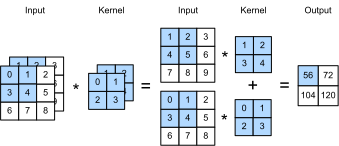
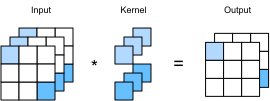

# 7.4 Nhiều Kênh Đầu vào và Nhiều Kênh Đầu ra

> Ghi chú của người biên soạn: trang này dịch nguyên văn từ sách *Dive into Deep Learning* của **Aston Zhang, Zachary C. Lipton, Mu Li và Alexander J. Smola** ([bản gốc](https://d2l.ai/chapter_convolutional-neural-networks/channels.html), [mã nguồn](https://github.com/d2l-ai/d2l-en), giấy phép [CC BY-SA 4.0](https://creativecommons.org/licenses/by-sa/4.0/); code theo giấy phép MIT-0). Chỉ giữ code PyTorch. Số mục, hình và công thức giữ như bản HTML d2l.ai; thuật ngữ đối chiếu với bản dịch [Đắm mình vào Học Sâu](https://github.com/aivivn/d2l-vn).

Dù ta đã mô tả nhiều kênh tạo nên mỗi ảnh (chẳng hạn ảnh màu có các kênh RGB tiêu chuẩn cho biết lượng màu đỏ, lục và lam) và các tầng tích chập nhiều kênh trong [Mục 7.1.4](dl/ch07_s1_vi), cho đến nay ta đã đơn giản hóa mọi ví dụ số bằng cách chỉ làm việc với một kênh đầu vào và một kênh đầu ra duy nhất. Điều này cho phép ta coi đầu vào, kernel tích chập và đầu ra đều là các tensor hai chiều.

Khi đưa thêm kênh vào, cả đầu vào lẫn các biểu diễn ẩn đều trở thành các tensor ba chiều. Chẳng hạn, mỗi ảnh đầu vào RGB có kích thước $3\times h\times w$. Ta gọi trục có kích thước 3 này là chiều *kênh* (channel). Khái niệm kênh lâu đời như chính CNN: chẳng hạn LeNet-5 ([LeCun *et al.*, 1995](dl/ch07_s4_vi?id=ref-lecun-jackel-bottou-ea-1995)) đã dùng chúng. Trong mục này, ta sẽ xem xét kỹ hơn các kernel tích chập có nhiều kênh đầu vào và nhiều kênh đầu ra.

<!-- run -->
```python
from d2l import torch as d2l
import torch
```

## 7.4.1 Nhiều Kênh Đầu vào

Khi dữ liệu đầu vào chứa nhiều kênh, ta cần dựng một kernel tích chập có cùng số kênh đầu vào với dữ liệu đầu vào để có thể thực hiện phép tương quan chéo với dữ liệu đầu vào. Giả sử số kênh của dữ liệu đầu vào là $c_\textrm{i}$, số kênh đầu vào của kernel tích chập cũng cần bằng $c_\textrm{i}$. Nếu cửa sổ của kernel tích chập có kích thước $k_\textrm{h}\times k_\textrm{w}$, thì khi $c_\textrm{i}=1$, ta có thể coi kernel tích chập chỉ là một tensor hai chiều kích thước $k_\textrm{h}\times k_\textrm{w}$.

Tuy nhiên, khi $c_\textrm{i}>1$, ta cần một kernel chứa một tensor kích thước $k_\textrm{h}\times k_\textrm{w}$ cho *mỗi* kênh đầu vào. Ghép nối $c_\textrm{i}$ tensor này lại với nhau cho ra một kernel tích chập kích thước $c_\textrm{i}\times k_\textrm{h}\times k_\textrm{w}$. Vì đầu vào và kernel tích chập đều có $c_\textrm{i}$ kênh, ta có thể thực hiện phép tương quan chéo giữa tensor hai chiều của đầu vào và tensor hai chiều của kernel tích chập cho mỗi kênh, rồi cộng $c_\textrm{i}$ kết quả lại với nhau (lấy tổng theo các kênh) để thu được một tensor hai chiều. Đây là kết quả của phép tương quan chéo hai chiều giữa một đầu vào nhiều kênh và một kernel tích chập nhiều kênh đầu vào.

[Hình 7.4.1](dl/ch07_s4_vi?id=fig-conv-multi-in) đưa ra một ví dụ về phép tương quan chéo hai chiều với hai kênh đầu vào. Các phần tô đậm là phần tử đầu ra đầu tiên cùng với các phần tử của tensor đầu vào và tensor kernel được dùng để tính đầu ra đó: $(1\times1+2\times2+4\times3+5\times4)+(0\times0+1\times1+3\times2+4\times3)=56$.

<div align=center id="fig-conv-multi-in">

</div>
<div align=center>Hình 7.4.1: Phép tương quan chéo với hai kênh đầu vào.</div>

Để chắc chắn rằng ta thực sự hiểu điều gì đang diễn ra ở đây, ta có thể tự cài đặt phép tương quan chéo với nhiều kênh đầu vào. Lưu ý rằng tất cả những gì ta làm là thực hiện phép tương quan chéo trên từng kênh rồi cộng các kết quả lại.

<!-- run -->
```python
def corr2d_multi_in(X, K):
    # Duyệt qua chiều thứ 0 (chiều kênh) của K trước, rồi cộng các kết quả lại
    return sum(d2l.corr2d(x, k) for x, k in zip(X, K))
```

Ta có thể dựng tensor đầu vào `X` và tensor kernel `K` tương ứng với các giá trị trong [Hình 7.4.1](dl/ch07_s4_vi?id=fig-conv-multi-in) để kiểm chứng đầu ra của phép tương quan chéo.

<!-- run -->
```python
X = d2l.tensor([[[0.0, 1.0, 2.0], [3.0, 4.0, 5.0], [6.0, 7.0, 8.0]],
               [[1.0, 2.0, 3.0], [4.0, 5.0, 6.0], [7.0, 8.0, 9.0]]])
K = d2l.tensor([[[0.0, 1.0], [2.0, 3.0]], [[1.0, 2.0], [3.0, 4.0]]])

corr2d_multi_in(X, K)
```

<!-- output -->
```output
tensor([[ 56.,  72.],
        [104., 120.]])
```
<!-- /output -->

## 7.4.2 Nhiều Kênh Đầu ra

Bất kể số kênh đầu vào là bao nhiêu, cho đến nay ta luôn chỉ thu được một kênh đầu ra. Tuy nhiên, như đã thảo luận trong [Mục 7.1.4](dl/ch07_s1_vi), hóa ra việc có nhiều kênh ở mỗi tầng là thiết yếu. Trong các kiến trúc mạng neuron phổ biến nhất, ta thực sự tăng chiều kênh khi đi sâu hơn vào mạng neuron, thường là giảm mẫu để đánh đổi độ phân giải không gian lấy *độ sâu kênh* (channel depth) lớn hơn. Một cách trực quan, bạn có thể coi mỗi kênh như phản hồi với một tập đặc trưng khác nhau. Thực tế phức tạp hơn thế một chút. Một cách diễn giải ngây thơ sẽ cho rằng các biểu diễn được học độc lập theo từng điểm ảnh hoặc từng kênh. Thay vào đó, các kênh được tối ưu để cùng nhau trở nên hữu ích. Điều này nghĩa là thay vì ánh xạ một kênh đơn lẻ thành một bộ phát hiện cạnh, có thể đơn giản là một hướng nào đó trong không gian kênh tương ứng với việc phát hiện cạnh.

Ký hiệu $c_\textrm{i}$ và $c_\textrm{o}$ lần lượt là số kênh đầu vào và đầu ra, và $k_\textrm{h}$ và $k_\textrm{w}$ là chiều cao và chiều rộng của kernel. Để có được đầu ra nhiều kênh, ta có thể tạo một tensor kernel kích thước $c_\textrm{i}\times k_\textrm{h}\times k_\textrm{w}$ cho *mỗi* kênh đầu ra. Ta ghép nối chúng theo chiều kênh đầu ra, để kernel tích chập có kích thước $c_\textrm{o}\times c_\textrm{i}\times k_\textrm{h}\times k_\textrm{w}$. Trong phép tương quan chéo, kết quả trên mỗi kênh đầu ra được tính từ kernel tích chập tương ứng với kênh đầu ra đó và nhận đầu vào từ tất cả các kênh trong tensor đầu vào.

Ta cài đặt một hàm tương quan chéo để tính đầu ra nhiều kênh như dưới đây.

<!-- run -->
```python
def corr2d_multi_in_out(X, K):
    # Duyệt qua chiều thứ 0 của K, mỗi lần thực hiện phép tương quan chéo với
    # đầu vào X. Tất cả các kết quả được xếp chồng lại với nhau
    return d2l.stack([corr2d_multi_in(X, k) for k in K], 0)
```

Ta dựng một kernel tích chập đơn giản có ba kênh đầu ra bằng cách ghép nối tensor kernel `K` với `K+1` và `K+2`.

<!-- run -->
```python
K = d2l.stack((K, K + 1, K + 2), 0)
K.shape
```

<!-- output -->
```output
torch.Size([3, 2, 2, 2])
```
<!-- /output -->

Dưới đây, ta thực hiện phép tương quan chéo giữa tensor đầu vào `X` và tensor kernel `K`. Giờ đầu ra có ba kênh. Kết quả của kênh đầu tiên khớp với kết quả trước đó của tensor đầu vào `X` và kernel nhiều kênh đầu vào, một kênh đầu ra.

<!-- run -->
```python
corr2d_multi_in_out(X, K)
```

<!-- output -->
```output
tensor([[[ 56.,  72.],
         [104., 120.]],

        [[ 76., 100.],
         [148., 172.]],

        [[ 96., 128.],
         [192., 224.]]])
```
<!-- /output -->

## 7.4.3 Tầng Tích chập $1\times 1$

Thoạt nhìn, một phép tích chập $1 \times 1$, tức là $k_\textrm{h} = k_\textrm{w} = 1$, có vẻ không có nhiều ý nghĩa. Suy cho cùng, tích chập tính tương quan giữa các điểm ảnh kề nhau. Phép tích chập $1 \times 1$ rõ ràng không làm vậy. Dù vậy, chúng là các phép toán phổ biến đôi khi được đưa vào thiết kế của các mạng sâu phức tạp ([Lin *et al.*, 2013](dl/ch07_s4_vi?id=ref-lin-chen-yan-2013); [Szegedy *et al.*, 2017](dl/ch07_s4_vi?id=ref-szegedy-ioffe-vanhoucke-ea-2017)). Hãy xem chi tiết hơn nó thực sự làm gì.

Vì dùng cửa sổ nhỏ nhất, phép tích chập $1\times 1$ mất đi khả năng của các tầng tích chập lớn hơn trong việc nhận dạng các khuôn mẫu gồm tương tác giữa các phần tử kề nhau theo chiều cao và chiều rộng. Phép tính duy nhất của tích chập $1\times 1$ diễn ra trên chiều kênh.

[Hình 7.4.2](dl/ch07_s4_vi?id=fig-conv-1x1) minh họa phép tương quan chéo dùng kernel tích chập $1\times 1$ với 3 kênh đầu vào và 2 kênh đầu ra. Lưu ý rằng đầu vào và đầu ra có cùng chiều cao và chiều rộng. Mỗi phần tử ở đầu ra được tính từ một tổ hợp tuyến tính của các phần tử *ở cùng vị trí* trong ảnh đầu vào. Bạn có thể coi tầng tích chập $1\times 1$ như một tầng kết nối đầy đủ được áp dụng tại từng vị trí điểm ảnh để biến đổi $c_\textrm{i}$ giá trị đầu vào tương ứng thành $c_\textrm{o}$ giá trị đầu ra. Vì đây vẫn là một tầng tích chập, các trọng số được dùng chung trên mọi vị trí điểm ảnh. Do đó tầng tích chập $1\times 1$ cần $c_\textrm{o}\times c_\textrm{i}$ trọng số (cộng thêm hệ số điều chỉnh). Cũng lưu ý rằng các tầng tích chập thường được theo sau bởi các hàm phi tuyến. Điều này đảm bảo rằng các phép tích chập $1 \times 1$ không thể đơn giản bị gộp vào các phép tích chập khác.

<div align=center id="fig-conv-1x1">

</div>
<div align=center>Hình 7.4.2: Phép tương quan chéo dùng kernel tích chập $1\times 1$ với ba kênh đầu vào và hai kênh đầu ra. Đầu vào và đầu ra có cùng chiều cao và chiều rộng.</div>

Hãy kiểm tra xem điều này có đúng trong thực tế không: ta cài đặt một phép tích chập $1 \times 1$ bằng một tầng kết nối đầy đủ. Điều duy nhất là ta cần điều chỉnh kích thước dữ liệu một chút trước và sau phép nhân ma trận.

<!-- run -->
```python
def corr2d_multi_in_out_1x1(X, K):
    c_i, h, w = X.shape
    c_o = K.shape[0]
    X = d2l.reshape(X, (c_i, h * w))
    K = d2l.reshape(K, (c_o, c_i))
    # Phép nhân ma trận trong tầng kết nối đầy đủ
    Y = d2l.matmul(K, X)
    return d2l.reshape(Y, (c_o, h, w))
```

Khi thực hiện tích chập $1\times 1$, hàm trên tương đương với hàm tương quan chéo `corr2d_multi_in_out` đã cài đặt trước đó. Hãy kiểm tra điều này với một số dữ liệu mẫu.

<!-- run -->
```python
X = d2l.normal(0, 1, (3, 3, 3))
K = d2l.normal(0, 1, (2, 3, 1, 1))
Y1 = corr2d_multi_in_out_1x1(X, K)
Y2 = corr2d_multi_in_out(X, K)
assert float(d2l.reduce_sum(d2l.abs(Y1 - Y2))) < 1e-6
```

## 7.4.4 Thảo luận

Các kênh cho phép ta kết hợp ưu điểm của cả hai: MLP cho phép các tính phi tuyến đáng kể và tích chập cho phép phân tích đặc trưng một cách *cục bộ*. Cụ thể, các kênh cho phép CNN suy luận với nhiều đặc trưng cùng lúc, chẳng hạn các bộ phát hiện cạnh và hình dạng. Chúng cũng mang lại một sự đánh đổi thực tế giữa việc cắt giảm mạnh số tham số nhờ bất biến tịnh tiến và tính cục bộ, với nhu cầu về các mô hình đa dạng và có khả năng biểu diễn tốt trong thị giác máy tính.

Tuy nhiên, lưu ý rằng sự linh hoạt này có cái giá của nó. Với một ảnh kích thước $(h \times w)$, chi phí tính một phép tích chập $k \times k$ là $\mathcal{O}(h \cdot w \cdot k^2)$. Với lần lượt $c_\textrm{i}$ kênh đầu vào và $c_\textrm{o}$ kênh đầu ra, chi phí này tăng lên thành $\mathcal{O}(h \cdot w \cdot k^2 \cdot c_\textrm{i} \cdot c_\textrm{o})$. Với một ảnh $256 \times 256$ điểm ảnh, kernel $5 \times 5$, và lần lượt $128$ kênh đầu vào và đầu ra, con số này lên tới hơn 53 tỷ phép tính (ta đếm riêng các phép nhân và phép cộng). Sau này ta sẽ gặp các chiến lược hiệu quả để cắt giảm chi phí, chẳng hạn bằng cách yêu cầu các phép toán theo kênh có dạng chéo khối (block-diagonal), dẫn đến các kiến trúc như ResNeXt ([Xie *et al.*, 2017](dl/ch07_s4_vi?id=ref-xie-girshick-dollar-ea-2017)).

## 7.4.5 Bài tập

1. Giả sử ta có hai kernel tích chập có kích thước lần lượt là $k_1$ và $k_2$ (không có hàm phi tuyến ở giữa).
    1. Chứng minh rằng kết quả của phép toán có thể được biểu diễn bằng một phép tích chập duy nhất.
    1. Số chiều của phép tích chập duy nhất tương đương là bao nhiêu?
    1. Điều ngược lại có đúng không, tức là liệu bạn có luôn phân tách được một phép tích chập thành hai phép tích chập nhỏ hơn?
1. Giả sử có một đầu vào kích thước $c_\textrm{i}\times h\times w$ và một kernel tích chập kích thước $c_\textrm{o}\times c_\textrm{i}\times k_\textrm{h}\times k_\textrm{w}$, đệm $(p_\textrm{h}, p_\textrm{w})$ và sải bước $(s_\textrm{h}, s_\textrm{w})$.
    1. Chi phí tính toán (số phép nhân và phép cộng) cho lan truyền xuôi là bao nhiêu?
    1. Lượng bộ nhớ sử dụng là bao nhiêu?
    1. Lượng bộ nhớ sử dụng cho phép tính ngược là bao nhiêu?
    1. Chi phí tính toán cho lan truyền ngược là bao nhiêu?
1. Số phép tính tăng lên bao nhiêu lần nếu ta nhân đôi cả số kênh đầu vào $c_\textrm{i}$ lẫn số kênh đầu ra $c_\textrm{o}$? Điều gì xảy ra nếu ta nhân đôi phần đệm?
1. Các biến `Y1` và `Y2` trong ví dụ cuối cùng của mục này có giống hệt nhau không? Vì sao?
1. Biểu diễn tích chập dưới dạng phép nhân ma trận, ngay cả khi cửa sổ tích chập không phải là $1 \times 1$.
1. Nhiệm vụ của bạn là cài đặt các phép tích chập nhanh với kernel $k \times k$. Một trong các thuật toán ứng viên là quét ngang qua nguồn, đọc một dải rộng $k$ và tính dải đầu ra rộng $1$, mỗi lần một giá trị. Phương án thay thế là đọc một dải rộng $k + \Delta$ và tính một dải đầu ra rộng $\Delta$. Vì sao phương án sau tốt hơn? Có giới hạn nào cho việc chọn $\Delta$ lớn đến đâu không?
1. Giả sử ta có một ma trận $c \times c$.
    1. Nhân với một ma trận chéo khối nhanh hơn bao nhiêu nếu ma trận được chia thành $b$ khối?
    1. Nhược điểm của việc có $b$ khối là gì? Bạn có thể khắc phục nó, ít nhất là một phần, như thế nào?

[Thảo luận (tiếng Anh)](https://discuss.d2l.ai/t/70)

## Tài liệu tham khảo

- <a id="ref-lecun-jackel-bottou-ea-1995"></a>LeCun, Yann, Jackel, LD, Bottou, Leon, ... (1995). *Comparison of learning algorithms for handwritten digit recognition*. International Conference on Artificial Neural Networks.
- <a id="ref-lin-chen-yan-2013"></a>Lin, Min, Chen, Qiang, Yan, Shuicheng (2013). *Network in network*. ArXiv:1312.4400.
- <a id="ref-szegedy-ioffe-vanhoucke-ea-2017"></a>Szegedy, Christian, Ioffe, Sergey, Vanhoucke, Vincent, ... (2017). *Inception-v4, Inception-ResNet and the impact of residual connections on learning*. 31st AAAI Conference on Artificial Intelligence.
- <a id="ref-xie-girshick-dollar-ea-2017"></a>Xie, Saining, Girshick, Ross, Doll\'ar, Piotr, ... (2017). *Aggregated residual transformations for deep neural networks*. Proceedings of the IEEE Conference on Computer Vision and Pattern Recognition.
