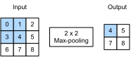

# 7.5 Gộp

> Ghi chú của người biên soạn: trang này dịch nguyên văn từ sách *Dive into Deep Learning* của **Aston Zhang, Zachary C. Lipton, Mu Li và Alexander J. Smola** ([bản gốc](https://d2l.ai/chapter_convolutional-neural-networks/pooling.html), [mã nguồn](https://github.com/d2l-ai/d2l-en), giấy phép [CC BY-SA 4.0](https://creativecommons.org/licenses/by-sa/4.0/); code theo giấy phép MIT-0). Chỉ giữ code PyTorch. Số mục, hình và công thức giữ như bản HTML d2l.ai; thuật ngữ đối chiếu với bản dịch [Đắm mình vào Học Sâu](https://github.com/aivivn/d2l-vn).
>
> **Đính chính** *(người biên soạn)*:
>
> - Mục 7.5.1, đoạn về phát hiện cạnh: bản gốc gọi `X` là "đầu vào của tầng tích chập" nhưng câu sau lại xét `X[i, j]`... như các giá trị đi vào tầng gộp. Đọc đúng ý là: `X` là **đầu ra của tầng tích chập** (cũng là đầu vào của tầng gộp), và `Y[i, j] = 1` chỉ đúng khi trong cửa sổ $2\times 2$ có ít nhất một phần tử bằng 1 (tức là cạnh nằm trong cửa sổ).

Trong nhiều trường hợp, tác vụ cuối cùng của ta đặt ra một câu hỏi tổng thể nào đó về ảnh, chẳng hạn *ảnh có chứa con mèo không?* Do đó, các nút ở tầng cuối cùng của ta nên nhạy với toàn bộ đầu vào. Bằng cách tổng hợp thông tin dần dần, tạo ra các ánh xạ ngày càng thô hơn, ta đạt được mục tiêu cuối cùng là học một biểu diễn tổng thể, trong khi vẫn giữ mọi ưu điểm của các tầng tích chập ở các tầng xử lý trung gian. Càng đi sâu vào mạng, vùng tiếp nhận (so với đầu vào) mà mỗi nút ẩn nhạy cảm càng lớn. Giảm độ phân giải không gian giúp tăng tốc quá trình này, vì các kernel tích chập bao phủ một vùng hiệu dụng lớn hơn.

Hơn nữa, khi phát hiện các đặc trưng cấp thấp, như các cạnh (như đã thảo luận trong [Mục 7.2](dl/ch07_s2_vi)), ta thường muốn các biểu diễn của mình bất biến với phép tịnh tiến ở một mức độ nào đó. Chẳng hạn, nếu ta lấy ảnh `X` có ranh giới rõ nét giữa đen và trắng rồi dịch toàn bộ ảnh sang phải một điểm ảnh, tức là `Z[i, j] = X[i, j + 1]`, thì đầu ra cho ảnh mới `Z` có thể khác biệt rất lớn. Cạnh sẽ bị dịch đi một điểm ảnh. Trong thực tế, các vật thể hầu như không bao giờ xuất hiện ở đúng cùng một chỗ. Thực ra, ngay cả khi dùng chân máy và vật thể đứng yên, rung động của máy ảnh do chuyển động của màn trập cũng có thể dịch mọi thứ đi khoảng một điểm ảnh (các máy ảnh cao cấp được trang bị những tính năng đặc biệt để xử lý vấn đề này).

Mục này giới thiệu các *tầng gộp* (pooling layer), phục vụ hai mục đích: giảm độ nhạy của các tầng tích chập đối với vị trí và giảm mẫu các biểu diễn theo không gian.

<!-- run -->
```python
from d2l import torch as d2l
import torch
from torch import nn
```

## 7.5.1 Gộp Cực đại và Gộp Trung bình

Giống như các tầng tích chập, các toán tử *gộp* gồm một cửa sổ có kích thước cố định được trượt qua mọi vùng của đầu vào theo sải bước của nó, tính ra một đầu ra duy nhất cho mỗi vị trí mà cửa sổ kích thước cố định đi qua (đôi khi gọi là *cửa sổ gộp* – pooling window). Tuy nhiên, khác với phép tương quan chéo giữa đầu vào và kernel trong tầng tích chập, tầng gộp không chứa tham số nào (không có *kernel*). Thay vào đó, các toán tử gộp là tất định, thường tính giá trị lớn nhất hoặc giá trị trung bình của các phần tử trong cửa sổ gộp. Các phép toán này lần lượt được gọi là *gộp cực đại* (maximum pooling, gọi tắt là *max-pooling*) và *gộp trung bình* (average pooling).

*Gộp trung bình* về cơ bản lâu đời như chính CNN. Ý tưởng này giống với việc giảm mẫu một ảnh. Thay vì chỉ lấy giá trị của mỗi điểm ảnh thứ hai (hoặc thứ ba) cho ảnh độ phân giải thấp hơn, ta có thể lấy trung bình các điểm ảnh kề nhau để thu được một ảnh có tỉ số tín hiệu trên nhiễu tốt hơn, vì ta đang kết hợp thông tin từ nhiều điểm ảnh kề nhau. *Gộp cực đại* được giới thiệu trong [Riesenhuber và Poggio (1999)](dl/ch07_s5_vi?id=ref-riesenhuber-poggio-1999) trong bối cảnh khoa học thần kinh nhận thức để mô tả cách thông tin có thể được tổng hợp theo phân cấp nhằm mục đích nhận dạng vật thể; trước đó đã có một phiên bản trong nhận dạng tiếng nói ([Yamaguchi *et al.*, 1990](dl/ch07_s5_vi?id=ref-yamaguchi-sakamoto-akabane-ea-1990)). Trong hầu hết mọi trường hợp, gộp cực đại (như cách nó cũng được gọi) tốt hơn gộp trung bình.

Trong cả hai trường hợp, giống như với toán tử tương quan chéo, ta có thể coi cửa sổ gộp bắt đầu từ góc trên bên trái của tensor đầu vào và trượt qua nó từ trái sang phải và từ trên xuống dưới. Tại mỗi vị trí mà cửa sổ gộp đi đến, nó tính giá trị lớn nhất hoặc giá trị trung bình của tensor con đầu vào nằm trong cửa sổ, tùy theo dùng gộp cực đại hay gộp trung bình.

<div align=center id="fig-pooling">

</div>
<div align=center>Hình 7.5.1: Gộp cực đại với cửa sổ gộp kích thước $2\times 2$. Các phần tô đậm là phần tử đầu ra đầu tiên cùng với các phần tử của tensor đầu vào được dùng để tính đầu ra đó: $\max(0, 1, 3, 4)=4$.</div>

Tensor đầu ra trong [Hình 7.5.1](dl/ch07_s5_vi?id=fig-pooling) có chiều cao bằng 2 và chiều rộng bằng 2. Bốn phần tử được lấy từ giá trị lớn nhất trong mỗi cửa sổ gộp:

$$
\begin{gathered}
\max(0, 1, 3, 4)=4,\\
\max(1, 2, 4, 5)=5,\\
\max(3, 4, 6, 7)=7,\\
\max(4, 5, 7, 8)=8.
\end{gathered}
$$

Tổng quát hơn, ta có thể định nghĩa một tầng gộp $p \times q$ bằng cách tổng hợp trên một vùng có kích thước đó. Quay lại bài toán phát hiện cạnh, ta dùng đầu ra của tầng tích chập làm đầu vào cho phép gộp cực đại $2\times 2$. Ký hiệu `X` là đầu vào của tầng tích chập và `Y` là đầu ra của tầng gộp. Bất kể giá trị của `X[i, j]`, `X[i, j + 1]`, `X[i+1, j]` và `X[i+1, j + 1]` có khác nhau hay không, tầng gộp luôn cho ra `Y[i, j] = 1`. Nghĩa là, khi dùng tầng gộp cực đại $2\times 2$, ta vẫn có thể phát hiện được khuôn mẫu mà tầng tích chập nhận dạng nếu nó dịch chuyển không quá một phần tử theo chiều cao hoặc chiều rộng.

Trong đoạn code dưới đây, ta cài đặt lan truyền xuôi của tầng gộp trong hàm `pool2d`. Hàm này tương tự hàm `corr2d` trong [Mục 7.2](dl/ch07_s2_vi). Tuy nhiên, không cần kernel nào, đầu ra được tính bằng giá trị lớn nhất hoặc giá trị trung bình của mỗi vùng trong đầu vào.

<!-- run -->
```python
def pool2d(X, pool_size, mode='max'):
    p_h, p_w = pool_size
    Y = d2l.zeros((X.shape[0] - p_h + 1, X.shape[1] - p_w + 1))
    for i in range(Y.shape[0]):
        for j in range(Y.shape[1]):
            if mode == 'max':
                Y[i, j] = X[i: i + p_h, j: j + p_w].max()
            elif mode == 'avg':
                Y[i, j] = X[i: i + p_h, j: j + p_w].mean()
    return Y
```

Ta có thể dựng tensor đầu vào `X` trong [Hình 7.5.1](dl/ch07_s5_vi?id=fig-pooling) để kiểm chứng đầu ra của tầng gộp cực đại hai chiều.

<!-- run -->
```python
X = d2l.tensor([[0.0, 1.0, 2.0], [3.0, 4.0, 5.0], [6.0, 7.0, 8.0]])
pool2d(X, (2, 2))
```

<!-- output -->
```output
tensor([[4., 5.],
        [7., 8.]])
```
<!-- /output -->

Ta cũng có thể thử nghiệm với tầng gộp trung bình.

<!-- run -->
```python
pool2d(X, (2, 2), 'avg')
```

<!-- output -->
```output
tensor([[2., 3.],
        [5., 6.]])
```
<!-- /output -->

## 7.5.2 Đệm và Sải bước

Giống như các tầng tích chập, các tầng gộp làm thay đổi kích thước đầu ra. Và như trước, ta có thể điều chỉnh phép toán để đạt được kích thước đầu ra mong muốn bằng cách đệm đầu vào và điều chỉnh sải bước. Ta có thể minh họa việc dùng đệm và sải bước trong các tầng gộp qua tầng gộp cực đại hai chiều có sẵn trong framework học sâu. Trước tiên ta dựng một tensor đầu vào `X` có bốn chiều, trong đó số mẫu (kích thước batch) và số kênh đều bằng 1.

<!-- run -->
```python
X = d2l.reshape(d2l.arange(16, dtype=d2l.float32), (1, 1, 4, 4))
X
```

<!-- output -->
```output
tensor([[[[ 0.,  1.,  2.,  3.],
          [ 4.,  5.,  6.,  7.],
          [ 8.,  9., 10., 11.],
          [12., 13., 14., 15.]]]])
```
<!-- /output -->

Vì phép gộp tổng hợp thông tin từ một vùng, các framework học sâu mặc định cho kích thước cửa sổ gộp và sải bước bằng nhau. Chẳng hạn, nếu ta dùng cửa sổ gộp kích thước `(3, 3)`, mặc định ta sẽ có sải bước `(3, 3)`.

<!-- run -->
```python
pool2d = nn.MaxPool2d(3)
# Phép gộp không có tham số mô hình, nên không cần khởi tạo
pool2d(X)
```

<!-- output -->
```output
tensor([[[[10.]]]])
```
<!-- /output -->

Không cần phải nói, sải bước và đệm có thể được chỉ định thủ công để ghi đè giá trị mặc định của framework nếu cần.

<!-- run -->
```python
pool2d = nn.MaxPool2d(3, padding=1, stride=2)
pool2d(X)
```

<!-- output -->
```output
tensor([[[[ 5.,  7.],
          [13., 15.]],

         [[ 6.,  8.],
          [14., 16.]]]])
```
<!-- /output -->

Tất nhiên, ta có thể chỉ định một cửa sổ gộp hình chữ nhật bất kỳ với chiều cao và chiều rộng tùy ý, như ví dụ dưới đây.

<!-- run -->
```python
pool2d = nn.MaxPool2d((2, 3), stride=(2, 3), padding=(0, 1))
pool2d(X)
```

<!-- output -->
```output
tensor([[[[ 5.,  7.],
          [13., 15.]]]])
```
<!-- /output -->

## 7.5.3 Nhiều Kênh

Khi xử lý dữ liệu đầu vào nhiều kênh, tầng gộp gộp riêng từng kênh đầu vào, thay vì cộng dồn đầu vào theo các kênh như trong tầng tích chập. Điều này nghĩa là số kênh đầu ra của tầng gộp bằng số kênh đầu vào. Dưới đây, ta sẽ ghép nối các tensor `X` và `X + 1` theo chiều kênh để dựng một đầu vào có hai kênh.

<!-- run -->
```python
X = d2l.concat((X, X + 1), 1)
X
```

<!-- output -->
```output
tensor([[[[ 0.,  1.,  2.,  3.],
          [ 4.,  5.,  6.,  7.],
          [ 8.,  9., 10., 11.],
          [12., 13., 14., 15.]],

         [[ 1.,  2.,  3.,  4.],
          [ 5.,  6.,  7.,  8.],
          [ 9., 10., 11., 12.],
          [13., 14., 15., 16.]]]])
```
<!-- /output -->

Như ta có thể thấy, số kênh đầu ra vẫn là hai sau khi gộp.

<!-- run -->
```python
pool2d = nn.MaxPool2d(3, padding=1, stride=2)
pool2d(X)
```

<!-- output -->
```output
tensor([[[[ 5.,  7.],
          [13., 15.]],

         [[ 6.,  8.],
          [14., 16.]]]])
```
<!-- /output -->

## 7.5.4 Tóm tắt

Gộp là một phép toán cực kỳ đơn giản. Nó làm đúng như tên gọi, tổng hợp kết quả trên một cửa sổ giá trị. Mọi ngữ nghĩa của tích chập, như sải bước và đệm, đều áp dụng theo cùng cách như trước. Lưu ý rằng phép gộp không quan tâm đến kênh, tức là nó giữ nguyên số kênh và áp dụng riêng cho từng kênh. Cuối cùng, trong hai lựa chọn gộp phổ biến, gộp cực đại tốt hơn gộp trung bình, vì nó mang lại một mức độ bất biến nhất định cho đầu ra. Một lựa chọn phổ biến là chọn kích thước cửa sổ gộp $2 \times 2$ để giảm độ phân giải không gian của đầu ra xuống còn một phần tư.

Lưu ý rằng có nhiều cách giảm độ phân giải khác ngoài phép gộp. Chẳng hạn, trong gộp ngẫu nhiên (stochastic pooling) ([Zeiler và Fergus, 2013](dl/ch07_s5_vi?id=ref-zeiler-fergus-2013)) và gộp cực đại phân đoạn (fractional max-pooling) ([Graham, 2014](dl/ch07_s5_vi?id=ref-graham-2014)), việc tổng hợp được kết hợp với yếu tố ngẫu nhiên. Điều này có thể cải thiện độ chính xác một chút trong một số trường hợp. Cuối cùng, như ta sẽ thấy sau này với cơ chế tập trung (attention), có những cách tinh tế hơn để tổng hợp trên các đầu ra, chẳng hạn bằng cách dùng sự căn chỉnh giữa một truy vấn và các vector biểu diễn.

## 7.5.5 Bài tập

1. Cài đặt gộp trung bình bằng một phép tích chập.
1. Chứng minh rằng gộp cực đại không thể được cài đặt chỉ bằng một phép tích chập.
1. Gộp cực đại có thể được thực hiện bằng các phép toán ReLU, tức là $\textrm{ReLU}(x) = \max(0, x)$.
    1. Biểu diễn $\max (a, b)$ chỉ bằng các phép toán ReLU.
    1. Dùng điều này để cài đặt gộp cực đại bằng các tầng tích chập và ReLU.
    1. Bạn cần bao nhiêu kênh và bao nhiêu tầng cho một phép tích chập $2 \times 2$? Bao nhiêu cho một phép tích chập $3 \times 3$?
1. Chi phí tính toán của tầng gộp là bao nhiêu? Giả sử đầu vào của tầng gộp có kích thước $c\times h\times w$, cửa sổ gộp có kích thước $p_\textrm{h}\times p_\textrm{w}$ với đệm $(p_\textrm{h}, p_\textrm{w})$ và sải bước $(s_\textrm{h}, s_\textrm{w})$.
1. Vì sao bạn cho rằng gộp cực đại và gộp trung bình hoạt động khác nhau?
1. Ta có cần một tầng gộp cực tiểu riêng không? Bạn có thể thay nó bằng một phép toán khác không?
1. Ta có thể dùng phép softmax để gộp. Vì sao nó có thể không phổ biến lắm?

[Thảo luận (tiếng Anh)](https://discuss.d2l.ai/t/72)

## Tài liệu tham khảo

- <a id="ref-yamaguchi-sakamoto-akabane-ea-1990"></a>Yamaguchi, Kouichi, Sakamoto, Kenji, Akabane, Toshio, ... (1990). *A neural network for speaker-independent isolated word recognition*. First International Conference on Spoken Language Processing.
- <a id="ref-zeiler-fergus-2013"></a>Zeiler, Matthew D, Fergus, Rob (2013). *Stochastic pooling for regularization of deep convolutional neural networks*. ArXiv:1301.3557.
- <a id="ref-graham-2014"></a>Graham, Benjamin (2014). *Fractional max-pooling*. ArXiv:1412.6071.
- <a id="ref-riesenhuber-poggio-1999"></a>Riesenhuber, Maximilian, Poggio, Tomaso (1999). *Hierarchical models of object recognition in cortex*. Nature Neuroscience.
