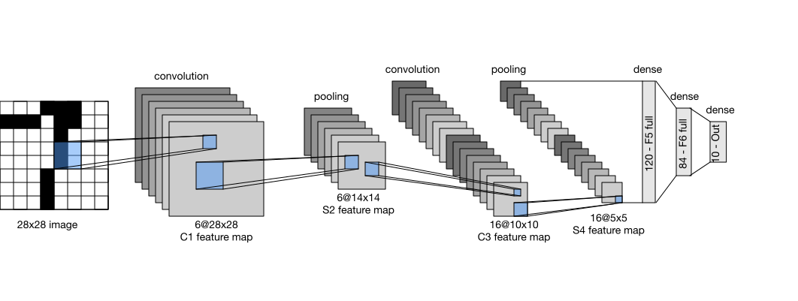
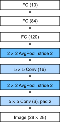

# 7.6 Mạng Neuron Tích chập (LeNet)

> Ghi chú của người biên soạn: trang này dịch nguyên văn từ sách *Dive into Deep Learning* của **Aston Zhang, Zachary C. Lipton, Mu Li và Alexander J. Smola** ([bản gốc](https://d2l.ai/chapter_convolutional-neural-networks/lenet.html), [mã nguồn](https://github.com/d2l-ai/d2l-en), giấy phép [CC BY-SA 4.0](https://creativecommons.org/licenses/by-sa/4.0/); code theo giấy phép MIT-0). Chỉ giữ code PyTorch. Số mục, hình và công thức giữ như bản HTML d2l.ai; thuật ngữ đối chiếu với bản dịch [Đắm mình vào Học Sâu](https://github.com/aivivn/d2l-vn).
>
> **Đính chính** *(người biên soạn)*:
>
> - Code `d2l.Trainer(max_epochs=10, num_gpus=1)`: trên máy không có GPU, `d2l` tự huấn luyện trên CPU (danh sách GPU rỗng), không báo lỗi.
> - Bài tập 1b, "thay tầng softmax bằng ReLU": ý của tác giả là thay các hàm kích hoạt **sigmoid** bằng ReLU; tầng softmax ở đầu ra vẫn giữ nguyên.

Giờ ta đã có mọi thành phần cần thiết để lắp ráp một CNN hoạt động hoàn chỉnh. Trong lần làm việc trước với dữ liệu ảnh, ta đã áp dụng một mô hình tuyến tính với hồi quy softmax ([Mục 4.4](https://d2l.ai/chapter_linear-classification/softmax-regression-scratch.html)) và một MLP ([Mục 5.2](https://d2l.ai/chapter_multilayer-perceptrons/mlp-implementation.html)) cho các ảnh quần áo trong bộ dữ liệu Fashion-MNIST. Để dữ liệu như vậy dùng được, trước tiên ta đã trải phẳng mỗi ảnh từ một ma trận $28\times28$ thành một vector $784$ chiều có độ dài cố định, rồi sau đó xử lý chúng bằng các tầng kết nối đầy đủ. Giờ khi đã nắm được các tầng tích chập, ta có thể giữ lại cấu trúc không gian trong ảnh. Một lợi ích bổ sung của việc thay các tầng kết nối đầy đủ bằng các tầng tích chập là ta sẽ có các mô hình tiết kiệm hơn, cần ít tham số hơn nhiều.

Trong mục này, ta sẽ giới thiệu *LeNet*, một trong những CNN được công bố sớm nhất thu hút sự chú ý rộng rãi nhờ hiệu năng trên các tác vụ thị giác máy tính. Mô hình được giới thiệu bởi (và được đặt theo tên của) Yann LeCun, khi đó là nhà nghiên cứu tại AT&T Bell Labs, nhằm mục đích nhận dạng chữ số viết tay trong ảnh ([LeCun *et al.*, 1998](dl/ch07_s6_vi?id=ref-lecun-bottou-bengio-ea-1998)). Công trình này là thành quả của một thập kỷ nghiên cứu phát triển công nghệ; nhóm của LeCun đã công bố nghiên cứu đầu tiên huấn luyện thành công CNN bằng lan truyền ngược ([LeCun *et al.*, 1989](dl/ch07_s6_vi?id=ref-lecun-boser-denker-ea-1989)).

Vào thời điểm đó, LeNet đạt được kết quả xuất sắc ngang với hiệu năng của máy vector hỗ trợ (support vector machine), khi ấy là cách tiếp cận thống trị trong học có giám sát, với tỉ lệ lỗi dưới 1% trên mỗi chữ số. LeNet sau đó được điều chỉnh để nhận dạng chữ số phục vụ xử lý tiền gửi tại các máy ATM. Cho đến ngày nay, một số máy ATM vẫn chạy đoạn code mà Yann LeCun và đồng nghiệp Leon Bottou viết vào những năm 1990!

<!-- run -->
```python
from d2l import torch as d2l
import torch
from torch import nn
```

## 7.6.1 LeNet

Ở mức tổng quát, LeNet (LeNet-5) gồm hai phần: (i) một bộ mã hóa tích chập gồm hai tầng tích chập; và (ii) một khối kết nối dày đặc gồm ba tầng kết nối đầy đủ. Kiến trúc được tóm tắt trong [Hình 7.6.1](dl/ch07_s6_vi?id=img-lenet).

<div align=center id="img-lenet">

</div>
<div align=center>Hình 7.6.1: Luồng dữ liệu trong LeNet. Đầu vào là một chữ số viết tay, đầu ra là một phân phối xác suất trên 10 kết quả có thể.</div>

Các đơn vị cơ bản trong mỗi khối tích chập là một tầng tích chập, một hàm kích hoạt sigmoid, và tiếp theo là một phép gộp trung bình. Lưu ý rằng dù ReLU và gộp cực đại hoạt động tốt hơn, chúng khi ấy chưa được phát hiện. Mỗi tầng tích chập dùng một kernel $5\times 5$ và một hàm kích hoạt sigmoid. Các tầng này ánh xạ đầu vào được sắp xếp theo không gian thành một số ánh xạ đặc trưng hai chiều, thường là tăng số kênh. Tầng tích chập thứ nhất có 6 kênh đầu ra, còn tầng thứ hai có 16. Mỗi phép gộp $2\times2$ (sải bước 2) giảm số chiều đi $4$ lần thông qua giảm mẫu theo không gian. Khối tích chập cho ra một đầu ra có kích thước (kích thước batch, số kênh, chiều cao, chiều rộng).

Để truyền đầu ra từ khối tích chập sang khối kết nối dày đặc, ta phải trải phẳng từng mẫu trong minibatch. Nói cách khác, ta lấy đầu vào bốn chiều này và biến đổi nó thành đầu vào hai chiều mà các tầng kết nối đầy đủ mong đợi: xin nhắc lại, biểu diễn hai chiều mà ta mong muốn dùng chiều thứ nhất để đánh chỉ số các mẫu trong minibatch và chiều thứ hai để chứa biểu diễn dạng vector phẳng của mỗi mẫu. Khối kết nối dày đặc của LeNet có ba tầng kết nối đầy đủ, với lần lượt 120, 84 và 10 đầu ra. Vì ta vẫn đang làm bài toán phân loại, tầng đầu ra 10 chiều tương ứng với số lớp đầu ra có thể có.

Dù để thực sự hiểu điều gì đang diễn ra bên trong LeNet có thể đã tốn chút công sức, chúng tôi hy vọng đoạn code sau sẽ thuyết phục bạn rằng việc cài đặt những mô hình như vậy bằng các framework học sâu hiện đại đơn giản đến đáng kinh ngạc. Ta chỉ cần khởi tạo một khối `Sequential` và nối các tầng thích hợp lại với nhau, dùng cách khởi tạo Xavier như đã giới thiệu trong [Mục 5.4.2.2](https://d2l.ai/chapter_multilayer-perceptrons/numerical-stability-and-init.html).

<!-- run -->
```python
def init_cnn(module):  #@save
    """Khởi tạo trọng số cho CNN."""
    if type(module) == nn.Linear or type(module) == nn.Conv2d:
        nn.init.xavier_uniform_(module.weight)
```

<!-- run -->
```python
class LeNet(d2l.Classifier):  #@save
    """Mô hình LeNet-5."""
    def __init__(self, lr=0.1, num_classes=10):
        super().__init__()
        self.save_hyperparameters()
        self.net = nn.Sequential(
            nn.LazyConv2d(6, kernel_size=5, padding=2), nn.Sigmoid(),
            nn.AvgPool2d(kernel_size=2, stride=2),
            nn.LazyConv2d(16, kernel_size=5), nn.Sigmoid(),
            nn.AvgPool2d(kernel_size=2, stride=2),
            nn.Flatten(),
            nn.LazyLinear(120), nn.Sigmoid(),
            nn.LazyLinear(84), nn.Sigmoid(),
            nn.LazyLinear(num_classes))
```

Ta đã có đôi chút tự do khi tái tạo LeNet ở chỗ thay tầng kích hoạt Gauss bằng một tầng softmax. Điều này đơn giản hóa đáng kể việc cài đặt, không chỉ vì bộ giải mã Gauss ngày nay hiếm khi được dùng. Ngoài điểm đó ra, mạng này khớp với kiến trúc LeNet-5 nguyên bản.

Hãy xem điều gì xảy ra bên trong mạng. Bằng cách đưa một ảnh một kênh (đen trắng) kích thước $28 \times 28$ qua mạng và in kích thước đầu ra ở mỗi tầng, ta có thể kiểm tra mô hình để đảm bảo các phép toán của nó khớp với những gì ta mong đợi từ [Hình 7.6.2](dl/ch07_s6_vi?id=img-lenet-vert).

<div align=center id="img-lenet-vert">

</div>
<div align=center>Hình 7.6.2: Ký hiệu rút gọn của LeNet-5.</div>

<!-- run -->
```python
@d2l.add_to_class(d2l.Classifier)  #@save
def layer_summary(self, X_shape):
    X = d2l.randn(*X_shape)
    for layer in self.net:
        X = layer(X)
        print(layer.__class__.__name__, 'output shape:\t', X.shape)
        
model = LeNet()
model.layer_summary((1, 1, 28, 28))
```

<!-- output -->
```output
Conv2d output shape:	 torch.Size([1, 6, 28, 28])
Sigmoid output shape:	 torch.Size([1, 6, 28, 28])
AvgPool2d output shape:	 torch.Size([1, 6, 14, 14])
Conv2d output shape:	 torch.Size([1, 16, 10, 10])
Sigmoid output shape:	 torch.Size([1, 16, 10, 10])
AvgPool2d output shape:	 torch.Size([1, 16, 5, 5])
Flatten output shape:	 torch.Size([1, 400])
Linear output shape:	 torch.Size([1, 120])
Sigmoid output shape:	 torch.Size([1, 120])
Linear output shape:	 torch.Size([1, 84])
Sigmoid output shape:	 torch.Size([1, 84])
Linear output shape:	 torch.Size([1, 10])
```
<!-- /output -->

Lưu ý rằng chiều cao và chiều rộng của biểu diễn ở mỗi tầng trong suốt khối tích chập đều giảm đi (so với tầng trước đó). Tầng tích chập thứ nhất dùng hai điểm ảnh đệm để bù cho việc giảm chiều cao và chiều rộng mà nếu không sẽ xảy ra khi dùng kernel $5 \times 5$. Nói thêm, kích thước ảnh $28 \times 28$ điểm ảnh trong bộ dữ liệu OCR MNIST gốc là kết quả của việc *cắt bớt* hai hàng (và hai cột) điểm ảnh khỏi các bản quét gốc có kích thước $32 \times 32$ điểm ảnh. Việc này chủ yếu nhằm tiết kiệm không gian lưu trữ (giảm 30%) vào thời điểm mà từng megabyte còn quan trọng.

Ngược lại, tầng tích chập thứ hai không dùng đệm, do đó chiều cao và chiều rộng đều giảm đi bốn điểm ảnh. Khi đi lên theo chồng các tầng, số kênh tăng dần qua từng tầng, từ 1 ở đầu vào lên 6 sau tầng tích chập thứ nhất và 16 sau tầng tích chập thứ hai. Tuy nhiên, mỗi tầng gộp lại giảm một nửa chiều cao và chiều rộng. Cuối cùng, mỗi tầng kết nối đầy đủ giảm số chiều, sau cùng cho ra một đầu ra có số chiều bằng số lớp.

## 7.6.2 Huấn luyện

Giờ khi đã cài đặt mô hình, hãy chạy một thí nghiệm để xem mô hình LeNet-5 hoạt động thế nào trên Fashion-MNIST.

Dù CNN có ít tham số hơn, chúng vẫn có thể tốn kém để tính toán hơn các MLP có độ sâu tương tự vì mỗi tham số tham gia vào nhiều phép nhân hơn. Nếu bạn có GPU, đây có thể là lúc tốt để dùng nó nhằm tăng tốc huấn luyện. Lưu ý rằng lớp `d2l.Trainer` lo mọi chi tiết. Theo mặc định, nó khởi tạo các tham số mô hình trên các thiết bị sẵn có. Cũng như với MLP, hàm mất mát của ta là entropy chéo, và ta cực tiểu hóa nó bằng hạ gradient ngẫu nhiên theo minibatch.

<!-- run gpu -->
```python
trainer = d2l.Trainer(max_epochs=10, num_gpus=1)
data = d2l.FashionMNIST(batch_size=128)
model = LeNet(lr=0.1)
model.apply_init([next(iter(data.get_dataloader(True)))[0]], init_cnn)
trainer.fit(model, data)
```

<!-- output -->
<div class="gpu-pending">Chưa có kết quả: khối này huấn luyện mô hình nên sẽ được chạy trên máy có GPU. Bạn có thể tự chạy code trên Colab hoặc máy của mình.</div>
<!-- /output -->

## 7.6.3 Tóm tắt

Ta đã tiến bộ đáng kể trong chương này. Ta đã đi từ các MLP của những năm 1980 đến các CNN của những năm 1990 và đầu những năm 2000. Các kiến trúc được đề xuất, chẳng hạn dưới dạng LeNet-5, vẫn có ý nghĩa cho đến tận ngày nay. Thật đáng để so sánh tỉ lệ lỗi trên Fashion-MNIST mà LeNet-5 đạt được với cả mức tốt nhất có thể của MLP ([Mục 5.2](https://d2l.ai/chapter_multilayer-perceptrons/mlp-implementation.html)) lẫn với các kiến trúc tiên tiến hơn đáng kể như ResNet ([Mục 8.6](https://d2l.ai/chapter_convolutional-modern/resnet.html)). LeNet giống kiến trúc sau hơn nhiều so với kiến trúc trước. Như ta sẽ thấy, một trong những khác biệt chính là lượng tính toán lớn hơn đã cho phép các kiến trúc phức tạp hơn đáng kể.

Khác biệt thứ hai là sự dễ dàng tương đối mà ta có được khi cài đặt LeNet. Điều từng là một thách thức kỹ thuật đáng giá hàng tháng trời viết code C++ và hợp ngữ, công sức kỹ thuật để cải tiến SN, một công cụ học sâu đời đầu dựa trên Lisp ([Bottou và Le Cun, 1988](dl/ch07_s6_vi?id=ref-bottou-le-cun-1988)), và cuối cùng là thử nghiệm với các mô hình, giờ đây có thể hoàn thành trong vài phút. Chính sự gia tăng năng suất đáng kinh ngạc này đã phổ cập hóa việc phát triển mô hình học sâu một cách to lớn. Trong chương tiếp theo, ta sẽ đi sâu vào hang thỏ này để xem nó dẫn ta đến đâu.

## 7.6.4 Bài tập

1. Hãy hiện đại hóa LeNet. Cài đặt và thử nghiệm các thay đổi sau:
    1. Thay gộp trung bình bằng gộp cực đại.
    1. Thay tầng softmax bằng ReLU.
1. Thử thay đổi kích thước của mạng kiểu LeNet để cải thiện độ chính xác, bên cạnh gộp cực đại và ReLU.
    1. Điều chỉnh kích thước cửa sổ tích chập.
    1. Điều chỉnh số kênh đầu ra.
    1. Điều chỉnh số tầng tích chập.
    1. Điều chỉnh số tầng kết nối đầy đủ.
    1. Điều chỉnh tốc độ học và các chi tiết huấn luyện khác (chẳng hạn cách khởi tạo và số epoch).
1. Thử mạng đã cải tiến trên bộ dữ liệu MNIST gốc.
1. Hiển thị các kích hoạt của tầng thứ nhất và thứ hai của LeNet với các đầu vào khác nhau (chẳng hạn áo len và áo khoác).
1. Điều gì xảy ra với các kích hoạt khi bạn đưa vào mạng những ảnh khác biệt đáng kể (chẳng hạn mèo, ô tô, hoặc thậm chí nhiễu ngẫu nhiên)?

[Thảo luận (tiếng Anh)](https://discuss.d2l.ai/t/74)

## Tài liệu tham khảo

- <a id="ref-lecun-bottou-bengio-ea-1998"></a>LeCun, Yann, Bottou, L\'eon, Bengio, Yoshua, ... (1998). *Gradient-based learning applied to document recognition*. Proceedings of the IEEE.
- <a id="ref-lecun-boser-denker-ea-1989"></a>LeCun, Yann, Boser, Bernhard, Denker, John S, ... (1989). *Backpropagation applied to handwritten zip code recognition*. Neural Computation.
- <a id="ref-bottou-le-cun-1988"></a>Bottou, L\'eon, Le Cun, Yann (1988). *SN: A simulator for connectionist models*. Proceedings of NeuroNimes 88.
