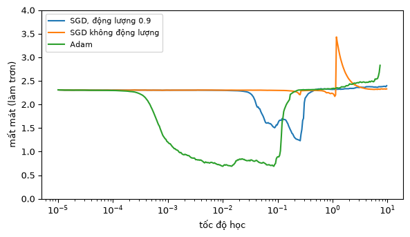

# Chương 12 · Ví dụ áp dụng: chọn bộ tối ưu và lịch tốc độ học cho một CNN

> Ghi chú của người biên soạn: trang này do người biên soạn viết thêm, không có trong sách gốc. Trang làm lại thí nghiệm của [mục 12.11](dl/ch12_s11_vi) (LeNet hiện đại hoá trên Fashion-MNIST) theo quy trình thường dùng khi bắt đầu một dự án: dò khoảng tốc độ học hợp lý trước, rồi mới so sánh các bộ tối ưu và lịch trình.

## Bài toán

Mục 12.11 chọn tốc độ học 0.3 cho SGD mà không giải thích vì sao. Với một mô hình và bộ dữ liệu mới, làm sao chọn được tốc độ học ban đầu mà không phải thử hàng chục lần huấn luyện đầy đủ? Và khi đã có tốc độ học, bộ tối ưu và lịch trình nào cho kết quả tốt nhất sau cùng một số epoch?

## 1. Dữ liệu và mô hình

<!-- run -->
```python
import os, math, time
import torch
import torchvision
from torch import nn
from torchvision import transforms
from torch.optim import lr_scheduler
import matplotlib.pyplot as plt

root = os.path.expanduser('~/.cache/d2l-data')
train = torchvision.datasets.FashionMNIST(root, train=True, transform=transforms.ToTensor(), download=True)
test = torchvision.datasets.FashionMNIST(root, train=False, transform=transforms.ToTensor(), download=True)
device = 'cuda' if torch.cuda.is_available() else 'cpu'

def lenet():                                   # đúng mạng net_fn của mục 12.11
    return nn.Sequential(
        nn.Conv2d(1, 6, 5, padding=2), nn.ReLU(), nn.MaxPool2d(2),
        nn.Conv2d(6, 16, 5), nn.ReLU(), nn.MaxPool2d(2),
        nn.Flatten(),
        nn.Linear(400, 120), nn.ReLU(), nn.Linear(120, 84), nn.ReLU(), nn.Linear(84, 10))

loader = lambda bs=256, shuffle=True: torch.utils.data.DataLoader(train, bs, shuffle=shuffle)
print(len(train), "ảnh huấn luyện,", len(test), "ảnh kiểm tra; thiết bị:", device)
```

<!-- output -->
```output
60000 ảnh huấn luyện, 10000 ảnh kiểm tra; thiết bị: cpu
```
<!-- /output -->

## 2. Dò tốc độ học (LR range test)

<small class="viz-ref">Mục 12.3.1.1 · mục 12.11</small>

Ý tưởng của Smith (2017): huấn luyện **một lượt ngắn** trong đó tốc độ học tăng theo hàm mũ sau mỗi minibatch, từ rất nhỏ ($10^{-5}$) đến rất lớn ($10$), và ghi lại mất mát. Lúc đầu tốc độ học quá nhỏ nên mất mát gần như không đổi; đến một khoảng nào đó mất mát giảm nhanh; rồi tốc độ học quá lớn và mất mát bùng nổ (đúng ba chế độ của mục 12.3.1.1). Tốc độ học tốt nằm trong vùng mất mát giảm dốc nhất, trước điểm bùng nổ khoảng một bậc độ lớn. Mỗi lần dò tốn 400 minibatch (chưa đến một epoch), chạy được trên CPU:

<!-- run -->
```python
def lr_range_test(make_opt, lr_min=1e-5, lr_max=10, steps=400, seed=0):
    torch.manual_seed(seed)
    net = lenet().to(device)
    opt = make_opt(net.parameters(), lr_min)
    gamma = (lr_max / lr_min) ** (1 / steps)
    lrs, losses, avg = [], [], None
    def forever():                                                    # lặp lại dữ liệu nếu cần
        while True:
            yield from loader(128)
    batches = forever()
    for k in range(steps):
        X, y = next(batches)
        loss = nn.functional.cross_entropy(net(X.to(device)), y.to(device))
        opt.zero_grad(); loss.backward(); opt.step()
        avg = loss.item() if avg is None else 0.9 * avg + 0.1 * loss.item()   # làm trơn
        lrs.append(opt.param_groups[0]['lr']); losses.append(avg)
        if avg > 4 * min(losses):                                            # đã bùng nổ: dừng
            break
        for g in opt.param_groups:
            g['lr'] *= gamma
    return lrs, losses

plt.figure(figsize=(6, 3.5))
for name, make in [("SGD, động lượng 0.9", lambda p, lr: torch.optim.SGD(p, lr=lr, momentum=0.9)),
                   ("SGD không động lượng", lambda p, lr: torch.optim.SGD(p, lr=lr)),
                   ("Adam", lambda p, lr: torch.optim.Adam(p, lr=lr))]:
    lrs, losses = lr_range_test(make)
    plt.plot(lrs, losses, label=name)
    k = min(range(len(losses)), key=losses.__getitem__)
    start = next((f"{lr:.2g}" for lr, l in zip(lrs, losses) if l < 2.0), "không có")
    print(f"{name:22s} mất mát bắt đầu giảm (< 2.0) ở lr ≈ {start}; thấp nhất {losses[k]:.2f} ở lr ≈ {lrs[k]:.2g}")
plt.xscale('log'); plt.xlabel('tốc độ học'); plt.ylabel('mất mát (làm trơn)'); plt.ylim(0, 4)
plt.legend(fontsize=8); plt.tight_layout()
```

<!-- output -->
```output
SGD, động lượng 0.9    mất mát bắt đầu giảm (< 2.0) ở lr ≈ 0.041; thấp nhất 1.23 ở lr ≈ 0.26
SGD không động lượng   mất mát bắt đầu giảm (< 2.0) ở lr ≈ không có; thấp nhất 2.17 ở lr ≈ 1.1
Adam                   mất mát bắt đầu giảm (< 2.0) ở lr ≈ 0.00048; thấp nhất 0.69 ở lr ≈ 0.085
```

<div align=center></div>
<!-- /output -->

Đọc kết quả:

- **Adam** cho đường cong rõ nhất: mất mát bắt đầu giảm từ khoảng $5 \cdot 10^{-4}$, thấp nhất quanh $0.085$, sau đó bùng nổ. Khoảng tốc độ học hợp lý của Adam vì thế vào cỡ $10^{-3}$ đến $10^{-2}$.
- **SGD có động lượng:** mất mát bắt đầu giảm từ khoảng $0.04$, thấp nhất quanh $0.26$. Khoảng hợp lý cỡ vài phần trăm đến $0.1$, lớn hơn Adam khoảng một bậc độ lớn.
- **SGD không động lượng:** trong 400 bước mất mát chưa xuống dưới 2.0 ở bất kỳ tốc độ học nào, rồi bùng nổ quanh $1$–$2$. LeNet với SGD thường cần nhiều bước hơn để rời khỏi vùng phẳng ban đầu, nên phép dò ngắn không cho câu trả lời; đây là giới hạn của phương pháp, không phải dấu hiệu SGD không học được (mục 12.11 vẫn huấn luyện được nó với tốc độ học 0.3 qua 30 epoch).

## 3. So sánh bộ tối ưu và lịch trình

<small class="viz-ref">Mục 12.6, 12.10, 12.11</small>

Bốn cấu hình, mỗi cấu hình 10 epoch, minibatch 256, cùng khởi tạo:

1. SGD, tốc độ học không đổi 0.3 (như mục 12.11.1);
2. SGD có động lượng 0.9, khởi động 1 epoch rồi giảm theo cosin (mục 12.11.3);
3. Adam, tốc độ học không đổi;
4. AdamW với lịch một chu kỳ (`OneCycleLR`, trang [Dùng thư viện](dl/ch12_lib_vi)).

Tốc độ học của các cấu hình 2–4 lấy theo kết quả dò ở mục 2: nằm trong vùng mất mát đang giảm, thấp hơn điểm thấp nhất vài lần để còn khoảng an toàn khi huấn luyện lâu:

<!-- run gpu -->
```python
def evaluate(net):
    net.eval(); correct = 0
    with torch.no_grad():
        for X, y in torch.utils.data.DataLoader(test, 1024):
            correct += (net(X.to(device)).argmax(1).cpu() == y).sum().item()
    net.train()
    return correct / len(test)

def fit(name, make_opt, make_sched=None, per_batch=False, epochs=10, seed=0):
    torch.manual_seed(seed)
    net = lenet().to(device)
    opt = make_opt(net.parameters())
    data = loader()
    sched = make_sched(opt, len(data) * epochs if per_batch else epochs) if make_sched else None
    hist, t0 = [], time.time()
    for ep in range(epochs):
        total = n = 0
        for X, y in data:
            X, y = X.to(device), y.to(device)
            loss = nn.functional.cross_entropy(net(X), y)
            opt.zero_grad(); loss.backward(); opt.step()
            if sched and per_batch:
                sched.step()
            total += loss.item() * len(y); n += len(y)
        if sched and not per_batch:
            sched.step()
        hist.append((total / n, evaluate(net)))
    print(f"{name:34s} mất mát huấn luyện {hist[-1][0]:.3f}, độ chính xác kiểm tra {hist[-1][1]:.4f} "
          f"(tốt nhất {max(a for _, a in hist):.4f}), {time.time() - t0:.0f} s")
    return hist

warm_cos = lambda o, T: lr_scheduler.SequentialLR(o, [lr_scheduler.LinearLR(o, 0.1, total_iters=1),
                                                      lr_scheduler.CosineAnnealingLR(o, T - 1)], [1])
results = {
    "SGD, lr 0.3 không đổi": fit("SGD, lr 0.3 không đổi", lambda p: torch.optim.SGD(p, lr=0.3)),
    "SGD+động lượng, khởi động + cosin": fit("SGD+động lượng, khởi động + cosin",
        lambda p: torch.optim.SGD(p, lr=0.05, momentum=0.9), warm_cos),
    "Adam, lr 1e-3 không đổi": fit("Adam, lr 1e-3 không đổi", lambda p: torch.optim.Adam(p, lr=1e-3)),
    "AdamW + OneCycle": fit("AdamW + OneCycle", lambda p: torch.optim.AdamW(p, lr=3e-3, weight_decay=0.01),
        lambda o, T: lr_scheduler.OneCycleLR(o, max_lr=3e-3, total_steps=T), per_batch=True),
}
fig, ax = plt.subplots(1, 2, figsize=(9, 3.2))
for name, h in results.items():
    ax[0].plot(range(1, 11), [l for l, _ in h], 'o-', ms=3, label=name)
    ax[1].plot(range(1, 11), [a for _, a in h], 'o-', ms=3, label=name)
ax[0].set(xlabel='epoch', ylabel='mất mát huấn luyện'); ax[1].set(xlabel='epoch', ylabel='độ chính xác kiểm tra')
ax[1].legend(fontsize=7); plt.tight_layout()
```

<!-- output -->
<div class="gpu-pending">Chưa có kết quả: khối này huấn luyện mô hình nên sẽ được chạy trên máy có GPU. Bạn có thể tự chạy code trên Colab hoặc máy của mình.</div>
<!-- /output -->

## Tóm tắt

- Dò tốc độ học tốn vài trăm minibatch nhưng cho biết khoảng tốc độ học hợp lý của từng bộ tối ưu, thay vì đoán rồi huấn luyện lại nhiều lần. Phép dò chỉ có ý nghĩa khi mất mát kịp giảm trong số bước dò; với SGD thường trên mạng này thì chưa đủ.
- Các bộ tối ưu khác nhau có khoảng tốc độ học hợp lý khác nhau hàng bậc độ lớn: không thể so SGD với Adam ở cùng một tốc độ học.
- Kết quả so sánh 10 epoch ở mục 3 sẽ có sau khi chạy trên máy có GPU.
