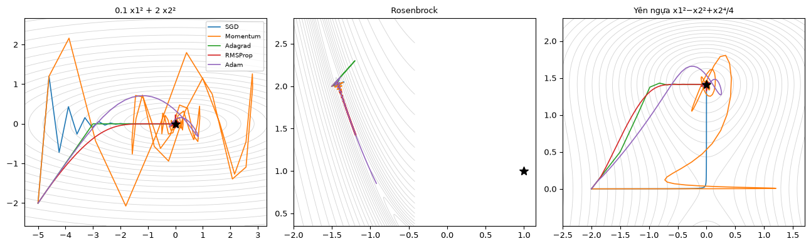
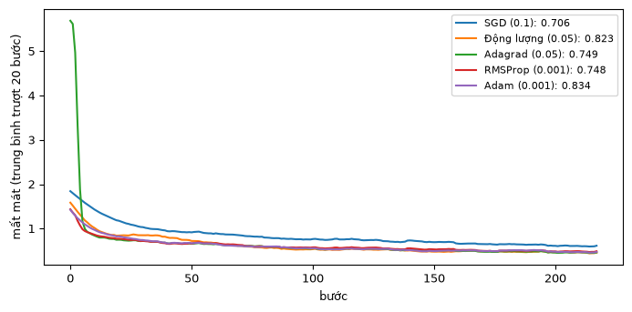

# Chương 12 · Code từ đầu

> Ghi chú của người biên soạn: trang này do người biên soạn viết thêm, không có trong sách gốc. Sách cài đặt mỗi thuật toán bằng một hàm riêng với trạng thái truyền tay (`states`, `hyperparams`). Trang này viết lại cả năm thuật toán (SGD, động lượng, Adagrad, RMSProp, Adam) cùng AdamW theo **một giao diện chung** giống `torch.optim`, kiểm tra chúng khớp từng bước với PyTorch, rồi so sánh trên các hàm thử và trên một mô hình thật.

## Cách dùng trang này

Các khối chạy lần lượt từ trên xuống và dùng chung biến. Cần `torch`, `torchvision`, `matplotlib`; mọi khối chạy trên CPU trong vài giây đến vài chục giây.

## 1. Một giao diện chung cho mọi bộ tối ưu

<small class="viz-ref">Mục 12.4–12.10</small>

Mỗi bộ tối ưu giữ một từ điển trạng thái cho từng tham số (vận tốc, tổng bình phương gradient, …) và có phương thức `step()` đọc `p.grad` để cập nhật `p`. Công thức trong từng lớp viết đúng như các mục 12.6–12.10. Hằng số $\epsilon$ đặt theo mặc định của PyTorch để so sánh được.

<!-- run -->
```python
import math
import torch
import matplotlib.pyplot as plt

class Optimizer:
    def __init__(self, params, lr):
        self.params, self.lr = list(params), lr
        self.state = {id(p): {} for p in self.params}
        self.t = 0
    def zero_grad(self):
        for p in self.params:
            p.grad = None
    @torch.no_grad()
    def step(self):
        self.t += 1
        for p in self.params:
            if p.grad is not None:
                self.update(p, p.grad, self.state[id(p)])

class SGD(Optimizer):                       # mục 12.4: x <- x - eta g
    def update(self, p, g, st):
        p -= self.lr * g

class Momentum(Optimizer):                  # mục 12.6: v <- beta v + g;  x <- x - eta v
    def __init__(self, params, lr, beta=0.9):
        super().__init__(params, lr); self.beta = beta
    def update(self, p, g, st):
        v = st.setdefault('v', torch.zeros_like(p))
        v.mul_(self.beta).add_(g)
        p -= self.lr * v

class Adagrad(Optimizer):                   # mục 12.7: s <- s + g^2;  x <- x - eta g / sqrt(s + eps)
    def __init__(self, params, lr, eps=1e-10):
        super().__init__(params, lr); self.eps = eps
    def update(self, p, g, st):
        s = st.setdefault('s', torch.zeros_like(p))
        s += g * g
        p -= self.lr * g / (s.sqrt() + self.eps)

class RMSProp(Optimizer):                   # mục 12.8: s <- gamma s + (1-gamma) g^2
    def __init__(self, params, lr, gamma=0.99, eps=1e-8):
        super().__init__(params, lr); self.gamma, self.eps = gamma, eps
    def update(self, p, g, st):
        s = st.setdefault('s', torch.zeros_like(p))
        s.mul_(self.gamma).add_((1 - self.gamma) * g * g)
        p -= self.lr * g / (s.sqrt() + self.eps)

class Adam(Optimizer):                      # mục 12.10, có hiệu chỉnh độ chệch
    def __init__(self, params, lr, betas=(0.9, 0.999), eps=1e-8, weight_decay=0.0, decoupled=False):
        super().__init__(params, lr)
        self.b1, self.b2 = betas
        self.eps, self.wd, self.decoupled = eps, weight_decay, decoupled
    def update(self, p, g, st):
        if self.wd and not self.decoupled:
            g = g + self.wd * p                  # Adam + L2: số hạng phạt đi qua phép co giãn của Adam
        if self.wd and self.decoupled:
            p -= self.lr * self.wd * p           # AdamW: suy giảm trọng số tách riêng, không bị co giãn
        v = st.setdefault('v', torch.zeros_like(p))
        s = st.setdefault('s', torch.zeros_like(p))
        v.mul_(self.b1).add_((1 - self.b1) * g)
        s.mul_(self.b2).add_((1 - self.b2) * g * g)
        v_hat = v / (1 - self.b1 ** self.t)
        s_hat = s / (1 - self.b2 ** self.t)
        p -= self.lr * v_hat / (s_hat.sqrt() + self.eps)
```

Kiểm tra: cùng mô hình, cùng dữ liệu, cùng siêu tham số, chạy 50 bước bằng lớp tự viết và bằng `torch.optim`, rồi so tham số cuối cùng. Riêng hàm mất mát có thêm số hạng $\ell_2$ khi so Adam có suy giảm trọng số:

<!-- run -->
```python
def compare(make_mine, make_torch, steps=50):
    torch.manual_seed(0)
    X, y = torch.randn(64, 5), torch.randn(64, 1)
    w0, b0 = torch.randn(5, 1), torch.zeros(1)
    results = []
    for make in (make_mine, make_torch):
        w, b = w0.clone().requires_grad_(), b0.clone().requires_grad_()
        opt = make([w, b])
        for _ in range(steps):
            opt.zero_grad()
            ((X @ w + b - y) ** 2).mean().backward()
            opt.step()
        results.append(torch.cat([w.detach().ravel(), b.detach()]))
    return (results[0] - results[1]).abs().max().item()

cases = {
    "SGD":            (lambda p: SGD(p, 0.05),            lambda p: torch.optim.SGD(p, lr=0.05)),
    "Động lượng":     (lambda p: Momentum(p, 0.05, 0.9),  lambda p: torch.optim.SGD(p, lr=0.05, momentum=0.9)),
    "Adagrad":        (lambda p: Adagrad(p, 0.1),         lambda p: torch.optim.Adagrad(p, lr=0.1)),
    "RMSProp":        (lambda p: RMSProp(p, 0.01, 0.9),   lambda p: torch.optim.RMSprop(p, lr=0.01, alpha=0.9)),
    "Adam":           (lambda p: Adam(p, 0.01),           lambda p: torch.optim.Adam(p, lr=0.01)),
    "Adam + L2":      (lambda p: Adam(p, 0.01, weight_decay=0.1), lambda p: torch.optim.Adam(p, lr=0.01, weight_decay=0.1)),
    "AdamW":          (lambda p: Adam(p, 0.01, weight_decay=0.1, decoupled=True),
                       lambda p: torch.optim.AdamW(p, lr=0.01, weight_decay=0.1)),
}
for name, (mine, ref) in cases.items():
    print(f"{name:12s} sai khác tham số sau 50 bước: {compare(mine, ref):.1e}")
```

<!-- output -->
```output
SGD          sai khác tham số sau 50 bước: 0.0e+00
Động lượng   sai khác tham số sau 50 bước: 6.0e-08
Adagrad      sai khác tham số sau 50 bước: 0.0e+00
RMSProp      sai khác tham số sau 50 bước: 0.0e+00
Adam         sai khác tham số sau 50 bước: 1.2e-07
Adam + L2    sai khác tham số sau 50 bước: 3.0e-08
AdamW        sai khác tham số sau 50 bước: 3.6e-07
```
<!-- /output -->

Hai chi tiết cài đặt của PyTorch khác với công thức trong sách, trang này theo PyTorch để so sánh khớp: $\epsilon$ được cộng **sau** căn bậc hai ($\sqrt{s} + \epsilon$, kể cả Adagrad và RMSProp), và động lượng cộng gradient vào vận tốc không nhân $(1-\beta)$, đúng như mục 12.6.

## 2. Trên các hàm thử hai chiều

<small class="viz-ref">Mục 12.3, 12.6 · hàm $0.1x_1^2 + 2x_2^2$</small>

Ba hàm: hàm bậc hai có điều kiện kém của mục 12.6, hàm Rosenbrock (thung lũng cong hẹp, cực tiểu tại $(1, 1)$), và một hàm có điểm yên ngựa. Mỗi bộ tối ưu chạy 200 bước từ cùng điểm xuất phát, tốc độ học được chọn bằng tay cho từng hàm sao cho không phân kỳ:

<!-- run -->
```python
funcs = {
    "0.1 x1² + 2 x2²":  (lambda x: 0.1 * x[0]**2 + 2 * x[1]**2, (-5.0, -2.0), (0.0, 0.0)),
    "Rosenbrock":       (lambda x: (1 - x[0])**2 + 100 * (x[1] - x[0]**2)**2, (-1.5, 2.0), (1.0, 1.0)),
    "Yên ngựa x1²−x2²+x2⁴/4": (lambda x: x[0]**2 - x[1]**2 + x[1]**4 / 4, (-2.0, 1e-3), (0.0, math.sqrt(2))),
}
lrs = {  # tốc độ học cho từng (hàm, bộ tối ưu)
    "0.1 x1² + 2 x2²":  dict(SGD=0.4, Momentum=0.4, Adagrad=2.0, RMSProp=0.1, Adam=0.3),
    "Rosenbrock":       dict(SGD=1e-3, Momentum=2e-4, Adagrad=0.3, RMSProp=0.01, Adam=0.05),
    "Yên ngựa x1²−x2²+x2⁴/4": dict(SGD=0.1, Momentum=0.05, Adagrad=0.5, RMSProp=0.05, Adam=0.1),
}
makers = dict(SGD=lambda p, lr: SGD(p, lr), Momentum=lambda p, lr: Momentum(p, lr, 0.9),
              Adagrad=lambda p, lr: Adagrad(p, lr), RMSProp=lambda p, lr: RMSProp(p, lr, 0.9),
              Adam=lambda p, lr: Adam(p, lr))

def run(f, x0, make, lr, steps=200):
    x = torch.tensor(x0, requires_grad=True)
    opt = make([x], lr)
    path = [x.detach().clone()]
    for _ in range(steps):
        opt.zero_grad(); f(x).backward(); opt.step()
        path.append(x.detach().clone())
    return torch.stack(path)

fig, axes = plt.subplots(1, 3, figsize=(13, 4))
for ax, (fname, (f, x0, opt_pt)) in zip(axes, funcs.items()):
    paths = {n: run(f, x0, m, lrs[fname][n]) for n, m in makers.items()}
    allp = torch.cat(list(paths.values()))
    lo, hi = allp.min(0).values - 0.5, allp.max(0).values + 0.5
    g1, g2 = torch.meshgrid(torch.linspace(lo[0], hi[0], 200), torch.linspace(lo[1], hi[1], 200), indexing='ij')
    Z = f((g1, g2))
    ax.contour(g1, g2, torch.log1p(Z - Z.min()), 25, colors='lightgray', linewidths=0.6)
    for n, pth in paths.items():
        ax.plot(pth[:, 0], pth[:, 1], '-', lw=1.2, label=n)
        print(f"{fname:24s} {n:9s} điểm cuối ({pth[-1, 0]:7.3f}, {pth[-1, 1]:7.3f}), "
              f"cách cực tiểu {torch.dist(pth[-1], torch.tensor(opt_pt)):.3f}")
    ax.plot(*opt_pt, 'k*', ms=10); ax.set_title(fname, fontsize=9)
axes[0].legend(fontsize=7); plt.tight_layout()
```

<!-- output -->
```output
0.1 x1² + 2 x2²          SGD       điểm cuối ( -0.000,  -0.000), cách cực tiểu 0.000
0.1 x1² + 2 x2²          Momentum  điểm cuối ( -0.000,  -0.000), cách cực tiểu 0.000
0.1 x1² + 2 x2²          Adagrad   điểm cuối ( -0.000,   0.000), cách cực tiểu 0.000
0.1 x1² + 2 x2²          RMSProp   điểm cuối ( -0.043,  -0.049), cách cực tiểu 0.066
0.1 x1² + 2 x2²          Adam      điểm cuối (  0.000,   0.000), cách cực tiểu 0.000
Rosenbrock               SGD       điểm cuối ( -1.306,   1.714), cách cực tiểu 2.414
Rosenbrock               Momentum  điểm cuối ( -1.185,   1.412), cách cực tiểu 2.224
Rosenbrock               Adagrad   điểm cuối ( -1.275,   1.633), cách cực tiểu 2.362
Rosenbrock               RMSProp   điểm cuối ( -1.186,   1.430), cách cực tiểu 2.228
Rosenbrock               Adam      điểm cuối ( -0.921,   0.854), cách cực tiểu 1.927
Yên ngựa x1²−x2²+x2⁴/4   SGD       điểm cuối ( -0.000,   1.414), cách cực tiểu 0.000
Yên ngựa x1²−x2²+x2⁴/4   Momentum  điểm cuối ( -0.000,   1.414), cách cực tiểu 0.000
Yên ngựa x1²−x2²+x2⁴/4   Adagrad   điểm cuối ( -0.000,   1.414), cách cực tiểu 0.000
Yên ngựa x1²−x2²+x2⁴/4   RMSProp   điểm cuối (  0.023,   1.439), cách cực tiểu 0.034
Yên ngựa x1²−x2²+x2⁴/4   Adam      điểm cuối ( -0.000,   1.414), cách cực tiểu 0.000
```

<div align=center></div>
<!-- /output -->

Đọc kết quả:

- **Hàm bậc hai có điều kiện kém:** cả năm thuật toán đều về đúng cực tiểu, trừ RMSProp dừng ở khoảng cách 0.066. Với tốc độ học cố định, bước của RMSProp xấp xỉ $\eta \cdot g/\sqrt{s} \approx \eta$ bất kể gradient lớn hay nhỏ, nên gần cực tiểu nó cứ dao động với biên độ cỡ $\eta$ (đây là lý do cần giảm dần tốc độ học, mục 12.11).
- **Rosenbrock:** sau 200 bước không thuật toán nào đến được $(1, 1)$; Adam đi xa nhất dọc thung lũng (còn cách 1.93). Thung lũng cong hẹp buộc mọi thuật toán phải dùng tốc độ học nhỏ để không bật ra khỏi thành thung lũng, nên tiến rất chậm dọc đáy.
- **Yên ngựa:** điểm xuất phát gần như nằm trên điểm yên ngựa ($x_2 = 0.001$), nhưng cả năm thuật toán đều thoát ra và về cực tiểu $(0, \sqrt 2)$: thành phần $x_2$ nhỏ bị nhân lên mỗi bước theo hướng có độ cong âm. Nếu xuất phát đúng $x_2 = 0$ thì gradient theo $x_2$ bằng 0 mãi mãi và không thuật toán nào thoát được (bài tập 4 của mục 12.1 gợi ý điều này).

## 3. Trên một mô hình thật

<small class="viz-ref">Mục 12.5 · so sánh như hình cuối mục 12.10</small>

Một MLP một tầng ẩn trên 10 000 ảnh Fashion-MNIST, 3 epoch, minibatch 128. Đây là thí nghiệm nhỏ để thấy khác biệt giữa các thuật toán, không phải để tìm cấu hình tốt nhất: tốc độ học của mỗi thuật toán là giá trị thông dụng, chưa tinh chỉnh.

<!-- run -->
```python
import os, torchvision
from torchvision import transforms
from torch import nn
import torch.nn.functional as F

root = os.path.expanduser('~/.cache/d2l-data')
full = torchvision.datasets.FashionMNIST(root, train=True, transform=transforms.ToTensor(), download=True)
Xall = full.data[:12000].float().div(255).view(-1, 784); yall = full.targets[:12000]
Xtr, ytr, Xva, yva = Xall[:10000], yall[:10000], Xall[10000:], yall[10000:]

def train_mlp(make_opt, epochs=3, seed=0):
    torch.manual_seed(seed)
    net = nn.Sequential(nn.Linear(784, 256), nn.ReLU(), nn.Linear(256, 10))
    opt = make_opt(list(net.parameters()))
    losses = []
    for _ in range(epochs):
        perm = torch.randperm(len(Xtr))
        for k in range(0, len(Xtr), 128):
            idx = perm[k:k + 128]
            loss = F.cross_entropy(net(Xtr[idx]), ytr[idx])
            opt.zero_grad(); loss.backward(); opt.step()
            losses.append(loss.item())
    acc = (net(Xva).argmax(1) == yva).float().mean().item()
    return losses, acc

configs = {"SGD (0.1)": lambda p: SGD(p, 0.1), "Động lượng (0.05)": lambda p: Momentum(p, 0.05, 0.9),
           "Adagrad (0.05)": lambda p: Adagrad(p, 0.05), "RMSProp (0.001)": lambda p: RMSProp(p, 0.001),
           "Adam (0.001)": lambda p: Adam(p, 0.001)}
plt.figure(figsize=(7, 3.5))
for name, make in configs.items():
    losses, acc = train_mlp(make)
    smooth = torch.tensor(losses).unfold(0, 20, 1).mean(1)
    plt.plot(smooth, label=f"{name}: {acc:.3f}")
    print(f"{name:20s} mất mát cuối {sum(losses[-20:]) / 20:.3f}, độ chính xác xác thực {acc:.3f}")
plt.xlabel('bước'); plt.ylabel('mất mát (trung bình trượt 20 bước)'); plt.legend(fontsize=8); plt.tight_layout()
```

<!-- output -->
```output
SGD (0.1)            mất mát cuối 0.613, độ chính xác xác thực 0.706
Động lượng (0.05)    mất mát cuối 0.457, độ chính xác xác thực 0.823
Adagrad (0.05)       mất mát cuối 0.463, độ chính xác xác thực 0.749
RMSProp (0.001)      mất mát cuối 0.489, độ chính xác xác thực 0.748
Adam (0.001)         mất mát cuối 0.473, độ chính xác xác thực 0.834
```

<div align=center></div>
<!-- /output -->

Sau 3 epoch, Adam (0.834) và động lượng (0.823) vượt xa SGD thường (0.706) với cùng số bước. Đây là so sánh với tốc độ học chưa tinh chỉnh; với tốc độ học và lịch trình tốt, SGD có động lượng thường đuổi kịp Adam trên các bài toán thị giác (trang [Ví dụ áp dụng](dl/ch12_app_vi) so sánh trên một CNN).

## Tóm tắt

- Mọi thuật toán của chương chỉ khác nhau ở hàm `update`: trạng thái nào được giữ cho mỗi tham số và gradient được biến đổi thế nào trước khi trừ vào tham số.
- Cài đặt của PyTorch khớp các công thức của chương đến sai số làm tròn, chỉ khác vị trí của $\epsilon$.
- Adam với `weight_decay` (phạt $\ell_2$ đi qua phép co giãn thích ứng) và AdamW (suy giảm trọng số tách riêng) là hai thuật toán khác nhau; trang [Dùng thư viện](dl/ch12_lib_vi) dùng AdamW.
