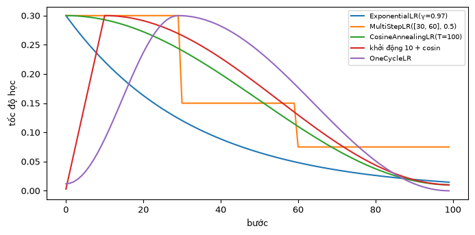

# Chương 12 · Dùng thư viện

> Ghi chú của người biên soạn: trang này do người biên soạn viết thêm, không có trong sách gốc. Trang tổng hợp những gì của `torch.optim` mà bạn sẽ dùng hằng ngày nhưng sách chỉ nhắc qua: nhóm tham số, các bộ lập lịch có sẵn và cách ghép chúng, cắt gradient, lưu trạng thái bộ tối ưu.

## Cách dùng trang này

Các khối chạy lần lượt từ trên xuống và dùng chung biến. Cần `torch` và `matplotlib`; mọi khối chạy trên CPU trong vài giây.

| Trong sách | PyTorch |
| --- | --- |
| SGD, động lượng (mục 12.4–12.6) | `torch.optim.SGD(params, lr, momentum=0.9, nesterov=False)` |
| Adagrad, RMSProp, Adadelta (12.7–12.9) | `torch.optim.Adagrad`, `RMSprop(alpha=γ)`, `Adadelta(rho=ρ)` |
| Adam, Yogi (12.10) | `torch.optim.Adam`, `AdamW` (Yogi không có sẵn trong PyTorch) |
| Suy giảm trọng số (mục 3.7) | `weight_decay=` của bộ tối ưu |
| Lịch tốc độ học (12.11) | `torch.optim.lr_scheduler.*` |
| Cắt gradient (nhắc trong mục 12.2) | `torch.nn.utils.clip_grad_norm_` |

## 1. Nhóm tham số

<small class="viz-ref">Mục 3.7.4 · mục 12.11.2</small>

Một bộ tối ưu nhận một danh sách *nhóm tham số* (`param_groups`), mỗi nhóm có thể có tốc độ học, suy giảm trọng số riêng. Cách dùng phổ biến nhất: không áp dụng suy giảm trọng số cho hệ số điều chỉnh (bias) và tham số chuẩn hóa, như mục 3.7.4 làm với `net.bias`.

<!-- run -->
```python
import math
import torch
from torch import nn
import matplotlib.pyplot as plt
from torch.optim import lr_scheduler

torch.manual_seed(0)
net = nn.Sequential(nn.Linear(10, 32), nn.LayerNorm(32), nn.ReLU(), nn.Linear(32, 2))
decay, no_decay = [], []
for name, p in net.named_parameters():
    (no_decay if p.ndim == 1 else decay).append(p)        # bias và tham số LayerNorm đều là vector 1 chiều
opt = torch.optim.AdamW([{'params': decay, 'weight_decay': 0.05},
                         {'params': no_decay, 'weight_decay': 0.0}], lr=1e-3)
for i, g in enumerate(opt.param_groups):
    print(f"nhóm {i}: {sum(p.numel() for p in g['params'])} tham số, lr={g['lr']}, weight_decay={g['weight_decay']}")
```

<!-- output -->
```output
nhóm 0: 384 tham số, lr=0.001, weight_decay=0.05
nhóm 1: 98 tham số, lr=0.001, weight_decay=0.0
```
<!-- /output -->

Tốc độ học của từng nhóm đọc và ghi qua `opt.param_groups[i]['lr']`, đúng cách mục 12.11.2 dùng. Các bộ lập lịch dưới đây làm việc đó tự động.

## 2. Các bộ lập lịch có sẵn

<small class="viz-ref">Mục 12.11.3</small>

Mỗi bộ lập lịch gắn với một bộ tối ưu; sau mỗi epoch (hoặc mỗi bước, tùy loại) gọi `scheduler.step()`. Hàm dưới đây ghi lại tốc độ học qua 100 bước để vẽ, không huấn luyện gì. Các lịch tương ứng với mục 12.11: theo hệ số (`ExponentialLR`), nhiều mốc (`MultiStepLR`), cosin (`CosineAnnealingLR`), khởi động rồi cosin (`LinearLR` nối với `CosineAnnealingLR` bằng `SequentialLR`), và lịch "một chu kỳ" (`OneCycleLR` của Smith và Topin, 2019: lịch được dùng nhiều trong thực tế dù sách không nhắc):

<!-- run -->
```python
def trace(make_sched, steps=100, lr=0.3):
    p = nn.Parameter(torch.zeros(1))
    opt = torch.optim.SGD([p], lr=lr, momentum=0.9)
    sched = make_sched(opt)
    lrs = []
    for _ in range(steps):
        lrs.append(opt.param_groups[0]['lr'])
        opt.step(); sched.step()
    return lrs

schedules = {
    "ExponentialLR(γ=0.97)": lambda o: lr_scheduler.ExponentialLR(o, gamma=0.97),
    "MultiStepLR([30, 60], 0.5)": lambda o: lr_scheduler.MultiStepLR(o, milestones=[30, 60], gamma=0.5),
    "CosineAnnealingLR(T=100)": lambda o: lr_scheduler.CosineAnnealingLR(o, T_max=100, eta_min=0.01),
    "khởi động 10 + cosin": lambda o: lr_scheduler.SequentialLR(o, [
        lr_scheduler.LinearLR(o, start_factor=0.01, total_iters=10),
        lr_scheduler.CosineAnnealingLR(o, T_max=90, eta_min=0.01)], milestones=[10]),
    "OneCycleLR": lambda o: lr_scheduler.OneCycleLR(o, max_lr=0.3, total_steps=100),
}
plt.figure(figsize=(7, 3.5))
for name, make in schedules.items():
    lrs = trace(make)
    plt.plot(lrs, label=name)
    print(f"{name:28s} lr ở bước 0, 10, 50, 99: {lrs[0]:.4f} {lrs[10]:.4f} {lrs[50]:.4f} {lrs[99]:.4f}")
plt.xlabel('bước'); plt.ylabel('tốc độ học'); plt.legend(fontsize=7); plt.tight_layout()
```

<!-- output -->
```output
ExponentialLR(γ=0.97)        lr ở bước 0, 10, 50, 99: 0.3000 0.2212 0.0654 0.0147
MultiStepLR([30, 60], 0.5)   lr ở bước 0, 10, 50, 99: 0.3000 0.3000 0.1500 0.0750
CosineAnnealingLR(T=100)     lr ở bước 0, 10, 50, 99: 0.3000 0.2929 0.1550 0.0101
khởi động 10 + cosin         lr ở bước 0, 10, 50, 99: 0.0030 0.3000 0.1802 0.0101
OneCycleLR                   lr ở bước 0, 10, 50, 99: 0.0120 0.0885 0.2382 0.0000
```

<div align=center></div>
<!-- /output -->

`OneCycleLR` tự quản lý cả tốc độ học lẫn hệ số động lượng (giảm động lượng khi tốc độ học tăng), và được gọi `step()` sau **mỗi minibatch** chứ không phải mỗi epoch.

Lịch tự viết như `SquareRootScheduler` của mục 12.11.2 có thể dùng qua `LambdaLR`, nhận một hàm trả về *hệ số nhân* với tốc độ học ban đầu:

<!-- run -->
```python
sqrt_sched = lambda o: lr_scheduler.LambdaLR(o, lambda t: (t + 1) ** -0.5)
lrs = trace(sqrt_sched, steps=5, lr=0.1)
print("LambdaLR với η0 (t+1)^(-1/2):", [round(v, 4) for v in lrs])
print("SquareRootScheduler của sách:", [round(0.1 * (t + 1) ** -0.5, 4) for t in range(5)])
```

<!-- output -->
```output
LambdaLR với η0 (t+1)^(-1/2): [0.1, 0.0707, 0.0577, 0.05, 0.0447]
SquareRootScheduler của sách: [0.1, 0.0707, 0.0577, 0.05, 0.0447]
```
<!-- /output -->

## 3. Cắt gradient

<small class="viz-ref">Mục 12.2.4.3 · phép chiếu</small>

Mục 12.2 nhận xét rằng cắt gradient là phép chiếu gradient lên quả cầu bán kính $\theta$: $\mathbf{g} \leftarrow \mathbf{g} \cdot \min(1, \theta / \|\mathbf{g}\|)$. Trong PyTorch, chuẩn được tính trên **toàn bộ** tham số gộp lại, gọi giữa `backward()` và `step()`:

<!-- run -->
```python
torch.manual_seed(0)
X, y = torch.randn(16, 10), torch.randint(0, 2, (16,))
loss = nn.functional.cross_entropy(net(X), y)
opt.zero_grad(); loss.backward()
before = torch.nn.utils.clip_grad_norm_(net.parameters(), max_norm=0.1)   # trả về chuẩn TRƯỚC khi cắt
after = torch.sqrt(sum((p.grad ** 2).sum() for p in net.parameters()))
print(f"chuẩn gradient trước khi cắt {before:.3f}, sau khi cắt {after:.3f}")
opt.step()
```

<!-- output -->
```output
chuẩn gradient trước khi cắt 0.827, sau khi cắt 0.100
```
<!-- /output -->

## 4. Lưu và nạp trạng thái bộ tối ưu

<small class="viz-ref">Mục 6.6 · trang Ví dụ áp dụng của chương 6</small>

Bộ tối ưu có trạng thái riêng (vận tốc, mô-men của Adam, số bước $t$ dùng cho hiệu chỉnh độ chệch). Trang [Ví dụ áp dụng chương 6](dl/ch06_app_vi) đã cho thấy thiếu trạng thái này thì huấn luyện tiếp bị lệch. Xem bên trong `state_dict` của AdamW:

<!-- run -->
```python
sd = opt.state_dict()
first = next(iter(sd['state'].values()))
print("các khoá trạng thái của một tham số:", list(first.keys()))
print("số bước đã đi:", first['step'].item())
print("cấu hình nhóm 0:", {k: v for k, v in sd['param_groups'][0].items() if k != 'params'})
```

<!-- output -->
```output
các khoá trạng thái của một tham số: ['step', 'exp_avg', 'exp_avg_sq']
số bước đã đi: 1.0
cấu hình nhóm 0: {'weight_decay': 0.05, 'lr': 0.001, 'betas': (0.9, 0.999), 'eps': 1e-08, 'amsgrad': False, 'maximize': False, 'foreach': None, 'capturable': False, 'differentiable': False, 'fused': None, 'decoupled_weight_decay': True}
```
<!-- /output -->

## Tóm tắt

- Nhóm tham số cho phép đặt tốc độ học, suy giảm trọng số khác nhau cho từng phần của mạng; mẫu thông dụng nhất là không suy giảm bias và tham số chuẩn hóa.
- Các lịch của mục 12.11 đều có sẵn trong `torch.optim.lr_scheduler`, ghép được với nhau bằng `SequentialLR`; lịch tự viết dùng `LambdaLR`.
- `clip_grad_norm_` thực hiện phép chiếu của mục 12.2 trên toàn bộ gradient của mạng.
- Khi lưu checkpoint, luôn lưu cả `optimizer.state_dict()` (và `scheduler.state_dict()`).
