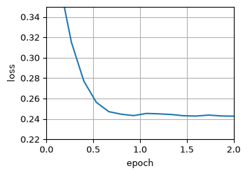
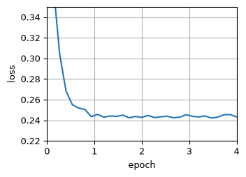
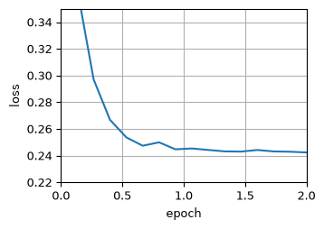

# 12.10 Adam

> Ghi chú của người biên soạn: trang này dịch nguyên văn từ sách *Dive into Deep Learning* của **Aston Zhang, Zachary C. Lipton, Mu Li và Alexander J. Smola** ([bản gốc](https://d2l.ai/chapter_optimization/adam.html), [mã nguồn](https://github.com/d2l-ai/d2l-en), giấy phép [CC BY-SA 4.0](https://creativecommons.org/licenses/by-sa/4.0/); code theo giấy phép MIT-0). Chỉ giữ code PyTorch. Số mục, hình và công thức giữ như bản HTML d2l.ai; thuật ngữ đối chiếu với bản dịch [Đắm mình vào Học Sâu](https://github.com/aivivn/d2l-vn).

Trong các thảo luận dẫn đến mục này, ta đã gặp một số kỹ thuật tối ưu hiệu quả. Hãy tóm tắt chi tiết chúng ở đây:

* Ta đã thấy [Mục 12.4](dl/ch12_s4_vi) hiệu quả hơn hạ gradient khi giải các bài toán tối ưu, chẳng hạn nhờ khả năng chống chịu vốn có với dữ liệu thừa.
* Ta đã thấy [Mục 12.5](dl/ch12_s5_vi) mang lại hiệu quả bổ sung đáng kể nhờ vector hóa, dùng các tập quan sát lớn hơn trong một minibatch. Đây là chìa khóa cho xử lý song song hiệu quả trên nhiều máy, nhiều GPU và nói chung.
* [Mục 12.6](dl/ch12_s6_vi) thêm một cơ chế tổng hợp lịch sử các gradient quá khứ để tăng tốc hội tụ.
* [Mục 12.7](dl/ch12_s7_vi) dùng phép co giãn theo từng tọa độ để có được một bộ tiền điều kiện hiệu quả về tính toán.
* [Mục 12.8](dl/ch12_s8_vi) tách rời phép co giãn theo từng tọa độ khỏi việc điều chỉnh tốc độ học.

Adam ([Kingma và Ba, 2014](dl/ch12_s10_vi?id=ref-kingma-ba-2014)) kết hợp tất cả các kỹ thuật này vào một thuật toán học hiệu quả. Đúng như dự đoán, đây là một thuật toán đã trở nên khá phổ biến như một trong những thuật toán tối ưu bền vững và hiệu quả hơn để dùng trong học sâu. Tuy nhiên, nó không phải không có vấn đề. Cụ thể, ([Reddi *et al.*, 2019](dl/ch12_s10_vi?id=ref-reddi-kale-kumar-2019)) chỉ ra rằng có những tình huống Adam có thể phân kỳ do kiểm soát phương sai kém. Trong một công trình tiếp theo, [Zaheer *et al.* (2018)](dl/ch12_s10_vi?id=ref-zaheer-reddi-sachan-ea-2018) đã đề xuất một bản sửa nhanh cho Adam, gọi là Yogi, giải quyết những vấn đề này. Sẽ nói thêm về điều này sau. Tạm thời hãy xem lại thuật toán Adam.

## 12.10.1 Thuật toán

Một trong những thành phần then chốt của Adam là nó dùng trung bình động có trọng số hàm mũ (exponential weighted moving average, còn được gọi là trung bình rò rỉ) để có được ước lượng của cả động lượng lẫn mô-men bậc hai của gradient. Tức là, nó dùng các biến trạng thái

$$
\begin{aligned}
    \mathbf{v}_t & \leftarrow \beta_1 \mathbf{v}_{t-1} + (1 - \beta_1) \mathbf{g}_t, \\
    \mathbf{s}_t & \leftarrow \beta_2 \mathbf{s}_{t-1} + (1 - \beta_2) \mathbf{g}_t^2.
\end{aligned}
$$

Ở đây $\beta_1$ và $\beta_2$ là các tham số trọng số không âm. Các lựa chọn thông dụng cho chúng là $\beta_1 = 0.9$ và $\beta_2 = 0.999$. Tức là, ước lượng phương sai di chuyển *chậm hơn rất nhiều* so với số hạng động lượng. Lưu ý rằng nếu khởi tạo $\mathbf{v}_0 = \mathbf{s}_0 = 0$, ban đầu ta có một độ chệch đáng kể về phía các giá trị nhỏ hơn. Điều này có thể được giải quyết bằng cách dùng thực tế $\sum_{i=0}^{t-1} \beta^i = \frac{1 - \beta^t}{1 - \beta}$ để chuẩn hóa lại các số hạng. Tương ứng, các biến trạng thái đã chuẩn hóa được cho bởi

$$
\hat{\mathbf{v}}_t = \frac{\mathbf{v}_t}{1 - \beta_1^t} \textrm{ và } \hat{\mathbf{s}}_t = \frac{\mathbf{s}_t}{1 - \beta_2^t}.
$$

Với các ước lượng phù hợp, giờ ta có thể viết ra các phương trình cập nhật. Trước tiên, ta co giãn lại gradient theo cách rất giống RMSProp để có

$$
\mathbf{g}_t' = \frac{\eta \hat{\mathbf{v}}_t}{\sqrt{\hat{\mathbf{s}}_t} + \epsilon}.
$$

Khác với RMSProp, bước cập nhật của ta dùng động lượng $\hat{\mathbf{v}}_t$ thay vì chính gradient. Hơn nữa, có một khác biệt nhỏ về hình thức vì phép co giãn dùng $\frac{1}{\sqrt{\hat{\mathbf{s}}_t} + \epsilon}$ thay vì $\frac{1}{\sqrt{\hat{\mathbf{s}}_t + \epsilon}}$. Cách trước có thể nói là hoạt động tốt hơn một chút trong thực tế, do đó có sự khác biệt so với RMSProp. Thông thường ta chọn $\epsilon = 10^{-6}$ để cân bằng tốt giữa ổn định số và độ trung thực.

Giờ ta đã có mọi mảnh ghép để tính các bước cập nhật. Điều này hơi hụt hẫng một chút, ta có một bước cập nhật đơn giản dạng

$$
\mathbf{x}_t \leftarrow \mathbf{x}_{t-1} - \mathbf{g}_t'.
$$

Xem lại thiết kế của Adam, nguồn cảm hứng của nó rất rõ ràng. Động lượng và thang đo hiện rõ trong các biến trạng thái. Định nghĩa khá đặc biệt của chúng buộc ta phải khử chệch các số hạng (điều này có thể được khắc phục bằng một cách khởi tạo và điều kiện cập nhật hơi khác). Thứ hai, việc kết hợp cả hai số hạng khá đơn giản, khi đã có RMSProp. Cuối cùng, tốc độ học tường minh $\eta$ cho phép ta kiểm soát độ dài bước để giải quyết các vấn đề hội tụ.

## 12.10.2 Cài đặt

Cài đặt Adam từ đầu không đáng sợ lắm. Để tiện lợi, ta lưu bộ đếm bước thời gian $t$ trong từ điển `hyperparams`. Ngoài ra mọi thứ đều đơn giản.

<!-- run -->
```python
from d2l import torch as d2l
import torch

def init_adam_states(feature_dim):
    v_w, v_b = d2l.zeros((feature_dim, 1)), d2l.zeros(1)
    s_w, s_b = d2l.zeros((feature_dim, 1)), d2l.zeros(1)
    return ((v_w, s_w), (v_b, s_b))

def adam(params, states, hyperparams):
    beta1, beta2, eps = 0.9, 0.999, 1e-6
    for p, (v, s) in zip(params, states):
        with torch.no_grad():
            v[:] = beta1 * v + (1 - beta1) * p.grad
            s[:] = beta2 * s + (1 - beta2) * torch.square(p.grad)
            v_bias_corr = v / (1 - beta1 ** hyperparams['t'])
            s_bias_corr = s / (1 - beta2 ** hyperparams['t'])
            p[:] -= hyperparams['lr'] * v_bias_corr / (torch.sqrt(s_bias_corr)
                                                       + eps)
        p.grad.data.zero_()
    hyperparams['t'] += 1
```

Ta đã sẵn sàng dùng Adam để huấn luyện mô hình. Ta dùng tốc độ học $\eta = 0.01$.

<!-- run -->
```python
data_iter, feature_dim = d2l.get_data_ch11(batch_size=10)
d2l.train_ch11(adam, init_adam_states(feature_dim),
               {'lr': 0.01, 't': 1}, data_iter, feature_dim);
```

<!-- output -->
```output
loss: 0.243, 0.037 sec/epoch
([0.005623340606689453, 0.010454893112182617, 0.014894247055053711, 0.01935124397277832, 0.02403879165649414, 0.028652429580688477, 0.033246517181396484, 0.04547739028930664, 0.049686431884765625, 0.05375099182128906, 0.057883262634277344, 0.061926841735839844, 0.06603264808654785, 0.07038998603820801, 0.07451987266540527], [0.3763378275632858, 0.315267042239507, 0.2770350608428319, 0.2562923289934794, 0.24712051967779794, 0.24461366502443949, 0.24325645486513772, 0.24537118297815322, 0.24498480506738027, 0.24433573041359583, 0.24310563443104427, 0.24281713018814724, 0.24375455129146575, 0.24292835557460785, 0.24268945461511612])
```

<div align=center></div>
<!-- /output -->

Một cách cài đặt súc tích hơn rất đơn giản vì `adam` là một trong các thuật toán được cung cấp sẵn trong thư viện tối ưu `trainer` của Gluon. Do đó ta chỉ cần truyền các tham số cấu hình cho một cài đặt trong Gluon.

<!-- run -->
```python
trainer = torch.optim.Adam
d2l.train_concise_ch11(trainer, {'lr': 0.01}, data_iter)
```

<!-- output -->
```output
loss: 0.243, 0.036 sec/epoch
```

<div align=center></div>
<!-- /output -->

## 12.10.3 Yogi

Một trong những vấn đề của Adam là nó có thể không hội tụ ngay cả trong bối cảnh lồi khi ước lượng mô-men bậc hai trong $\mathbf{s}_t$ bùng nổ. Để khắc phục, [Zaheer *et al.* (2018)](dl/ch12_s10_vi?id=ref-zaheer-reddi-sachan-ea-2018) đã đề xuất một bước cập nhật (và cách khởi tạo) cải tiến cho $\mathbf{s}_t$. Để hiểu điều gì đang diễn ra, hãy viết lại bước cập nhật của Adam như sau:

$$
\mathbf{s}_t \leftarrow \mathbf{s}_{t-1} + (1 - \beta_2) \left(\mathbf{g}_t^2 - \mathbf{s}_{t-1}\right).
$$

Bất cứ khi nào $\mathbf{g}_t^2$ có phương sai cao hoặc các bước cập nhật thưa, $\mathbf{s}_t$ có thể quên các giá trị quá khứ quá nhanh. Một cách khắc phục khả dĩ cho điều này là thay $\mathbf{g}_t^2 - \mathbf{s}_{t-1}$ bằng $\mathbf{g}_t^2 \odot \mathop{\textrm{sgn}}(\mathbf{g}_t^2 - \mathbf{s}_{t-1})$. Giờ độ lớn của bước cập nhật không còn phụ thuộc vào mức độ sai lệch. Điều này cho ta các bước cập nhật Yogi

$$
\mathbf{s}_t \leftarrow \mathbf{s}_{t-1} + (1 - \beta_2) \mathbf{g}_t^2 \odot \mathop{\textrm{sgn}}(\mathbf{g}_t^2 - \mathbf{s}_{t-1}).
$$

Các tác giả còn khuyên nên khởi tạo động lượng trên một lô ban đầu lớn hơn thay vì chỉ một ước lượng điểm ban đầu. Ta bỏ qua chi tiết vì chúng không quan trọng với thảo luận và vì ngay cả không có điều này, sự hội tụ vẫn khá tốt.

<!-- run -->
```python
def yogi(params, states, hyperparams):
    beta1, beta2, eps = 0.9, 0.999, 1e-3
    for p, (v, s) in zip(params, states):
        with torch.no_grad():
            v[:] = beta1 * v + (1 - beta1) * p.grad
            s[:] = s + (1 - beta2) * torch.sign(
                torch.square(p.grad) - s) * torch.square(p.grad)
            v_bias_corr = v / (1 - beta1 ** hyperparams['t'])
            s_bias_corr = s / (1 - beta2 ** hyperparams['t'])
            p[:] -= hyperparams['lr'] * v_bias_corr / (torch.sqrt(s_bias_corr)
                                                       + eps)
        p.grad.data.zero_()
    hyperparams['t'] += 1

data_iter, feature_dim = d2l.get_data_ch11(batch_size=10)
d2l.train_ch11(yogi, init_adam_states(feature_dim),
               {'lr': 0.01, 't': 1}, data_iter, feature_dim);
```

<!-- output -->
```output
loss: 0.242, 0.033 sec/epoch
([0.004603147506713867, 0.008878946304321289, 0.01319742202758789, 0.01752638816833496, 0.021973848342895508, 0.026240110397338867, 0.030753135681152344, 0.03549480438232422, 0.040374040603637695, 0.044934749603271484, 0.04949665069580078, 0.05389404296875, 0.05817413330078125, 0.062425851821899414, 0.0666971206665039], [0.3648763492504756, 0.29707805784543356, 0.26682247837384543, 0.2536543871561686, 0.24739432005087533, 0.24995041600863138, 0.2447243408759435, 0.24535360586643218, 0.24425727152824403, 0.24317152839899064, 0.2430040947198868, 0.24420908478895823, 0.24313019144535064, 0.24291596015294392, 0.24237050795555115])
```

<div align=center></div>
<!-- /output -->

## 12.10.4 Tóm tắt

* Adam kết hợp đặc điểm của nhiều thuật toán tối ưu thành một quy tắc cập nhật khá bền vững.
* Được xây dựng dựa trên RMSProp, Adam cũng dùng EWMA trên gradient ngẫu nhiên theo minibatch.
* Adam dùng hiệu chỉnh độ chệch để bù cho sự khởi đầu chậm khi ước lượng động lượng và mô-men bậc hai.
* Với các gradient có phương sai đáng kể, ta có thể gặp vấn đề về hội tụ. Chúng có thể được khắc phục bằng cách dùng minibatch lớn hơn hoặc chuyển sang một ước lượng cải tiến cho $\mathbf{s}_t$. Yogi cung cấp một phương án thay thế như vậy.

## 12.10.5 Bài tập

1. Điều chỉnh tốc độ học, quan sát và phân tích các kết quả thí nghiệm.
1. Bạn có thể viết lại các bước cập nhật động lượng và mô-men bậc hai sao cho không cần hiệu chỉnh độ chệch không?
1. Vì sao bạn cần giảm tốc độ học $\eta$ khi ta hội tụ?
1. Thử dựng một trường hợp mà Adam phân kỳ còn Yogi hội tụ.

[Thảo luận (tiếng Anh)](https://discuss.d2l.ai/t/1078)

## Tài liệu tham khảo

- <a id="ref-kingma-ba-2014"></a>Kingma, Diederik P, Ba, Jimmy (2014). *Adam: A method for stochastic optimization*. ArXiv:1412.6980.
- <a id="ref-reddi-kale-kumar-2019"></a>Reddi, Sashank J, Kale, Satyen, Kumar, Sanjiv (2019). *On the convergence of Adam and beyond*. ArXiv:1904.09237.
- <a id="ref-zaheer-reddi-sachan-ea-2018"></a>Zaheer, Manzil, Reddi, Sashank, Sachan, Devendra, ... (2018). *Adaptive methods for nonconvex optimization*. Advances in Neural Information Processing Systems.
