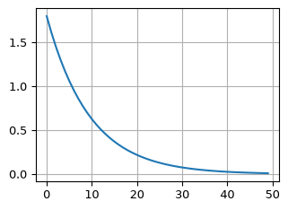

# 12.11 Lập lịch Tốc độ học

> Ghi chú của người biên soạn: trang này dịch nguyên văn từ sách *Dive into Deep Learning* của **Aston Zhang, Zachary C. Lipton, Mu Li và Alexander J. Smola** ([bản gốc](https://d2l.ai/chapter_optimization/lr-scheduler.html), [mã nguồn](https://github.com/d2l-ai/d2l-en), giấy phép [CC BY-SA 4.0](https://creativecommons.org/licenses/by-sa/4.0/); code theo giấy phép MIT-0). Chỉ giữ code PyTorch. Số mục, hình và công thức giữ như bản HTML d2l.ai; thuật ngữ đối chiếu với bản dịch [Đắm mình vào Học Sâu](https://github.com/aivivn/d2l-vn).
>
> **Đính chính** *(người biên soạn)*:
>
> - Mục 12.11.3.2: khối vẽ lịch `MultiStepLR` gọi `scheduler.step()` 30 lần để lấy các giá trị cần vẽ, rồi khối tiếp theo huấn luyện bằng **chính bộ lập lịch đó**. Vì vậy lúc bắt đầu huấn luyện, tốc độ học đã giảm sẵn từ 0.5 xuống 0.125 (đã qua cả hai mốc 15 và 30), không giống lịch vừa vẽ. Muốn huấn luyện đúng lịch, hãy tạo lại `net`, `trainer` và `scheduler` trước khi gọi `train`.
> - Các câu nhắc MXNet/Gluon (`set_learning_rate`, `lr_scheduler.FactorScheduler`, GluonCV, `PolyScheduler`) còn sót từ bản viết chung cho nhiều framework. Trong PyTorch, tương ứng là gán `trainer.param_groups[0]['lr']` (như code), `torch.optim.lr_scheduler.ExponentialLR`/`LambdaLR`, `CosineAnnealingLR` và `PolynomialLR`.
> - Phần lớn các khối của mục này huấn luyện LeNet 30 epoch nên được chạy trên máy có GPU; các khối vẽ lịch dùng biến `num_epochs` và `trainer` của khối huấn luyện đầu tiên nên cũng chờ chạy cùng.

Cho đến nay, ta chủ yếu tập trung vào các *thuật toán* tối ưu, tức cách cập nhật các vector trọng số, thay vì vào *tốc độ* cập nhật chúng. Dù vậy, điều chỉnh tốc độ học thường quan trọng không kém chính thuật toán. Có một số khía cạnh cần xem xét:

* Hiển nhiên nhất là *độ lớn* của tốc độ học có ý nghĩa. Nếu quá lớn, quá trình tối ưu phân kỳ; nếu quá nhỏ, huấn luyện mất quá lâu hoặc ta đi đến một kết quả chưa tối ưu. Trước đây ta đã thấy số điều kiện của bài toán có ý nghĩa (xem chẳng hạn [Mục 12.6](dl/ch12_s6_vi) để biết chi tiết). Một cách trực quan, đó là tỉ số giữa lượng thay đổi theo hướng kém nhạy cảm nhất và theo hướng nhạy cảm nhất.
* Thứ hai, tốc độ suy giảm cũng quan trọng không kém. Nếu tốc độ học vẫn lớn, ta có thể chỉ đơn giản nảy qua nảy lại quanh cực tiểu và do đó không đạt được điểm tối ưu. [Mục 12.5](dl/ch12_s5_vi) đã thảo luận điều này khá chi tiết và ta đã phân tích các đảm bảo hiệu năng trong [Mục 12.4](dl/ch12_s4_vi). Tóm lại, ta muốn tốc độ học suy giảm, nhưng có lẽ chậm hơn $\mathcal{O}(t^{-\frac{1}{2}})$, vốn là một lựa chọn tốt cho các bài toán lồi.
* Một khía cạnh khác cũng quan trọng không kém là *khởi tạo*. Điều này liên quan cả đến cách các tham số được đặt ban đầu (xem lại [Mục 5.4](dl/ch05_s4_vi) để biết chi tiết) lẫn cách chúng thay đổi lúc đầu. Điều này được gọi là *khởi động* (warmup), tức là ban đầu ta bắt đầu di chuyển về phía nghiệm nhanh đến đâu. Những bước lớn lúc đầu có thể không có lợi, đặc biệt vì tập tham số ban đầu là ngẫu nhiên. Các hướng cập nhật ban đầu cũng có thể khá vô nghĩa.
* Cuối cùng, có một số biến thể tối ưu thực hiện điều chỉnh tốc độ học theo chu kỳ. Điều này nằm ngoài phạm vi của chương hiện tại. Chúng tôi giới thiệu độc giả xem chi tiết trong [Izmailov *et al.* (2018)](dl/ch12_s11_vi?id=ref-izmailov-podoprikhin-garipov-ea-2018), chẳng hạn cách có được nghiệm tốt hơn bằng cách lấy trung bình trên cả một *đường đi* của các tham số.

Vì việc quản lý tốc độ học cần rất nhiều chi tiết, hầu hết các framework học sâu đều có công cụ để xử lý điều này tự động. Trong chương hiện tại, ta sẽ xem xét tác động của các lịch trình khác nhau lên độ chính xác và cũng chỉ ra cách quản lý điều này hiệu quả qua một *bộ lập lịch tốc độ học* (learning rate scheduler).

## 12.11.1 Bài toán Đơn giản

Ta bắt đầu với một bài toán đơn giản, đủ rẻ để tính toán dễ dàng nhưng cũng đủ không tầm thường để minh họa một số khía cạnh then chốt. Để làm điều đó, ta chọn một phiên bản hơi hiện đại hóa của LeNet (hàm kích hoạt `relu` thay vì `sigmoid`, gộp cực đại thay vì gộp trung bình), áp dụng cho Fashion-MNIST. Hơn nữa, ta lai hóa (hybridize) mạng để có hiệu năng tốt. Vì phần lớn code là tiêu chuẩn, ta chỉ giới thiệu những điều cơ bản mà không thảo luận chi tiết thêm. Xem [Chương 7](dl/ch07_vi) để ôn lại nếu cần.

<!-- run -->
```python
from d2l import torch as d2l
import math
import torch
from torch import nn
from torch.optim import lr_scheduler

def net_fn():
    model = nn.Sequential(
        nn.Conv2d(1, 6, kernel_size=5, padding=2), nn.ReLU(),
        nn.MaxPool2d(kernel_size=2, stride=2),
        nn.Conv2d(6, 16, kernel_size=5), nn.ReLU(),
        nn.MaxPool2d(kernel_size=2, stride=2),
        nn.Flatten(),
        nn.Linear(16 * 5 * 5, 120), nn.ReLU(),
        nn.Linear(120, 84), nn.ReLU(),
        nn.Linear(84, 10))

    return model

loss = nn.CrossEntropyLoss()
device = d2l.try_gpu()

batch_size = 256
train_iter, test_iter = d2l.load_data_fashion_mnist(batch_size=batch_size)

# Code gần như giống hệt `d2l.train_ch6` được định nghĩa trong mục lenet
# của chương mạng neuron tích chập
def train(net, train_iter, test_iter, num_epochs, loss, trainer, device,
          scheduler=None):
    net.to(device)
    animator = d2l.Animator(xlabel='epoch', xlim=[0, num_epochs],
                            legend=['train loss', 'train acc', 'test acc'])

    for epoch in range(num_epochs):
        metric = d2l.Accumulator(3)  # train_loss, train_acc, num_examples
        for i, (X, y) in enumerate(train_iter):
            net.train()
            trainer.zero_grad()
            X, y = X.to(device), y.to(device)
            y_hat = net(X)
            l = loss(y_hat, y)
            l.backward()
            trainer.step()
            with torch.no_grad():
                metric.add(l * X.shape[0], d2l.accuracy(y_hat, y), X.shape[0])
            train_loss = metric[0] / metric[2]
            train_acc = metric[1] / metric[2]
            if (i + 1) % 50 == 0:
                animator.add(epoch + i / len(train_iter),
                             (train_loss, train_acc, None))

        test_acc = d2l.evaluate_accuracy_gpu(net, test_iter)
        animator.add(epoch+1, (None, None, test_acc))

        if scheduler:
            if scheduler.__module__ == lr_scheduler.__name__:
                # Dùng bộ lập lịch có sẵn của PyTorch
                scheduler.step()
            else:
                # Dùng bộ lập lịch tự định nghĩa
                for param_group in trainer.param_groups:
                    param_group['lr'] = scheduler(epoch)

    print(f'train loss {train_loss:.3f}, train acc {train_acc:.3f}, '
          f'test acc {test_acc:.3f}')
```

Hãy xem điều gì xảy ra nếu ta gọi thuật toán này với các thiết lập mặc định, chẳng hạn tốc độ học $0.3$, và huấn luyện $30$ vòng lặp. Lưu ý rằng độ chính xác huấn luyện cứ tiếp tục tăng trong khi tiến triển về độ chính xác kiểm tra dừng lại sau một thời điểm. Khoảng cách giữa hai đường cho thấy hiện tượng quá khớp.

<!-- run gpu -->
```python
lr, num_epochs = 0.3, 30
net = net_fn()
trainer = torch.optim.SGD(net.parameters(), lr=lr)
train(net, train_iter, test_iter, num_epochs, loss, trainer, device)
```

<!-- output -->
<div class="gpu-pending">Chưa có kết quả: khối này huấn luyện mô hình nên sẽ được chạy trên máy có GPU. Bạn có thể tự chạy code trên Colab hoặc máy của mình.</div>
<!-- /output -->

## 12.11.2 Bộ lập lịch

Một cách điều chỉnh tốc độ học là đặt nó một cách tường minh ở mỗi bước. Điều này có thể đạt được một cách tiện lợi bằng phương thức `set_learning_rate`. Ta có thể giảm nó sau mỗi epoch (hoặc thậm chí sau mỗi minibatch), chẳng hạn một cách động để phản ứng với tiến trình tối ưu.

<!-- run gpu -->
```python
lr = 0.1
trainer.param_groups[0]["lr"] = lr
print(f'learning rate is now {trainer.param_groups[0]["lr"]:.2f}')
```

<!-- output -->
<div class="gpu-pending">Chưa có kết quả: khối này huấn luyện mô hình nên sẽ được chạy trên máy có GPU. Bạn có thể tự chạy code trên Colab hoặc máy của mình.</div>
<!-- /output -->

Tổng quát hơn, ta muốn định nghĩa một bộ lập lịch. Khi được gọi với số lần cập nhật, nó trả về giá trị tốc độ học thích hợp. Hãy định nghĩa một bộ lập lịch đơn giản đặt tốc độ học là $\eta = \eta_0 (t + 1)^{-\frac{1}{2}}$.

<!-- run -->
```python
class SquareRootScheduler:
    def __init__(self, lr=0.1):
        self.lr = lr

    def __call__(self, num_update):
        return self.lr * pow(num_update + 1.0, -0.5)
```

Hãy vẽ hành vi của nó trên một khoảng giá trị.

<!-- run gpu -->
```python
scheduler = SquareRootScheduler(lr=0.1)
d2l.plot(d2l.arange(num_epochs), [scheduler(t) for t in range(num_epochs)])
```

<!-- output -->
<div class="gpu-pending">Chưa có kết quả: khối này huấn luyện mô hình nên sẽ được chạy trên máy có GPU. Bạn có thể tự chạy code trên Colab hoặc máy của mình.</div>
<!-- /output -->

Giờ hãy xem điều này diễn ra thế nào khi huấn luyện trên Fashion-MNIST. Ta chỉ đơn giản cung cấp bộ lập lịch như một đối số bổ sung cho thuật toán huấn luyện.

<!-- run gpu -->
```python
net = net_fn()
trainer = torch.optim.SGD(net.parameters(), lr)
train(net, train_iter, test_iter, num_epochs, loss, trainer, device,
      scheduler)
```

<!-- output -->
<div class="gpu-pending">Chưa có kết quả: khối này huấn luyện mô hình nên sẽ được chạy trên máy có GPU. Bạn có thể tự chạy code trên Colab hoặc máy của mình.</div>
<!-- /output -->

Cách này hoạt động tốt hơn đáng kể so với trước. Có hai điều nổi bật: đường cong mượt hơn khá nhiều so với trước. Thứ hai, ít quá khớp hơn. Đáng tiếc là câu hỏi vì sao một số chiến lược nhất định dẫn đến ít quá khớp hơn về mặt *lý thuyết* chưa được giải đáp thỏa đáng. Có một số lập luận rằng kích thước bước nhỏ hơn sẽ dẫn đến các tham số gần không hơn và do đó đơn giản hơn. Tuy nhiên, điều này không giải thích hoàn toàn hiện tượng vì ta không thực sự dừng sớm mà chỉ đơn giản giảm tốc độ học một cách nhẹ nhàng.

## 12.11.3 Các Chính sách

Dù không thể bao quát toàn bộ sự đa dạng của các bộ lập lịch tốc độ học, chúng tôi cố gắng đưa ra một tổng quan ngắn gọn về các chính sách phổ biến dưới đây. Các lựa chọn phổ biến là suy giảm theo đa thức và lịch hằng số từng khúc. Ngoài ra, các lịch tốc độ học theo hàm cosin đã được thấy là hoạt động tốt về mặt thực nghiệm trên một số bài toán. Cuối cùng, trên một số bài toán, việc khởi động bộ tối ưu trước khi dùng các tốc độ học lớn là có lợi.

### 12.11.3.1 Bộ lập lịch Theo hệ số

Một phương án thay thế cho suy giảm theo đa thức là suy giảm theo phép nhân, tức là $\eta_{t+1} \leftarrow \eta_t \cdot \alpha$ với $\alpha \in (0, 1)$. Để ngăn tốc độ học suy giảm xuống dưới một cận dưới hợp lý, phương trình cập nhật thường được sửa thành $\eta_{t+1} \leftarrow \mathop{\mathrm{max}}(\eta_{\mathrm{min}}, \eta_t \cdot \alpha)$.

<!-- run -->
```python
class FactorScheduler:
    def __init__(self, factor=1, stop_factor_lr=1e-7, base_lr=0.1):
        self.factor = factor
        self.stop_factor_lr = stop_factor_lr
        self.base_lr = base_lr

    def __call__(self, num_update):
        self.base_lr = max(self.stop_factor_lr, self.base_lr * self.factor)
        return self.base_lr

scheduler = FactorScheduler(factor=0.9, stop_factor_lr=1e-2, base_lr=2.0)
d2l.plot(d2l.arange(50), [scheduler(t) for t in range(50)])
```

<!-- output -->
<div align=center></div>
<!-- /output -->

Điều này cũng có thể đạt được bằng một bộ lập lịch có sẵn trong MXNet qua đối tượng `lr_scheduler.FactorScheduler`. Nó nhận thêm một vài tham số, như thời gian khởi động, chế độ khởi động (tuyến tính hoặc hằng số), số lần cập nhật tối đa mong muốn, v.v.; Từ đây trở đi, ta sẽ dùng các bộ lập lịch có sẵn khi thích hợp và chỉ giải thích chức năng của chúng ở đây. Như đã minh họa, tự xây dựng bộ lập lịch của riêng bạn khá đơn giản nếu cần.

### 12.11.3.2 Bộ lập lịch Nhiều mốc

Một chiến lược phổ biến để huấn luyện mạng sâu là giữ tốc độ học không đổi từng khúc và giảm nó đi một lượng cho trước thỉnh thoảng. Tức là, cho một tập các thời điểm cần giảm tốc độ học, chẳng hạn $s = \{5, 10, 20\}$, giảm $\eta_{t+1} \leftarrow \eta_t \cdot \alpha$ bất cứ khi nào $t \in s$. Giả sử giá trị giảm một nửa ở mỗi bước, ta có thể cài đặt điều này như sau.

<!-- run gpu -->
```python
net = net_fn()
trainer = torch.optim.SGD(net.parameters(), lr=0.5)
scheduler = lr_scheduler.MultiStepLR(trainer, milestones=[15, 30], gamma=0.5)

def get_lr(trainer, scheduler):
    lr = scheduler.get_last_lr()[0]
    trainer.step()
    scheduler.step()
    return lr

d2l.plot(d2l.arange(num_epochs), [get_lr(trainer, scheduler)
                                  for t in range(num_epochs)])
```

<!-- output -->
<div class="gpu-pending">Chưa có kết quả: khối này huấn luyện mô hình nên sẽ được chạy trên máy có GPU. Bạn có thể tự chạy code trên Colab hoặc máy của mình.</div>
<!-- /output -->

Trực giác đằng sau lịch tốc độ học hằng số từng khúc này là ta để quá trình tối ưu tiếp diễn cho đến khi đạt được một điểm dừng xét theo phân phối của các vector trọng số. Sau đó (và chỉ khi đó) ta mới giảm tốc độ học để có được một xấp xỉ chất lượng cao hơn cho một cực tiểu địa phương tốt. Ví dụ dưới đây cho thấy cách này có thể tạo ra những nghiệm tốt hơn một chút.

<!-- run gpu -->
```python
train(net, train_iter, test_iter, num_epochs, loss, trainer, device,
      scheduler)
```

<!-- output -->
<div class="gpu-pending">Chưa có kết quả: khối này huấn luyện mô hình nên sẽ được chạy trên máy có GPU. Bạn có thể tự chạy code trên Colab hoặc máy của mình.</div>
<!-- /output -->

### 12.11.3.3 Bộ lập lịch Cosin

Một phương pháp kinh nghiệm khá khó hiểu đã được đề xuất bởi [Loshchilov và Hutter (2016)](dl/ch12_s11_vi?id=ref-loshchilov-hutter-2016). Nó dựa trên nhận xét rằng ta có thể không muốn giảm tốc độ học quá mạnh lúc đầu, và hơn nữa, ta có thể muốn "tinh chỉnh" nghiệm ở cuối bằng một tốc độ học rất nhỏ. Điều này dẫn đến một lịch trình dạng cosin với dạng hàm sau cho tốc độ học trong khoảng $t \in [0, T]$.

$$
\eta_t = \eta_T + \frac{\eta_0 - \eta_T}{2} \left(1 + \cos(\pi t/T)\right)
$$

Ở đây $\eta_0$ là tốc độ học ban đầu, $\eta_T$ là tốc độ học mục tiêu tại thời điểm $T$. Hơn nữa, với $t > T$, ta chỉ đơn giản cố định giá trị ở $\eta_T$ mà không tăng lại. Trong ví dụ sau, ta đặt bước cập nhật tối đa $T = 20$.

<!-- run gpu -->
```python
class CosineScheduler:
    def __init__(self, max_update, base_lr=0.01, final_lr=0,
               warmup_steps=0, warmup_begin_lr=0):
        self.base_lr_orig = base_lr
        self.max_update = max_update
        self.final_lr = final_lr
        self.warmup_steps = warmup_steps
        self.warmup_begin_lr = warmup_begin_lr
        self.max_steps = self.max_update - self.warmup_steps

    def get_warmup_lr(self, epoch):
        increase = (self.base_lr_orig - self.warmup_begin_lr) \
                       * float(epoch) / float(self.warmup_steps)
        return self.warmup_begin_lr + increase

    def __call__(self, epoch):
        if epoch < self.warmup_steps:
            return self.get_warmup_lr(epoch)
        if epoch <= self.max_update:
            self.base_lr = self.final_lr + (
                self.base_lr_orig - self.final_lr) * (1 + math.cos(
                math.pi * (epoch - self.warmup_steps) / self.max_steps)) / 2
        return self.base_lr

scheduler = CosineScheduler(max_update=20, base_lr=0.3, final_lr=0.01)
d2l.plot(d2l.arange(num_epochs), [scheduler(t) for t in range(num_epochs)])
```

<!-- output -->
<div class="gpu-pending">Chưa có kết quả: khối này huấn luyện mô hình nên sẽ được chạy trên máy có GPU. Bạn có thể tự chạy code trên Colab hoặc máy của mình.</div>
<!-- /output -->

Trong bối cảnh thị giác máy tính, lịch trình này *có thể* dẫn đến kết quả được cải thiện. Tuy nhiên, lưu ý rằng những cải thiện như vậy không được đảm bảo (như có thể thấy dưới đây).

<!-- run gpu -->
```python
net = net_fn()
trainer = torch.optim.SGD(net.parameters(), lr=0.3)
train(net, train_iter, test_iter, num_epochs, loss, trainer, device,
      scheduler)
```

<!-- output -->
<div class="gpu-pending">Chưa có kết quả: khối này huấn luyện mô hình nên sẽ được chạy trên máy có GPU. Bạn có thể tự chạy code trên Colab hoặc máy của mình.</div>
<!-- /output -->

### 12.11.3.4 Khởi động

Trong một số trường hợp, khởi tạo tham số không đủ để đảm bảo một nghiệm tốt. Đây đặc biệt là vấn đề với một số thiết kế mạng nâng cao có thể dẫn đến các bài toán tối ưu không ổn định. Ta có thể giải quyết điều này bằng cách chọn một tốc độ học đủ nhỏ để ngăn phân kỳ lúc đầu. Đáng tiếc là điều này nghĩa là tiến triển chậm. Ngược lại, một tốc độ học lớn lúc đầu dẫn đến phân kỳ.

Một cách khắc phục khá đơn giản cho tình thế khó xử này là dùng một giai đoạn khởi động, trong đó tốc độ học *tăng* lên giá trị tối đa ban đầu của nó, rồi hạ nhiệt tốc độ học cho đến cuối quá trình tối ưu. Để đơn giản, người ta thường dùng mức tăng tuyến tính cho mục đích này. Điều này dẫn đến một lịch trình có dạng như dưới đây.

<!-- run gpu -->
```python
scheduler = CosineScheduler(20, warmup_steps=5, base_lr=0.3, final_lr=0.01)
d2l.plot(d2l.arange(num_epochs), [scheduler(t) for t in range(num_epochs)])
```

<!-- output -->
<div class="gpu-pending">Chưa có kết quả: khối này huấn luyện mô hình nên sẽ được chạy trên máy có GPU. Bạn có thể tự chạy code trên Colab hoặc máy của mình.</div>
<!-- /output -->

Lưu ý rằng mạng hội tụ tốt hơn lúc đầu (đặc biệt hãy quan sát hiệu năng trong 5 epoch đầu tiên).

<!-- run gpu -->
```python
net = net_fn()
trainer = torch.optim.SGD(net.parameters(), lr=0.3)
train(net, train_iter, test_iter, num_epochs, loss, trainer, device,
      scheduler)
```

<!-- output -->
<div class="gpu-pending">Chưa có kết quả: khối này huấn luyện mô hình nên sẽ được chạy trên máy có GPU. Bạn có thể tự chạy code trên Colab hoặc máy của mình.</div>
<!-- /output -->

Khởi động có thể được áp dụng cho bất kỳ bộ lập lịch nào (không chỉ cosin). Để có thảo luận chi tiết hơn về các lịch tốc độ học và nhiều thí nghiệm hơn nữa, xem thêm ([Gotmare *et al.*, 2018](dl/ch12_s11_vi?id=ref-gotmare-keskar-xiong-ea-2018)). Cụ thể, họ thấy rằng một giai đoạn khởi động hạn chế mức độ phân kỳ của tham số trong các mạng rất sâu. Điều này có ý nghĩa về mặt trực giác vì ta có thể dự đoán sự phân kỳ đáng kể do khởi tạo ngẫu nhiên ở những phần của mạng cần nhiều thời gian nhất để tiến triển lúc đầu.

## 12.11.4 Tóm tắt

* Giảm tốc độ học trong quá trình huấn luyện có thể dẫn đến độ chính xác được cải thiện và (khó hiểu nhất) giảm quá khớp của mô hình.
* Giảm tốc độ học từng khúc bất cứ khi nào tiến triển chững lại hiệu quả trong thực tế. Về cơ bản, điều này đảm bảo ta hội tụ hiệu quả đến một nghiệm phù hợp và chỉ sau đó mới giảm phương sai vốn có của các tham số bằng cách giảm tốc độ học.
* Các bộ lập lịch cosin phổ biến cho một số bài toán thị giác máy tính. Xem chẳng hạn [GluonCV](http://gluon-cv.mxnet.io) để biết chi tiết về một bộ lập lịch như vậy.
* Một giai đoạn khởi động trước khi tối ưu có thể ngăn phân kỳ.
* Tối ưu phục vụ nhiều mục đích trong học sâu. Ngoài việc cực tiểu hóa mục tiêu huấn luyện, các lựa chọn khác nhau về thuật toán tối ưu và lịch tốc độ học có thể dẫn đến mức độ tổng quát hóa và quá khớp khá khác nhau trên tập kiểm tra (với cùng mức lỗi huấn luyện).

## 12.11.5 Bài tập

1. Thử nghiệm với hành vi tối ưu cho một tốc độ học cố định cho trước. Mô hình tốt nhất bạn có thể đạt được theo cách này là gì?
1. Sự hội tụ thay đổi thế nào nếu bạn thay đổi số mũ của mức giảm tốc độ học? Dùng `PolyScheduler` để tiện cho các thí nghiệm.
1. Áp dụng bộ lập lịch cosin cho các bài toán thị giác máy tính lớn, chẳng hạn huấn luyện ImageNet. Nó ảnh hưởng thế nào đến hiệu năng so với các bộ lập lịch khác?
1. Giai đoạn khởi động nên kéo dài bao lâu?
1. Bạn có thể liên hệ tối ưu với lấy mẫu không? Hãy bắt đầu bằng việc dùng kết quả từ [Welling và Teh (2011)](dl/ch12_s11_vi?id=ref-welling-teh-2011) về Động lực học Langevin với Gradient Ngẫu nhiên (Stochastic Gradient Langevin Dynamics).

[Thảo luận (tiếng Anh)](https://discuss.d2l.ai/t/1080)

## Tài liệu tham khảo

- <a id="ref-gotmare-keskar-xiong-ea-2018"></a>Gotmare, Akhilesh, Keskar, Nitish Shirish, Xiong, Caiming, ... (2018). *A closer look at deep learning heuristics: Learning rate restarts, warmup and distillation*. ArXiv:1810.13243.
- <a id="ref-izmailov-podoprikhin-garipov-ea-2018"></a>Izmailov, Pavel, Podoprikhin, Dmitrii, Garipov, Timur, ... (2018). *Averaging weights leads to wider optima and better generalization*. ArXiv:1803.05407.
- <a id="ref-loshchilov-hutter-2016"></a>Loshchilov, Ilya, Hutter, Frank (2016). *SGDR: Stochastic gradient descent with warm restarts*. ArXiv:1608.03983.
- <a id="ref-welling-teh-2011"></a>Welling, Max, Teh, Yee W (2011). *Bayesian learning via stochastic gradient Langevin dynamics*. Proceedings of the 28th International Conference on Machine Learning (ICML-11).
