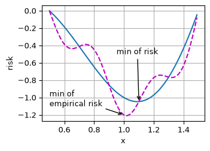
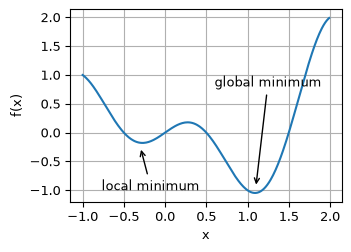
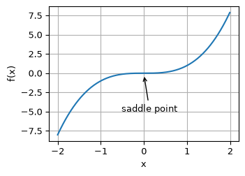
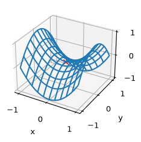
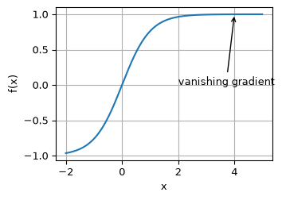

# 12.1 Tối ưu và Học sâu

> Ghi chú của người biên soạn: trang này dịch nguyên văn từ sách *Dive into Deep Learning* của **Aston Zhang, Zachary C. Lipton, Mu Li và Alexander J. Smola** ([bản gốc](https://d2l.ai/chapter_optimization/optimization-intro.html), [mã nguồn](https://github.com/d2l-ai/d2l-en), giấy phép [CC BY-SA 4.0](https://creativecommons.org/licenses/by-sa/4.0/); code theo giấy phép MIT-0). Chỉ giữ code PyTorch. Số mục, hình và công thức giữ như bản HTML d2l.ai; thuật ngữ đối chiếu với bản dịch [Đắm mình vào Học Sâu](https://github.com/aivivn/d2l-vn).

Trong mục này, ta sẽ thảo luận mối quan hệ giữa tối ưu và học sâu cũng như những thách thức khi dùng tối ưu trong học sâu. Với một bài toán học sâu, ta thường định nghĩa một *hàm mất mát* trước. Khi đã có hàm mất mát, ta có thể dùng một thuật toán tối ưu để cố gắng cực tiểu hóa mất mát. Trong tối ưu, hàm mất mát thường được gọi là *hàm mục tiêu* của bài toán tối ưu. Theo truyền thống và quy ước, hầu hết các thuật toán tối ưu quan tâm đến việc *cực tiểu hóa*. Nếu cần cực đại hóa một hàm mục tiêu, có một giải pháp đơn giản: chỉ cần đổi dấu hàm mục tiêu.

## 12.1.1 Mục tiêu của Tối ưu

Dù tối ưu cung cấp một cách để cực tiểu hóa hàm mất mát cho học sâu, về bản chất, mục tiêu của tối ưu và học sâu khác nhau một cách căn bản. Cái trước chủ yếu quan tâm đến việc cực tiểu hóa một hàm mục tiêu, trong khi cái sau quan tâm đến việc tìm một mô hình phù hợp với một lượng dữ liệu hữu hạn. Trong [Mục 3.6](dl/ch03_s6_vi), ta đã thảo luận chi tiết sự khác biệt giữa hai mục tiêu này. Chẳng hạn, lỗi huấn luyện và lỗi tổng quát hóa nhìn chung khác nhau: vì hàm mục tiêu của thuật toán tối ưu thường là một hàm mất mát dựa trên tập dữ liệu huấn luyện, mục tiêu của tối ưu là giảm lỗi huấn luyện. Tuy nhiên, mục tiêu của học sâu (hay rộng hơn là suy luận thống kê) là giảm lỗi tổng quát hóa. Để đạt được điều sau, ta cần chú ý đến quá khớp bên cạnh việc dùng thuật toán tối ưu để giảm lỗi huấn luyện.

<!-- run -->
```python
from d2l import torch as d2l
import numpy as np
from mpl_toolkits import mplot3d
import torch
```

Để minh họa các mục tiêu khác nhau nói trên, hãy xét rủi ro thực nghiệm và rủi ro. Như đã mô tả trong [Mục 4.7.3.1](dl/ch04_s7_vi), rủi ro thực nghiệm là mất mát trung bình trên tập dữ liệu huấn luyện, còn rủi ro là mất mát kỳ vọng trên toàn bộ tổng thể dữ liệu. Dưới đây ta định nghĩa hai hàm: hàm rủi ro `f` và hàm rủi ro thực nghiệm `g`. Giả sử ta chỉ có một lượng dữ liệu huấn luyện hữu hạn. Do đó, ở đây `g` kém trơn hơn `f`.

<!-- run -->
```python
def f(x):
    return x * d2l.cos(np.pi * x)

def g(x):
    return f(x) + 0.2 * d2l.cos(5 * np.pi * x)
```

Đồ thị dưới đây minh họa rằng cực tiểu của rủi ro thực nghiệm trên một tập dữ liệu huấn luyện có thể nằm ở vị trí khác với cực tiểu của rủi ro (lỗi tổng quát hóa).

<!-- run -->
```python
def annotate(text, xy, xytext):  #@save
    d2l.plt.gca().annotate(text, xy=xy, xytext=xytext,
                           arrowprops=dict(arrowstyle='->'))

x = d2l.arange(0.5, 1.5, 0.01)
d2l.set_figsize((4.5, 2.5))
d2l.plot(x, [f(x), g(x)], 'x', 'risk')
annotate('min of\nempirical risk', (1.0, -1.2), (0.5, -1.1))
annotate('min of risk', (1.1, -1.05), (0.95, -0.5))
```

<!-- output -->
<div align=center></div>
<!-- /output -->

## 12.1.2 Những Thách thức Tối ưu trong Học sâu

Trong chương này, ta sẽ tập trung cụ thể vào hiệu năng của các thuật toán tối ưu trong việc cực tiểu hóa hàm mục tiêu, thay vì lỗi tổng quát hóa của mô hình. Trong [Mục 3.1](https://d2l.ai/chapter_linear-regression/linear-regression.html), ta đã phân biệt giữa nghiệm giải tích và nghiệm số trong các bài toán tối ưu. Trong học sâu, hầu hết các hàm mục tiêu đều phức tạp và không có nghiệm giải tích. Thay vào đó, ta phải dùng các thuật toán tối ưu số. Các thuật toán tối ưu trong chương này đều thuộc loại này.

Có nhiều thách thức trong tối ưu học sâu. Một số thách thức khó chịu nhất là cực tiểu địa phương, điểm yên ngựa và tiêu biến gradient. Hãy xem xét chúng.

### 12.1.2.1 Cực tiểu Địa phương

Với bất kỳ hàm mục tiêu $f(x)$ nào, nếu giá trị của $f(x)$ tại $x$ nhỏ hơn giá trị của $f(x)$ tại mọi điểm khác trong lân cận của $x$, thì $f(x)$ có thể là một cực tiểu địa phương (local minimum). Nếu giá trị của $f(x)$ tại $x$ là giá trị nhỏ nhất của hàm mục tiêu trên toàn bộ miền xác định, thì $f(x)$ là cực tiểu toàn cục (global minimum).

Chẳng hạn, cho hàm số

$$
f(x) = x \cdot \textrm{cos}(\pi x) \textrm{ với } -1.0 \leq x \leq 2.0,
$$

ta có thể xấp xỉ cực tiểu địa phương và cực tiểu toàn cục của hàm này.

<!-- run -->
```python
x = d2l.arange(-1.0, 2.0, 0.01)
d2l.plot(x, [f(x), ], 'x', 'f(x)')
annotate('local minimum', (-0.3, -0.25), (-0.77, -1.0))
annotate('global minimum', (1.1, -0.95), (0.6, 0.8))
```

<!-- output -->
<div align=center></div>
<!-- /output -->

Hàm mục tiêu của các mô hình học sâu thường có nhiều cực trị địa phương. Khi nghiệm số của một bài toán tối ưu ở gần cực trị địa phương, nghiệm số thu được ở vòng lặp cuối cùng có thể chỉ cực tiểu hóa hàm mục tiêu *cục bộ*, thay vì *toàn cục*, vì gradient của hàm mục tiêu tại các nghiệm tiến về hoặc bằng không. Chỉ một mức nhiễu nào đó mới có thể đánh bật tham số ra khỏi cực tiểu địa phương. Thực ra, đây là một trong những tính chất có lợi của hạ gradient ngẫu nhiên theo minibatch, trong đó sự biến thiên tự nhiên của gradient giữa các minibatch có thể đẩy tham số ra khỏi các cực tiểu địa phương.

### 12.1.2.2 Điểm Yên ngựa

Bên cạnh cực tiểu địa phương, điểm yên ngựa (saddle point) là một lý do khác khiến gradient biến mất. Một *điểm yên ngựa* là bất kỳ vị trí nào mà mọi gradient của hàm đều bằng không nhưng không phải cực tiểu toàn cục cũng không phải cực tiểu địa phương. Hãy xét hàm $f(x) = x^3$. Đạo hàm bậc nhất và bậc hai của nó đều bằng không tại $x=0$. Quá trình tối ưu có thể bị đình trệ tại điểm này, dù nó không phải là cực tiểu.

<!-- run -->
```python
x = d2l.arange(-2.0, 2.0, 0.01)
d2l.plot(x, [x**3], 'x', 'f(x)')
annotate('saddle point', (0, -0.2), (-0.52, -5.0))
```

<!-- output -->
<div align=center></div>
<!-- /output -->

Điểm yên ngựa trong không gian nhiều chiều còn nguy hiểm hơn, như ví dụ dưới đây cho thấy. Hãy xét hàm $f(x, y) = x^2 - y^2$. Nó có điểm yên ngựa tại $(0, 0)$. Đây là cực đại theo $y$ và cực tiểu theo $x$. Hơn nữa, nó *trông* giống một cái yên ngựa, đó là nguồn gốc tên gọi của tính chất toán học này.

<!-- run -->
```python
x, y = d2l.meshgrid(
    d2l.linspace(-1.0, 1.0, 101), d2l.linspace(-1.0, 1.0, 101))
z = x**2 - y**2

ax = d2l.plt.figure().add_subplot(111, projection='3d')
ax.plot_wireframe(x, y, z, **{'rstride': 10, 'cstride': 10})
ax.plot([0], [0], [0], 'rx')
ticks = [-1, 0, 1]
d2l.plt.xticks(ticks)
d2l.plt.yticks(ticks)
ax.set_zticks(ticks)
d2l.plt.xlabel('x')
d2l.plt.ylabel('y');
```

<!-- output -->
<div align=center></div>
<!-- /output -->

Ta giả sử đầu vào của một hàm là một vector $k$ chiều và đầu ra là một số vô hướng, do đó ma trận Hessian của nó sẽ có $k$ trị riêng. Nghiệm của hàm có thể là một cực tiểu địa phương, một cực đại địa phương, hoặc một điểm yên ngựa tại vị trí mà gradient của hàm bằng không:

* Khi các trị riêng của ma trận Hessian của hàm tại vị trí gradient bằng không đều dương, ta có một cực tiểu địa phương của hàm.
* Khi các trị riêng của ma trận Hessian của hàm tại vị trí gradient bằng không đều âm, ta có một cực đại địa phương của hàm.
* Khi các trị riêng của ma trận Hessian của hàm tại vị trí gradient bằng không có cả âm lẫn dương, ta có một điểm yên ngựa của hàm.

Với các bài toán nhiều chiều, khả năng ít nhất *một số* trị riêng là âm khá cao. Điều này khiến điểm yên ngựa có khả năng xuất hiện cao hơn cực tiểu địa phương. Ta sẽ thảo luận một số ngoại lệ cho tình huống này trong mục tiếp theo khi giới thiệu tính lồi. Nói ngắn gọn, hàm lồi là những hàm mà trị riêng của Hessian không bao giờ âm. Tuy nhiên, đáng buồn là hầu hết các bài toán học sâu không thuộc loại này. Dù vậy, đây vẫn là một công cụ tuyệt vời để nghiên cứu các thuật toán tối ưu.

### 12.1.2.3 Tiêu biến Gradient

Có lẽ vấn đề nguy hiểm nhất có thể gặp phải là tiêu biến gradient. Hãy nhớ lại các hàm kích hoạt thường dùng và đạo hàm của chúng trong [Mục 5.1.2](https://d2l.ai/chapter_multilayer-perceptrons/mlp.html). Chẳng hạn, giả sử ta muốn cực tiểu hóa hàm $f(x) = \tanh(x)$ và tình cờ bắt đầu tại $x = 4$. Như ta có thể thấy, gradient của $f$ gần như bằng không. Cụ thể hơn, $f'(x) = 1 - \tanh^2(x)$ và do đó $f'(4) = 0.0013$. Do đó, quá trình tối ưu sẽ bị kẹt rất lâu trước khi ta có tiến triển. Hóa ra đây là một trong những lý do khiến việc huấn luyện các mô hình học sâu khá khó khăn trước khi hàm kích hoạt ReLU được giới thiệu.

<!-- run -->
```python
x = d2l.arange(-2.0, 5.0, 0.01)
d2l.plot(x, [d2l.tanh(x)], 'x', 'f(x)')
annotate('vanishing gradient', (4, 1), (2, 0.0))
```

<!-- output -->
<div align=center></div>
<!-- /output -->

Như ta đã thấy, tối ưu cho học sâu đầy rẫy thách thức. May mắn thay, có một loạt thuật toán mạnh mẽ hoạt động tốt và dễ dùng ngay cả với người mới bắt đầu. Hơn nữa, thực ra không nhất thiết phải tìm được nghiệm *tốt nhất*. Các cực trị địa phương hoặc thậm chí các nghiệm xấp xỉ của chúng vẫn rất hữu ích.

## 12.1.3 Tóm tắt

* Cực tiểu hóa lỗi huấn luyện *không* đảm bảo rằng ta tìm được bộ tham số tốt nhất để cực tiểu hóa lỗi tổng quát hóa.
* Các bài toán tối ưu có thể có nhiều cực tiểu địa phương.
* Bài toán có thể có còn nhiều điểm yên ngựa hơn nữa, vì nói chung các bài toán không lồi.
* Tiêu biến gradient có thể khiến quá trình tối ưu bị đình trệ. Thường thì việc tham số hóa lại bài toán sẽ giúp ích. Khởi tạo tham số tốt cũng có thể có lợi.

## 12.1.4 Bài tập

1. Xét một MLP đơn giản có một tầng ẩn duy nhất với, chẳng hạn, $d$ chiều trong tầng ẩn và một đầu ra duy nhất. Chứng minh rằng với bất kỳ cực tiểu địa phương nào cũng có ít nhất $d!$ nghiệm tương đương hoạt động giống hệt nhau.
1. Giả sử ta có một ma trận ngẫu nhiên đối xứng $\mathbf{M}$ trong đó mỗi phần tử $M_{ij} = M_{ji}$ được lấy từ một phân phối xác suất $p_{ij}$ nào đó. Hơn nữa, giả sử $p_{ij}(x) = p_{ij}(-x)$, tức là phân phối đối xứng (xem chẳng hạn [Wigner (1958)](dl/ch12_s1_vi?id=ref-wigner-1958) để biết chi tiết).
    1. Chứng minh rằng phân phối của các trị riêng cũng đối xứng. Tức là, với bất kỳ vector riêng $\mathbf{v}$ nào, xác suất trị riêng tương ứng $\lambda$ thỏa mãn $P(\lambda > 0) = P(\lambda < 0)$.
    1. Vì sao điều trên *không* hàm ý $P(\lambda > 0) = 0.5$?
1. Bạn có thể nghĩ ra những thách thức nào khác trong tối ưu học sâu?
1. Giả sử bạn muốn giữ thăng bằng một quả bóng (thật) trên một cái yên ngựa (thật).
    1. Vì sao điều này khó?
    1. Bạn có thể khai thác hiệu ứng này cho các thuật toán tối ưu không?

[Thảo luận (tiếng Anh)](https://discuss.d2l.ai/t/487)

## Tài liệu tham khảo

- <a id="ref-wigner-1958"></a>Wigner, Eugene P. (1958). *On the distribution of the roots of certain symmetric matrices*. Ann. Math..
