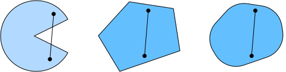
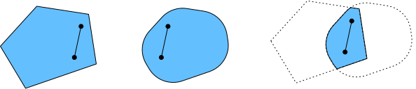
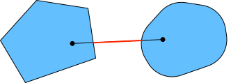
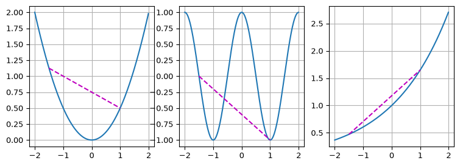
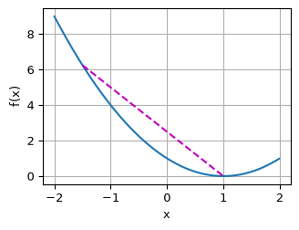
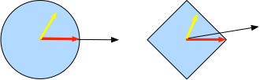

# 12.2 Tính Lồi

> Ghi chú của người biên soạn: trang này dịch nguyên văn từ sách *Dive into Deep Learning* của **Aston Zhang, Zachary C. Lipton, Mu Li và Alexander J. Smola** ([bản gốc](https://d2l.ai/chapter_optimization/convexity.html), [mã nguồn](https://github.com/d2l-ai/d2l-en), giấy phép [CC BY-SA 4.0](https://creativecommons.org/licenses/by-sa/4.0/); code theo giấy phép MIT-0). Chỉ giữ code PyTorch. Số mục, hình và công thức giữ như bản HTML d2l.ai; thuật ngữ đối chiếu với bản dịch [Đắm mình vào Học Sâu](https://github.com/aivivn/d2l-vn).

Tính lồi (convexity) đóng vai trò sống còn trong việc thiết kế các thuật toán tối ưu. Điều này phần lớn là do việc phân tích và kiểm tra thuật toán trong bối cảnh như vậy dễ dàng hơn nhiều. Nói cách khác, nếu thuật toán hoạt động kém ngay cả trong bối cảnh lồi, thông thường ta không nên hy vọng thấy kết quả tốt trong các trường hợp khác. Hơn nữa, dù các bài toán tối ưu trong học sâu nhìn chung không lồi, chúng thường thể hiện một số tính chất của bài toán lồi ở gần các cực tiểu địa phương. Điều này có thể dẫn đến những biến thể tối ưu mới thú vị như ([Izmailov *et al.*, 2018](dl/ch12_s2_vi?id=ref-izmailov-podoprikhin-garipov-ea-2018)).

<!-- run -->
```python
from d2l import torch as d2l
import numpy as np
from mpl_toolkits import mplot3d
import torch
```

## 12.2.1 Định nghĩa

Trước khi phân tích lồi, ta cần định nghĩa *tập lồi* và *hàm lồi*. Chúng dẫn đến những công cụ toán học thường được áp dụng trong học máy.

### 12.2.1.1 Tập Lồi

Tập hợp là nền tảng của tính lồi. Nói đơn giản, một tập $\mathcal{X}$ trong một không gian vector là *lồi* nếu với mọi $a, b \in \mathcal{X}$, đoạn thẳng nối $a$ và $b$ cũng nằm trong $\mathcal{X}$. Theo ngôn ngữ toán học, điều này nghĩa là với mọi $\lambda \in [0, 1]$ ta có

$$
\lambda  a + (1-\lambda)  b \in \mathcal{X} \textrm{ mỗi khi } a, b \in \mathcal{X}.
$$

Điều này nghe hơi trừu tượng. Hãy xem [Hình 12.2.1](dl/ch12_s2_vi?id=fig-pacman). Tập thứ nhất không lồi vì tồn tại những đoạn thẳng không nằm trong nó. Hai tập còn lại không gặp vấn đề như vậy.

<div align=center id="fig-pacman">

</div>
<div align=center>Hình 12.2.1: Tập thứ nhất không lồi, hai tập còn lại lồi.</div>

Bản thân các định nghĩa không đặc biệt hữu ích trừ khi bạn có thể làm điều gì đó với chúng. Trong trường hợp này ta có thể xét phép giao như minh họa trong [Hình 12.2.2](dl/ch12_s2_vi?id=fig-convex-intersect). Giả sử $\mathcal{X}$ và $\mathcal{Y}$ là các tập lồi. Khi đó $\mathcal{X} \cap \mathcal{Y}$ cũng lồi. Để thấy điều này, hãy xét bất kỳ $a, b \in \mathcal{X} \cap \mathcal{Y}$ nào. Vì $\mathcal{X}$ và $\mathcal{Y}$ lồi, đoạn thẳng nối $a$ và $b$ nằm trong cả $\mathcal{X}$ lẫn $\mathcal{Y}$. Do đó, chúng cũng phải nằm trong $\mathcal{X} \cap \mathcal{Y}$, chứng minh định lý của ta.

<div align=center id="fig-convex-intersect">

</div>
<div align=center>Hình 12.2.2: Giao của hai tập lồi là tập lồi.</div>

Ta có thể làm mạnh kết quả này mà không tốn nhiều công: cho các tập lồi $\mathcal{X}_i$, giao của chúng $\cap_{i} \mathcal{X}_i$ là lồi. Để thấy điều ngược lại không đúng, hãy xét hai tập rời nhau $\mathcal{X} \cap \mathcal{Y} = \emptyset$. Giờ chọn $a \in \mathcal{X}$ và $b \in \mathcal{Y}$. Đoạn thẳng trong [Hình 12.2.3](dl/ch12_s2_vi?id=fig-nonconvex) nối $a$ và $b$ phải chứa một phần nào đó không nằm trong $\mathcal{X}$ cũng không nằm trong $\mathcal{Y}$, vì ta đã giả sử $\mathcal{X} \cap \mathcal{Y} = \emptyset$. Do đó đoạn thẳng cũng không nằm trong $\mathcal{X} \cup \mathcal{Y}$, chứng minh rằng nói chung hợp của các tập lồi không nhất thiết lồi.

<div align=center id="fig-nonconvex">

</div>
<div align=center>Hình 12.2.3: Hợp của hai tập lồi không nhất thiết lồi.</div>

Thông thường các bài toán trong học sâu được định nghĩa trên các tập lồi. Chẳng hạn, $\mathbb{R}^d$, tập các vector số thực $d$ chiều, là một tập lồi (suy cho cùng, đường thẳng giữa hai điểm bất kỳ trong $\mathbb{R}^d$ vẫn nằm trong $\mathbb{R}^d$). Trong một số trường hợp ta làm việc với các biến có độ dài bị chặn, như các quả cầu bán kính $r$ được định nghĩa bởi $\{\mathbf{x} | \mathbf{x} \in \mathbb{R}^d \textrm{ và } \|\mathbf{x}\| \leq r\}$.

### 12.2.1.2 Hàm Lồi

Giờ khi đã có tập lồi, ta có thể giới thiệu *hàm lồi* $f$. Cho một tập lồi $\mathcal{X}$, một hàm $f: \mathcal{X} \to \mathbb{R}$ là *lồi* nếu với mọi $x, x' \in \mathcal{X}$ và với mọi $\lambda \in [0, 1]$ ta có

$$
\lambda f(x) + (1-\lambda) f(x') \geq f(\lambda x + (1-\lambda) x').
$$

Để minh họa, hãy vẽ một vài hàm và kiểm tra xem hàm nào thỏa mãn yêu cầu. Dưới đây ta định nghĩa một vài hàm, cả lồi lẫn không lồi.

<!-- run -->
```python
f = lambda x: 0.5 * x**2  # Lồi
g = lambda x: d2l.cos(np.pi * x)  # Không lồi
h = lambda x: d2l.exp(0.5 * x)  # Lồi

x, segment = d2l.arange(-2, 2, 0.01), d2l.tensor([-1.5, 1])
d2l.use_svg_display()
_, axes = d2l.plt.subplots(1, 3, figsize=(9, 3))
for ax, func in zip(axes, [f, g, h]):
    d2l.plot([x, segment], [func(x), func(segment)], axes=ax)
```

<!-- output -->
<div align=center></div>
<!-- /output -->

Đúng như dự đoán, hàm cosin *không lồi*, trong khi parabol và hàm mũ thì lồi. Lưu ý rằng yêu cầu $\mathcal{X}$ là tập lồi là cần thiết để điều kiện có nghĩa. Nếu không, kết quả của $f(\lambda x + (1-\lambda) x')$ có thể không được định nghĩa rõ ràng.

### 12.2.1.3 Bất đẳng thức Jensen

Cho một hàm lồi $f$, một trong những công cụ toán học hữu ích nhất là *bất đẳng thức Jensen*. Nó tương đương với một sự tổng quát hóa định nghĩa của tính lồi:

$$
\sum_i \alpha_i f(x_i)  \geq f\left(\sum_i \alpha_i x_i\right)    \textrm{ và }    E_X[f(X)]  \geq f\left(E_X[X]\right), \tag{12.2.1}
$$

trong đó $\alpha_i$ là các số thực không âm thỏa mãn $\sum_i \alpha_i = 1$ và $X$ là một biến ngẫu nhiên. Nói cách khác, kỳ vọng của một hàm lồi không nhỏ hơn giá trị của hàm lồi tại kỳ vọng, trong đó cái sau thường là một biểu thức đơn giản hơn. Để chứng minh bất đẳng thức thứ nhất, ta áp dụng lặp lại định nghĩa của tính lồi cho từng số hạng một trong tổng.

Một trong những ứng dụng phổ biến của bất đẳng thức Jensen là chặn một biểu thức phức tạp hơn bằng một biểu thức đơn giản hơn. Chẳng hạn, nó có thể được áp dụng cho log hợp lý của các biến ngẫu nhiên quan sát được một phần. Tức là, ta dùng

$$
E_{Y \sim P(Y)}[-\log P(X \mid Y)] \geq -\log P(X),
$$

vì $\int P(Y) P(X \mid Y) dY = P(X)$. Điều này có thể được dùng trong các phương pháp biến phân. Ở đây $Y$ thường là biến ngẫu nhiên không quan sát được, $P(Y)$ là phỏng đoán tốt nhất về cách nó có thể phân phối, và $P(X)$ là phân phối khi đã lấy tích phân hết $Y$. Chẳng hạn, trong phân cụm, $Y$ có thể là nhãn cụm và $P(X \mid Y)$ là mô hình sinh khi áp dụng nhãn cụm.

## 12.2.2 Các Tính chất

Hàm lồi có nhiều tính chất hữu ích. Dưới đây ta mô tả một vài tính chất thường dùng.

### 12.2.2.1 Cực tiểu Địa phương là Cực tiểu Toàn cục

Trước hết và quan trọng nhất, cực tiểu địa phương của hàm lồi cũng là cực tiểu toàn cục. Ta có thể chứng minh điều này bằng phản chứng như sau.

Xét một hàm lồi $f$ được định nghĩa trên một tập lồi $\mathcal{X}$. Giả sử $x^{\ast} \in \mathcal{X}$ là một cực tiểu địa phương: tồn tại một giá trị dương nhỏ $p$ sao cho với $x \in \mathcal{X}$ thỏa mãn $0 < |x - x^{\ast}| \leq p$, ta có $f(x^{\ast}) < f(x)$.

Giả sử cực tiểu địa phương $x^{\ast}$ không phải là cực tiểu toàn cục của $f$: tồn tại $x' \in \mathcal{X}$ sao cho $f(x') < f(x^{\ast})$. Cũng tồn tại $\lambda \in [0, 1)$, chẳng hạn $\lambda = 1 - \frac{p}{|x^{\ast} - x'|}$, sao cho $0 < |\lambda x^{\ast} + (1-\lambda) x' - x^{\ast}| \leq p$.

Tuy nhiên, theo định nghĩa của hàm lồi, ta có

$$
\begin{aligned}
    f(\lambda x^{\ast} + (1-\lambda) x') &\leq \lambda f(x^{\ast}) + (1-\lambda) f(x') \\
    &< \lambda f(x^{\ast}) + (1-\lambda) f(x^{\ast}) \\
    &= f(x^{\ast}),
\end{aligned}
$$

mâu thuẫn với khẳng định rằng $x^{\ast}$ là một cực tiểu địa phương. Do đó, không tồn tại $x' \in \mathcal{X}$ nào sao cho $f(x') < f(x^{\ast})$. Cực tiểu địa phương $x^{\ast}$ cũng là cực tiểu toàn cục.

Chẳng hạn, hàm lồi $f(x) = (x-1)^2$ có một cực tiểu địa phương tại $x=1$, đồng thời cũng là cực tiểu toàn cục.

<!-- run -->
```python
f = lambda x: (x - 1) ** 2
d2l.set_figsize()
d2l.plot([x, segment], [f(x), f(segment)], 'x', 'f(x)')
```

<!-- output -->
<div align=center></div>
<!-- /output -->

Việc cực tiểu địa phương của hàm lồi cũng là cực tiểu toàn cục rất tiện lợi. Nó nghĩa là nếu ta cực tiểu hóa các hàm, ta không thể "bị mắc kẹt". Tuy nhiên, lưu ý rằng điều này không có nghĩa là không thể có nhiều hơn một cực tiểu toàn cục, hay thậm chí là có tồn tại một cực tiểu. Chẳng hạn, hàm $f(x) = \mathrm{max}(|x|-1, 0)$ đạt giá trị nhỏ nhất trên cả khoảng $[-1, 1]$. Ngược lại, hàm $f(x) = \exp(x)$ không đạt giá trị nhỏ nhất trên $\mathbb{R}$: khi $x \to -\infty$ nó tiệm cận về $0$, nhưng không có $x$ nào để $f(x) = 0$.

### 12.2.2.2 Tập Mức dưới của Hàm Lồi là Tập Lồi

Ta có thể định nghĩa các tập lồi một cách tiện lợi thông qua các *tập mức dưới* (below set) của hàm lồi. Cụ thể, cho một hàm lồi $f$ được định nghĩa trên một tập lồi $\mathcal{X}$, mọi tập mức dưới

$$
\mathcal{S}_b \stackrel{\textrm{def}}{=} \{x | x \in \mathcal{X} \textrm{ và } f(x) \leq b\}
$$

đều là tập lồi.

Hãy chứng minh nhanh điều này. Hãy nhớ lại rằng với mọi $x, x' \in \mathcal{S}_b$, ta cần chứng minh $\lambda x + (1-\lambda) x' \in \mathcal{S}_b$ miễn là $\lambda \in [0, 1]$. Vì $f(x) \leq b$ và $f(x') \leq b$, theo định nghĩa của tính lồi ta có

$$
f(\lambda x + (1-\lambda) x') \leq \lambda f(x) + (1-\lambda) f(x') \leq b.
$$

### 12.2.2.3 Tính Lồi và Đạo hàm Bậc hai

Bất cứ khi nào đạo hàm bậc hai của một hàm $f: \mathbb{R}^n \rightarrow \mathbb{R}$ tồn tại, rất dễ kiểm tra xem $f$ có lồi hay không. Tất cả những gì ta cần làm là kiểm tra xem ma trận Hessian của $f$ có nửa xác định dương hay không: $\nabla^2f \succeq 0$, tức là, ký hiệu ma trận Hessian $\nabla^2f$ là $\mathbf{H}$, ta có $\mathbf{x}^\top \mathbf{H} \mathbf{x} \geq 0$ với mọi $\mathbf{x} \in \mathbb{R}^n$. Chẳng hạn, hàm $f(\mathbf{x}) = \frac{1}{2} \|\mathbf{x}\|^2$ là lồi vì $\nabla^2 f = \mathbf{1}$, tức là Hessian của nó là ma trận đơn vị.

Một cách hình thức, một hàm một chiều khả vi hai lần $f: \mathbb{R} \rightarrow \mathbb{R}$ là lồi khi và chỉ khi đạo hàm bậc hai của nó $f'' \geq 0$. Với bất kỳ hàm nhiều chiều khả vi hai lần $f: \mathbb{R}^{n} \rightarrow \mathbb{R}$ nào, nó là lồi khi và chỉ khi Hessian của nó $\nabla^2f \succeq 0$.

Trước tiên, ta cần chứng minh trường hợp một chiều. Để thấy tính lồi của $f$ hàm ý $f'' \geq 0$, ta dùng thực tế rằng

$$
\frac{1}{2} f(x + \epsilon) + \frac{1}{2} f(x - \epsilon) \geq f\left(\frac{x + \epsilon}{2} + \frac{x - \epsilon}{2}\right) = f(x).
$$

Vì đạo hàm bậc hai được cho bởi giới hạn của các sai phân hữu hạn, ta suy ra

$$
f''(x) = \lim_{\epsilon \to 0} \frac{f(x+\epsilon) + f(x - \epsilon) - 2f(x)}{\epsilon^2} \geq 0.
$$

Để thấy $f'' \geq 0$ hàm ý $f$ lồi, ta dùng thực tế rằng $f'' \geq 0$ hàm ý $f'$ là một hàm đơn điệu không giảm. Gọi $a < x < b$ là ba điểm trong $\mathbb{R}$, trong đó $x = (1-\lambda)a + \lambda b$ và $\lambda \in (0, 1)$. Theo định lý giá trị trung bình, tồn tại $\alpha \in [a, x]$ và $\beta \in [x, b]$ sao cho

$$
f'(\alpha) = \frac{f(x) - f(a)}{x-a} \textrm{ và } f'(\beta) = \frac{f(b) - f(x)}{b-x}.
$$

Theo tính đơn điệu $f'(\beta) \geq f'(\alpha)$, do đó

$$
\frac{x-a}{b-a}f(b) + \frac{b-x}{b-a}f(a) \geq f(x).
$$

Vì $x = (1-\lambda)a + \lambda b$, ta có

$$
\lambda f(b) + (1-\lambda)f(a) \geq f((1-\lambda)a + \lambda b),
$$

qua đó chứng minh tính lồi.

Thứ hai, ta cần một bổ đề trước khi chứng minh trường hợp nhiều chiều: $f: \mathbb{R}^n \rightarrow \mathbb{R}$ là lồi khi và chỉ khi với mọi $\mathbf{x}, \mathbf{y} \in \mathbb{R}^n$

$$
g(z) \stackrel{\textrm{def}}{=} f(z \mathbf{x} + (1-z)  \mathbf{y}) \textrm{ với } z \in [0,1]
$$

 

là lồi.

Để chứng minh tính lồi của $f$ hàm ý $g$ lồi, ta có thể chứng minh rằng với mọi $a, b, \lambda \in [0, 1]$ (do đó $0 \leq \lambda a + (1-\lambda) b \leq 1$)

$$
\begin{aligned} &g(\lambda a + (1-\lambda) b)\\
=&f\left(\left(\lambda a + (1-\lambda) b\right)\mathbf{x} + \left(1-\lambda a - (1-\lambda) b\right)\mathbf{y} \right)\\
=&f\left(\lambda \left(a \mathbf{x} + (1-a)  \mathbf{y}\right)  + (1-\lambda) \left(b \mathbf{x} + (1-b)  \mathbf{y}\right) \right)\\
\leq& \lambda f\left(a \mathbf{x} + (1-a)  \mathbf{y}\right)  + (1-\lambda) f\left(b \mathbf{x} + (1-b)  \mathbf{y}\right) \\
=& \lambda g(a) + (1-\lambda) g(b).
\end{aligned}
$$

Để chứng minh chiều ngược lại, ta có thể chứng minh rằng với mọi $\lambda \in [0, 1]$

$$
\begin{aligned} &f(\lambda \mathbf{x} + (1-\lambda) \mathbf{y})\\
=&g(\lambda \cdot 1 + (1-\lambda) \cdot 0)\\
\leq& \lambda g(1)  + (1-\lambda) g(0) \\
=& \lambda f(\mathbf{x}) + (1-\lambda) f(\mathbf{y}).
\end{aligned}
$$

Cuối cùng, dùng bổ đề trên và kết quả của trường hợp một chiều, trường hợp nhiều chiều có thể được chứng minh như sau. Một hàm nhiều chiều $f: \mathbb{R}^n \rightarrow \mathbb{R}$ là lồi khi và chỉ khi với mọi $\mathbf{x}, \mathbf{y} \in \mathbb{R}^n$, hàm $g(z) \stackrel{\textrm{def}}{=} f(z \mathbf{x} + (1-z)  \mathbf{y})$, với $z \in [0,1]$, là lồi. Theo trường hợp một chiều, điều này đúng khi và chỉ khi $g'' = (\mathbf{x} - \mathbf{y})^\top \mathbf{H}(\mathbf{x} - \mathbf{y}) \geq 0$ ($\mathbf{H} \stackrel{\textrm{def}}{=} \nabla^2f$) với mọi $\mathbf{x}, \mathbf{y} \in \mathbb{R}^n$, tương đương với $\mathbf{H} \succeq 0$ theo định nghĩa của ma trận nửa xác định dương.

## 12.2.3 Ràng buộc

Một trong những tính chất hay của tối ưu lồi là nó cho phép ta xử lý các ràng buộc một cách hiệu quả. Tức là, nó cho phép ta giải các bài toán *tối ưu có ràng buộc* có dạng:

$$
\begin{aligned} \mathop{\textrm{minimize~}}_{\mathbf{x}} & f(\mathbf{x}) \\
    \textrm{ subject to } & c_i(\mathbf{x}) \leq 0 \textrm{ với mọi } i \in \{1, \ldots, n\},
\end{aligned}
$$

trong đó $f$ là hàm mục tiêu và các hàm $c_i$ là các hàm ràng buộc. Để thấy điều này làm gì, hãy xét trường hợp $c_1(\mathbf{x}) = \|\mathbf{x}\|_2 - 1$. Trong trường hợp này các tham số $\mathbf{x}$ bị ràng buộc trong quả cầu đơn vị. Nếu ràng buộc thứ hai là $c_2(\mathbf{x}) = \mathbf{v}^\top \mathbf{x} + b$, thì điều này tương ứng với mọi $\mathbf{x}$ nằm trên một nửa không gian. Thỏa mãn đồng thời cả hai ràng buộc tương đương với việc chọn một lát cắt của quả cầu.

### 12.2.3.1 Hàm Lagrange

Nói chung, giải một bài toán tối ưu có ràng buộc là khó. Một cách giải quyết bắt nguồn từ vật lý với một trực giác khá đơn giản. Hãy tưởng tượng một quả bóng bên trong một chiếc hộp. Quả bóng sẽ lăn đến chỗ thấp nhất và lực hấp dẫn sẽ được cân bằng bởi các lực mà thành hộp có thể tác dụng lên quả bóng. Tóm lại, gradient của hàm mục tiêu (tức trọng lực) sẽ được bù trừ bởi gradient của hàm ràng buộc (quả bóng cần ở lại bên trong hộp nhờ các bức tường "đẩy lại"). Lưu ý rằng một số ràng buộc có thể không hoạt động: những bức tường mà quả bóng không chạm vào sẽ không thể tác dụng lực nào lên quả bóng.

Bỏ qua phần suy ra *hàm Lagrange* (Lagrangian) $L$, lập luận trên có thể được biểu diễn qua bài toán tối ưu điểm yên ngựa sau:

$$
L(\mathbf{x}, \alpha_1, \ldots, \alpha_n) = f(\mathbf{x}) + \sum_{i=1}^n \alpha_i c_i(\mathbf{x}) \textrm{ với } \alpha_i \geq 0.
$$

Ở đây các biến $\alpha_i$ ($i=1,\ldots,n$) là những thứ được gọi là *nhân tử Lagrange* (Lagrange multiplier), đảm bảo rằng các ràng buộc được thực thi đúng đắn. Chúng được chọn vừa đủ lớn để đảm bảo $c_i(\mathbf{x}) \leq 0$ với mọi $i$. Chẳng hạn, với bất kỳ $\mathbf{x}$ nào mà $c_i(\mathbf{x}) < 0$ một cách tự nhiên, cuối cùng ta sẽ chọn $\alpha_i = 0$. Hơn nữa, đây là một bài toán tối ưu điểm yên ngựa, trong đó ta muốn *cực đại hóa* $L$ theo mọi $\alpha_i$ và đồng thời *cực tiểu hóa* nó theo $\mathbf{x}$. Có một khối tài liệu phong phú giải thích cách đi đến hàm $L(\mathbf{x}, \alpha_1, \ldots, \alpha_n)$. Với mục đích của ta, chỉ cần biết rằng điểm yên ngựa của $L$ là nơi bài toán tối ưu có ràng buộc ban đầu được giải một cách tối ưu.

### 12.2.3.2 Số hạng Phạt

Một cách để thỏa mãn các bài toán tối ưu có ràng buộc ít nhất là một cách *xấp xỉ* là điều chỉnh hàm Lagrange $L$. Thay vì thỏa mãn $c_i(\mathbf{x}) \leq 0$, ta chỉ đơn giản thêm $\alpha_i c_i(\mathbf{x})$ vào hàm mục tiêu $f(x)$. Điều này đảm bảo rằng các ràng buộc sẽ không bị vi phạm quá nặng.

Thực ra, ta đã dùng thủ thuật này suốt từ trước đến giờ. Hãy xét suy giảm trọng số trong [Mục 3.7](dl/ch03_s7_vi). Trong đó ta thêm $\frac{\lambda}{2} \|\mathbf{w}\|^2$ vào hàm mục tiêu để đảm bảo $\mathbf{w}$ không trở nên quá lớn. Từ góc nhìn tối ưu có ràng buộc, ta có thể thấy rằng điều này sẽ đảm bảo $\|\mathbf{w}\|^2 - r^2 \leq 0$ với một bán kính $r$ nào đó. Điều chỉnh giá trị của $\lambda$ cho phép ta thay đổi kích thước của $\mathbf{w}$.

Nói chung, thêm số hạng phạt là một cách tốt để đảm bảo thỏa mãn ràng buộc một cách xấp xỉ. Trong thực tế, cách này hóa ra bền vững hơn nhiều so với thỏa mãn chính xác. Hơn nữa, với các bài toán không lồi, nhiều tính chất khiến cách tiếp cận chính xác hấp dẫn đến vậy trong trường hợp lồi (chẳng hạn tính tối ưu) không còn đúng nữa.

### 12.2.3.3 Phép chiếu

Một chiến lược thay thế để thỏa mãn ràng buộc là phép chiếu. Một lần nữa, ta đã gặp chúng trước đây, chẳng hạn khi xử lý việc cắt gradient trong [Mục 9.5](https://d2l.ai/chapter_recurrent-neural-networks/rnn-scratch.html). Ở đó ta đảm bảo rằng một gradient có độ dài bị chặn bởi $\theta$ thông qua

$$
\mathbf{g} \leftarrow \mathbf{g} \cdot \mathrm{min}(1, \theta/\|\mathbf{g}\|).
$$

Hóa ra đây là một *phép chiếu* của $\mathbf{g}$ lên quả cầu bán kính $\theta$. Tổng quát hơn, một phép chiếu lên một tập lồi $\mathcal{X}$ được định nghĩa là

$$
\textrm{Proj}_\mathcal{X}(\mathbf{x}) = \mathop{\mathrm{argmin}}_{\mathbf{x}' \in \mathcal{X}} \|\mathbf{x} - \mathbf{x}'\|,
$$

tức là điểm gần $\mathbf{x}$ nhất trong $\mathcal{X}$.

<div align=center id="fig-projections">

</div>
<div align=center>Hình 12.2.4: Các phép chiếu lồi.</div>

Định nghĩa toán học của phép chiếu có thể nghe hơi trừu tượng. [Hình 12.2.4](dl/ch12_s2_vi?id=fig-projections) giải thích điều này rõ ràng hơn một chút. Trong đó ta có hai tập lồi, một hình tròn và một hình thoi. Các điểm nằm trong cả hai tập (màu vàng) giữ nguyên khi chiếu. Các điểm nằm ngoài cả hai tập (màu đen) được chiếu lên những điểm bên trong các tập (màu đỏ) gần với điểm ban đầu (màu đen) nhất. Trong khi với quả cầu $\ell_2$ điều này giữ nguyên hướng, nói chung không nhất thiết như vậy, như có thể thấy trong trường hợp hình thoi.

Một trong những ứng dụng của phép chiếu lồi là tính các vector trọng số thưa. Trong trường hợp này ta chiếu các vector trọng số lên một quả cầu $\ell_1$, một phiên bản tổng quát của trường hợp hình thoi trong [Hình 12.2.4](dl/ch12_s2_vi?id=fig-projections).

## 12.2.4 Tóm tắt

Trong bối cảnh học sâu, mục đích chính của hàm lồi là tạo động lực cho các thuật toán tối ưu và giúp ta hiểu chúng một cách chi tiết. Sau đây ta sẽ thấy hạ gradient và hạ gradient ngẫu nhiên có thể được suy ra tương ứng như thế nào.

* Giao của các tập lồi là lồi. Hợp thì không.
* Kỳ vọng của một hàm lồi không nhỏ hơn giá trị của hàm lồi tại kỳ vọng (bất đẳng thức Jensen).
* Một hàm khả vi hai lần là lồi khi và chỉ khi Hessian của nó (một ma trận các đạo hàm bậc hai) nửa xác định dương.
* Các ràng buộc lồi có thể được thêm vào thông qua hàm Lagrange. Trong thực tế, ta có thể chỉ đơn giản thêm chúng dưới dạng số hạng phạt vào hàm mục tiêu.
* Phép chiếu ánh xạ đến các điểm trong tập lồi gần nhất với điểm ban đầu.

## 12.2.5 Bài tập

1. Giả sử ta muốn kiểm chứng tính lồi của một tập bằng cách vẽ mọi đường thẳng giữa các điểm trong tập và kiểm tra xem các đường đó có nằm trong tập không.
    1. Chứng minh rằng chỉ cần kiểm tra các điểm trên biên là đủ.
    1. Chứng minh rằng chỉ cần kiểm tra các đỉnh của tập là đủ.
1. Ký hiệu $\mathcal{B}_p[r] \stackrel{\textrm{def}}{=} \{\mathbf{x} | \mathbf{x} \in \mathbb{R}^d \textrm{ và } \|\mathbf{x}\|_p \leq r\}$ là quả cầu bán kính $r$ dùng chuẩn $p$. Chứng minh rằng $\mathcal{B}_p[r]$ là lồi với mọi $p \geq 1$.
1. Cho các hàm lồi $f$ và $g$, chứng minh rằng $\mathrm{max}(f, g)$ cũng lồi. Chứng minh rằng $\mathrm{min}(f, g)$ không lồi.
1. Chứng minh rằng phần chuẩn hóa của hàm softmax là lồi. Cụ thể hơn, chứng minh tính lồi của $f(x) = \log \sum_i \exp(x_i)$.
1. Chứng minh rằng các không gian con tuyến tính, tức là $\mathcal{X} = \{\mathbf{x} | \mathbf{W} \mathbf{x} = \mathbf{b}\}$, là các tập lồi.
1. Chứng minh rằng trong trường hợp các không gian con tuyến tính với $\mathbf{b} = \mathbf{0}$, phép chiếu $\textrm{Proj}_\mathcal{X}$ có thể được viết là $\mathbf{M} \mathbf{x}$ với một ma trận $\mathbf{M}$ nào đó.
1. Chứng minh rằng với các hàm lồi khả vi hai lần $f$, ta có thể viết $f(x + \epsilon) = f(x) + \epsilon f'(x) + \frac{1}{2} \epsilon^2 f''(x + \xi)$ với một $\xi \in [0, \epsilon]$ nào đó.
1. Cho một tập lồi $\mathcal{X}$ và hai vector $\mathbf{x}$ và $\mathbf{y}$, chứng minh rằng phép chiếu không bao giờ làm tăng khoảng cách, tức là $\|\mathbf{x} - \mathbf{y}\| \geq \|\textrm{Proj}_\mathcal{X}(\mathbf{x}) - \textrm{Proj}_\mathcal{X}(\mathbf{y})\|$.

[Thảo luận (tiếng Anh)](https://discuss.d2l.ai/t/350)

## Tài liệu tham khảo

- <a id="ref-izmailov-podoprikhin-garipov-ea-2018"></a>Izmailov, Pavel, Podoprikhin, Dmitrii, Garipov, Timur, ... (2018). *Averaging weights leads to wider optima and better generalization*. ArXiv:1803.05407.
