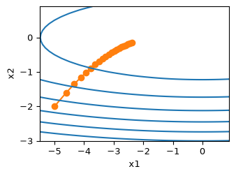
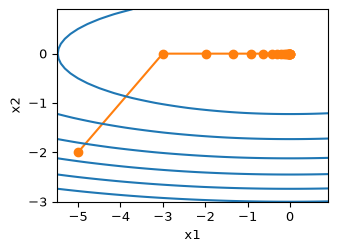
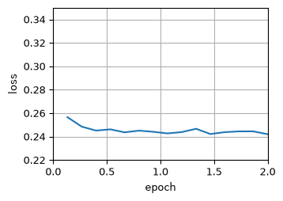
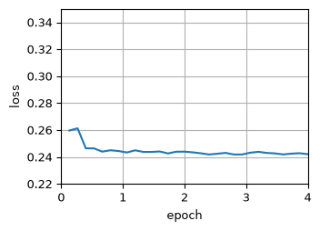

# 12.7 Adagrad

> Ghi chú của người biên soạn: trang này dịch nguyên văn từ sách *Dive into Deep Learning* của **Aston Zhang, Zachary C. Lipton, Mu Li và Alexander J. Smola** ([bản gốc](https://d2l.ai/chapter_optimization/adagrad.html), [mã nguồn](https://github.com/d2l-ai/d2l-en), giấy phép [CC BY-SA 4.0](https://creativecommons.org/licenses/by-sa/4.0/); code theo giấy phép MIT-0). Chỉ giữ code PyTorch. Số mục, hình và công thức giữ như bản HTML d2l.ai; thuật ngữ đối chiếu với bản dịch [Đắm mình vào Học Sâu](https://github.com/aivivn/d2l-vn).

Hãy bắt đầu bằng việc xét các bài toán học có những đặc trưng xuất hiện không thường xuyên.

## 12.7.1 Đặc trưng Thưa và Tốc độ học

Hãy tưởng tượng ta đang huấn luyện một mô hình ngôn ngữ. Để có độ chính xác tốt, ta thường muốn giảm tốc độ học khi tiếp tục huấn luyện, thường với tốc độ $\mathcal{O}(t^{-\frac{1}{2}})$ hoặc chậm hơn. Giờ hãy xét một mô hình được huấn luyện trên các đặc trưng thưa, tức là những đặc trưng chỉ xuất hiện không thường xuyên. Điều này phổ biến với ngôn ngữ tự nhiên, chẳng hạn khả năng ta thấy từ *preconditioning* (tiền điều kiện) thấp hơn nhiều so với từ *learning* (học). Tuy nhiên, nó cũng phổ biến ở các lĩnh vực khác như quảng cáo điện toán và lọc cộng tác cá nhân hóa. Suy cho cùng, có nhiều thứ chỉ được một số ít người quan tâm.

Các tham số gắn với những đặc trưng hiếm chỉ nhận được cập nhật có ý nghĩa mỗi khi những đặc trưng này xuất hiện. Với một tốc độ học giảm dần, ta có thể rơi vào tình huống mà tham số của các đặc trưng phổ biến hội tụ khá nhanh về giá trị tối ưu, trong khi với các đặc trưng hiếm, ta vẫn chưa quan sát chúng đủ thường xuyên để xác định được giá trị tối ưu. Nói cách khác, tốc độ học hoặc giảm quá chậm đối với các đặc trưng phổ biến hoặc quá nhanh đối với các đặc trưng hiếm.

Một mẹo có thể dùng để khắc phục vấn đề này là đếm số lần ta thấy một đặc trưng cụ thể và dùng con số này như một chiếc đồng hồ để điều chỉnh tốc độ học. Tức là, thay vì chọn tốc độ học có dạng $\eta = \frac{\eta_0}{\sqrt{t + c}}$, ta có thể dùng $\eta_i = \frac{\eta_0}{\sqrt{s(i, t) + c}}$. Ở đây $s(i, t)$ đếm số giá trị khác không của đặc trưng $i$ mà ta đã quan sát đến thời điểm $t$. Điều này thực ra khá dễ cài đặt mà không tốn chi phí đáng kể nào. Tuy nhiên, nó thất bại bất cứ khi nào ta không thực sự có tính thưa mà chỉ có dữ liệu trong đó gradient thường rất nhỏ và chỉ hiếm khi lớn. Suy cho cùng, không rõ người ta sẽ vạch ranh giới ở đâu giữa thứ được coi là một đặc trưng đã quan sát và thứ không.

Adagrad của [Duchi *et al.* (2011)](dl/ch12_s7_vi?id=ref-duchi-hazan-singer-2011) giải quyết điều này bằng cách thay bộ đếm khá thô $s(i, t)$ bằng tổng bình phương của các gradient đã quan sát trước đó. Cụ thể, nó dùng $s(i, t+1) = s(i, t) + \left(\partial_i f(\mathbf{x})\right)^2$ như một phương tiện để điều chỉnh tốc độ học. Điều này có hai lợi ích: thứ nhất, ta không còn cần quyết định khi nào một gradient là đủ lớn. Thứ hai, nó tự động co giãn theo độ lớn của gradient. Các tọa độ thường xuyên ứng với gradient lớn bị thu nhỏ đáng kể, trong khi những tọa độ khác có gradient nhỏ được đối xử nhẹ nhàng hơn nhiều. Trong thực tế, điều này dẫn đến một quy trình tối ưu rất hiệu quả cho quảng cáo điện toán và các bài toán liên quan. Nhưng điều này che giấu một số lợi ích bổ sung vốn có trong Adagrad, những lợi ích được hiểu rõ nhất trong bối cảnh tiền điều kiện.

## 12.7.2 Tiền điều kiện

Các bài toán tối ưu lồi rất tốt cho việc phân tích đặc tính của các thuật toán. Suy cho cùng, với hầu hết các bài toán không lồi, khó có thể suy ra những đảm bảo lý thuyết có ý nghĩa, nhưng *trực giác* và *hiểu biết sâu* thường vẫn áp dụng được. Hãy xét bài toán cực tiểu hóa $f(\mathbf{x}) = \frac{1}{2} \mathbf{x}^\top \mathbf{Q} \mathbf{x} + \mathbf{c}^\top \mathbf{x} + b$.

Như ta đã thấy trong [Mục 12.6](dl/ch12_s6_vi), có thể viết lại bài toán này theo phân tích riêng $\mathbf{Q} = \mathbf{U}^\top \boldsymbol{\Lambda} \mathbf{U}$ để đi đến một bài toán đơn giản hơn nhiều, trong đó mỗi tọa độ có thể được giải riêng lẻ:

$$
f(\mathbf{x}) = \bar{f}(\bar{\mathbf{x}}) = \frac{1}{2} \bar{\mathbf{x}}^\top \boldsymbol{\Lambda} \bar{\mathbf{x}} + \bar{\mathbf{c}}^\top \bar{\mathbf{x}} + b.
$$

Ở đây ta dùng $\bar{\mathbf{x}} = \mathbf{U} \mathbf{x}$ và do đó $\bar{\mathbf{c}} = \mathbf{U} \mathbf{c}$. Bài toán đã sửa đổi có điểm cực tiểu là $\bar{\mathbf{x}} = -\boldsymbol{\Lambda}^{-1} \bar{\mathbf{c}}$ và giá trị nhỏ nhất $-\frac{1}{2} \bar{\mathbf{c}}^\top \boldsymbol{\Lambda}^{-1} \bar{\mathbf{c}} + b$. Điều này dễ tính hơn nhiều vì $\boldsymbol{\Lambda}$ là một ma trận đường chéo chứa các trị riêng của $\mathbf{Q}$.

Nếu ta làm nhiễu $\mathbf{c}$ một chút, ta hy vọng chỉ thấy những thay đổi nhỏ ở điểm cực tiểu của $f$. Đáng tiếc là không phải vậy. Dù những thay đổi nhỏ ở $\mathbf{c}$ dẫn đến những thay đổi nhỏ tương đương ở $\bar{\mathbf{c}}$, điều này không đúng với điểm cực tiểu của $f$ (và tương ứng của $\bar{f}$). Bất cứ khi nào các trị riêng $\boldsymbol{\Lambda}_i$ lớn, ta sẽ chỉ thấy những thay đổi nhỏ ở $\bar{x}_i$ và ở giá trị nhỏ nhất của $\bar{f}$. Ngược lại, với $\boldsymbol{\Lambda}_i$ nhỏ, các thay đổi ở $\bar{x}_i$ có thể rất lớn. Tỉ số giữa trị riêng lớn nhất và nhỏ nhất được gọi là số điều kiện (condition number) của một bài toán tối ưu.

$$
\kappa = \frac{\boldsymbol{\Lambda}_1}{\boldsymbol{\Lambda}_d}.
$$

Nếu số điều kiện $\kappa$ lớn, rất khó giải bài toán tối ưu một cách chính xác. Ta cần đảm bảo cẩn thận xử lý đúng một dải động giá trị lớn. Phân tích của ta dẫn đến một câu hỏi hiển nhiên, dù hơi ngây thơ: chẳng lẽ ta không thể đơn giản "sửa" bài toán bằng cách bóp méo không gian sao cho mọi trị riêng đều bằng $1$? Về lý thuyết, điều này khá dễ: ta chỉ cần các trị riêng và vector riêng của $\mathbf{Q}$ để co giãn lại bài toán từ $\mathbf{x}$ sang một bài toán trong $\mathbf{z} \stackrel{\textrm{def}}{=} \boldsymbol{\Lambda}^{\frac{1}{2}} \mathbf{U} \mathbf{x}$. Trong hệ tọa độ mới, $\mathbf{x}^\top \mathbf{Q} \mathbf{x}$ có thể được đơn giản hóa thành $\|\mathbf{z}\|^2$. Than ôi, đây là một gợi ý khá phi thực tế. Tính trị riêng và vector riêng nói chung tốn kém *hơn nhiều* so với giải chính bài toán.

Dù tính chính xác các trị riêng có thể tốn kém, việc đoán chúng và tính chúng dù chỉ xấp xỉ có thể đã tốt hơn nhiều so với không làm gì cả. Cụ thể, ta có thể dùng các phần tử đường chéo của $\mathbf{Q}$ và co giãn nó tương ứng. Cách này rẻ hơn *rất nhiều* so với tính trị riêng.

$$
\tilde{\mathbf{Q}} = \textrm{diag}^{-\frac{1}{2}}(\mathbf{Q}) \mathbf{Q} \textrm{diag}^{-\frac{1}{2}}(\mathbf{Q}).
$$

Trong trường hợp này ta có $\tilde{\mathbf{Q}}_{ij} = \mathbf{Q}_{ij} / \sqrt{\mathbf{Q}_{ii} \mathbf{Q}_{jj}}$ và cụ thể $\tilde{\mathbf{Q}}_{ii} = 1$ với mọi $i$. Trong hầu hết các trường hợp, điều này đơn giản hóa số điều kiện đáng kể. Chẳng hạn, với những trường hợp ta đã thảo luận trước đây, điều này sẽ loại bỏ hoàn toàn vấn đề vì bài toán thẳng hàng với các trục tọa độ.

Đáng tiếc là ta lại đối mặt với một vấn đề khác: trong học sâu, ta thường thậm chí không có quyền truy cập đạo hàm bậc hai của hàm mục tiêu: với $\mathbf{x} \in \mathbb{R}^d$, đạo hàm bậc hai ngay cả trên một minibatch cũng có thể cần $\mathcal{O}(d^2)$ không gian và công sức để tính, khiến nó bất khả thi trong thực tế. Ý tưởng tài tình của Adagrad là dùng một đại lượng thay thế cho đường chéo khó nắm bắt của Hessian, vừa tương đối rẻ để tính vừa hiệu quả: độ lớn của chính gradient.

Để thấy vì sao điều này hiệu quả, hãy xét $\bar{f}(\bar{\mathbf{x}})$. Ta có

$$
\partial_{\bar{\mathbf{x}}} \bar{f}(\bar{\mathbf{x}}) = \boldsymbol{\Lambda} \bar{\mathbf{x}} + \bar{\mathbf{c}} = \boldsymbol{\Lambda} \left(\bar{\mathbf{x}} - \bar{\mathbf{x}}_0\right),
$$

trong đó $\bar{\mathbf{x}}_0$ là điểm cực tiểu của $\bar{f}$. Do đó độ lớn của gradient phụ thuộc vào cả $\boldsymbol{\Lambda}$ lẫn khoảng cách đến điểm tối ưu. Nếu $\bar{\mathbf{x}} - \bar{\mathbf{x}}_0$ không đổi, đây là tất cả những gì cần thiết. Suy cho cùng, trong trường hợp này độ lớn của gradient $\partial_{\bar{\mathbf{x}}} \bar{f}(\bar{\mathbf{x}})$ là đủ. Vì AdaGrad là một thuật toán hạ gradient ngẫu nhiên, ta sẽ thấy gradient có phương sai khác không ngay cả tại điểm tối ưu. Do đó ta có thể yên tâm dùng phương sai của gradient như một đại lượng thay thế rẻ cho thang đo của Hessian. Một phân tích kỹ lưỡng nằm ngoài phạm vi của mục này (nó sẽ dài vài trang). Chúng tôi giới thiệu độc giả tham khảo ([Duchi *et al.*, 2011](dl/ch12_s7_vi?id=ref-duchi-hazan-singer-2011)) để biết chi tiết.

## 12.7.3 Thuật toán

Hãy hình thức hóa thảo luận ở trên. Ta dùng biến $\mathbf{s}_t$ để tích lũy phương sai gradient quá khứ như sau.

$$
\begin{aligned}
    \mathbf{g}_t & = \partial_{\mathbf{w}} l(y_t, f(\mathbf{x}_t, \mathbf{w})), \\
    \mathbf{s}_t & = \mathbf{s}_{t-1} + \mathbf{g}_t^2, \\
    \mathbf{w}_t & = \mathbf{w}_{t-1} - \frac{\eta}{\sqrt{\mathbf{s}_t + \epsilon}} \cdot \mathbf{g}_t.
\end{aligned}
$$

Ở đây các phép toán được áp dụng theo từng tọa độ. Tức là, $\mathbf{v}^2$ có các phần tử $v_i^2$. Tương tự, $\frac{1}{\sqrt{v}}$ có các phần tử $\frac{1}{\sqrt{v_i}}$ và $\mathbf{u} \cdot \mathbf{v}$ có các phần tử $u_i v_i$. Như trước, $\eta$ là tốc độ học và $\epsilon$ là một hằng số cộng thêm để đảm bảo ta không chia cho $0$. Cuối cùng, ta khởi tạo $\mathbf{s}_0 = \mathbf{0}$.

Giống như trường hợp động lượng, ta cần theo dõi một biến phụ, trong trường hợp này để cho phép một tốc độ học riêng cho mỗi tọa độ. Điều này không làm tăng đáng kể chi phí của Adagrad so với SGD, đơn giản vì chi phí chính thường là tính $l(y_t, f(\mathbf{x}_t, \mathbf{w}))$ và đạo hàm của nó.

Lưu ý rằng việc tích lũy bình phương gradient trong $\mathbf{s}_t$ nghĩa là về cơ bản $\mathbf{s}_t$ tăng tuyến tính (trong thực tế chậm hơn tuyến tính một chút, vì ban đầu gradient giảm dần). Điều này dẫn đến tốc độ học $\mathcal{O}(t^{-\frac{1}{2}})$, dù được điều chỉnh theo từng tọa độ. Với các bài toán lồi, điều này hoàn toàn phù hợp. Tuy nhiên, trong học sâu, ta có thể muốn giảm tốc độ học chậm hơn. Điều này đã dẫn đến một số biến thể của Adagrad mà ta sẽ thảo luận trong các mục tiếp theo. Tạm thời, hãy xem nó hoạt động thế nào trong một bài toán bậc hai lồi. Ta dùng cùng bài toán như trước:

$$
f(\mathbf{x}) = 0.1 x_1^2 + 2 x_2^2.
$$

Ta sẽ cài đặt Adagrad dùng cùng tốc độ học như trước, tức là $\eta = 0.4$. Như ta có thể thấy, quỹ đạo lặp của biến độc lập mượt hơn. Tuy nhiên, do hiệu ứng tích lũy của $\boldsymbol{s}_t$, tốc độ học liên tục suy giảm, nên biến độc lập không di chuyển nhiều ở các giai đoạn lặp sau.

<!-- run -->
```python
from d2l import torch as d2l
import math
import torch
```

<!-- run -->
```python
def adagrad_2d(x1, x2, s1, s2):
    eps = 1e-6
    g1, g2 = 0.2 * x1, 4 * x2
    s1 += g1 ** 2
    s2 += g2 ** 2
    x1 -= eta / math.sqrt(s1 + eps) * g1
    x2 -= eta / math.sqrt(s2 + eps) * g2
    return x1, x2, s1, s2

def f_2d(x1, x2):
    return 0.1 * x1 ** 2 + 2 * x2 ** 2

eta = 0.4
d2l.show_trace_2d(f_2d, d2l.train_2d(adagrad_2d))
```

<!-- output -->
```output
epoch 20, x1: -2.382563, x2: -0.158591
```

<div align=center></div>
<!-- /output -->

Khi tăng tốc độ học lên $2$, ta thấy hành vi tốt hơn nhiều. Điều này đã cho thấy việc giảm tốc độ học có thể khá mạnh tay, ngay cả trong trường hợp không có nhiễu, và ta cần đảm bảo các tham số hội tụ một cách thích hợp.

<!-- run -->
```python
eta = 2
d2l.show_trace_2d(f_2d, d2l.train_2d(adagrad_2d))
```

<!-- output -->
```output
epoch 20, x1: -0.002295, x2: -0.000000
```

<div align=center></div>
<!-- /output -->

## 12.7.4 Cài đặt từ Đầu

Giống như phương pháp động lượng, Adagrad cần duy trì một biến trạng thái có cùng kích thước với tham số.

<!-- run -->
```python
def init_adagrad_states(feature_dim):
    s_w = d2l.zeros((feature_dim, 1))
    s_b = d2l.zeros(1)
    return (s_w, s_b)

def adagrad(params, states, hyperparams):
    eps = 1e-6
    for p, s in zip(params, states):
        with torch.no_grad():
            s[:] += torch.square(p.grad)
            p[:] -= hyperparams['lr'] * p.grad / torch.sqrt(s + eps)
        p.grad.data.zero_()
```

So với thí nghiệm trong [Mục 12.5](dl/ch12_s5_vi), ta dùng tốc độ học lớn hơn để huấn luyện mô hình.

<!-- run -->
```python
data_iter, feature_dim = d2l.get_data_ch11(batch_size=10)
d2l.train_ch11(adagrad, init_adagrad_states(feature_dim),
               {'lr': 0.1}, data_iter, feature_dim);
```

<!-- output -->
```output
loss: 0.242, 0.029 sec/epoch
([0.004510164260864258, 0.008179187774658203, 0.011989593505859375, 0.015602350234985352, 0.019171953201293945, 0.022922992706298828, 0.026613950729370117, 0.030885696411132812, 0.03451395034790039, 0.03834223747253418, 0.04224419593811035, 0.04608941078186035, 0.049918413162231445, 0.05382823944091797, 0.05779218673706055], [0.25653325680891675, 0.2484836364587148, 0.24512189118067423, 0.2461922712524732, 0.24361574079593024, 0.2450934402545293, 0.24407144399484, 0.2427123327255249, 0.24386563255389532, 0.24665517085790634, 0.24216936026016872, 0.2437897583246231, 0.24445680717627208, 0.24446404498815535, 0.24201410182317099])
```

<div align=center></div>
<!-- /output -->

## 12.7.5 Cài đặt Súc tích

Dùng thực thể `Trainer` của thuật toán `adagrad`, ta có thể gọi thuật toán Adagrad trong Gluon.

<!-- run -->
```python
trainer = torch.optim.Adagrad
d2l.train_concise_ch11(trainer, {'lr': 0.1}, data_iter)
```

<!-- output -->
```output
loss: 0.242, 0.032 sec/epoch
```

<div align=center></div>
<!-- /output -->

## 12.7.6 Tóm tắt

* Adagrad giảm tốc độ học một cách động theo từng tọa độ.
* Nó dùng độ lớn của gradient như một phương tiện để điều chỉnh tốc độ tiến triển: các tọa độ có gradient lớn được bù lại bằng tốc độ học nhỏ hơn.
* Tính chính xác đạo hàm bậc hai thường bất khả thi trong các bài toán học sâu do ràng buộc về bộ nhớ và tính toán. Gradient có thể là một đại lượng thay thế hữu ích.
* Nếu bài toán tối ưu có cấu trúc khá không đồng đều, Adagrad có thể giúp giảm bớt sự méo mó.
* Adagrad đặc biệt hiệu quả với các đặc trưng thưa, nơi tốc độ học cần giảm chậm hơn đối với các số hạng ít xuất hiện.
* Trên các bài toán học sâu, Adagrad đôi khi có thể giảm tốc độ học quá mạnh tay. Ta sẽ thảo luận các chiến lược giảm thiểu điều này trong bối cảnh của [Mục 12.10](dl/ch12_s10_vi).

## 12.7.7 Bài tập

1. Chứng minh rằng với một ma trận trực giao $\mathbf{U}$ và một vector $\mathbf{c}$, đẳng thức sau đúng: $\|\mathbf{c} - \mathbf{\delta}\|_2 = \|\mathbf{U} \mathbf{c} - \mathbf{U} \mathbf{\delta}\|_2$. Vì sao điều này nghĩa là độ lớn của nhiễu loạn không thay đổi sau một phép đổi biến trực giao?
1. Thử Adagrad cho $f(\mathbf{x}) = 0.1 x_1^2 + 2 x_2^2$ và cả cho hàm mục tiêu đã bị xoay 45 độ, tức là $f(\mathbf{x}) = 0.1 (x_1 + x_2)^2 + 2 (x_1 - x_2)^2$. Nó có hoạt động khác đi không?
1. Chứng minh [định lý đường tròn Gerschgorin](https://en.wikipedia.org/wiki/Gershgorin_circle_theorem), phát biểu rằng các trị riêng $\lambda_i$ của một ma trận $\mathbf{M}$ thỏa mãn $|\lambda_i - \mathbf{M}_{jj}| \leq \sum_{k \neq j} |\mathbf{M}_{jk}|$ với ít nhất một lựa chọn $j$.
1. Định lý Gerschgorin cho ta biết gì về các trị riêng của ma trận được tiền điều kiện theo đường chéo $\textrm{diag}^{-\frac{1}{2}}(\mathbf{M}) \mathbf{M} \textrm{diag}^{-\frac{1}{2}}(\mathbf{M})$?
1. Thử Adagrad cho một mạng sâu thực thụ, như [Mục 7.6](dl/ch07_s6_vi) khi áp dụng cho Fashion-MNIST.
1. Bạn cần sửa đổi Adagrad như thế nào để đạt được sự suy giảm tốc độ học ít mạnh tay hơn?

[Thảo luận (tiếng Anh)](https://discuss.d2l.ai/t/1072)

## Tài liệu tham khảo

- <a id="ref-duchi-hazan-singer-2011"></a>Duchi, John, Hazan, Elad, Singer, Yoram (2011). *Adaptive subgradient methods for online learning and stochastic optimization*. Journal of Machine Learning Research.
