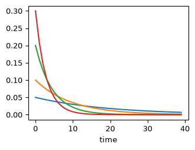
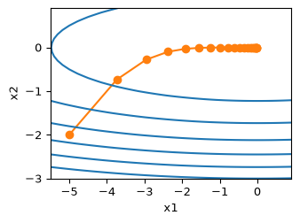
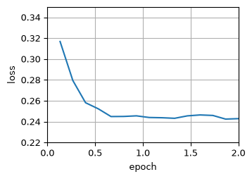
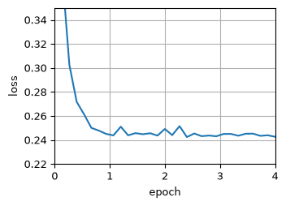

# 12.8 RMSProp

> Ghi chú của người biên soạn: trang này dịch nguyên văn từ sách *Dive into Deep Learning* của **Aston Zhang, Zachary C. Lipton, Mu Li và Alexander J. Smola** ([bản gốc](https://d2l.ai/chapter_optimization/rmsprop.html), [mã nguồn](https://github.com/d2l-ai/d2l-en), giấy phép [CC BY-SA 4.0](https://creativecommons.org/licenses/by-sa/4.0/); code theo giấy phép MIT-0). Chỉ giữ code PyTorch. Số mục, hình và công thức giữ như bản HTML d2l.ai; thuật ngữ đối chiếu với bản dịch [Đắm mình vào Học Sâu](https://github.com/aivivn/d2l-vn).
>
> **Đính chính** *(người biên soạn)*:
>
> - Mục 12.8.1, khai triển của $\mathbf{s}_t$: số hạng thứ ba phải là $\gamma^2 \mathbf{g}_{t-2}^2$ (thiếu bình phương).
> - Cùng mục: "chu kỳ bán rã $\gamma^{-1}$" không chính xác. Trọng số của một quan sát giảm theo $\gamma^k$, nên số quan sát hiệu dụng là $\frac{1}{1-\gamma}$ (10 với $\gamma = 0.9$, đúng như sách tính ở mục 12.8.2), còn chu kỳ bán rã theo nghĩa thông thường là $\ln 2 / \ln(1/\gamma) \approx 6.6$ bước.
> - Mục 12.8.3: `gamma1` là tên tham số trong MXNet. Trong PyTorch, tham số tương ứng của `torch.optim.RMSprop` tên là `alpha`, đúng như code bên dưới dùng.

Một trong những vấn đề then chốt trong [Mục 12.7](dl/ch12_s7_vi) là tốc độ học giảm theo một lịch định trước, về thực chất là $\mathcal{O}(t^{-\frac{1}{2}})$. Dù điều này nhìn chung phù hợp với các bài toán lồi, nó có thể không lý tưởng cho các bài toán không lồi, như những bài toán gặp trong học sâu. Thế nhưng, tính thích ứng theo từng tọa độ của Adagrad lại rất đáng mong muốn như một bộ tiền điều kiện.

[Tieleman và Hinton (2012)](dl/ch12_s8_vi?id=ref-tieleman-hinton-2012) đã đề xuất thuật toán RMSProp như một cách khắc phục đơn giản để tách rời việc lập lịch tốc độ học khỏi các tốc độ học thích ứng theo tọa độ. Vấn đề là Adagrad tích lũy bình phương của gradient $\mathbf{g}_t$ vào một vector trạng thái $\mathbf{s}_t = \mathbf{s}_{t-1} + \mathbf{g}_t^2$. Kết quả là $\mathbf{s}_t$ cứ tăng mãi không bị chặn do thiếu chuẩn hóa, về cơ bản tăng tuyến tính khi thuật toán hội tụ.

Một cách khắc phục vấn đề này là dùng $\mathbf{s}_t / t$. Với các phân phối hợp lý của $\mathbf{g}_t$, đại lượng này sẽ hội tụ. Đáng tiếc là có thể mất rất lâu cho đến khi hành vi giới hạn bắt đầu có ý nghĩa vì quy trình ghi nhớ toàn bộ quỹ đạo giá trị. Một phương án thay thế là dùng trung bình rò rỉ theo cùng cách ta đã dùng trong phương pháp động lượng, tức là $\mathbf{s}_t \leftarrow \gamma \mathbf{s}_{t-1} + (1-\gamma) \mathbf{g}_t^2$ với một tham số $\gamma > 0$ nào đó. Giữ nguyên mọi phần khác cho ta RMSProp.

## 12.8.1 Thuật toán

Hãy viết chi tiết các phương trình.

$$
\begin{aligned}
    \mathbf{s}_t & \leftarrow \gamma \mathbf{s}_{t-1} + (1 - \gamma) \mathbf{g}_t^2, \\
    \mathbf{x}_t & \leftarrow \mathbf{x}_{t-1} - \frac{\eta}{\sqrt{\mathbf{s}_t + \epsilon}} \odot \mathbf{g}_t.
\end{aligned}
$$

Hằng số $\epsilon > 0$ thường được đặt bằng $10^{-6}$ để đảm bảo ta không gặp phải phép chia cho không hoặc kích thước bước quá lớn. Với khai triển này, giờ ta tự do kiểm soát tốc độ học $\eta$ độc lập với phép co giãn được áp dụng theo từng tọa độ. Về mặt trung bình rò rỉ, ta có thể áp dụng cùng lập luận như đã áp dụng trước đây trong trường hợp phương pháp động lượng. Khai triển định nghĩa của $\mathbf{s}_t$ cho ta

$$
\begin{aligned}
\mathbf{s}_t & = (1 - \gamma) \mathbf{g}_t^2 + \gamma \mathbf{s}_{t-1} \\
& = (1 - \gamma) \left(\mathbf{g}_t^2 + \gamma \mathbf{g}_{t-1}^2 + \gamma^2 \mathbf{g}_{t-2} + \ldots, \right).
\end{aligned}
$$

Như trước đây trong [Mục 12.6](dl/ch12_s6_vi), ta dùng $1 + \gamma + \gamma^2 + \ldots, = \frac{1}{1-\gamma}$. Do đó tổng các trọng số được chuẩn hóa về $1$ với chu kỳ bán rã của một quan sát là $\gamma^{-1}$. Hãy trực quan hóa trọng số của 40 bước thời gian vừa qua với các lựa chọn $\gamma$ khác nhau.

<!-- run -->
```python
from d2l import torch as d2l
import torch
import math
```

<!-- run -->
```python
d2l.set_figsize()
gammas = [0.95, 0.9, 0.8, 0.7]
for gamma in gammas:
    x = d2l.numpy(d2l.arange(40))
    d2l.plt.plot(x, (1-gamma) * gamma ** x, label=f'gamma = {gamma:.2f}')
d2l.plt.xlabel('time');
```

<!-- output -->
<div align=center></div>
<!-- /output -->

## 12.8.2 Cài đặt từ Đầu

Như trước, ta dùng hàm bậc hai $f(\mathbf{x})=0.1x_1^2+2x_2^2$ để quan sát quỹ đạo của RMSProp. Hãy nhớ lại rằng trong [Mục 12.7](dl/ch12_s7_vi), khi dùng Adagrad với tốc độ học 0.4, các biến chỉ di chuyển rất chậm ở các giai đoạn sau của thuật toán vì tốc độ học giảm quá nhanh. Vì $\eta$ được kiểm soát riêng, điều này không xảy ra với RMSProp.

<!-- run -->
```python
def rmsprop_2d(x1, x2, s1, s2):
    g1, g2, eps = 0.2 * x1, 4 * x2, 1e-6
    s1 = gamma * s1 + (1 - gamma) * g1 ** 2
    s2 = gamma * s2 + (1 - gamma) * g2 ** 2
    x1 -= eta / math.sqrt(s1 + eps) * g1
    x2 -= eta / math.sqrt(s2 + eps) * g2
    return x1, x2, s1, s2

def f_2d(x1, x2):
    return 0.1 * x1 ** 2 + 2 * x2 ** 2

eta, gamma = 0.4, 0.9
d2l.show_trace_2d(f_2d, d2l.train_2d(rmsprop_2d))
```

<!-- output -->
```output
epoch 20, x1: -0.010599, x2: 0.000000
```

<div align=center></div>
<!-- /output -->

Tiếp theo, ta cài đặt RMSProp để dùng trong một mạng sâu. Việc này cũng đơn giản tương tự.

<!-- run -->
```python
def init_rmsprop_states(feature_dim):
    s_w = d2l.zeros((feature_dim, 1))
    s_b = d2l.zeros(1)
    return (s_w, s_b)
```

<!-- run -->
```python
def rmsprop(params, states, hyperparams):
    gamma, eps = hyperparams['gamma'], 1e-6
    for p, s in zip(params, states):
        with torch.no_grad():
            s[:] = gamma * s + (1 - gamma) * torch.square(p.grad)
            p[:] -= hyperparams['lr'] * p.grad / torch.sqrt(s + eps)
        p.grad.data.zero_()
```

Ta đặt tốc độ học ban đầu bằng 0.01 và hệ số trọng số $\gamma$ bằng 0.9. Tức là, $\mathbf{s}$ tổng hợp trung bình trên $1/(1-\gamma) = 10$ quan sát gần nhất của bình phương gradient.

<!-- run -->
```python
data_iter, feature_dim = d2l.get_data_ch11(batch_size=10)
d2l.train_ch11(rmsprop, init_rmsprop_states(feature_dim),
               {'lr': 0.01, 'gamma': 0.9}, data_iter, feature_dim);
```

<!-- output -->
```output
loss: 0.243, 0.029 sec/epoch
([0.00480341911315918, 0.008542537689208984, 0.012331485748291016, 0.01626443862915039, 0.020018815994262695, 0.023816347122192383, 0.027565956115722656, 0.03150749206542969, 0.035201072692871094, 0.03913617134094238, 0.04284310340881348, 0.04657888412475586, 0.050295114517211914, 0.05393505096435547, 0.05778312683105469], [0.3167718188762665, 0.27944759658972423, 0.2581380612850189, 0.25229558499654137, 0.24487530688444772, 0.2449743865331014, 0.24555124721924465, 0.24397516916195552, 0.24374020787080128, 0.2432054609656334, 0.24553577055533726, 0.2464171046813329, 0.245932271639506, 0.24244701727231344, 0.24286584107081097])
```

<div align=center></div>
<!-- /output -->

## 12.8.3 Cài đặt Súc tích

Vì RMSProp là một thuật toán khá phổ biến, nó cũng có sẵn trong thực thể `Trainer`. Tất cả những gì ta cần làm là khởi tạo nó dùng một thuật toán tên `rmsprop`, gán $\gamma$ cho tham số `gamma1`.

<!-- run -->
```python
trainer = torch.optim.RMSprop
d2l.train_concise_ch11(trainer, {'lr': 0.01, 'alpha': 0.9},
                       data_iter)
```

<!-- output -->
```output
loss: 0.243, 0.032 sec/epoch
```

<div align=center></div>
<!-- /output -->

## 12.8.4 Tóm tắt

* RMSProp rất giống Adagrad ở chỗ cả hai đều dùng bình phương của gradient để co giãn các hệ số.
* RMSProp có chung với động lượng việc lấy trung bình rò rỉ. Tuy nhiên, RMSProp dùng kỹ thuật này để điều chỉnh bộ tiền điều kiện theo từng hệ số.
* Trong thực tế, tốc độ học cần được người làm thí nghiệm lập lịch.
* Hệ số $\gamma$ quyết định độ dài của lịch sử khi điều chỉnh thang đo theo từng tọa độ.

## 12.8.5 Bài tập

1. Điều gì xảy ra trong thực nghiệm nếu ta đặt $\gamma = 1$? Vì sao?
1. Xoay bài toán tối ưu để cực tiểu hóa $f(\mathbf{x}) = 0.1 (x_1 + x_2)^2 + 2 (x_1 - x_2)^2$. Điều gì xảy ra với sự hội tụ?
1. Thử xem điều gì xảy ra với RMSProp trên một bài toán học máy thực tế, như huấn luyện trên Fashion-MNIST. Thử nghiệm với các lựa chọn khác nhau để điều chỉnh tốc độ học.
1. Bạn có muốn điều chỉnh $\gamma$ khi quá trình tối ưu tiến triển không? RMSProp nhạy cảm với điều này đến đâu?

[Thảo luận (tiếng Anh)](https://discuss.d2l.ai/t/1074)

## Tài liệu tham khảo

- <a id="ref-tieleman-hinton-2012"></a>Tieleman, Tijmen, Hinton, Geoffrey (2012). *Divide the gradient by a running average of its recent magnitude*. COURSERA: Neural Networks for Machine Learning, Lecture 6.5-rmsprop.
