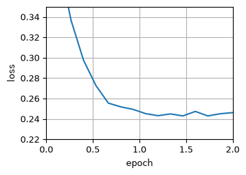
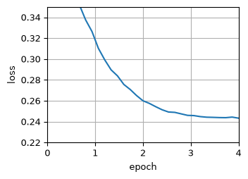

# 12.9 Adadelta

> Ghi chú của người biên soạn: trang này dịch nguyên văn từ sách *Dive into Deep Learning* của **Aston Zhang, Zachary C. Lipton, Mu Li và Alexander J. Smola** ([bản gốc](https://d2l.ai/chapter_optimization/adadelta.html), [mã nguồn](https://github.com/d2l-ai/d2l-en), giấy phép [CC BY-SA 4.0](https://creativecommons.org/licenses/by-sa/4.0/); code theo giấy phép MIT-0). Chỉ giữ code PyTorch. Số mục, hình và công thức giữ như bản HTML d2l.ai; thuật ngữ đối chiếu với bản dịch [Đắm mình vào Học Sâu](https://github.com/aivivn/d2l-vn).

Adadelta là thêm một biến thể nữa của AdaGrad ([Mục 12.7](dl/ch12_s7_vi)). Khác biệt chính nằm ở chỗ nó giảm mức độ thích ứng của tốc độ học theo các tọa độ. Hơn nữa, theo truyền thống, nó được coi là không có tốc độ học vì nó dùng chính lượng thay đổi để hiệu chỉnh cho lượng thay đổi trong tương lai. Thuật toán được đề xuất trong [Zeiler (2012)](dl/ch12_s9_vi?id=ref-zeiler-2012). Nó khá đơn giản, xét những gì đã thảo luận về các thuật toán trước cho đến nay.

## 12.9.1 Thuật toán

Nói ngắn gọn, Adadelta dùng hai biến trạng thái, $\mathbf{s}_t$ để lưu trung bình rò rỉ của mô-men bậc hai của gradient và $\Delta\mathbf{x}_t$ để lưu trung bình rò rỉ của mô-men bậc hai của lượng thay đổi của chính các tham số trong mô hình. Lưu ý rằng ta dùng ký hiệu và cách đặt tên gốc của các tác giả để tương thích với các công bố và cài đặt khác (không có lý do thực sự nào khác khiến người ta nên dùng các chữ cái Hy Lạp khác nhau để chỉ một tham số có cùng mục đích trong động lượng, Adagrad, RMSProp và Adadelta).

Đây là các chi tiết kỹ thuật của Adadelta. Với tham số của thuật toán này là $\rho$, ta có các bước cập nhật rò rỉ sau, tương tự như [Mục 12.8](dl/ch12_s8_vi):

$$
\begin{aligned}
    \mathbf{s}_t & = \rho \mathbf{s}_{t-1} + (1 - \rho) \mathbf{g}_t^2.
\end{aligned}
$$

Khác biệt so với [Mục 12.8](dl/ch12_s8_vi) là ta thực hiện cập nhật với gradient đã được co giãn lại $\mathbf{g}_t'$, tức là

$$
\begin{aligned}
    \mathbf{x}_t  & = \mathbf{x}_{t-1} - \mathbf{g}_t'. \\
\end{aligned}
$$

Vậy gradient đã co giãn lại $\mathbf{g}_t'$ là gì? Ta có thể tính nó như sau:

$$
\begin{aligned}
    \mathbf{g}_t' & = \frac{\sqrt{\Delta\mathbf{x}_{t-1} + \epsilon}}{\sqrt{{\mathbf{s}_t + \epsilon}}} \odot \mathbf{g}_t, \\
\end{aligned}
$$

trong đó $\Delta \mathbf{x}_{t-1}$ là trung bình rò rỉ của bình phương các gradient đã co giãn lại $\mathbf{g}_t'$. Ta khởi tạo $\Delta \mathbf{x}_{0}$ bằng $0$ và cập nhật nó ở mỗi bước với $\mathbf{g}_t'$, tức là

$$
\begin{aligned}
    \Delta \mathbf{x}_t & = \rho \Delta\mathbf{x}_{t-1} + (1 - \rho) {\mathbf{g}_t'}^2,
\end{aligned}
$$

và $\epsilon$ (một giá trị nhỏ như $10^{-5}$) được thêm vào để duy trì ổn định số.

## 12.9.2 Cài đặt

Adadelta cần duy trì hai biến trạng thái cho mỗi biến, $\mathbf{s}_t$ và $\Delta\mathbf{x}_t$. Điều này cho ta cách cài đặt sau.

<!-- run -->
```python
from d2l import torch as d2l
import torch

def init_adadelta_states(feature_dim):
    s_w, s_b = d2l.zeros((feature_dim, 1)), d2l.zeros(1)
    delta_w, delta_b = d2l.zeros((feature_dim, 1)), d2l.zeros(1)
    return ((s_w, delta_w), (s_b, delta_b))

def adadelta(params, states, hyperparams):
    rho, eps = hyperparams['rho'], 1e-5
    for p, (s, delta) in zip(params, states):
        with torch.no_grad():
            # Cập nhật tại chỗ qua [:]
            s[:] = rho * s + (1 - rho) * torch.square(p.grad)
            g = (torch.sqrt(delta + eps) / torch.sqrt(s + eps)) * p.grad
            p[:] -= g
            delta[:] = rho * delta + (1 - rho) * g * g
        p.grad.data.zero_()
```

Chọn $\rho = 0.9$ tương đương với chu kỳ bán rã bằng 10 cho mỗi lần cập nhật tham số. Điều này thường hoạt động khá tốt. Ta có hành vi sau.

<!-- run -->
```python
data_iter, feature_dim = d2l.get_data_ch11(batch_size=10)
d2l.train_ch11(adadelta, init_adadelta_states(feature_dim),
               {'rho': 0.9}, data_iter, feature_dim);
```

<!-- output -->
```output
loss: 0.246, 0.034 sec/epoch
([0.005364894866943359, 0.010153770446777344, 0.014548778533935547, 0.0191648006439209, 0.02372288703918457, 0.028112173080444336, 0.032479286193847656, 0.036923885345458984, 0.041277408599853516, 0.04559922218322754, 0.050046682357788086, 0.054431915283203125, 0.058795928955078125, 0.06310915946960449, 0.06751585006713867], [0.395500837802887, 0.33659167925516764, 0.29758379904429116, 0.27268922704458237, 0.25549508531888326, 0.25183326957623164, 0.24931731128692627, 0.24519084000587463, 0.24316593273480733, 0.2449207139015198, 0.24296174999078116, 0.24736083738009135, 0.24294358309110006, 0.24508787420392036, 0.24615977215766907])
```

<div align=center></div>
<!-- /output -->

Để cài đặt súc tích, ta chỉ đơn giản dùng thuật toán Adadelta từ các API cấp cao. Điều này cho ta một dòng lệnh duy nhất gọn hơn nhiều.

<!-- run -->
```python
trainer = torch.optim.Adadelta
d2l.train_concise_ch11(trainer, {'rho': 0.9}, data_iter)
```

<!-- output -->
```output
loss: 0.243, 0.037 sec/epoch
```

<div align=center></div>
<!-- /output -->

## 12.9.3 Tóm tắt

* Adadelta không có tham số tốc độ học. Thay vào đó, nó dùng chính tốc độ thay đổi của các tham số để điều chỉnh tốc độ học.
* Adadelta cần hai biến trạng thái để lưu mô-men bậc hai của gradient và của lượng thay đổi trong tham số.
* Adadelta dùng trung bình rò rỉ để duy trì ước lượng liên tục của các thống kê thích hợp.

## 12.9.4 Bài tập

1. Điều chỉnh giá trị của $\rho$. Điều gì xảy ra?
1. Chỉ ra cách cài đặt thuật toán mà không dùng $\mathbf{g}_t'$. Vì sao đây có thể là một ý hay?
1. Adadelta có thực sự không cần tốc độ học không? Bạn có thể tìm những bài toán tối ưu làm Adadelta thất bại không?
1. So sánh Adadelta với Adagrad và RMSProp để thảo luận về hành vi hội tụ của chúng.

[Thảo luận (tiếng Anh)](https://discuss.d2l.ai/t/1076)

## Tài liệu tham khảo

- <a id="ref-zeiler-2012"></a>Zeiler, Matthew D (2012). *ADADELTA: an adaptive learning rate method*. ArXiv:1212.5701.
