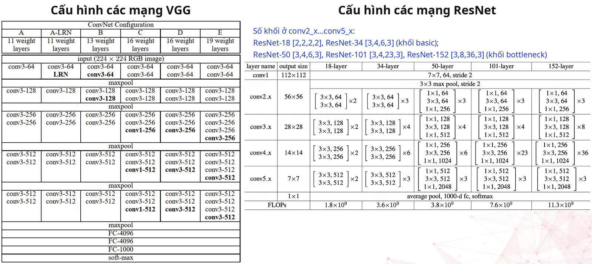
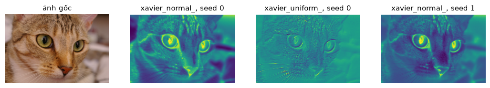
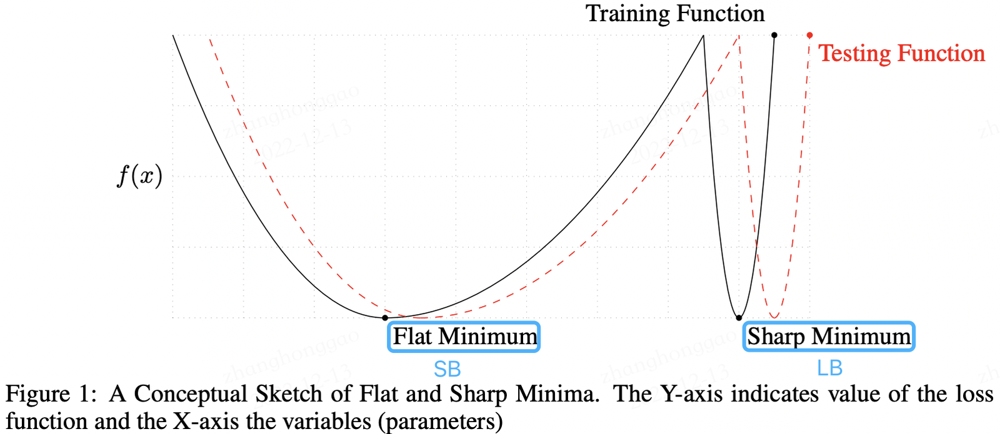
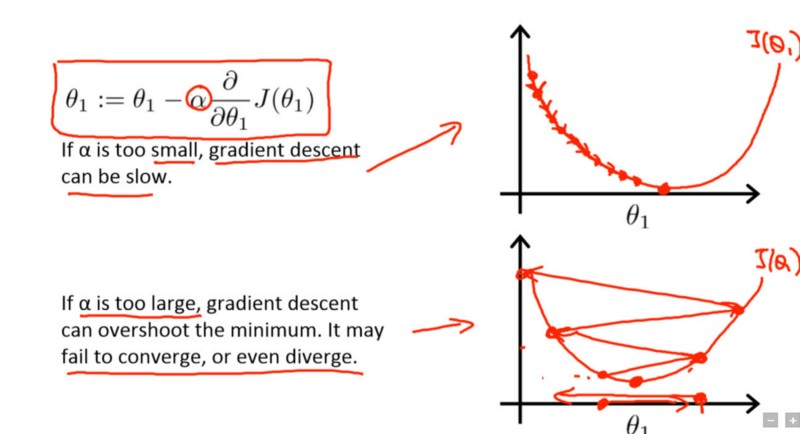
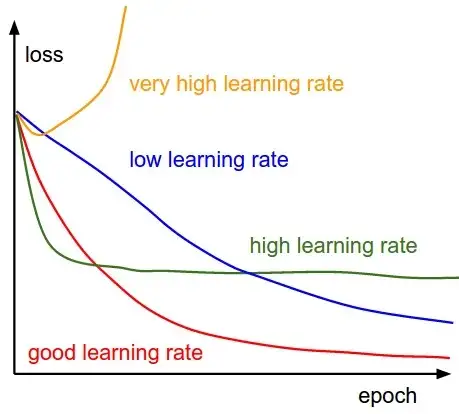
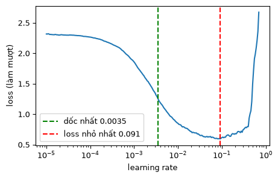
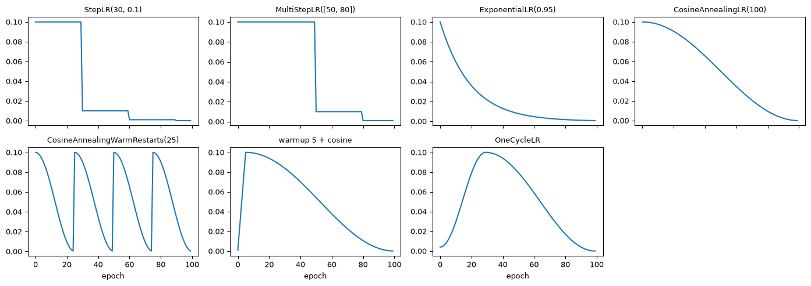

# Mẹo huấn luyện: điều chỉnh siêu tham số

> Ghi chú của người biên soạn: trang này dịch từ ghi chú *dl_note* của **Harley Zhang** ([bản gốc](https://github.com/harleyszhang/dl_note/blob/main/4-deep_learning_alchemy/深度学习炼丹-超参数调整.md), [kho mã](https://github.com/harleyszhang/dl_note), giấy phép [Apache-2.0](https://www.apache.org/licenses/LICENSE-2.0); phần dịch có chỉnh sửa). Số mục giữ như bản gốc. Chỗ bản gốc sai, thiếu hoặc đã lỗi thời được sửa ngay trong bài và ghi ở ô **Biên tập**. Các mục có chữ **Bổ sung** do người biên soạn viết thêm.

Trang [Code](dlnote/alchemy_code_vi) đi kèm kiểm tra các nhận xét của bài: khởi tạo mặc định của lớp tích chập, so sánh hai cách khởi tạo Xavier, vẽ các bộ lập lịch learning rate, đo bộ nhớ trạng thái của từng optimizer, làm thử dải learning rate (LR range test) và thử quy tắc tỉ lệ tuyến tính giữa batch size và learning rate.

<div class="qa-theory">

**Lý thuyết:** [Ôn tập · 14.3.3 Có những chiến lược điều chỉnh tốc độ học nào?](qa/ch14_vi?id=_1433-có-những-chiến-lược-điều-chỉnh-tốc-độ-học-nào) · [Ôn tập · 3.5.5 Rốt cuộc điều chỉnh batch size ảnh hưởng thế nào tới kết quả huấn luyện?](qa/ch03_vi?id=_355-rốt-cuộc-điều-chỉnh-batch-size-ảnh-hưởng-thế-nào-tới-kết-quả-huấn-luyện) · [Học sâu · 12.11 Lập lịch Tốc độ học](dl/ch12_s11_vi) · [Ôn tập · 14.4.1 Tinh chỉnh (fine-tune) là gì?](qa/ch14_vi?id=_1441-tinh-chỉnh-fine-tune-là-gì)

</div>

## Lời nói đầu

**Siêu tham số (hyperparameter) là những tham số không do chính thuật toán học học ra, mà người huấn luyện phải tự chỉnh** (về lý thuyết có thể thiết kế một quá trình học lồng nhau, trong đó một thuật toán học ra siêu tham số tốt nhất cho thuật toán kia). Các siêu tham số thường gặp của mạng neuron tích chập là: learning rate của optimizer, số `epoch` huấn luyện, kích thước batch `batch_size` và kích thước ảnh đầu vào.

Thông thường ta chia dữ liệu huấn luyện thành hai tập con không giao nhau: một tập dùng để học tham số, tập còn lại là tập kiểm định, dùng để ước lượng sai số tổng quát hoá trong hoặc sau khi huấn luyện, và từ đó cập nhật siêu tham số.

- Tập con dùng để học tham số thường vẫn gọi là tập huấn luyện (đừng nhầm với toàn bộ dữ liệu dùng trong quá trình huấn luyện).
- Tập con dùng để chọn siêu tham số gọi là tập kiểm định (`validation set`).

Thường `80%` dữ liệu huấn luyện dùng để huấn luyện và `20%` để kiểm định. Vì tập kiểm định được dùng để "huấn luyện" siêu tham số, **sai số trên tập kiểm định thường thấp hơn sai số tổng quát hoá thật**, tức tập kiểm định đánh giá thấp sai số tổng quát hoá (dù ít hơn nhiều so với mức tập huấn luyện đánh giá thấp). Sau khi tối ưu xong mọi siêu tham số, **cần dùng tập kiểm tra (test set) để ước lượng sai số tổng quát hoá**.

> **Biên tập:** Bản gốc viết "vì tập kiểm định dùng để huấn luyện siêu tham số nên sai số trên tập kiểm định thường nhỏ hơn sai số trên tập huấn luyện". Đoạn này tóm tắt mục 5.3 của sách *Deep Learning* (Goodfellow và cộng sự), nhưng sách nói điều khác: sai số kiểm định *đánh giá thấp sai số tổng quát hoá*, dù thường ít hơn mức mà sai số huấn luyện đánh giá thấp. Sai số kiểm định thường *lớn hơn* sai số huấn luyện, không nhỏ hơn.

## 1 Tham số bên trong của các tầng mạng

Khi thiết kế kiến trúc mạng, ta thường phải chỉ định trước một số tham số kiến trúc, chẳng hạn:

- **Tham số của tầng tích chập** (`convolution`): số kênh, kích thước kernel, bước trượt (stride).
- **Tham số của tầng gộp** (`pooling`): kích thước cửa sổ, bước trượt…
- **Khởi tạo trọng số**: thường dùng họ `Xavier` hoặc `kaiming`, hoặc khởi tạo bằng trọng số của mô hình tiền huấn luyện (`finetune`).
- **Độ sâu mạng** (ở đây chỉ mạng neuron tích chập), tức số tầng; độ sâu thường quyết định năng lực biểu diễn (trừu tượng hoá) của mạng, mạng càng sâu khả năng học càng mạnh.
- **Độ rộng mạng**, tức số kênh (`channel`) của tầng tích chập, cũng là số **bộ lọc** (3 chiều); mạng càng rộng thì tầng đó học được đặc trưng càng phong phú.

Các tham số này thường được chốt ngay lúc thiết kế kiến trúc; giá trị của chúng có thể tham khảo các bài báo kinh điển và kinh nghiệm huấn luyện, chẳng hạn:

- dùng tích chập `3x3`;
- dùng tổ hợp `cbr`;
- thử các cách khởi tạo trọng số khác nhau.

### 1.1 Dùng tích chập 3x3

Tầng tích chập $3\times 3$ là thành phần chủ đạo của `cnn`: trong các mạng `backbone` trích đặc trưng ảnh, phần lớn kernel có kích thước $3\times 3$. Bảng cấu hình của các mạng VGG và ResNet dưới đây là ví dụ.



Hình 1.1: Cấu hình các mạng VGG (bảng 1 của bài báo VGG) và ResNet (bảng 1 của bài báo ResNet).

> **Biên tập:** Khung chú thích trong ảnh gốc ghi số khối của mạng 152 tầng ([3,8,36,3]) dưới tên "resnet18" và bỏ sót ResNet-101 ([3,4,23,3]); khung trong hình trên đã sửa.

### 1.2 Dùng tổ hợp cbr

Trong mô hình `cnn`, sau tầng tích chập (`conv`) thường là tầng `bn` và tầng `relu`, tạo thành bộ `cbr`. Tầng `BN` (batch normalization) rất quan trọng, cùng với tầng tích chập và hàm kích hoạt là **thành phần tiêu chuẩn** của mô hình `cnn`. Nó không chỉ **giúp mô hình hội tụ nhanh hơn, mà quan trọng hơn là phần nào giảm được một khó khăn của mạng sâu là "gradient biến mất", nhờ đó huấn luyện mạng sâu dễ và ổn định hơn**.

Ngoài ra, khi đã huấn luyện xong, lúc suy luận có thể gộp tầng tích chập và tầng `BN` ngay sau nó thành một tầng tích chập có `bias` (thường gọi là "hấp thụ BN"); nguyên lý xem [bài Batch Normalization](dlnote/dl_bn_vi) và [trang Code](dlnote/dl_basic_code_vi) của phần 2.

> Với các bài toán thị giác máy tính, cứ dùng hàm kích hoạt `ReLU` là được.

```python
# ví dụ khối cbr
def convbn_relu(in_planes, out_planes, kernel_size, stride, pad, dilation):
    return nn.Sequential(
        nn.Conv2d(in_planes, out_planes,
                  kernel_size=kernel_size, stride=stride,
                  padding=dilation if dilation > 1 else pad,
                  dilation=dilation, bias=False),
        nn.BatchNorm2d(out_planes),
        nn.ReLU(inplace=True)
        )
```

> **Biên tập:** Câu "cứ dùng ReLU" là kinh nghiệm của thời ResNet. Các mạng thị giác từ khoảng 2019 thường dùng SiLU/Swish (EfficientNet, YOLOv5 trở đi) hoặc GELU (ViT, ConvNeXt); xem [bài hàm kích hoạt](dlnote/dl_act_vi). ReLU vẫn là lựa chọn mặc định tốt khi cần tốc độ và khi triển khai lên phần cứng hạn chế.

### 1.3 Thử các cách khởi tạo trọng số khác nhau

Hãy thử nhiều cách khởi tạo trọng số kernel. Hiện **các cách khởi tạo thường dùng** là họ `Xavier` và `kaiming`; PyTorch cung cấp chúng trong `torch.nn.init`. Lớp tích chập mặc định dùng phân phối đều kaiming `nn.init.kaiming_uniform_()`, như đoạn `reset_parameters` của `_ConvNd` dưới đây (PyTorch 2.14, đã lược chú thích):

```python
def reset_parameters(self) -> None:
    with torch.no_grad():
        ...
        init.kaiming_uniform_(self.weight, a=math.sqrt(5))
        if self.bias is not None:
            fan_in, _ = init._calculate_fan_in_and_fan_out(self.weight)
            bound = 1 / math.sqrt(fan_in) if fan_in > 0 else 0
            init.uniform_(self.bias, -bound, bound)
```

> **Biên tập:** Bản gốc là ảnh chụp mã nguồn của bản PyTorch cũ trong thư mục cài đặt riêng của tác giả; đã thay bằng mã trích từ bản đang dùng (trang Code in ra nguyên văn). Với `a=√5`, phân phối này là $U(-1/\sqrt{n_{in}},\ 1/\sqrt{n_{in}})$, phương sai $1/(3n_{in})$, nhỏ hơn khởi tạo He sáu lần; xem [bài khởi tạo tham số](dlnote/dl_init_vi), mục 3.

Dưới đây là ví dụ khởi tạo trọng số tầng tích chập bằng `kaiming_normal_` (phân phối chuẩn kaiming).

```python
import torch
import torch.nn as nn

# định nghĩa một tầng tích chập
conv = nn.Conv2d(in_channels=3, out_channels=16, kernel_size=3, stride=1, padding=1)

# khởi tạo trọng số theo He (kaiming)
nn.init.kaiming_normal_(conv.weight, mode="fan_out", nonlinearity="relu")
```

Mỗi cách khởi tạo cho đầu ra khác nhau. Khởi tạo bằng `xavier_normal_` và `xavier_uniform_` rồi cho một ảnh đi qua một tầng tích chập, đầu ra như sau:

<div align=center></div>

Hình 1.2: Ảnh gốc và đầu ra của tầng tích chập 3→1 kênh, kernel 3x3, stride 2, với các cách khởi tạo khác nhau (vẽ lại trên trang Code).

> **Biên tập:** Bản gốc so sánh một lần khởi tạo `xavier_normal_` với một lần `xavier_uniform_` và kết luận hai cách "cho hiệu quả khác nhau". Hai hàm này có cùng phương sai $2/(n_{in}+n_{out})$; khác biệt giữa hai ảnh chủ yếu do mỗi lần lấy ngẫu nhiên một kernel khác nhau. Hình trên thêm ô thứ tư: cũng `xavier_normal_` nhưng đổi seed, khác ô thứ hai không kém gì ô thứ ba. Qua 500 lần khởi tạo, độ lệch chuẩn của đầu ra trung bình là 0,138 với bản chuẩn và 0,140 với bản đều.

## 2 Kích thước ảnh và tăng cường dữ liệu

1. **Khi bộ nhớ GPU cho phép, ảnh đầu vào càng lớn thì độ chính xác của mô hình thường càng cao.**

2. **Dữ liệu huấn luyện đưa vào mô hình phải được xáo trộn (`shuffle`) kỹ.** Như vậy, khi dùng thuật toán learning rate thích nghi, ta tránh được việc một số đặc trưng xuất hiện dồn cục, khiến mô hình lúc học quá đà, lúc học không đủ, làm lệch hướng đi xuống. Lý thuyết thông tin cũng có câu: "học từ những sự kiện không giống nhau luôn mang nhiều thông tin hơn học từ những sự kiện giống nhau".

   Ngoài ra, để tiện so sánh thí nghiệm, nên **cố định seed ngẫu nhiên**, và xáo trộn lại tập huấn luyện trước mỗi `epoch`, để cùng một thứ tự batch ở các epoch khác nhau mô hình "thấy" dữ liệu khác nhau.

3. **Chiến lược tăng cường dữ liệu (data augmentation) phải được thiết kế theo bài toán cụ thể.** Có nhiều cách tăng cường, thường gặp là (ngoài ba cách đầu, các cách còn lại cần cân nhắc kỹ):

   - lật ngang / lật dọc;
   - xoay 90°, 180°, 270°;
   - lật kết hợp xoay (xoay và lật giúp mô hình học được tính bất biến với phép xoay của đặc trưng; cách làm ở mức tầng tích chập có thể tham khảo bài báo `ACNet`);
   - thay đổi ngẫu nhiên độ sáng, độ bão hoà, độ tương phản;
   - cắt ngẫu nhiên (Random Crop);
   - co giãn ngẫu nhiên (Random Resize);
   - làm mờ (Blurring);
   - thêm nhiễu Gauss (Gaussian Noise).

Chi tiết xem [bài tăng cường dữ liệu](dlnote/alch_augment_vi).

## 3 Đặt batch size

### 3.1 Kiến thức nền

Trong học sâu thường gặp ba khái niệm `epoch`, `iteration` và `batch size`:

- `batch size`: kích thước batch. Học sâu thường huấn luyện bằng SGD, mỗi lần lấy `batch_size` mẫu từ tập huấn luyện để huấn luyện;
- `iteration`: 1 iteration là một lần huấn luyện với `batch_size` mẫu;
- `epoch`: 1 epoch là một lượt huấn luyện qua toàn bộ mẫu của tập huấn luyện.

### 3.2 Định nghĩa batch size

**`batch` là một lô dữ liệu; đặt `batch size` để mỗi lần mô hình xử lý một lô mẫu. Hiểu trực quan, `batch size` là số mẫu dùng cho một lần cập nhật.**

Kích thước `batch size` ảnh hưởng tới tốc độ hội tụ và mức tối ưu của mô hình, đồng thời quyết định trực tiếp lượng bộ nhớ `GPU` cần dùng: nếu bộ nhớ GPU nhỏ thì nên đặt nhỏ, nếu không sẽ tràn bộ nhớ.

### 3.3 Chọn batch size phù hợp

`batch size` là siêu tham số dễ chỉnh nhất, và cũng nên được chốt sớm nhất. Nguyên tắc là không quá nhỏ, không quá lớn, **lấy giá trị vừa phải ở giữa**, thường là luỹ thừa của 2 như 16, 32, 64, 128. Với cấu hình thường gặp (khoảng 100 epoch), batch size thường không dưới `16`.

> Lý do hay được nêu cho việc chọn luỹ thừa của 2: bộ nhớ của GPU và CPU tổ chức theo hệ nhị phân, nên luỹ thừa của 2 tính nhanh hơn.

> **Biên tập:** Lý do này chỉ đúng một phần. Với GPU, điều đáng kể là các chiều của phép nhân ma trận chia hết cho 8 (fp16) hay 16 (int8) để dùng hết Tensor Core, và số mẫu chia đều cho các khối tính; batch 96 hay 192 nhanh ngang các luỹ thừa của 2 gần đó. Trên CPU khác biệt gần như không đáng kể. Chọn luỹ thừa của 2 chủ yếu là thói quen tiện so sánh.

Batch size quá nhỏ và quá lớn đều có vấn đề:

- **Quá nhỏ**: gradient mỗi lần tính không ổn định, huấn luyện dao động mạnh, khó hội tụ.
- **Quá lớn**: batch lớn giảm được thời gian huấn luyện (ít bước hơn cho mỗi epoch), nhưng nếu giữ nguyên các siêu tham số khác thì cả **tối ưu** (loss huấn luyện khó giảm) lẫn **tổng quát hoá** (khoảng cách tổng quát hoá lớn) đều có thể xấu đi.

> **Biên tập:** Bản gốc dẫn bài báo [Accurate, Large Minibatch SGD: Training ImageNet in 1 Hour](https://arxiv.org/abs/1706.02677) (Goyal và cộng sự, 2017) làm nguồn cho kết luận "batch lớn làm hỏng tối ưu và tổng quát hoá". Bài báo này cho thấy điều ngược lại: với **quy tắc tỉ lệ tuyến tính** (nhân batch size lên $k$ lần thì nhân learning rate lên $k$ lần) cộng **warmup** 5 epoch, ResNet-50 huấn luyện với batch 8192 đạt cùng độ chính xác như batch 256, trong 1 giờ trên 256 GPU. Vấn đề chỉ xuất hiện khi tăng batch mà giữ nguyên learning rate, hoặc khi vượt quá một ngưỡng (với ResNet-50 trên ImageNet, khoảng 8k). Mục 3.4 nói thêm.

Có bài báo cho rằng `LB` (batch lớn, large batch) gặp vấn đề `Generalization Gap` vì khi huấn luyện với `LB` mô hình dễ hội tụ về **cực tiểu nhọn** (`sharp minima`), còn `SB` (batch nhỏ) dễ hội tụ về **cực tiểu phẳng** (`flat minima`), và `LB` khó thoát ra khỏi các cực tiểu nhọn này. Tác giả cũng cho rằng việc chọn `batch size` có một ngưỡng: vượt quá ngưỡng đó, chất lượng mô hình giảm, độ chính xác giảm mạnh.



Hình 3.1: Phác hoạ cực tiểu phẳng và cực tiểu nhọn. Trục tung là giá trị hàm mất mát, trục hoành là tham số; đường liền là hàm mất mát trên tập huấn luyện, đường đứt là trên tập kiểm tra.

> Bài báo nguồn: [On Large-Batch Training for Deep Learning: Generalization Gap and Sharp Minima](https://arxiv.org/abs/1609.04836) (Keskar và cộng sự, 2017). Bài này nghiên cứu hiện tượng phổ biến là huấn luyện với batch size lớn làm giảm khả năng tổng quát hoá (bài gọi là Generalization Gap).

Ngoài ra:

- Khoảng batch size phù hợp không liên quan rõ rệt tới quy mô dữ liệu huấn luyện, số tầng hay số đơn vị của mạng.
- Khoảng batch size phù hợp chủ yếu liên quan tới tốc độ hội tụ và nhiễu của gradient ngẫu nhiên.

> Tham khảo hỏi đáp trên Zhihu: [Chọn batch size khi huấn luyện mạng neuron thế nào?](https://www.zhihu.com/question/61607442)

### 3.4 Quan hệ giữa learning rate và batch size

`batch size` và learning rate gắn chặt với nhau. Mô hình học sâu phần lớn được tối ưu bằng gradient descent ngẫu nhiên theo minibatch, có công thức cập nhật:

$$
w_{t+1} = w_{t} - \eta \frac{1}{n} \sum_{x\in\mathcal B} \nabla l(x,w_{t})
$$

trong đó $n$ là batch size, $\eta$ là learning rate và $\mathcal B$ là batch hiện tại. Ngoài bản thân gradient, hai hệ số này quyết định trực tiếp bước cập nhật trọng số, nên về mặt tối ưu chúng là những tham số quan trọng nhất đối với sự hội tụ của mô hình.

**Learning rate ảnh hưởng trực tiếp tới trạng thái hội tụ, còn `batch size` ảnh hưởng tới khả năng tổng quát hoá.** Hai đại lượng đứng ở tử và mẫu của cùng một biểu thức nên tác động lẫn nhau.

> Nguồn tham khảo: [【AI不惑境】学习率和batchsize如何影响模型的性能？](https://zhuanlan.zhihu.com/p/64864995)

Trang Code thử quy tắc tỉ lệ tuyến tính trên một MLP với FashionMNIST, 5 epoch, lịch cosine:

| batch | learning rate | warmup | độ chính xác test |
| --- | --- | --- | --- |
| 64 | 0,02 | không | 0,888 |
| 1024 | 0,02 | không | 0,836 |
| 1024 | 0,32 (= 0,02 × 16) | không | 0,865 |
| 1024 | 0,32 | 1 epoch | 0,876 |
| 8192 | 0,32 | không | 0,780 |
| 8192 | 2,56 (= 0,02 × 128) | không / 2 epoch | phân kỳ (0,25) |

Tăng batch 16 lần mà giữ nguyên learning rate làm độ chính xác giảm 5 điểm; tăng learning rate theo cùng tỉ lệ cộng warmup lấy lại gần hết. Ở batch 8192, mỗi epoch chỉ còn 7 bước cập nhật (35 bước cả quá trình), và learning rate nhân 128 lần làm mô hình phân kỳ dù có warmup: quy tắc tỉ lệ tuyến tính có giới hạn, như Goyal và cộng sự đã ghi nhận.

## 4 Đặt learning rate

### 4.1 Kiến thức nền

Lan truyền ngược là phương pháp tính gradient theo tham số của mạng neuron. Nói chung, lan truyền ngược dựa trên quy tắc chuỗi của giải tích, đi theo thứ tự từ tầng ra về tầng vào, lần lượt tính và lưu gradient của hàm mục tiêu theo các biến trung gian và tham số của từng tầng.

Lan truyền xuôi: tầng vào → tầng ra; lan truyền ngược: tầng ra → tầng vào. Xem [bài lan truyền ngược và gradient descent](dlnote/dl_bp_vi).

### 4.2 Learning rate là gì

Tham số của mọi mạng neuron sâu hiện nay đều được huấn luyện bằng thuật toán `BP` (lan truyền ngược), mà `BP` **dựa trên chiến lược gradient descent, điều chỉnh tham số theo hướng ngược với gradient của hàm mục tiêu**:

```shell
new_weight = existing_weight - learning_rate * gradient
```

Chi tiết hơn, công thức cập nhật trọng số là:

$$\theta_1 := \theta_1  - \alpha \frac{\partial}{\partial \theta_1}J(\theta_1)$$

> Đây là công thức gradient descent trong khoá Machine Learning của Andrew Ng; cũng có thể xem công thức (5.6) trong sách *Học máy* (机器学习) của Chu Chí Hoa, cách viết khác nhưng ý nghĩa như nhau.

Trong đó $\alpha$ là **learning rate**, $\theta$ là trọng số cần cập nhật. Learning rate điều khiển độ dài bước cập nhật ở mỗi vòng lặp. Dễ thấy **learning rate quá lớn dễ gây dao động, không hội tụ; quá nhỏ thì hội tụ quá chậm (hàm mất mát thay đổi quá chậm)**. Learning rate thấp giúp ta không bỏ qua cực tiểu địa phương nào, nhưng cũng có nghĩa là mất nhiều thời gian hơn để hội tụ, nhất là khi bị kẹt ở vùng bằng phẳng (plateau).

> **Biên tập:** Bản gốc ghi "learning rate nằm trong khoảng $\alpha \in (0,1)$". Không có ràng buộc như vậy: learning rate chỉ cần dương, giá trị phù hợp phụ thuộc thang của hàm mất mát và optimizer. Huấn luyện ResNet với batch lớn dùng lr từ 3 trở lên (bảng mục 3.4 cũng có lr 2,56), còn Adam cho mô hình ngôn ngữ thường dùng $10^{-4}$ trở xuống.



Hình 4.1: Gradient descent với learning rate nhỏ (trên) và lớn (dưới). Nguồn: khoá Machine Learning của Andrew Ng trên Coursera.

Vì vậy có thể nói **learning rate là siêu tham số quan trọng, quyết định cách ta dùng gradient của hàm mất mát để điều chỉnh trọng số!**

### 4.3 Đặt learning rate thế nào

Khi huấn luyện `CNN`, có hai nguyên tắc về learning rate:

1. **Learning rate ban đầu không nên quá lớn**; với mô hình thị giác, `0.01` và `0.001` là hợp lý (với SGD);
2. Trong quá trình huấn luyện, **learning rate nên giảm dần theo số `epoch`**.

Ngoài các quy tắc cố định trên, **còn vài kinh nghiệm tham khảo**:

1. Với bài toán phân loại ảnh, khi huấn luyện theo kiểu `finetune`, các tầng đóng băng không cần thay đổi nhiều nên đặt learning rate nhỏ, còn tầng phân loại mới thay cần bước lớn hơn để hội tụ nên learning rate thường đặt lớn hơn.
2. Khi tìm learning rate lý tưởng hoặc chẩn đoán learning rate có phù hợp không, có thể dựa vào đường cong huấn luyện (learning curve). Hình dưới (từ `cs231n`) cho thấy hàm mất mát thay đổi thế nào với các learning rate khác nhau.



Hình 4.2: Loss huấn luyện theo epoch với learning rate rất cao, cao, thấp và vừa phải. Nguồn: CS231n.

Một cách làm có hệ thống hơn là **thử dải learning rate** (LR range test, Leslie Smith 2017): huấn luyện vài trăm bước, mỗi bước nhân learning rate lên một hệ số cố định từ rất nhỏ (như $10^{-5}$) tới rất lớn, rồi vẽ loss theo learning rate. Learning rate tốt nằm ở đoạn loss giảm nhanh nhất, trước điểm loss nhỏ nhất khoảng một bậc. Trên trang Code, với MLP trên FashionMNIST và SGD momentum, đoạn dốc nhất ở quanh $3{,}5\cdot 10^{-3}$, loss nhỏ nhất ở $0{,}09$, và loss bùng nổ từ khoảng $0{,}5$:

<div align=center></div>

Hình 4.3: LR range test (trang Code). Đường xanh lá: chỗ loss giảm nhanh nhất; đường đỏ: chỗ loss nhỏ nhất.

Đó là phần phân tích lý thuyết; trong thực tế, lấy `PyTorch` làm ví dụ, bản gốc chia các cách điều chỉnh learning rate thành ba nhóm:

1. **Điều chỉnh theo lịch cố định**: điều chỉnh theo một quy luật định trước; đây là nhóm dùng nhiều nhất, gồm giảm theo khoảng đều (`Step`), giảm tại các mốc tự đặt (`MultiStep`), giảm theo hàm mũ (`Exponential`) và `CosineAnnealing`. Thời điểm điều chỉnh của bốn cách này đều do người dùng kiểm soát.
2. **Điều chỉnh thích nghi**: điều chỉnh tuỳ theo tình hình huấn luyện, như `ReduceLROnPlateau`. Cách này theo dõi một chỉ số; khi chỉ số gần như không đổi nữa thì đó là lúc giảm learning rate.
3. **Điều chỉnh tự định nghĩa**: `Lambda`. Cách này **rất linh hoạt**: có thể đặt chiến lược điều chỉnh khác nhau cho các nhóm tham số khác nhau, rất hữu ích khi fine-tune, vì ta có thể đặt cho từng tầng không chỉ learning rate riêng mà cả lịch điều chỉnh riêng.

Các bộ lập lịch learning rate thường gặp:

- `lr_scheduler.StepLR`: điều chỉnh sau mỗi `step_size` epoch, nhân learning rate với `gamma`.
- `lr_scheduler.MultiStepLR`: điều chỉnh tại các mốc tự đặt. Hợp dùng khi đã quan sát đường loss và muốn tự quyết định thời điểm giảm.
- `lr_scheduler.ExponentialLR`: giảm theo hàm mũ, $lr_{epoch} = lr_0 \cdot \gamma^{epoch}$.
- `lr_scheduler.CosineAnnealingLR`: giảm theo nửa chu kỳ hàm cosin từ $lr_0$ xuống $\eta_{min}$ trong `T_max` epoch.
- `lr_scheduler.ReduceLROnPlateau`: khi một chỉ số không còn thay đổi (không giảm hoặc không tăng nữa) thì giảm learning rate (rất thực dụng).
- `lr_scheduler.LambdaLR`: đặt hàm điều chỉnh riêng cho từng nhóm tham số.

> **Biên tập:** Bản gốc viết `CosineAnnealingLR` "lấy hàm cosin làm chu kỳ và đặt lại learning rate ở đỉnh mỗi chu kỳ"; đó là mô tả của `CosineAnnealingWarmRestarts` (SGDR). `CosineAnnealingLR` chỉ giảm một lần theo nửa chu kỳ cosin. Bản gốc cũng nói PyTorch có "sáu" bộ lập lịch; bản 2.14 có 15, trong đó đáng kể là `LinearLR` (thường dùng cho warmup), `SequentialLR` (nối warmup với cosine), `OneCycleLR` và `PolynomialLR`. Hình dưới vẽ một số lịch thường gặp, trong 100 epoch.

<div align=center></div>

Hình 4.4: Learning rate theo epoch của một số bộ lập lịch trong `torch.optim.lr_scheduler`, learning rate ban đầu 0,1 (trang Code).

Tham số và phương thức chi tiết của các lớp lập lịch xem tài liệu PyTorch: [torch.optim](https://pytorch.org/docs/stable/optim.html#how-to-adjust-learning-rate).

Lưu ý: từ `PyTorch 1.1.0`, `scheduler.step()` phải được gọi **sau** `optimizer.step()`. Muốn tạo một optimizer, trước hết cần đưa cho nó một đối tượng lặp được chứa các tham số cần tối ưu, rồi đặt các tuỳ chọn riêng của optimizer như learning rate, weight decay…

> Trước PyTorch 1.1.0, bộ lập lịch phải được gọi trước khi optimizer cập nhật; bản 1.1.0 đổi hành vi này và phá vỡ tương thích ngược. Nếu gọi bộ lập lịch (`scheduler.step()`) trước khi optimizer cập nhật (`optimizer.step()`), giá trị learning rate đầu tiên của lịch sẽ bị bỏ qua. Trang Code cho thấy điều này: với lr ban đầu 0,1 và `StepLR(gamma=0.5)`, thứ tự đúng dùng 0,1; 0,05; 0,025, thứ tự sai dùng 0,05; 0,025; 0,0125 và PyTorch in cảnh báo.

Mẫu code dùng lịch giảm theo hàm mũ:

```python
import torchvision.models as models
import torch.optim as optim
model = models.resnet50(weights=None)

optimizer = optim.SGD(model.parameters(), lr=0.01, momentum=0.9)  # tạo optimizer, lr là learning rate ban đầu
scheduler = optim.lr_scheduler.ExponentialLR(optimizer, gamma=0.9) # đặt lịch điều chỉnh learning rate

for epoch in range(20):
    for input, target in dataset:
        optimizer.zero_grad()
        output = model(input)
        loss = loss_fn(output, target)
        loss.backward()
        optimizer.step()
    scheduler.step()
    print(epoch, scheduler.get_last_lr())
```

> **Biên tập:** Bản gốc gọi `models.resnet50(pretrained=False)` (tham số `pretrained` đã lỗi thời từ torchvision 0.13, nay dùng `weights=None`) và in learning rate bằng `print_lr(is_verbose=true)`, một hàm không tồn tại trong API công khai (và `true` không phải cú pháp Python); cách lấy learning rate hiện tại là `scheduler.get_last_lr()`.

## 5 Chọn optimizer

### 5.1 Định nghĩa optimizer

Optimizer (thuật toán tối ưu) tối ưu giá trị các tham số $(w, b)$ của neuron. Quá trình như sau: gọi $\theta$ là tham số của mạng, $J(\theta)$ là giá trị hàm mất mát trên tập huấn luyện ứng với giá trị tham số đó (kể cả số hạng regularization); tối ưu là tìm $\theta$ sao cho $J(\theta)$ nhỏ nhất.

Sau khi đã xong tiền xử lý dữ liệu, tăng cường dữ liệu, xây mô hình và chọn hàm mất mát, mô hình toán của bài toán học sâu coi như đã xác định; việc tiếp theo là chọn một optimizer (`Optimizer`) phù hợp để tối ưu mô hình (chọn xong optimizer thì chọn lịch learning rate phù hợp cũng quan trọng).

### 5.2 Chọn optimizer phù hợp cho từng dự án học máy

Cái khó của việc chọn optimizer là **không có optimizer nào giải được mọi bài toán**. Thực tế, hiệu năng của optimizer phụ thuộc nhiều vào cấu hình. Vì vậy bản chất câu hỏi là: **optimizer nào hợp nhất với đặc điểm của dự án?**

Mạng neuron tích chập sâu thường được huấn luyện bằng các thuật toán tối ưu họ gradient descent ngẫu nhiên. Phổ biến và kinh điển nhất là gradient descent ngẫu nhiên `SGD` (có động lượng) và `Adam`; các optimizer thường gặp khác gồm SGD với động lượng `Nesterov`, `Adagrad`, `Adadelta`, `RMSProp`. Nguyên lý của chúng xem [bài thuật toán tối ưu](dlnote/dl_optim_vi).

Dù không có quy tắc chung, vẫn có vài kinh nghiệm:

- `SGD` là cách tối ưu mạng neuron phổ biến nhất, hội tụ ổn định nhưng chậm.
- `Adam` và các thuật toán learning rate thích nghi có lợi thế với dữ liệu thưa và hội tụ rất nhanh, nhưng kết quả kém ổn định hơn (dễ vượt qua nghiệm tốt nhất).

Bảng 1 dưới đây tóm tắt ưu nhược điểm của vài optimizer; có thể dựa vào đó để tìm optimizer khớp với đặc điểm dữ liệu, cấu hình huấn luyện và mục tiêu dự án.

Có optimizer làm tốt trên dữ liệu có đặc trưng thưa, có optimizer cho mô hình tổng quát hoá tốt hơn trên dữ liệu chưa thấy. Một số làm việc tốt với batch lớn (`batch_size` lớn), một số khác lại hội tụ về cực tiểu nhọn và tổng quát hoá kém.

Bảng 1: Ưu nhược điểm của các optimizer phổ biến ($n$ là số tham số; bộ nhớ tính cho trạng thái fp32). Nguồn: [Which Optimizer should I use for my ML Project?](https://www.lightly.ai/post/which-optimizer-should-i-use-for-my-machine-learning-project)

| Optimizer | Bộ nhớ trạng thái (byte) | Số siêu tham số cần chỉnh | Ưu điểm | Nhược điểm |
| --- | --- | --- | --- | --- |
| SGD | 0 | 1 | Thường tổng quát hoá tốt nhất (sau khi huấn luyện đủ lâu) | Dễ kẹt ở điểm yên ngựa hoặc cực tiểu địa phương; nhạy với khởi tạo và learning rate $\alpha$ |
| SGD có động lượng | $4n$ | 2 | Tăng tốc theo hướng đi xuống đều đặn; khắc phục điểm yếu của SGD thường | Nhạy với khởi tạo, với learning rate $\alpha$ và hệ số động lượng $\beta$ |
| AdaGrad | $\sim 4n$ | 1 | Tốt với dữ liệu có đặc trưng thưa; tự giảm learning rate | Tổng quát hoá kém hơn, hội tụ về cực tiểu nhọn; gradient có thể triệt tiêu vì co giãn quá mạnh |
| RMSprop | $\sim 4n$ | 3 | Tốt với dữ liệu có đặc trưng thưa; có sẵn động lượng | Tổng quát hoá kém hơn, hội tụ về cực tiểu nhọn |
| Adam | $\sim 8n$ | 3 | Tốt với dữ liệu có đặc trưng thưa; giá trị mặc định tốt; tự giảm learning rate $\alpha$ | Tổng quát hoá kém hơn, hội tụ về cực tiểu nhọn; trạng thái tốn nhiều bộ nhớ |
| AdamW | $\sim 8n$ | 3 | Tổng quát hoá tốt hơn Adam; vùng siêu tham số tốt rộng hơn | Trạng thái tốn nhiều bộ nhớ |
| LARS | $\sim 4n$ | 3 | Tốt với batch lớn (tới 32k); chống gradient biến mất và bùng nổ; có sẵn động lượng | Tính chuẩn gradient cho từng tầng có thể tốn kém |

> **Biên tập:** Bản gốc dán bảng này dưới dạng ảnh tiếng Anh; đã gõ lại. Trang Code đo bộ nhớ trạng thái thật trên ResNet-18 (11,7 triệu tham số): SGD 0, SGD momentum, Adagrad và RMSprop $4n$, Adam và AdamW $8n$ byte, đúng như cột thứ hai. Ở RMSprop, "có sẵn động lượng" chỉ đúng khi đặt `momentum > 0` (PyTorch mặc định 0, khi đó trạng thái chỉ có `square_avg`).

Trên mạng có mẹo (`tricks`) kết hợp `SGD` và `Adam`: dùng `Adam` để loss giảm nhanh trước, rồi chuyển sang `SGD` để tinh chỉnh. Nhưng chiến lược này có hai câu hỏi: khi nào chuyển, và chuyển sang SGD thì dùng learning rate nào? Bài báo `SWATS` [Improving Generalization Performance by Switching from Adam to SGD](https://arxiv.org/abs/1712.07628) đưa ra câu trả lời, bạn đọc quan tâm có thể đọc thêm.

### 5.3 Optimizer trong PyTorch

Lấy `PyTorch` làm ví dụ, mọi optimizer (như `optim.Adadelta`, `optim.SGD`, `optim.RMSprop`…) đều là lớp con của `Optimizer`, lớp này định nghĩa một số phương thức thường dùng:

- `zero_grad()`: xoá gradient về 0 (từ PyTorch 2.0 mặc định đặt thành `None`).
- `step(closure)`: thực hiện một bước cập nhật trọng số; có thể truyền vào một closure (hàm tính lại loss, cần cho các thuật toán như L-BFGS).
- `state_dict()`: lấy **trạng thái của optimizer** dưới dạng từ điển gồm hai khoá: `state` (bộ đệm theo từng tham số, như `momentum_buffer` của SGD hay `exp_avg`, `exp_avg_sq` của Adam) và `param_groups` (siêu tham số của từng nhóm: lr, momentum, weight_decay… cùng chỉ số các tham số).
- `load_state_dict(state_dict)`: nạp lại trạng thái đó, thường dùng khi **tiếp tục huấn luyện** từ checkpoint.
- `add_param_group(param_group)`: thêm một nhóm tham số vào optimizer, có thể đặt lr, momentum, weight_decay riêng cho nhóm này; hay dùng khi fine-tune (ví dụ mở băng dần từng tầng).

> **Biên tập:** Bản gốc mô tả `state_dict()` là "lấy tham số hiện tại của mô hình, khoá là tên tham số các tầng, giá trị là tham số" và `load_state_dict()` là "nạp tham số vào mạng, thường dùng cho fine-tune". Đó là mô tả của `model.state_dict()`; `optimizer.state_dict()` không chứa trọng số mô hình, và các khoá trong `state` là chỉ số tham số (0, 1, 2…), không phải tên tầng (lỗi tương tự trong [bài thuật toán tối ưu](dlnote/dl_optim_vi)). Trang Code in nội dung của cả hai.

Mẫu code đặt và dùng optimizer:

```python
# optimizer = optim.SGD(model.parameters(), lr=0.01, momentum=0.9)
# đặt learning rate riêng cho từng phần của mô hình
optimizer = optim.SGD([
            {'params': model.base.parameters()},
            {'params': model.classifier.parameters(), 'lr': 1e-3}
          ], lr=1e-2, momentum=0.9
        )
for input, target in dataset:
    optimizer.zero_grad()
    output = model(input)
    loss = loss_fn(output, target)
    loss.backward()
    optimizer.step()
```

> **Biên tập:** Trong bản gốc, đối tượng `optim.SGD([...])` không được gán cho biến nào nên `optimizer` ở vòng lặp là biến chưa định nghĩa; đã thêm `optimizer = `. Với cấu hình này, `model.base` dùng lr mặc định `1e-2`, `model.classifier` dùng `1e-3`.

Nguyên lý các thuật toán tối ưu có thể xem chương 8 của sách *Deep Learning* (Goodfellow và cộng sự); tham số và phương thức chi tiết của các lớp optimizer xem tài liệu PyTorch [torch.optim](https://pytorch.org/docs/stable/optim.html).

## 6 Fine-tune mô hình

Thường khi làm bài toán học sâu, `backbone` được khởi tạo bằng trọng số của mô hình tiền huấn luyện trên `imagenet`; quá trình này gọi là `finetune`, rộng hơn là học chuyển giao (transfer learning). Bản chất của fine-tune là **có được một giá trị khởi tạo trọng số tốt**. Các bước fine-tune thường là:

- lấy trọng số của mô hình tiền huấn luyện (như trên `imagenet`);
- dùng trọng số đó để khởi tạo mô hình của ta, tức nạp trọng số tiền huấn luyện.

Fine-tune thường có hai trường hợp:

1. Dùng thẳng trọng số `resnet50` tiền huấn luyện trên `imagenet` làm bộ trích đặc trưng, chỉ thay tầng kết nối đầy đủ cuối cùng. Ví dụ:

```python
import torch
import torch.nn as nn
import torchvision.models as models

model = models.resnet50(weights=models.ResNet50_Weights.IMAGENET1K_V2)

# duyệt mọi tham số, đặt không cập nhật, tức đóng băng toàn bộ mô hình
for param in model.parameters():
    param.requires_grad = False

# chỉ thay tầng kết nối đầy đủ cuối, đổi thành 10 lớp; tầng mới có requires_grad=True
model.fc = nn.Linear(2048, 10)

print(model.fc) # in thông tin tầng kết nối đầy đủ
# kết quả: Linear(in_features=2048, out_features=10, bias=True)
```

> **Biên tập:** Bản gốc dùng `pretrained=True` (lỗi thời, nay là `weights=...`) và thiếu `import torch.nn as nn`. Khi đóng băng như trên, chỉ nên đưa tham số còn huấn luyện vào optimizer (`model.fc.parameters()`), và nhớ rằng các tầng BN đóng băng vẫn cập nhật thống kê chạy (running mean/var) ở chế độ `train()`; muốn giữ nguyên chúng thì đặt các tầng BN về `eval()`. Với ResNet-18, phần còn huấn luyện chỉ là 5130 tham số (0,05%), theo trang Code.

2. Dùng kiến trúc tự định nghĩa, lưu trọng số tốt của một lần huấn luyện trước để fine-tune ở lần sau, tiết kiệm thời gian huấn luyện. Ví dụ:

```python
import torch

# 1. lưu trọng số mô hình
# giả sử đã tạo net = Net() và huấn luyện xong, lưu trọng số như sau
torch.save(net.state_dict(), 'net_params.pth')
# 2. nạp tệp trọng số
pretrained_dict = torch.load('net_params.pth', weights_only=True)
# 3. khởi tạo mô hình
net = Net()  # tạo net
net_state_dict = net.state_dict()  # lấy state_dict của net vừa tạo
# (tuỳ chọn) bỏ các khoá không có trong net_state_dict, hoặc có nhưng khác kích thước
pretrained_dict_new = {k: v for k, v in pretrained_dict.items()
                       if k in net_state_dict and v.shape == net_state_dict[k].shape}
# cập nhật state_dict của mô hình mới bằng tham số của mô hình tiền huấn luyện
net_state_dict.update(pretrained_dict_new)
# nạp state_dict đã cập nhật
net.load_state_dict(net_state_dict)
```

> **Biên tập:** Bản gốc chỉ lọc theo tên khoá. Nếu mô hình mới đổi số lớp, khoá `fc.weight` có ở cả hai nhưng khác kích thước, và `load_state_dict` báo lỗi `size mismatch`, kể cả khi đặt `strict=False` (trang Code minh hoạ với ResNet-18 1000 lớp → 10 lớp); vì vậy đã thêm điều kiện cùng kích thước. `torch.load` từ PyTorch 2.6 mặc định `weights_only=True`, chỉ nạp tensor và kiểu dữ liệu an toàn.

Fine-tune sâu hơn có thể đặt learning rate khác nhau cho các tầng khác nhau (xem mục 5.3 ở trên và chương 2 của *PyTorch tutorial* của Dư Đình Tung).

> Fine-tune mô hình là một kỹ thuật thuộc học chuyển giao.

## 7 Bổ sung: các thực hành điều chỉnh siêu tham số hiện nay

Mục này do người biên soạn viết thêm.

- **AdamW thay cho Adam + L2.** Với Adam, cộng L2 vào loss không tương đương weight decay (trang Code kiểm tra), nên từ khoảng 2019 AdamW (Loshchilov và Hutter) là mặc định cho Transformer và nhiều CNN hiện đại, với weight decay cỡ 0,05–0,1. Xem [bài regularization](dlnote/alch_reg_vi).
- **Warmup + cosine** là lịch mặc định của hầu hết công thức huấn luyện hiện nay (ConvNeXt, ViT, LLM): tăng tuyến tính learning rate trong vài epoch hoặc vài nghìn bước đầu, rồi giảm theo cosin về gần 0. Một số công thức cho LLM dùng lịch warmup–hằng số–giảm (WSD) để có thể dừng hoặc huấn luyện tiếp ở bất kỳ điểm nào.
- **Quy tắc tỉ lệ:** SGD thường theo tỉ lệ tuyến tính với batch size; với Adam, quy tắc căn bậc hai ($lr \propto \sqrt{B}$) thường hợp hơn. Khi batch rất lớn, LARS/LAMB chuẩn hoá bước cập nhật theo từng tầng.
- **Optimizer mới.** Lion (2023) chỉ giữ một bộ đệm động lượng ($4n$ byte) và dùng dấu của cập nhật; Muon (2024–2025) trực giao hoá cập nhật của các ma trận trọng số 2 chiều và được dùng để huấn luyện một số LLM lớn. Cả hai cần learning rate và weight decay khác Adam.
- **Không phải chỉnh tay:** tìm siêu tham số tự động (Optuna, Hyperband, xem [chương 14 của khoá Ôn tập](qa/ch14_vi)), và μP (maximal update parametrization) cho phép chỉnh siêu tham số trên mô hình nhỏ rồi chuyển nguyên sang mô hình lớn.
- **Công thức huấn luyện mạnh** của torchvision (2021) cho ResNet-50 lên 80,9% top-1 (so với 76,1% ban đầu) chỉ bằng cách kết hợp: lịch cosine dài 600 epoch, label smoothing, MixUp/CutMix, TrivialAugment, random erasing, EMA trọng số, độ phân giải huấn luyện nhỏ hơn lúc kiểm tra. Kiến trúc không đổi: phần lớn khác biệt giữa các bài báo đến từ mẹo huấn luyện.

## Tài liệu tham khảo

- Ngụy Tú Tham. *Giải tích mạng neuron tích chập* (解析卷积神经网络), chương 11.
- Dư Đình Tung. *PyTorch tutorial 0.0.5* (PyTorch_tutorial_0.0.5_余霆嵩).
- Hỏi đáp Zhihu: [Chọn batch size khi huấn luyện mạng neuron thế nào?](https://www.zhihu.com/question/61607442)
- [Mẹo đặt batch size](https://blog.51cto.com/u_15485092/5464376)
- [Chọn optimizer cho từng dự án học máy](https://www.jiqizhixin.com/articles/2021-01-05-9)
- [Hiểu learning rate và các chiến lược chọn](https://www.jiqizhixin.com/articles/understanding-learning-rates)
- Goodfellow, Bengio, Courville. *Deep Learning*, chương 5 Cơ sở học máy.
- Hỏi đáp Zhihu: [Học sâu có những mẹo chỉnh tham số nào?](https://www.zhihu.com/question/25097993)
- [Ghi chú học PyTorch: 3.2 Tầng tích chập](https://pytorch.zhangxiann.com/3-mo-xing-gou-jian/3.2-juan-ji-ceng#juan-ji-wang-luo-shi-li)
- Goyal et al. [Accurate, Large Minibatch SGD: Training ImageNet in 1 Hour](https://arxiv.org/abs/1706.02677). 2017.
- Smith. [Cyclical Learning Rates for Training Neural Networks](https://arxiv.org/abs/1506.01186). WACV 2017.
- Loshchilov, Hutter. [Decoupled Weight Decay Regularization](https://arxiv.org/abs/1711.05101). ICLR 2019.
- Vryniotis. [How to Train State-Of-The-Art Models Using TorchVision's Latest Primitives](https://pytorch.org/blog/how-to-train-state-of-the-art-models-using-torchvision-latest-primitives/). 2021.
