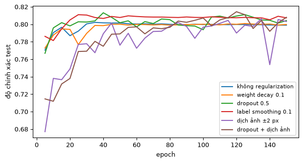

# Mẹo huấn luyện: các chiến lược regularization

> Ghi chú của người biên soạn: trang này dịch từ ghi chú *dl_note* của **Harley Zhang** ([bản gốc](https://github.com/harleyszhang/dl_note/blob/main/4-deep_learning_alchemy/深度学习炼丹-正则化策略.md), [kho mã](https://github.com/harleyszhang/dl_note), giấy phép [Apache-2.0](https://www.apache.org/licenses/LICENSE-2.0); phần dịch có chỉnh sửa). Số mục giữ như bản gốc. Chỗ bản gốc sai, thiếu hoặc đã lỗi thời được sửa ngay trong bài và ghi ở ô **Biên tập**. Các mục có chữ **Bổ sung** do người biên soạn viết thêm.

> Bản gốc của bài này mới viết tới định nghĩa regularization L2 (khoảng một trang). Phần đó được dịch đầy đủ ở lời nói đầu và mục 1, 1.1. Từ mục 1.2 trở đi do người biên soạn viết tiếp, theo dàn ý chương 7 *Regularization cho học sâu* của sách *Deep Learning* (Goodfellow, Bengio, Courville), là tài liệu mà bản gốc ghi làm nguồn.

Trang [Code](dlnote/alchemy_code_vi) đi kèm (mục 5) kiểm tra L2 trong hàm mất mát có tương đương weight decay không (với SGD và với Adam), xem dropout làm gì lúc huấn luyện và lúc suy luận, và so sánh vài cách regularization trên một MLP chỉ có 1000 mẫu huấn luyện.

**Lý thuyết:** [Học sâu · 3.7 Suy giảm Trọng số](dl/ch03_s7_vi) · [Học sâu · 5.6 Dropout](dl/ch05_s6_vi) · [Ôn tập · 3.12.3 Hiểu điều chuẩn dropout](qa/ch03_vi?id=_3123-hiểu-điều-chuẩn-dropout)

> Nội dung bài tham khảo hai sách *Deep Learning* (Goodfellow và cộng sự) và *Giải tích mạng neuron tích chập* (解析卷积神经网络), cùng một số tài liệu trên mạng.

## Lời nói đầu

Một vấn đề cốt lõi của học máy là thiết kế thuật toán không chỉ làm tốt trên dữ liệu huấn luyện mà còn tổng quát hoá tốt trên đầu vào mới (tập kiểm tra).

**Các chiến lược sửa đổi thuật toán học nhằm giảm sai số tổng quát hoá một cách tường minh (có thể phải trả giá bằng sai số huấn luyện lớn hơn) được gọi là regularization** (điều chuẩn, chính quy hoá). **Regularization là một tư tưởng (chiến lược)**, không phải một công thức cụ thể.

Hiện có rất nhiều chiến lược regularization. Có chiến lược thêm ràng buộc cứng lên giá trị tham số. Có chiến lược thêm số hạng vào hàm mục tiêu để ràng buộc mềm giá trị tham số. Nếu chọn cẩn thận, các ràng buộc và hình phạt này có thể cải thiện hiệu năng trên tập kiểm tra. Đôi khi chúng được thiết kế để mã hoá một loại tri thức tiên nghiệm cụ thể; lúc khác chúng được thiết kế để ưu tiên mô hình đơn giản hơn, nhằm tổng quát hoá tốt hơn. Có lúc hình phạt và ràng buộc là cần thiết để làm một bài toán thiếu xác định (underdetermined) trở nên xác định. Các dạng regularization khác, như các phương pháp tổ hợp (ensemble), kết hợp nhiều giả thuyết để giải thích dữ liệu huấn luyện.

> Chương 5 sách *Deep Learning* giới thiệu các khái niệm cơ bản: **tổng quát hoá, học thiếu (underfitting), quá khớp (overfitting), độ lệch (bias), phương sai (variance) và regularization**; xem [bài Nguyên lý cơ bản của học máy](dlnote/math_ml_vi).

## 1 Phạt chuẩn của tham số

Nhiều phương pháp regularization hạn chế năng lực học của mô hình (như mạng neuron, hồi quy tuyến tính hay hồi quy logistic) bằng cách thêm vào hàm mục tiêu $J$ một **số hạng phạt chuẩn của tham số** (parameter norm penalty) $\Omega(\theta)$. Ký hiệu hàm mục tiêu sau khi regularization là $\tilde{J}$:

$$\tilde{J}(\theta; X,y) = J(\theta; X,y) + \alpha \Omega (\theta )$$

trong đó $\alpha \ge 0$ là siêu tham số cân đối giữa số hạng phạt $\Omega$ và hàm mục tiêu gốc $J$. $\alpha = 0$ là không regularization; $\alpha$ càng lớn thì hình phạt càng mạnh.

Trong mạng neuron, thường chỉ phạt **trọng số** của phép biến đổi affine ở mỗi tầng, không phạt độ lệch (bias): mỗi độ lệch chỉ điều khiển một biến, cần ít dữ liệu để ước lượng chính xác, và phạt nó dễ gây học thiếu. Dưới đây $w$ là các trọng số chịu phạt, $\theta$ là toàn bộ tham số.

### 1.1 Regularization L2

Regularization `L2` thêm vào hàm mục tiêu số hạng $\Omega (\theta ) = \frac{1}{2} \left \| w \right \|_{2}^{2}$, khiến trọng số gần gốc toạ độ hơn. Ở các lĩnh vực khác, regularization `L2` còn được gọi là hồi quy ridge (ridge regression) hay regularization Tikhonov.

*Phần dưới đây do người biên soạn viết tiếp.*

Gradient của hàm mục tiêu có regularization là $\nabla_w \tilde J = \nabla_w J + \alpha w$, nên một bước gradient descent với learning rate $\epsilon$ là

$$
w \leftarrow w - \epsilon(\alpha w + \nabla_w J) = (1-\epsilon\alpha)\,w - \epsilon \nabla_w J.
$$

Trước mỗi bước cập nhật thông thường, trọng số bị **nhân co lại** một hệ số $(1-\epsilon\alpha)$; vì vậy L2 còn được gọi là **suy giảm trọng số** (weight decay). Xét cả quá trình huấn luyện, với xấp xỉ bậc hai của $J$ quanh nghiệm không regularization $w^*$ (Hessian $H = Q\Lambda Q^\top$), nghiệm có regularization là

$$
\tilde w = Q(\Lambda + \alpha I)^{-1}\Lambda Q^\top w^*,
$$

tức thành phần của $w^*$ theo trục riêng thứ $i$ bị co theo hệ số $\frac{\lambda_i}{\lambda_i + \alpha}$. Theo những hướng mà hàm mục tiêu cong nhiều ($\lambda_i \gg \alpha$), trọng số gần như giữ nguyên; theo những hướng ít ảnh hưởng tới hàm mục tiêu ($\lambda_i \ll \alpha$), trọng số bị kéo gần về 0. Với hồi quy tuyến tính, L2 đổi nghiệm từ $(X^\top X)^{-1}X^\top y$ thành $(X^\top X + \alpha I)^{-1}X^\top y$, và luôn có nghiệm duy nhất kể cả khi $X^\top X$ suy biến.

**Weight decay trong các optimizer.** Với SGD, cộng $\frac{\alpha}{2}\|w\|^2$ vào loss và đặt `weight_decay=α` trong optimizer là một. Với các optimizer thích nghi như Adam thì không: số hạng $\alpha w$ trong gradient bị chia cho $\sqrt{\hat v}$ như phần còn lại, nên trọng số có gradient lớn bị co ít hơn. **AdamW** (Loshchilov và Hutter, 2019) tách phép co trọng số ra khỏi gradient: $w \leftarrow w - \epsilon\left(\frac{\hat m}{\sqrt{\hat v}+\delta} + \alpha w\right)$. Trang Code kiểm tra: với SGD hai cách cho kết quả trùng nhau tới sai số làm tròn; với Adam, `Adam(weight_decay=α)` trùng với L2 trong loss, còn `AdamW` cho trọng số khác. Lưu ý `torch.optim.AdamW` mặc định `weight_decay=0.01`, `Adam` mặc định 0.

### 1.2 Regularization L1

Regularization L1 dùng $\Omega(\theta) = \|w\|_1 = \sum_i |w_i|$, có gradient con $\alpha\,\mathrm{sign}(w)$: mỗi bước kéo trọng số về 0 một lượng cố định, không phụ thuộc độ lớn của nó. Với xấp xỉ bậc hai có Hessian chéo, nghiệm là

$$
\tilde w_i = \mathrm{sign}(w_i^*)\,\max\left\{|w_i^*| - \frac{\alpha}{H_{ii}},\ 0\right\},
$$

nên các trọng số có $|w_i^*| \le \alpha/H_{ii}$ bị đưa **đúng về 0**. L1 vì vậy cho nghiệm **thưa** và được dùng để chọn đặc trưng (LASSO). Về mặt xác suất, L2 tương ứng với ước lượng MAP với tiên nghiệm Gauss trên trọng số, L1 với tiên nghiệm Laplace. Trong mạng neuron sâu, L1 ít dùng để regularization; nó xuất hiện chủ yếu trong cắt tỉa mô hình (phạt L1 trên hệ số $\gamma$ của BN để chọn kênh cần bỏ, xem [bài thuật toán cắt tỉa](dlnote/compress_prune_vi)).

### 1.3 Phạt chuẩn như một ràng buộc

Cực tiểu hoá $J + \alpha\Omega$ tương đương (theo điều kiện KKT) với cực tiểu hoá $J$ dưới ràng buộc $\Omega(\theta) \le k$ với một $k$ nào đó. Thay vì phạt, có thể áp ràng buộc tường minh: sau mỗi bước cập nhật, chiếu tham số về tập thoả ràng buộc. Ví dụ **ràng buộc max-norm** (Srebro và Shraibman, 2005; Hinton và cộng sự, 2012) chuẩn hoá lại mỗi cột của ma trận trọng số (các trọng số đi vào một neuron) khi chuẩn L2 của nó vượt ngưỡng $c$; cách này hay dùng cùng dropout và learning rate lớn, vì trọng số không thể lớn vô hạn. **Cắt gradient** (gradient clipping) là ràng buộc trên gradient chứ không phải trên tham số, nhưng cùng mục đích giữ quá trình huấn luyện ổn định.

## 2 Tăng cường dữ liệu và nhiễu

Cách tốt nhất để mô hình tổng quát hoá tốt hơn là huấn luyện nó trên nhiều dữ liệu hơn. Khi dữ liệu có hạn, có thể tạo dữ liệu giả: với phân loại ảnh, các phép lật, cắt, xoay, đổi màu cho ra mẫu mới cùng nhãn; xem [bài tăng cường dữ liệu](dlnote/alch_augment_vi). Đây là một trong những regularization hiệu quả nhất cho thị giác máy tính.

**Thêm nhiễu.** Thêm nhiễu Gauss nhỏ vào đầu vào, với hồi quy tuyến tính, tương đương L2 trên trọng số (Bishop, 1995). Nhiễu cũng có thể thêm vào các tầng ẩn (dropout là một dạng nhiễu nhân), vào trọng số (một xấp xỉ của suy luận Bayes, khuyến khích mô hình nằm ở vùng cực tiểu phẳng), hoặc vào nhãn.

**Label smoothing.** Nhãn trong tập dữ liệu có thể sai. Thay nhãn one-hot bằng $(1-\varepsilon)$ cho lớp đúng và $\varepsilon/(K-1)$ cho các lớp còn lại ($K$ là số lớp; PyTorch dùng biến thể $\varepsilon/K$ cho mọi lớp) khiến softmax không bao giờ đạt đúng mục tiêu, nên mô hình không đẩy logit ra vô hạn. Label smoothing được dùng trong Inception v3, Transformer gốc và hầu hết công thức huấn luyện phân loại ảnh hiện nay, thường với $\varepsilon = 0{,}1$; trong PyTorch là `F.cross_entropy(..., label_smoothing=0.1)`.

## 3 Dừng sớm

Khi huấn luyện mô hình đủ lớn để quá khớp, sai số huấn luyện giảm đều theo thời gian, còn sai số kiểm định giảm rồi tăng trở lại. **Dừng sớm** (early stopping) lưu lại tham số mỗi khi sai số kiểm định đạt mức tốt nhất mới, và dừng khi sau một số lần đánh giá liên tiếp (gọi là *patience*) không có cải thiện; kết quả là bộ tham số có sai số kiểm định thấp nhất.

Dừng sớm gần như không tốn gì (chỉ cần đánh giá định kỳ trên tập kiểm định và lưu checkpoint), không đổi hàm mục tiêu, và dùng được với mọi chiến lược regularization khác. Với mô hình tuyến tính và hàm mất mát bậc hai, Goodfellow và cộng sự chỉ ra dừng sớm sau $\tau$ bước với learning rate $\epsilon$ tương đương L2 với $\alpha \approx \frac{1}{\tau\epsilon}$: số bước huấn luyện đóng vai trò nghịch đảo của hệ số regularization.

Sau khi đã biết số bước tốt nhất, có thể huấn luyện lại trên cả tập huấn luyện và kiểm định với cùng số bước (hoặc số epoch), để tận dụng dữ liệu kiểm định.

## 4 Chia sẻ tham số và học đa nhiệm

**Chia sẻ tham số** là regularization bằng tri thức tiên nghiệm về cấu trúc của bài toán. Mạng neuron tích chập là ví dụ quan trọng nhất: một kernel dùng chung cho mọi vị trí trên ảnh, mã hoá giả định đặc trưng ảnh bất biến với phép tịnh tiến, và giảm số tham số đi nhiều bậc so với tầng kết nối đầy đủ (xem [bài lớp tích chập](dlnote/dl_conv_vi)). Mạng hồi quy chia sẻ tham số theo thời gian theo cùng tinh thần.

**Học đa nhiệm** (multi-task learning) dùng chung phần thân của mạng cho nhiều bài toán liên quan, mỗi bài toán một nhánh đầu ra riêng. Phần dùng chung phải giải thích được dữ liệu của mọi bài toán nên bị ràng buộc mạnh hơn, thường tổng quát hoá tốt hơn khi các bài toán thực sự có quan hệ.

## 5 Bagging, tổ hợp và dropout

**Bagging** (bootstrap aggregating) huấn luyện $k$ mô hình trên $k$ tập dữ liệu lấy mẫu có hoàn lại từ tập gốc, rồi lấy trung bình dự đoán. Nếu sai số của các mô hình có phương sai $v$ và hiệp phương sai $c$, sai số bình phương kỳ vọng của trung bình là $\frac{v}{k} + \frac{k-1}{k}c$: khi các mô hình sai độc lập ($c = 0$), sai số giảm tỉ lệ $1/k$. Với mạng neuron, ngay cả các mạng cùng dữ liệu nhưng khác khởi tạo, khác thứ tự minibatch cũng sai khá độc lập, nên tổ hợp vài mạng gần như luôn tốt hơn một mạng; giá phải trả là chi phí huấn luyện và suy luận nhân $k$ lần.

**Dropout** (Srivastava và cộng sự, 2014) có thể xem là bagging rẻ cho một số mũ mạng con. Ở mỗi bước huấn luyện, mỗi đơn vị (không phải đầu ra) bị tắt độc lập với xác suất $p$, nên mỗi minibatch huấn luyện một mạng con khác nhau, các mạng con dùng chung tham số. Khi suy luận, dùng toàn bộ mạng; để kỳ vọng của đầu vào mỗi tầng giống lúc huấn luyện, PyTorch dùng **inverted dropout**: lúc huấn luyện, nhân các đơn vị còn lại với $\frac{1}{1-p}$, lúc suy luận không làm gì. Trang Code kiểm tra: với `nn.Dropout(p=0.3)`, khoảng 30% phần tử bị tắt, phần còn lại thành $1/0{,}7 \approx 1{,}4286$, trung bình vẫn xấp xỉ 1; ở chế độ `eval()` đầu ra bằng đúng đầu vào.

Một cách hiểu khác: dropout buộc mỗi đơn vị phải hữu ích trong nhiều ngữ cảnh khác nhau, không dựa vào sự có mặt của một vài đơn vị cụ thể. Dropout thường dùng ở các tầng kết nối đầy đủ ($p$ từ 0,1 tới 0,5); với tầng tích chập, các biến thể tắt cả kênh (Dropout2d) hay cả vùng (DropBlock) hiệu quả hơn, vì các điểm ảnh lân cận tương quan mạnh. Với mạng residual sâu, **stochastic depth** (DropPath) bỏ ngẫu nhiên cả khối residual, là regularization tiêu chuẩn của ViT và ConvNeXt.

> Lưu ý về ký hiệu: trong PyTorch và bài báo Srivastava, hai đại lượng ngược nhau. `nn.Dropout(p)` dùng $p$ là xác suất **tắt**, còn bài báo dùng $p$ là xác suất **giữ**. [Bài tổng hợp 40 câu hỏi](dlnote/dl_summary_vi) có ghi chú về chỗ dễ nhầm này.

## 6 Huấn luyện đối kháng và các cách khác

**Huấn luyện đối kháng** (adversarial training) thêm vào tập huấn luyện các ví dụ đối kháng: những ảnh bị nhiễu rất nhỏ, theo hướng làm tăng loss nhiều nhất (như $x + \epsilon\,\mathrm{sign}(\nabla_x J)$ của FGSM), mang cùng nhãn với ảnh gốc. Nó làm mô hình trơn hơn quanh dữ liệu và bền vững hơn trước tấn công, nhưng thường giảm một ít độ chính xác trên ảnh sạch.

Các phương pháp khác trong chương 7 sách *Deep Learning*: học bán giám sát (dùng dữ liệu không nhãn để học biểu diễn), biểu diễn thưa (phạt trên kích hoạt thay vì trên trọng số), tangent prop và bộ phân loại theo đa tạp tiếp tuyến.

**Các tầng chuẩn hoá** (BatchNorm) cũng có hiệu ứng regularization phụ: thống kê của mỗi minibatch thêm nhiễu vào kích hoạt. Với mạng có BN, có thể bớt hoặc bỏ dropout; xem [bài Batch Normalization](dlnote/dl_bn_vi).

## 7 Thí nghiệm: regularization khi chỉ có 1000 mẫu

Trang Code huấn luyện một MLP 784–512–512–10 (khoảng 670 nghìn tham số) trên đúng 1000 ảnh FashionMNIST trong 150 epoch, AdamW learning rate $10^{-3}$, và theo dõi độ chính xác trên 2000 ảnh kiểm định (để dừng sớm) và 10000 ảnh kiểm tra:

| Cấu hình | Huấn luyện (cuối) | Kiểm tra (cuối) | Dừng sớm: epoch | Dừng sớm: kiểm tra |
| --- | --- | --- | --- | --- |
| Không regularization | 1,000 | 0,799 | 130 | 0,800 |
| Weight decay 0,1 | 1,000 | 0,800 | 60 | 0,800 |
| Dropout 0,5 | 0,994 | 0,804 | 40 | 0,813 |
| Label smoothing 0,1 | 1,000 | 0,807 | 25 | 0,811 |
| Dịch ảnh ngẫu nhiên ±2 điểm ảnh | 0,959 | 0,803 | 150 | 0,803 |
| Dropout + dịch ảnh | 0,901 | 0,808 | 115 | 0,808 |

Hình 7.1: Độ chính xác kiểm tra theo epoch của các cấu hình trong bảng (trang Code, một seed).

Mọi cấu hình đều đạt (gần) 100% trên tập huấn luyện, và chênh lệch trên tập kiểm tra chỉ khoảng 1 điểm. Với 1000 mẫu, MLP 670 nghìn tham số không hề "quá khớp thảm hoạ" như trực giác cổ điển dự đoán: độ chính xác kiểm tra không tụt sau khi sai số huấn luyện về 0. Dropout và label smoothing cho lợi ích rõ nhất, và lợi ích lớn nhất khi kết hợp với dừng sớm (epoch 25–40). Weight decay 0,1 của AdamW gần như không có tác dụng ở số bước này (1500 bước với $\epsilon\alpha = 10^{-4}$ chỉ co trọng số khoảng 14%). Tăng cường dữ liệu làm chậm quá trình học (đường tím, nâu) và cần nhiều epoch hơn mới phát huy. Kết quả trên một seed có dao động cỡ 0,5 điểm, nên chỉ nên đọc xu hướng chứ không đọc chữ số thứ ba.

## 8 Bổ sung: regularization trong mô hình lớn hiện nay

Mục này do người biên soạn viết thêm.

- **Overparameterization và double descent.** Belkin và cộng sự (2019), Nakkiran và cộng sự (2020) chỉ ra rằng khi tăng kích thước mô hình hoặc số epoch qua ngưỡng nội suy (vừa đủ để khớp hoàn toàn tập huấn luyện), sai số kiểm tra có thể giảm trở lại. Mạng neuron hiện đại thường nằm ở vùng này, nơi regularization ngầm của SGD (thiên về nghiệm có chuẩn nhỏ, cực tiểu phẳng) đóng vai trò lớn.
- **Mô hình ngôn ngữ lớn** huấn luyện trên dữ liệu khổng lồ, thường chỉ một epoch, nên gần như không quá khớp: dropout thường đặt 0, regularization chủ yếu là weight decay (0,1 với AdamW) để ổn định huấn luyện. Khi fine-tune trên dữ liệu nhỏ, LoRA (chỉ huấn luyện ma trận hạng thấp) tự nó đã là một ràng buộc mạnh.
- **Phân loại ảnh**: công thức tiêu chuẩn gồm weight decay 0,05 (AdamW), stochastic depth, label smoothing 0,1, MixUp/CutMix, RandAugment, Random Erasing và EMA trọng số (trung bình trượt của tham số theo thời gian, cho mô hình tổng quát hoá tốt hơn checkpoint cuối).
- **Sharpness-Aware Minimization** (SAM, Foret và cộng sự 2021): tìm tham số mà cả lân cận của nó đều có loss thấp, bằng cách tính gradient tại điểm bị đẩy theo hướng làm loss tăng nhiều nhất; nối dài trực giác cực tiểu phẳng ở [bài siêu tham số](dlnote/alch_hyper_vi), mục 3.3. Giá là hai lần lan truyền xuôi/ngược mỗi bước.

## Tài liệu tham khảo

- Goodfellow, Bengio, Courville. *Deep Learning*, chương 7 Regularization cho học sâu.
- Ngụy Tú Tham. *Giải tích mạng neuron tích chập* (解析卷积神经网络), chương 10 Regularization mạng.
- Srivastava et al. [Dropout: A Simple Way to Prevent Neural Networks from Overfitting](https://jmlr.org/papers/v15/srivastava14a.html). JMLR 2014.
- Loshchilov, Hutter. [Decoupled Weight Decay Regularization](https://arxiv.org/abs/1711.05101). ICLR 2019.
- Szegedy et al. [Rethinking the Inception Architecture for Computer Vision](https://arxiv.org/abs/1512.00567) (label smoothing). CVPR 2016.
- Huang et al. [Deep Networks with Stochastic Depth](https://arxiv.org/abs/1603.09382). ECCV 2016.
- Nakkiran et al. [Deep Double Descent: Where Bigger Models and More Data Hurt](https://arxiv.org/abs/1912.02292). ICLR 2020.
- Foret et al. [Sharpness-Aware Minimization for Efficiently Improving Generalization](https://arxiv.org/abs/2010.01412). ICLR 2021.
