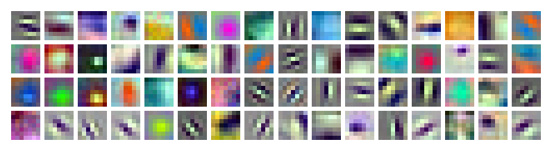
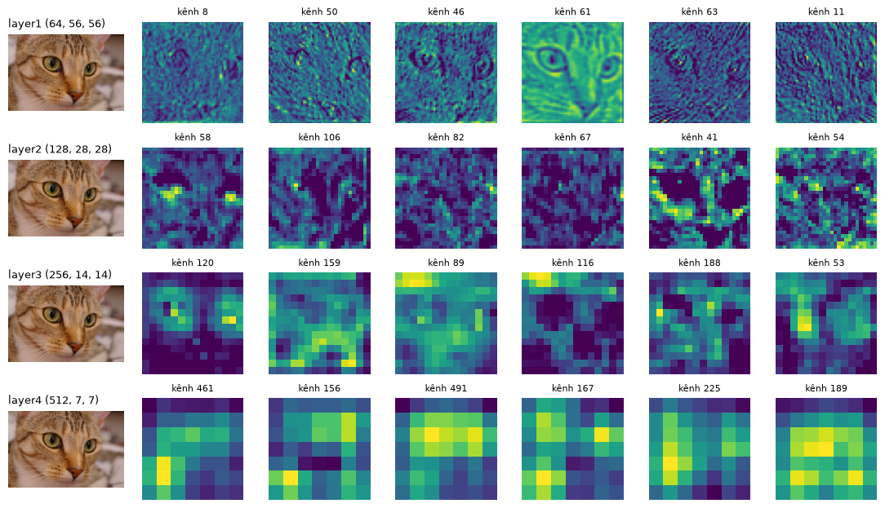
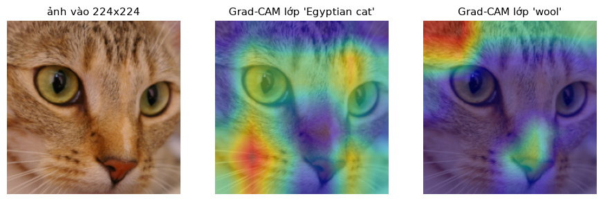
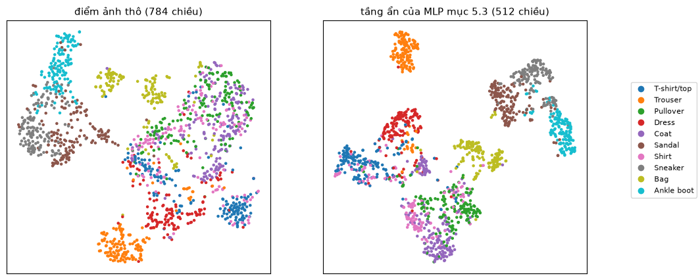

# Mẹo huấn luyện: trực quan hoá mô hình

> Ghi chú của người biên soạn: trang này dịch từ ghi chú *dl_note* của **Harley Zhang** ([bản gốc](https://github.com/harleyszhang/dl_note/blob/main/4-deep_learning_alchemy/深度学习炼丹-模型可视化.md), [kho mã](https://github.com/harleyszhang/dl_note), giấy phép [Apache-2.0](https://www.apache.org/licenses/LICENSE-2.0); phần dịch có chỉnh sửa). Số mục giữ như bản gốc. Chỗ bản gốc sai, thiếu hoặc đã lỗi thời được sửa ngay trong bài và ghi ở ô **Biên tập**. Các mục có chữ **Bổ sung** do người biên soạn viết thêm.

> Bản gốc của bài này chỉ có dàn ý: một danh sách bốn hướng trực quan hoá và năm tài liệu tham khảo. Danh sách đó được dịch ở mục 1; phần còn lại do người biên soạn viết, theo đúng dàn ý và các tài liệu bản gốc đã chọn.

Trang [Code](dlnote/alchemy_code_vi) đi kèm (mục 6) vẽ mọi hình trong bài từ ResNet-18 tiền huấn luyện trên ImageNet và từ MLP FashionMNIST của bài regularization, đều chạy trên CPU.

## 1 Các hướng trực quan hoá mô hình

Bản gốc liệt kê các hướng trực quan hoá mô hình:

- trực quan hoá trọng số;
- trực quan hoá kích hoạt;
- trực quan hoá dữ liệu;
- trực quan hoá feature map.

> **Biên tập:** Bản gốc ghi "chia làm 3 hướng" nhưng liệt kê bốn mục, trong đó "kích hoạt" và "feature map" là một (feature map chính là kích hoạt của tầng tích chập). Bài này gộp hai mục đó, và thêm hai nhóm hay dùng trong thực tế: **theo dõi quá trình huấn luyện** (TensorBoard) và **giải thích dự đoán** (bản đồ nổi bật, Grad-CAM).

*Từ đây trở xuống do người biên soạn viết.*

Trực quan hoá trả lời các câu hỏi khác nhau ở từng giai đoạn:

| Giai đoạn | Câu hỏi | Công cụ |
| --- | --- | --- |
| Trước khi huấn luyện | Dữ liệu và nhãn có đúng không, tăng cường có hợp lý không? | Xem trực tiếp một batch sau tăng cường |
| Trong khi huấn luyện | Loss có giảm, learning rate có hợp lý, gradient có biến mất hay bùng nổ? | TensorBoard, Weights & Biases: đường loss, histogram trọng số và gradient |
| Sau khi huấn luyện | Mô hình học được gì, nhìn vào đâu khi dự đoán? | Trọng số tầng đầu, feature map, Grad-CAM, t-SNE của đặc trưng |

## 2 Trực quan hoá trọng số

Trọng số của tầng tích chập **đầu tiên** xem được trực tiếp như ảnh, vì nó tác động thẳng lên điểm ảnh RGB. Hình dưới là 64 kernel $7\times 7\times 3$ của tầng `conv1` trong ResNet-18, mỗi kernel được co giãn riêng về $[0, 1]$.

<div align=center></div>

Hình 2.1: Trọng số tầng tích chập đầu tiên của ResNet-18 tiền huấn luyện trên ImageNet (trang Code).

Có thể thấy các bộ dò cạnh ở nhiều hướng, các vân dạng Gabor, và các kernel nhạy với một cặp màu đối lập (lục–tím, lam–cam): giống các bộ lọc ở vỏ não thị giác sơ cấp, và giống nhau ở hầu hết mạng CNN huấn luyện trên ảnh tự nhiên. Kernel nhiễu hạt, không có cấu trúc thường là dấu hiệu mạng chưa hội tụ hoặc regularization quá yếu. Từ tầng thứ hai trở đi, trọng số tác động lên các kênh đặc trưng chứ không lên điểm ảnh, nên nhìn trực tiếp gần như không đọc được; khi đó trực quan hoá kích hoạt có ích hơn.

## 3 Trực quan hoá kích hoạt (feature map)

Feature map là đầu ra của một tầng khi đưa một ảnh cụ thể vào. Trong PyTorch, cách lấy feature map không phải sửa mô hình là **forward hook**:

```python
feats = {}
def save(name):
    return lambda module, inputs, output: feats.__setitem__(name, output.detach())

hooks = [getattr(net, n).register_forward_hook(save(n)) for n in ['layer1', 'layer2', 'layer3', 'layer4']]
with torch.no_grad():
    logits = net(x)
for h in hooks:
    h.remove()        # gỡ hook khi xong, nếu không mỗi lần forward sau đều chạy lại
```

Với mô hình torchvision, `torchvision.models.feature_extraction.create_feature_extractor` cũng trích được đầu ra của các tầng giữa bằng cách truy vết đồ thị (FX).

<div align=center></div>

Hình 3.1: Sáu kênh có kích hoạt trung bình lớn nhất ở đầu ra bốn tầng của ResNet-18 với ảnh mèo (trang Code). Kích thước (kênh, cao, rộng) ghi bên trái mỗi hàng.

Ở `layer1` (56×56) các kênh còn giữ được hình dạng con mèo: chúng phản ứng với cạnh, vân lông, vùng sáng tối. Càng lên cao, độ phân giải không gian càng giảm (28, 14, rồi 7×7) và số kênh càng tăng; mỗi kênh phản ứng với các mẫu trừu tượng hơn (mắt, mũi, vùng có lông), không còn đọc được bằng mắt như ảnh. Feature map cũng là công cụ gỡ lỗi: kênh toàn 0 với mọi đầu vào là neuron ReLU "chết"; kích hoạt rất lớn hoặc NaN là dấu hiệu sắp bùng nổ số học.

## 4 Giải thích dự đoán: Grad-CAM

Bản đồ kích hoạt lớp (class activation map, CAM; Zhou và cộng sự, 2016) chỉ ra vùng ảnh mà mô hình dựa vào để dự đoán một lớp. **Grad-CAM** (Selvaraju và cộng sự, 2017) tổng quát hoá CAM cho mọi kiến trúc CNN:

1. lấy feature map $A^k$ ($k$ là kênh) của tầng tích chập cuối, và gradient của điểm số lớp $y^c$ (logit trước softmax) theo nó;
2. trọng số của kênh $k$ là gradient trung bình trên toàn không gian: $\alpha_k^c = \frac{1}{Z}\sum_{i,j} \frac{\partial y^c}{\partial A^k_{ij}}$;
3. bản đồ là $L^c = \mathrm{ReLU}\left(\sum_k \alpha_k^c A^k\right)$, phóng lên kích thước ảnh vào để chồng lên ảnh.

ReLU giữ lại vùng làm *tăng* điểm số của lớp $c$. Toàn bộ thuật toán chỉ cần một forward hook và một backward hook (khoảng 15 dòng, xem trang Code).

<div align=center></div>

Hình 4.1: Grad-CAM trên `layer4` của ResNet-18 (trang Code). Giữa: lớp dự đoán cao nhất *Egyptian cat* (xác suất 0,39; *tiger cat* 0,39 và *tabby* 0,22 theo sau). Phải: cùng ảnh nhưng với lớp *wool* (len), một lớp mô hình không dự đoán.

Với lớp *Egyptian cat*, vùng nóng nằm trên mặt, mắt và vằn lông của con mèo; với lớp *wool*, vùng nóng chuyển sang góc nền mờ phía trên và vùng lông sáng dưới mũi, chỗ có kết cấu giống len. Grad-CAM giúp phát hiện mô hình học "đường tắt": ví dụ bộ phân loại chó sói và chó husky nhìn vào tuyết trên nền thay vì con vật. Lưu ý Grad-CAM có độ phân giải thấp (lưới 7×7 của `layer4`) và là một cách giải thích gần đúng; các phương pháp khác gồm saliency map (gradient theo điểm ảnh), Integrated Gradients, SHAP, và thư viện [Captum](https://captum.ai/) gom sẵn nhiều phương pháp cho PyTorch.

## 5 Theo dõi quá trình huấn luyện: TensorBoard

TensorBoard đọc các tệp sự kiện (`events.out.tfevents.*`) mà chương trình huấn luyện ghi ra, và hiển thị chúng trên trình duyệt. PyTorch có sẵn `torch.utils.tensorboard.SummaryWriter` (bản gốc dẫn tới TensorboardX, gói bên ngoài có trước khi PyTorch tích hợp):

```python
from torch.utils.tensorboard import SummaryWriter

writer = SummaryWriter('runs/exp1')                       # thư mục log
for step in range(num_steps):
    ...
    writer.add_scalar('loss/train', loss.item(), step)    # đường loss
    writer.add_scalar('lr', optimizer.param_groups[0]['lr'], step)
    if step % 50 == 0:
        writer.add_histogram('weight/fc1', model[1].weight, step)       # phân phối trọng số
        writer.add_histogram('grad/fc1', model[1].weight.grad, step)    # phân phối gradient
writer.add_scalar('acc/test', test_acc, step)
writer.add_graph(model, example_input)                    # đồ thị tính toán
writer.add_images('batch', images, 0)                     # một batch sau tăng cường
writer.close()
```

Rồi chạy `tensorboard --logdir runs` và mở `http://localhost:6006`. Trang Code ghi log 200 bước huấn luyện một MLP rồi đọc ngược lại bằng `EventAccumulator`, để kiểm tra các thẻ `loss/train`, `acc/test`, `weight/fc1` đã được ghi đúng.

Những gì nên ghi: loss huấn luyện và kiểm định (cùng một hình để thấy khoảng cách tổng quát hoá), learning rate (để kiểm tra lịch), chuẩn của gradient (phát hiện bùng nổ), histogram trọng số của vài tầng (phát hiện trọng số không đổi hay neuron chết), và một batch ảnh sau tăng cường (phát hiện lỗi tiền xử lý, như quên chuẩn hoá hoặc đảo kênh màu). Các công cụ khác cùng mục đích: Weights & Biases, MLflow, Aim.

## 6 Trực quan hoá dữ liệu và đặc trưng

Đặc trưng nhiều chiều (ảnh 784 điểm ảnh, vector 512 chiều của tầng ẩn) có thể chiếu xuống 2 chiều để xem các lớp tách nhau tới đâu. **PCA** là phép chiếu tuyến tính, nhanh, giữ khoảng cách toàn cục. **t-SNE** (van der Maaten và Hinton, 2008) và **UMAP** (2018) là phép nhúng phi tuyến, giữ các láng giềng gần, cho cụm rõ hơn.

<div align=center></div>

Hình 6.1: t-SNE của 1500 ảnh kiểm tra FashionMNIST. Trái: điểm ảnh thô. Phải: đầu ra tầng ẩn thứ hai của MLP huấn luyện ở [bài regularization](dlnote/alch_reg_vi), mục 7 (trang Code).

Trên điểm ảnh thô, quần (cam) và nhóm giày dép (sandal, sneaker, ankle boot) đã tách được, nhưng áo phông, áo sơ mi, áo chui đầu, áo khoác trộn lẫn ở giữa. Sau khi qua mạng, các lớp tách thành cụm rõ hơn nhiều; chỗ còn chồng lấn (shirt với T-shirt, pullover với coat) chính là các cặp lớp mô hình hay nhầm. Khi đọc t-SNE cần nhớ: kích thước cụm và khoảng cách giữa các cụm không mang nhiều ý nghĩa, và kết quả thay đổi theo perplexity và seed; xem [How to Use t-SNE Effectively](https://distill.pub/2016/misread-tsne/) (Wattenberg và cộng sự, Distill 2016).

**Trực quan hoá đặc trưng** (feature visualization, tài liệu 3) đi theo chiều ngược lại: tối ưu một ảnh đầu vào để kích hoạt tối đa một neuron hay một kênh, cho thấy kênh đó "tìm kiếm" mẫu gì. **Grand Tour** (tài liệu 1) chiếu tuyến tính dữ liệu nhiều chiều theo một chuỗi góc nhìn liên tục, giúp theo dõi biểu diễn thay đổi thế nào qua các epoch.

## Tài liệu tham khảo

1. [Visualizing Neural Networks with the Grand Tour](https://distill.pub/2020/grand-tour/). Distill, 2020.
2. [Multi-Label Classification and Class Activation Map on Fashion-MNIST](https://towardsdatascience.com/multi-label-classification-and-class-activation-map-on-fashion-mnist-1454f09f5925)
3. Olah, Mordvintsev, Schubert. [Feature Visualization](https://distill.pub/2017/feature-visualization/). Distill, 2017.
4. Dư Đình Tung. [Chương 6: Mô-đun trực quan hoá của PyTorch](https://tingsongyu.github.io/PyTorch-Tutorial-2nd/chapter-6/) (PyTorch Tutorial bản 2).
5. [Trực quan hoá huấn luyện PyTorch bằng TensorboardX](https://zhuanlan.zhihu.com/p/54947519)
6. Zhou et al. [Learning Deep Features for Discriminative Localization](https://arxiv.org/abs/1512.04150) (CAM). CVPR 2016.
7. Selvaraju et al. [Grad-CAM: Visual Explanations from Deep Networks via Gradient-based Localization](https://arxiv.org/abs/1610.02391). ICCV 2017.
8. van der Maaten, Hinton. [Visualizing Data using t-SNE](https://jmlr.org/papers/v9/vandermaaten08a.html). JMLR 2008.
9. [PyTorch: Visualizing models, data, and training with TensorBoard](https://pytorch.org/tutorials/intermediate/tensorboard_tutorial.html)
