# Mẹo huấn luyện · Code

> Ghi chú của người biên soạn: trang này do người biên soạn viết thêm cho phần 4 của khoá: [siêu tham số](dlnote/alch_hyper_vi), [chuẩn hoá dữ liệu](dlnote/alch_norm_vi), [mẫu mất cân bằng](dlnote/alch_imbalance_vi), [tăng cường dữ liệu](dlnote/alch_augment_vi), [regularization](dlnote/alch_reg_vi) và [trực quan hoá mô hình](dlnote/alch_vis_vi). Mỗi mục kiểm tra bằng số một nhận xét của các bài đó, và vẽ lại các hình của bản gốc có chữ Trung hoặc có lỗi.

## Cách dùng trang này

Các khối chạy lần lượt từ trên xuống và dùng chung biến. Cần `torch`, `torchvision`, `scikit-learn`, `scikit-image`, `opencv-python`, `albumentations`, `tensorboard`, `matplotlib`. Mọi khối chạy trên CPU, cả trang mất khoảng hai phút; khối đầu tải FashionMNIST, mục 1.7 và 6 tải trọng số ResNet-18 (45 MB) nếu chưa có. Ảnh mẫu là ảnh mèo `chelsea` có sẵn trong scikit-image.

<!-- run -->
```python
import os, random, inspect, warnings, tempfile
warnings.filterwarnings('ignore')
import numpy as np
import torch
import torch.nn as nn
import torch.nn.functional as F
import torchvision
import matplotlib.pyplot as plt
from skimage import data as skdata
torch.manual_seed(0); np.random.seed(0); random.seed(0)
np.set_printoptions(precision=4, suppress=True)
torch.set_num_threads(4)

cat = skdata.chelsea()                       # ảnh mẫu 300x451 RGB, uint8
root = os.path.expanduser('~/.cache/d2l-data')
fm_tr = torchvision.datasets.FashionMNIST(root, train=True, download=True)
fm_te = torchvision.datasets.FashionMNIST(root, train=False, download=True)
MEAN, STD = 0.2860, 0.3530                    # trung bình, độ lệch chuẩn điểm ảnh của tập huấn luyện
Xtr = fm_tr.data.float().div(255).sub(MEAN).div(STD)[:, None]; ytr = fm_tr.targets
Xte = fm_te.data.float().div(255).sub(MEAN).div(STD)[:, None]; yte = fm_te.targets

def mlp(hidden=256, p=0.0):
    return nn.Sequential(nn.Flatten(), nn.Linear(784, hidden), nn.ReLU(), nn.Dropout(p), nn.Linear(hidden, 10))

@torch.no_grad()
def accuracy(model, X=Xte, y=yte):
    model.eval()
    return (model(X).argmax(1) == y).float().mean().item()

print("torch", torch.__version__, "| torchvision", torchvision.__version__)
print("ảnh mẫu:", cat.shape, "| FashionMNIST:", tuple(Xtr.shape), tuple(Xte.shape))
```

<!-- output -->
```output
torch 2.14.0+cpu | torchvision 0.29.0+cpu
ảnh mẫu: (300, 451, 3) | FashionMNIST: (60000, 1, 28, 28) (10000, 1, 28, 28)
```
<!-- /output -->

## 1. Siêu tham số

### 1.1 Khởi tạo mặc định của lớp tích chập

<small class="viz-ref">Bài siêu tham số: mục 1.3</small>

In nguyên văn `reset_parameters` của bản PyTorch đang cài (thay cho ảnh chụp màn hình của bản gốc), rồi kiểm tra cận và độ lệch chuẩn của trọng số:

<!-- run -->
```python
print(inspect.getsource(nn.modules.conv._ConvNd.reset_parameters))
conv = nn.Conv2d(16, 32, 3)
fan_in = 16 * 3 * 3
print(f"max|w| = {conv.weight.abs().max():.4f}   cận 1/sqrt(fan_in) = {1/np.sqrt(fan_in):.4f}")
print(f"std(w) = {conv.weight.std():.4f}   lý thuyết 1/sqrt(3·fan_in) = {1/np.sqrt(3*fan_in):.4f}   He sqrt(2/fan_in) = {np.sqrt(2/fan_in):.4f}")
```

<!-- output -->
```output
    def reset_parameters(self) -> None:
        # Use torch.no_grad() to allow in-place modification of weights/bias
        with torch.no_grad():
            # Check if the weight tensor is in channels_last_3d format to ensure numerical consistency
            if not self.weight.is_contiguous():
                # Use an empty contiguous buffer to optimize memory and ensure consistent initialization
                temp_weight = torch.empty_like(
                    self.weight, memory_format=torch.contiguous_format
                )
                init.kaiming_uniform_(temp_weight, a=math.sqrt(5))
                # Copy the initialized values back to the original tensor
                self.weight.copy_(temp_weight)
            else:
                # Standard initialization for default contiguous memory format
                init.kaiming_uniform_(self.weight, a=math.sqrt(5))
            if self.bias is not None:
                # Bias initialization remains independent of weight memory format
                fan_in, _ = init._calculate_fan_in_and_fan_out(self.weight)
                bound = 1 / math.sqrt(fan_in) if fan_in > 0 else 0
                init.uniform_(self.bias, -bound, bound)

max|w| = 0.0833   cận 1/sqrt(fan_in) = 0.0833
std(w) = 0.0478   lý thuyết 1/sqrt(3·fan_in) = 0.0481   He sqrt(2/fan_in) = 0.1179
```
<!-- /output -->

Cận $1/\sqrt{fan_{in}}$ khớp đúng, và độ lệch chuẩn của trọng số bằng một phần sáu căn của phương sai He ($0{,}048$ so với $0{,}118$).

### 1.2 Xavier chuẩn và Xavier đều

<small class="viz-ref">Bài siêu tham số: mục 1.3, hình 1.2</small>

Bản gốc so một lần `xavier_normal_` với một lần `xavier_uniform_`. Ô thứ tư dùng lại `xavier_normal_` với seed khác; phần sau lặp 500 lần để so phân phối độ lệch chuẩn của đầu ra:

<!-- run -->
```python
img = torch.from_numpy(cat).permute(2, 0, 1).float().div(255)[None]
conv = nn.Conv2d(3, 1, 3, stride=2, bias=False)
print("trước tích chập:", tuple(img.shape), " sau tích chập:", tuple(conv(img).shape))
panels = [("ảnh gốc", None, None)] + [(f"{n}, seed {s}", f, s) for n, f, s in
          [("xavier_normal_", nn.init.xavier_normal_, 0), ("xavier_uniform_", nn.init.xavier_uniform_, 0),
           ("xavier_normal_", nn.init.xavier_normal_, 1)]]
fig, axes = plt.subplots(1, 4, figsize=(13, 2.6))
for ax, (title, init, seed) in zip(axes, panels):
    if init is None:
        ax.imshow(cat)
    else:
        torch.manual_seed(seed); init(conv.weight)
        with torch.no_grad():
            ax.imshow(conv(img)[0, 0], cmap='viridis')
    ax.set_title(title); ax.axis('off')
plt.show()

# độ lệch chuẩn của đầu ra qua 500 lần khởi tạo: hai phân phối có cùng phương sai
res = {}
for name, init in [("xavier_normal_", nn.init.xavier_normal_), ("xavier_uniform_", nn.init.xavier_uniform_)]:
    s = []
    for seed in range(500):
        torch.manual_seed(seed); init(conv.weight)
        with torch.no_grad():
            s.append(conv(img).std().item())
    res[name] = np.array(s)
    print(f"{name:16s} std đầu ra: trung bình {res[name].mean():.3f}, trải từ {res[name].min():.3f} đến {res[name].max():.3f}")
```

<!-- output -->
```output
trước tích chập: (1, 3, 300, 451)  sau tích chập: (1, 1, 149, 225)
xavier_normal_   std đầu ra: trung bình 0.138, trải từ 0.031 đến 0.454
xavier_uniform_  std đầu ra: trung bình 0.140, trải từ 0.030 đến 0.488
```

<div align=center>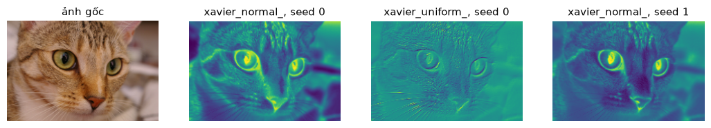</div>
<!-- /output -->

Hai ô `xavier_normal_` với hai seed khác nhau khác nhau không kém gì ô `xavier_normal_` so với ô `xavier_uniform_`: khác biệt trong hình đến từ kernel ngẫu nhiên, không đến từ loại phân phối. Độ lệch chuẩn đầu ra trung bình qua 500 lần gần như bằng nhau (0,138 và 0,140).

### 1.3 Các bộ lập lịch learning rate

<small class="viz-ref">Bài siêu tham số: mục 4.3, hình 4.4</small>

<!-- run -->
```python
from torch.optim import lr_scheduler as S

def lr_curve(make, epochs=100, lr=0.1):
    p = nn.Parameter(torch.zeros(1)); opt = torch.optim.SGD([p], lr=lr)
    sch = make(opt); out = []
    for _ in range(epochs):
        out.append(opt.param_groups[0]['lr']); opt.step(); sch.step()
    return out

curves = {
    "StepLR(30, 0.1)": lambda o: S.StepLR(o, 30, 0.1),
    "MultiStepLR([50, 80])": lambda o: S.MultiStepLR(o, [50, 80], 0.1),
    "ExponentialLR(0.95)": lambda o: S.ExponentialLR(o, 0.95),
    "CosineAnnealingLR(100)": lambda o: S.CosineAnnealingLR(o, 100),
    "CosineAnnealingWarmRestarts(25)": lambda o: S.CosineAnnealingWarmRestarts(o, 25),
    "warmup 5 + cosine": lambda o: S.SequentialLR(o, [S.LinearLR(o, 0.01, total_iters=5), S.CosineAnnealingLR(o, 95)], milestones=[5]),
    "OneCycleLR": lambda o: S.OneCycleLR(o, max_lr=0.1, total_steps=100),
}
fig, axes = plt.subplots(2, 4, figsize=(14, 5), sharex=True)
for ax, (name, make) in zip(axes.flat, curves.items()):
    ax.plot(lr_curve(make)); ax.set_title(name, fontsize=9)
axes.flat[-1].axis('off')
for ax in axes[1]: ax.set_xlabel('epoch')
plt.tight_layout(); plt.show()
print("Số bộ lập lịch trong torch.optim.lr_scheduler:", len([n for n in S.__all__ if n != 'LRScheduler']))
print(sorted(n for n in S.__all__))
```

<!-- output -->
```output
Số bộ lập lịch trong torch.optim.lr_scheduler: 15
['ChainedScheduler', 'ConstantLR', 'CosineAnnealingLR', 'CosineAnnealingWarmRestarts', 'CyclicLR', 'ExponentialLR', 'LRScheduler', 'LambdaLR', 'LinearLR', 'MultiStepLR', 'MultiplicativeLR', 'OneCycleLR', 'PolynomialLR', 'ReduceLROnPlateau', 'SequentialLR', 'StepLR']
```

<div align=center>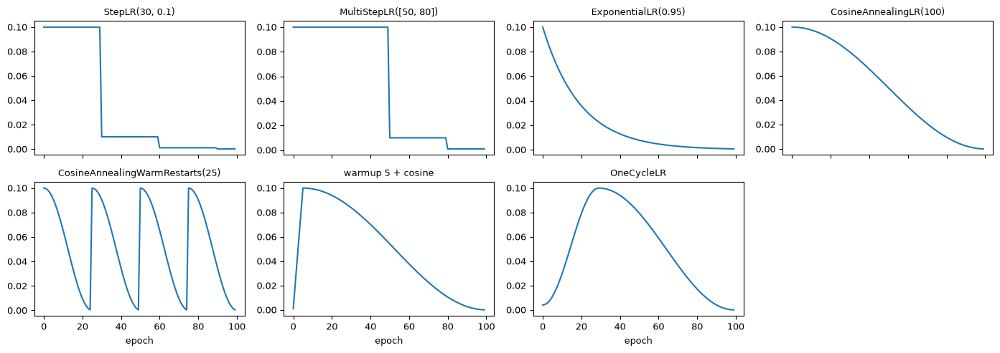</div>
<!-- /output -->

Thứ tự gọi `optimizer.step()` và `scheduler.step()`:

<!-- run -->
```python
def first_lrs(scheduler_first):
    p = nn.Parameter(torch.zeros(1)); opt = torch.optim.SGD([p], lr=0.1)
    sch = S.StepLR(opt, step_size=1, gamma=0.5); used = []
    with warnings.catch_warnings(record=True) as w:
        warnings.simplefilter('always')
        for _ in range(3):
            if scheduler_first: sch.step()
            used.append(opt.param_groups[0]['lr']); opt.step()
            if not scheduler_first: sch.step()
    return used, [str(x.message)[:120] for x in w]

print("đúng thứ tự (optimizer rồi scheduler):", first_lrs(False))
print("sai thứ tự (scheduler trước):        ", first_lrs(True))
```

<!-- output -->
```output
đúng thứ tự (optimizer rồi scheduler): ([0.1, 0.05, 0.025], [])
sai thứ tự (scheduler trước):         ([0.05, 0.025, 0.0125], ['Detected call of `lr_scheduler.step()` before `optimizer.step()`. In PyTorch 1.1.0 and later, you should call them in th'])
```
<!-- /output -->

### 1.4 Bộ nhớ trạng thái của các optimizer

<small class="viz-ref">Bài siêu tham số: bảng 1</small>

Đếm số byte trong `optimizer.state` sau một bước, chia cho số tham số $n$ của ResNet-18:

<!-- run -->
```python
model = torchvision.models.resnet18()
n = sum(p.numel() for p in model.parameters())
x = torch.randn(2, 3, 64, 64)
makers = {
    "SGD": lambda ps: torch.optim.SGD(ps, lr=0.1),
    "SGD momentum": lambda ps: torch.optim.SGD(ps, lr=0.1, momentum=0.9),
    "Adagrad": lambda ps: torch.optim.Adagrad(ps),
    "RMSprop": lambda ps: torch.optim.RMSprop(ps),
    "Adam": lambda ps: torch.optim.Adam(ps),
    "AdamW": lambda ps: torch.optim.AdamW(ps),
}
print(f"ResNet-18: n = {n:,} tham số, trọng số fp32 = {4*n/2**20:.1f} MiB")
for name, make in makers.items():
    opt = make(model.parameters())
    opt.zero_grad(); model(x).sum().backward(); opt.step()
    b = sum(t.numel() * t.element_size() for st in opt.state.values() for t in st.values() if torch.is_tensor(t))
    keys = sorted({k for st in opt.state.values() for k in st})
    print(f"{name:13s} {b/n:5.2f}·n byte  ({b/2**20:5.1f} MiB)  trạng thái: {keys}")
```

<!-- output -->
```output
ResNet-18: n = 11,689,512 tham số, trọng số fp32 = 44.6 MiB
SGD            0.00·n byte  (  0.0 MiB)  trạng thái: []
SGD momentum   4.00·n byte  ( 44.6 MiB)  trạng thái: ['momentum_buffer']
Adagrad        4.00·n byte  ( 44.6 MiB)  trạng thái: ['step', 'sum']
RMSprop        4.00·n byte  ( 44.6 MiB)  trạng thái: ['square_avg', 'step']
Adam           8.00·n byte  ( 89.2 MiB)  trạng thái: ['exp_avg', 'exp_avg_sq', 'step']
AdamW          8.00·n byte  ( 89.2 MiB)  trạng thái: ['exp_avg', 'exp_avg_sq', 'step']
```
<!-- /output -->

### 1.5 Thử dải learning rate (LR range test)

<small class="viz-ref">Bài siêu tham số: mục 4.3, hình 4.3</small>

MLP 784–256–10 trên FashionMNIST, SGD momentum 0,9, batch 128; learning rate tăng theo cấp số nhân từ $10^{-5}$ tới 10 trong 300 bước, dừng khi loss vượt 4 lần mức nhỏ nhất. Loss được làm mượt bằng trung bình mũ có hiệu chỉnh độ lệch:

<!-- run -->
```python
def lr_range_test(lr_min=1e-5, lr_max=10, steps=300, bs=128, seed=0):
    torch.manual_seed(seed)
    model = mlp(); opt = torch.optim.SGD(model.parameters(), lr=lr_min, momentum=0.9)
    mult = (lr_max / lr_min) ** (1 / steps); lrs, losses, avg = [], [], 0.0
    for i in range(steps):
        idx = torch.randint(0, len(Xtr), (bs,))
        loss = F.cross_entropy(model(Xtr[idx]), ytr[idx])
        avg = 0.9 * avg + 0.1 * loss.item()               # trung bình mũ, có hiệu chỉnh độ lệch
        lrs.append(opt.param_groups[0]['lr']); losses.append(avg / (1 - 0.9 ** (i + 1)))
        if not np.isfinite(avg) or (i > 10 and losses[-1] > 4 * min(losses)): break
        opt.zero_grad(); loss.backward(); opt.step()
        opt.param_groups[0]['lr'] *= mult
    return np.array(lrs), np.array(losses)

lrs, losses = lr_range_test()
i_min = losses.argmin(); g = np.gradient(losses, np.log10(lrs)); i_steep = 10 + g[10:i_min].argmin()
plt.figure(figsize=(5, 3)); plt.semilogx(lrs, losses)
plt.axvline(lrs[i_steep], ls='--', c='g', label=f'dốc nhất {lrs[i_steep]:.2g}')
plt.axvline(lrs[i_min], ls='--', c='r', label=f'loss nhỏ nhất {lrs[i_min]:.2g}')
plt.xlabel('learning rate'); plt.ylabel('loss (làm mượt)'); plt.legend(); plt.show()
print(f"dừng ở lr = {lrs[-1]:.3g}; loss nhỏ nhất tại lr = {lrs[i_min]:.3g}; dốc nhất tại lr = {lrs[i_steep]:.3g}")
```

<!-- output -->
```output
dừng ở lr = 0.692; loss nhỏ nhất tại lr = 0.0912; dốc nhất tại lr = 0.00347
```

<div align=center>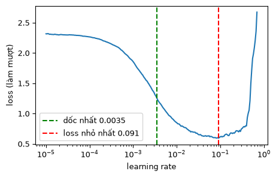</div>
<!-- /output -->

Learning rate tốt cho cấu hình này nằm quanh đoạn dốc nhất, khoảng $3\cdot 10^{-3}$ tới $3\cdot 10^{-2}$; mục 1.6 dùng 0,02 cho batch 64.

### 1.6 Batch size và quy tắc tỉ lệ tuyến tính

<small class="viz-ref">Bài siêu tham số: mục 3.3, 3.4</small>

Cùng MLP, 5 epoch, lịch cosine theo từng bước (có warmup tuyến tính nếu đặt). Learning rate của batch 1024 và 8192 là 0,02 nhân với tỉ lệ batch so với 64:

<!-- run -->
```python
def train(bs, lr, epochs=5, warmup_epochs=0, seed=0, model=None):
    torch.manual_seed(seed)
    model = model or mlp(); opt = torch.optim.SGD(model.parameters(), lr=lr, momentum=0.9)
    steps_per_epoch = len(Xtr) // bs; total = epochs * steps_per_epoch; wu = warmup_epochs * steps_per_epoch
    step = 0
    for ep in range(epochs):
        model.train(); perm = torch.randperm(len(Xtr))
        for k in range(steps_per_epoch):
            idx = perm[k * bs:(k + 1) * bs]
            for gp in opt.param_groups:   # warmup tuyến tính rồi cosine, theo từng bước
                gp['lr'] = lr * (step + 1) / wu if step < wu else lr * 0.5 * (1 + np.cos(np.pi * (step - wu) / max(1, total - wu)))
            loss = F.cross_entropy(model(Xtr[idx]), ytr[idx])
            opt.zero_grad(); loss.backward(); opt.step(); step += 1
    return accuracy(model), loss.item()

for bs, lr, wu in [(64, 0.02, 0), (1024, 0.02, 0), (1024, 0.32, 0), (1024, 0.32, 1), (8192, 0.32, 0), (8192, 2.56, 0), (8192, 2.56, 2)]:
    acc, last = train(bs, lr, warmup_epochs=wu)
    print(f"batch {bs:5d}  lr {lr:5.2f}  warmup {wu} epoch   -> độ chính xác test {acc:.4f}   loss cuối {last:.3g}")
```

<!-- output -->
```output
batch    64  lr  0.02  warmup 0 epoch   -> độ chính xác test 0.8876   loss cuối 0.256
batch  1024  lr  0.02  warmup 0 epoch   -> độ chính xác test 0.8364   loss cuối 0.44
batch  1024  lr  0.32  warmup 0 epoch   -> độ chính xác test 0.8653   loss cuối 0.349
batch  1024  lr  0.32  warmup 1 epoch   -> độ chính xác test 0.8759   loss cuối 0.304
batch  8192  lr  0.32  warmup 0 epoch   -> độ chính xác test 0.7799   loss cuối 0.587
batch  8192  lr  2.56  warmup 0 epoch   -> độ chính xác test 0.2493   loss cuối 8.64e+03
batch  8192  lr  2.56  warmup 2 epoch   -> độ chính xác test 0.2467   loss cuối 20.6
```
<!-- /output -->

Tăng batch 16 lần mà giữ learning rate làm mất 5 điểm; tăng learning rate cùng tỉ lệ và thêm warmup lấy lại gần hết. Ở batch 8192 chỉ còn 7 bước mỗi epoch: learning rate 2,56 phân kỳ dù có warmup, nên quy tắc tỉ lệ tuyến tính không cứu được khi số bước cập nhật quá ít.

### 1.7 Fine-tune và state_dict

<small class="viz-ref">Bài siêu tham số: mục 5.3, 6</small>

Đóng băng ResNet-18, thay tầng `fc`, đặt learning rate riêng cho hai nhóm tham số, rồi xem `optimizer.state_dict()` thực sự chứa gì. Phần cuối nạp trọng số 1000 lớp vào mô hình 10 lớp theo cách của bản gốc:

<!-- run -->
```python
from torchvision.models import resnet18, ResNet18_Weights
m = resnet18(weights=ResNet18_Weights.IMAGENET1K_V1)
for p in m.parameters():
    p.requires_grad = False
m.fc = nn.Linear(512, 10)
total = sum(p.numel() for p in m.parameters()); train_n = sum(p.numel() for p in m.parameters() if p.requires_grad)
print(f"tham số: {total:,}, cần huấn luyện: {train_n:,} ({train_n/total:.2%})")

opt = torch.optim.SGD([
    {'params': [p for n_, p in m.named_parameters() if not n_.startswith('fc.')], 'lr': 1e-4},
    {'params': m.fc.parameters()},
], lr=1e-2, momentum=0.9)
print("lr từng nhóm:", [g['lr'] for g in opt.param_groups])
F.cross_entropy(m(torch.randn(2, 3, 224, 224)), torch.tensor([1, 2])).backward(); opt.step()
sd = opt.state_dict()
print("optimizer.state_dict() có các khoá:", list(sd))
print("  'state' có", len(sd['state']), "mục (chỉ tham số đã có gradient):",
      {k: list(v) for k, v in sd['state'].items()})
print("model.state_dict() có", len(m.state_dict()), "tensor, ví dụ:", list(m.state_dict())[:3])

# Nạp trọng số 1000 lớp vào mô hình 10 lớp: lọc theo tên là chưa đủ
pre = resnet18(weights=ResNet18_Weights.IMAGENET1K_V1).state_dict()
net = resnet18(num_classes=10); cur = net.state_dict()
by_name = {k: v for k, v in pre.items() if k in cur}
try:
    net.load_state_dict(by_name, strict=False)
except RuntimeError as e:
    print("lọc theo tên:", str(e).strip().splitlines()[-1].strip())
by_shape = {k: v for k, v in pre.items() if k in cur and v.shape == cur[k].shape}
r = net.load_state_dict(by_shape, strict=False)
print("lọc theo tên và kích thước: thiếu", r.missing_keys, "| thừa", r.unexpected_keys)
```

<!-- output -->
```output
tham số: 11,181,642, cần huấn luyện: 5,130 (0.05%)
lr từng nhóm: [0.0001, 0.01]
optimizer.state_dict() có các khoá: ['state', 'param_groups']
  'state' có 2 mục (chỉ tham số đã có gradient): {60: ['momentum_buffer'], 61: ['momentum_buffer']}
model.state_dict() có 122 tensor, ví dụ: ['conv1.weight', 'bn1.weight', 'bn1.bias']
lọc theo tên: size mismatch for fc.bias: copying a param with shape torch.Size([1000]) from checkpoint, the shape in current model is torch.Size([10]).
lọc theo tên và kích thước: thiếu ['fc.weight', 'fc.bias'] | thừa []
```
<!-- /output -->

`optimizer.state_dict()` chỉ chứa bộ đệm động lượng của hai tham số có gradient (trọng số và bias của `fc`, đánh số 60 và 61) cùng siêu tham số của các nhóm; trọng số mô hình nằm trong `model.state_dict()`. Lọc theo tên thì `fc.weight`, `fc.bias` vẫn lọt qua và gây lỗi kích thước, kể cả với `strict=False`.

## 2. Chuẩn hoá dữ liệu

### 2.1 z-score không biến dữ liệu thành phân phối chuẩn

<small class="viz-ref">Bài chuẩn hoá dữ liệu: mục 1.4, 1.5, hình 1.5</small>

Cùng thí nghiệm của bản gốc (100×15 số đều trên $[0, 100)$), thêm đường $\mathcal N(0,1)$, độ nhọn dư và kiểm định Shapiro–Wilk:

<!-- run -->
```python
from sklearn import preprocessing
from scipy import stats
rng = np.random.default_rng(42)
X_train = rng.uniform(0, 100, size=(100, 15))
X_sk = preprocessing.StandardScaler().fit_transform(X_train)
X_np = (X_train - X_train.mean(0)) / X_train.std(0)
print("sklearn == numpy:", np.allclose(X_sk, X_np))
fig, axes = plt.subplots(1, 3, figsize=(13, 2.8))
for ax, (t, d, c) in zip(axes, [("dữ liệu gốc (đều trên [0, 100))", X_train, 'y'),
                                 ("sau z-score (sklearn)", X_sk, 'r'), ("sau z-score (numpy)", X_np, 'g')]):
    ax.hist(d.ravel(), bins=20, density=True, color=c, alpha=0.6); ax.set_title(t)
xs = np.linspace(-3, 3, 200); axes[1].plot(xs, stats.norm.pdf(xs), 'k--', label='N(0, 1)'); axes[1].legend()
plt.show()
for name, d in [("gốc", X_train), ("z-score", X_np)]:
    v = d.ravel()
    print(f"{name:8s} trung bình {v.mean():7.3f}  độ lệch chuẩn {v.std():6.3f}  độ nhọn dư {stats.kurtosis(v):6.3f}  "
          f"Shapiro p = {stats.shapiro(v).pvalue:.1e}")
print("độ nhọn dư lý thuyết: phân phối đều -1.2, phân phối chuẩn 0")
```

<!-- output -->
```output
sklearn == numpy: True
gốc      trung bình  49.964  độ lệch chuẩn 29.139  độ nhọn dư -1.222  Shapiro p = 8.7e-22
z-score  trung bình   0.000  độ lệch chuẩn  1.000  độ nhọn dư -1.216  Shapiro p = 3.2e-21
độ nhọn dư lý thuyết: phân phối đều -1.2, phân phối chuẩn 0
```

<div align=center>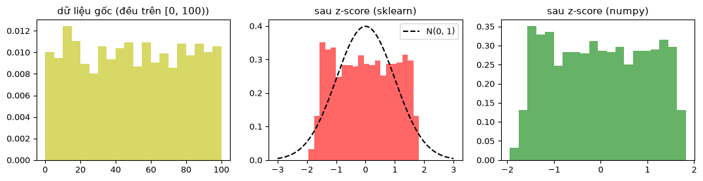</div>
<!-- /output -->

Sau z-score, độ nhọn dư vẫn là $-1{,}22$ như dữ liệu đều ban đầu, và kiểm định Shapiro–Wilk vẫn bác bỏ phân phối chuẩn: z-score không đổi hình dạng phân phối.

### 2.2 Min-max: trên toàn mảng hay theo từng cột

<small class="viz-ref">Bài chuẩn hoá dữ liệu: mục 1.5</small>

<!-- run -->
```python
def min_max_global(X):          # cách viết của bài gốc
    return (X - X.min()) / (X.max() - X.min())

X = np.array([[1, 2, 3], [4, 5, 6], [7, 8, 9]])
print(min_max_global(X))
# Bảng lương / số năm kinh nghiệm của hình 1.2 trong bài
salary = [100000, 78000, 32000, 55000, 92000, 120000, 65750]
years = [10, 7, 5, 6, 8, 15, 7]
D = np.array([salary, years], dtype=float).T
print("min-max trên toàn mảng (cột số năm):", min_max_global(D)[:, 1].round(5))
print("min-max theo cột (cột số năm):      ", preprocessing.MinMaxScaler().fit_transform(D)[:, 1].round(3))
```

<!-- output -->
```output
[[0.    0.125 0.25 ]
 [0.375 0.5   0.625]
 [0.75  0.875 1.   ]]
min-max trên toàn mảng (cột số năm): [0.     0.     0.     0.     0.     0.0001 0.    ]
min-max theo cột (cột số năm):       [0.5 0.2 0.  0.1 0.3 1.  0.2]
```
<!-- /output -->

### 2.3 Gradient descent trước và sau chuẩn hoá

<small class="viz-ref">Bài chuẩn hoá dữ liệu: mục 1.3, hình 1.2</small>

Hồi quy tuyến tính giá nhà theo hai đặc trưng có thang khác nhau. Gradient descent dùng learning rate $1/\lambda_{max}$ (lớn nhất mà vẫn đơn điệu) và chạy tới khi loss cách tối ưu dưới $10^{-8}$. Cả hai trường hợp đều trừ trung bình (thay cho số hạng bias), chỉ khác ở việc chia độ lệch chuẩn:

<!-- run -->
```python
rng = np.random.default_rng(0)
N = 200
area = rng.uniform(30, 200, N); dist = rng.uniform(1, 20, N)
price = 0.03 * area - 0.2 * dist + rng.normal(0, 0.3, N)
Xr = np.c_[area, dist]; Xr = Xr - Xr.mean(0); y = price - price.mean()   # chỉ trừ trung bình
Xs = Xr / Xr.std(0)                                                          # z-score đầy đủ

def gd(X, y, steps=200000, tol=1e-8):
    H = X.T @ X / len(y); lr = 1.0 / np.linalg.eigvalsh(H).max()
    w_opt = np.linalg.solve(H, X.T @ y / len(y)); w = np.zeros(2); path = [w.copy()]
    f = lambda w: 0.5 * np.mean((X @ w - y) ** 2); f_opt = f(w_opt)
    for t in range(steps):
        w = w - lr * (X.T @ (X @ w - y) / len(y)); path.append(w.copy())
        if f(w) - f_opt < tol: break
    return np.array(path), t + 1, np.linalg.cond(H), w_opt, f

fig, axes = plt.subplots(1, 2, figsize=(11, 4))
for ax, (title, X) in zip(axes, [("chưa chuẩn hoá (chỉ trừ trung bình)", Xr), ("sau z-score", Xs)]):
    path, steps, cond, w_opt, f = gd(X, y)
    span = np.abs(path - w_opt).max() * 1.15             # cùng thang cho hai trục để thấy đúng hình elip
    g1, g2 = np.meshgrid(np.linspace(w_opt[0] - span, w_opt[0] + span, 300),
                         np.linspace(w_opt[1] - span, w_opt[1] + span, 300))
    Z = np.vectorize(lambda a, b: f(np.array([a, b])))(g1, g2)
    ax.contour(g1, g2, Z, levels=f(w_opt) + (f(np.zeros(2)) - f(w_opt)) * np.array([0.002, 0.01, 0.04, 0.15, 0.4, 1.0]), colors='steelblue', linewidths=0.8)
    ax.set_aspect('equal')
    show = path[:min(len(path), 60)]
    ax.plot(show[:, 0], show[:, 1], 'o-', c='r', ms=2, lw=0.8)
    ax.set_title(f"{title}\nsố điều kiện {cond:.0f}, {steps} bước", fontsize=9)
    ax.set_xlabel('w (diện tích)'); ax.set_ylabel('w (khoảng cách)')
    print(f"{title:36s} số điều kiện {cond:8.1f}   số bước GD tới sai số 1e-8: {steps}")
plt.tight_layout(); plt.show()
```

<!-- output -->
```output
chưa chuẩn hoá (chỉ trừ trung bình)  số điều kiện     87.9   số bước GD tới sai số 1e-8: 782
sau z-score                          số điều kiện      1.1   số bước GD tới sai số 1e-8: 4
```

<div align=center>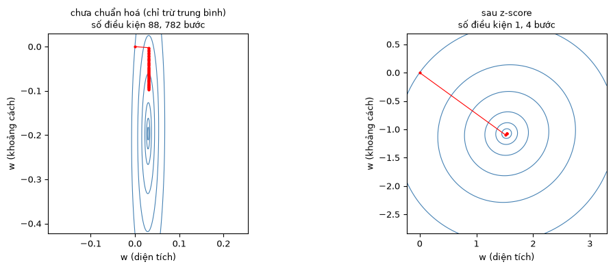</div>
<!-- /output -->

### 2.4 Chuẩn hoá ảnh trong torchvision

<small class="viz-ref">Bài chuẩn hoá dữ liệu: mục 2.1, 2.3, hình 2.1</small>

<!-- run -->
```python
import torchvision.transforms as T
import torchvision.transforms.v2 as v2
from PIL import Image
pil = Image.fromarray(cat)
t = T.ToTensor()(pil)
print("ảnh uint8: min theo kênh", cat.reshape(-1, 3).min(0), "max theo kênh", cat.reshape(-1, 3).max(0))
print("ToTensor: min", t.amin((1, 2)).numpy(), "max", t.amax((1, 2)).numpy(), "== ảnh/255?", torch.allclose(t, torch.from_numpy(cat).permute(2, 0, 1) / 255))
mm = (t - t.amin((1, 2), keepdim=True)) / (t.amax((1, 2), keepdim=True) - t.amin((1, 2), keepdim=True))
print("min-max thật sự: min", mm.amin((1, 2)).numpy(), "max", mm.amax((1, 2)).numpy())

mean, std = t.mean([1, 2]), t.std([1, 2])
print("trung bình theo kênh:", mean.numpy(), " độ lệch chuẩn:", std.numpy())
z_img = T.Normalize(mean, std)(t)
z_net = T.Normalize([0.485, 0.456, 0.406], [0.229, 0.224, 0.225])(t)
print("Normalize bằng thống kê của chính ảnh: mean", z_img.mean([1, 2]).numpy().round(4), "std", z_img.std([1, 2]).numpy().round(4))
print("Normalize bằng thống kê ImageNet:      mean", z_net.mean([1, 2]).numpy().round(4), "std", z_net.std([1, 2]).numpy().round(4))
pipe = v2.Compose([v2.ToImage(), v2.ToDtype(torch.float32, scale=True)])
print("v2.ToImage + ToDtype(scale=True) == ToTensor:", torch.allclose(pipe(pil), t))

x = torch.rand(3, 4, 8)
print("x.mean((1, 2)).shape =", tuple(x.mean((1, 2)).shape), "  x.mean(2).shape =", tuple(x.mean(2).shape))

fig, axes = plt.subplots(2, 3, figsize=(11, 4.6))
for i, (title, im) in enumerate([("ảnh gốc (uint8)", cat), ("ToTensor (chia 255)", t.permute(1, 2, 0).numpy()),
                                 ("Normalize(mean, std) của ảnh", z_img.permute(1, 2, 0).numpy())]):
    axes[0, i].imshow(np.clip(im, 0, None) if i < 2 else np.clip(im, 0, 1)); axes[0, i].set_title(title); axes[0, i].axis('off')
    axes[1, i].hist(np.asarray(im, dtype=float).ravel(), bins=50, density=True)
    axes[1, i].set_xlabel('giá trị điểm ảnh')
axes[1, 0].set_ylabel('tần suất tương đối')
plt.tight_layout(); plt.show()
```

<!-- output -->
```output
ảnh uint8: min theo kênh [2 4 0] max theo kênh [215 189 231]
ToTensor: min [0.0078 0.0157 0.    ] max [0.8431 0.7412 0.9059] == ảnh/255? True
min-max thật sự: min [0. 0. 0.] max [1. 1. 1.]
trung bình theo kênh: [0.5791 0.437  0.3404]  độ lệch chuẩn: [0.1265 0.1268 0.1468]
Normalize bằng thống kê của chính ảnh: mean [-0. -0. -0.] std [1. 1. 1.]
Normalize bằng thống kê ImageNet:      mean [ 0.411  -0.0847 -0.2916] std [0.5523 0.5659 0.6523]
v2.ToImage + ToDtype(scale=True) == ToTensor: True
x.mean((1, 2)).shape = (3,)   x.mean(2).shape = (3, 4)
```

<div align=center>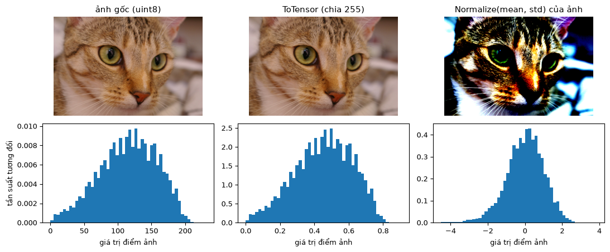</div>
<!-- /output -->

## 3. Mẫu mất cân bằng

### 3.1 Phương pháp tổ hợp lại lớp

<small class="viz-ref">Bài mẫu mất cân bằng: mục 1.3, hình 1.2</small>

Cài các bước của hình 1.2 và chạy trên đúng ví dụ của hình (lớp a 3 ảnh, b 2 ảnh, c 5 ảnh):

<!-- run -->
```python
random.seed(1)
print("random.sample(range(0, 10), 10) =", random.sample(range(0, 10), 10))

def class_regroup(labels, rng):
    """Hình 1.3 của bài: mỗi lớp được lấy đúng max_num mẫu mỗi epoch."""
    by_cls = {}
    for i, c in enumerate(labels):
        by_cls.setdefault(c, []).append(i)
    max_num = max(len(v) for v in by_cls.values())
    out = []
    for c, idx in sorted(by_cls.items()):
        r = rng.permutation(max_num)              # bước 3: dãy ngẫu nhiên độ dài max_num
        out += [idx[k % len(idx)] for k in r]     # bước 4-5: lấy dư rồi tra ngược ra ảnh
    rng.shuffle(out)                              # bước 6: trộn
    return out

names = [f"img{i:03d}" for i in range(10)]; labels = list("aaabbccccc")
order = class_regroup(labels, np.random.default_rng(0))
print([f"{names[i]}/{labels[i]}" for i in order])
from collections import Counter
print("số lần xuất hiện mỗi lớp:", dict(Counter(labels[i] for i in order)))
```

<!-- output -->
```output
random.sample(range(0, 10), 10) = [2, 1, 4, 0, 3, 5, 7, 9, 8, 6]
['img003/b', 'img001/a', 'img004/b', 'img005/c', 'img007/c', 'img000/a', 'img001/a', 'img004/b', 'img003/b', 'img000/a', 'img006/c', 'img003/b', 'img002/a', 'img009/c', 'img008/c']
số lần xuất hiện mỗi lớp: {'b': 5, 'a': 5, 'c': 5}
```
<!-- /output -->

### 3.2 WeightedRandomSampler

<small class="viz-ref">Bài mẫu mất cân bằng: mục 1.2, 1.3</small>

Tạo phiên bản đuôi dài của FashionMNIST (số ảnh mỗi lớp giảm theo cấp số nhân từ 6000 xuống 60) và lấy mẫu với trọng số $1/n_c$:

<!-- run -->
```python
from torch.utils.data import WeightedRandomSampler
n_c = (6000 * 0.01 ** (np.arange(10) / 9)).astype(int)             # đuôi dài: 6000 → 60 mẫu, tỉ lệ 100
idx_lt = torch.cat([torch.nonzero(ytr == c).flatten()[:n] for c, n in enumerate(n_c)])
y_lt = ytr[idx_lt]
print("số mẫu mỗi lớp:", n_c.tolist(), " tổng", int(n_c.sum()))
w_cls = 1.0 / torch.bincount(y_lt).float()
sampler = WeightedRandomSampler(w_cls[y_lt], num_samples=len(y_lt), replacement=True, generator=torch.Generator().manual_seed(0))
picked = torch.tensor(list(sampler)); drawn = y_lt[picked]
print("số lần mỗi lớp được rút trong 1 epoch:", torch.bincount(drawn, minlength=10).tolist())
print("lớp 9:", int((drawn == 9).sum()), "lần rút nhưng chỉ", len(set(picked[drawn == 9].tolist())), "ảnh khác nhau (có", n_c[9], "ảnh)")
```

<!-- output -->
```output
số mẫu mỗi lớp: [6000, 3596, 2156, 1292, 774, 464, 278, 166, 100, 60]  tổng 14886
số lần mỗi lớp được rút trong 1 epoch: [1413, 1474, 1506, 1493, 1435, 1499, 1518, 1509, 1475, 1564]
lớp 9: 1564 lần rút nhưng chỉ 60 ảnh khác nhau (có 60 ảnh)
```
<!-- /output -->

Mỗi lớp được rút xấp xỉ 1500 lần, nhưng lớp 9 chỉ có 60 ảnh, nên mỗi ảnh của nó lặp lại khoảng 25 lần mỗi epoch: đó là cái giá quá khớp của lấy mẫu thêm.

### 3.3 Focal loss

<small class="viz-ref">Bài mẫu mất cân bằng: mục 2.1</small>

Tự cài focal loss nhị phân, so với `torchvision.ops.sigmoid_focal_loss`, tính lại các tỉ lệ 100 lần, 1000 lần, 4 lần của bài, rồi xem $\alpha = 0{,}25$ áp lên lớp nào:

<!-- run -->
```python
from torchvision.ops import sigmoid_focal_loss

def focal(logit, y, alpha=0.25, gamma=2.0):
    log_pt = torch.where(y == 1, F.logsigmoid(logit), F.logsigmoid(-logit))   # log p_t, ổn định số
    at = torch.where(y == 1, torch.full_like(logit, alpha), torch.full_like(logit, 1 - alpha))
    return -at * (1 - log_pt.exp()) ** gamma * log_pt

logit = torch.randn(1000) * 3; y = (torch.rand(1000) < 0.3).float()
print("tự cài == torchvision.ops.sigmoid_focal_loss:", torch.allclose(focal(logit, y), sigmoid_focal_loss(logit, y, reduction='none'), rtol=1e-4, atol=1e-7))
print(" p_t     CE        FL(γ=2)    CE/FL")
for pt in [0.1, 0.5, 0.9, 0.968, 0.99]:
    ce = -np.log(pt); fl = (1 - pt) ** 2 * ce
    print(f"{pt:5.3f}  {ce:8.4f}  {fl:10.6f}  {ce/fl:8.1f}")
l = torch.logit(torch.tensor([0.9, 0.1]))   # mẫu dương p=0.9 và mẫu âm p=0.1: cùng p_t = 0.9
print("α=0.25: loss mẫu dương dễ", sigmoid_focal_loss(l[:1], torch.ones(1)).item(),
      "| loss mẫu âm dễ", sigmoid_focal_loss(l[1:], torch.zeros(1)).item())
```

<!-- output -->
```output
tự cài == torchvision.ops.sigmoid_focal_loss: True
 p_t     CE        FL(γ=2)    CE/FL
0.100    2.3026    1.865094       1.2
0.500    0.6931    0.173287       4.0
0.900    0.1054    0.001054     100.0
0.968    0.0325    0.000033     976.6
0.990    0.0101    0.000001   10000.0
α=0.25: loss mẫu dương dễ 0.000263401452684775 | loss mẫu âm dễ 0.0007902041543275118
```
<!-- /output -->

Mẫu dương dễ có loss bằng một phần ba mẫu âm dễ cùng $p_t$: $\alpha = 0{,}25$ giảm trọng số của lớp **dương**.

### 3.4 `pos_weight` và `weight`

<small class="viz-ref">Bài mẫu mất cân bằng: mục 2.2</small>

<!-- run -->
```python
logits = torch.randn(4, 5)
crit = nn.BCEWithLogitsLoss(pos_weight=torch.tensor([1, 1, 8, 8, 4.]))
multi_hot = torch.tensor([[1, 0, 0, 1, 0], [0, 0, 1, 0, 0], [1, 1, 0, 0, 1], [0, 0, 0, 0, 0.]])
print("đa nhãn, target (4, 5):", round(crit(logits, multi_hot).item(), 4))
try:
    crit(logits, torch.tensor([0, 2, 3, 4]))
except Exception as e:
    print("đơn nhãn, target (4,):", type(e).__name__, "-", str(e).splitlines()[0][:90])
# pos_weight chỉ nhân vào số hạng y=1, không đổi số hạng y=0:
z, t1 = torch.tensor([0.3]), torch.tensor([1.])
print("y=1:", nn.BCEWithLogitsLoss(pos_weight=torch.tensor([8.]))(z, t1).item(), "= 8 ×", nn.BCEWithLogitsLoss()(z, t1).item())
print("y=0:", nn.BCEWithLogitsLoss(pos_weight=torch.tensor([8.]))(z, 1 - t1).item(), "=", nn.BCEWithLogitsLoss()(z, 1 - t1).item())
# Bài toán nhiều lớp: CrossEntropyLoss(weight=...), trung bình có trọng số
w = torch.tensor([1, 1, 8, 8, 4.]); tgt = torch.tensor([0, 2, 3, 4])
manual = (w[tgt] * F.cross_entropy(logits, tgt, reduction='none')).sum() / w[tgt].sum()
print("CrossEntropyLoss(weight) == Σ w_y·CE / Σ w_y:", torch.allclose(nn.CrossEntropyLoss(weight=w)(logits, tgt), manual))
```

<!-- output -->
```output
đa nhãn, target (4, 5): 1.4873
đơn nhãn, target (4,): ValueError - Target size (torch.Size([4])) must be the same as input size (torch.Size([4, 5]))
y=1: 4.434841632843018 = 8 × 0.5543552041053772
y=0: 0.8543552160263062 = 0.8543552160263062
CrossEntropyLoss(weight) == Σ w_y·CE / Σ w_y: True
```
<!-- /output -->

### 3.5 So sánh các cách xử lý trên FashionMNIST đuôi dài

<small class="viz-ref">Bài mẫu mất cân bằng: mục 3</small>

MLP 784–256–10, Adam $10^{-3}$, 10 epoch trên tập đuôi dài, đánh giá trên tập kiểm tra cân bằng. "Logit adjustment (loss)" cộng $\log \pi_y$ vào logit khi tính loss; "chỉnh logit khi suy luận" lấy mô hình CE rồi trừ $\log\pi_y$ trước khi lấy argmax:

<!-- run -->
```python
prior = torch.bincount(y_lt, minlength=10).float(); prior /= prior.sum()
X_lt = Xtr[idx_lt]

def fit_lt(loss_kind="ce", sampler_kind=None, epochs=10, bs=128, seed=0):
    torch.manual_seed(seed); g = torch.Generator().manual_seed(seed)
    model = mlp(); opt = torch.optim.Adam(model.parameters(), 1e-3)
    cw = (1 / prior) / (1 / prior).mean()
    for ep in range(epochs):
        model.train()
        if sampler_kind == "balanced":
            order = torch.tensor(list(WeightedRandomSampler(w_cls[y_lt], len(y_lt), True, generator=g)))
        else:
            order = torch.randperm(len(y_lt), generator=g)
        for k in range(0, len(order), bs):
            idx = order[k:k + bs]; out = model(X_lt[idx]); t = y_lt[idx]
            if loss_kind == "ce":
                loss = F.cross_entropy(out, t)
            elif loss_kind == "weighted":
                loss = F.cross_entropy(out, t, weight=cw)
            elif loss_kind == "focal":
                logp = F.log_softmax(out, 1).gather(1, t[:, None]).squeeze(1)
                loss = (-(1 - logp.exp()) ** 2 * logp).mean()
            elif loss_kind == "la_loss":
                loss = F.cross_entropy(out + prior.log(), t)
            opt.zero_grad(); loss.backward(); opt.step()
    return model

@torch.no_grad()
def report(model, adjust=0.0):
    model.eval(); pred = (model(Xte) - adjust * prior.log()).argmax(1)
    per = torch.stack([(pred[yte == c] == c).float().mean() for c in range(10)])
    return per.mean().item(), per[:3].mean().item(), per[-3:].mean().item()

runs = {}
for name, kw in [("CE", {}), ("CE có trọng số 1/n_c", {"loss_kind": "weighted"}), ("lấy mẫu cân bằng", {"sampler_kind": "balanced"}),
                 ("focal loss γ=2", {"loss_kind": "focal"}), ("logit adjustment (loss)", {"loss_kind": "la_loss"})]:
    runs[name] = [report(fit_lt(seed=s, **kw)) for s in range(3)]
runs["CE + chỉnh logit khi suy luận"] = [report(fit_lt(seed=s), adjust=1.0) for s in range(3)]
print(f"{'phương pháp':32s} {'độ chính xác':>13s} {'3 lớp nhiều':>12s} {'3 lớp ít':>9s}   (test cân bằng, trung bình 3 seed)")
for name, r in runs.items():
    r = np.array(r).mean(0)
    print(f"{name:32s} {r[0]:13.4f} {r[1]:12.4f} {r[2]:9.4f}")
```

<!-- output -->
```output
phương pháp                       độ chính xác  3 lớp nhiều  3 lớp ít   (test cân bằng, trung bình 3 seed)
CE                                      0.7984       0.9300    0.8157
CE có trọng số 1/n_c                    0.8224       0.8664    0.8607
lấy mẫu cân bằng                        0.8307       0.8917    0.8810
focal loss γ=2                          0.7956       0.9339    0.8280
logit adjustment (loss)                 0.8328       0.8709    0.8857
CE + chỉnh logit khi suy luận           0.8296       0.8621    0.8843
```
<!-- /output -->

Mọi cách tái cân bằng (trừ focal loss) tăng độ chính xác cân bằng khoảng 3 điểm, bằng cách đổi bớt độ chính xác của các lớp nhiều mẫu lấy độ chính xác của các lớp ít mẫu. Chỉnh logit khi suy luận không cần huấn luyện lại mà đạt gần như ngang các cách còn lại.

## 4. Tăng cường dữ liệu

### 4.1 Biến đổi hình học bằng OpenCV

<small class="viz-ref">Bài tăng cường dữ liệu: mục 2, hình 2.1</small>

<!-- run -->
```python
import cv2
rows, cols, _ = cat.shape
res = {
    "resize (x2)": cv2.resize(cat, None, fx=2, fy=2, interpolation=cv2.INTER_CUBIC),
    "tịnh tiến (100, 50)": cv2.warpAffine(cat, np.float32([[1, 0, 100], [0, 1, 50]]), (cols, rows)),
    "xoay 90°": cv2.warpAffine(cat, cv2.getRotationMatrix2D((cols / 2, rows / 2), 90, 1), (cols, rows)),
    "affine (3 điểm)": cv2.warpAffine(cat, cv2.getAffineTransform(np.float32([[50, 50], [200, 50], [50, 200]]),
                                                                 np.float32([[10, 100], [200, 50], [100, 250]])), (cols, rows)),
    "phối cảnh (4 điểm)": cv2.warpPerspective(cat, cv2.getPerspectiveTransform(
        np.float32([[56, 65], [368, 52], [28, 287], [389, 290]]), np.float32([[0, 0], [300, 0], [0, 300], [300, 300]])), (300, 300)),
}
fig, axes = plt.subplots(2, 3, figsize=(9, 4.5))
for ax, (k, v) in zip(axes.flat, [("ảnh gốc", cat)] + list(res.items())):
    ax.imshow(v); ax.set_title(f"{k} {v.shape[1]}x{v.shape[0]}", fontsize=9); ax.axis('off')
plt.tight_layout(); plt.show()
M = cv2.getAffineTransform(np.float32([[50, 50], [200, 50], [50, 200]]), np.float32([[10, 100], [200, 50], [100, 250]]))
print("ma trận affine 2x3:\n", M.round(4))
```

<!-- output -->
```output
ma trận affine 2x3:
 [[  1.2667   0.6    -83.3333]
 [ -0.3333   1.      66.6667]]
```

<div align=center>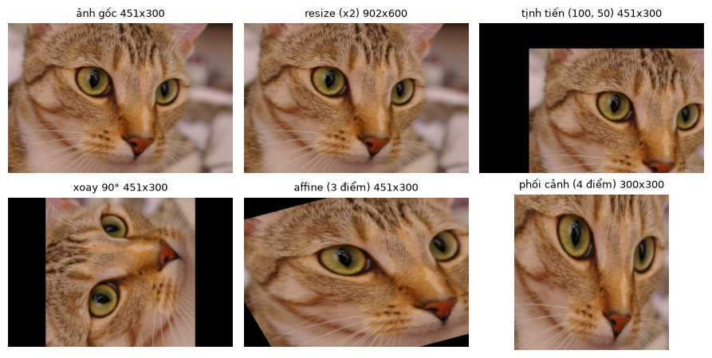</div>
<!-- /output -->

### 4.2 `transforms.v2`: ảnh và hộp giới hạn cùng biến đổi

<small class="viz-ref">Bài tăng cường dữ liệu: mục 3, hình 3.1, 3.2</small>

<!-- run -->
```python
from torchvision import tv_tensors
from torchvision.utils import draw_bounding_boxes
names_v2 = [n for n in dir(v2) if n[0].isupper() and isinstance(getattr(v2, n), type) and issubclass(getattr(v2, n), nn.Module)]
print("số lớp biến đổi trong torchvision.transforms.v2:", len(names_v2))
img_t = tv_tensors.Image(torch.from_numpy(cat).permute(2, 0, 1))
box = tv_tensors.BoundingBoxes([[120, 20, 340, 280]], format="XYXY", canvas_size=(rows, cols))
aug = v2.Compose([v2.RandomResizedCrop(224, scale=(0.4, 1.0), antialias=True), v2.RandomHorizontalFlip(),
                  v2.RandomRotation(20), v2.ColorJitter(0.4, 0.4, 0.4, 0.05), v2.ClampBoundingBoxes(), v2.SanitizeBoundingBoxes(labels_getter=None)])
torch.manual_seed(3)
fig, axes = plt.subplots(1, 5, figsize=(13, 2.6))
axes[0].imshow(draw_bounding_boxes(img_t, box, colors="red", width=3).permute(1, 2, 0)); axes[0].set_title("gốc")
for ax in axes[1:]:
    im2, b2 = aug(img_t, box)
    ax.imshow(draw_bounding_boxes(im2, b2, colors="red", width=3).permute(1, 2, 0)); ax.set_title(f"{tuple(im2.shape[1:])}, {len(b2)} hộp")
for ax in axes: ax.axis('off')
plt.show()
```

<!-- output -->
```output
số lớp biến đổi trong torchvision.transforms.v2: 63
```

<div align=center>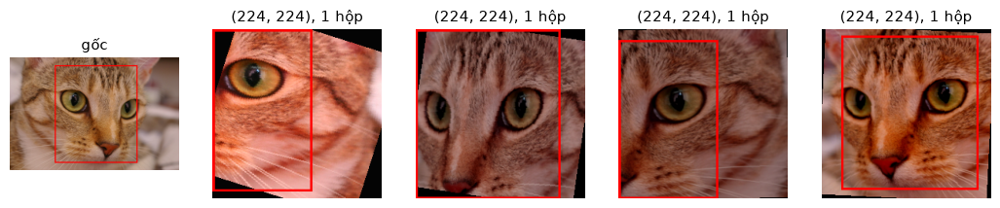</div>
<!-- /output -->

<!-- run -->
```python
sizes = (30, 50, 100, (rows, cols))
resized = [v2.Resize(size=s, antialias=True)(pil) for s in sizes]
fig, axes = plt.subplots(1, 4, figsize=(14, 2.6))
for ax, s, im in zip(axes, sizes, resized):
    ax.imshow(im); ax.set_title(f"Resize({s}) → {im.size[0]}x{im.size[1]}", fontsize=9); ax.axis('off')
plt.show()
```

<!-- output -->
<div align=center>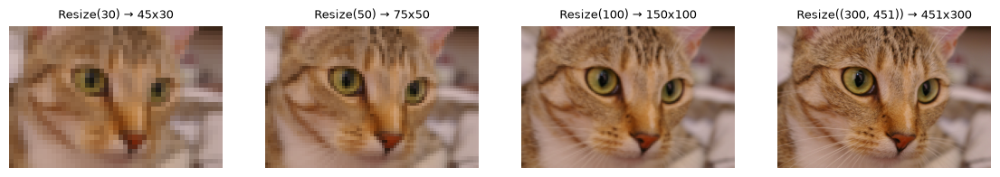</div>
<!-- /output -->

### 4.3 Albumentations

<small class="viz-ref">Bài tăng cường dữ liệu: mục 4, hình 4.1</small>

<!-- run -->
```python
import albumentations as A
print("albumentations", A.__version__)
alb = A.Compose([
    A.RandomResizedCrop(size=(224, 224), scale=(0.4, 1.0)), A.HorizontalFlip(p=0.5),
    A.Affine(rotate=(-20, 20), p=0.7), A.ColorJitter(0.4, 0.4, 0.4, 0.05, p=0.8),
    A.OneOf([A.GaussianBlur(blur_limit=(3, 7)), A.GaussNoise(std_range=(0.05, 0.15))], p=0.5),
], bbox_params=A.BboxParams(format='pascal_voc', label_fields=['labels'], min_visibility=0.3), seed=7)
fig, axes = plt.subplots(1, 4, figsize=(13, 3.2))
for ax in axes:
    o = alb(image=cat, bboxes=[[120, 20, 340, 280]], labels=['mèo'])
    im = torch.from_numpy(o['image']).permute(2, 0, 1)
    b = torch.tensor(o['bboxes']).reshape(-1, 4)
    ax.imshow(draw_bounding_boxes(im, b, colors="red", width=3).permute(1, 2, 0)); ax.axis('off')
    ax.set_title(f"{len(b)} hộp {o['labels']}", fontsize=9)
plt.show()
```

<!-- output -->
```output
albumentations 2.0.8
```

<div align=center>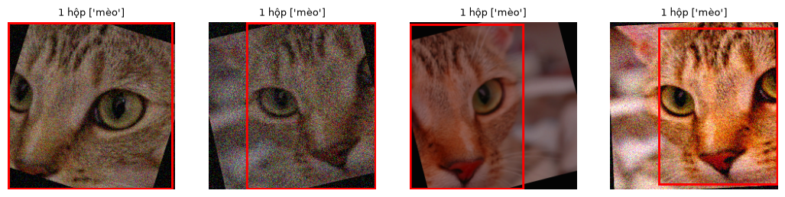</div>
<!-- /output -->

### 4.4 MixUp, CutMix và RandAugment

<small class="viz-ref">Bài tăng cường dữ liệu: mục 5, hình 5.1, 5.2</small>

<!-- run -->
```python
torch.manual_seed(0)
xb = fm_tr.data[:8].float().div(255)[:, None].repeat(1, 3, 1, 1); yb = fm_tr.targets[:8]
cls = fm_tr.classes
fig, axes = plt.subplots(2, 4, figsize=(12, 6))
for row, mix in zip(axes, [v2.MixUp(alpha=1.0, num_classes=10), v2.CutMix(alpha=1.0, num_classes=10)]):
    xm, ym = mix(xb, yb)
    for ax, i in zip(row, range(4)):
        top = ym[i].topk(2)
        ax.imshow(xm[i].permute(1, 2, 0)); ax.axis('off')
        ax.set_title(f"{type(mix).__name__}: " + ", ".join(f"{cls[c][:7]} {v:.2f}" for v, c in zip(top.values, top.indices)), fontsize=8)
plt.tight_layout(); plt.show()
print("nhãn sau MixUp là phân phối, tổng mỗi hàng:", ym.sum(1)[:4].tolist())
```

<!-- output -->
```output
nhãn sau MixUp là phân phối, tổng mỗi hàng: [1.0, 1.0, 1.0, 1.0]
```

<div align=center>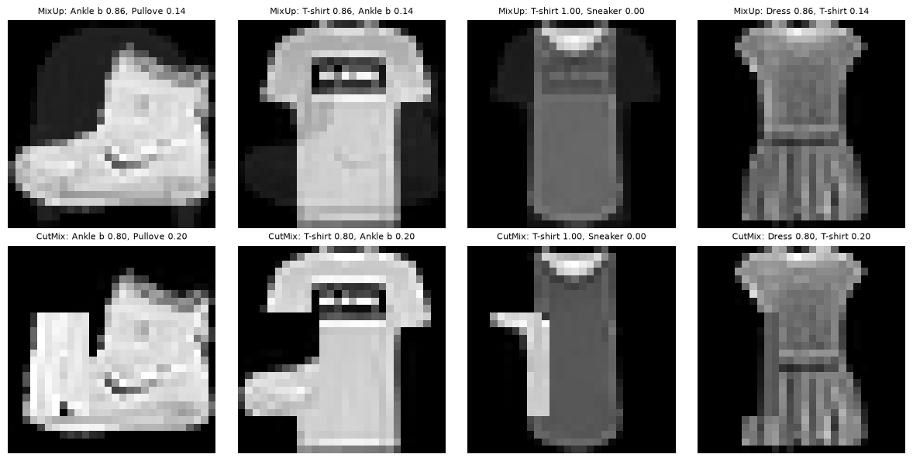</div>
<!-- /output -->

<!-- run -->
```python
policies = {"RandAugment(2, 9)": v2.RandAugment(num_ops=2, magnitude=9), "TrivialAugmentWide": v2.TrivialAugmentWide(),
            "AutoAugment(ImageNet)": v2.AutoAugment(v2.AutoAugmentPolicy.IMAGENET), "RandomErasing": v2.Compose([v2.ToImage(), v2.RandomErasing(p=1.0)])}
torch.manual_seed(1)
fig, axes = plt.subplots(len(policies), 4, figsize=(9, 5.2))
for row, (name, pol) in zip(axes, policies.items()):
    for ax in row:
        out = pol(img_t)
        ax.imshow(out.permute(1, 2, 0)); ax.axis('off')
    row[0].set_title(name, fontsize=9, loc='left')
plt.tight_layout(); plt.show()
```

<!-- output -->
<div align=center>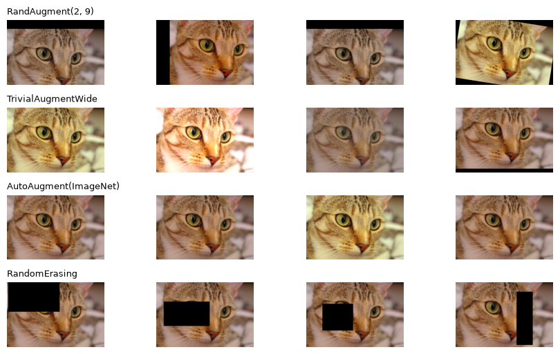</div>
<!-- /output -->

## 5. Regularization

### 5.1 L2 trong hàm mất mát và weight decay

<small class="viz-ref">Bài regularization: mục 1.1</small>

Hồi quy tuyến tính 5 chiều, 50 bước. So trọng số cuối cùng giữa "cộng $\frac{\lambda}{2}\|w\|^2$ vào loss" và "đặt `weight_decay=λ`":

<!-- run -->
```python
torch.manual_seed(0)
Xr_ = torch.randn(64, 5); yr_ = torch.randn(64); lam = 0.1

def run(opt_cls, l2_in_loss, wd, steps=50, **kw):
    w = nn.Parameter(torch.ones(5)); opt = opt_cls([w], weight_decay=wd, **kw)
    for _ in range(steps):
        loss = ((Xr_ @ w - yr_) ** 2).mean() + (lam / 2 * (w ** 2).sum() if l2_in_loss else 0)
        opt.zero_grad(); loss.backward(); opt.step()
    return w.detach()

d = lambda a, b: (a - b).abs().max().item()
print("SGD:   L2 trong loss vs weight_decay       chênh", d(run(torch.optim.SGD, True, 0, lr=0.05), run(torch.optim.SGD, False, lam, lr=0.05)))
print("Adam:  L2 trong loss vs Adam(weight_decay) chênh", d(run(torch.optim.Adam, True, 0, lr=0.05), run(torch.optim.Adam, False, lam, lr=0.05)))
print("Adam:  L2 trong loss vs AdamW(weight_decay) chênh", d(run(torch.optim.Adam, True, 0, lr=0.05), run(torch.optim.AdamW, False, lam, lr=0.05)))
print("AdamW mặc định weight_decay =", torch.optim.AdamW([nn.Parameter(torch.zeros(1))]).defaults['weight_decay'],
      "| Adam mặc định =", torch.optim.Adam([nn.Parameter(torch.zeros(1))]).defaults['weight_decay'])
```

<!-- output -->
```output
SGD:   L2 trong loss vs weight_decay       chênh 1.4901161193847656e-08
Adam:  L2 trong loss vs Adam(weight_decay) chênh 0.0
Adam:  L2 trong loss vs AdamW(weight_decay) chênh 0.020677700638771057
AdamW mặc định weight_decay = 0.01 | Adam mặc định = 0
```
<!-- /output -->

### 5.2 Dropout

<small class="viz-ref">Bài regularization: mục 5</small>

<!-- run -->
```python
drop = nn.Dropout(p=0.3); x = torch.ones(100000)
drop.train(); yt = drop(x)
print(f"train: tỉ lệ bị tắt {(yt == 0).float().mean():.4f}, giá trị còn lại {yt[yt > 0][0]:.4f} = 1/(1-0.3), trung bình {yt.mean():.4f}")
drop.eval(); print("eval: đầu ra == đầu vào:", torch.equal(drop(x), x))
```

<!-- output -->
```output
train: tỉ lệ bị tắt 0.3008, giá trị còn lại 1.4286 = 1/(1-0.3), trung bình 0.9989
eval: đầu ra == đầu vào: True
```
<!-- /output -->

### 5.3 Thí nghiệm quá khớp với 1000 mẫu

<small class="viz-ref">Bài regularization: mục 7</small>

1000 ảnh huấn luyện, 2000 ảnh kiểm định (chọn epoch dừng sớm), 10000 ảnh kiểm tra; đánh giá mỗi 5 epoch:

<!-- run -->
```python
g = torch.Generator().manual_seed(0); perm = torch.randperm(len(Xtr), generator=g)
i_small, i_val = perm[:1000], perm[1000:3000]

def shift_aug(x, pad=2):
    xp = F.pad(x, (pad, pad, pad, pad)); i, j = np.random.randint(0, 2 * pad + 1, 2)
    return xp[..., i:i + 28, j:j + 28]

def fit_small(p=0.0, wd=0.0, smooth=0.0, aug=False, epochs=150, seed=0):
    torch.manual_seed(seed); np.random.seed(seed)
    model = nn.Sequential(nn.Flatten(), nn.Linear(784, 512), nn.ReLU(), nn.Dropout(p), nn.Linear(512, 512), nn.ReLU(), nn.Dropout(p), nn.Linear(512, 10))
    opt = torch.optim.AdamW(model.parameters(), 1e-3, weight_decay=wd)
    hist = []
    for ep in range(epochs):
        model.train(); o = torch.randperm(1000)
        for k in range(0, 1000, 100):
            idx = i_small[o[k:k + 100]]; xb = Xtr[idx]
            if aug: xb = shift_aug(xb)
            loss = F.cross_entropy(model(xb), ytr[idx], label_smoothing=smooth)
            opt.zero_grad(); loss.backward(); opt.step()
        if ep % 5 == 4:
            hist.append((ep + 1, accuracy(model, Xtr[i_small], ytr[i_small]), accuracy(model, Xtr[i_val], ytr[i_val]), accuracy(model)))
    return model, np.array(hist)

configs = {"không regularization": {}, "weight decay 0.1": {"wd": 0.1}, "dropout 0.5": {"p": 0.5},
           "label smoothing 0.1": {"smooth": 0.1}, "dịch ảnh ±2 px": {"aug": True}, "dropout + dịch ảnh": {"p": 0.5, "aug": True}}
hists = {}
print(f"{'cấu hình':22s} {'train':>6s} {'test cuối':>9s} | dừng sớm theo val: {'epoch':>5s} {'test':>6s}")
for name, kw in configs.items():
    model_k, h = fit_small(**kw); hists[name] = h
    b = h[:, 2].argmax()
    print(f"{name:22s} {h[-1, 1]:6.3f} {h[-1, 3]:9.4f} | {'':19s}{int(h[b, 0]):5d} {h[b, 3]:6.4f}")
    if name == "không regularization": model_plain = model_k
plt.figure(figsize=(7, 3.5))
for name, h in hists.items():
    plt.plot(h[:, 0], h[:, 3], label=name)
plt.xlabel('epoch'); plt.ylabel('độ chính xác test'); plt.legend(fontsize=8); plt.show()
```

<!-- output -->
```output
cấu hình                train test cuối | dừng sớm theo val: epoch   test
không regularization    1.000    0.7990 |                      130 0.7997
weight decay 0.1        1.000    0.7998 |                       60 0.7999
dropout 0.5             0.994    0.8043 |                       40 0.8132
label smoothing 0.1     1.000    0.8074 |                       25 0.8110
dịch ảnh ±2 px          0.959    0.8032 |                      150 0.8032
dropout + dịch ảnh      0.901    0.8080 |                      115 0.8077
```

<div align=center>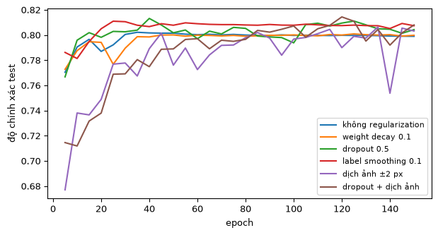</div>
<!-- /output -->

Mọi cấu hình đều khớp hoàn toàn tập huấn luyện; khác biệt trên tập kiểm tra chỉ khoảng 1 điểm, lớn nhất với dropout và label smoothing khi kết hợp dừng sớm.

## 6. Trực quan hoá mô hình

### 6.1 Trọng số tầng tích chập đầu tiên

<small class="viz-ref">Bài trực quan hoá: mục 2</small>

<!-- run -->
```python
weights = ResNet18_Weights.IMAGENET1K_V1
net = resnet18(weights=weights).eval()
w1 = net.conv1.weight.detach()                       # (64, 3, 7, 7)
w1 = (w1 - w1.amin((1, 2, 3), keepdim=True)) / (w1.amax((1, 2, 3), keepdim=True) - w1.amin((1, 2, 3), keepdim=True))
grid = torchvision.utils.make_grid(w1, nrow=16, padding=1, pad_value=1)
plt.figure(figsize=(10, 2.8)); plt.imshow(grid.permute(1, 2, 0)); plt.axis('off'); plt.show()
```

<!-- output -->
<div align=center>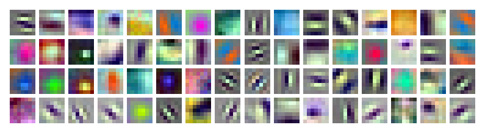</div>
<!-- /output -->

### 6.2 Feature map qua forward hook

<small class="viz-ref">Bài trực quan hoá: mục 3</small>

<!-- run -->
```python
prep = weights.transforms()
xin = prep(pil)[None]
feats = {}
hooks = [getattr(net, n).register_forward_hook(lambda m, i, o, n=n: feats.__setitem__(n, o.detach())) for n in ['layer1', 'layer2', 'layer3', 'layer4']]
with torch.no_grad():
    logits = net(xin)
for h in hooks: h.remove()
fig, axes = plt.subplots(4, 7, figsize=(11, 6.3))
for row, (name, f) in zip(axes, feats.items()):
    row[0].imshow(cat); row[0].set_title(f"{name} {tuple(f.shape[1:])}", fontsize=9, loc='left')
    top = f[0].mean((1, 2)).topk(6).indices
    for ax, c in zip(row[1:], top):
        ax.imshow(f[0, c], cmap='viridis'); ax.set_title(f"kênh {c.item()}", fontsize=8)
    for ax in row: ax.axis('off')
plt.tight_layout(); plt.show()
```

<!-- output -->
<div align=center>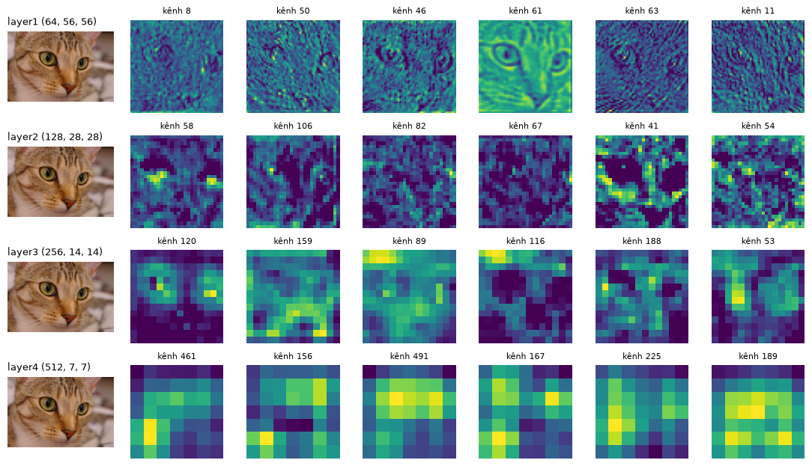</div>
<!-- /output -->

### 6.3 Grad-CAM

<small class="viz-ref">Bài trực quan hoá: mục 4</small>

<!-- run -->
```python
cats = weights.meta['categories']
prob = logits.softmax(1)[0]; top5 = prob.topk(5)
print("top-5:", [(cats[i], round(p.item(), 3)) for p, i in zip(top5.values, top5.indices)])

def grad_cam(model, layer, x, cls):
    store = {}
    h1 = layer.register_forward_hook(lambda m, i, o: store.__setitem__('A', o))
    h2 = layer.register_full_backward_hook(lambda m, gi, go: store.__setitem__('G', go[0]))
    out = model(x); model.zero_grad(); out[0, cls].backward()
    h1.remove(); h2.remove()
    a = store['G'].mean((2, 3), keepdim=True)                 # trọng số kênh = gradient trung bình
    cam = F.relu((a * store['A']).sum(1, keepdim=True))
    cam = F.interpolate(cam, size=x.shape[-2:], mode='bilinear', align_corners=False)[0, 0]
    return (cam / cam.max()).detach()

show = (xin[0] * torch.tensor([0.229, 0.224, 0.225])[:, None, None] + torch.tensor([0.485, 0.456, 0.406])[:, None, None]).clamp(0, 1).permute(1, 2, 0)
fig, axes = plt.subplots(1, 3, figsize=(11, 3.8))
axes[0].imshow(show); axes[0].set_title("ảnh vào 224x224")
for ax, cls_i in zip(axes[1:], [top5.indices[0].item(), cats.index('wool')]):
    cam = grad_cam(net, net.layer4, xin, cls_i)
    ax.imshow(show); ax.imshow(cam, cmap='jet', alpha=0.45); ax.set_title(f"Grad-CAM lớp '{cats[cls_i]}'")
for ax in axes: ax.axis('off')
plt.show()
```

<!-- output -->
```output
top-5: [('Egyptian cat', 0.391), ('tiger cat', 0.386), ('tabby', 0.218), ('lynx', 0.005), ('Persian cat', 0.0)]
```

<div align=center>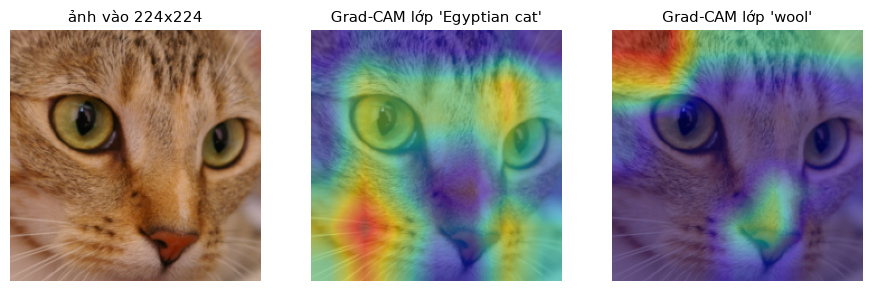</div>
<!-- /output -->

### 6.4 TensorBoard

<small class="viz-ref">Bài trực quan hoá: mục 5</small>

Ghi log 200 bước huấn luyện vào một thư mục tạm, rồi đọc ngược bằng `EventAccumulator` (thay cho việc mở giao diện TensorBoard):

<!-- run -->
```python
from torch.utils.tensorboard import SummaryWriter
from tensorboard.backend.event_processing.event_accumulator import EventAccumulator
logdir = tempfile.mkdtemp()
writer = SummaryWriter(logdir)
torch.manual_seed(0); model = mlp(); opt = torch.optim.SGD(model.parameters(), lr=0.05, momentum=0.9)
for step in range(200):
    idx = torch.randint(0, len(Xtr), (128,)); loss = F.cross_entropy(model(Xtr[idx]), ytr[idx])
    opt.zero_grad(); loss.backward(); opt.step()
    writer.add_scalar('loss/train', loss.item(), step)
    if step % 50 == 0:
        writer.add_histogram('weight/fc1', model[1].weight, step)
writer.add_scalar('acc/test', accuracy(model), 199)
writer.close()
ea = EventAccumulator(logdir); ea.Reload()
print("tệp log:", [f[:20] + '…' for f in os.listdir(logdir)])
print("thẻ:", ea.Tags()['scalars'], ea.Tags()['histograms'])
ls = ea.Scalars('loss/train')
print("loss/train:", [(e.step, round(e.value, 3)) for e in ls[::50]], "| acc/test:", round(ea.Scalars('acc/test')[0].value, 4))
```

<!-- output -->
```output
tệp log: ['events.out.tfevents.…']
thẻ: ['loss/train', 'acc/test'] ['weight/fc1']
loss/train: [(0, 2.318), (50, 0.597), (100, 0.438), (150, 0.378)] | acc/test: 0.8403
```
<!-- /output -->

### 6.5 Trực quan hoá dữ liệu bằng t-SNE

<small class="viz-ref">Bài trực quan hoá: mục 6</small>

<!-- run -->
```python
from sklearn.manifold import TSNE
sub = torch.arange(1500)
with torch.no_grad():
    model_plain.eval(); hid = model_plain[:5](Xte[sub])            # đầu ra tầng ẩn thứ hai (512 chiều)
fig, axes = plt.subplots(1, 2, figsize=(12, 5))
for ax, (title, Z) in zip(axes, [("điểm ảnh thô (784 chiều)", Xte[sub].flatten(1).numpy()), ("tầng ẩn của MLP mục 5.3 (512 chiều)", hid.numpy())]):
    E = TSNE(n_components=2, init='pca', perplexity=30, random_state=0).fit_transform(Z)
    sc = ax.scatter(E[:, 0], E[:, 1], c=yte[sub], cmap='tab10', s=5); ax.set_title(title); ax.set_xticks([]); ax.set_yticks([])
fig.legend(sc.legend_elements()[0], fm_te.classes, loc='center right', fontsize=8)
plt.subplots_adjust(right=0.86); plt.show()
```

<!-- output -->
<div align=center>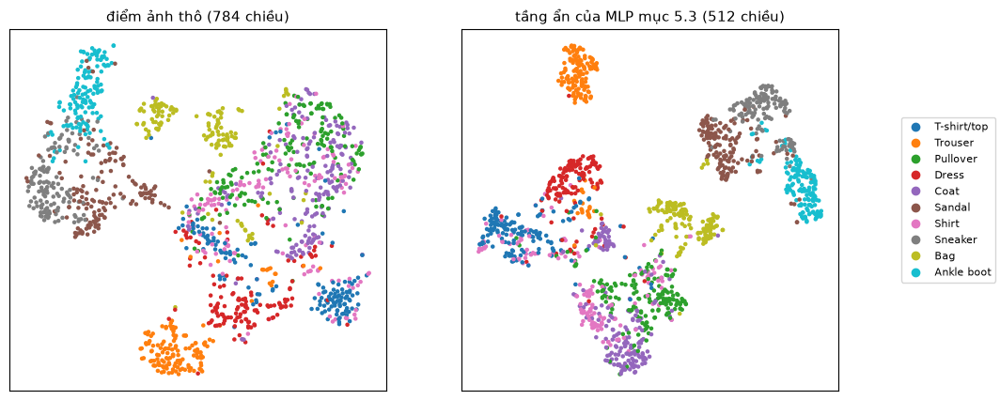</div>
<!-- /output -->
