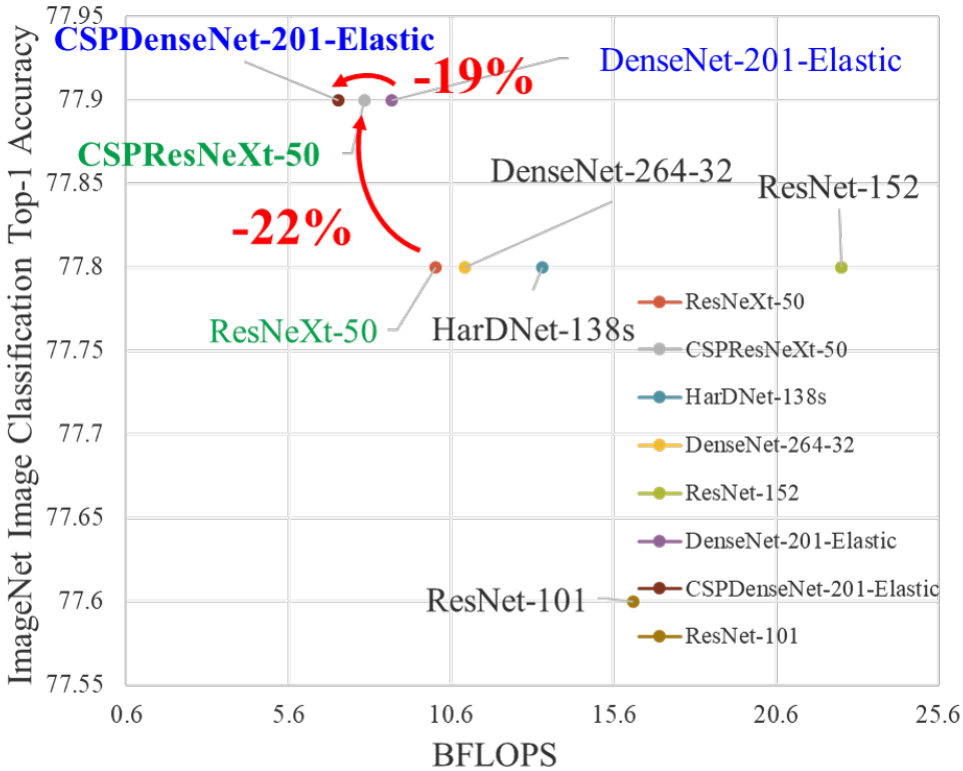
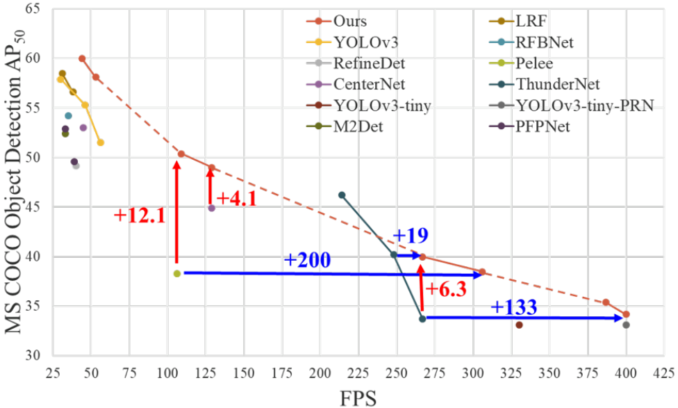
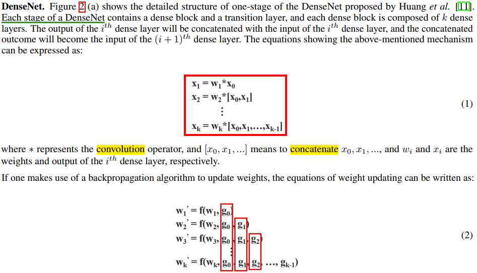
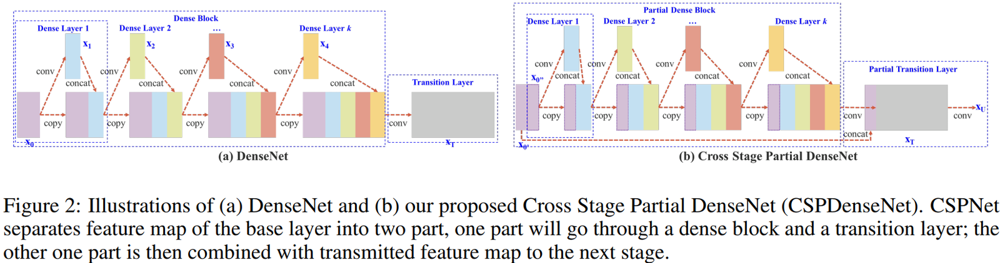
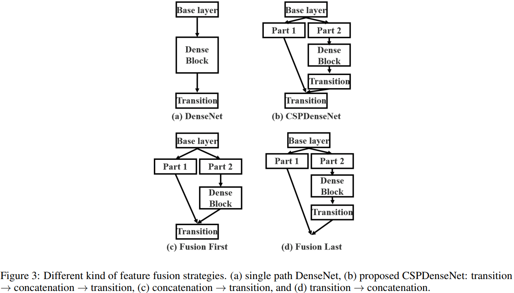
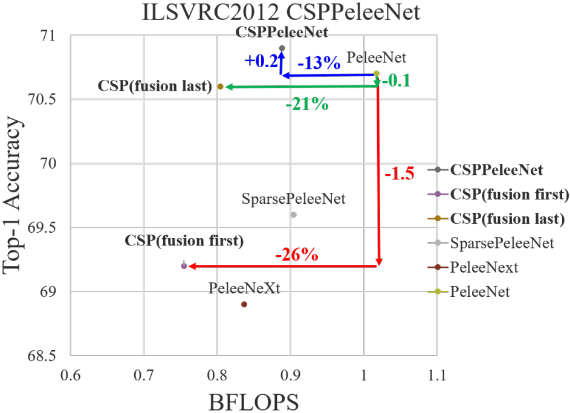
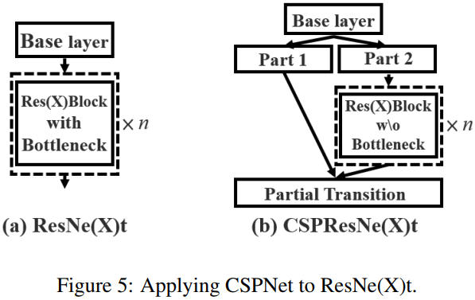
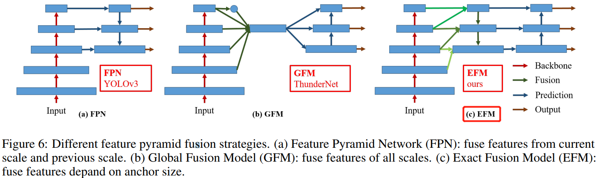
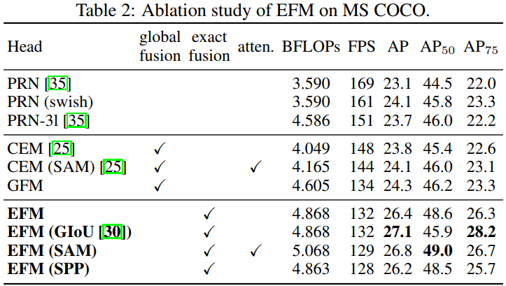

# CNN hiệu quả: CSPNet

> Ghi chú của người biên soạn: trang này dịch từ ghi chú *dl_note* của **Harley Zhang** ([bản gốc](https://github.com/harleyszhang/dl_note/blob/main/3-classic_backbone/efficient_cnn/CSPNet论文详解.md), [kho mã](https://github.com/harleyszhang/dl_note), giấy phép [Apache-2.0](https://www.apache.org/licenses/LICENSE-2.0); phần dịch có chỉnh sửa). Số mục giữ như bản gốc. Chỗ bản gốc sai, thiếu hoặc đã lỗi thời được sửa ngay trong bài và ghi ở ô **Biên tập**. Các mục có chữ **Bổ sung** do người biên soạn viết thêm.

Bài này đọc bài báo *CSPNet: A New Backbone that can Enhance Learning Capability of CNN* (Wang, Liao và cộng sự, CVPRW 2020). Trang [Code](dlnote/backbone_code_vi) đi kèm chạy code Partial Dense Block ở mục 6 (bản gốc có nhiều lỗi, đã sửa), so số tham số và MACs của một DenseBlock với CSP DenseBlock, và kiểm tra công thức lượng vào/ra (CIO) ở mục 3.1.

<div class="qa-theory">

**Lý thuyết:** [Ôn tập · Bổ sung: ResNet và DenseNet](qa/ch04_vi?id=bổ-sung-resnet-và-densenet)

</div>

## Tóm tắt

> `CSPNet` là bài báo năm `2019` của `Chien-Yao Wang` và cộng sự, *CSPNet: A New Backbone that can Enhance Learning Capability of CNN*, cũng là bản cải tiến cho vấn đề suy luận kém hiệu quả của `DenseNet`.

Tác giả cho rằng chi phí suy luận quá cao của mạng là do **thông tin gradient bị lặp lại trong quá trình tối ưu**. `CSPNet` đưa sự thay đổi của gradient từ đầu tới cuối vào feature map, giảm lượng tính toán mà vẫn giữ độ chính xác. Phương pháp `CSP` (`Cross Stage Partial Network`, gọi tắt `CSPNet`) **giảm lượng tính toán và tăng tốc độ mà không giảm độ chính xác**, là cách thiết kế mạng hiệu quả hơn, và kết hợp được với các `backbone` như `ResNet`, `DenseNet`, `Darknet`.

## 1 Giới thiệu

Dù đã có các mạng nhẹ thiết kế cho di động (`CPU`) như `MobileNet v1/v2/v3` và `ShuffleNet v1/v2`, kỹ thuật nền mà chúng dùng, tích chập tách được theo chiều sâu, không hợp với chip `NPU` (hệ thống tính toán biên dựa trên mạch tích hợp chuyên dụng, `ASIC`).

Kết quả khi kết hợp `CSPNet` với các `backbone` khác:



Hình 1.1: Áp dụng CSP lên các backbone phân loại (ResNet, ResNeXt, DenseNet…) giảm lượng tính toán mà độ chính xác giữ nguyên hoặc tăng (hình 1 của bài báo).

Kết quả khi kết hợp với mạng phát hiện đối tượng:



Hình 1.2: Độ chính xác (AP) và tốc độ (FPS) của các bộ phát hiện dùng backbone CSP trên COCO (bảng của bài báo).

`CSPNet` được đề xuất chủ yếu để giải quyết ba vấn đề:

1. tăng năng lực học của CNN, giữ được độ chính xác khi làm mạng nhẹ đi;
2. giảm nút thắt tính toán và giảm thông tin gradient lặp lại của DenseNet;
3. giảm chi phí bộ nhớ.

## 2 Công trình liên quan

**Thiết kế kiến trúc CNN.**

**Bộ phát hiện đối tượng thời gian thực.**

(Bản gốc để trống hai mục này.)

## 3 Phương pháp cải tiến

> Bài báo gọi chương này là `Method`, nhưng tác giả bản gốc thấy gọi là "phương pháp cải tiến" thể hiện nội dung rõ hơn.

### 3.1 Cross Stage Partial Network

**1. DenseNet**



Hình 3.1: Lan truyền xuôi (1) và cập nhật trọng số (2) của DenseNet; $w'_i = f(w_i, g_0, g_1, \dots, g_{i-1})$ (công thức (1), (2) của bài báo).

Trong đó $f$ là hàm cập nhật trọng số, $g_i$ là gradient lan truyền tới tầng dày đặc thứ $i$. Từ công thức (2) có thể thấy rất nhiều thông tin gradient được dùng lại để cập nhật trọng số của các tầng dày đặc khác nhau, khiến các tầng dày đặc khác nhau lặp đi lặp lại việc học cùng thông tin gradient bị sao chép.

**2. Cross Stage Partial DenseNet.**

Kiến trúc một giai đoạn của `CSPDenseNet` do tác giả đề xuất như hình 2(b). **Một giai đoạn của `CSPDenseNet` gồm một khối dày đặc từng phần và một tầng chuyển tiếp từng phần** (`a partial dense block and a partial transition layer`).



Hình 3.2: (a) Một giai đoạn của DenseNet. (b) Một giai đoạn của CSPDenseNet: feature map vào tách theo kênh thành hai phần, chỉ một phần đi qua khối dày đặc, rồi hai phần được nối lại qua tầng chuyển tiếp (hình 2 của bài báo).

Nói chung, CSPDenseNet giữ ưu điểm tái sử dụng đặc trưng của DenseNet, đồng thời **cắt đứt luồng gradient** để tránh quá nhiều thông tin gradient trùng lặp. Ý tưởng này được thực hiện bằng một chiến lược hợp nhất đặc trưng phân cấp, áp dụng trong tầng chuyển tiếp từng phần (partial transition layer).

**3. Partial Dense Block (khối dày đặc từng phần).**

Mục đích thiết kế khối dày đặc từng phần:

1. **Tăng số đường gradient**: nhờ chiến lược tách rồi gộp, số đường gradient tăng gấp đôi. Nhờ chiến lược xuyên giai đoạn (cross-stage), giảm được nhược điểm của việc nối các feature map sao chép tường minh.
2. **Cân bằng tính toán giữa các tầng**: thường thì số kênh của tầng nền (base layer) trong DenseNet lớn hơn nhiều so với tốc độ tăng trưởng. Trong khối dày đặc từng phần, số kênh tầng nền tham gia các tầng dày đặc chỉ bằng một nửa ban đầu, nên giải quyết được gần một nửa nút thắt tính toán.
3. **Giảm lưu lượng bộ nhớ**: giả sử feature map nền của một khối dày đặc trong `DenseNet` có kích thước $w\times h\times c$, tốc độ tăng trưởng là $d$, có $m$ tầng dày đặc. Khi đó lượng vào/ra (CIO, convolutional input/output) của khối là $(c\times m) + ((m^2+m)\times d)/2$, còn của khối dày đặc từng phần (`partial dense block`) là $((c\times m) + (m^2+m)\times d)/2$. Vì $m$ và $d$ thường nhỏ hơn $c$ nhiều, khối dày đặc từng phần tiết kiệm được tới một nửa lưu lượng bộ nhớ của mạng.

> **Biên tập:** Bản gốc viết "có $m$ khối dày đặc"; đúng là $m$ **tầng** dày đặc trong một khối. Công thức CIO đếm tổng số kênh vào và ra của các tầng (nhân $wh$ là lượng dữ liệu); trang Code đếm trực tiếp trên DenseBlock và CSP DenseBlock để kiểm tra.

**4. Partial Transition Layer (tầng chuyển tiếp từng phần).**

**Mục đích của tầng chuyển tiếp từng phần là làm cho các tổ hợp gradient khác nhau nhiều nhất.** Đây là cơ chế hợp nhất đặc trưng phân cấp, dùng chiến lược gộp luồng gradient để ngăn các tầng khác nhau học thông tin gradient trùng lặp. Tác giả thiết kế hai biến thể `CSPDenseNet` để cho thấy việc cắt đứt luồng gradient ảnh hưởng thế nào tới năng lực học của mạng.



Hình 3.3: Các kiểu hợp nhất đặc trưng: (a) DenseNet đơn; (b) CSPDenseNet đề xuất (tầng chuyển tiếp trước và sau phép nối); (c) Fusion First; (d) Fusion Last (hình 3 của bài báo).

Tầng chuyển tiếp (transition layer) có ý nghĩa như trong DenseNet, là một tầng tích chập 1x1 (không còn average pooling). Vị trí của `transition layer` trong hình quyết định cấu trúc của gradient, mỗi cách có ưu điểm riêng:

- Hình (c), **Fusion First**: nối hai phần trước rồi mới đưa vào tầng chuyển tiếp; cách này làm nhiều thông tin gradient được dùng lại, có lợi cho việc học;
- Hình (d), **Fusion Last**: đưa một phần qua tầng chuyển tiếp trước rồi mới nối; như vậy **thông tin gradient bị cắt đứt**, mất một phần tái sử dụng gradient, nhưng vì đầu vào của tầng chuyển tiếp ít chiều hơn (c), lượng tính toán giảm nhiều.
- Cấu trúc ở hình (b) là cấu trúc bài báo `CSPNet` dùng, kết hợp đặc điểm của (c) và (d): tăng năng lực học, đổi lại tăng thêm chút độ phức tạp tính toán. Tác giả cho kết quả thí nghiệm với các tầng chuyển tiếp từng phần khác nhau như hình dưới. Dùng cấu trúc nào có thể tuỳ điều kiện và tình huống sử dụng.



Hình 3.4: Độ chính xác và lượng tính toán của các kiểu hợp nhất trên ImageNet (hình 4 của bài báo): Fusion Last giảm nhiều tính toán mà độ chính xác chỉ giảm 0,1%, Fusion First giảm tính toán nhưng mất nhiều độ chính xác hơn.

**5. Áp dụng CSPNet cho các kiến trúc khác.**

Cấu trúc khi áp dụng `CSP` lên khối residual của `ResNeXt` hay `ResNet`:



Hình 3.5: (a) Một giai đoạn của ResNe(X)t. (b) CSPResNe(X)t: một nửa số kênh đi qua các khối residual, nửa kia đi thẳng, rồi nối lại (hình 5 của bài báo).

### 3.2 Exact Fusion Model (EFM)

**Gộp kim tự tháp đặc trưng (Aggregate Feature Pyramid).**

Bài báo đề xuất cấu trúc `EFM` để gộp kim tự tháp đặc trưng ban đầu tốt hơn.



Hình 3.6: Các kiến trúc kim tự tháp đặc trưng: (a) FPN; (b) GFM (hợp nhất toàn cục); (c) EFM đề xuất (hình 6 của bài báo).

## 4 Thí nghiệm

### 4.1 Chi tiết thí nghiệm

(Bản gốc bỏ qua.)

### 4.2 Thí nghiệm loại bỏ

Kết quả thí nghiệm loại bỏ (ablation) của EFM trên COCO.



Hình 4.1: Thí nghiệm loại bỏ EFM trên COCO (bảng của bài báo).

### 4.3 Tổng kết thí nghiệm

Từ kết quả thí nghiệm: với bài toán phân loại, dùng `CSPNet` giảm được lượng tính toán nhưng độ chính xác tăng rất ít; với phát hiện đối tượng, dùng `CSPNet` làm `Backbone` tăng độ chính xác khá nhiều, tăng hiệu quả năng lực học của `CNN`, đồng thời giảm lượng tính toán.

## 5 Kết luận

`CSPNet` là kiến trúc mạng nhẹ dùng được cho `GPU` và `CPU` di động.

Tác giả cho rằng đóng góp chính của bài báo là **nhận ra vấn đề thông tin gradient dư thừa, gây tối ưu kém hiệu quả và suy luận tốn kém**. Đồng thời đề xuất **dùng chiến lược hợp nhất đặc trưng xuyên giai đoạn và cắt đứt luồng gradient** để tăng tính đa dạng của đặc trưng học được ở các tầng khác nhau.

Ngoài ra, bài báo đề xuất cấu trúc `EFM`, kết hợp phép `Maxout` để nén các feature map sinh từ kim tự tháp đặc trưng, giảm mạnh băng thông bộ nhớ cần thiết, nhờ đó suy luận đủ hiệu quả cho thiết bị tính toán biên.

Kết quả thí nghiệm cho thấy `CSPNet` dựa trên `EFM` vượt rõ các đối thủ về độ chính xác và tốc độ suy luận trong bài toán phát hiện đối tượng thời gian thực trên `GPU` và `CPU` di động.

> **Biên tập:** Ảnh hưởng lớn nhất của CSPNet là ở họ YOLO: CSPDarknet53 là backbone của YOLOv4 (2020, cùng nhóm tác giả), và các khối CSP (C3 trong YOLOv5, C2f trong YOLOv8, ELAN/GELAN trong YOLOv7, YOLOv9) đều phát triển từ ý tưởng tách kênh thành hai phần, chỉ cho một phần đi qua các tầng nặng, rồi nối lại.

## 6 Đọc code

Khối dày đặc từng phần (Partial Dense Block) chỉ cần sửa nhẹ từ code Dense Block. Code Dense Block đơn giản và Partial Dense Block (đã sửa lỗi, xem ô Biên tập bên dưới):

```python
import torch
import torch.nn as nn

class conv2d_bn_relu(nn.Module):
    """CONV_BN_RELU"""
    def __init__(self, in_channels, out_channels, kernel_size, stride, padding,
                 dilation=1, groups=1, bias=False):
        super(conv2d_bn_relu, self).__init__()
        layers = [nn.Conv2d(in_channels, out_channels, kernel_size=kernel_size, stride=stride,
                            padding=padding, dilation=dilation, groups=groups, bias=bias),
                  nn.BatchNorm2d(out_channels),
                  nn.ReLU(inplace=False)]
        self.seq = nn.Sequential(*layers)

    def forward(self, x):
        return self.seq(x)


class bn_relu_conv2d(nn.Module):
    """BN_RELU_CONV"""
    def __init__(self, in_channels, out_channels, kernel_size, stride, padding,
                 dilation=1, groups=1, bias=False):
        super(bn_relu_conv2d, self).__init__()
        layers = [nn.BatchNorm2d(in_channels),
                  nn.ReLU(inplace=False),
                  nn.Conv2d(in_channels, out_channels, kernel_size=kernel_size, stride=stride,
                            padding=padding, dilation=dilation, groups=groups, bias=bias)]
        self.seq = nn.Sequential(*layers)

    def forward(self, x):
        return self.seq(x)


class DenseBlock(nn.Module):
    def __init__(self, input_channels, num_layers, growth_rate):
        super(DenseBlock, self).__init__()
        self.num_layers = num_layers
        self.k0 = input_channels
        self.k = growth_rate
        self.layers = self.__make_layers()

    def __make_layers(self):
        layer_list = []
        for i in range(self.num_layers):
            layer_list.append(nn.Sequential(
                bn_relu_conv2d(self.k0 + i * self.k, 4 * self.k, 1, 1, 0),
                bn_relu_conv2d(4 * self.k, self.k, 3, 1, 1)
            ))
        return nn.ModuleList(layer_list)

    def forward(self, x):
        out = x
        for layer in self.layers:
            feature = layer(out)
            out = torch.cat((out, feature), 1)
        return out


# Partial Dense Block
class CSP_DenseBlock(nn.Module):
    def __init__(self, in_channels, num_layers, k, part_ratio=0.5):
        super(CSP_DenseBlock, self).__init__()
        self.part1_chnls = int(in_channels * part_ratio)
        self.part2_chnls = in_channels - self.part1_chnls
        self.dense = DenseBlock(self.part2_chnls, num_layers, k)
        trans_chnls = self.part2_chnls + k * num_layers
        self.transition = conv2d_bn_relu(trans_chnls, trans_chnls, 1, 1, 0)

    def forward(self, x):
        part1 = x[:, :self.part1_chnls, :, :]
        part2 = x[:, self.part1_chnls:, :, :]
        part2 = self.dense(part2)        # cũng có thể là khối residual
        part2 = self.transition(part2)   # chuyển tiếp trước, nối sau: Fusion Last
        out = torch.cat((part1, part2), 1)
        return out
```

> **Biên tập:** Code của bản gốc (chép từ một blog) không chạy được: (1) cả hai lớp `conv2d_bn_relu` và `bn_relu_conv2d` gọi `super(BN_Conv2d, self)`, một lớp không tồn tại; (2) `conv2d_bn_relu` đặt `BatchNorm2d(in_channels)` sau tích chập, phải là `out_channels`; (3) `DenseBlock` lưu các tầng trong một `list` thường, nên tham số không được đăng ký với mô-đun (không được `.parameters()` thấy, không lên GPU, không được lưu); đã dùng `nn.ModuleList`; (4) `forward` chứa các đoạn như `self.layers[0](x "0")`, lỗi cú pháp sinh ra khi chuyển định dạng trang web. Ngoài ra chú thích gốc ghi phép trong `CSP_DenseBlock` là "Fusion First", nhưng code cho phần 2 qua tầng chuyển tiếp **trước** khi nối, tức là **Fusion Last** (hình 3.3(d)). Trang Code chạy bản đã sửa và so với DenseBlock đầy đủ (kèm tầng chuyển tiếp) cùng 4 tầng, $k = 32$: với 64 kênh vào, CSP DenseBlock giảm khoảng 11% số tham số và MACs; với 256 kênh vào, giảm khoảng một phần ba. Mức giảm “tới một nửa” của mục 3.1 chỉ đạt khi số kênh nền $c$ lớn hơn nhiều so với $m \times d$, vì CSP chỉ cắt phần tính toán phụ thuộc vào số kênh nền.

## Tài liệu tham khảo

- [Backbone tăng cường năng lực học của CNN: CSPNet](https://www.cnblogs.com/pprp/p/12566116.html)
- [CSPNet: cài đặt CSPDenseNet và CSPResNeXt bằng PyTorch](https://zhuanlan.zhihu.com/p/263555330)
- Wang et al. [CSPNet: A New Backbone that can Enhance Learning Capability of CNN](https://arxiv.org/abs/1911.11929). CVPR Workshops 2020.
- Bochkovskiy, Wang, Liao. [YOLOv4: Optimal Speed and Accuracy of Object Detection](https://arxiv.org/abs/2004.10934). 2020.
