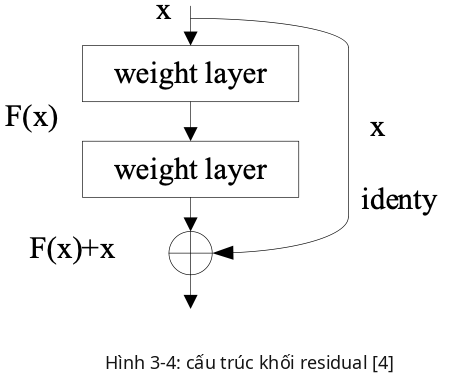
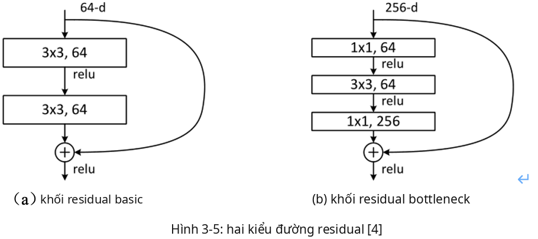
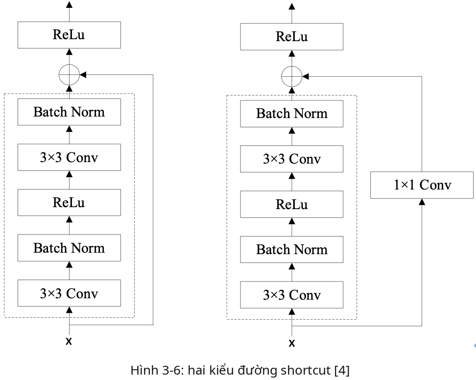
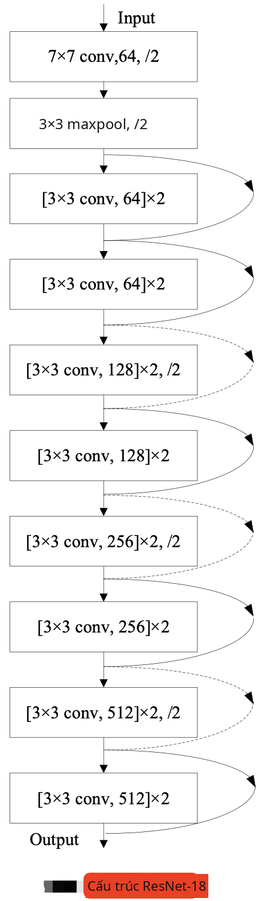
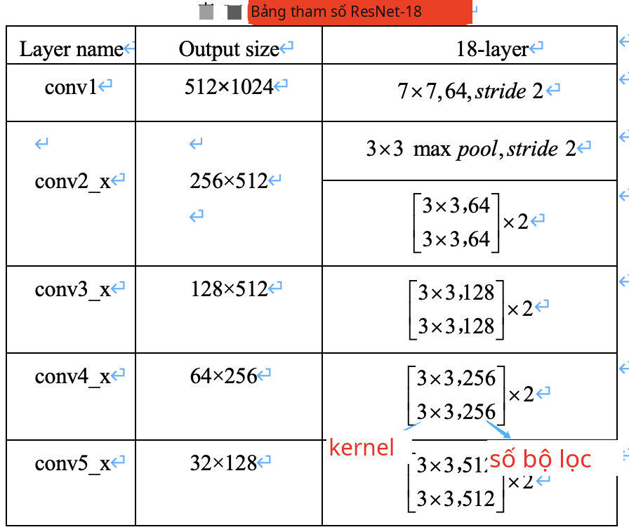

# Backbone kinh điển: ResNet

> Ghi chú của người biên soạn: trang này dịch từ ghi chú *dl_note* của **Harley Zhang** ([bản gốc](https://github.com/harleyszhang/dl_note/blob/main/3-classic_backbone/ResNet网络详解.md), [kho mã](https://github.com/harleyszhang/dl_note), giấy phép [Apache-2.0](https://www.apache.org/licenses/LICENSE-2.0); phần dịch có chỉnh sửa). Số mục giữ như bản gốc. Chỗ bản gốc sai, thiếu hoặc đã lỗi thời được sửa ngay trong bài và ghi ở ô **Biên tập**. Các mục có chữ **Bổ sung** do người biên soạn viết thêm.

Trang [Code](dlnote/backbone_code_vi) đi kèm dựng lại ResNet-18 từ khối BasicBlock, so với `torchvision`, và in kích thước feature map qua từng giai đoạn.

**Lý thuyết:** [Ôn tập · Bổ sung: ResNet và DenseNet](qa/ch04_vi?id=bổ-sung-resnet-và-densenet)

## Tóm tắt

Mạng residual (`ResNet`) được đề xuất để **giải quyết vấn đề "suy thoái" (bài toán tối ưu) của mạng neuron sâu**.

Có [bài báo](https://arxiv.org/abs/1702.08591) chỉ ra rằng khi mạng neuron càng sâu, tương quan giữa các gradient lan truyền ngược càng kém, cuối cùng gần như nhiễu trắng. Tức là mạng tích chập sâu hơn gặp vấn đề về gradient khiến mạng không huấn luyện hiệu quả được.

`ResNet` thiết kế khối residual, điều chỉnh cấu trúc mô hình để mô hình sâu hơn huấn luyện được hiệu quả. Hiện ResNet là backbone chủ đạo của các framework thị giác như phát hiện đối tượng, phân đoạn ngữ nghĩa.

> **Biên tập:** Bản gốc gộp hai hiện tượng khác nhau. Bài báo dẫn ở trên (Balduzzi và cộng sự, 2017, *The Shattered Gradients Problem*) nói về **gradient vỡ vụn** (shattered gradients): độ lớn gradient vẫn bình thường nhưng gradient của các đầu vào gần nhau mất tương quan, giống nhiễu trắng; nó không phải "gradient biến mất". Bài báo ResNet thì nói rõ vấn đề **suy thoái** (mạng thẳng 56 tầng có sai số *huấn luyện* cao hơn mạng 20 tầng) *không* do gradient biến mất, vì mạng đã có BN và gradient lan truyền ngược có độ lớn bình thường; tác giả cho rằng mạng thẳng sâu khó tối ưu, có lẽ do tốc độ hội tụ chậm theo cấp số mũ.

## 1 Giới thiệu mạng residual

Tác giả lập luận: giả sử một mạng tích chập nông đã đạt kết quả khá tốt; thêm nhiều tầng tích chập không làm gì cả (ánh xạ đồng nhất) thì kết quả cũng không thể kém đi. Mạng sâu trước đây bị suy thoái chính vì việc khiến các tầng mạng "không làm gì" lại là một trong những điều mạng neuron khó học nhất!

Vì vậy, ý định ban đầu của **mạng residual** là làm cho cấu trúc bên trong mô hình ít nhất có khả năng **ánh xạ đồng nhất** (khả năng không làm gì), nhờ đó chồng thêm tầng tích chập không gây suy thoái vì mạng sâu hơn.

### 1.1 Nguyên lý của cấu trúc residual

Xét một khối tích chập trong mạng kiểu VGG, đầu vào $x$, đầu ra mong muốn $H(x)$; khối thực hiện một ánh xạ phi tuyến.

Vậy **làm sao để có ánh xạ đồng nhất**?

Với khối tích chập thẳng (`plain`) có đầu vào $x$ và đầu ra mong muốn $H(x)$, phản xạ đầu tiên là cho nó học thẳng $H(x) = x$, nhưng điều này rất khó!

Tác giả đổi góc nhìn: đã khó học $H(x) = x$ thì để khối học thứ khác, còn khả năng ánh xạ đồng nhất do một cấu trúc khác lo, chẳng hạn thêm thẳng một kết nối tắt (shortcut)! Như vậy khối tích chập chỉ cần học ra đầu ra bằng 0. Học đầu ra bằng 0 dễ hơn nhiều so với học ánh xạ đồng nhất: chỉ cần các trọng số tiến về 0, điều mà weight decay (L2) vốn đã đẩy tới.

Vì vậy tác giả thiết kế mạng thành $H(x) = F(x) + x$, đưa thẳng ánh xạ đồng nhất vào thành một phần của mạng: chỉ cần $F(x) = 0$ là có **ánh xạ đồng nhất** $H(x) = x$. Đó là khối residual (`residual block`), cấu trúc cơ bản như hình dưới:

Hình 1.1: Khối residual (hình 2 của bài báo ResNet).

Hình cho thấy khối residual có $2$ đường $F(x)$ và $x$. Đường $F(x)$ khớp **phần dư** (residual) $H(x)-x$, gọi là đường residual; đường $x$ là ánh xạ đồng nhất (identity mapping), gọi là "shortcut" (kết nối tắt). $⊕$ trong hình là phép cộng từng phần tử (`element-wise addition`), nên $F(x)$ và $x$ phải cùng kích thước!

> Như vậy bài toán ban đầu được chuyển thành học hàm residual $F(x) = H(x) - x$.

**Tóm lại**: ý định ban đầu (nguyên lý) của Residual Learning là **làm cho cấu trúc bên trong mô hình ít nhất có khả năng ánh xạ đồng nhất**, đảm bảo khi chồng thêm tầng, mạng ít nhất không bị suy thoái vì sâu thêm!

> Câu trả lời chi tiết hơn cho câu hỏi ResNet giải quyết vấn đề gì và vì sao hiệu quả, xem [câu trả lời này trên Zhihu](https://www.zhihu.com/question/64494691/answer/786270699).

### 1.2 Hai kiểu đường residual

Trong bài báo ResNet, đường residual có $2$ kiểu thiết kế:

1. Kiểu không có cấu trúc `bottleneck`, như bên trái hình 1.2, gọi là "basic block", gồm 2 tầng tích chập $3\times 3$. Đơn vị học residual 2 tầng này có hai phần đầu ra cùng số kênh (vì phần dư là đầu ra mục tiêu trừ đầu vào, $H(x) - x$, nên số kênh vào và ra phải bằng nhau).
2. Kiểu có cấu trúc `bottleneck`, gọi là "bottleneck block": mỗi hàm residual $F$ dùng $3$ tầng chồng nhau thay vì 2, lần lượt là tích chập $1\times 1$, $3\times 3$ và $1\times 1$. Hai tầng $1\times 1$ lần lượt giảm rồi tăng lại (khôi phục) số chiều, để tầng $3\times 3$ chỉ phải làm việc với ít kênh hơn, giảm tham số và giảm "nút thắt" tính toán (vì thế mới gọi là bottleneck). Các ResNet từ `50` tầng trở lên đều dùng bottleneck block, vì nó giảm lượng tính toán và thời gian huấn luyện.

Hình 1.2: (a) Khối residual của basic block. (b) Khối residual của bottleneck block.

> Đơn vị residual 3 tầng tham khảo cách làm `Network in Network` trong Inception: đặt tích chập $1\times 1$ trước và sau tích chập $3\times 3$ ở giữa để giảm rồi tăng số chiều, nhờ đó giảm tham số và lượng tính toán.

### 1.3 Hai kiểu đường shortcut

Đường `shortcut` cũng có $2$ kiểu: một kiểu đưa thẳng $x$ ra; kiểu kia đi qua tích chập $1\times 1$ để tăng số kênh hoặc giảm kích thước (stride 2), cho đầu ra của shortcut cùng hình dạng với đầu ra của đường $F(x)$. Kiểu thứ hai chỉ dùng khi hình dạng thay đổi, và việc dùng nó ở mọi khối không cải thiện rõ hiệu năng. Hai kiểu như hình 1.3.

Hình 1.3: Hai kiểu đường shortcut: đồng nhất (khi hình dạng không đổi) và tích chập 1×1 (khi đổi số kênh hoặc kích thước).

Về cách nối các khối residual: trong bài báo gốc, $F(x)+x$ đi qua ReLU rồi làm đầu vào $x$ của khối tiếp theo.

> **Biên tập:** Bài báo so ba phương án cho shortcut khi đổi số chiều: (A) đệm thêm kênh 0, không thêm tham số; (B) tích chập 1×1 chỉ khi đổi số chiều; (C) tích chập 1×1 ở mọi shortcut. Trên ImageNet, B tốt hơn A một chút, C tốt hơn B một chút nữa, nhưng khác biệt nhỏ nên tác giả dùng B. torchvision dùng B, và đặt stride 2 ở tầng 3×3 của bottleneck thay vì tầng 1×1 đầu (biến thể thường gọi là ResNet v1.5, chính xác hơn khoảng 0,5% top-1).

## 2 Phân tích cấu trúc ResNet-18

Trong mạng residual, một số tầng tích chập (`layer`) chồng nhau được gọi là khối residual (`Residual Block`); nhiều khối residual tương tự nối tiếp nhau tạo thành ResNet. Backbone ResNet-18 và ResNet-34 dùng đơn vị residual 2 tầng (`basic block`), các ResNet sâu hơn dùng đơn vị 3 tầng (`bottleneck block`).

Cấu trúc ResNet-18 như hình dưới.

Hình 2.1: Cấu trúc ResNet-18.

Tham số cụ thể của ResNet-18:

Hình 2.2: Bảng tham số của ResNet-18 (cột 18 tầng trong bảng 1 của bài báo ResNet).

Giả sử ảnh vào có kích thước $1024\times 2048$. ResNet có năm giai đoạn:

1. Giai đoạn đầu, `conv1`, là tích chập $7\times 7$ stride 2, tiếp theo là max pooling stride 2; lúc này feature map còn `1/4` kích thước đầu vào theo mỗi chiều, tức $256\times 512$.
2. Tiếp theo là bốn giai đoạn, tức bốn `layer` trong bảng: conv2_x, conv3_x, conv4_x, conv5_x. Ba giai đoạn sau đều giảm kích thước feature map còn `1/2`, việc giảm kích thước do conv3_1, conv4_1 và conv5_1 với stride `2` đảm nhận. Vì vậy feature map cuối cùng nhỏ hơn đầu vào $32 = 4\times 2\times 2\times 2$ lần.

> **Biên tập:** Bản gốc ghi feature map sau giai đoạn đầu có kích thước $512\times 1024$; đó là sau riêng tầng `conv1` (giảm 2 lần). Sau cả max pooling, kích thước là $1024/4 \times 2048/4 = 256\times 512$, và đầu ra cuối là $32\times 64$. Trang Code in kích thước qua từng giai đoạn.

Trong code, hàm `make_layer` tạo bốn `layer`, ứng với bốn giai đoạn của ResNet. Với ResNet có số tầng N khác nhau:

1. số khối (`blocks`) trong mỗi layer khác nhau (danh sách `layers` khác nhau);
2. loại khối (`basic` hay `bottleneck`) cũng khác nhau.

ResNet-18 ở đây dùng `basic block`, số khối residual mỗi giai đoạn là [2, 2, 2, 2]. Mỗi khối có 2 tầng tích chập nên tổng cộng có (2+2+2+2)×2 = 16 tầng tích chập trong các khối, cộng tầng tích chập đầu và tầng phân loại (FC) cuối là 18 tầng có trọng số, nên gọi là ResNet-18.

> ResNet-50 là [3, 4, 6, 3] (bottleneck).

## Suy nghĩ cá nhân của tác giả

Sau khi đọc các bài báo `ResNeXt`, `ResNet v2`, `DenseNet`, `CSPNet`, `VoVNet`, tác giả càng thấy `ResNet` thực sự là công trình mở thời kỳ mới cho lĩnh vực backbone: nó làm cho mạng neuron **sâu** huấn luyện được, về cơ bản giải quyết vấn đề khó huấn luyện của mạng sâu, và đưa ra lời giải có hệ thống (hai kiểu khối residual), tức làm mạng "sâu" hơn một cách có hệ thống. Còn làm mạng "rộng" hơn thì đến nay chưa có phương án tốt nhất được công nhận (`Inception`, `ResNeXt` về sau ít được dùng rộng rãi). Phải chăng "rộng" không quan trọng bằng "sâu", hay ta chưa tìm ra cách hiệu quả hơn?

> **Biên tập:** Xem ô Biên tập tương ứng ở [bài tổng kết](dlnote/bb_summary_vi): Wide ResNet và EfficientNet cho thấy độ rộng cũng quan trọng, và nên mở rộng cân đối nhiều chiều cùng lúc.

## Bổ sung: vì sao kết nối tắt giúp tối ưu

Mục này do người biên soạn viết thêm.

- **Gradient có đường đi thẳng.** Với $x_{l+1} = x_l + F(x_l)$, đạo hàm $\frac{\partial x_{l+1}}{\partial x_l} = I + \frac{\partial F}{\partial x_l}$ luôn chứa ma trận đơn vị, nên gradient từ tầng cuối có một đường đi về tầng đầu không bị nhân qua các ma trận trọng số; phân tích đầy đủ ở [bài ResNet v2](dlnote/bb_resnetv2_vi).
- **Bề mặt mất mát trơn hơn.** Li và cộng sự (2018) vẽ bề mặt mất mát của ResNet-56 có và không có kết nối tắt: không có kết nối tắt, bề mặt rất gồ ghề, hỗn loạn; có kết nối tắt, bề mặt gần lồi quanh cực tiểu.
- **Tổ hợp ngầm của nhiều mạng nông.** Veit và cộng sự (2016) chỉ ra ResNet có thể xem như tổ hợp của $2^n$ đường đi có độ dài khác nhau, và phần lớn gradient đi qua các đường ngắn (10–34 tầng với ResNet-110); bỏ một khối khi suy luận chỉ làm sai số tăng nhẹ, khác hẳn với VGG.
- **Khởi tạo**: đặt $\gamma = 0$ cho tầng BN cuối mỗi khối (`zero_init_residual=True` trong torchvision) khiến mỗi khối là ánh xạ đồng nhất lúc đầu, giúp huấn luyện với batch lớn ổn định hơn; xem [bài khởi tạo tham số](dlnote/dl_init_vi).

Kết nối tắt nay có mặt trong gần như mọi kiến trúc sâu: DenseNet, MobileNet v2, EfficientNet, ConvNeXt, và mọi khối Transformer (attention và MLP đều nằm trên nhánh residual).

## Tài liệu tham khảo

1. He et al. [Deep Residual Learning for Image Recognition](https://arxiv.org/abs/1512.03385). CVPR 2016.
2. [torchvision/models/resnet.py](https://github.com/pytorch/vision/blob/main/torchvision/models/resnet.py)
3. Balduzzi et al. [The Shattered Gradients Problem: If resnets are the answer, then what is the question?](https://arxiv.org/abs/1702.08591). ICML 2017.
4. Veit et al. [Residual Networks Behave Like Ensembles of Relatively Shallow Networks](https://arxiv.org/abs/1605.06431). NeurIPS 2016.
5. Li et al. [Visualizing the Loss Landscape of Neural Nets](https://arxiv.org/abs/1712.09913). NeurIPS 2018.
