# Backbone kinh điển: tổng kết

> Ghi chú của người biên soạn: trang này dịch từ ghi chú *dl_note* của **Harley Zhang** ([bản gốc](https://github.com/harleyszhang/dl_note/blob/main/3-classic_backbone/经典backbone总结.md), [kho mã](https://github.com/harleyszhang/dl_note), giấy phép [Apache-2.0](https://www.apache.org/licenses/LICENSE-2.0); phần dịch có chỉnh sửa). Số mục giữ như bản gốc. Chỗ bản gốc sai, thiếu hoặc đã lỗi thời được sửa ngay trong bài và ghi ở ô **Biên tập**. Các mục có chữ **Bổ sung** do người biên soạn viết thêm.

Bài này điểm nhanh các backbone (mạng xương sống trích đặc trưng) kinh điển trước 2020; mỗi mạng quan trọng có bài riêng ở các trang sau. Mục cuối do người biên soạn viết thêm, tóm tắt các backbone từ 2019 tới nay. Trang [Code](dlnote/backbone_code_vi) đi kèm đếm tham số, FLOPs và đo độ trễ của các mạng trong bài.

**Lý thuyết:** [Ôn tập · 4.5 VGGNet](qa/ch04_vi?id=_45-vggnet) · [Ôn tập · Bổ sung: ResNet và DenseNet](qa/ch04_vi?id=bổ-sung-resnet-và-densenet) · [Ôn tập · 4.8 Bổ sung: các mạng sau ResNet (2017–2026)](qa/ch04_vi?id=_48-bổ-sung-các-mạng-sau-resnet-20172026)

## VGG

Bảng cấu hình của mạng `VGG`:

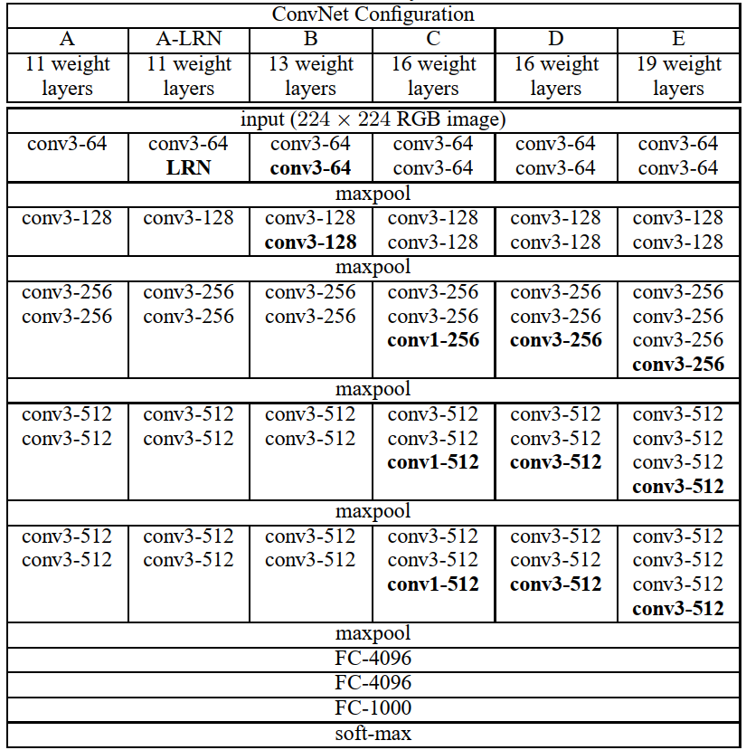

Hình 1: Cấu hình VGG (bảng 1 của bài báo VGG): sáu cấu hình A–E, độ sâu từ 11 tới 19 tầng có trọng số; `conv3-64` là tích chập 3×3 với 64 kênh ra.

## ResNet

`ResNet` có ít bộ lọc hơn và độ phức tạp thấp hơn `VGG`. Ví dụ `ResNet-34` có `3,6 G` FLOPs, chỉ bằng `18%` của `VGG-19` (`19,6 G`).

> Lưu ý: FLOPs trong bài báo coi một phép nhân-cộng là `1` phép tính (tức là đếm MACs; xem [bài độ phức tạp](dlnote/deploy_flops_vi)).

Sơ đồ kết nối của `ResNet` so với `VGG`:

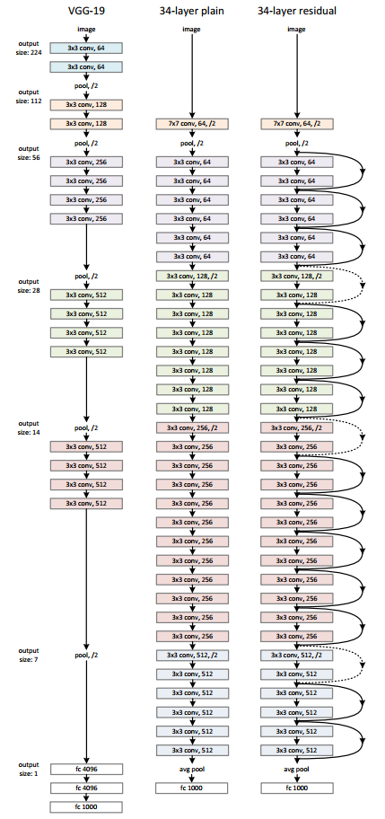

Hình 2: VGG-19 (trái), mạng thẳng 34 tầng (giữa) và ResNet 34 tầng (phải); đường cong là kết nối tắt, nét đứt là kết nối tắt có tăng chiều (hình 3 của bài báo ResNet).

Bảng cấu hình `ResNet` với các độ sâu khác nhau:

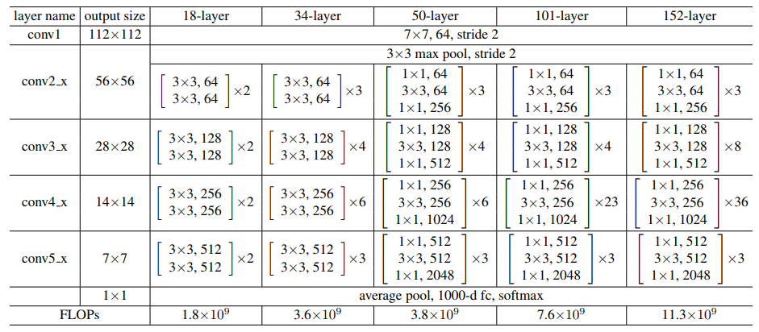

Hình 3: Cấu hình ResNet 18, 34, 50, 101, 152 tầng (bảng 1 của bài báo ResNet).

> Sau khi đọc các bài báo `ResNeXt`, `ResNet v2`, `DenseNet`, `CSPNet`, `VoVNet`, tác giả càng thấy `ResNet` thực sự là công trình mở ra thời kỳ mới cho lĩnh vực backbone: nó làm cho mạng neuron **sâu** huấn luyện được, về cơ bản giải quyết vấn đề gradient biến mất khi huấn luyện mạng sâu, và đưa ra lời giải có hệ thống (hai kiểu khối residual), tức là làm mạng "sâu" hơn một cách có hệ thống. Còn làm mạng "rộng" hơn thì đến nay chưa có phương án tốt nhất được công nhận (`Inception`, `ResNeXt` về sau ít được dùng rộng rãi). Phải chăng "rộng" không quan trọng bằng "sâu", hay ta chưa tìm ra cách hiệu quả hơn?

> **Biên tập:** Hai chỗ cần nói chính xác hơn. (1) Bài báo ResNet nói rõ vấn đề nó giải quyết là **suy thoái** (degradation: mạng thẳng sâu hơn có sai số *huấn luyện* cao hơn), và cho rằng đó *không* phải do gradient biến mất, vì các mạng đã có BN; xem [bài ResNet](dlnote/bb_resnet_vi). (2) Về độ rộng: Wide ResNet (2016) cho thấy ResNet rộng và nông hơn có thể ngang ResNet rất sâu; ResNeXt được dùng làm backbone phát hiện đối tượng khá phổ biến; và EfficientNet (2019) chỉ ra nên mở rộng cân đối cả độ sâu, độ rộng lẫn độ phân giải (mục cuối bài).

## Inception v3

Inception v3 là mô hình nhận dạng ảnh đạt độ chính xác top-1 trên 78,1% với ImageNet. Mô hình là kết tinh của nhiều ý tưởng do nhiều nhà nghiên cứu đề xuất qua nhiều năm, dựa trên bài báo [Rethinking the Inception Architecture for Computer Vision](https://arxiv.org/abs/1512.00567) của Szegedy và cộng sự.

Mô hình gồm các khối đối xứng và không đối xứng: tích chập, average pooling, max pooling, nối (concat), dropout và tầng kết nối đầy đủ. Batch normalization được dùng rộng rãi trong mô hình, kể cả cho đầu vào của hàm kích hoạt. Hàm mất mát tính qua Softmax.

Sơ đồ tóm tắt của mô hình:

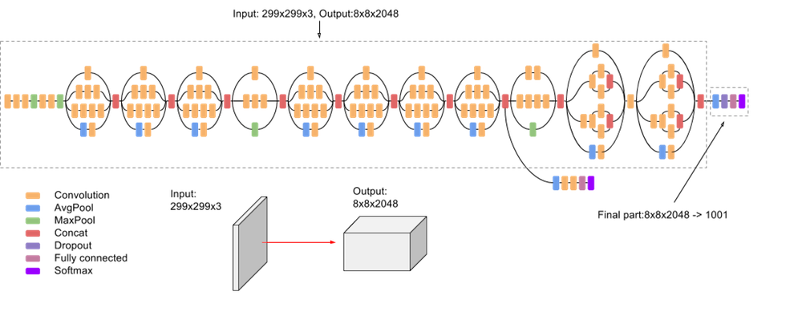

Hình 4: Sơ đồ khối của Inception v3 (nguồn: tài liệu Google Cloud TPU).

Một dạng mô-đun `Inception` thường gặp:

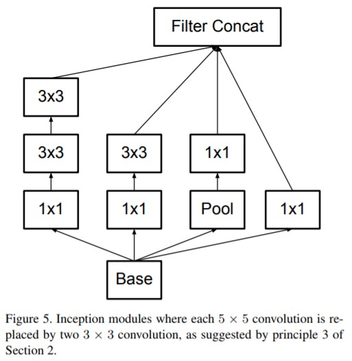

Hình 5: Mô-đun Inception: các nhánh tích chập 1×1, 3×3, 5×5 và max pooling chạy song song rồi nối lại theo kênh; tích chập 1×1 đặt trước các tích chập lớn để giảm số kênh.

## ResNet v2

Tác giả kết luận: **kết nối tắt dạng ánh xạ đồng nhất và tiền kích hoạt (pre-activation) là yếu tố then chốt để tín hiệu lan truyền thông suốt trong mạng**. Xem [bài ResNet v2](dlnote/bb_resnetv2_vi).

## ResNeXt

So sánh khối tích chập của `ResNeXt` và `ResNet`:

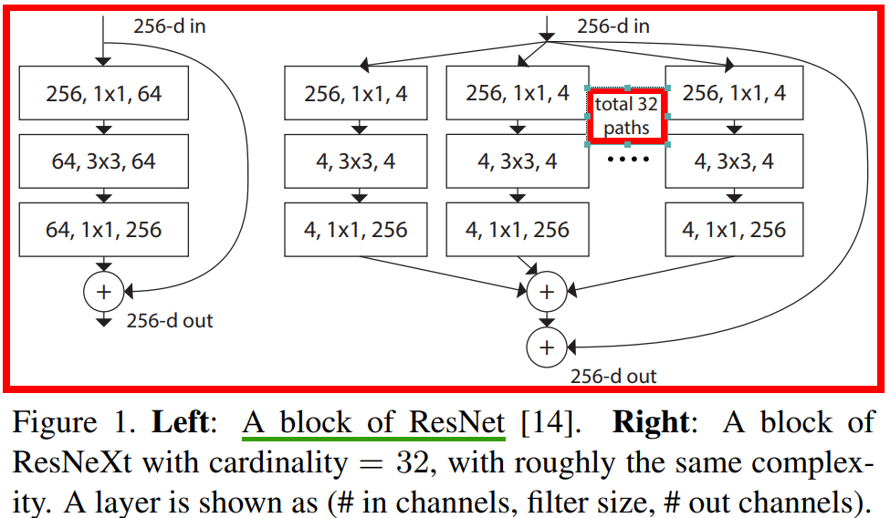

Hình 6: Trái: khối bottleneck của ResNet. Phải: khối của ResNeXt với 32 nhánh (cardinality = 32), mỗi nhánh 4 kênh; tương đương một tích chập nhóm 32 nhóm (hình 1 của bài báo ResNeXt).

So sánh tham số cấu trúc của ResNeXt và ResNet:

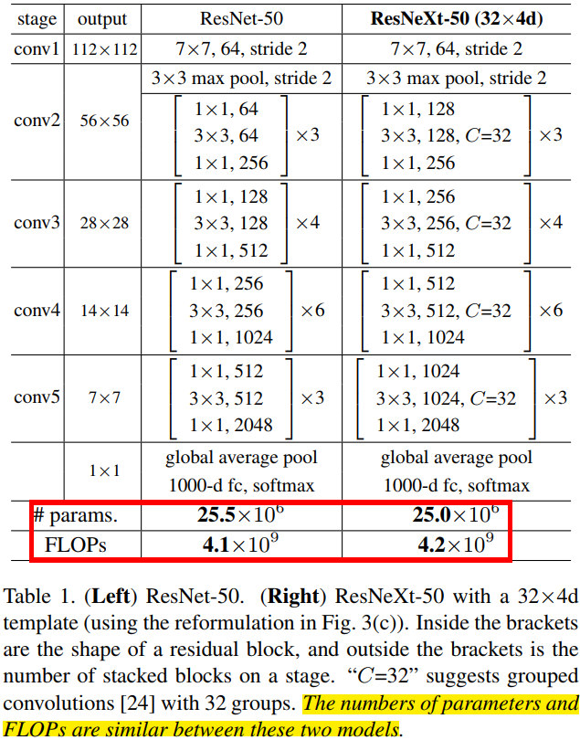

Hình 7: Cấu hình ResNet-50 và ResNeXt-50 (32×4d): số tham số và FLOPs gần bằng nhau (bảng 1 của bài báo ResNeXt).

Ý tưởng của ResNeXt là thêm một chiều mới, **cardinality** (số nhánh, tức số nhóm của tích chập nhóm), bên cạnh độ sâu và độ rộng: với cùng ngân sách tham số và FLOPs, tăng số nhóm hiệu quả hơn tăng độ sâu hay độ rộng. Về tích chập nhóm, xem [bài lớp tích chập](dlnote/dl_conv_vi).

## Darknet53

Sơ đồ kết nối của `Darknet53`:

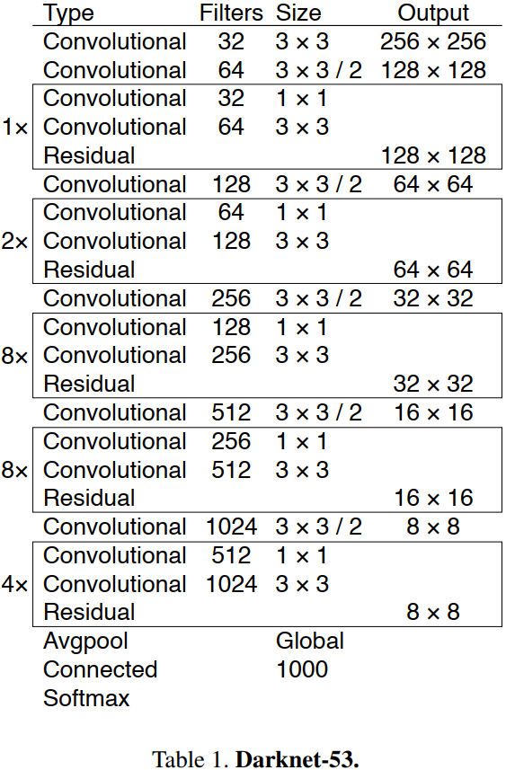

Hình 8: Darknet-53, backbone của YOLOv3: 53 tầng tích chập, các khối residual 1×1 rồi 3×3, giảm kích thước bằng tích chập stride 2 thay cho pooling (bảng 1 của bài báo YOLOv3).

## DenseNet

> Bài báo `Densely Connected Convolutional Networks` của `Gao Huang` và cộng sự (CVPR 2017).

**Trong khối dày đặc (`DenseBlock`), mỗi tầng nhận đầu vào là kết quả nối (`concat`) đầu ra của mọi tầng trước nó.** Ba cách vẽ cấu trúc `DenseBlock` (khối dày đặc, tương tự khối residual):

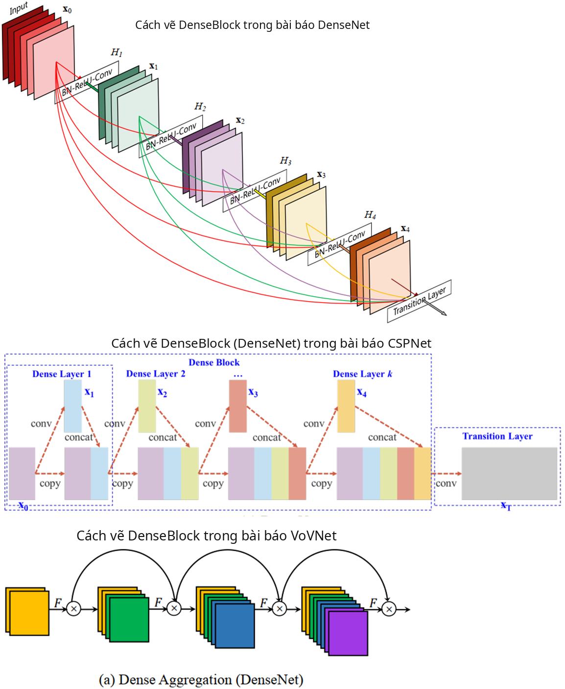

Hình 9: Cách vẽ DenseBlock trong bài báo DenseNet (trên), CSPNet (giữa) và VoVNet (dưới).

Có thể thấy bài báo `DenseNet` nhấn mạnh quan hệ kết nối dày đặc (`dense connection`) giữa các tầng tích chập trong `DenseBlock`, còn hai cách vẽ kia nhấn mạnh đầu vào của mỗi tầng là các feature map của mọi tầng trước chồng lên nhau, thể hiện số feature map tăng dần.

> **Biên tập:** Bản gốc ghi bài báo DenseNet công bố năm 2018; bài đăng arXiv tháng 8/2016 và nhận giải bài báo xuất sắc nhất CVPR 2017. Xem [bài DenseNet](dlnote/bb_densenet_vi).

## CSPNet

**Một giai đoạn (stage) của `CSPDenseNet` gồm một khối dày đặc từng phần và một tầng chuyển tiếp từng phần (`a partial dense block and a partial transition layer`).**

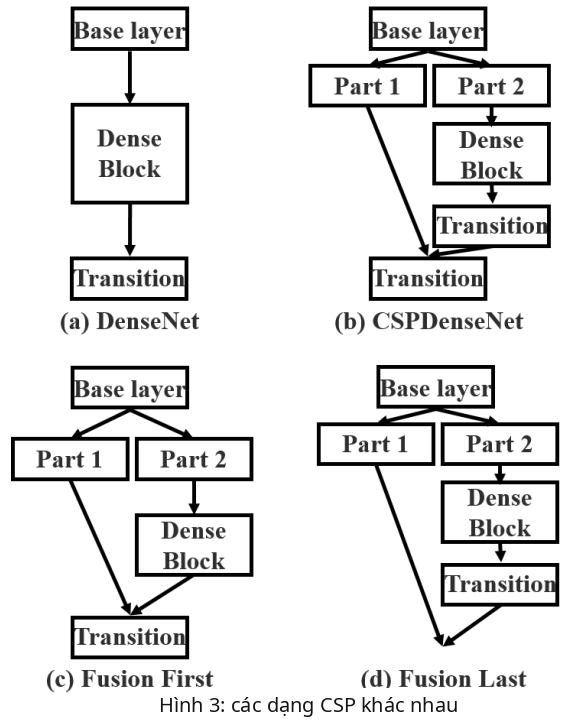

Hình 10: Một số dạng hợp nhất CSP khác nhau (hình 3 của bài báo CSPNet).

Phương pháp `CSP` giảm lượng tính toán và tăng tốc độ mà không giảm độ chính xác, là cách thiết kế mạng hiệu quả hơn, và kết hợp được với các `backbone` như `ResNet`, `DenseNet`, `Darknet`. Xem [bài CSPNet](dlnote/bb_cspnet_vi).

## VoVNet

**One-Shot Aggregation (OSA, "gộp một lần") nghĩa là phép concat trong mô-đun OSA chỉ làm một lần: chỉ tầng cuối (tích chập $1\times 1$) nhận đầu vào là concat của feature map mọi tầng trước.** Cấu trúc mô-đun `OSA` như hình 1(b).

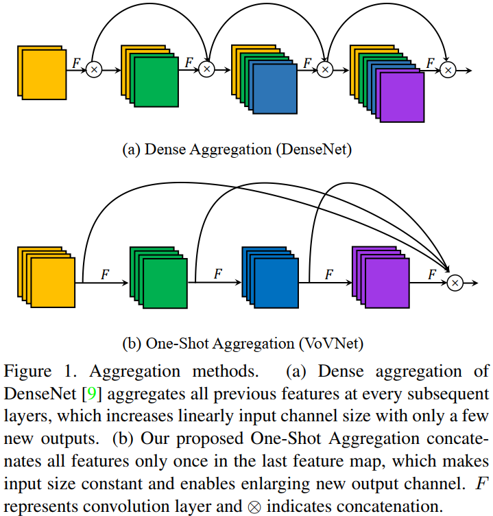

Hình 11: (a) Kết nối dày đặc của DenseNet. (b) Mô-đun OSA của VoVNet (hình 1 của bài báo VoVNet).

Trong `OSA module`, mỗi tầng sinh ra hai kết nối: một qua `conv` tới tầng kế tiếp, cho `feature map` có trường tiếp nhận (`receptive field`) lớn hơn; một nối thẳng tới tầng ra cuối, để gộp đủ đặc trưng tốt. Dùng `OSA module`, `MAC` của `DenseNet-40` (`5` tầng, `43` kênh) giảm `30%` (`3,7M → 2,5M`).

Bảng cấu hình các `VoVNet` dựng từ mô-đun OSA:

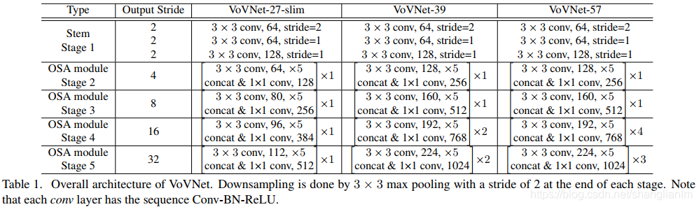

Hình 12: Cấu hình VoVNet-27-slim, VoVNet-39, VoVNet-57 (bảng 2 của bài báo VoVNet).

Tác giả VoVNet cho rằng `DenseNet` có ít tham số và `FLOPs` hơn mà kết quả tốt hơn `ResNet` chủ yếu vì `concat` giữ được nhiều thông tin hơn `add`. Nhưng thực tế `DenseNet` lại chậm hơn và tốn tài nguyên hơn `ResNet`.

Hiệu quả tính toán của `GPU`:

- `GPU` giỏi tính toán song song (`parallel computation`): `tensor` càng lớn, `GPU` dùng càng hiệu quả.
- Chia phép tích chập lớn thành nhiều phép nhỏ rời rạc bất lợi cho tính toán trên `GPU`.
- Nên thiết kế mạng có ít tầng.
- Tích chập 1×1 giảm được lượng tính toán, nhưng bất lợi cho tính toán trên GPU.

Bài báo CenterMask đề xuất VoVNet v2, sơ đồ khối tích chập như sau:

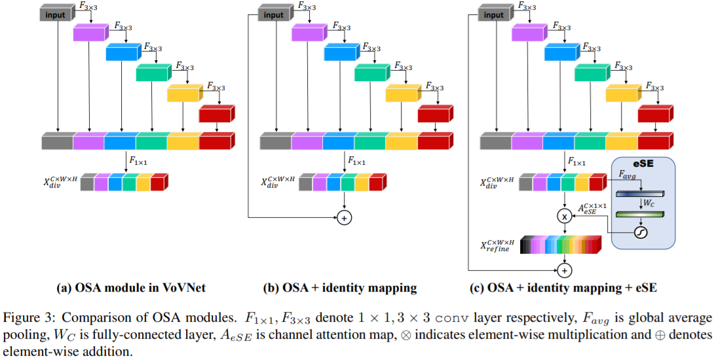

Hình 13: (a) Mô-đun OSA. (b) OSA thêm kết nối residual. (c) OSA thêm residual và mô-đun chú ý kênh eSE: mô-đun OSA của VoVNet v2 (bài báo CenterMask).

Xem [bài VoVNet](dlnote/bb_vovnet_vi).

## Một số kết luận

- Khi số kênh vào và ra của tầng tích chập bằng nhau, lượng truy cập bộ nhớ (`MAC`) nhỏ nhất.
- Yếu tố chính quyết định điện năng tiêu thụ của CNN là lượng truy cập bộ nhớ MAC, không phải lượng tính toán FLOPs.
- GPU giỏi tính toán song song, tensor càng lớn GPU dùng càng hiệu quả; chia tích chập lớn thành nhiều phép nhỏ rời rạc bất lợi cho GPU.
- Tích chập 1×1 giảm được lượng tính toán, nhưng bất lợi cho tính toán trên GPU.

> **Biên tập:** Kết luận thứ nhất là nguyên tắc G1 của ShuffleNet v2, đúng với một tầng tích chập 1×1 khi tổng FLOPs cố định (xem [bài ShuffleNet v2](dlnote/bb_shufflenet_vi) và trang Code). Kết luận thứ hai lấy từ bài VoVNet, đo trên GPU; nó phản ánh việc truy cập DRAM tốn năng lượng hơn nhiều so với một phép tính (khoảng hai bậc độ lớn), nhưng mức đóng góp thực tế phụ thuộc phần cứng. Về kết luận cuối: tích chập 1×1 có cường độ tính toán thấp hơn 3×3 nên hiệu suất trên mỗi FLOP thấp hơn, nhưng vẫn là thành phần chính của mọi mạng hiện đại; xem mô hình roofline ở [bài độ phức tạp](dlnote/deploy_flops_vi).

## Bổ sung: các backbone từ 2019 tới nay

Mục này do người biên soạn viết thêm.

| Mạng | Năm | Ý tưởng chính |
| --- | --- | --- |
| EfficientNet | 2019 | Tìm kiến trúc (NAS) cho mạng gốc B0 dựa trên khối MBConv (inverted residual của MobileNet v2 + SE), rồi **mở rộng phức hợp** (compound scaling): tăng đồng thời độ sâu, độ rộng và độ phân giải theo các hệ số $\alpha^\phi, \beta^\phi, \gamma^\phi$ cố định. B0–B7 từ 5,3 tới 66 triệu tham số. |
| RegNet | 2020 | Thay vì tìm từng mạng, tìm **không gian thiết kế** tốt: độ rộng các giai đoạn tăng theo hàm tuyến tính lượng tử hoá; ra họ RegNetX/RegNetY đơn giản, nhanh trên GPU. |
| RepVGG | 2021 | Huấn luyện mạng nhiều nhánh, suy luận bằng chồng tích chập 3×3 thuần (tái tham số hoá cấu trúc); xem [bài RepVGG](dlnote/bb_repvgg_vi). |
| ViT | 2020 | Cắt ảnh thành các mảnh 16×16, coi mỗi mảnh là một token và dùng Transformer thuần; vượt CNN khi được tiền huấn luyện trên dữ liệu rất lớn (JFT-300M), DeiT (2021) huấn luyện được trên ImageNet-1k bằng tăng cường mạnh và chưng cất. |
| Swin Transformer | 2021 | Self-attention trong cửa sổ cục bộ, dịch cửa sổ giữa các tầng, và cấu trúc phân cấp nhiều tỉ lệ như CNN; dùng tốt cho phát hiện, phân đoạn. |
| ConvNeXt | 2022 | "Hiện đại hoá" ResNet theo các lựa chọn của Swin (kernel depthwise 7×7, inverted bottleneck, LayerNorm, GELU, ít hàm kích hoạt, công thức huấn luyện mới): CNN thuần ngang Swin. ConvNeXt V2 (2023) thêm tiền huấn luyện tự giám sát kiểu masked autoencoder. |
| Mạng nhẹ hiện nay | 2019–2024 | MobileNet v3 (NAS + h-swish + SE), EfficientNet-Lite, MobileOne (tái tham số hoá cho di động), FastViT, EfficientViT, MobileNet v4 (khối UIB, 2024). |

Xu hướng sau 2020: (1) kiến trúc và **công thức huấn luyện** quan trọng ngang nhau, nhiều so sánh cũ bị đảo ngược khi huấn luyện lại bằng công thức hiện đại (ResNet-50 lên 80,9% top-1); (2) backbone được **tiền huấn luyện tự giám sát** trên dữ liệu lớn (DINOv2, MAE, CLIP) rồi dùng chung cho nhiều bài toán; (3) với thiết bị di động, tiêu chí thiết kế là **độ trễ đo thật** trên phần cứng đích chứ không phải FLOPs, đúng tinh thần của ShuffleNet v2 và RepVGG. Xem thêm [mục 4.8 của khoá Ôn tập](qa/ch04_vi).

## Tài liệu tham khảo

- Các bài báo `VGG`, `ResNet`, `Inception`, `ResNeXt`, `CSPNet`.
- [Bài báo học sâu: An Energy and GPU-Computation Efficient Backbone Network for Object Detection và cài đặt PyTorch](https://blog.csdn.net/shanglianlm/article/details/106482678)
- Tan, Le. [EfficientNet: Rethinking Model Scaling for Convolutional Neural Networks](https://arxiv.org/abs/1905.11946). ICML 2019.
- Radosavovic et al. [Designing Network Design Spaces](https://arxiv.org/abs/2003.13678) (RegNet). CVPR 2020.
- Dosovitskiy et al. [An Image is Worth 16x16 Words](https://arxiv.org/abs/2010.11929) (ViT). ICLR 2021.
- Liu et al. [Swin Transformer](https://arxiv.org/abs/2103.14030). ICCV 2021.
- Liu et al. [A ConvNet for the 2020s](https://arxiv.org/abs/2201.03545) (ConvNeXt). CVPR 2022.
- Zagoruyko, Komodakis. [Wide Residual Networks](https://arxiv.org/abs/1605.07146). BMVC 2016.
