# CNN hiệu quả: VoVNet

> Ghi chú của người biên soạn: trang này dịch từ ghi chú *dl_note* của **Harley Zhang** ([bản gốc](https://github.com/harleyszhang/dl_note/blob/main/3-classic_backbone/efficient_cnn/VoVNet论文解读.md), [kho mã](https://github.com/harleyszhang/dl_note), giấy phép [Apache-2.0](https://www.apache.org/licenses/LICENSE-2.0); phần dịch có chỉnh sửa). Số mục giữ như bản gốc. Chỗ bản gốc sai, thiếu hoặc đã lỗi thời được sửa ngay trong bài và ghi ở ô **Biên tập**. Các mục có chữ **Bổ sung** do người biên soạn viết thêm.

Bài này đọc bài báo *An Energy and GPU-Computation Efficient Backbone Network for Real-Time Object Detection* (Lee và cộng sự, CVPRW 2019), giới thiệu VoVNet và mô-đun OSA. Trang [Code](dlnote/backbone_code_vi) đi kèm dựng VoVNet-27-slim, 39, 57 từ code ở mục 5 (tệp `vovnet.py` của bản gốc), đếm tham số và MACs, đo độ trễ trên CPU, và so lượng truy cập bộ nhớ (MAC) của một DenseBlock với một mô-đun OSA.

<div class="qa-theory">

**Lý thuyết:** [Ôn tập · Bổ sung: ResNet và DenseNet](qa/ch04_vi?id=bổ-sung-resnet-và-densenet)

</div>

## Tóm tắt

> Bài báo của `Youngwan Lee` và cộng sự năm `2019`, *An Energy and GPU-Computation Efficient Backbone Network for Real-Time Object Detection*, là một bản cải tiến cho vấn đề suy luận kém hiệu quả của `DenseNet`.

Vì `DenseNet` dùng kết nối dày đặc để gộp các đặc trưng trung gian có trường tiếp nhận khác nhau, nó làm việc tốt trong phát hiện đối tượng. Dù tái sử dụng đặc trưng (`feature reuse`) giúp `DenseNet` tạo đặc trưng mạnh với ít tham số và `FLOPs`, bộ phát hiện dùng `DenseNet` làm `backbone` lại chậm và kém hiệu quả. Tác giả cho rằng nguyên nhân là kết nối dày đặc (`dense connection`) làm số kênh vào tăng tuyến tính, dẫn tới chi phí truy cập bộ nhớ và điện năng cao. Để DenseNet hiệu quả hơn, tác giả đề xuất mạng mới hiệu quả hơn là `VoVNet`, gồm các mô-đun `OSA` (`One-Shot Aggregation`, gộp một lần). `OSA` **chỉ gộp đặc trưng của mọi tầng trước ở tầng cuối của mô-đun**: cấu trúc này vừa kế thừa ưu điểm biểu diễn đa dạng nhờ nhiều trường tiếp nhận của `DenseNet`, vừa giải quyết sự kém hiệu quả của kết nối dày đặc. Bộ phát hiện dựa trên `VoVNet` không chỉ nhanh gấp 2 lần bộ dựa trên `DenseNet` mà còn tiêu thụ ít hơn 1,5–4,1 lần điện năng. Ngoài ra, `VoVNet` nhanh và hiệu quả hơn cả `ResNet`, và phát hiện đối tượng nhỏ tốt hơn rõ rệt.

## 1 Giới thiệu

Với những tiến bộ lớn của các mô hình `CNN` như `VGG`, `ResNet` và `DenseNet`, chúng bắt đầu được dùng rộng rãi làm `backbone` trích đặc trưng ảnh cho bộ phát hiện đối tượng.

Khác biệt chính giữa `ResNet` và `DenseNet` là cách gộp đặc trưng: `ResNet` gộp với đặc trưng trước bằng phép cộng từng phần tử (`element-wise add`), còn `DenseNet` bằng phép nối (`concatenation`). `Zhu` và cộng sự trong [bài báo 32](https://arxiv.org/abs/1801.05895) cho rằng thông tin mà các feature map trước mang theo sẽ bị "xoá mờ" khi cộng với các feature map khác. Nói cách khác, nối (`concatenation`) mới giữ được đặc trưng sớm truyền tiếp xuống, vì giữ nguyên dạng ban đầu của đặc trưng (không đổi bản thân đặc trưng).

Một số công trình gần đây [25, 17, 13] cho thấy **đặc trưng trừu tượng với nhiều trường tiếp nhận nắm bắt được thông tin thị giác ở nhiều tỉ lệ**. Bài toán phát hiện cần đa dạng tỉ lệ hơn phân loại để nhận ra đối tượng, nên giữ thông tin từ các tầng (mỗi tầng có trường tiếp nhận khác nhau) đặc biệt quan trọng cho phát hiện. Vì vậy trong phát hiện đối tượng, `DenseNet` có biểu diễn đặc trưng tốt và đa dạng hơn `ResNet`.

> Câu hỏi của tác giả bản gốc: phải chăng với bài toán phân loại đa nhãn, dùng VoVNet làm backbone sẽ tốt hơn ResNet, vì nó biểu diễn đặc trưng với nhiều trường tiếp nhận?

Dù bộ phát hiện dùng DenseNet có ít tham số và FLOPs hơn ResNet, nó lại tốn điện hơn và chậm hơn. Đó là vì ngoài FLOPs và kích thước mô hình (số tham số), còn có yếu tố khác ảnh hưởng tới điện năng.

Thứ nhất, **lượng truy cập bộ nhớ** `MAC` là yếu tố then chốt của điện năng. Như hình 1(a), vì mọi feature map trong DenseNet đều được kết nối dày đặc làm đầu vào cho các tầng sau, lượng truy cập bộ nhớ tăng theo bình phương độ sâu, gây thêm chi phí tính toán và tiêu thụ điện nhiều hơn.

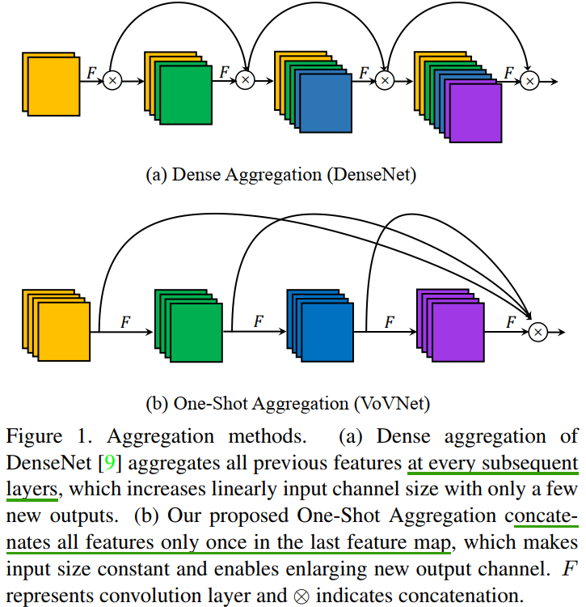

Hình 1.1: (a) Kết nối dày đặc của DenseNet. (b) Mô-đun One-Shot Aggregation của VoVNet (hình 1 của bài báo).

Từ hình (a) có thể thấy đầu vào mỗi tầng trong DenseBlock là chồng feature map của mọi tầng trước; còn ở hình (b) chỉ tầng cuối nhận chồng feature map của mọi tầng trước.

Thứ hai, về **tính toán song song trên GPU**, DenseNet bị nút thắt tính toán. Nói chung, tensor càng lớn thì GPU tận dụng song song càng tốt [19, 29, 13]. Nhưng do số kênh vào tăng tuyến tính, DenseNet phải dùng cấu trúc `bottleneck` tích chập 1×1 để giảm số chiều vào và `FLOPs`, dẫn tới nhiều tầng hơn với tensor nhỏ hơn. Kết quả là GPU tính toán kém hiệu quả. Tóm lại, tích chập $1\times 1$ trong cấu trúc `bottleneck` làm giảm hiệu suất tận dụng song song của `GPU`.

Mục tiêu của bài báo là làm DenseNet hiệu quả hơn, đồng thời giữ phép gộp bằng nối (`concatenative aggregation`) có lợi cho phát hiện đối tượng.

> Tác giả cho rằng kết nối dày đặc (`dense connections`) giữa các tầng giữa trong DenseBlock làm mạng kém hiệu quả, và giả thuyết rằng các kết nối dày đặc này là thừa.

Tác giả dùng mô-đun `OSA` để dựng mạng `VoVNet`, và để kiểm chứng hiệu quả, dùng nó làm backbone cho DSOD, RefineDet và Mask R-CNN để so sánh. Kết quả cho thấy bộ phát hiện dựa trên VoVNet tốt hơn DenseNet và ResNet, cả về tốc độ lẫn điện năng.

## 2 Các yếu tố ảnh hưởng tới thiết kế mạng hiệu quả

Tác giả cho rằng MobileNet v1 [8], MobileNet v2 [21], ShuffleNet v1 [31], ShuffleNet v2 [18] và Pelee chủ yếu giảm `FLOPs` và kích thước mô hình (số tham số) bằng tích chập `DW` và cấu trúc `bottleneck` có tích chập $1\times 1$.

> Tác giả bản gốc thấy nhận định này chưa chặt chẽ, vì bài báo ShuffleNet v2 đã nói rõ FLOPs và số tham số không phải yếu tố duy nhất quyết định tốc độ.

Thực tế, giảm `FLOPs` và kích thước mô hình không phải lúc nào cũng bảo đảm giảm thời gian suy luận trên GPU và điện năng thực tế. Ví dụ điển hình là so sánh `DenseNet` với `ResNet`, hay trên GPU, ShuffleNet v2 chạy nhanh hơn MobileNet v2 với cùng số tham số. Các hiện tượng này cho thấy `FLOPs` và kích thước mô hình (tham số) là các chỉ số gián tiếp về tính thực dụng (`practicality`) của mô hình. Để thiết kế mạng hiệu quả hơn, cần dùng chỉ số trực tiếp là `FPS`; ngoài FLOPs và số tham số, các yếu tố sau cũng ảnh hưởng tới tốc độ (`FPS`).

### 2.1 Lượng truy cập bộ nhớ

Tác giả ShuffleNet v2 đã giải thích rất rõ điều này, mô tả của bài báo này về cơ bản giống ShuffleNet v2. Tác giả bản gốc đưa thẳng kết luận:

- `MAC` ảnh hưởng tới điện năng nhiều hơn lượng tính toán `FLOPs` [28].
- Khi số kênh vào và ra của tầng tích chập bằng nhau, `MAC` nhỏ nhất.
- Dù số tham số như nhau, nếu `MAC` khác nhau thì thời gian chạy cũng khác nhau (ShuffleNet v2 có thí nghiệm chứng minh).

> Bài báo [28]: *Designing energy-efficient convolutional neural networks using energy-aware pruning* (Yang và cộng sự, CVPR 2017). Xem [bài ShuffleNet v2](dlnote/bb_shufflenet_vi), nguyên tắc G1.

### 2.2 Hiệu quả tính toán trên GPU

> Nội dung này về cơ bản trùng với nguyên tắc G3 của ShuffleNet v2 (mạng phân mảnh làm giảm mức song song trên GPU).

**Các kiến trúc giảm `FLOPs` để tăng tốc dựa trên giả định mọi phép tính số thực trên thiết bị đều được xử lý với cùng tốc độ.** Nhưng khi triển khai trên `GPU` thì không phải vậy, vì GPU xử lý song song nhiều phép tính cùng lúc. Bài báo dùng "hiệu quả tính toán GPU" để chỉ mức tận dụng năng lực tính toán của GPU.

- Giảm `FLOPs` để tăng tốc chỉ đúng nếu mọi phép tính số thực trên thiết bị đều có cùng tốc độ;
- **Đặc điểm của GPU**:
  - giỏi tính song song (`parallel computation`): `tensor` càng lớn, `GPU` dùng càng hiệu quả;
  - tách phép tích chập lớn thành nhiều phép nhỏ rời rạc bất lợi cho GPU.
- Vì vậy thiết kế mạng có ít `layer` là lựa chọn tốt hơn. `MobileNet` dùng thêm tích chập 1x1 để giảm lượng tính toán, nhưng điều này bất lợi cho GPU.
- Để đo mức tận dụng GPU, bài báo dùng chỉ số mới: $FLOP/s = \frac{FLOPs}{\text{GPU inference time}}$ (lượng tính toán hoàn thành mỗi giây). FLOP/s càng cao thì GPU được tận dụng càng tốt.

## 3 Phương pháp đề xuất

### 3.1 Nhìn lại kết nối dày đặc

**1. Ưu điểm của DenseNet:**

Khi tính đầu ra tầng $l$, cần kết quả nối đầu ra của mọi tầng trước. **Kết nối dày đặc này cho phép trích đặc trưng ở mọi tỉ lệ của mọi tầng** cho các tầng phía sau dùng; đó là lý do nó đạt độ chính xác khá cao. Ngoài ra **kết nối dày đặc giúp gradient lan truyền ngược tốt hơn** (bản tăng cường của kết nối tắt trong ResNet).

**2. Nhược điểm của DenseNet** (gây ra điện năng cao và suy luận kém hiệu quả):

- Kết nối dày đặc làm số kênh vào tăng dần nhưng số kênh ra giữ nguyên, nên số kênh vào và ra không bằng nhau. Vì vậy DenseNet có MAC cao.
- DenseNet dùng cấu trúc `bottleneck`, tách một tích chập $3\times 3$ thành hai phép (tích chập 1x1 rồi 3x3), thêm nhiều phép tính tuần tự (sequential computations), làm giảm tốc độ suy luận.

> Kết nối dày đặc làm lượng tính toán tăng, nên buộc phải dùng cấu trúc `bottleneck` với tích chập $1\times 1$.

Hàng thứ nhất của hình 2 thể hiện độ mạnh liên hệ giữa các tầng tích chập của DenseNet. Ô $(s,l)$ là chuẩn $L_1$ trung bình (chuẩn hoá theo số feature map) của trọng số tích chập nối tầng $s$ với tầng $l$, tức đo mức liên hệ giữa $X_s$ và $X_l$.

Chú thích hình 2 của bài báo: trị tuyệt đối trung bình của trọng số bộ lọc trong các tầng tích chập của DenseNet (trên) và VoVNet (giữa và dưới) sau khi huấn luyện. Màu của mỗi ô là chuẩn $L_1$ trung bình (chuẩn hoá theo số feature map) của trọng số giữa hai tầng được nối $(i, j)$. OSA Module (x/y) là mô-đun OSA gồm $x$ tầng và $y$ kênh.

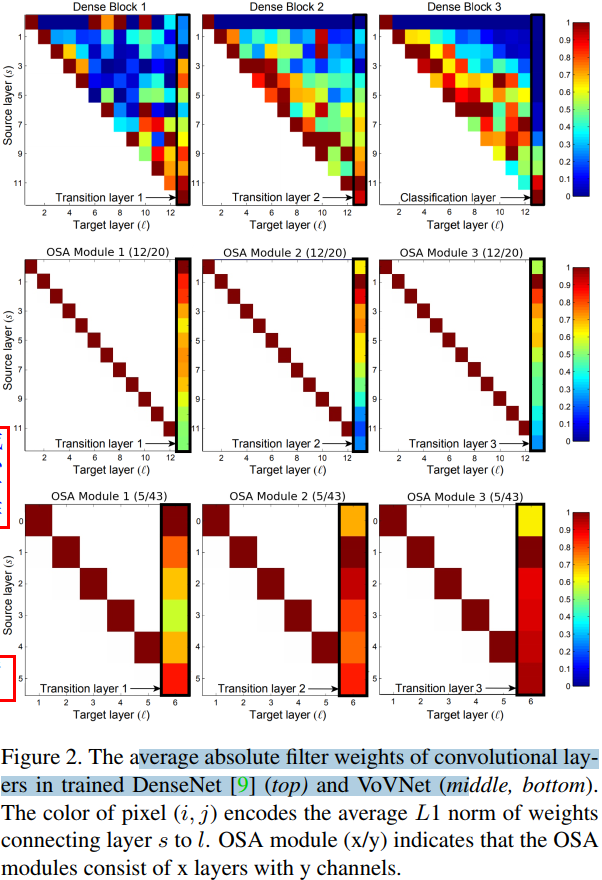

Hình 3.1: Bản đồ nhiệt độ mạnh kết nối giữa các tầng trong ba DenseBlock của DenseNet-40 (hình 2 trên của bài báo).

Như hình 2 trên, `Hu` và cộng sự [9] minh hoạ mức liên kết (`connectivity`) của kết nối dày đặc bằng chuẩn L1 đã chuẩn hoá của trọng số đầu vào mỗi tầng. Các giá trị cho thấy ảnh hưởng (đã chuẩn hoá) của mọi tầng trước lên tầng tương ứng: 1 là ảnh hưởng lớn nhất, 0 là không ảnh hưởng (trọng số giữa hai tầng không đáng kể).

> Tác giả bản gốc giải thích "liên kết" như sau: trị tuyệt đối của trọng số đầu vào giữa hai tầng càng chênh lệch, tức L1 càng lớn, thì kernel càng khác nhau, tầng trước ảnh hưởng tầng sau càng nhiều, tức liên kết càng tốt (càng lớn). Về mặt thực dụng, ta muốn liên kết giữa các tầng nối nhau càng lớn càng tốt (sau chuẩn hoá trong khoảng 0–1), như vậy kết nối dày đặc mới có tác dụng; nếu tốn tính toán, hy sinh hiệu quả mà liên kết lại kém, thì thiết kế kết nối dày đặc (`dense connection`) còn ý nghĩa gì. Hai hình sau của hình 2 cũng cho thấy **phần lớn liên hệ giữa các tầng trong DenseBlock là vô dụng, chỉ một phần nhỏ có ích, tức phần lớn kết nối trong kết nối dày đặc không hiệu quả**.

> **Biên tập:** Cách hiểu ở đầu đoạn trên chưa đúng. Chuẩn L1 ở đây không đo "độ chênh lệch" giữa các trọng số. Với tầng đích $l$, kernel của nó có các kênh vào đến từ từng tầng nguồn $s$; lấy trị tuyệt đối trung bình của phần trọng số ứng với các kênh của tầng $s$ cho ta mức tầng $l$ *dựa vào* đặc trưng của tầng $s$. Giá trị gần 0 nghĩa là tầng $l$ gần như bỏ qua đặc trưng đó (kết nối có cũng như không), gần 1 nghĩa là dựa nhiều. Kết luận "nhiều kết nối dày đặc ít được dùng" vẫn đúng.

Trong Dense Block3, ô đỏ gần đường chéo cho thấy các tầng giữa (`intermediate layers`) gộp tích cực, nhưng tầng phân loại (`classification layer`) chỉ dùng một phần nhỏ đặc trưng trung gian. Ngược lại, ở Dense Block1, tầng chuyển tiếp (`transition layer`) gộp tốt phần lớn đặc trưng vào, còn các tầng giữa thì không.

> Tầng phân loại của Dense Block3 và tầng chuyển tiếp của Dense Block1 đều là tầng cuối của khối.

Từ quan sát trên, tác giả giả thuyết rằng mức gộp ở các tầng giữa và mức gộp ở tầng cuối tương quan âm (tầng giữa gộp càng mạnh thì tầng cuối gộp càng yếu). Giả thuyết đúng nếu kết nối dày đặc giữa các tầng giữa làm đặc trưng các tầng tương quan với nhau: kết nối dày đặc giúp các tầng giữa phía sau tạo đặc trưng tốt hơn nhưng cũng giống đặc trưng các tầng trước. Khi đó, vì hai loại đặc trưng mang **thông tin dư thừa**, tầng cuối không cần học cách gộp cả hai, nên ảnh hưởng của các tầng giữa trước đó lên tầng cuối nhỏ đi.

Vì đặc trưng của tầng cuối được tạo bằng cách gộp (`aggregate`) đặc trưng của mọi tầng giữa, ta muốn các đặc trưng trung gian này bổ sung cho nhau, tương quan càng thấp càng tốt. Vì vậy, tác giả đưa ra giả thuyết tiếp: **so với chi phí gây ra, kết nối dày đặc giữa các tầng giữa có tác dụng hạn chế**. Để kiểm chứng, tác giả thiết kế lại một mô-đun mới, `OSA`, **chỉ gộp đặc trưng các tầng khác trong khối (`intermediate features`) ở tầng cuối**, bỏ toàn bộ kết nối dày đặc ở giữa.

### 3.2 One-Shot Aggregation

Để kiểm chứng giả thuyết rằng mức gộp ở tầng giữa và ở tầng cuối tương quan âm, và kết nối dày đặc là thừa, tác giả làm cùng thí nghiệm như Hu và cộng sự; kết quả là hai hình giữa và dưới của hình 2.

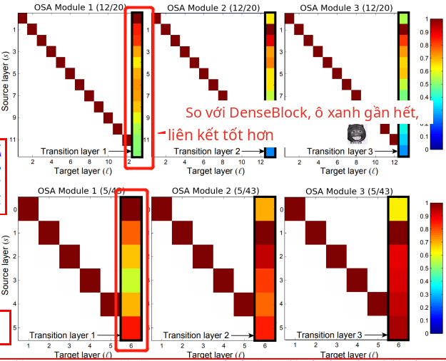

Hình 3.2: Bản đồ nhiệt của hai mô-đun OSA trên CIFAR-10 (hình 2 giữa và dưới của bài báo). Chú thích của tác giả bản gốc: so với DenseBlock, các ô xanh (liên hệ yếu) gần như không còn, liên kết tốt hơn.

Hình 2 giữa cho thấy khi bỏ kết nối dày đặc ở các tầng giữa, mức gộp ở tầng cuối mạnh lên. Đồng thời, phần màu xanh (phần liên hệ lỏng lẻo) giảm rõ rệt, tức mọi kết nối của mô-đun OSA đều **tương đối có ích**.

Hình 2 dưới cho thấy trọng số tầng chuyển tiếp của mô-đun OSA có kiểu khác DenseNet: đặc trưng từ các tầng nông được gộp vào tầng chuyển tiếp nhiều hơn. Vì đặc trưng từ các tầng sâu ảnh hưởng ít tới tầng chuyển tiếp, có thể giảm số tầng của mô-đun OSA mà không ảnh hưởng đáng kể. Đáng ngạc nhiên là với mô-đun này (5 tầng), sai số đạt 5,44%, gần bằng DenseNet-40 (mỗi khối 12 tầng) với 5,24%. Điều này cho thấy việc tạo đặc trưng trung gian sâu bằng kết nối dày đặc kém hiệu quả hơn mong đợi (*This implies that building deep intermediate feature via dense connection is less effective than expected*).

**One-Shot Aggregation (gộp một lần) nghĩa là phép concat trong mô-đun OSA chỉ làm một lần: chỉ tầng cuối nhận đầu vào là concat (chồng) feature map của mọi tầng trước.** Cấu trúc mô-đun `OSA` như hình 1(b).

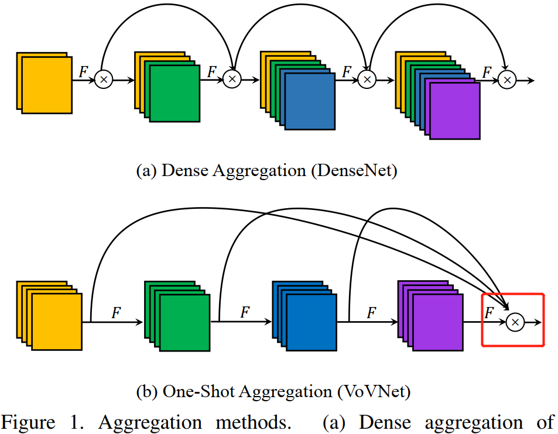

Hình 3.3: Kết nối dày đặc (a) và mô-đun OSA (b); F là tích chập, ⊕ là phép nối (hình 1 của bài báo).

Trong mô-đun OSA, mỗi tầng sinh hai kết nối: một qua tích chập tới tầng kế tiếp, cho `feature map` có `receptive field` lớn hơn; một nối thẳng tới tầng ra cuối, để gộp đủ đặc trưng tốt.

Để kiểm chứng hiệu quả của mô-đun OSA, tác giả dựng DenseNet-40 bằng dense block và bằng mô-đun OSA với số tham số như nhau để so sánh. Bản dùng mô-đun OSA đạt độ chính xác `93,6%` trên CIFAR-10, chỉ thấp hơn bản dense block `1,2%`. Theo công thức MAC, MAC giảm từ 3,7M xuống 2,5M. `MAC` giảm vì các tầng giữa của OSA có số kênh vào và ra bằng nhau, nên MAC đạt giá trị nhỏ nhất (`lower boundary`).

Vì các tầng giữa trong mô-đun OSA có số kênh vào và ra như nhau, không cần cấu trúc `bottleneck`, điều này lại tăng thêm mức tận dụng GPU.

### 3.3 Dựng mạng VoVNet

Nhờ biểu diễn đặc trưng đa dạng và hiệu quả của mô-đun `OSA`, có thể dựng mạng `VoVNet` chính xác và nhanh bằng cách **chỉ chồng vài mô-đun**. Từ nhận xét ở hình 2 rằng các tầng nông dễ được gộp hơn, tác giả cho rằng có thể dùng các mô-đun `OSA` có nhiều kênh hơn nhưng ít tầng tích chập hơn so với `DenseNet`.

Như hình dưới, tác giả dựng VoVNet-27-slim, VoVNet-39 và VoVNet-57. Tầng giảm kích thước (downsampling) là max pooling 3x3 stride 2, còn "conv" là chuỗi Conv-BN-ReLU.

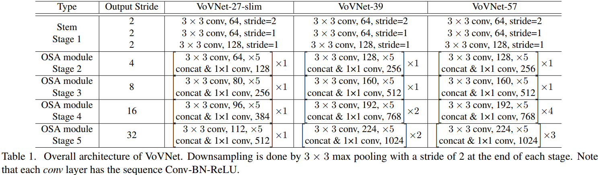

Hình 3.4: Cấu trúc VoVNet-27-slim, VoVNet-39, VoVNet-57 (bảng của bài báo).

VoVNet gồm 5 giai đoạn, kích thước đặc trưng giảm một nửa sau mỗi giai đoạn. Đồ thị kết nối của 2 giai đoạn đầu VoVNet-27:

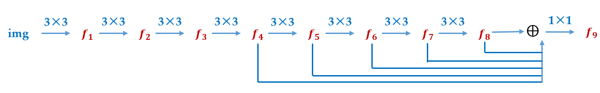

Hình 3.5: Giai đoạn stem (ba tích chập 3×3) và giai đoạn OSA đầu tiên của VoVNet-27-slim.

## 4 Thí nghiệm

Công thức tính điện năng tiêu thụ của GPU:

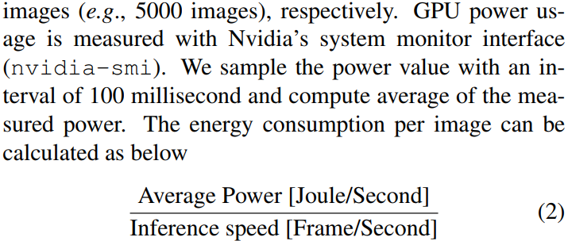

Hình 4.1: Công suất GPU được đo bằng `nvidia-smi`, lấy mẫu mỗi 100 ms rồi lấy trung bình; điện năng mỗi ảnh = công suất trung bình (J/s) chia cho tốc độ suy luận (ảnh/s) (công thức (2) của bài báo).

**Thí nghiệm 1: VoVNet so với DenseNet, so sánh các bộ phát hiện với backbone khác nhau (PASCAL VOC)**

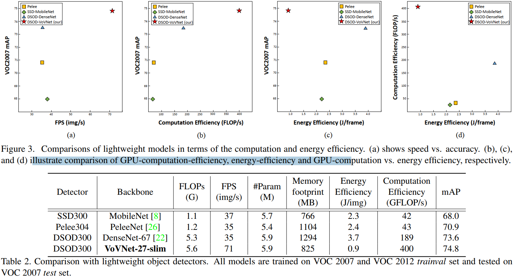

Hình 4.2: So sánh các backbone nhẹ trong DSOD trên PASCAL VOC (bảng của bài báo).

Các chỉ số so sánh:

- FLOPs: lượng tính toán mô hình cần;
- FPS: tốc độ suy luận, ảnh/giây;
- Params: số tham số;
- Memory footprint: bộ nhớ chiếm;
- Energy Efficiency: điện năng mỗi ảnh;
- Computation Efficiency: hiệu quả tính toán GPU (GFLOP/s);
- mAP: chỉ số độ chính xác của phát hiện đối tượng.

Hiện tượng và tổng kết:

- **Hiện tượng 1**: so với DenseNet-67, PeleeNet giảm FLOPs nhưng tốc độ suy luận không tăng; ngược lại, VoVNet-27-slim tăng FLOPs một chút nhưng tốc độ suy luận tăng gấp đôi. Đồng thời VoVNet-27-slim chính xác hơn mọi mô hình khác.
- **Hiện tượng 2**: VoVNet-27-slim tốt nhất về bộ nhớ chiếm, điện năng và mức tận dụng GPU.
- **Kết luận 1**: so với các mô hình khác, **VoVNet cân bằng được độ chính xác và hiệu quả, nâng hiệu năng tổng thể của phát hiện đối tượng**.

> **Biên tập:** Bản gốc viết hiện tượng 2 là VoVNet-27-slim có bộ nhớ chiếm và điện năng "cao nhất". Ý đúng là *tốt nhất*: bộ nhớ chiếm và điện năng mỗi ảnh *thấp nhất*, còn hiệu quả tính toán GPU *cao nhất*.

**Thí nghiệm 2: Thí nghiệm loại bỏ (ablation) với bottleneck tích chập 1×1.**

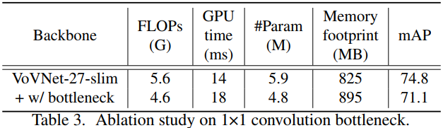

Hình 4.3: VoVNet-27-slim có và không có bottleneck 1×1 (bảng của bài báo).

**Kết luận 2**: bottleneck 1x1 làm tăng thời gian suy luận trên GPU và giảm mAP, dù giảm số tham số và lượng tính toán.

Vì bottleneck 1x1 làm tăng tổng số tầng, cần thêm nhiều kích hoạt trung gian, nên làm tăng bộ nhớ chiếm.

**Thí nghiệm 3: Hiệu quả tính toán trên GPU.**

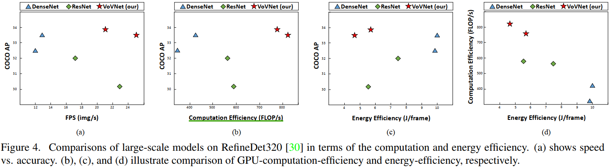

Hình 4.4: (a) Độ chính xác so với tốc độ suy luận; (b) độ chính xác so với hiệu quả tính toán GPU; (c) độ chính xác so với điện năng; (d) điện năng so với hiệu quả tính toán GPU (hình 3 của bài báo).

- Hình 3(a): VoVNet cân bằng độ chính xác và tốc độ suy luận;
- Hình 3(b): VoVNet cân bằng độ chính xác và mức tận dụng GPU;
- Hình 3(c): VoVNet cân bằng độ chính xác và điện năng;
- Hình 3(d): VoVNet cân bằng điện năng và mức tận dụng GPU.

**Thí nghiệm 4: so sánh VoVNet, ResNet và DenseNet trên kiến trúc RefineDet.**

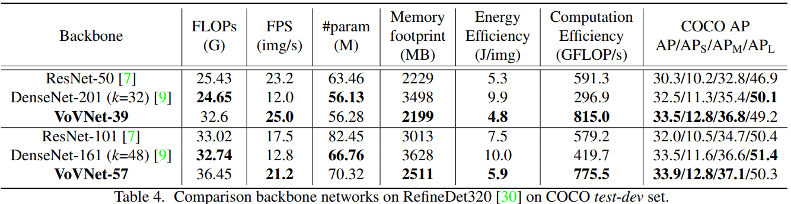

Hình 4.5: So sánh backbone trong RefineDet320 trên COCO (bảng của bài báo).

**Kết luận 4**: theo kết quả trên COCO, so với ResNet, VoVNet hơn về tốc độ suy luận, bộ nhớ chiếm, điện năng, mức tận dụng GPU và độ chính xác, dù nhiều trường hợp VoVNet cần nhiều tính toán và tham số hơn.

- So sánh DenseNet-161 ($k=48$) và DenseNet-201 ($k=32$) cho thấy mạng sâu và "gầy" tận dụng GPU kém hơn.
- Ngoài ra, tác giả thấy **so với ResNet, VoVNet phát hiện đối tượng nhỏ tốt hơn**.

**Thí nghiệm 5: Mask R-CNN huấn luyện từ đầu.**

Thay backbone của Mask R-CNN, VoVNet cũng vượt ResNet về tốc độ suy luận và độ chính xác.

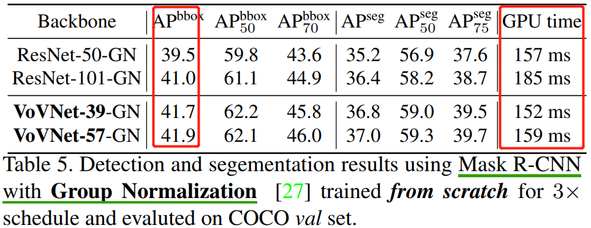

Hình 4.6: Mask R-CNN huấn luyện từ đầu với backbone ResNet-50 và VoVNet-39 trên COCO (bảng của bài báo).

## 5 Đọc code

Dù VoVNet đã có bản nâng cấp VoVNet v2 trong [bài báo CenterMask](https://arxiv.org/abs/1911.06667), phần đọc code ở đây vẫn cho VoVNet gốc; code lấy từ [kho này](https://github.com/stigma0617/VoVNet.pytorch/blob/master/models_vovnet/vovnet.py).

1. Định nghĩa các kiểu tích chập:

```python
import torch
import torch.nn as nn
import torch.nn.functional as F
from collections import OrderedDict

def conv3x3(in_channels, out_channels, module_name, postfix,
            stride=1, groups=1, kernel_size=3, padding=1):
    """Tích chập 3x3 có padding: tổ hợp conv3x3, bn, relu theo thứ tự."""
    return [
        ('{}_{}/conv'.format(module_name, postfix),
            nn.Conv2d(in_channels, out_channels, kernel_size=kernel_size, stride=stride,
                      padding=padding, groups=groups, bias=False)),
        ('{}_{}/norm'.format(module_name, postfix), nn.BatchNorm2d(out_channels)),
        ('{}_{}/relu'.format(module_name, postfix), nn.ReLU(inplace=True)),
    ]

def conv1x1(in_channels, out_channels, module_name, postfix,
            stride=1, groups=1, kernel_size=1, padding=0):
    """Tích chập 1x1."""
    return [
        ('{}_{}/conv'.format(module_name, postfix),
            nn.Conv2d(in_channels, out_channels, kernel_size=kernel_size, stride=stride,
                      padding=padding, groups=groups, bias=False)),
        ('{}_{}/norm'.format(module_name, postfix), nn.BatchNorm2d(out_channels)),
        ('{}_{}/relu'.format(module_name, postfix), nn.ReLU(inplace=True)),
    ]
```

2. Code của mô-đun `OSA`:

```python
class _OSA_module(nn.Module):
    def __init__(self, in_ch, stage_ch, concat_ch, layer_per_block, module_name, identity=False):
        super(_OSA_module, self).__init__()
        self.identity = identity    # mặc định không dùng ánh xạ đồng nhất
        self.layers = nn.ModuleList()
        in_channel = in_ch
        # stage_ch: số kênh bên trong mỗi giai đoạn
        for i in range(layer_per_block):
            self.layers.append(nn.Sequential(
                OrderedDict(conv3x3(in_channel, stage_ch, module_name, i))))
            in_channel = stage_ch
        # gộp đặc trưng
        in_channel = in_ch + layer_per_block * stage_ch
        # concat_ch: số kênh ra của tích chập 1x1,
        # cũng là số kênh vào đầu mỗi giai đoạn từ stage 3 trở đi
        self.concat = nn.Sequential(
            OrderedDict(conv1x1(in_channel, concat_ch, module_name, 'concat')))

    def forward(self, x):
        identity_feat = x
        output = [x]
        for layer in self.layers:    # các tầng giữa nối tiếp nhau
            x = layer(x)
            output.append(x)
        # tầng cuối nối feature map của mọi tầng trước
        x = torch.cat(output, dim=1)
        xt = self.concat(x)
        if self.identity:
            xt = xt + identity_feat
        return xt
```

3. Định nghĩa `_OSA_stage`; mỗi `stage` có bao nhiêu mô-đun `OSA` do tham số `block_per_stage` của hàm `_vovnet` chỉ định.

```python
class _OSA_stage(nn.Sequential):
    """in_ch: số kênh vào (số feature map) ở đầu mỗi giai đoạn."""
    def __init__(self, in_ch, stage_ch, concat_ch, block_per_stage, layer_per_block, stage_num):
        super(_OSA_stage, self).__init__()
        if not stage_num == 2:
            self.add_module('Pooling', nn.MaxPool2d(kernel_size=3, stride=2, ceil_mode=True))
        module_name = f'OSA{stage_num}_1'
        self.add_module(module_name,
            _OSA_module(in_ch, stage_ch, concat_ch, layer_per_block, module_name))
        for i in range(block_per_stage - 1):
            module_name = f'OSA{stage_num}_{i+2}'
            self.add_module(module_name,
                _OSA_module(concat_ch, stage_ch, concat_ch, layer_per_block, module_name, identity=True))
```

> **Biên tập:** Trong code của bản gốc, chuỗi tài liệu của `_OSA_stage` được thụt bằng ký tự tab, còn các dòng khác bằng dấu cách, nên Python báo `TabError` khi nạp; đã sửa thụt lề. (Các mô-đun OSA thứ hai trở đi trong một giai đoạn có kết nối residual `identity=True`; đây là chi tiết của bản cài đặt, gần với VoVNet v2 hơn bài báo gốc.)

4. Định nghĩa `VoVNet`:

```python
class VoVNet(nn.Module):
    def __init__(self, config_stage_ch, config_concat_ch, block_per_stage, layer_per_block, num_classes=1000):
        super(VoVNet, self).__init__()
        # Stem --> stage1
        stem = conv3x3(3, 64, 'stem', '1', 2)
        stem += conv3x3(64, 64, 'stem', '2', 1)
        stem += conv3x3(64, 128, 'stem', '3', 2)
        self.add_module('stem', nn.Sequential(OrderedDict(stem)))

        stem_out_ch = [128]
        # với vovnet-57, in_ch_list là [128, 256, 512, 768]
        in_ch_list = stem_out_ch + config_concat_ch[:-1]
        self.stage_names = []
        for i in range(4):   # số giai đoạn
            name = 'stage%d' % (i + 2)
            self.stage_names.append(name)
            self.add_module(name, _OSA_stage(in_ch_list[i], config_stage_ch[i], config_concat_ch[i],
                                             block_per_stage[i], layer_per_block, i + 2))
        self.classifier = nn.Linear(config_concat_ch[-1], num_classes)

        for m in self.modules():
            if isinstance(m, nn.Conv2d):
                nn.init.kaiming_normal_(m.weight)
            elif isinstance(m, (nn.BatchNorm2d, nn.GroupNorm)):
                nn.init.constant_(m.weight, 1)
                nn.init.constant_(m.bias, 0)
            elif isinstance(m, nn.Linear):
                nn.init.constant_(m.bias, 0)

    def forward(self, x):
        x = self.stem(x)
        for name in self.stage_names:
            x = getattr(self, name)(x)
        x = F.adaptive_avg_pool2d(x, (1, 1)).view(x.size(0), -1)
        x = self.classifier(x)
        return x
```

5. Các phiên bản VoVNet. VoVNet-57 có `4` giai đoạn OSA, số mô-đun OSA mỗi giai đoạn lần lượt là [1, 1, 4, 3]; số kênh bên trong mỗi giai đoạn như nhau, lần lượt là [128, 160, 192, 224]; số kênh ra cuối mỗi giai đoạn lần lượt là [256, 512, 768, 1024], do tham số `concat_ch` chỉ định.

Mọi phiên bản VoVNet đều có `5` tầng tích chập trong mỗi mô-đun OSA.

```python
def _vovnet(arch, config_stage_ch, config_concat_ch, block_per_stage, layer_per_block,
            pretrained, progress, **kwargs):
    model = VoVNet(config_stage_ch, config_concat_ch, block_per_stage, layer_per_block, **kwargs)
    if pretrained:
        state_dict = load_state_dict_from_url(model_urls[arch], progress=progress)
        model.load_state_dict(state_dict)
    return model

def vovnet57(pretrained=False, progress=True, **kwargs):
    """VoVNet-57, bài báo "An Energy and GPU-Computation Efficient Backbone Networks"."""
    return _vovnet('vovnet57', [128, 160, 192, 224], [256, 512, 768, 1024],
                   [1, 1, 4, 3], 5, pretrained, progress, **kwargs)

def vovnet39(pretrained=False, progress=True, **kwargs):
    """VoVNet-39."""
    return _vovnet('vovnet39', [128, 160, 192, 224], [256, 512, 768, 1024],
                   [1, 1, 2, 2], 5, pretrained, progress, **kwargs)

def vovnet27_slim(pretrained=False, progress=True, **kwargs):
    """VoVNet-27-slim."""
    return _vovnet('vovnet27_slim', [64, 80, 96, 112], [128, 256, 384, 512],
                   [1, 1, 1, 1], 5, pretrained, progress, **kwargs)
```

> **Biên tập:** Bản gốc viết tên mô-đun là "OSP" ở mục này; đúng là OSA. Chuỗi tài liệu của `vovnet27_slim` trong code gốc ghi nhầm "VoVNet-39". Tên mạng đếm số tầng có trọng số: VoVNet-39 có 3 tầng stem + (1+1+2+2) mô-đun × 6 tầng (5 tích chập 3×3 và 1 tích chập 1×1) = 39 tầng (không tính FC); VoVNet-57 có 3 + 9 × 6 = 57; VoVNet-27-slim có 3 + 4 × 6 = 27.

Trang Code dựng ba phiên bản trên: VoVNet-27-slim có 3,5 triệu tham số và 2,2 G MACs, VoVNet-39 có 22,6 triệu và 7,1 G, VoVNet-57 có 36,6 triệu và 8,9 G (ảnh 224×224). Với cùng 5 tầng 43 kênh như ví dụ DenseNet-40 ở mục 3.2, mô-đun OSA có khoảng một nửa số tham số và MACs, và lượng truy cập bộ nhớ của các tầng tích chập ít hơn khoảng 35% so với DenseBlock kèm tầng chuyển tiếp.

## 6 Tổng kết

Bài báo đề xuất một backbone hiệu quả cho phát hiện đối tượng thời gian thực là VoVNet. Mạng giải quyết hiệu quả sự kém hiệu quả của DenseNet bằng biểu diễn đặc trưng đa dạng nhờ nhiều trường tiếp nhận. Kỹ thuật One-Shot Aggregation (OSA) đề xuất, **gộp mọi đặc trưng một lần ở feature map cuối cùng, giải quyết vấn đề số kênh vào tăng dần của kết nối dày đặc, bảo đảm kích thước đầu vào không đổi, nhờ đó giảm chi phí truy cập bộ nhớ và tăng hiệu quả tính toán trên GPU**. Thí nghiệm cho thấy bộ phát hiện dựa trên VoVNet không chỉ nhẹ mà còn vượt bộ phát hiện dựa trên DenseNet với tốc độ nhanh hơn trên các bài toán phát hiện quy mô lớn.

> **Biên tập:** VoVNet v2 (bài báo CenterMask, 2020) thêm kết nối residual vào mô-đun OSA (để huấn luyện mạng sâu hơn, như VoVNet-99) và mô-đun chú ý kênh eSE (effective Squeeze-Excitation, chỉ một tầng FC thay vì hai), như hình 13 của [bài tổng kết](dlnote/bb_summary_vi). Ý tưởng "gộp một lần ở cuối khối" cũng xuất hiện trong khối ELAN của YOLOv7.

## Tài liệu tham khảo

- [Ghi chú bài báo VoVNet (mạng tập trung vào hiệu quả tính toán GPU và điện năng)](https://zhuanlan.zhihu.com/p/79677425)
- Lee et al. [An Energy and GPU-Computation Efficient Backbone Network for Real-Time Object Detection](https://arxiv.org/abs/1904.09730). CVPR Workshops 2019.
- [Backbone mới cho phát hiện đối tượng thời gian thực: VoVNet](https://zhuanlan.zhihu.com/p/393740052)
- Lee, Park. [CenterMask: Real-Time Anchor-Free Instance Segmentation](https://arxiv.org/abs/1911.06667). CVPR 2020.
