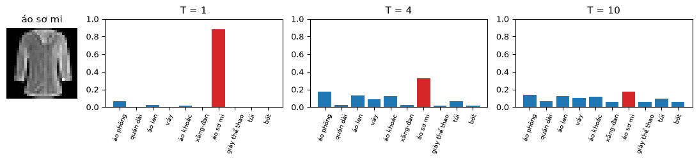
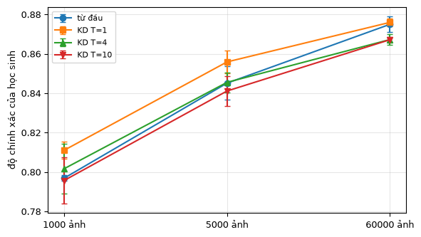

# Chưng cất tri thức · Code

> Ghi chú của người biên soạn: trang này do người biên soạn viết thêm. Nó cài đặt hàm mất mát chưng cất (2.2) của bài [Chưng cất tri thức](dlnote/compress_kd_vi), kiểm tra công thức gradient (2.3), (2.4) và hệ số $T^2$ bằng số, rồi chưng cất CNN FashionMNIST 1,7 triệu tham số (giáo viên) xuống một CNN 9 nghìn tham số (học sinh) với các lượng dữ liệu và nhiệt độ khác nhau.

## Cách dùng trang này

Các khối chạy lần lượt từ trên xuống và dùng chung biến. Cần `torch`, `torchvision`, `matplotlib`. Mọi khối chạy trên CPU; giáo viên là mô hình của [trang Code lượng tử hóa](dlnote/compress_quant_code_vi) (lưu ở `~/.cache/dlnote`, nếu chưa có thì huấn luyện khoảng một phút). Mục 3 huấn luyện 45 học sinh nhỏ, mất khoảng ba phút.

## 1. Nhãn mềm theo nhiệt độ

<small class="viz-ref">Mục 1, 2.1</small>

Ta lấy một ảnh "áo sơ mi" trong tập kiểm tra mà giáo viên đoán đúng, rồi xem phân bố (2.1) của giáo viên ở các nhiệt độ khác nhau.

<!-- run -->
```python
import warnings
warnings.filterwarnings('ignore')
import os, time, copy
import numpy as np
import torch
import torch.nn as nn
import torch.nn.functional as F
import torchvision
import torchvision.transforms as T
import matplotlib.pyplot as plt
torch.manual_seed(0)
torch.set_num_threads(4)

root = os.path.expanduser('~/.cache/d2l-data')
train_set = torchvision.datasets.FashionMNIST(root, train=True, transform=T.ToTensor(), download=True)
test_set = torchvision.datasets.FashionMNIST(root, train=False, transform=T.ToTensor(), download=True)
test_iter = torch.utils.data.DataLoader(test_set, 1000)
classes = ['áo phông', 'quần dài', 'áo len', 'váy', 'áo khoác', 'xăng-đan', 'áo sơ mi', 'giày thể thao', 'túi', 'bốt']

class Net(nn.Module):
    """Giáo viên: mô hình của trang Code lượng tử hóa."""
    def __init__(self):
        super().__init__()
        self.quant = torch.ao.quantization.QuantStub()
        self.c1 = nn.Conv2d(1, 32, 3, padding=1); self.r1 = nn.ReLU()
        self.c2 = nn.Conv2d(32, 64, 3, padding=1); self.r2 = nn.ReLU()
        self.pool = nn.MaxPool2d(2)
        self.c3 = nn.Conv2d(64, 128, 3, padding=1); self.r3 = nn.ReLU()
        self.flat = nn.Flatten()
        self.fc1 = nn.Linear(128 * 7 * 7, 256); self.r4 = nn.ReLU()
        self.fc2 = nn.Linear(256, 10)
        self.dequant = torch.ao.quantization.DeQuantStub()
    def forward(self, x):
        x = self.quant(x)
        x = self.pool(self.r1(self.c1(x)))
        x = self.pool(self.r2(self.c2(x)))
        x = self.r3(self.c3(x))
        x = self.r4(self.fc1(self.flat(x)))
        return self.dequant(self.fc2(x))

def accuracy(m):
    m.eval(); c = n = 0
    with torch.no_grad():
        for X, y in test_iter:
            c += (m(X).argmax(1) == y).sum().item(); n += len(y)
    return c / n

teacher = Net()
ckpt = os.path.expanduser('~/.cache/dlnote/fmnist_cnn.pt')
if os.path.exists(ckpt):
    teacher.load_state_dict(torch.load(ckpt))
else:
    opt = torch.optim.Adam(teacher.parameters(), 1e-3)
    for epoch in range(3):
        for X, y in torch.utils.data.DataLoader(train_set, 256, shuffle=True):
            opt.zero_grad(); F.cross_entropy(teacher(X), y).backward(); opt.step()
    os.makedirs(os.path.dirname(ckpt), exist_ok=True); torch.save(teacher.state_dict(), ckpt)
teacher.eval()
print('độ chính xác của giáo viên:', accuracy(teacher))

X_test = torch.stack([test_set[i][0] for i in range(200)])
y_test = test_set.targets[:200]
with torch.no_grad():
    logits = teacher(X_test)
i = int(((y_test == 6) & (logits.argmax(1) == 6)).nonzero()[0])   # ảnh "áo sơ mi" đầu tiên đoán đúng
z = logits[i]
print('logit:', z.numpy().round(2))
fig, axes = plt.subplots(1, 4, figsize=(11, 2.6), gridspec_kw={'width_ratios': [0.8, 2, 2, 2]})
axes[0].imshow(X_test[i, 0], cmap='gray'); axes[0].axis('off'); axes[0].set_title(classes[6])
for ax, Tm in zip(axes[1:], [1, 4, 10]):
    p = F.softmax(z / Tm, 0)
    ax.bar(range(10), p.numpy(), color=['C3' if k == 6 else 'C0' for k in range(10)])
    ax.set_xticks(range(10)); ax.set_xticklabels(classes, rotation=70, fontsize=7)
    ax.set_ylim(0, 1); ax.set_title(f'T = {Tm}')
    top = p.argsort(descending=True)[:4]
    print(f'T = {Tm:2d}: ' + ', '.join(f'{classes[k]} {float(p[k]):.3f}' for k in top))
plt.tight_layout()
```

<!-- output -->
```output
độ chính xác của giáo viên: 0.8997
logit: [ 2.67 -4.94  1.66 -0.09  1.33 -5.26  5.21 -6.02 -1.12 -6.09]
T =  1: áo sơ mi 0.881, áo phông 0.069, áo len 0.025, áo khoác 0.018
T =  4: áo sơ mi 0.326, áo phông 0.173, áo len 0.134, áo khoác 0.124
T = 10: áo sơ mi 0.177, áo phông 0.138, áo len 0.124, áo khoác 0.120
```

<div align=center></div>
<!-- /output -->

Logit của giáo viên cho ảnh này là 5,21 cho "áo sơ mi", rồi 2,67 "áo phông", 1,66 "áo len", 1,33 "áo khoác", còn ba lớp giày dép đều quanh −5 đến −6. Ở $T = 1$, giáo viên gần như chắc chắn (0,881) và các lớp áo khác chỉ còn vài phần trăm. Ở $T = 4$, thứ tự giữa các lớp hiện rõ: các loại áo (0,12–0,17) được xem là giống áo sơ mi hơn hẳn giày và túi. Đó là "tri thức tối" mà nhãn one-hot không có. Ở $T = 10$, phân bố đã gần phẳng: các loại áo gần như bằng nhau và thông tin bắt đầu mờ đi.

## 2. Hàm mất mát và hệ số $T^2$

<small class="viz-ref">Mục 2.2, 2.3</small>

Cài đặt (2.2). `F.kl_div` nhận log-xác suất của học sinh và xác suất của giáo viên; `reduction='batchmean'` chia cho kích thước batch, đúng định nghĩa KL. Sau đó ta kiểm tra:

1. Gradient của phần chưng cất (không nhân $T^2$) theo logit học sinh bằng $\frac{1}{T}(p^s - p^t)$ như (2.3), và tiến về $\frac{1}{KT^2}(z - v)$ như (2.4) khi $T$ lớn;
2. Độ lớn gradient của phần chưng cất theo $T$, khi có và không có hệ số $T^2$.

<!-- run -->
```python
def kd_loss(s_logits, t_logits, y, T_, alpha):
    """Công thức (2.2): alpha * T^2 * KL(p_t(T) || p_s(T)) + (1 - alpha) * CE(y, p_s)."""
    soft = F.kl_div(F.log_softmax(s_logits / T_, 1), F.softmax(t_logits / T_, 1),
                    reduction='batchmean') * T_ * T_
    return alpha * soft + (1 - alpha) * F.cross_entropy(s_logits, y)

torch.manual_seed(0)
K = 10
v = torch.randn(K) * 3; v -= v.mean()          # logit giáo viên, trung bình 0
z = torch.randn(K) * 3; z -= z.mean()          # logit học sinh, trung bình 0
print(f"{'T':>4s} {'lệch với (2.3)':>15s} {'lệch tương đối với (2.4)':>25s} {'|grad| không T^2':>17s} {'|grad| có T^2':>14s}")
for T_ in [1, 2, 4, 8, 16, 32]:
    zz = z.clone().requires_grad_()
    soft = F.kl_div(F.log_softmax(zz / T_, 0), F.softmax(v / T_, 0), reduction='sum')
    g, = torch.autograd.grad(soft, zz)
    g23 = (F.softmax(z / T_, 0) - F.softmax(v / T_, 0)) / T_
    g24 = (z - v) / (K * T_ ** 2)
    print(f'{T_:4d} {float((g - g23).abs().max()):15.2e} {float((g - g24).norm() / g24.norm()):25.3f}'
          f' {float(g.norm()):17.5f} {float(g.norm()) * T_ ** 2:14.4f}')
```

<!-- output -->
```output
   T  lệch với (2.3)  lệch tương đối với (2.4)  |grad| không T^2  |grad| có T^2
   1        7.45e-09                     0.942           1.11488         1.1149
   2        2.98e-08                     0.822           0.30408         1.2163
   4        7.45e-09                     0.507           0.06948         1.1117
   8        1.86e-09                     0.268           0.01637         1.0475
  16        1.40e-09                     0.136           0.00401         1.0257
  32        4.29e-10                     0.068           0.00100         1.0190
```
<!-- /output -->

- Cột thứ hai: gradient tính bằng autograd khớp (2.3) tới sai số làm tròn ($10^{-8}$), ở mọi $T$.
- Cột thứ ba: sai số tương đối so với xấp xỉ (2.4) giảm gần theo $1/T$ (0,94 ở $T = 1$, 0,27 ở $T = 8$, 0,07 ở $T = 32$). Ở nhiệt độ cao, chưng cất đúng là khớp logit bằng sai số bình phương; ở $T = 1$ thì khác hẳn.
- Hai cột cuối: không nhân $T^2$, độ lớn gradient giảm từ 1,11 xuống 0,001 khi $T$ đi từ 1 tới 32, tức gần đúng theo $1/T^2$. Nhân $T^2$ thì nó gần như không đổi (1,02–1,22). Nếu bỏ hệ số này, chọn $T = 10$ sẽ vô tình làm phần chưng cất yếu đi khoảng 100 lần so với phần nhãn cứng.

## 3. Học sinh từ đầu và học sinh được chưng cất

<small class="viz-ref">Mục 2.4, 4, 6</small>

Học sinh là một CNN hai lớp tích chập (8 và 16 kênh) và một lớp kết nối đầy đủ, khoảng 9 nghìn tham số. Ta huấn luyện nó với 1000 ảnh, 5000 ảnh và toàn bộ 60.000 ảnh, theo bốn cách: từ đầu (chỉ nhãn cứng), và chưng cất với $T = 1, 4, 10$ (cùng $\alpha = 0{,}9$). Dữ liệu càng ít thì càng nhiều epoch (30, 15, 3), để học sinh hội tụ mà thời gian chạy vẫn vừa phải. Mỗi cấu hình chạy với 3 hạt giống; bảng in trung bình và độ lệch chuẩn. Logit của giáo viên trên tập huấn luyện được tính sẵn một lần.

<!-- run -->
```python
class Student(nn.Module):
    def __init__(self):
        super().__init__()
        self.body = nn.Sequential(
            nn.Conv2d(1, 8, 3, padding=1), nn.ReLU(), nn.MaxPool2d(2),
            nn.Conv2d(8, 16, 3, padding=1), nn.ReLU(), nn.MaxPool2d(2),
            nn.Flatten(), nn.Linear(16 * 7 * 7, 10))
    def forward(self, x):
        return self.body(x)

nparams = lambda m: sum(p.numel() for p in m.parameters())
print('tham số: giáo viên', nparams(teacher), '| học sinh', nparams(Student()),
      f'| nhỏ hơn {nparams(teacher) / nparams(Student()):.0f} lần')

X_all = torch.stack([train_set[i][0] for i in range(len(train_set))])
y_all = train_set.targets.clone()
with torch.no_grad():
    T_logits = torch.cat([teacher(X_all[i:i + 2000]) for i in range(0, len(X_all), 2000)])
print('giáo viên đúng trên tập huấn luyện:', float((T_logits.argmax(1) == y_all).float().mean()))

def train_student(idx, epochs, T_=None, alpha=0.9, seed=0):
    torch.manual_seed(seed)
    s = Student(); opt = torch.optim.Adam(s.parameters(), 2e-3)
    g = torch.Generator().manual_seed(seed)
    for _ in range(epochs):
        perm = idx[torch.randperm(len(idx), generator=g)]
        for k in range(0, len(perm), 128):
            b = perm[k:k + 128]; out = s(X_all[b])
            loss = F.cross_entropy(out, y_all[b]) if T_ is None else kd_loss(out, T_logits[b], y_all[b], T_, alpha)
            opt.zero_grad(); loss.backward(); opt.step()
    return accuracy(s)

settings = [('từ đầu', None), ('KD T=1', 1), ('KD T=4', 4), ('KD T=10', 10)]
results = {}
print(f"\n{'số ảnh':>7s} {'epoch':>6s}" + ''.join(f'{name:>17s}' for name, _ in settings))
for n, epochs in [(1000, 30), (5000, 15), (60000, 3)]:
    idx = torch.randperm(60000, generator=torch.Generator().manual_seed(0))[:n]
    row = []
    for name, T_ in settings:
        accs = [train_student(idx, epochs, T_, seed=sd) for sd in range(3)]
        results[(n, name)] = accs
        row.append(f'{np.mean(accs):.4f} ± {np.std(accs):.4f}')
    print(f'{n:7d} {epochs:6d}' + ''.join(f'{r:>17s}' for r in row))
```

<!-- output -->
```output
tham số: giáo viên 1701130 | học sinh 9098 | nhỏ hơn 187 lần
giáo viên đúng trên tập huấn luyện: 0.9125833511352539

 số ảnh  epoch           từ đầu           KD T=1           KD T=4          KD T=10
   1000     30  0.7969 ± 0.0015  0.8111 ± 0.0043  0.8017 ± 0.0125  0.7958 ± 0.0118
   5000     15  0.8452 ± 0.0085  0.8559 ± 0.0056  0.8456 ± 0.0050  0.8412 ± 0.0077
  60000      3  0.8750 ± 0.0040  0.8760 ± 0.0020  0.8673 ± 0.0027  0.8672 ± 0.0012
```
<!-- /output -->

<!-- run -->
```python
fig, ax = plt.subplots(figsize=(6, 3.4))
ns = [1000, 5000, 60000]
for (name, _), mk in zip(settings, ['o', 's', '^', 'v']):
    m_ = [np.mean(results[(n, name)]) for n in ns]
    sd_ = [np.std(results[(n, name)]) for n in ns]
    ax.errorbar(range(3), m_, yerr=sd_, marker=mk, capsize=3, label=name)
ax.set_xticks(range(3)); ax.set_xticklabels([f'{n} ảnh' for n in ns])
ax.set_ylabel('độ chính xác của học sinh'); ax.grid(alpha=0.3); ax.legend(fontsize=8)
plt.tight_layout()
```

<!-- output -->
<div align=center></div>
<!-- /output -->

Học sinh nhỏ hơn giáo viên 187 lần. Ba điều rút ra:

- **Chưng cất có ích nhất khi ít dữ liệu.** Với $T = 1$, học sinh tăng 1,4 điểm ở 1000 ảnh (79,7% → 81,1%) và 1,1 điểm ở 5000 ảnh (84,5% → 85,6%), lớn hơn độ lệch giữa các lần chạy. Với đủ 60.000 ảnh, mức tăng chỉ còn 0,1 điểm: nhãn cứng đã đủ thông tin cho một học sinh nhỏ như vậy.
- **Nhiệt độ cao không giúp học sinh rất nhỏ.** $T = 4$ và $T = 10$ ở 1000 và 5000 ảnh chỉ chênh với huấn luyện từ đầu trong phạm vi độ lệch giữa các lần chạy (±0,5–1,2 điểm), và kém 0,8 điểm khi đủ dữ liệu. Theo (2.4), $T$ cao bắt học sinh khớp cả các logit rất âm của giáo viên (các lớp giày dép với ảnh áo), việc mà 9 nghìn tham số không đủ sức làm và cũng không có ích cho phân loại. Bài báo của Hinton cũng thấy học sinh nhỏ hợp với nhiệt độ thấp hơn (bài lý thuyết, mục 2.4).
- **Giáo viên giới hạn học sinh.** Giáo viên chỉ đúng 91,3% trên tập huấn luyện, nên khoảng 9% nhãn mềm chỉ sai hướng; $\alpha = 0{,}9$ đặt rất ít trọng số cho nhãn thật để sửa lại. Thử $\alpha$ nhỏ hơn, hoặc một "trợ giảng" cỡ trung gian (bài lý thuyết, mục 4), là các bước tiếp theo tự nhiên.

## Tóm tắt

| Thí nghiệm | Kết quả |
|---|---|
| Nhãn mềm của giáo viên | $T = 1$: 0,88 cho lớp đúng; $T = 4$: các loại áo 0,12–0,17, giày dép gần 0 |
| Gradient (2.3), (2.4) | Khớp (2.3) tới $10^{-8}$; sai số so với (2.4) giảm theo $1/T$ |
| Hệ số $T^2$ | Giữ độ lớn gradient ≈ 1 ở mọi $T$; không có nó, gradient giảm theo $1/T^2$ |
| KD $T = 1$ | +1,4 điểm (1000 ảnh), +1,1 (5000), +0,1 (60.000) |
| KD $T = 4$, $T = 10$ | Không hơn rõ rệt; −0,8 điểm khi đủ dữ liệu |

Học tiếp: [Chưng cất tri thức](dlnote/compress_kd_vi), [Tổng quan nén mô hình](dlnote/compress_overview_vi).
