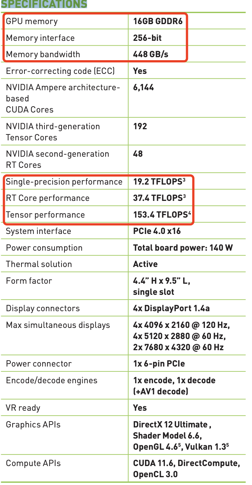
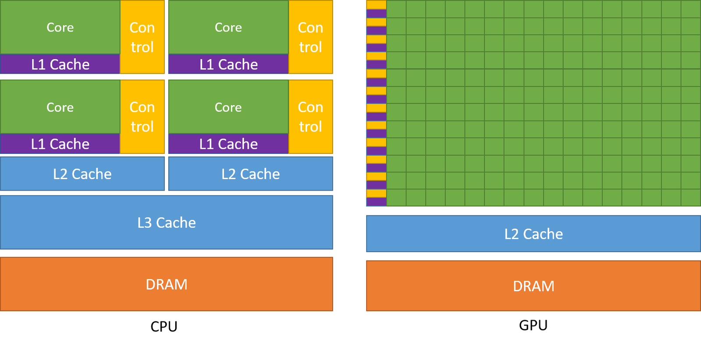

# Nén mô hình: Tổng kết mạng nhẹ

> Ghi chú của người biên soạn: trang này dịch từ ghi chú *dl_note* của **Harley Zhang** ([bản gốc](https://github.com/harleyszhang/dl_note/blob/main/5-model_compression/模型压缩-轻量化网络总结.md), [kho mã](https://github.com/harleyszhang/dl_note), giấy phép [Apache-2.0](https://www.apache.org/licenses/LICENSE-2.0); phần dịch có chỉnh sửa). Số mục giữ như bản gốc. Chỗ bản gốc sai, thiếu hoặc đã lỗi thời được sửa ngay trong bài và ghi ở ô **Biên tập**. Các mục có chữ **Bổ sung** do người biên soạn viết thêm.

> Bài này cũng được tác giả đăng ở [kho cv_note](https://github.com/HarleysZhang/cv_note/blob/master/7-model_compression/%E8%BD%BB%E9%87%8F%E7%BA%A7%E7%BD%91%E7%BB%9C%E8%AE%BA%E6%96%87%E8%A7%A3%E6%9E%90/%E8%BD%BB%E9%87%8F%E7%BA%A7%E6%A8%A1%E5%9E%8B%E8%AE%BE%E8%AE%A1%E4%B8%8E%E9%83%A8%E7%BD%B2%E6%80%BB%E7%BB%93.md) và CSDN.

## Mở đầu

**Cốt lõi của mạng nhẹ là cải tạo mạng cho nhẹ hơn cả về kích thước mô hình lẫn tốc độ, trong khi cố giữ độ chính xác.** Về cách tự tay thiết kế mạng nhẹ, hiện chưa có quy tắc chung được dùng rộng rãi, mà chỉ có một số tư tưởng chỉ đạo và các tổng kết thiết kế cho từng nền tảng chip (từng kiến trúc chip). Nên rút ra tư tưởng và gợi ý từ các bài báo kinh điển, rồi tự triển khai và đo hiệu năng mô hình trên từng nền tảng phần cứng.

Với mạng neuron tích chập, các công trình tiêu biểu là dòng `MobileNet`, dòng `ShuffleNet`, `RepVGG`, `CSPNet`, `VoVNet`, v.v. Bài giải đọc chi tiết từng mạng nằm ở phần 3 của khoá (CNN hiệu quả).

## Một số khái niệm then chốt

### Lượng tính toán FLOPs

- `FLOPs`: `floating point operations`, số phép tính dấu phẩy động, hiểu là **lượng tính toán**, dùng để đo **độ phức tạp thời gian của thuật toán/mô hình**.
- `FLOPS` (viết hoa toàn bộ): `Floating-point Operations Per Second`, số phép tính dấu phẩy động thực hiện mỗi giây, hiểu là tốc độ tính toán; là chỉ số đo hiệu năng phần cứng/tốc độ mô hình, tức năng lực tính toán của một con chip.
- `MACCs`: `multiply-accumulate operations`, số phép nhân-cộng; `MACCs` xấp xỉ một nửa `FLOPs`. Mỗi số hạng của $w[0] \cdot x[0] + \dots$ tính là một phép nhân-cộng, tức `1` `MACC`.

### Chi phí truy cập bộ nhớ MAC

`MAC`: `Memory Access Cost`, chi phí truy cập bộ nhớ. Là **tổng lượng dữ liệu trao đổi với bộ nhớ trong một lượt lan truyền xuôi** của mô hình/lớp tích chập với một mẫu đầu vào (một ảnh), đơn vị là `Byte`.

> **Biên tập:** Bản gốc gọi MAC là "độ phức tạp không gian của mô hình". Hai khái niệm này khác nhau: độ phức tạp không gian thường chỉ bộ nhớ cần giữ (tham số và feature map), còn MAC đếm lượng dữ liệu phải **đọc và ghi**. Ví dụ với lớp tích chập $1\times 1$ có $c_1$ kênh vào, $c_2$ kênh ra trên feature map $h \times w$, MAC $= hw(c_1 + c_2) + c_1 c_2$ (đọc đầu vào, ghi đầu ra, đọc trọng số), như trong bài báo ShuffleNet v2. Lưu ý thêm: chữ viết tắt MAC ở đây khác với MAC (multiply-accumulate) ở mục trên; các bài báo dùng cả hai nghĩa, nên phải xem ngữ cảnh.

> Cách tính `FLOPs` và `MAC` có trong bài *Phân tích độ phức tạp của mạng neuron tích chập* ở phần 6 (Triển khai mô hình) của khoá.

### Băng thông bộ nhớ GPU

- Băng thông bộ nhớ của `GPU` quyết định tốc độ chuyển dữ liệu từ bộ nhớ (`VRAM`) tới các nhân tính toán; đây là chỉ số tiêu biểu hơn tốc độ bộ nhớ của `GPU`.
- Băng thông bộ nhớ của `GPU` phụ thuộc vào **tốc độ truyền dữ liệu giữa bộ nhớ và nhân tính toán, cùng số đường truyền song song độc lập trên bus giữa hai phần này**.

`NVIDIA RTX A4000` dựa trên kiến trúc `Ampere` của `NVIDIA`, thông số chip như sau:

Hình 1: Thông số của NVIDIA RTX A4000 (khung đỏ: bộ nhớ và hiệu năng tính toán).

Chip `A4000` có `16 GB` bộ nhớ `GDDR6`, giao tiếp bộ nhớ `256` bit (số đường truyền độc lập trên bus giữa `GPU` và `VRAM`). Nhờ các đặc tính bộ nhớ này, băng thông bộ nhớ của `A4000` đạt `448 GB/s`.

> **Biên tập:** Con số này kiểm tra được: GDDR6 của A4000 chạy 14 Gbit/s mỗi chân, nên băng thông $= 14 \times 256 / 8 = 448$ GB/s. Từ bảng thông số còn tính được một con số quan trọng: A4000 làm được $19{,}2$ TFLOPS FP32 nhưng chỉ đọc được 448 GB/s, tức khoảng 43 phép tính cho mỗi byte đọc vào. Lớp nào làm ít phép tính hơn thế trên mỗi byte (như tích chập depthwise) sẽ bị **giới hạn bởi băng thông**, không phải bởi năng lực tính toán; đây là ý chính của mô hình roofline.

### Độ trễ và thông lượng

> Tham khảo slide [An Introduction to Modern GPU Architecture](https://download.nvidia.com/developer/cuda/seminar/TDCI_Arch.pdf) của Ashu Rege, Director of Developer Technology, NVIDIA.

Cách hiểu chung về **độ trễ** (`Latency`) và **thông lượng** (`Throughput`) trong học sâu:

+ Độ trễ (`Latency`): người hay máy khi ra quyết định hoặc hành động đều cần thời gian phản ứng. Độ trễ là **khoảng thời gian từ lúc gửi yêu cầu đến lúc nhận được phản hồi**. Với phần lớn hệ thống phần mềm phục vụ con người (không riêng hệ thống AI), độ trễ được đo bằng **mili giây**.
+ Thông lượng (`Throughput`): với một mạng học sâu đã tạo hoặc triển khai ở quy mô cho trước, có thể đưa ra bao nhiêu kết quả suy luận. Hiểu đơn giản là **số mẫu đầu vào tối đa mà mạng xử lý được trong một đơn vị thời gian (ví dụ một giây)**.

**`CPU` là bộ xử lý độ trễ thấp, thông lượng thấp; `GPU` là bộ xử lý độ trễ cao, thông lượng cao.**

### Volatile GPU Util

Nhiều người xem chỉ số `Volatile GPU Util` của lệnh `nvidia-smi` để suy ra mức sử dụng `GPU`. Nhưng với chỉ số này (`GPU Util`), rất dễ mắc **hai ngộ nhận**:

- Ngộ nhận 1: mức sử dụng `GPU` = tỉ lệ đơn vị tính toán trong `GPU` đang làm việc. Mức sử dụng càng cao thì năng lực tính toán càng được tận dụng hết.
- Ngộ nhận 2: cùng điều kiện, mức sử dụng càng cao thì thời gian chạy chắc chắn càng ngắn.

Thực ra `GPU Util` chỉ phản ánh tỉ lệ phần trăm thời gian, trong khoảng lấy mẫu, mà có ít nhất một kernel đang chạy trên `GPU`; khoảng lấy mẫu dài từ `1/6 s` đến `1 s`.

> Nguyên văn: *Percent of time over the past sample period during which one or more kernels was executing on the GPU. The sample period may be between 1 second and 1/6 second depending on the product.* Nguồn: tài liệu [nvidia-smi.txt](https://developer.download.nvidia.com/compute/DCGM/docs/nvidia-smi-367.38.pdf).

Nói nôm na là tỉ lệ thời gian có kernel `GPU` chạy trong một khoảng thời gian. Ví dụ `GPU Util` là `69%` và khoảng lấy mẫu là `1 s`, thì trong `1 s` vừa qua, thời gian có kernel `GPU` chạy là `0,69 s`. Nếu `GPU Util` là `0%` thì `GPU` không được dùng, đang rảnh.

Tức là **chỉ số này không cho biết bao nhiêu `SM` đang tính, chương trình "bận" đến đâu, hay bộ nhớ được dùng thế nào; nói gọn là không phản ánh năng lực tính toán được tận dụng tới đâu**. Một kernel chỉ chạy trên 1 trong 100 SM suốt cả giây vẫn cho `GPU Util` bằng 100%.

> Bản chất của `GPU Util` tham khảo bài Zhihu [Dạy bạn tiếp tục vắt kiệt năng lực tính toán của GPU](https://zhuanlan.zhihu.com/p/346389176) và [câu hỏi trên Stack Overflow](https://stackoverflow.com/questions/40937894/nvidia-smi-volatile-gpu-utilization-explanation).

### Kiến trúc GPU NVIDIA

`GPU` dành nhiều bóng bán dẫn (`transistors`) cho xử lý dữ liệu (`data processing`) hơn là cho bộ đệm dữ liệu (`data caching`) và điều khiển luồng (`flow control`), nên `GPU` rất hợp với **tính toán song song cao** (`highly parallel computations`). Đồng thời `GPU` có **thông lượng lệnh** và **băng thông bộ nhớ** (`instruction throughput and memory bandwidth`) cao hơn `CPU`.

Hình so sánh trực quan `CPU` và `GPU`:

Hình 2: Phân bổ tài nguyên chip của CPU (trái) và GPU (phải): GPU có rất nhiều nhân nhỏ (ô xanh lá), ít bộ đệm và khối điều khiển. Nguồn: [CUDA C++ Programming Guide](https://docs.nvidia.com/cuda/cuda-c-programming-guide/index.html).

Tóm tắt một số đặc điểm của kiến trúc `GPU` NVIDIA:

- Chế độ `SIMT` (`Single Instruction Multiple Threads`): nhiều `Core` cùng một lúc chỉ thực thi được cùng một lệnh. Nhìn thì giống `SIMD` (một lệnh, nhiều dữ liệu) của `CPU` hiện đại, nhưng thực ra khác nhau về căn bản.
- Hợp hơn với chương trình **nặng tính toán** và **song song dữ liệu**, vì thiếu `Cache` và `Control`.

Quá trình phát triển kiến trúc `GPU` NVIDIA giai đoạn `2008-2020` (gõ lại từ hình của bản gốc, bổ sung các thế hệ sau 2020):

| Năm | Kiến trúc | Điểm mới chính |
| --- | --- | --- |
| 2008 | Tesla | Vi kiến trúc thống nhất đầu tiên, đưa vào đơn vị CUDA, hỗ trợ DX10 |
| 2010 | Fermi | Hỗ trợ GDDR5, tính toán FP64 mạnh hơn, hỗ trợ ECC, địa chỉ bộ nhớ thống nhất 64 bit |
| 2012 | Kepler | Hiệu năng trên mỗi watt tốt hơn, PCIe 3.0, song song động (dynamic parallelism), GPU Boost |
| 2014 | Maxwell | Hiệu năng trên mỗi watt tăng gấp đôi, kiến trúc SMM mới |
| 2016 | Pascal | Bộ nhớ HBM2, NVLink, GPU Boost 3.0 |
| 2017–2018 | Volta, Turing | Tensor Core thế hệ 1 (Volta) và 2, nhân RT, GDDR6, DLSS |
| 2020 | Ampere | Tensor Core thế hệ 3 (TF32, BF16, thưa 2:4), nhân RT thế hệ 2, GDDR6X, PCIe 4.0 |
| 2022 | Hopper, Ada Lovelace | *Bổ sung:* Tensor Core thế hệ 4 với **FP8**, Transformer Engine (H100) |
| 2024 | Blackwell | *Bổ sung:* Tensor Core thế hệ 5 với **FP4** (NVFP4), hai die trên một gói (B200) |

> **Biên tập:** Hình gốc là ảnh chụp sơ đồ tiếng Trung từ một báo cáo đầu tư, chỉ tới năm 2020, nên được gõ lại thành bảng; hai dòng cuối do người biên soạn thêm. Hình gốc xếp Turing riêng năm 2018; ở đây gộp với Volta (2017) cho gọn.

Tổng quan quá trình phát triển kiến trúc `GPU` NVIDIA trong mười năm từ `2010` đến `2020` có thể đọc bài Zhihu [Mười năm tiến hóa kiến trúc GPU NVIDIA, từ Fermi đến Ampere](https://zhuanlan.zhihu.com/p/413145211).

Hiểu sâu kiến trúc `GPU` có thể đọc bài blog [Đi sâu vào kiến trúc phần cứng và cơ chế hoạt động của GPU](https://www.cnblogs.com/timlly/p/11471507.html#41-gpu%E6%B8%B2%E6%9F%93%E6%80%BB%E8%A7%88) trên Cnblogs.

## Hiểu về kiến trúc CNN

**Độ rộng của mạng** là số kênh (`channel`), cũng là số bộ lọc (3 chiều); **độ sâu của mạng** là số lớp (`layer`), ví dụ `resnet18` có `18` lớp. Lưu ý độ rộng ở đây không liên quan tới các mô hình kiểu "học rộng" (broad learning), mà chỉ độ rộng (số kênh) của mạng neuron tích chập sâu.

- **Ý nghĩa của độ sâu**: các lớp của `CNN` trừu tượng hóa dữ liệu ảnh đầu vào qua từng lớp, ví dụ lớp đầu học đặc trưng cạnh, lớp thứ hai học hình dạng đơn giản, lớp thứ ba học đặc trưng hình dạng của đối tượng. Tức **độ sâu quyết định năng lực biểu diễn (trừu tượng) của mạng; mạng càng sâu thì năng lực học càng mạnh**.
- **Ý nghĩa của độ rộng**: mạng càng rộng thì khả năng trích đặc trưng càng mạnh, tức một lớp học được đặc trưng phong phú hơn, ví dụ các kết cấu theo nhiều hướng, nhiều tần số. Tức **độ rộng quyết định lượng thông tin mạng học được ở một lớp**.

Tóm lại, ở một mức độ nào đó, mạng càng sâu, càng rộng thì hiệu năng càng tốt, nhưng mấu chốt là cân bằng (`trade-off`) thế nào.

## Gợi ý tự thiết kế kiến trúc CNN hiệu quả

### Một số kết luận

1. **Phân tích hiệu năng suy luận của mô hình phải gắn với nền tảng suy luận cụ thể** (thường gặp như `GPU` NVIDIA, `CPU` `ARM` trên di động, chip `NPU` trên thiết bị đầu cuối). Các yếu tố đã biết ảnh hưởng tới hiệu năng suy luận của `CNN` gồm: lượng tính toán của toán tử `FLOPs` (và số tham số `Params`), chi phí truy cập bộ nhớ của khối tích chập (băng thông truy cập), mức song song của mạng, v.v. Nhưng với cùng nền tảng phần cứng và cùng kiến trúc mạng, tỉ lệ giảm `FLOPs` tỉ lệ thuận với tỉ lệ giảm thời gian suy luận.
2. Khi thiết kế mạng nhẹ nên dùng chỉ số trực tiếp (`metric` trực tiếp, ví dụ tốc độ `speed`) thay vì chỉ số gián tiếp (ví dụ `FLOPs`).
3. **`FLOPs` thấp không có nghĩa là độ trễ (`latency`) thấp, nhất là trên phần cứng có chức năng tăng tốc (`GPU`, `DSP`, `TPU`); phải phân tích theo kiến trúc phần cứng cụ thể.**
4. Các mô hình `CNN` có kiến trúc khác nhau, dù cùng `FLOPs`, vẫn có thể có `MAC` khác nhau rất nhiều.
5. **Tích chập `Depthwise` thân thiện hơn với các thiết bị di động như `CPU` kiểu đường ống (pipeline), `ARM`, và kém hiệu quả trên `GPU` có năng lực song song mạnh cũng như phần cứng có chức năng tăng tốc (phần cứng chuyên dụng, chip NPU).** Toán tử tích chập `Depthwise` thực chất gồm nhiều phép tính ít `FLOPs` nhưng đọc/ghi dữ liệu nhiều. Cộng thêm việc **phần lớn thời gian, nút thắt của `GPU` là băng thông truy cập bộ nhớ**, mô hình mất nhiều thời gian vào đọc/ghi dữ liệu với bộ nhớ đồ họa, nên năng lực tính toán của `GPU` không được "tận dụng hết". Kết luận lấy từ bài Zhihu [FLOPs và tốc độ suy luận của mô hình](https://zhuanlan.zhihu.com/p/122943688) và bài báo [G-GhostNet](https://arxiv.org/pdf/2201.03297.pdf).

> **Biên tập:** Kết luận 1 chỉ đúng khi đổi FLOPs bằng cách co giãn đều (ví dụ giảm số kênh của mọi lớp theo cùng tỉ lệ). Kết luận 3 và 4 cho thấy đổi kiểu toán tử (tích chập thường sang depthwise) thì không còn tỉ lệ thuận. Trang [Code cắt tỉa](dlnote/compress_prune_torch_code_vi) có ví dụ trên CPU: bỏ 50% kênh của hai lớp tích chập giảm 51% tham số, nhưng độ trễ chỉ giảm khoảng một phần ba.

### Một số gợi ý

1. Trên phần lớn phần cứng, số `channel` là bội của `16` có lợi cho tính toán hiệu quả. Ví dụ chip HiSilicon dòng `351x`, khi số kênh vào là bội của `4` và số kênh ra là bội của `16`, tỉ lệ tăng tốc về thời gian gần bằng tỉ lệ giảm `FLOPs`, giúp tăng mức tận dụng phần cứng `NNIE`. (Nguồn: tài liệu chip HiSilicon `351X` và bài báo `MobileDets`.)
2. Khi số `channel` ít (như mấy lớp đầu của mạng), trên phần cứng có chức năng tăng tốc, `convolution` thường thường hiệu quả hơn `separable convolution`. (Nguồn: [bài báo MobileDets](https://medium.com/ai-blog-tw/mobiledets-flops%E4%B8%8D%E7%AD%89%E6%96%BClatency-%E8%80%83%E9%87%8F%E4%B8%8D%E5%90%8C%E7%A1%AC%E9%AB%94%E7%9A%84%E9%AB%98%E6%95%88%E6%9E%B6%E6%A7%8B-5bfc27d4c2c8).)
3. **Bốn nguyên tắc thực tế để thiết kế mạng hiệu quả** do [bài báo ShuffleNet v2](https://arxiv.org/pdf/1807.11164.pdf) đề xuất: G1, số kênh vào và ra bằng nhau thì `MAC` nhỏ nhất; G2, tích chập chia quá nhiều nhóm làm tăng `MAC`; G3, mạng bị phân mảnh làm giảm mức song song; G4, không được bỏ qua các phép toán theo từng phần tử.
4. Trên chip `GPU`, tích chập $3\times 3$ rất nhanh, mật độ tính toán (lượng phép tính lý thuyết chia cho thời gian chạy) có thể gấp bốn lần tích chập $1\times 1$ và $5\times 5$. (Nguồn: [bài báo RepVGG](https://zhuanlan.zhihu.com/p/344324470).)
5. **Bắt đầu từ việc giải quyết sự dư thừa thông tin gradient** để tăng hiệu quả suy luận, ví dụ mạng [CSPNet](https://arxiv.org/pdf/1911.11929.pdf).
6. Bắt đầu từ việc giải quyết chi phí truy cập bộ nhớ và năng lượng cao do kết nối dày đặc của `DenseNet`, ví dụ mạng [VoVNet](https://arxiv.org/pdf/1904.09730.pdf), gồm các mô-đun `OSA` (`One-Shot Aggregation`, gộp một lần).

## Tổng kết triển khai mô hình nhẹ

Từ việc đọc và hiểu các bài báo về mạng nhẹ kinh điển như dòng `mobilenet`, `MobileDets`, dòng `shufflenet`, `cspnet`, `vovnet`, `repvgg`, tác giả tổng kết như sau:

1. Thiết bị năng lực tính toán thấp, như `cpu` trên điện thoại di động: cân nhắc `mobilenetv1` (kiến trúc tích chập tách được theo chiều sâu, `FLOPs` thấp), `shufflenetv2` (`FLOPs` thấp và `MAC` thấp; toán tử `channel_shuffle` có thể chưa được framework suy luận hỗ trợ).
2. Thiết bị phần cứng `asic` chuyên dụng, như chip `npu` (Horizon Robotics `x3/x4`, HiSilicon `3519`, Ambarella `cv22`, …): với bài toán phân loại, phát hiện đối tượng, cân nhắc mạng `cspnet` (giảm thông tin gradient lặp lại), `repvgg2` (tức `RepOptimizer`: kiến trúc nối thẳng kiểu `vgg`, triển khai đơn giản).
3. Phần cứng `gpu` NVIDIA, như chip `t4`: cân nhắc mạng `repvgg` (kiến trúc tích chập kiểu `vgg`, mức song song cao giúp tận dụng năng lực `gpu`; kiến trúc một nhánh tiết kiệm bộ nhớ; nhược điểm: `INT8 PTQ` mất độ chính xác nhiều).

`MobileNet block` (khối tích chập tách được theo chiều sâu, `depthwise separable convolution block`) kém hiệu quả trên phần cứng có chức năng tăng tốc (phần cứng chuyên dụng, chip `NPU`).

> Kết luận này được nhắc tới trong cả hai bài báo [CSPNet](https://arxiv.org/pdf/1911.11929.pdf) và [MobileDets](https://arxiv.org/pdf/2004.14525.pdf).

Trừ khi hãng chip đã tối ưu riêng để tăng hiệu quả tính toán của khối tích chập tách được theo chiều sâu, ví dụ chip `x3` của Horizon Robotics đã tối ưu riêng cho khối này.

Bảng dưới là kết quả đo hiệu năng của `MobileNetv2` và `ResNet50` trên một số nền tảng chip `NPU` thường gặp.

| Hãng | Ambarella | Horizon Robotics | HiSilicon |
| --- | --- | --- | --- |
| Mẫu chip | CV2299 (10 nm), CVFlow | X3 (16 nm), BPU | Hi3519AV100 (12 nm), NNIE |
| Số MAC của "NPU" | n/a | n/a | n/a |
| Số nhân "NPU" | 1 | 2 | 1 |
| Năng lực lý thuyết một nhân "NPU" (int8) | tương đương 5T | tương đương 2T (mỗi nhân) | 1,7T |
| Tần số nhân "NPU" | 1 GHz | 1 GHz | 800 MHz |
| CPU | 4×A53 @ 1,0 GHz | 4×A53 @ 1,2 GHz | 2×A53 @ 1,5 GHz |
| Nhân tính toán khác | n/a | ISP (chức năng đơn giản) | DSP 0,3T + ISP |
| Hỗ trợ thưa | có | dự kiến hỗ trợ | không |
| Toán tử tự định nghĩa | có | dự kiến hỗ trợ | có |

| Mô hình | CV2299-4T: FPS 8 bit | FPS 16 bit | Tận dụng MACC | X3-2T: FPS 8 bit | Tận dụng MACC | Hi3519AV100-1.7T: FPS 8 bit | Tận dụng MACC |
| --- | --- | --- | --- | --- | --- | --- | --- |
| MobileNetV2 | 345 | 119 | 5% | 458 | 13% | 243 | 8% |
| ResNet50 | 53 | 15 | 11% | 56 | 21% | 76 | 34% |

> **Biên tập:** Bảng gốc là ảnh chụp bảng tính tiếng Trung, được gõ lại ở trên. Dòng "tận dụng MACC" là bằng chứng rõ nhất cho kết luận về khối depthwise: trên cả ba NPU, MobileNetV2 chỉ dùng được 5–13% năng lực nhân-cộng, còn ResNet50 dùng được 11–34%. MobileNetV2 vẫn cho FPS cao hơn (vì ít FLOPs hơn nhiều), nhưng chênh lệch FPS nhỏ hơn nhiều so với chênh lệch FLOPs.

Trên đây đều là **kinh nghiệm triển khai mô hình nhẹ trên các nền tảng phần cứng khác nhau** rút ra từ việc đọc các bài báo về mạng nhẹ; kết quả thực tế vẫn cần tự chạy thử.

## Các bài giải đọc bài báo mạng nhẹ

Các bài này sẽ được dịch ở phần 3 (Backbone kinh điển) của khoá; trước mắt dẫn về bản gốc:

- [Giải đọc chi tiết MobileNet v1](https://github.com/harleyszhang/dl_note/blob/main/3-classic_backbone/efficient_cnn/MobileNetv1%E8%AE%BA%E6%96%87%E8%AF%A6%E8%A7%A3.md)
- [Giải đọc chi tiết ShuffleNet v2](https://github.com/harleyszhang/dl_note/blob/main/3-classic_backbone/efficient_cnn/ShuffleNetv2%E8%AE%BA%E6%96%87%E8%AF%A6%E8%A7%A3.md)
- [Giải đọc chi tiết RepVGG](https://github.com/harleyszhang/dl_note/blob/main/3-classic_backbone/efficient_cnn/RepVGG%E8%AE%BA%E6%96%87%E8%AF%A6%E8%A7%A3.md)
- [Giải đọc chi tiết CSPNet](https://github.com/harleyszhang/dl_note/blob/main/3-classic_backbone/efficient_cnn/CSPNet%E8%AE%BA%E6%96%87%E8%AF%A6%E8%A7%A3.md)
- [Giải đọc VoVNet](https://github.com/harleyszhang/dl_note/blob/main/3-classic_backbone/efficient_cnn/VoVNet%E8%AE%BA%E6%96%87%E8%A7%A3%E8%AF%BB.md)

## Bổ sung: mạng nhẹ sau 2021

Mục này do người biên soạn viết thêm. Các bài báo trong bài này dừng ở khoảng 2021. Những hướng chính sau đó:

- **Tìm kiếm kiến trúc có tính độ trễ thật** (hardware-aware NAS): MobileNetV3 (2019), EfficientNet (2019), và MobileNetV4 (2024) với khối "Universal Inverted Bottleneck" được tìm để chạy tốt trên cả CPU, DSP, GPU di động lẫn Apple Neural Engine. Đây chính là kết luận 2 ở trên (đo tốc độ trực tiếp thay vì FLOPs) được đưa vào quy trình thiết kế.
- **Tái tham số hóa** tiếp nối RepVGG: MobileOne (Apple, 2022) huấn luyện nhiều nhánh rồi gộp thành một nhánh khi suy luận, độ trễ dưới 1 ms trên iPhone 12; các mô hình YOLO từ v6, v7 cũng dùng khối tái tham số hóa.
- **Lai CNN và Transformer cho di động**: MobileViT (2021), EfficientFormer (2022), FastViT (2023): giữ tích chập ở các tầng độ phân giải cao, dùng attention ở tầng thấp.
- **ConvNeXt** (2022) cho thấy một CNN thuần, được "hiện đại hóa" theo các lựa chọn của Transformer (kernel 7×7 depthwise, LayerNorm, ít hàm kích hoạt), vẫn cạnh tranh được với Swin Transformer. Như vậy tích chập depthwise không biến mất, nhưng được dùng với kernel lớn hơn để tăng lượng tính trên mỗi byte đọc vào.

## Tài liệu tham khảo

- [An Introduction to Modern GPU Architecture](https://download.nvidia.com/developer/cuda/seminar/TDCI_Arch.pdf)
- [Tuyển tập giải đọc bài báo mạng nhẹ](https://github.com/HarleysZhang/cv_note/tree/79740428b6162630eb80ed3d39052cac52f60c32/7-model_compression/%E8%BD%BB%E9%87%8F%E7%BA%A7%E7%BD%91%E7%BB%9C%E8%AE%BA%E6%96%87%E8%A7%A3%E6%9E%90) (轻量级网络论文解析合集)

Tài liệu cho mục bổ sung:

- Ma et al., [ShuffleNet V2: Practical Guidelines for Efficient CNN Architecture Design](https://arxiv.org/abs/1807.11164), ECCV 2018 (công thức MAC của tích chập $1\times 1$).
- Qin et al., [MobileNetV4: Universal Models for the Mobile Ecosystem](https://arxiv.org/abs/2404.10518), 2024.
- Vasu et al., [MobileOne: An Improved One millisecond Mobile Backbone](https://arxiv.org/abs/2206.04040), 2022.
- Liu et al., [A ConvNet for the 2020s](https://arxiv.org/abs/2201.03545) (ConvNeXt), 2022.
