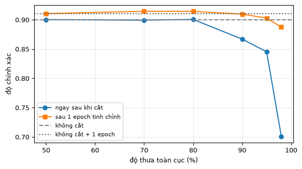

# Cắt tỉa · Code

> Ghi chú của người biên soạn: trang này do người biên soạn viết thêm, không có trong ghi chú gốc. Nó chạy lại các ví dụ của bài [Cắt tỉa bằng PyTorch](dlnote/compress_prune_torch_vi) (thay cho các ảnh chụp notebook của bản gốc), rồi kiểm tra các nhận xét của bài [Thuật toán cắt tỉa](dlnote/compress_prune_vi) trên một CNN thật: lớp nào chịu cắt được nhiều, độ chính xác theo độ thưa, và vì sao cắt tỉa không cấu trúc không làm mô hình nhanh hơn.

## Cách dùng trang này

Các khối chạy lần lượt từ trên xuống và dùng chung biến. Cần `torch`, `torchvision`, `matplotlib`. Mục 1–6 chạy trên CPU; mô hình FashionMNIST dùng lại mô hình của [trang Code lượng tử hóa](dlnote/compress_quant_code_vi) (lưu ở `~/.cache/dlnote`, nếu chưa có thì huấn luyện khoảng một phút). Mục 7 cần GPU NVIDIA từ thế hệ Ampere trở lên.

<div class="gpu-pending">Mục 7 (thưa 2:4) cần GPU NVIDIA Ampere trở lên nên chưa có kết quả. Khi chuyển sang máy có GPU, chạy <code>python3 scripts/build_code_pages.py --gpu docs/dlnote/compress_prune_torch_code_vi.md</code> để điền vào.</div>

## 1. Mặt nạ, `weight_orig` và `prune.remove`

<small class="viz-ref">Bài PyTorch, mục 2.1 và 3</small>

Cắt ngẫu nhiên 50% trọng số của một lớp tích chập, rồi xem PyTorch đã thay đổi những gì trong mô-đun.

<!-- run -->
```python
import warnings
warnings.filterwarnings('ignore')
import torch
import torch.nn as nn
import torch.nn.functional as F
import torch.nn.utils.prune as prune
torch.manual_seed(0)

conv = nn.Conv2d(1, 1, 4)
prune.random_unstructured(conv, name="weight", amount=0.5)
print('tham số :', [n for n, _ in conv.named_parameters()])
print('buffer  :', [n for n, _ in conv.named_buffers()])
print('hook    :', [type(h).__name__ for h in conv._forward_pre_hooks.values()])
print('weight là Parameter?', isinstance(conv.weight, nn.Parameter), '| grad_fn =', type(conv.weight.grad_fn).__name__)
print('weight == weight_orig * weight_mask:', torch.equal(conv.weight, conv.weight_orig * conv.weight_mask))
print('số phần tử bằng 0:', int((conv.weight == 0).sum()), '/', conv.weight.numel())
print('is_pruned:', prune.is_pruned(conv))

prune.remove(conv, 'weight')                 # gộp mặt nạ vào trọng số, vĩnh viễn
print('\nsau prune.remove:')
print('tham số :', [n for n, _ in conv.named_parameters()], '| buffer:', [n for n, _ in conv.named_buffers()])
print('số phần tử bằng 0:', int((conv.weight == 0).sum()), '/', conv.weight.numel(), '| is_pruned:', prune.is_pruned(conv))
```

<!-- output -->
```output
tham số : ['bias', 'weight_orig']
buffer  : ['weight_mask']
hook    : ['RandomUnstructured']
weight là Parameter? False | grad_fn = MulBackward0
weight == weight_orig * weight_mask: True
số phần tử bằng 0: 8 / 16
is_pruned: True

sau prune.remove:
tham số : ['bias', 'weight'] | buffer: []
số phần tử bằng 0: 8 / 16 | is_pruned: False
```
<!-- /output -->

Đúng như ô Biên tập của bài: tham số gốc được đổi tên thành `weight_orig`, mặt nạ là buffer `weight_mask`, và một hook `RandomUnstructured` chạy trước mỗi lượt xuôi. `weight` lúc này không còn là `Parameter` mà là kết quả phép nhân (`MulBackward0`). Sau `prune.remove`, `weight` lại là tham số thường, mặt nạ và hook biến mất, nhưng **8 phần tử bằng 0 vẫn bằng 0**: `remove` làm việc cắt tỉa thành vĩnh viễn chứ không khôi phục trọng số.

## 2. Cắt tỉa có cấu trúc theo `dim=0` và `dim=1`

<small class="viz-ref">Bài PyTorch, mục 2.2.3</small>

Trọng số của `Conv2d(2, 3, 3)` có hình dạng `[3, 2, 3, 3]`. Ta in chuẩn L1 và L2 của từng lát theo chiều cần cắt, rồi xem lát nào thành 0. Thay vì in cả tensor, ta in tổng trị tuyệt đối của mỗi kernel $3 \times 3$ (bảng 3 hàng ứng với 3 bộ lọc, 2 cột ứng với 2 kênh vào).

<!-- run -->
```python
def kernel_abs_sum(w):
    return w.detach().abs().sum(dim=(2, 3))     # [C_out, C_in]

torch.manual_seed(1)
conv = nn.Conv2d(2, 3, 3)
w = conv.weight.detach()
print('dim=0: chuẩn L1 từng bộ lọc', w.norm(p=1, dim=[1, 2, 3]).numpy().round(4),
      '| chuẩn L2', w.norm(p=2, dim=[1, 2, 3]).numpy().round(4))
prune.ln_structured(conv, name="weight", amount=1, n=2, dim=0)
print(kernel_abs_sum(conv.weight).numpy().round(3))

torch.manual_seed(1)
conv = nn.Conv2d(2, 3, 3)
w = conv.weight.detach()
print('\ndim=1: chuẩn L1 từng kênh vào', w.norm(p=1, dim=[0, 2, 3]).numpy().round(4),
      '| chuẩn L2', w.norm(p=2, dim=[0, 2, 3]).numpy().round(4))
prune.ln_structured(conv, name="weight", amount=1, n=2, dim=1)
print(kernel_abs_sum(conv.weight).numpy().round(3))
```

<!-- output -->
```output
dim=0: chuẩn L1 từng bộ lọc [1.3035 2.3802 2.025 ] | chuẩn L2 [0.3872 0.626  0.5484]
[[0.    0.   ]
 [0.878 1.502]
 [1.091 0.934]]

dim=1: chuẩn L1 từng kênh vào [2.9156 2.7932] | chuẩn L2 [0.6456 0.6525]
[[0.    0.357]
 [0.    1.502]
 [0.    0.934]]
```
<!-- /output -->

Với `dim=0`, bộ lọc thứ nhất có chuẩn nhỏ nhất theo cả L1 lẫn L2 nên cả hàng đầu thành 0. Với `dim=1`, hai chuẩn **không đồng ý**: theo L1, kênh vào thứ hai nhỏ hơn (2,79 < 2,92); theo L2, kênh thứ nhất nhỏ hơn (0,646 < 0,653). `ln_structured(n=2)` dùng L2 nên bỏ cột thứ nhất. Đây là lý do bài đã sửa đoạn mã in chuẩn L1 nhưng cắt theo L2.

## 3. Cắt tỉa toàn cục trên LeNet

<small class="viz-ref">Bài PyTorch, mục 2.3</small>

Mã của bài, với `fc1` đã sửa thành `16 * 6 * 6` để chạy được lượt xuôi trên ảnh 32×32. Ta in độ thưa của từng lớp thay vì chỉ `conv1`.

<!-- run -->
```python
class LeNet(nn.Module):
    def __init__(self):
        super().__init__()
        self.conv1 = nn.Conv2d(1, 6, 3)
        self.conv2 = nn.Conv2d(6, 16, 3)
        self.fc1 = nn.Linear(16 * 6 * 6, 120)
        self.fc2 = nn.Linear(120, 84)
        self.fc3 = nn.Linear(84, 10)
    def forward(self, x):
        x = F.max_pool2d(F.relu(self.conv1(x)), (2, 2))
        x = F.max_pool2d(F.relu(self.conv2(x)), 2)
        x = x.view(-1, int(x.nelement() / x.shape[0]))
        x = F.relu(self.fc1(x))
        x = F.relu(self.fc2(x))
        return self.fc3(x)

torch.manual_seed(0)
model = LeNet()
print('lượt xuôi trên ảnh 32x32:', tuple(model(torch.randn(2, 1, 32, 32)).shape))
names = ['conv1', 'conv2', 'fc1', 'fc2', 'fc3']
prune.global_unstructured([(getattr(model, n), 'weight') for n in names],
                          pruning_method=prune.L1Unstructured, amount=0.2)
total = zeros = 0
for n in names:
    w = getattr(model, n).weight
    z = int((w == 0).sum()); zeros += z; total += w.numel()
    print(f'{n:6s} {w.numel():6d} trọng số, thưa {100 * z / w.numel():5.2f}%')
print(f'toàn cục: thưa {100 * zeros / total:.2f}%')
```

<!-- output -->
```output
lượt xuôi trên ảnh 32x32: (2, 10)
conv1      54 trọng số, thưa  3.70%
conv2     864 trọng số, thưa  6.25%
fc1     69120 trọng số, thưa 21.75%
fc2     10080 trọng số, thưa 10.12%
fc3       840 trọng số, thưa  9.76%
toàn cục: thưa 20.00%
```
<!-- /output -->

`conv1` thưa 3,70% như bản gốc: đó là 2 trên 54 trọng số, nên với lớp nhỏ như vậy con số dễ trùng dù hạt giống khác nhau. Bảng cho thấy rõ cắt tỉa toàn cục dồn phần lớn vào các lớp lớn: `fc1` có 69 nghìn trọng số và bị cắt 21,75%, còn `conv1` chỉ 54 trọng số và bị cắt 3,70%. Trọng số của lớp lớn thường nhỏ hơn (khởi tạo theo $1/\sqrt{\text{fan-in}}$), nên bị chọn trước khi xếp hạng chung theo độ lớn.

## 4. Độ chính xác theo độ thưa trên CNN FashionMNIST

<small class="viz-ref">Bài thuật toán, mục 2.1</small>

Mô hình có ba lớp tích chập và hai lớp kết nối đầy đủ, 1,7 triệu tham số, độ chính xác FP32 89,97%. Ta cắt tỉa toàn cục theo độ lớn (L1) ở nhiều mức thưa, đo độ chính xác ngay sau khi cắt và sau **1 epoch tinh chỉnh** (bước 3 của quy trình ba bước). Trong lúc tinh chỉnh, mặt nạ vẫn giữ các trọng số đã cắt bằng 0. Để so sánh công bằng, ta cũng tinh chỉnh 1 epoch mô hình **không cắt**, vì bản thân việc huấn luyện thêm cũng tăng độ chính xác.

<!-- run -->
```python
import os, io, time, copy
import numpy as np
import torchvision
import torchvision.transforms as T
torch.manual_seed(0)
torch.set_num_threads(4)

root = os.path.expanduser('~/.cache/d2l-data')
train_set = torchvision.datasets.FashionMNIST(root, train=True, transform=T.ToTensor(), download=True)
test_set = torchvision.datasets.FashionMNIST(root, train=False, transform=T.ToTensor(), download=True)
test_iter = torch.utils.data.DataLoader(test_set, 1000)

class Net(nn.Module):
    """Mô hình của trang Code lượng tử hóa; c = số kênh của ba lớp tích chập."""
    def __init__(self, c=(32, 64, 128)):
        super().__init__()
        self.quant = torch.ao.quantization.QuantStub()
        self.c1 = nn.Conv2d(1, c[0], 3, padding=1); self.r1 = nn.ReLU()
        self.c2 = nn.Conv2d(c[0], c[1], 3, padding=1); self.r2 = nn.ReLU()
        self.pool = nn.MaxPool2d(2)
        self.c3 = nn.Conv2d(c[1], c[2], 3, padding=1); self.r3 = nn.ReLU()
        self.flat = nn.Flatten()
        self.fc1 = nn.Linear(c[2] * 7 * 7, 256); self.r4 = nn.ReLU()
        self.fc2 = nn.Linear(256, 10)
        self.dequant = torch.ao.quantization.DeQuantStub()
    def forward(self, x):
        x = self.quant(x)
        x = self.pool(self.r1(self.c1(x)))
        x = self.pool(self.r2(self.c2(x)))
        x = self.r3(self.c3(x))
        x = self.r4(self.fc1(self.flat(x)))
        return self.dequant(self.fc2(x))

def train(m, epochs, lr=1e-3, seed=1):
    opt = torch.optim.Adam(m.parameters(), lr)
    g = torch.Generator().manual_seed(seed)
    m.train()
    for _ in range(epochs):
        for X, y in torch.utils.data.DataLoader(train_set, 256, shuffle=True, generator=g):
            opt.zero_grad(); F.cross_entropy(m(X), y).backward(); opt.step()
    return m.eval()

def accuracy(m):
    m.eval(); c = n = 0
    with torch.no_grad():
        for X, y in test_iter:
            c += (m(X).argmax(1) == y).sum().item(); n += len(y)
    return c / n

net = Net()
ckpt = os.path.expanduser('~/.cache/dlnote/fmnist_cnn.pt')
if os.path.exists(ckpt):
    net.load_state_dict(torch.load(ckpt))
else:
    train(net, 3, seed=0)
    os.makedirs(os.path.dirname(ckpt), exist_ok=True); torch.save(net.state_dict(), ckpt)
net.eval()
layer_names = ['c1', 'c2', 'c3', 'fc1', 'fc2']
for n in layer_names:
    print(f'{n:4s} {getattr(net, n).weight.numel():8d} trọng số')

base_acc = accuracy(net)
dense_ft = accuracy(train(copy.deepcopy(net), 1))
print(f'\nkhông cắt: {base_acc:.4f}, tinh chỉnh thêm 1 epoch: {dense_ft:.4f}')
rows = []
for amount in [0.5, 0.7, 0.8, 0.9, 0.95, 0.98]:
    m = copy.deepcopy(net)
    prune.global_unstructured([(getattr(m, n), 'weight') for n in layer_names],
                              pruning_method=prune.L1Unstructured, amount=amount)
    sp = [float((getattr(m, n).weight == 0).float().mean()) for n in layer_names]
    a0 = accuracy(m)
    a1 = accuracy(train(m, 1))
    rows.append((amount, a0, a1, sp))
    print(f'thưa {amount:.0%}: ngay sau cắt {a0:.4f}, sau tinh chỉnh {a1:.4f} | thưa từng lớp '
          + ' '.join(f'{n}={s:.1%}' for n, s in zip(layer_names, sp)))
```

<!-- output -->
```output
c1        288 trọng số
c2      18432 trọng số
c3      73728 trọng số
fc1   1605632 trọng số
fc2      2560 trọng số

không cắt: 0.8997, tinh chỉnh thêm 1 epoch: 0.9105
thưa 50%: ngay sau cắt 0.9004, sau tinh chỉnh 0.9107 | thưa từng lớp c1=4.5% c2=12.9% c3=19.2% fc1=51.9% fc2=12.8%
thưa 70%: ngay sau cắt 0.8994, sau tinh chỉnh 0.9145 | thưa từng lớp c1=4.9% c2=20.6% c3=30.1% fc1=72.5% fc2=19.5%
thưa 80%: ngay sau cắt 0.9007, sau tinh chỉnh 0.9144 | thưa từng lớp c1=6.9% c2=26.3% c3=38.3% fc1=82.6% fc2=25.7%
thưa 90%: ngay sau cắt 0.8671, sau tinh chỉnh 0.9098 | thưa từng lớp c1=8.7% c2=40.1% c3=57.3% fc1=92.2% fc2=40.5%
thưa 95%: ngay sau cắt 0.8454, sau tinh chỉnh 0.9030 | thưa từng lớp c1=11.5% c2=54.0% c3=74.7% fc1=96.5% fc2=56.7%
thưa 98%: ngay sau cắt 0.7009, sau tinh chỉnh 0.8875 | thưa từng lớp c1=17.7% c2=71.1% c3=89.7% fc1=98.7% fc2=79.3%
```
<!-- /output -->

<!-- run -->
```python
import matplotlib.pyplot as plt
xs = [100 * r[0] for r in rows]
fig, ax = plt.subplots(figsize=(6, 3.4))
ax.plot(xs, [r[1] for r in rows], 'o-', label='ngay sau khi cắt')
ax.plot(xs, [r[2] for r in rows], 's-', label='sau 1 epoch tinh chỉnh')
ax.axhline(base_acc, color='0.5', ls='--', label='không cắt')
ax.axhline(dense_ft, color='0.3', ls=':', label='không cắt + 1 epoch')
ax.set_xlabel('độ thưa toàn cục (%)'); ax.set_ylabel('độ chính xác')
ax.legend(fontsize=8); ax.grid(alpha=0.3)
plt.tight_layout()
```

<!-- output -->
<div align=center></div>
<!-- /output -->

`fc1` chiếm 1,6 trong 1,7 triệu tham số (94%), nên cũng chịu phần lớn việc cắt: ở mọi mức thưa, `fc1` thưa hơn mức chung, còn `c1` gần như không bị đụng (17,7% khi thưa toàn cục 98%). Đây đúng là hai nhận xét của bài thuật toán, mục 2.1: lớp kết nối đầy đủ dư thừa hơn, lớp tích chập đầu nhạy nhất.

Về độ chính xác: tới 80% thưa, mô hình **chưa cần tinh chỉnh** đã giữ nguyên 90,0%. Ở 90–98%, độ chính xác ngay sau cắt giảm dần (86,7% → 70,1%), và 1 epoch tinh chỉnh kéo về 91,0% → 88,8%. Lưu ý đường "không cắt + 1 epoch" (91,05%): các mô hình thưa 50–80% sau tinh chỉnh (91,07–91,45%) chỉ ngang hoặc nhỉnh hơn nó một chút, nên phần lớn mức tăng so với 89,97% là do huấn luyện thêm, không phải do cắt tỉa. Kết luận đúng là: với mô hình này, **bỏ 90% trọng số không mất gì** sau một epoch tinh chỉnh (90,98% so với 91,05%).

## 5. Cắt tỉa không cấu trúc không làm mô hình nhanh hơn

<small class="viz-ref">Bài thuật toán, mục 3; bài PyTorch, mục 3</small>

Cắt 90% trọng số rồi đo kích thước tệp lưu và thời gian chạy một batch 64 ảnh ở ba trạng thái: còn mặt nạ, sau `prune.remove`, và khi lưu các ma trận trọng số 2 chiều ở định dạng thưa CSR.

<!-- run -->
```python
def size_mb(state):
    b = io.BytesIO(); torch.save(state, b); return b.tell() / 1e6

def latency_ms(m, bs=64, rep=20, trials=7):
    """Trung vị của 7 lần đo, mỗi lần 20 batch: đỡ nhiễu hơn một lần đo."""
    X = torch.randn(bs, 1, 28, 28)
    times = []
    with torch.no_grad():
        for _ in range(5): m(X)
        for _ in range(trials):
            t = time.perf_counter()
            for _ in range(rep): m(X)
            times.append((time.perf_counter() - t) / rep * 1000)
    return float(np.median(times))

m = copy.deepcopy(net)
prune.global_unstructured([(getattr(m, n), 'weight') for n in layer_names],
                          pruning_method=prune.L1Unstructured, amount=0.9)
print(f"{'trạng thái':28s} {'MB':>6s} {'ms/batch':>9s}")
print(f"{'gốc (dày đặc)':28s} {size_mb(net.state_dict()):6.2f} {latency_ms(net):9.2f}")
print(f"{'thưa 90%, còn mặt nạ':28s} {size_mb(m.state_dict()):6.2f} {latency_ms(m):9.2f}")
keys_masked = [k for k in m.state_dict() if k.startswith('c1.')]
for n in layer_names:
    prune.remove(getattr(m, n), 'weight')
print(f"{'thưa 90%, sau remove':28s} {size_mb(m.state_dict()):6.2f} {latency_ms(m):9.2f}")
csr = {k: (v.to_sparse_csr() if v.dim() == 2 else v) for k, v in m.state_dict().items()}
print(f"{'thưa 90%, Linear lưu CSR':28s} {size_mb(csr):6.2f}")
print('khoá của c1 trong state_dict: gốc', [k for k in net.state_dict() if k.startswith('c1.')],
      '| còn mặt nạ', keys_masked, '| sau remove', [k for k in m.state_dict() if k.startswith('c1.')])
```

<!-- output -->
```output
trạng thái                       MB  ms/batch
gốc (dày đặc)                  6.81      8.12
thưa 90%, còn mặt nạ          13.61      9.75
thưa 90%, sau remove           6.81      8.33
thưa 90%, Linear lưu CSR       2.92
khoá của c1 trong state_dict: gốc ['c1.weight', 'c1.bias'] | còn mặt nạ ['c1.bias', 'c1.weight_orig', 'c1.weight_mask'] | sau remove ['c1.bias', 'c1.weight']
```
<!-- /output -->

Ba điều bài nói được thấy rõ:

- **Còn mặt nạ**: tệp lưu to gấp đôi (13,61 MB), vì `state_dict` chứa cả `weight_orig` lẫn `weight_mask`, và mô hình chạy **chậm hơn** (9,75 ms so với 8,12 ms) vì mỗi lượt xuôi phải nhân lại trọng số với mặt nạ.
- **Sau `remove`**: kích thước và tốc độ như mô hình gốc (6,81 MB; 8,33 ms). Bỏ 90% trọng số mà không nhanh hơn chút nào, vì tensor vẫn dày đặc và phép nhân vẫn tính đủ, kể cả các số 0.
- **Lưu thưa (CSR)**: tệp nhỏ còn 2,92 MB, nhưng chỉ nhỏ hơn khoảng 2,3 lần chứ không phải 10 lần: mỗi phần tử khác 0 phải lưu kèm chỉ số cột kiểu `int64` (8 byte), nặng gấp đôi chính giá trị `float32` (4 byte). Định dạng thưa chỉ có lợi khi rất thưa, hoặc khi chỉ số được nén như ở thưa 2:4 (mục 7).

## 6. Cắt tỉa kênh và bỏ hẳn kênh

<small class="viz-ref">Bài thuật toán, mục 3.1.1</small>

`prune.ln_structured(..., dim=0)` chỉ đặt cả bộ lọc bằng 0; mô hình vẫn to như cũ. Để nhanh hơn, ta tự chọn các bộ lọc có chuẩn L2 lớn nhất của `c2` và `c3` (đúng tiêu chí của `ln_structured`), rồi **tạo mô hình mới ít kênh hơn** và chép trọng số sang: bỏ hàng (kênh ra) của lớp bị cắt, bỏ cột (kênh vào) tương ứng của lớp sau. Với `c3`, lớp sau là `fc1`, nhận đầu vào đã duỗi phẳng $128 \times 7 \times 7$, nên phải bỏ cả khối $7 \times 7$ cột ứng với mỗi kênh bị cắt.

<!-- run -->
```python
def keep_top_l2(w, ratio):
    """Chỉ số các bộ lọc giữ lại: (1 - ratio) bộ lọc có chuẩn L2 lớn nhất, theo thứ tự cũ."""
    k = int(round(w.shape[0] * (1 - ratio)))
    return w.flatten(1).norm(dim=1).argsort(descending=True)[:k].sort().values

def shrink(model, k2, k3):
    sd = model.state_dict()
    k1 = torch.arange(sd['c1.weight'].shape[0])          # c1 giữ nguyên
    new = Net((len(k1), len(k2), len(k3)))
    new.c1.weight.data = sd['c1.weight'].clone();        new.c1.bias.data = sd['c1.bias'].clone()
    new.c2.weight.data = sd['c2.weight'][k2].clone();    new.c2.bias.data = sd['c2.bias'][k2].clone()
    new.c3.weight.data = sd['c3.weight'][k3][:, k2].clone(); new.c3.bias.data = sd['c3.bias'][k3].clone()
    new.fc1.weight.data = sd['fc1.weight'].view(256, -1, 7, 7)[:, k3].reshape(256, -1).clone()
    new.fc1.bias.data = sd['fc1.bias'].clone()
    new.fc2.weight.data = sd['fc2.weight'].clone();      new.fc2.bias.data = sd['fc2.bias'].clone()
    return new.eval()

# Cùng các kênh mà ln_structured chọn?
m = copy.deepcopy(net)
prune.ln_structured(m.c3, 'weight', amount=0.5, n=2, dim=0)
by_mask = (m.c3.weight_mask.flatten(1).sum(1) > 0).nonzero().flatten()
print('trùng với các kênh ln_structured giữ lại:', torch.equal(by_mask, keep_top_l2(net.c3.weight.data, 0.5)))
# Mô hình nhỏ cho đúng kết quả của mô hình bị che mặt nạ?
k2, k3 = keep_top_l2(net.c2.weight.data, 0.5), keep_top_l2(net.c3.weight.data, 0.5)
masked = copy.deepcopy(net)
prune.ln_structured(masked.c2, 'weight', amount=0.5, n=2, dim=0)
prune.ln_structured(masked.c3, 'weight', amount=0.5, n=2, dim=0)
masked.c2.bias.data[~torch.isin(torch.arange(64), k2)] = 0     # bộ lọc bị cắt: bỏ cả bias
masked.c3.bias.data[~torch.isin(torch.arange(128), k3)] = 0
X = torch.randn(8, 1, 28, 28)
with torch.no_grad():
    print('lệch lớn nhất giữa mô hình nhỏ và mô hình bị che:', float((shrink(net, k2, k3)(X) - masked(X)).abs().max()))

nparams = lambda mm: sum(p.numel() for p in mm.parameters())
print(f"\n{'cắt c2, c3':>10s} {'tham số':>9s} {'ms/batch':>9s} {'ngay sau cắt':>13s} {'+1 epoch':>9s}")
print(f"{'0%':>10s} {nparams(net):9d} {latency_ms(net):9.2f} {base_acc:13.4f} {dense_ft:9.4f}")
for ratio in [0.25, 0.5, 0.75]:
    small = shrink(net, keep_top_l2(net.c2.weight.data, ratio), keep_top_l2(net.c3.weight.data, ratio))
    a0, lat = accuracy(small), latency_ms(small)
    a1 = accuracy(train(copy.deepcopy(small), 1))
    print(f'{ratio:>10.0%} {nparams(small):9d} {lat:9.2f} {a0:13.4f} {a1:9.4f}')
```

<!-- output -->
```output
trùng với các kênh ln_structured giữ lại: True
lệch lớn nhất giữa mô hình nhỏ và mô hình bị che: 1.9073486328125e-06

cắt c2, c3   tham số  ms/batch  ngay sau cắt  +1 epoch
        0%   1701130      8.34        0.8997    0.9105
       25%   1262810      7.16        0.8880    0.9105
       50%    833706      5.62        0.8759    0.9050
       75%    413818      4.54        0.7987    0.8960
```
<!-- /output -->

Hai kiểm tra đầu cho thấy cách làm đúng: các kênh tự chọn trùng với các kênh `ln_structured` giữ lại, và mô hình nhỏ cho cùng đầu ra với mô hình bị che mặt nạ (lệch $2 \times 10^{-6}$, chỉ là sai số làm tròn). Lưu ý phải bỏ cả bias của bộ lọc bị cắt; `ln_structured` chỉ che `weight`, nên nếu quên bias, kênh "đã cắt" vẫn cho ra hằng số $\mathrm{ReLU}(b)$.

Bỏ 50% kênh của `c2` và `c3` giảm 51% tham số và giảm độ trễ khoảng một phần ba (8,34 → 5,62 ms); sau 1 epoch tinh chỉnh còn 90,50%, chỉ kém mô hình đầy đủ cùng số epoch 0,55 điểm. Bỏ 75% kênh còn 24% tham số, nhanh gần gấp đôi (4,54 ms), mất 1,45 điểm. Độ trễ giảm chậm hơn số tham số vì phần lớn tham số nằm ở `fc1`, còn phần lớn thời gian tính lại nằm ở các lớp tích chập trên ảnh 28×28 và 14×14; c1 không bị cắt. So với mục 5: cắt tỉa có cấu trúc mất độ chính xác nhiều hơn (bỏ một nửa kênh tích chập mất 0,55 điểm, bỏ 90% trọng số rải rác không mất gì), nhưng là cách duy nhất ở đây làm mô hình nhanh hơn thật.

## 7. Thưa bán cấu trúc 2:4 trên GPU

<small class="viz-ref">Bài thuật toán, mục 4.2</small>

Với thưa 2:4, mỗi nhóm 4 trọng số liên tiếp giữ đúng 2 trọng số lớn nhất. `to_sparse_semi_structured` nén ma trận và dùng kernel thưa của Tensor Core (cuSPARSELt hoặc CUTLASS). Khối dưới so tốc độ phép nhân ma trận cỡ một lớp MLP của Transformer ở FP16, dày đặc và thưa 2:4, rồi áp thưa 2:4 cho `fc1` của CNN ở trên và đo độ chính xác trước và sau 1 epoch tinh chỉnh.

<!-- run gpu -->
```python
from torch.sparse import to_sparse_semi_structured, SparseSemiStructuredTensor
assert torch.cuda.is_available(), 'cần GPU NVIDIA (Ampere trở lên)'
SparseSemiStructuredTensor._FORCE_CUTLASS = False

def mask_2_4(w):
    """Mặt nạ 2:4 theo hàng: trong mỗi nhóm 4 phần tử liên tiếp, giữ 2 phần tử có |w| lớn nhất."""
    g = w.reshape(-1, 4)
    idx = g.abs().topk(2, dim=1).indices
    return torch.zeros_like(g, dtype=torch.bool).scatter_(1, idx, True).reshape(w.shape)

# 1) tốc độ nhân ma trận
torch.manual_seed(0)
W = torch.randn(11008, 4096, device='cuda', dtype=torch.float16)
X = torch.randn(4096, 4096, device='cuda', dtype=torch.float16)
W = W * mask_2_4(W)
Ws = to_sparse_semi_structured(W)

def bench(f, rep=50):
    for _ in range(5): f()
    torch.cuda.synchronize(); t = time.perf_counter()
    for _ in range(rep): f()
    torch.cuda.synchronize(); return (time.perf_counter() - t) / rep * 1000

print('lệch giữa thưa và dày:', float((torch.mm(Ws, X) - torch.mm(W, X)).abs().max()))
td, ts = bench(lambda: torch.mm(W, X)), bench(lambda: torch.mm(Ws, X))
print(f'dày đặc {td:.3f} ms, thưa 2:4 {ts:.3f} ms, nhanh hơn {td / ts:.2f} lần')

# 2) độ chính xác khi áp 2:4 cho fc1 (mặt nạ tự tạo qua prune.custom_from_mask)
m = copy.deepcopy(net)
prune.custom_from_mask(m.fc1, 'weight', mask_2_4(m.fc1.weight.detach()))
print('fc1 thưa:', float((m.fc1.weight == 0).float().mean()), '| ngay sau cắt:', accuracy(m))
print('sau 1 epoch tinh chỉnh:', accuracy(train(m, 1)))
```

<!-- output -->
<div class="gpu-pending">Chưa có kết quả: khối này huấn luyện mô hình nên sẽ được chạy trên máy có GPU. Bạn có thể tự chạy code trên Colab hoặc máy của mình.</div>
<!-- /output -->

## Tóm tắt

| Thí nghiệm | Kết quả |
|---|---|
| `prune.remove` | Gộp mặt nạ vào trọng số vĩnh viễn; số 0 vẫn giữ nguyên |
| `ln_structured`, `dim=1` | Chuẩn L1 và L2 có thể chọn kênh khác nhau |
| Cắt tỉa toàn cục 98% | `fc1` thưa 98,7%, `c1` chỉ 17,7% |
| Thưa 90% + 1 epoch | 90,98%, ngang mô hình dày cùng số epoch (91,05%) |
| Thưa 90%, không cấu trúc | Không nhanh hơn (8,3 ms so với 8,1 ms); còn mặt nạ thì chậm hơn và tệp to gấp đôi |
| Bỏ 50% kênh `c2`, `c3` | −51% tham số, −33% độ trễ, −0,55 điểm sau tinh chỉnh |

Học tiếp: [Thuật toán cắt tỉa](dlnote/compress_prune_vi), [Cắt tỉa bằng PyTorch](dlnote/compress_prune_torch_vi), [Chưng cất tri thức](dlnote/compress_kd_vi).
