# Nén mô hình: Thuật toán cắt tỉa

> Ghi chú của người biên soạn: trang này dịch từ ghi chú *dl_note* của **Harley Zhang** ([bản gốc](https://github.com/harleyszhang/dl_note/blob/main/5-model_compression/模型压缩-剪枝算法详解.md), [kho mã](https://github.com/harleyszhang/dl_note), giấy phép [Apache-2.0](https://www.apache.org/licenses/LICENSE-2.0); phần dịch có chỉnh sửa). Số mục giữ như bản gốc. Chỗ bản gốc sai, thiếu hoặc đã lỗi thời được sửa ngay trong bài và ghi ở ô **Biên tập**. Các mục có chữ **Bổ sung** do người biên soạn viết thêm.

Trang [Code](dlnote/compress_prune_torch_code_vi) đi kèm (chung với bài [Cắt tỉa bằng PyTorch](dlnote/compress_prune_torch_vi)) đo các nhận xét của bài này trên một CNN thật: độ nhạy của từng lớp, độ chính xác theo độ thưa, và khác biệt về tốc độ giữa cắt tỉa không cấu trúc và có cấu trúc.

## 1 Mở đầu

Khi đưa các mô hình SOTA của giới học thuật vào ứng dụng công nghiệp, ta thường phải đối mặt với các thách thức về độ trễ thấp (`Latency`), thông lượng cao (`Throughput`) và hiệu quả cao (`Efficiency`). Thuật toán nén mô hình biến một mô hình tiền huấn luyện lớn và phức tạp thành một mô hình nhỏ gọn, giảm yêu cầu về lưu trữ, băng thông và tính toán của phần cứng, nhằm tăng tốc suy luận và đưa mô hình vào sử dụng.

Các phương pháp nén mô hình chủ đạo những năm gần đây gồm: **lượng tử hóa số (Data Quantization, còn gọi là lượng tử hóa mô hình)**, **làm thưa mô hình (Model sparsification, còn gọi là cắt tỉa mô hình, Model Pruning)**, **chưng cất tri thức (Knowledge Distillation)**, **thiết kế mạng nhẹ (Lightweight Network Design)** và **phân tích tensor (Tensor Decomposition)**.

Trong đó cắt tỉa mô hình là phương pháp nén được dùng rất rộng rãi, vì nó **trực tiếp** giảm số tham số của mô hình. Bài này giới thiệu chi tiết định nghĩa, quá trình phát triển, cách phân loại và nguyên lý thuật toán của cắt tỉa mô hình.

### 1.1 Định nghĩa cắt tỉa mô hình

Cắt tỉa mô hình (`Pruning`) còn gọi là làm thưa mô hình. Khác với lượng tử hóa là nén từng tham số trọng số, phương pháp làm thưa cố gắng "xoá" thẳng một phần tham số. Nguyên lý của cắt tỉa là loại bỏ các trọng số "không quan trọng" để giảm số tham số và lượng tính toán, đồng thời cố giữ độ chính xác của mô hình không bị ảnh hưởng.

## 2 Tính thưa của mạng neuron sâu

Nghiên cứu sinh học cho thấy não người có tính thưa rất cao. Ví dụ bài báo cắt tỉa kinh điển [1] có nhắc: sinh lý học phát hiện ở động vật có vú, giai đoạn sơ sinh tạo ra rất nhiều khớp nối thần kinh (synapse), và trong quá trình lớn lên, những khớp nối ít được dùng sẽ thoái hóa và biến mất. Kết hợp với việc mạng neuron sâu mô phỏng cấu trúc não người và hiện tượng sinh lý trên, ta có thể cho rằng mạng neuron sâu có tính thưa [1].

> **Biên tập:** Bản gốc gọi [1] là "bài báo cắt tỉa kinh điển năm 2016". Bài [1] (*Learning both Weights and Connections for Efficient Neural Networks*) đăng ở NIPS 2015; bài của cùng nhóm năm 2016 là *Deep Compression* (ICLR 2016).

Theo đối tượng có thể làm thưa trong mô hình học sâu, tính thưa của mạng neuron sâu chủ yếu gồm **thưa trọng số**, **thưa kích hoạt** và **thưa gradient**.

### 2.1 Thưa trọng số

Ở phần lớn mạng neuron, nếu vẽ histogram giá trị trọng số của các lớp (tích chập hoặc kết nối đầy đủ), ta thấy phân bố trọng số (trước hoặc sau huấn luyện) rất giống phân bố chuẩn (hoặc hỗn hợp nhiều phân bố chuẩn), và càng gần 0 thì càng nhiều trọng số. Đó là hiện tượng **thưa trọng số**.

Bài báo [1] cho rằng độ lớn trị tuyệt đối của trọng số có thể xem là một thước đo tầm quan trọng: trọng số càng lớn thì đóng góp vào đầu ra của mô hình càng nhiều; ngược lại thì không quan trọng, xoá đi sẽ ít ảnh hưởng tới độ chính xác.

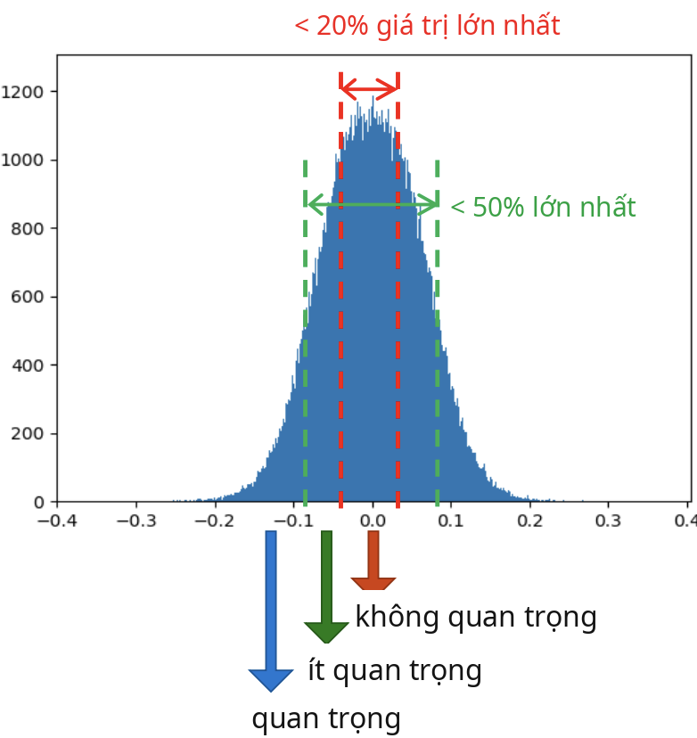

Hình 1: Histogram trọng số của một lớp. Các trọng số có trị tuyệt đối nhỏ hơn 20% giá trị lớn nhất được xem là không quan trọng, nhỏ hơn 50% là ít quan trọng, còn lại là quan trọng.

Tất nhiên, cắt tỉa trọng số (**Weight Pruning**) ảnh hưởng nhỏ chứ không phải không ảnh hưởng, và **các lớp khác loại, ở vị trí khác nhau thì bị ảnh hưởng khác nhau sau khi cắt tỉa trọng số**. Bài báo [1] làm thí nghiệm **độ nhạy với cắt tỉa** trên các lớp CONV và FC của AlexNet, kết quả như hình dưới.

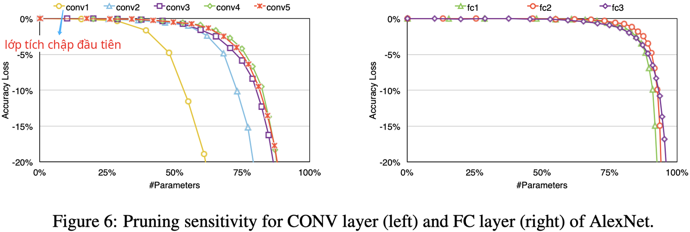

Hình 2: Độ nhạy với cắt tỉa của các lớp tích chập (trái) và kết nối đầy đủ (phải) trong AlexNet: trục hoành là tỉ lệ tham số bị cắt, trục tung là độ chính xác bị mất.

Từ kết quả có thể thấy **lớp tích chập nhạy với cắt tỉa hơn lớp kết nối đầy đủ, và lớp tích chập đầu tiên nhạy nhất**. Tác giả cho rằng đó là vì bản thân lớp kết nối đầy đủ có nhiều tham số dư thừa hơn, còn lớp tích chập đầu chỉ có 3 kênh đầu vào nên ít dư thừa hơn các lớp tích chập khác.

> Trang Code (mục 4) thấy đúng hiện tượng này: khi cắt tỉa toàn cục 98% trọng số của một CNN nhỏ, lớp kết nối đầy đủ lớn nhất bị cắt 98,7%, còn lớp tích chập đầu chỉ bị cắt 17,7%.

Ngay cả bỏ các trọng số có trị tuyệt đối gần 0 cũng làm giảm độ chính xác suy luận, nên để phục hồi độ chính xác, sau khi cắt tỉa thường phải huấn luyện lại mô hình. Quy trình (`pipeline`) cắt tỉa ba bước điển hình [1] và sự thay đổi kết nối của mạng trước và sau cắt tỉa như hình dưới.

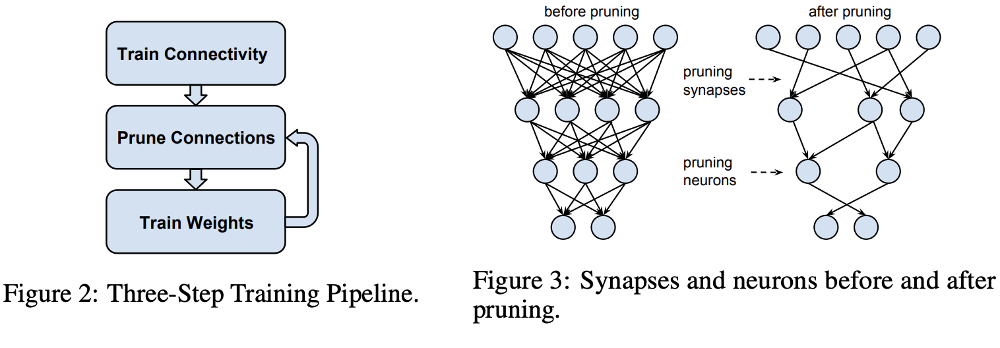

Hình 3: Quy trình ba bước: huấn luyện kết nối (thường có chính quy hóa L2) → cắt tỉa kết nối (xoá thẳng các trọng số nhỏ hơn ngưỡng) → huấn luyện trọng số; lặp lại cho tới khi kích thước và độ chính xác của mô hình đạt yêu cầu. Bên phải: khớp nối và neuron trước và sau cắt tỉa.

> **Biên tập:** Bản gốc dùng một ảnh khác của cùng hình này, có ba chú thích tiếng Trung chen giữa; ba chú thích đó được đưa vào lời hình ở trên.

Trong các bước trên có hai vấn đề trọng tâm: một là đánh giá tầm quan trọng của trọng số kết nối thế nào, hai là phục hồi độ chính xác khi huấn luyện lại thế nào. Về **đánh giá tầm quan trọng của trọng số kết nối**, có hai cách tiêu biểu: một là dựa trên **độ lớn** của trọng số kết nối [1], nguyên lý đơn giản; hai là dùng đạo hàm bậc hai của hàm mục tiêu theo tham số để biểu diễn mức đóng góp của tham số [10].

> Cách dựa trên độ lớn trọng số kết nối hình như đã được đề xuất từ thập niên 1990, chỉ là được dùng lại trong bài báo của Song Han [1].

Phân bố giá trị trọng số ở ba giai đoạn của `Three-Step Training Pipeline` như hình dưới. Sau khi tinh chỉnh, phân bố trọng số của mô hình phục hồi một phần đặc tính phân bố chuẩn.

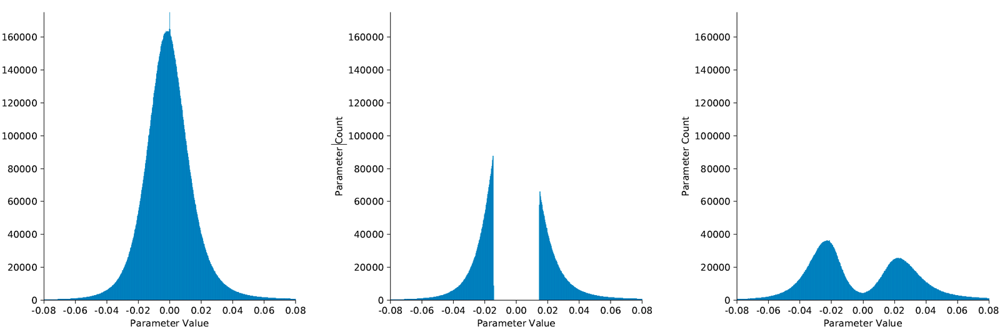

Hình 4: Tính thưa trọng số trong mạng sâu: (a) phân bố trọng số trước cắt tỉa; (b) phân bố sau khi cắt bỏ các trọng số gần 0; (c) sau khi tinh chỉnh, phân bố từ một đỉnh thành hai đỉnh.

Đáng lưu ý là phương pháp thưa trọng số của Song Han là thưa mịn (fine-grained), chỉ tăng tốc được trên phần cứng chuyên dụng EIE; đây là cách làm thưa không thân thiện với phần cứng, vì ma trận trọng số sau khi làm thưa là **ma trận rất không đều**, như hình dưới.

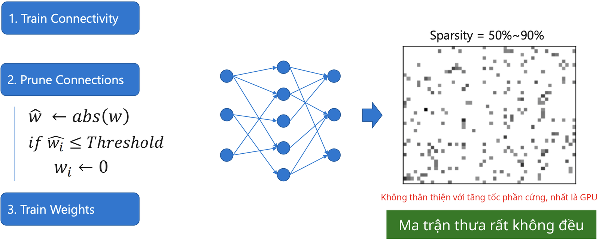

Hình 5: Cắt tỉa theo độ lớn: $\hat w \leftarrow |w|$, nếu $\hat w_i \le$ ngưỡng thì $w_i \leftarrow 0$. Ma trận thu được thưa 50–90% nhưng các phần tử khác 0 nằm rải rác, không thân thiện với tăng tốc phần cứng, nhất là GPU.

### 2.2 Thưa kích hoạt

Các mạng neuron đời đầu, như perceptron nhiều lớp (MLP), thường dùng hàm Sigmoid làm đơn vị kích hoạt. Nhưng công thức tính phức tạp của nó làm mô hình huấn luyện chậm, và khi mạng sâu hơn, tiêu biến và bùng nổ gradient do Sigmoid gây ra ảnh hưởng nghiêm trọng tới tính thực dụng của thuật toán lan truyền ngược. Để giải quyết, Nair và Hinton (2010) dùng hàm kích hoạt `ReLU` trong bài báo [2], và nó được dùng thực tế lần đầu trong mô hình `AlexNet` [3].

> **Biên tập:** Bản gốc viết ReLU "do Hinton và cộng sự đề xuất năm 2010". Hàm $\max(0,x)$ đã xuất hiện từ trước (ví dụ Fukushima, 1969; Hahnloser và cộng sự, 2000); bài [2] của Nair và Hinton là bài đưa ReLU vào học sâu và làm nó phổ biến.

Sau đó, cùng với sự ra đời của toán tử `BN`, đơn vị cơ bản gồm ba toán tử nối tiếp "tích chập 2D – lớp BN – hàm kích hoạt ReLU" trở thành thành phần nền của các mô hình CNN về sau, như đoạn mã `PyTorch` dưới:

> Thời kỳ đầu là thành phần nối tiếp "tích chập 2D – hàm kích hoạt ReLU – gộp".

```python
# Mã ví dụ thành phần cbr (Conv-BN-ReLU)
def convbn_relu(in_planes, out_planes, kernel_size, stride, pad, dilation):
    return nn.Sequential(
        nn.Conv2d(in_planes, out_planes,
                  kernel_size=kernel_size, stride=stride,
                  padding=dilation if dilation > 1 else pad,
                  dilation=dilation, bias=False),
        nn.BatchNorm2d(out_planes),
        nn.ReLU(inplace=True)
        )
```

Định nghĩa hàm kích hoạt ReLU:

$$\mathrm{ReLU}(x) = \max(0, x)$$

Hàm này cho đầu ra 0 với mọi đầu vào ở nửa trục âm; có thể xem hàm kích hoạt đã mang lại cho mạng một kiểu thưa khác. Ngoài ra, phép gộp lớn nhất (`max_pooling`) cũng tạo ra hiệu ứng tương tự thưa. Tức là dù mạng nhận đầu vào gì, đầu ra của một phần lớn neuron trong mạng lớn phần nhiều bằng 0. Hiệu ứng thưa của kích hoạt và gộp như hình dưới.

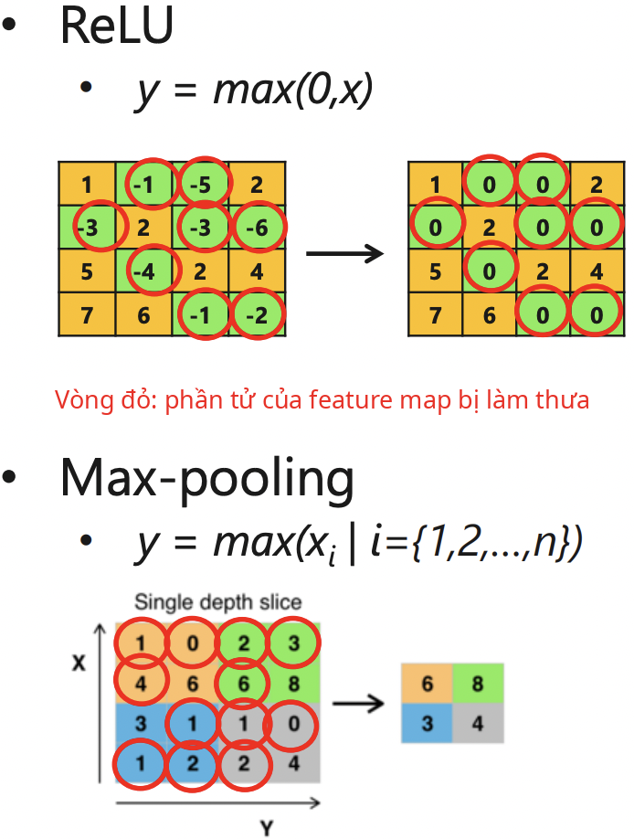

Hình 6: Thưa kích hoạt: ReLU biến các giá trị âm thành 0; max-pooling chỉ giữ một giá trị trong mỗi vùng. Vòng đỏ đánh dấu các phần tử của feature map bị làm thưa, tức feature map đầu ra của lớp ReLU và lớp gộp là ma trận thưa.

Lấy cảm hứng từ hiện tượng trên, bài báo [4] làm vài thống kê đơn giản và thấy rằng dù đầu vào là ảnh gì, rất nhiều neuron trong CNN có kích hoạt rất thấp. Tác giả cho rằng các **neuron bằng 0** rất có thể là **dư thừa** (`redundant`) và có thể bỏ đi mà không ảnh hưởng tới độ chính xác chung của mạng, vì sự tồn tại của chúng chỉ làm tăng khả năng quá khớp và độ khó tối ưu, đều có hại cho mạng.

> Vì mạng neuron tính theo trình tự nhân – cộng – kích hoạt, các neuron có đầu ra phần lớn bằng 0 đóng góp rất ít cho đầu ra của các lớp sau và cho kết quả cuối.

Từ đó, bài báo đề xuất một thuật toán **cắt tỉa neuron**. Trước hết, định nghĩa chỉ số `APoZ` (Average Percentage of Zeros) để đo tỉ lệ phần trăm kích hoạt bằng 0 của neuron sau ReLU. Gọi $O_c^{(i)}$ là kênh (feature map) thứ $c$ ở lớp thứ $i$ của mạng; APoZ của bộ lọc thứ $c$ ở lớp $i$ (bài báo gọi là neuron) định nghĩa như sau:

$$APoZ^{(i)}_c = APoZ\left(O_c^{(i)}\right) = \frac{\sum_{k=1}^{N} \sum_{j=1}^{M} f\left(O^{(i)}_{c,j}(k) = 0\right)}{N \times M}$$

Ở đây $f(\cdot)$ cho 1 nếu biểu thức đúng, ngược lại cho 0; $M$ là kích thước feature map đầu ra $O_c^{(i)}$; $N$ là số ảnh dùng để kiểm định; $O^{(i)}_{c,j}(k)$ là phần tử thứ $j$ của feature map đó với ảnh thứ $k$. Vì mỗi feature map là kết quả tích chập và kích hoạt của một bộ lọc (neuron), công thức trên đo tầm quan trọng của từng neuron.

> **Biên tập:** Bản gốc viết $f(O^{(i)}_{c,j}(k=0))$, đặt nhầm dấu "$=0$" vào trong chỉ số ảnh $k$; đã sửa thành $f(O^{(i)}_{c,j}(k)=0)$ như bài báo [4].

Hình dưới là phân bố chỉ số APoZ của 512 neuron ở lớp CONV5-3 và 4096 neuron ở lớp FC6 trong mạng VGG-16, tính bằng 50.000 ảnh ImageNet.

> "Cao hơn" ở đây là các lớp gần phía đầu ra của mô hình hơn.

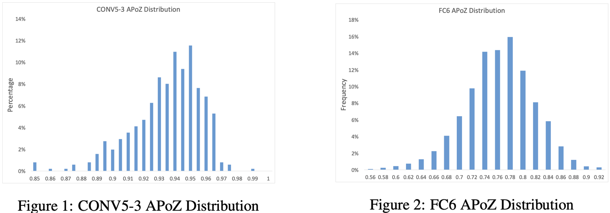

Hình 7: Phân bố APoZ của lớp CONV5-3 (trái) và FC6 (phải) trong VGG-16.

Có thể thấy chỉ số này của phần lớn neuron lớp CONV5-3 nằm quanh 93%. Thực tế, VGG-16 có tổng cộng 631 neuron có APoZ trên 90%. Việc dùng hàm kích hoạt cho thấy mạng VGG có rất nhiều thưa và dư thừa, và phần lớn dư thừa nằm ở các lớp tích chập cao hơn và các lớp kết nối đầy đủ.

**Quy trình làm thưa kích hoạt** và sự thay đổi kết nối của mạng trước và sau làm thưa như hình dưới.

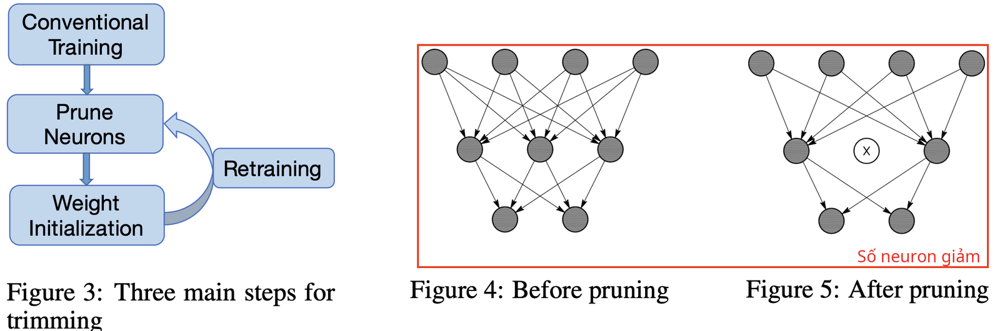

Hình 8: Ba bước chính của cắt tỉa neuron (huấn luyện thường → cắt tỉa neuron → khởi tạo trọng số, rồi huấn luyện lại), và mạng trước/sau cắt tỉa: số neuron giảm.

Quy trình làm theo Three-Step Training Pipeline của bài báo [1] của Song Han, các bước như sau:

1. Trước hết, huấn luyện mạng theo quy trình thông thường, số neuron mỗi lớp đặt theo kinh nghiệm. Tiếp theo, chạy mạng trên một tập kiểm định lớn để có APoZ của từng neuron.
2. Cắt tỉa các neuron có APoZ cao theo một tiêu chí nhất định. Khi một neuron bị cắt, các kết nối tới neuron đó cũng bị xoá theo (xem khung đỏ bên phải hình trên).
3. Sau khi cắt tỉa neuron, mạng đã cắt được khởi tạo bằng trọng số trước khi cắt. Mạng sau cắt tỉa giảm hiệu năng một mức nhất định, nên ở bước cuối cùng, ta **huấn luyện lại** mạng để củng cố các neuron còn lại, tăng hiệu năng của mạng sau cắt tỉa.

**Tóm lại**: so với công trình tiêu biểu của cắt tỉa trọng số [1] (cắt tỉa trọng số theo độ lớn, cắt cả neuron lẫn kết nối), công trình tiêu biểu của cắt tỉa kích hoạt [4] cắt trực tiếp neuron (neuron), tức đặt bằng 0 toàn bộ đầu ra của một số neuron được chọn theo APoZ; đây là thưa có cấu trúc.

> **Biên tập:** Bản gốc gọi [1] là "cắt tỉa trọng số ngẫu nhiên" và nói [4] "ngẫu nhiên đặt đầu ra của một số neuron bằng 0". Cả hai đều không ngẫu nhiên: [1] cắt theo độ lớn trọng số, [4] cắt theo chỉ số APoZ.

### 2.3 Thưa gradient

Các mô hình lớn (như BERT) có số tham số rất lớn, một máy khó đáp ứng tài nguyên tính toán khi huấn luyện, nên thường phải huấn luyện phân tán trên nhiều nút (Worker). Thuật toán SGD phân tán (Distributed SGD) cho phép $N$ nút cùng thực hiện lan truyền ngược và cập nhật gradient. Mỗi máy giữ một bản sao đầy đủ của tham số và phụ trách tính cập nhật cho $\frac{1}{N}$ số tham số. Sau một khoảng thời gian, mỗi nút phát gradient cập nhật của mình lên mạng và nhận kết quả gradient của $N-1$ nút còn lại, rồi cập nhật bản sao tham số tại chỗ.

Khi số nút tham gia huấn luyện tăng lên, lượng dữ liệu gradient truyền trên mạng cũng tăng mạnh; chi phí truyền thông dần vượt chi phí tính gradient, ảnh hưởng nghiêm trọng tới hiệu quả của huấn luyện phân tán quy mô lớn. Ngoài ra, gradient của tham số trong đa số mạng neuron sâu cũng rất thưa; nghiên cứu [5] cho thấy trong SGD phân tán, 99,9% lượng gradient trao đổi là **dư thừa**. Ví dụ hình dưới cho thấy giai đoạn đầu huấn luyện AlexNet, độ lớn gradient của các lớp còn khá cao, nhưng khi số epoch tăng lên, **độ thưa của gradient tham số tăng rõ rệt**.

> Gradient của các lớp khi huấn luyện mạng neuron sâu có tính thưa cao.

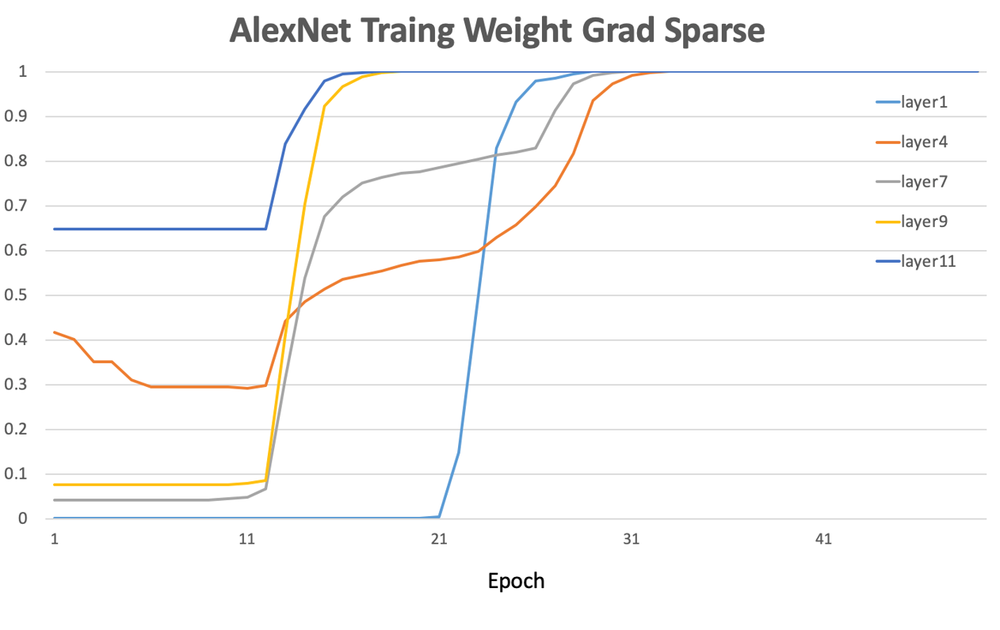

Hình 9: Độ thưa gradient trọng số của một số lớp AlexNet theo epoch huấn luyện.

> **Biên tập:** Bản gốc ghi thêm "AlexNet được huấn luyện phân tán". AlexNet gốc (2012) huấn luyện trên 2 GPU trong một máy, chia mô hình (model parallel) chứ không phải SGD phân tán nhiều nút; hình trên chỉ minh hoạ độ thưa của gradient, không phụ thuộc cách huấn luyện. Không rõ nguồn gốc của hình này trong bản gốc.

Vì trao đổi gradient tốn kém, băng thông mạng trở thành nút thắt của huấn luyện phân tán. Để vượt qua nút thắt truyền thông này, làm thưa gradient (`Gradient Sparsification`) được nghiên cứu rộng rãi, với các cách:

1. **Chọn một tỉ lệ cố định cập nhật gradient dương và âm**: chỉ truyền trên mạng một phần giá trị cập nhật gradient dương, âm được chọn theo tỉ lệ. [Bài báo của Dryden và cộng sự, 2016](https://dl.acm.org/doi/abs/10.5555/3018874.3018875).
2. **Đặt ngưỡng trước**: chỉ truyền trên mạng các gradient có trị tuyệt đối lớn hơn ngưỡng đặt trước. [Bài báo của Aji và Heafield, 2017](https://arxiv.org/abs/1704.05021).

**Nén gradient sâu (Deep Gradient Compression, DGC)** [5] dựa trên làm thưa gradient, cộng thêm 4 kỹ thuật là hiệu chỉnh động lượng, cắt gradient cục bộ, che hệ số động lượng (momentum factor masking) và huấn luyện warm-up để nén gradient, giảm băng thông truyền thông trong huấn luyện phân tán. Hiệu quả của thuật toán như hình dưới.

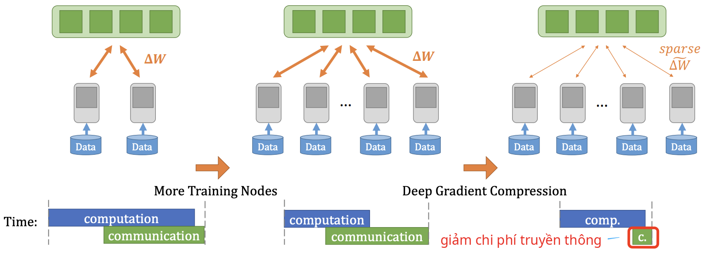

Hình 10: Thêm nút huấn luyện làm thời gian truyền thông tăng; DGC chỉ truyền gradient thưa $\widetilde{\Delta W}$ nên giảm chi phí truyền thông.

### 2.4 Tiểu kết

Dù làm thưa mạng neuron đã có một số tiến triển trong nghiên cứu và ứng dụng công nghiệp, hiện vẫn chưa có một khung kiến thức hoàn toàn xác định; nhiều kết luận trong các bài báo trước có thể bị các bài báo mới phá vỡ và xây dựng lại. Dưới đây là tổng kết về cắt tỉa trọng số, cắt tỉa kích hoạt và cắt tỉa gradient chủ đạo:

1. Cắt tỉa trọng số thời kỳ đầu là **không cấu trúc** (thưa mịn), không thân thiện với phần cứng tính toán song song như GPU, thậm chí có thể hoàn toàn không tăng tốc; hiệu quả tăng tốc phải nhờ phần cứng tăng tốc chuyên dụng (thường là **ASIC**), như phần cứng EIE do Song Han đề xuất [6].
2. Lớp càng cao thì càng dư thừa, và lớp tích chập ít dư thừa hơn lớp kết nối đầy đủ. Vì vậy cắt tỉa ResNet, MobileNet khó hơn VGG, AlexNet.
3. Cắt tỉa neuron dễ làm mất độ chính xác hơn cắt tỉa trọng số; còn gradient trong giai đoạn huấn luyện thì có độ thưa lớn nhất.
4. Quy trình cắt tỉa ba bước điển hình chưa chắc đã đúng. Nghiên cứu mới cho thấy cắt tỉa mạng khởi tạo ngẫu nhiên trước rồi mới huấn luyện có thể đạt độ thưa và độ chính xác cao hơn cắt tỉa mạng đã tiền huấn luyện. Điều này cần nghiên cứu thêm.

Tổng kết tính thưa của trọng số, kích hoạt và gradient trong mạng neuron như bảng dưới:

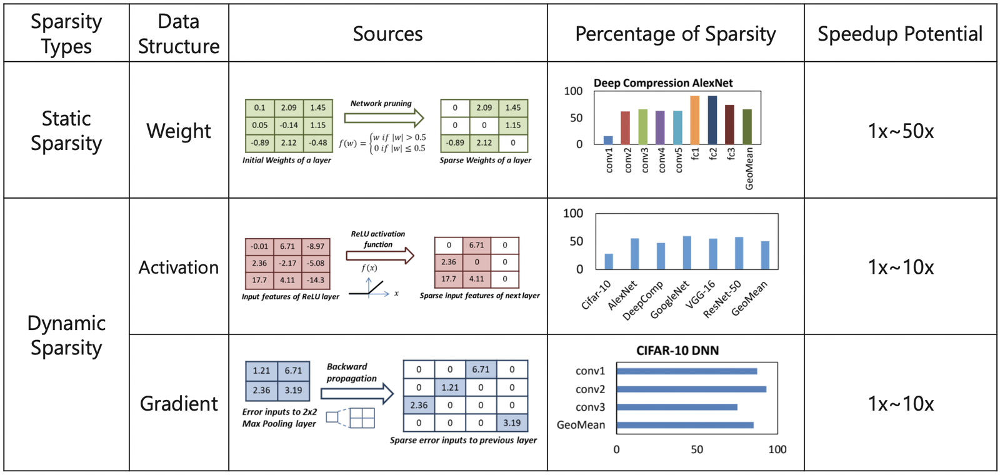

Hình 11: Tổng kết các loại thưa. Thưa tĩnh: trọng số (tăng tốc tiềm năng 1–50 lần). Thưa động: kích hoạt và gradient (1–10 lần).

## 3 Thưa có cấu trúc

Phương pháp làm thưa trọng số kết nối được đề xuất sớm nhất [1] là thưa không cấu trúc (tức thưa mịn, còn gọi là cắt tỉa không cấu trúc). Nó nén trực tiếp kích thước mô hình hơn 10 lần, về lý thuyết cũng giảm được 10 lần lượng tính toán. Nhưng sự "không đều" về đặc tính tính toán do cắt tỉa mịn gây ra rất không thân thiện với việc truy cập dữ liệu và tính toán song song quy mô lớn trên thiết bị tính toán, nhất là phần cứng `GPU`!

> Tác giả bài báo [1] đã đề xuất phần cứng tăng tốc chuyên dụng `EIE` để hỗ trợ thuật toán cắt tỉa trọng số mịn của mình.

Lý do là "thưa không cấu trúc" (Unstructured Sparsity) chủ yếu cắt tỉa từng trọng số riêng lẻ trong ma trận trọng số. Ma trận trọng số mới sau cắt tỉa trở thành ma trận thưa (các giá trị bị cắt được đặt bằng 0). Vì thế, trừ khi nền tảng phần cứng và thư viện tính toán hỗ trợ tính toán ma trận thưa hiệu quả, mô hình sau cắt tỉa không thể tăng hiệu năng thật sự!

> **Biên tập:** Bản gốc viết thưa không cấu trúc cắt "từng trọng số, hoặc cả hàng, cả cột trọng số". Cắt cả hàng hay cả cột chính là thưa **có cấu trúc** (mục 3.1); đã bỏ vế sau. Trang Code (mục 5) đo điều được nói ở đây: mô hình bị cắt 90% trọng số vẫn chạy chậm y như mô hình gốc trên CPU, và còn chậm hơn khi mask chưa được gộp vào trọng số.

Do đó, nhiều nghiên cứu bắt đầu thêm một ràng buộc "đều đặn" vào việc cắt tỉa mạng neuron, gọi là **cắt tỉa có cấu trúc** (Structured pruning), để kiểu thưa sau cắt tỉa hợp hơn với phần cứng tính toán song song. Đơn vị cắt tỉa cơ bản của "cắt tỉa có cấu trúc" là **kernel tích chập**, hoặc một hay nhiều kênh (channel) của ma trận trọng số. Vì cắt tỉa có cấu trúc bỏ hẳn cả hàng, cả kênh, kết quả là một ma trận dày đặc nhỏ hơn, nên các nền tảng và framework tính toán hiện có đều hỗ trợ tốt.

> **Biên tập:** Bản gốc giải thích "vì cắt tỉa có cấu trúc không làm thay đổi độ thưa của bản thân ma trận trọng số". Ý đúng là: sau khi bỏ các kênh, ma trận còn lại vẫn **dày đặc** (chỉ nhỏ hơn), nên tính được bằng các thư viện ma trận dày đặc thông thường; câu đã được viết lại theo ý này.

Kiểu thưa có thêm ràng buộc cấu trúc "đều đặn" này thường được gọi là thưa có cấu trúc (Structured Sparsity), trong nhiều tài liệu còn gọi là thưa thô (Coarse-grained Sparsity) hoặc thưa theo khối (Block Sparsity). Thưa có cấu trúc và không cấu trúc đều nhắm vào tham số trọng số.

### 3.1 Phân loại thưa có cấu trúc

Cắt tỉa có cấu trúc lại chia nhỏ được nữa: có thể theo channel/filter (channel/filter-wise), theo hình dạng (shape-wise), v.v.

> Bộ lọc (filter) tương đương một kernel tích chập 3 chiều. Số `feature map`/số kênh đầu ra bằng số bộ lọc.

#### 3.1.1 Cắt tỉa kênh/bộ lọc

Cắt tỉa kênh có nhiều công trình nhất. Cắt tỉa kênh và cắt tỉa bộ lọc thực ra cùng ý nghĩa: bỏ một bộ lọc thì một kênh của feature map đầu ra cũng tự nhiên bị bỏ, và ngược lại.

Cắt tỉa bộ lọc (kênh), filter (channel) pruning (FP), thuộc loại cắt tỉa thô (còn gọi là cắt tỉa có cấu trúc, Structured Pruning). Các phương pháp FP cắt bộ lọc hoặc kênh trong lớp tích chập chứ không cắt từng trọng số; cấu trúc tích chập ban đầu không đổi, nên mô hình sau cắt tỉa chạy nhanh hơn được mà không cần thuật toán hay phần cứng chuyên dụng.

Cốt lõi của cắt tỉa kênh trong mô hình `CNN` là làm sao giảm số đặc trưng ở giữa. Một hướng kinh điển là dựa trên **hệ số tầm quan trọng**: đánh giá mức hữu ích của một kênh, kết hợp ràng buộc để một số kênh làm cho bản thân cấu trúc mô hình có tính thưa, rồi cắt tỉa dựa trên đó.

> Cắt tỉa kênh dựa trên hệ số tầm quan trọng, giống như cắt tỉa kết nối theo độ lớn trọng số trong cắt tỉa không cấu trúc ở trên, đều có phần quá chủ quan.

Bài báo [Learning Efficient Convolutional Networks through Network Slimming](https://arxiv.org/pdf/1708.06519.pdf) [7] cho rằng tầm quan trọng của mỗi kênh trong lớp tích chập có thể gắn với lớp `BN`: nếu hệ số co giãn (scaling factor) tương ứng trong lớp `bn` sau một kênh đủ nhỏ, thì kênh đó ít quan trọng và có thể bỏ qua. Như hai kênh màu cam trong hình dưới bị cắt.

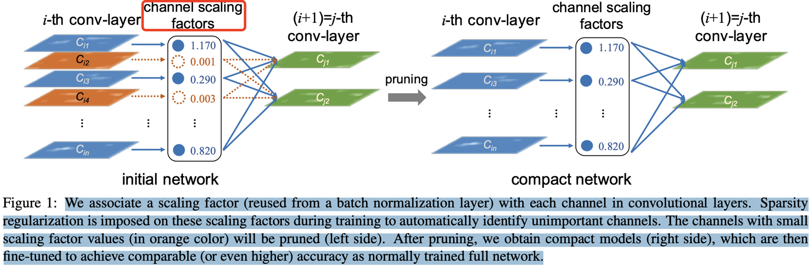

Hình 12: Network Slimming: mỗi kênh của lớp tích chập gắn với một hệ số co giãn (lấy lại từ lớp BN). Chính quy hóa làm thưa được áp lên các hệ số này khi huấn luyện; kênh có hệ số nhỏ (màu cam) bị cắt, cho mô hình gọn hơn, rồi tinh chỉnh lại.

Công thức tính của lớp `BN` như sau:

$$
\begin{aligned}
\mu_B &= \frac{1}{m}\sum_{i=1}^m x_i \\
\sigma^2_B &= \frac{1}{m} \sum_{i=1}^m (x_i-\mu_B)^2 \\
n_i &= \frac{x_i-\mu_B}{\sqrt{\sigma^2_B + \epsilon}} \\
z_i &= \gamma n_i + \beta = \frac{\gamma}{\sqrt{\sigma^2_B + \epsilon}}x_i + \left(\beta - \frac{\gamma\mu_{B}}{\sqrt{\sigma^2_B + \epsilon}}\right)
\end{aligned}
$$

Trong đó tham số $\gamma$ của lớp `bn` được dùng làm hệ số co giãn (`scaling factor`) để cắt tỉa ở mức kênh (`channel-level`). Để nhiều $\gamma$ tiến về 0, Network Slimming cộng thêm phạt L1 $\lambda \sum_\gamma |\gamma|$ vào hàm mất mát khi huấn luyện.

#### 3.1.2 Cắt tỉa mức giai đoạn (stage)

Cắt tỉa mức bộ lọc chỉ áp dụng được cho các lớp tích chập bên trong khối residual. CURL [9] chỉ ra rằng nếu chỉ cắt tỉa mức bộ lọc, mô hình sẽ có dạng đồng hồ cát, hai đầu rộng, giữa hẹp, và cấu trúc này ảnh hưởng tới số tham số và lượng tính toán. Khi đó, cắt tỉa mức giai đoạn bù được chỗ thiếu của cắt tỉa mức bộ lọc.

Các khối residual trong một giai đoạn liên kết chặt với nhau, như hình dưới.

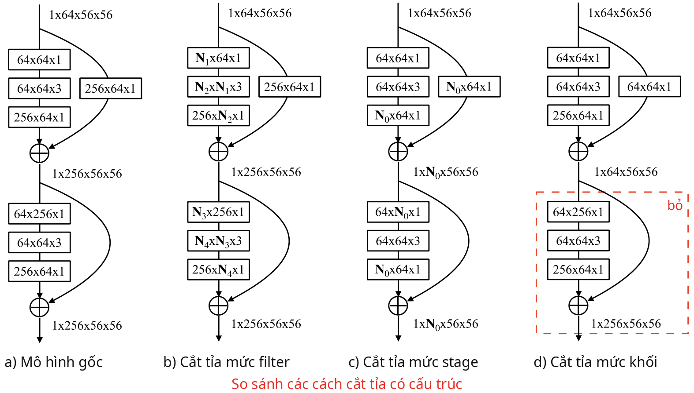

Hình 13: So sánh các cách cắt tỉa có cấu trúc trên hai khối bottleneck của ResNet: (a) mô hình gốc; (b) cắt tỉa mức bộ lọc: chỉ giảm số kênh bên trong khối ($N_1 \dots N_4$); (c) cắt tỉa mức giai đoạn: giảm số kênh $N_0$ ở đầu vào/ra của cả giai đoạn; (d) cắt tỉa mức khối: bỏ hẳn một khối.

Khi đặc trưng đầu ra của một giai đoạn thay đổi (một số đặc trưng bị bỏ), đặc trưng vào và ra của mỗi khối residual tương ứng đều phải thay đổi theo. Vì vậy trong cả giai đoạn, số kênh vào của lớp tích chập đầu tiên và số kênh ra của lớp tích chập cuối cùng trong mỗi khối residual đều phải thay đổi giống nhau. Vì ảnh hưởng này chỉ giới hạn trong giai đoạn hiện tại, không ảnh hưởng các giai đoạn trước và sau, ta gọi quá trình cắt tỉa này là cắt tỉa mức giai đoạn (stage-level pruning).

Cắt tỉa mức giai đoạn kết hợp với cắt tỉa mức bộ lọc làm hình dạng mạng đều hơn, tránh cấu trúc đồng hồ cát. Ngoài ra, cắt tỉa mức giai đoạn bỏ được nhiều tham số hơn, hỗ trợ nén mạng thêm nữa.

### 3.2 So sánh thưa có cấu trúc và thưa không cấu trúc

So với cắt tỉa không cấu trúc, cắt tỉa có cấu trúc thường hy sinh độ chính xác và tỉ lệ nén của mô hình. Thưa có cấu trúc giới hạn vị trí của các trọng số khác 0, nên khi cắt tỉa có thể phải cắt cả một số trọng số có giá trị lớn, ảnh hưởng tới độ chính xác. Còn cắt tỉa "không đều" thì khớp với **phân bố ngẫu nhiên** của các trọng số lớn nhỏ trong mạng neuron, điều rất quan trọng với độ chính xác của mô hình học sâu. Cụ thể:

1. Thưa không cấu trúc có tỉ lệ nén và độ chính xác cao hơn, nhưng tăng tốc kém trên phần cứng thông dụng, vì đặc tính tính toán "không đều" khiến phải có phần cứng riêng mới tăng tốc được.
2. Thưa có cấu trúc tuy hy sinh tỉ lệ nén hoặc độ chính xác, nhưng tăng tốc tốt trên phần cứng thông dụng nên được dùng rộng rãi, vì nó làm ma trận trọng số đều đặn, có cấu trúc hơn, có lợi cho tăng tốc phần cứng.

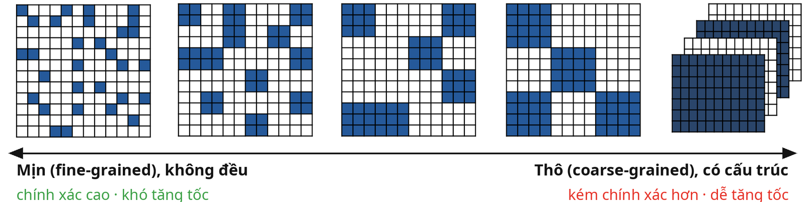

Hình 14: Từ trái sang phải, độ mịn của cắt tỉa giảm dần (từ từng phần tử đến cả kênh): độ chính xác giảm, nhưng càng dễ tăng tốc.

Tóm lại, làm thưa trọng số của mạng neuron sâu phải **cân bằng giữa hiệu quả của mô hình và hiệu quả tính toán**.

Hiện có xu hướng hỗ trợ **tensor thưa** ở cả phần mềm lẫn phần cứng, nên trong tương lai cắt tỉa không cấu trúc có thể trở nên phổ biến hơn.

## 4 Bổ sung: cắt tỉa từ 2019 đến nay

Mục này do người biên soạn viết thêm.

### 4.1 Giả thuyết vé số

Điểm 4 của mục 2.4 nói tới **giả thuyết vé số** (Lottery Ticket Hypothesis, Frankle và Carbin, 2019): một mạng dày khởi tạo ngẫu nhiên chứa sẵn các mạng con ("vé trúng") mà nếu huấn luyện riêng **từ đúng giá trị khởi tạo ban đầu** thì đạt độ chính xác ngang mạng đầy đủ, dù chỉ còn 10–20% trọng số. Cách tìm: huấn luyện, cắt các trọng số nhỏ, đặt các trọng số còn lại về giá trị khởi tạo ban đầu, lặp lại. Với mạng lớn, phải "tua lại" về trọng số ở một bước sớm của huấn luyện thay vì bước 0. Giả thuyết này chủ yếu có ý nghĩa lý thuyết, vì tìm vé trúng tốn hơn huấn luyện mạng dày.

### 4.2 Thưa bán cấu trúc 2:4

Đây là lời giải phần cứng cho "xu hướng tensor thưa" ở cuối mục 3.2. Từ GPU Ampere (A100, 2020), Tensor Core hỗ trợ **thưa N:M** với $N:M = 2:4$: trong mỗi nhóm 4 trọng số liên tiếp có đúng 2 trọng số bằng 0. Ma trận được lưu nén (một nửa giá trị cùng chỉ số 2 bit), và phép nhân ma trận thưa này nhanh tới 2 lần trên lý thuyết. Ràng buộc 2:4 đủ "đều" để phần cứng tận dụng, nhưng vẫn đủ linh hoạt nên thường giữ được độ chính xác sau một lần tinh chỉnh ngắn. PyTorch hỗ trợ qua `torch.sparse.to_sparse_semi_structured` (chỉ trên GPU NVIDIA, xem trang Code, mục 7).

### 4.3 Cắt tỉa mô hình ngôn ngữ lớn

Với LLM hàng chục tỉ tham số, quy trình "cắt → huấn luyện lại" quá tốn, nên các phương pháp mới cắt **một lần** (one-shot) và không huấn luyện lại:

- **SparseGPT** (Frantar và Alistarh, 2023): giống GPTQ (xem bài lượng tử hóa), xử lý từng lớp, dùng ma trận Hessian ước lượng từ tập hiệu chuẩn để cập nhật các trọng số còn lại, bù sai số do cắt. Cắt được 50–60% trọng số của các mô hình cỡ 175 tỉ tham số mà độ khó hiểu (perplexity) tăng không đáng kể.
- **Wanda** (Sun và cộng sự, 2023): tiêu chí tầm quan trọng chỉ là $|W_{ij}| \cdot \|X_j\|_2$, tức độ lớn trọng số nhân với độ lớn kích hoạt đi vào nó (cùng ý với AWQ trong lượng tử hóa), không cần cập nhật trọng số mà kết quả gần SparseGPT.
- **Cắt tỉa có cấu trúc + chưng cất**: bỏ cả lớp, cả đầu attention, cả chiều ẩn rồi chưng cất từ mô hình gốc để phục hồi (LLM-Pruner, Sheared-LLaMA, Minitron; xem [bài tổng quan](dlnote/compress_overview_vi), mục 7). Hướng này cho tăng tốc thật trên mọi phần cứng, đúng như kết luận của mục 3.2.

## Tài liệu tham khảo

- [1] Han et al., [Learning both Weights and Connections for Efficient Neural Networks](https://arxiv.org/pdf/1506.02626.pdf), NIPS 2015.
- [2] Nair and Hinton, [Rectified Linear Units Improve Restricted Boltzmann Machines](https://www.cs.toronto.edu/~hinton/absps/reluICML.pdf), ICML 2010.
- [3] Krizhevsky et al., [ImageNet Classification with Deep Convolutional Neural Networks](https://proceedings.neurips.cc/paper/2012/file/c399862d3b9d6b76c8436e924a68c45b-Paper.pdf), NIPS 2012.
- [4] Hu et al., [Network Trimming: A Data-Driven Neuron Pruning Approach towards Efficient Deep Architectures](https://arxiv.org/pdf/1607.03250.pdf), 2016.
- [5] Lin et al., [Deep Gradient Compression: Reducing the Communication Bandwidth for Distributed Training](https://arxiv.org/abs/1712.01887), ICLR 2018.
- [6] Song Han, [Efficient Methods and Hardware for Deep Learning](https://stacks.stanford.edu/file/druid:qf934gh3708/EFFICIENT%20METHODS%20AND%20HARDWARE%20FOR%20DEEP%20LEARNING-augmented.pdf), luận án tiến sĩ, Stanford.
- [7] Liu et al., [Learning Efficient Convolutional Networks through Network Slimming](https://arxiv.org/pdf/1708.06519.pdf), ICCV 2017.
- [8] [Chương 1: Tổng quan về cắt tỉa có cấu trúc](https://cs.nju.edu.cn/wujx/paper/Pruning_Survey_MLA21.pdf) (结构化剪枝综述), Wu Jianxin và cộng sự.
- [9] Luo and Wu, [Neural Network Pruning with Residual-Connections and Limited-Data](https://arxiv.org/pdf/1911.08114.pdf) (CURL), CVPR 2020.
- [10] LeCun et al., [Optimal Brain Damage](https://proceedings.neurips.cc/paper/1989/file/6c9882bbac1c7093bd25041881277658-Paper.pdf), NIPS 1989.
- [11] [AI-System: 11.3 Nén mô hình và tăng tốc phần cứng](https://github.com/microsoft/AI-System/blob/main/Textbook/%E7%AC%AC11%E7%AB%A0-%E6%A8%A1%E5%9E%8B%E5%8E%8B%E7%BC%A9%E4%B8%8E%E5%8A%A0%E9%80%9F/11.3-%E6%A8%A1%E5%9E%8B%E5%8E%8B%E7%BC%A9%E4%B8%8E%E7%A1%AC%E4%BB%B6%E5%8A%A0%E9%80%9F.md), Microsoft.

Tài liệu cho mục 4 (người biên soạn bổ sung):

- Frankle and Carbin, [The Lottery Ticket Hypothesis](https://arxiv.org/abs/1803.03635), ICLR 2019.
- Mishra et al., [Accelerating Sparse Deep Neural Networks](https://arxiv.org/abs/2104.08378) (thưa 2:4 trên Ampere), 2021.
- Frantar and Alistarh, [SparseGPT: Massive Language Models Can Be Accurately Pruned in One-Shot](https://arxiv.org/abs/2301.00774), 2023.
- Sun et al., [A Simple and Effective Pruning Approach for Large Language Models](https://arxiv.org/abs/2306.11695) (Wanda), 2023.
