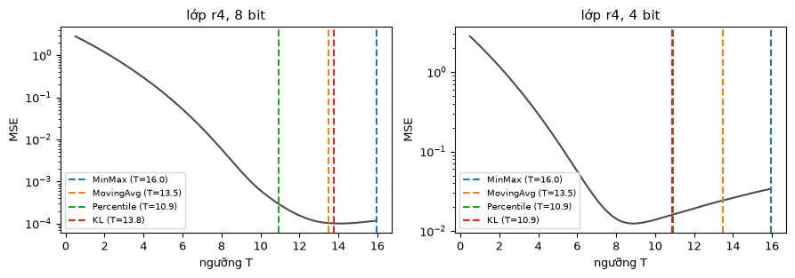

# Lượng tử hóa · Code

> Ghi chú của người biên soạn: trang này do người biên soạn viết thêm, không có trong ghi chú gốc. Nó cài đặt lại các công thức của bài [Cơ bản về lượng tử hóa mạng neuron](dlnote/compress_quant_vi) bằng NumPy, kiểm tra với PyTorch, rồi lượng tử hóa INT8 một CNN thật trên FashionMNIST bằng `torch.ao.quantization` và `torchao`.

## Cách dùng trang này

Các khối chạy lần lượt từ trên xuống và dùng chung biến. Cần `numpy`, `torch`, `torchvision`, `matplotlib`, và `torchao` cho mục 6. Mọi khối chạy trên CPU; khối huấn luyện mô hình ở mục 3 mất khoảng một phút (lần sau mô hình được đọc lại từ `~/.cache/dlnote`).

## 1. Lượng tử hóa đối xứng và bất đối xứng

<small class="viz-ref">Mục 2.2</small>

Hai hàm dưới đây viết đúng công thức (2.2) và (2.4). Ta thử trên hai loại dữ liệu: "trọng số" phân bố chuẩn quanh 0, và "kích hoạt" sau ReLU (luôn $\ge 0$).

<!-- run -->
```python
import warnings
warnings.filterwarnings('ignore')
import numpy as np
import torch

def quant_sym(x, bits=8):
    """Đối xứng, công thức (2.2): x_q trong [-(2^(b-1)-1), 2^(b-1)-1]."""
    qmax = 2 ** (bits - 1) - 1
    s = np.abs(x).max() / qmax
    q = np.clip(np.round(x / s), -qmax, qmax).astype(np.int32)
    return q, s

def quant_asym(x, bits=8):
    """Bất đối xứng, công thức (2.4): x_q trong [0, 2^b - 1], x_f = s (x_q - z)."""
    qmin, qmax = 0, 2 ** bits - 1
    s = (x.max() - x.min()) / (qmax - qmin)
    z = int(np.round(qmin - x.min() / s))
    q = np.clip(np.round(x / s) + z, qmin, qmax).astype(np.int32)
    return q, s, z

rng = np.random.default_rng(0)
w = rng.normal(0, 0.05, 10000).astype(np.float32)                 # giống trọng số
a = np.maximum(rng.normal(0.5, 1.0, 10000), 0).astype(np.float32)  # giống kích hoạt sau ReLU

print(f"{'dữ liệu':10s} {'cách':12s} {'scale':>9s} {'zero':>5s} {'số mức dùng':>12s} {'sai số TB':>10s}")
for name, x in [('trọng số', w), ('kích hoạt', a)]:
    q, s = quant_sym(x)
    print(f"{name:10s} {'đối xứng':12s} {float(s):9.5f} {0:5d} {len(np.unique(q)):12d} {float(np.abs(q * s - x).mean()):10.5f}")
    q, s, z = quant_asym(x)
    print(f"{name:10s} {'bất đối xứng':12s} {float(s):9.5f} {z:5d} {len(np.unique(q)):12d} {float(np.abs((q - z) * s - x).mean()):10.5f}")

# Kiểm tra với PyTorch: fake_quantize = lượng tử hóa rồi giải lượng tử hóa ngay
q, s, z = quant_asym(a)
ref = torch.fake_quantize_per_tensor_affine(torch.tensor(a), float(s), z, 0, 255)
print('lệch so với PyTorch:', float((ref - torch.tensor((q - z) * s)).abs().max()))

# Ví dụ trong bài: [-1, 1] -> [0, 255]
s = 2 / 255
print('zero point cho [-1, 1]:', 255 - 1 / s, '-> làm tròn', round(255 - 1 / s))
print('FP32 lớn nhất:', (2 - 2 ** -23) * 2.0 ** 127, '=', float(np.finfo(np.float32).max))
```

<!-- output -->
```output
dữ liệu    cách             scale  zero  số mức dùng  sai số TB
trọng số   đối xứng       0.00154     0          207    0.00039
trọng số   bất đối xứng   0.00145   135          217    0.00036
kích hoạt  đối xứng       0.03500     0          110    0.00600
kích hoạt  bất đối xứng   0.01743     0          205    0.00303
lệch so với PyTorch: 1.1920928955078125e-07
zero point cho [-1, 1]: 127.5 -> làm tròn 128
FP32 lớn nhất: 3.4028234663852886e+38 = 3.4028234663852886e+38
```
<!-- /output -->

Với "trọng số" phân bố đối xứng quanh 0, hai cách gần như ngang nhau (sai số 0,00039 và 0,00036). Với "kích hoạt" sau ReLU, cách đối xứng bỏ phí toàn bộ nửa âm: chỉ dùng 110 mức, trong khi bất đối xứng dùng 205 mức, scale nhỏ bằng một nửa và sai số cũng giảm một nửa (0,0060 → 0,0030). Đây là lý do kích hoạt thường được lượng tử hóa bất đối xứng sang `uint8` (lưu ý ở đây zero point bằng 0 vì giá trị nhỏ nhất đúng bằng 0). Hàm của ta khớp `torch.fake_quantize_per_tensor_affine` tới sai số làm tròn của FP32. Ví dụ $[-1, 1]$ cho zero point 127,5, làm tròn thành 128.

## 2. Phép nhân ma trận chỉ dùng số nguyên

<small class="viz-ref">Mục 2.3</small>

Cài đặt (2.5) cho phép nhân ma trận $Z = XY$: nhân các số nguyên đã trừ điểm không, **cộng dồn bằng INT32**, nhân với hằng $\alpha = x_s y_s / z_s$, cộng $z_{zero}$, rồi cắt về `uint8` (bước *requantize*). Kết quả giải lượng tử hóa được so với phép nhân số thực.

<!-- run -->
```python
X = np.maximum(rng.normal(0.3, 1.0, (64, 256)), 0).astype(np.float32)   # kích hoạt (uint8)
Y = rng.normal(0, 0.05, (256, 128)).astype(np.float32)                  # trọng số
Z = X @ Y                                                               # kết quả số thực

xq, xs, xz = quant_asym(X)
yq, ys, yz = quant_asym(Y)
_, zs, zz = quant_asym(Z)        # thang đo của đầu ra: thực tế lấy từ hiệu chuẩn

acc = (xq - xz).astype(np.int32) @ (yq - yz).astype(np.int32)   # cộng dồn INT32
alpha = xs * ys / zs                                            # hằng FP32 tính sẵn
zq = np.clip(np.round(alpha * acc) + zz, 0, 255).astype(np.uint8)  # requantize

print('acc: kiểu', acc.dtype, ', khoảng', int(acc.min()), '..', int(acc.max()), '(vượt xa int8/uint8)')
print('alpha =', float(alpha))
err = np.abs((zq.astype(np.int32) - zz) * zs - Z)
print('sai số tuyệt đối TB:', float(err.mean()), ', lớn nhất:', float(err.max()))
print('so với bước lượng tử hóa của đầu ra zs =', float(zs))
```

<!-- output -->
```output
acc: kiểu int32 , khoảng -96219 .. 111881 (vượt xa int8/uint8)
alpha = 0.0012259584618732333
sai số tuyệt đối TB: 0.0081434411013106 , lớn nhất: 0.03835563361644745
so với bước lượng tử hóa của đầu ra zs = 0.022972889244556427
```
<!-- /output -->

Tổng tích lũy nằm trong khoảng −96219 đến 111881: phải dùng INT32 như bài nói, INT8 hay INT16 đều không chứa nổi. Sau khi lượng tử hóa lại, sai số trung bình là 0,0081, lớn nhất 0,038. Con số này cỡ một đến hai lần bước lượng tử hóa của đầu ra ($z_s \approx 0{,}023$), đúng như mong đợi khi cả đầu vào, trọng số và đầu ra đều bị làm tròn.

## 3. Chọn ngưỡng: MinMax, trung bình trượt, phân vị và KL

<small class="viz-ref">Mục 3.1–3.4</small>

Để có kích hoạt thật, ta huấn luyện một CNN nhỏ trên FashionMNIST: ba lớp tích chập và hai lớp kết nối đầy đủ. `QuantStub`/`DeQuantStub` đánh dấu chỗ lượng tử hóa đầu vào và giải lượng tử hóa đầu ra (Hình 1 của bài); khi mô hình chưa lượng tử hóa, chúng không làm gì.

<!-- run -->
```python
import os, copy, io, time
import torch.nn as nn
import torch.nn.functional as F
import torchvision
import torchvision.transforms as T
torch.manual_seed(0)
torch.set_num_threads(4)

root = os.path.expanduser('~/.cache/d2l-data')
train_set = torchvision.datasets.FashionMNIST(root, train=True, transform=T.ToTensor(), download=True)
test_set = torchvision.datasets.FashionMNIST(root, train=False, transform=T.ToTensor(), download=True)
test_iter = torch.utils.data.DataLoader(test_set, 1000)

class Net(nn.Module):
    def __init__(self):
        super().__init__()
        self.quant = torch.ao.quantization.QuantStub()
        self.c1 = nn.Conv2d(1, 32, 3, padding=1); self.r1 = nn.ReLU()
        self.c2 = nn.Conv2d(32, 64, 3, padding=1); self.r2 = nn.ReLU()
        self.pool = nn.MaxPool2d(2)
        self.c3 = nn.Conv2d(64, 128, 3, padding=1); self.r3 = nn.ReLU()
        self.flat = nn.Flatten()
        self.fc1 = nn.Linear(128 * 7 * 7, 256); self.r4 = nn.ReLU()
        self.fc2 = nn.Linear(256, 10)
        self.dequant = torch.ao.quantization.DeQuantStub()
    def forward(self, x):
        x = self.quant(x)
        x = self.pool(self.r1(self.c1(x)))
        x = self.pool(self.r2(self.c2(x)))
        x = self.r3(self.c3(x))
        x = self.r4(self.fc1(self.flat(x)))
        return self.dequant(self.fc2(x))

net = Net()
ckpt = os.path.expanduser('~/.cache/dlnote/fmnist_cnn.pt')
if os.path.exists(ckpt):
    net.load_state_dict(torch.load(ckpt))
else:                                  # 3 epoch Adam, khoảng một phút trên CPU
    opt = torch.optim.Adam(net.parameters(), 1e-3)
    for epoch in range(3):
        for X_, y_ in torch.utils.data.DataLoader(train_set, 256, shuffle=True):
            opt.zero_grad(); F.cross_entropy(net(X_), y_).backward(); opt.step()
    os.makedirs(os.path.dirname(ckpt), exist_ok=True)
    torch.save(net.state_dict(), ckpt)
net.eval()

def accuracy(m):
    c = n = 0
    with torch.no_grad():
        for X_, y_ in test_iter:
            c += (m(X_).argmax(1) == y_).sum().item(); n += len(y_)
    return c / n

print('độ chính xác FP32:', accuracy(net))
```

<!-- output -->
```output
độ chính xác FP32: 0.8997
```
<!-- /output -->

Tập hiệu chuẩn là 8 batch ảnh huấn luyện (2048 ảnh). Ta ghi lại kích hoạt sau mỗi ReLU, rồi cài đặt bốn cách chọn ngưỡng $T$ (khoảng lượng tử hóa là $[0, T]$ vì kích hoạt không âm). Hàm `kl_threshold` làm theo thuật toán của TensorRT ở mục 3.4: histogram 2048 bin; với mỗi ngưỡng $i$, P là $i$ bin đầu với phần vượt ngưỡng dồn vào bin cuối, Q là $i$ bin đó gộp thành $2^b$ mức rồi trải đều trở lại.

<!-- run -->
```python
calib = [X_ for X_, _ in torch.utils.data.DataLoader(train_set, 256, shuffle=True)][:8]
names = ['r1', 'r2', 'r3', 'r4']
acts = {k: [] for k in names}
hooks = [getattr(net, k).register_forward_hook(
            lambda m, i, o, k=k: acts[k].append(o.detach().flatten().numpy())) for k in names]
with torch.no_grad():
    for X_ in calib:
        net(X_)
for h in hooks:
    h.remove()
print('tỉ lệ kích hoạt bằng 0:', {k: round(float((np.concatenate(acts[k]) == 0).mean()), 2) for k in names})

def kl_threshold(x, bits=8, nbins=2048):
    x = x[x > 0]                      # bỏ các số 0 do ReLU sinh ra (xem ô Biên tập ở mục 3.4)
    hist, edges = np.histogram(x, bins=nbins, range=(0, x.max()))
    nq = 2 ** bits
    best, best_i = np.inf, nbins
    for i in range(nq, nbins + 1):
        p = hist[:i].astype(np.float64).copy()
        p[i - 1] += hist[i:].sum()                    # phần vượt ngưỡng dồn vào bin cuối
        chunks = np.array_split(hist[:i].astype(np.float64), nq)
        q = np.concatenate([np.where(c > 0, c.sum() / max((c > 0).sum(), 1), 0) for c in chunks])
        p /= p.sum(); q /= q.sum()
        m = p > 0
        if (q[m] == 0).any():
            continue
        kl = np.sum(p[m] * np.log(p[m] / q[m]))       # công thức (3.1)
        if kl < best:
            best, best_i = kl, i
    return edges[best_i]

def threshold(batches, method, bits=8):
    if method == 'MinMax':                            # mục 3.2
        return max(b.max() for b in batches)
    if method == 'MovingAvg':                         # mục 3.3, c = 0.01
        t = None
        for b in batches:
            t = b.max() if t is None else 0.99 * t + 0.01 * b.max()
        return t
    if method == 'Percentile':                        # bỏ 0,01% giá trị lớn nhất
        return np.percentile(np.concatenate(batches), 99.99)
    if method == 'KL':                                # mục 3.4
        return kl_threshold(np.concatenate(batches), bits)

methods = ['MinMax', 'MovingAvg', 'Percentile', 'KL']
for k in names:
    print(k, {m: round(float(threshold(acts[k], m)), 2) for m in methods})
```

<!-- output -->
```output
tỉ lệ kích hoạt bằng 0: {'r1': 0.44, 'r2': 0.5, 'r3': 0.62, 'r4': 0.64}
r1 {'MinMax': 1.35, 'MovingAvg': 1.34, 'Percentile': 1.1, 'KL': 0.22}
r2 {'MinMax': 2.24, 'MovingAvg': 2.04, 'Percentile': 1.36, 'KL': 1.4}
r3 {'MinMax': 2.9, 'MovingAvg': 2.64, 'Percentile': 1.83, 'KL': 2.55}
r4 {'MinMax': 15.96, 'MovingAvg': 13.5, 'Percentile': 10.92, 'KL': 13.78}
```
<!-- /output -->

Đúng như bài nói, 44–64% kích hoạt bằng 0. Ba cách MinMax, trung bình trượt, phân vị cho ngưỡng giảm dần theo thứ tự đó. KL cho ngưỡng gần với trung bình trượt hoặc phân vị, trừ lớp đầu `r1`: KL chọn 0,22, chỉ bằng một phần sáu giá trị lớn nhất.

Ngưỡng nhỏ thì bước lượng tử hóa mịn nhưng cắt mất phần đuôi; ngưỡng lớn thì giữ đủ đuôi nhưng bước thô. Đó là đánh đổi giữa khoảng giá trị và độ chính xác trong Hình 8 của bài. Hình dưới đo sai số bình phương trung bình (MSE) của kích hoạt lớp `r4` theo ngưỡng, ở 8 bit và 4 bit, và đánh dấu ngưỡng mà mỗi cách chọn.

<!-- run -->
```python
import matplotlib.pyplot as plt

def fq(x, T_, bits):                     # lượng tử hóa giả không dấu trên [0, T]
    s = T_ / (2 ** bits - 1)
    return np.clip(np.round(x / s), 0, 2 ** bits - 1) * s

x4 = np.concatenate(acts['r4'])
fig, axes = plt.subplots(1, 2, figsize=(9, 3.2))
for ax, bits in zip(axes, [8, 4]):
    Ts = np.linspace(0.5, x4.max(), 200)
    mse = [float(np.mean((fq(x4, t, bits) - x4) ** 2)) for t in Ts]
    ax.plot(Ts, mse, color='0.3')
    best_T = Ts[int(np.argmin(mse))]
    print(f'{bits} bit: ngưỡng MSE nhỏ nhất ≈ {best_T:.2f}, MSE = {min(mse):.2e}')
    for m, c in zip(methods, ['C0', 'C1', 'C2', 'C3']):
        t = threshold(acts['r4'], m, bits)
        e = float(np.mean((fq(x4, t, bits) - x4) ** 2))
        ax.axvline(t, color=c, ls='--', label=f'{m} (T={t:.1f})')
        print(f'   {m:10s} T = {t:6.2f}   MSE = {e:.2e}')
    ax.set_yscale('log'); ax.set_xlabel('ngưỡng T'); ax.set_ylabel('MSE'); ax.set_title(f'lớp r4, {bits} bit')
    ax.legend(fontsize=7)
plt.tight_layout()
```

<!-- output -->
```output
8 bit: ngưỡng MSE nhỏ nhất ≈ 14.09, MSE = 1.00e-04
   MinMax     T =  15.96   MSE = 1.17e-04
   MovingAvg  T =  13.50   MSE = 1.03e-04
   Percentile T =  10.92   MSE = 2.98e-04
   KL         T =  13.78   MSE = 1.01e-04
4 bit: ngưỡng MSE nhỏ nhất ≈ 8.89, MSE = 1.24e-02
   MinMax     T =  15.96   MSE = 3.40e-02
   MovingAvg  T =  13.50   MSE = 2.43e-02
   Percentile T =  10.92   MSE = 1.61e-02
   KL         T =  10.89   MSE = 1.60e-02
```

<div align=center></div>
<!-- /output -->

Ở 8 bit, đường MSE khá phẳng quanh điểm tốt nhất (≈ 14,1): MinMax, trung bình trượt và KL đều gần tối ưu, còn phân vị cắt quá tay nên sai số gấp ba. Ở 4 bit, bước lượng tử hóa thô hơn 17 lần nên điểm tối ưu dịch hẳn về trái (≈ 8,9): lúc này cắt đuôi có lợi, phân vị và KL (≈ 10,9) tốt gấp đôi MinMax. Đây chính là ý của mục 3: ngưỡng tốt phụ thuộc vào số bit, và "bão hòa" chỉ có lợi khi độ phân giải không đủ.

Cuối cùng là tác động lên độ chính xác của cả mô hình: lượng tử hóa giả mọi kích hoạt với ngưỡng của từng cách, trọng số lượng tử hóa theo kênh cùng số bit.

<!-- run -->
```python
def quantize_weights(m, bits, per_channel=True):
    qmax = 2 ** (bits - 1) - 1
    for mod in m.modules():
        if isinstance(mod, (nn.Conv2d, nn.Linear)):
            w_ = mod.weight.data
            if per_channel:   # mỗi kênh ra một scale
                s = (w_.abs().flatten(1).max(1).values / qmax).view((-1,) + (1,) * (w_.dim() - 1))
            else:             # cả tensor một scale
                s = w_.abs().max() / qmax
            mod.weight.data = torch.clamp(torch.round(w_ / s), -qmax, qmax) * s
    return m

def fake_quant_model(method, bits):
    m = quantize_weights(copy.deepcopy(net), bits)
    for k in names:
        s = float(threshold(acts[k], method, bits)) / (2 ** bits - 1)
        getattr(m, k).register_forward_hook(
            lambda mod, i, o, s=s, qm=2 ** bits - 1: torch.clamp(torch.round(o / s), 0, qm) * s)
    return m

print(f"{'bit':>4s}" + ''.join(f'{m:>12s}' for m in methods))
for bits in [8, 6, 4]:
    print(f'{bits:4d}' + ''.join(f'{accuracy(fake_quant_model(m, bits)):12.4f}' for m in methods))
```

<!-- output -->
```output
 bit      MinMax   MovingAvg  Percentile          KL
   8      0.8987      0.8987      0.8990      0.7775
   6      0.9003      0.8991      0.8998      0.8985
   4      0.8935      0.8914      0.8929      0.8921
```
<!-- /output -->

Mô hình này rất dễ lượng tử hóa: ở 8 bit, ba cách MinMax, trung bình trượt, phân vị đều giữ khoảng 90%, bằng FP32; đến 4 bit cũng chỉ mất chưa tới 1%. Ngoại lệ là **KL ở 8 bit: 77,8%**. Nguyên nhân là ngưỡng 0,22 của lớp đầu `r1` cắt mất phần lớn kích hoạt có ích. Ở 6 bit và 4 bit, KL lại chọn ngưỡng hợp lý cho `r1` và ngang các cách khác. Bài học: KL không phải lúc nào cũng tốt nhất. Đó là lý do các công cụ hiện nay còn cho chọn theo phân vị hoặc MSE, và luôn nên đo lại độ chính xác sau khi hiệu chuẩn.

## 4. Theo tensor hay theo kênh

<small class="viz-ref">Mục 1.2.1, 4.2</small>

Chỉ lượng tử hóa trọng số (kích hoạt giữ FP32), so một scale cho cả tensor với một scale cho mỗi kênh ra. Dòng cuối in khoảng $\max|w|$ của các kênh trong từng lớp: kênh lớn nhất gấp nhiều lần kênh nhỏ nhất, nên một scale chung làm các kênh nhỏ chỉ còn vài mức.

<!-- run -->
```python
print(f"{'bit':>4s} {'theo tensor':>12s} {'theo kênh':>10s}")
for bits in [8, 4, 3, 2]:
    pt = accuracy(quantize_weights(copy.deepcopy(net), bits, per_channel=False))
    pc = accuracy(quantize_weights(copy.deepcopy(net), bits, per_channel=True))
    print(f'{bits:4d} {pt:12.4f} {pc:10.4f}')
for n_, mod in [('c1', net.c1), ('c2', net.c2), ('c3', net.c3), ('fc1', net.fc1), ('fc2', net.fc2)]:
    mx = mod.weight.data.abs().flatten(1).max(1).values
    print(f'{n_:4s} max|w| theo kênh: {float(mx.min()):.3f} .. {float(mx.max()):.3f}  (gấp {float(mx.max() / mx.min()):.1f} lần)')
```

<!-- output -->
```output
 bit  theo tensor  theo kênh
   8       0.8995     0.8987
   4       0.8788     0.8944
   3       0.7641     0.8944
   2       0.1000     0.1735
c1   max|w| theo kênh: 0.275 .. 0.648  (gấp 2.4 lần)
c2   max|w| theo kênh: 0.062 .. 0.412  (gấp 6.6 lần)
c3   max|w| theo kênh: 0.047 .. 0.228  (gấp 4.8 lần)
fc1  max|w| theo kênh: 0.018 .. 0.242  (gấp 13.6 lần)
fc2  max|w| theo kênh: 0.101 .. 0.251  (gấp 2.5 lần)
```
<!-- /output -->

Ở 8 bit, hai cách ngang nhau. Từ 4 bit trở xuống, khác biệt rất rõ: ở 3 bit, theo tensor chỉ còn 76,4%, theo kênh vẫn giữ 89,4%. Lớp `fc1` giải thích điều này: kênh lớn nhất có $\max|w|$ gấp 13,6 lần kênh nhỏ nhất. Với một scale chung ở 3 bit (chỉ 3 mức dương), các kênh nhỏ gần như bị làm tròn hết về 0. Ở 2 bit thì cả hai đều hỏng (10% là đoán ngẫu nhiên): muốn xuống thấp như vậy cần QAT hoặc các kỹ thuật ở mục 4 của bài.

## 5. PTQ INT8 thật với `torch.ao.quantization`

<small class="viz-ref">Mục 1.1, 1.2</small>

Các mục trên dùng lượng tử hóa giả (vẫn tính bằng số thực). Ở đây mô hình được chuyển thật sang INT8 và chạy bằng kernel số nguyên `x86` (FBGEMM/oneDNN), theo đúng các bước PTQ: gộp Conv+ReLU (`fuse_modules`), gắn observer (`prepare`), cho tập hiệu chuẩn chạy qua, rồi `convert`. Ta thử ba cấu hình observer cho kích hoạt và trọng số; `HistogramObserver` chọn ngưỡng bằng cách cực tiểu sai số lượng tử hóa trên histogram, gần với ý tưởng của mục 3.4.

<!-- run -->
```python
from torch.ao import quantization as tq
torch.backends.quantized.engine = 'x86'

def size_mb(m):
    b = io.BytesIO(); torch.save(m.state_dict(), b); return b.tell() / 1e6

def latency_ms(m, bs=64, rep=30):
    X_ = torch.randn(bs, 1, 28, 28)
    with torch.no_grad():
        for _ in range(5): m(X_)
        t = time.perf_counter()
        for _ in range(rep): m(X_)
    return (time.perf_counter() - t) / rep * 1000

def ptq(qconfig):
    m = copy.deepcopy(net).eval()
    m = tq.fuse_modules(m, [['c1', 'r1'], ['c2', 'r2'], ['c3', 'r3'], ['fc1', 'r4']])
    m.qconfig = qconfig
    tq.prepare(m, inplace=True)          # gắn observer
    with torch.no_grad():
        for X_ in calib:                 # hiệu chuẩn
            m(X_)
    tq.convert(m, inplace=True)          # thay bằng module INT8
    return m

configs = {
    'MinMax, W theo tensor': tq.QConfig(
        activation=tq.MinMaxObserver.with_args(dtype=torch.quint8),
        weight=tq.MinMaxObserver.with_args(dtype=torch.qint8, qscheme=torch.per_tensor_symmetric)),
    'MinMax, W theo kênh': tq.QConfig(
        activation=tq.MinMaxObserver.with_args(dtype=torch.quint8),
        weight=tq.PerChannelMinMaxObserver.with_args(dtype=torch.qint8, qscheme=torch.per_channel_symmetric)),
    'Histogram, W theo kênh': tq.get_default_qconfig('x86'),
}
print(f"{'cấu hình':24s} {'độ chính xác':>12s} {'MB':>6s} {'ms/batch 64':>12s}")
print(f"{'FP32':24s} {accuracy(net):12.4f} {size_mb(net):6.2f} {latency_ms(net):12.1f}")
qmodels = {}
for k, c in configs.items():
    qmodels[k] = ptq(c)
    print(f'{k:24s} {accuracy(qmodels[k]):12.4f} {size_mb(qmodels[k]):6.2f} {latency_ms(qmodels[k]):12.1f}')
```

<!-- output -->
```output
cấu hình                 độ chính xác     MB  ms/batch 64
FP32                           0.8997   6.81          8.4
MinMax, W theo tensor          0.8999   1.71          3.1
MinMax, W theo kênh            0.8957   1.72          3.2
Histogram, W theo kênh         0.8989   1.72          3.1
```
<!-- /output -->

Mô hình INT8 nhỏ đi 4 lần (6,81 → 1,72 MB) và chạy nhanh hơn khoảng 2,7 lần trên CPU này (8,4 → 3,1 ms cho một batch 64 ảnh; thời gian đo được thay đổi giữa các lần chạy). Độ chính xác gần như không đổi (89,97% → 89,57–89,99%), khớp với mục 3: ở 8 bit, mô hình này không nhạy với cách chọn ngưỡng.

Xem bên trong mô hình đã chuyển: mỗi lớp giờ là module lượng tử hóa, mang `scale` và `zero_point` của đầu ra (đúng $z_s$, $z_{zero}$ trong (2.5)), còn trọng số là tensor `qint8` với một scale cho mỗi kênh.

<!-- run -->
```python
qm = qmodels['Histogram, W theo kênh']
print(qm.c1)
print(qm.fc2)
print('đầu vào : scale =', float(qm.quant.scale), ', zero_point =', int(qm.quant.zero_point))
wq = qm.c1.weight()
print('trọng số c1:', wq.dtype, tuple(wq.shape), ', số scale =', wq.q_per_channel_scales().numel())
print('vài giá trị nguyên:', wq.int_repr()[0, 0].flatten().tolist())
```

<!-- output -->
```output
QuantizedConvReLU2d(1, 32, kernel_size=(3, 3), stride=(1, 1), scale=0.009030475281178951, zero_point=0, padding=(1, 1))
QuantizedLinear(in_features=256, out_features=10, scale=0.2239575833082199, zero_point=60, qscheme=torch.per_channel_affine)
đầu vào : scale = 0.007870171219110489 , zero_point = 0
trọng số c1: torch.qint8 (32, 1, 3, 3) , số scale = 32
vài giá trị nguyên: [0, 95, -98, -108, -30, 59, -8, 127, -1]
```
<!-- /output -->

`QuantizedConvReLU2d` là Conv và ReLU đã gộp làm một kernel, nên đầu ra có zero point bằng 0 (kích hoạt không âm). Lớp cuối `fc2` không có ReLU, đầu ra có cả số âm nên zero point là 60. Trọng số `c1` có 32 scale, một cho mỗi kênh ra, và giá trị nguyên nằm trong $[-127, 127]$ như công thức (2.2).

## 6. Cách mới: `torchao`

<small class="viz-ref">Mục 4.5</small>

`torch.ao.quantization` đã bị đánh dấu ngừng hỗ trợ; PyTorch khuyên dùng thư viện `torchao` (`pip install torchao`). API chính là `quantize_(model, config)`, thay trọng số của các lớp `nn.Linear` bằng tensor lượng tử hóa ngay trong mô hình. Hai cấu hình dưới đây là INT8 chỉ cho trọng số (W8A16), và INT8 cho cả trọng số lẫn kích hoạt với scale kích hoạt tính động theo từng đầu vào (W8A8 động). torchao nhắm tới lớp `Linear` của Transformer, nên ở mô hình này chỉ `fc1`, `fc2` được lượng tử hóa.

<!-- run -->
```python
import logging
logging.disable(logging.WARNING)
from torchao.quantization import quantize_, Int8WeightOnlyConfig, Int8DynamicActivationInt8WeightConfig

for cfg in [Int8WeightOnlyConfig(), Int8DynamicActivationInt8WeightConfig()]:
    m = copy.deepcopy(net)
    quantize_(m, cfg)
    print(f'{type(cfg).__name__:40s} độ chính xác {accuracy(m):.4f}, '
          f'fc1.weight: {type(m.fc1.weight).__name__}, conv c1: {type(m.c1.weight).__name__}')
```

<!-- output -->
```output
Int8WeightOnlyConfig                     độ chính xác 0.8997, fc1.weight: Int8Tensor, conv c1: Parameter
Int8DynamicActivationInt8WeightConfig    độ chính xác 0.8995, fc1.weight: Int8Tensor, conv c1: Parameter
```
<!-- /output -->

Cả hai cấu hình đều giữ độ chính xác FP32 (89,97% và 89,95%). Trọng số của `fc1` đã thành `Int8Tensor`, còn lớp tích chập `c1` vẫn là `Parameter` thường. Muốn lượng tử hóa cả CNN bằng torchao thì dùng luồng PT2E (`torch.export` → `prepare_pt2e` → hiệu chuẩn → `convert_pt2e`), về ý tưởng giống mục 5.

## Tóm tắt

| Thí nghiệm | Kết quả trên CNN FashionMNIST |
|---|---|
| Đối xứng và bất đối xứng (kích hoạt ReLU) | Bất đối xứng dùng gấp đôi số mức, sai số giảm một nửa |
| Chọn ngưỡng ở 8 bit | MinMax, trung bình trượt, phân vị đều ≈ FP32; KL hỏng ở lớp đầu (77,8%) |
| Chọn ngưỡng ở 4 bit | Cắt đuôi có lợi: MSE của phân vị/KL bằng một nửa MinMax |
| Trọng số theo tensor và theo kênh | 3 bit: 76,4% và 89,4% |
| PTQ INT8 thật (`torch.ao`) | Nhỏ 4×, nhanh ≈ 2,7×, độ chính xác giữ nguyên |
| `torchao` (lớp Linear) | W8A16 và W8A8 động đều giữ nguyên độ chính xác |

Học tiếp: [Cơ bản về lượng tử hóa mạng neuron](dlnote/compress_quant_vi) (bài lý thuyết), [Ôn tập · Chương 17](qa/ch17_vi) (câu hỏi phỏng vấn về nén mô hình).
