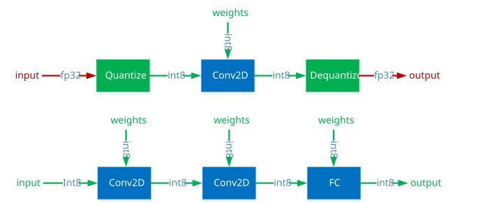
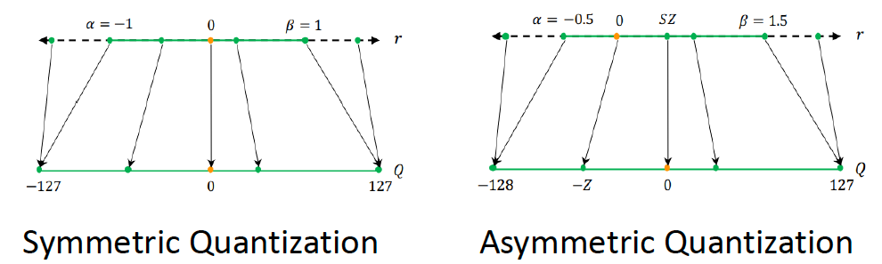
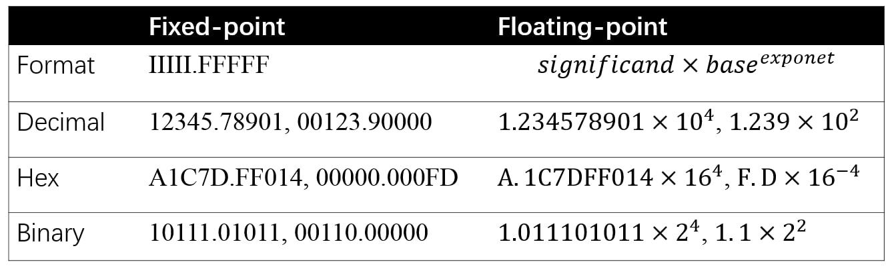
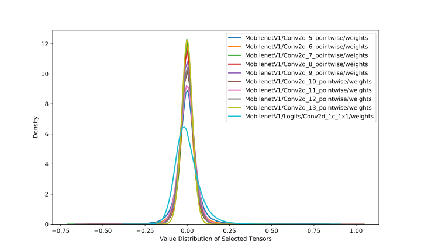
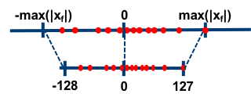
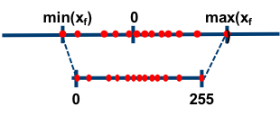
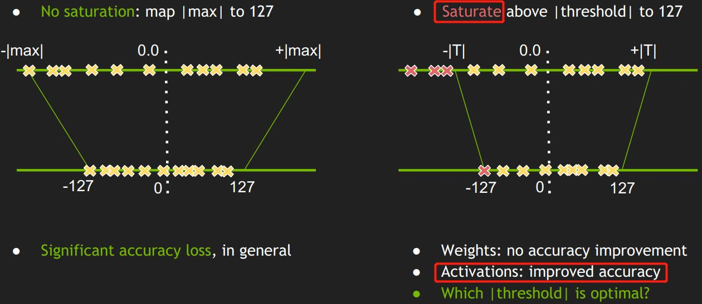
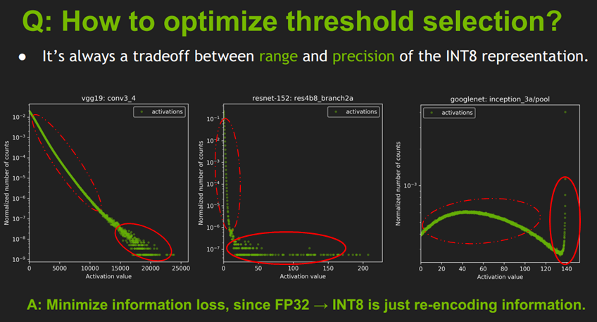

# Nén mô hình: Cơ bản về lượng tử hóa mạng neuron

> Ghi chú của người biên soạn: trang này dịch từ ghi chú *dl_note* của **Harley Zhang** ([bản gốc](https://github.com/harleyszhang/dl_note/blob/main/5-model_compression/模型压缩-神经网络量化基础.md), [kho mã](https://github.com/harleyszhang/dl_note), giấy phép [Apache-2.0](https://www.apache.org/licenses/LICENSE-2.0); phần dịch có chỉnh sửa). Số mục giữ như bản gốc. Chỗ bản gốc sai, thiếu hoặc đã lỗi thời được sửa ngay trong bài và ghi ở ô **Biên tập**. Các mục có chữ **Bổ sung** do người biên soạn viết thêm.

> Bài này tóm tắt ưu điểm, nguyên lý, phương pháp và kiến thức thực hành cơ bản của lượng tử hóa tuyến tính. Nội dung chủ yếu dựa trên bài [Giới thiệu lượng tử hóa mạng neuron](https://jackwish.net/2019/neural-network-quantization-introduction-chn.html) (神经网络量化简介), cộng thêm phần hiểu và tổng kết của tác giả. Bài hợp cho người mới bắt đầu và để tự ôn tập.

Trang [Code](dlnote/compress_quant_code_vi) đi kèm cài đặt lại các công thức trong bài bằng NumPy và lượng tử hóa INT8 một CNN thật bằng PyTorch.

## 1 Tổng quan về lượng tử hóa mô hình

**Lý thuyết:** [Ôn tập · Chương 17 Nén, tăng tốc mô hình và triển khai trên thiết bị di động](qa/ch17_vi)

### 1.1 Ưu điểm của lượng tử hóa mô hình

Lượng tử hóa mô hình (model quantization) là chuyển một mô hình có trọng số dạng số thực dấu phẩy động `FP32` thành mô hình có trọng số dạng số nguyên `INT8/INT4`. Việc này gồm hai quá trình: chuyển mô hình dấu phẩy động FP32 sang INT8, và suy luận bằng trọng số INT8. Suy luận lượng tử hóa và suy luận độ chính xác thấp (low precision) có cùng ý nghĩa.

- Mô hình độ chính xác thấp có trọng số ở định dạng `FP16` (số thực dấu phẩy động nửa độ chính xác) hoặc `INT8` (số nguyên dấu phẩy tĩnh 8 bit). Tuy vậy, "độ chính xác thấp" hiện nay thường dùng để chỉ `INT8`.
- Mô hình độ chính xác thông thường có trọng số ở định dạng `FP32` (số thực 32 bit, độ chính xác đơn).
- Độ chính xác hỗn hợp (mixed precision) dùng đồng thời cả `FP32` và `FP16` trong mô hình. `FP16` giảm một nửa bộ nhớ, nhưng một số tham số hoặc toán tử phải giữ ở `FP32` để không mất độ chính xác.

> **Biên tập:** "Độ chính xác hỗn hợp" thường dùng nhất khi **huấn luyện**: trọng số gốc (master weights) và bộ cộng dồn giữ ở FP32, còn phép nhân ma trận chạy ở FP16 hoặc BF16. Từ năm 2023, câu "độ chính xác thấp thường chỉ INT8" cũng không còn đúng: mô hình ngôn ngữ lớn thường dùng FP8, INT4 hoặc các định dạng 4 bit khác (xem mục 4 ở cuối bài).

Lượng tử hóa mô hình có các lợi ích sau:

> Tham khảo [Tối ưu mô hình TensorFlow: lượng tử hóa mô hình (Zhang Yixin)](https://mp.weixin.qq.com/s/9QeVVESP3_rBZ6n_D96lwg).

+ **Giảm kích thước mô hình**: ví dụ lượng tử hóa `int8` giảm được `75%` kích thước, tức mô hình `int8` thường chỉ bằng `1/4` mô hình số thực `32` bit:
    + Giảm dung lượng lưu trữ: rất có ý nghĩa khi thiết bị đầu cuối không đủ chỗ lưu.
    + Giảm bộ nhớ sử dụng: mô hình nhỏ hơn thì cần ít bộ nhớ hơn.
    + Giảm điện năng tiêu thụ: dùng ít bộ nhớ hơn, suy luận nhanh hơn thì tất nhiên tốn ít điện hơn.
+ **Tăng tốc độ suy luận**: băng thông để đọc một số thực `32` bit đủ để đọc bốn số nguyên `int8`, và phép toán số nguyên nhanh hơn phép toán số thực; `CPU` tính bằng `int8` nhanh hơn.
+ **Một số bộ tăng tốc phần cứng như DSP/NPU chỉ hỗ trợ int8.** Chẳng hạn một số vi xử lý là loại `8` bit, chạy phép toán số thực rất chậm khi ở chế độ tiết kiệm điện, nên cần lượng tử hóa `8 bit`.

Tóm lại: ý nghĩa chính của lượng tử hóa mô hình là tăng tốc suy luận trên thiết bị đầu cuối, giảm điện năng và giảm dung lượng lưu trữ.

Trong công nghiệp, thường chỉ dùng mô hình lượng tử hóa `INT8`. Các framework suy luận trên thiết bị di động như `NCNN`, `TNN` đều hỗ trợ lượng tử hóa mô hình sang `INT8` và suy luận mô hình đã lượng tử hóa.

Thông thường có thể phân loại **phương án suy luận mô hình lượng tử hóa** theo cách chuyển đổi giữa `FP32` và `INT8`. Một số framework chỉ đơn giản chèn thêm lớp `Quantize` (lượng tử hóa) và `Dequantize` (giải lượng tử hóa): dữ liệu được chuyển từ `FP32` sang `INT8` trước khi vào lớp tích chập hoặc lớp kết nối đầy đủ, và chuyển ngược lại khi đi ra. Trong trường hợp này (nửa trên của hình dưới), bản thân mô hình và đầu vào/đầu ra vẫn ở định dạng `FP32`. Khi tải mô hình, framework suy luận viết lại mạng để chèn các lớp `Quantize` và `Dequantize`, đồng thời chuyển trọng số sang `INT8`.

> Lưu ý: cần chèn lớp giải lượng tử hóa (`Dequantize`) là vì ở giai đoạn đầu của kỹ thuật lượng tử hóa, chỉ toán tử tích chập hỗ trợ lượng tử hóa. Mạng thực tế còn nhiều toán tử khác chỉ tính được bằng `FP32`, nên phải chuyển INT8 về lại FP32. Khi kỹ thuật phát triển, thao tác `Dequantize` sẽ dần ít đi và có thể biến mất, để toàn bộ mạng chạy lượng tử hóa thay vì chỉ một phần toán tử.

Hình 1: Suy luận hỗn hợp FP32/INT8 (trên) và suy luận thuần INT8 (dưới). Màu đỏ là FP32, màu xanh lá là INT8 hoặc phép lượng tử hóa.

Một số framework khác chuyển toàn bộ mạng sang `INT8`, nên khi suy luận không có bước chuyển định dạng nào, như nửa dưới của hình trên. Cách này đòi hỏi mọi toán tử (`Operator`) đều hỗ trợ lượng tử hóa, vì dữ liệu chảy giữa các toán tử ở dạng `INT8`. Với những toán tử chưa hỗ trợ, framework có thể quay về phương án `Quantize/Dequantize`.

### 1.2 Các phương án lượng tử hóa mô hình

Trong thực tế có ba cách chuyển mô hình số thực thành mô hình lượng tử hóa:

1. `data free`: không dùng tập hiệu chuẩn (calibration set). Cách truyền thống là chuyển thẳng tham số số thực thành số lượng tử hóa. Cách này rất dễ dùng nhưng thường làm mất độ chính xác đáng kể. Tuy nhiên, bài báo `DFQ` gần đây của Qualcomm không cần tập hiệu chuẩn mà vẫn đạt độ chính xác rất cao.
2. `calibration`: dựa trên tập hiệu chuẩn, cho một lượng nhỏ dữ liệu thật đi qua mạng để thống kê. Nhiều hãng chip cung cấp chức năng này, như `TensorRT`, Qualcomm, HiSilicon, Horizon Robotics, Cambricon.
3. `finetune`: dựa trên huấn luyện tinh chỉnh. Sai số lượng tử hóa được mô phỏng ngay trong lúc huấn luyện, và trọng số được điều chỉnh cho hợp với lượng tử hóa. Ưu điểm là giữ được độ chính xác tốt hơn; nhược điểm là phải sửa mã huấn luyện, thời gian phát triển dài hơn.

Theo giai đoạn thực hiện lượng tử hóa, framework `TensorFlow` chia chức năng lượng tử hóa mô hình thành hai loại:

+ Lượng tử hóa sau huấn luyện, Post-training quantization `PTQ` (còn gọi là lượng tử hóa ngoại tuyến);
+ Huấn luyện có nhận biết lượng tử hóa, Quantization-aware training `QAT` (còn gọi là lượng tử hóa khi huấn luyện, lượng tử hóa giả, lượng tử hóa trực tuyến).

#### 1.2.1 Hiểu về PTQ

`PTQ` (`Post Training Quantization`) là lượng tử hóa sau huấn luyện, còn gọi là lượng tử hóa ngoại tuyến. Theo điểm không lượng tử hóa (zero point) $x_{zero}$ có bằng `0` hay không, PTQ chia thành lượng tử hóa đối xứng và bất đối xứng. Theo chiều kênh (channel) của dữ liệu (ví dụ `NHWC` trong TensorFlow), PTQ chia thành lượng tử hóa theo lớp (per-layer) và theo kênh (per-channel). Lượng tử hóa theo kênh là mỗi kênh của mỗi lớp có một ngưỡng riêng, giúp tăng độ chính xác đáng kể.

> **Biên tập:** Bản gốc viết "framework `TensorRT` của NVIDIA dùng lượng tử hóa theo lớp, mỗi lớp một ngưỡng". Theo tài liệu TensorRT, **trọng số** được lượng tử hóa theo kênh (mỗi kênh ra một hệ số tỉ lệ), còn **kích hoạt** được lượng tử hóa theo tensor (mỗi tensor một hệ số). Trang Code (mục 4) cho thấy khác biệt giữa hai cách với trọng số: ở 3 bit, theo tensor chỉ còn 76,4% độ chính xác, theo kênh vẫn giữ 89,4%.

### 1.3 Phân loại lượng tử hóa

Các phương pháp lượng tử hóa đã biết, có nhiều khả năng tăng tốc suy luận, gồm:

1. **Nhị phân hóa** (binarization): dùng phép toán bit đơn giản để tính cùng lúc rất nhiều số. Từ GPU NVIDIA đến nền tảng x86, tính toán 1 bit có thể tăng hiệu năng lý thuyết từ 5 đến 128 lần. Nó chỉ thêm một phép lượng tử hóa, và phép đó cũng được tăng tốc bằng SIMD (một lệnh, nhiều dữ liệu).
2. **Lượng tử hóa tuyến tính** (phổ biến nhất): lại chia thành bất đối xứng, đối xứng và `ristretto`. GPU NVIDIA, `x86`, `arm` và một số chip `AI` đều hỗ trợ tính toán `8bit`, hiệu năng tăng từ `1` đến `16` lần; `tensor core` còn hỗ trợ tính `4bit`, một hướng rất tiềm năng. Các phép lượng tử hóa và giải lượng tử hóa thêm vào đều là phép toán vector chuẩn, nên cũng tăng tốc được bằng `SIMD`, thời gian tính thêm không đáng kể.
3. **Lượng tử hóa logarit**: một phương pháp khá đặc biệt. Nhân hai lũy thừa cùng cơ số tương đương với cộng số mũ, nên cường độ tính toán giảm. Phép cộng thì biến thành phép tra chỉ số. Hiện chưa có thư viện tăng tốc lượng tử hóa logarit trên ba nền tảng GPU NVIDIA, `x86`, `arm`, nhưng được biết chip HiSilicon dòng `351X` có dùng lượng tử hóa logarit.

#### 1.3.1 Tổng quan về lượng tử hóa tuyến tính

Khác với lượng tử hóa phi tuyến, lượng tử hóa tuyến tính dùng các tâm cụm phân bố đều: số thực ban đầu và số nguyên sau lượng tử hóa liên hệ với nhau bằng một phép biến đổi tuyến tính đơn giản. Vì bản thân các lớp như tích chập, kết nối đầy đủ chỉ là phép tính tuyến tính, nên có thể tính trực tiếp trên dữ liệu đã lượng tử hóa.

Tùy theo số 0 của không gian số thực, sau khi lượng tử hóa, có còn ứng với số nguyên 0 hay không, lượng tử hóa tuyến tính chia thành hai loại: **lượng tử hóa đối xứng** (Symmetric Quantization) và **lượng tử hóa bất đối xứng** (Asymmetric Quantization).

Hình 2: Lượng tử hóa đối xứng (trái): đoạn $[\alpha, \beta] = [-1, 1]$ ánh xạ vào $[-127, 127]$, số 0 thực ứng với số nguyên 0. Lượng tử hóa bất đối xứng (phải): đoạn $[-0{,}5;\ 1{,}5]$ ánh xạ vào $[-128, 127]$, số 0 thực ứng với số nguyên $-Z$.

## 2 Số học lượng tử hóa

**Quá trình lượng tử hóa mô hình gồm hai phần: chuyển mô hình từ FP32 sang INT8, và suy luận bằng INT8.** Mục này giải thích nguyên lý số học đằng sau hai phần đó. Nếu không nắm nguyên lý số học cơ bản, ta thường sẽ thấy rối khi xét các chi tiết của lượng tử hóa.

### 2.1 Dấu phẩy tĩnh và dấu phẩy động

**Dấu phẩy tĩnh (fixed point) và dấu phẩy động (floating point) đều là cách biểu diễn số** (representation). Chúng khác nhau ở vị trí của dấu phẩy ngăn phần nguyên (integer) và phần thập phân (fractional). **Dấu phẩy tĩnh giữ một số chữ số cố định cho phần nguyên và phần thập phân, còn dấu phẩy động giữ một số chữ số cố định cho phần định trị (significand) và phần số mũ (exponent).**

Phần lớn hệ thống máy tính hiện đại dùng **biểu diễn dấu phẩy động**, tức biểu diễn số thực theo kiểu ký hiệu khoa học: một phần định trị (mantissa, hay significand), một cơ số (base), một số mũ (exponent) và một bit dấu. Cụ thể, với số `float` 32 bit:

- Phần thứ nhất là bit dấu `sign` $s$, 1 bit, cho biết số âm hay dương;
- Phần thứ hai là số mũ có độ lệch `exponent` $k$, 8 bit, cho biết số này là 2 mũ bao nhiêu;
- Phần thứ ba là phần định trị `fraction` $M$, 23 bit, cho biết độ lớn của số.

Với cách biểu diễn trên, giá trị của số dấu phẩy động tính bằng công thức:

$$(-1)^s \times M \times 2^k$$

Lưu ý công thức trên đã giấu đi vài chi tiết, chẳng hạn số mũ $k$ khi dùng phải trừ đi một độ lệch cố định (127 với FP32), và $M$ có một bit 1 ẩn ở đầu ($M = 1.f$).

Ví dụ, `123.45` viết theo ký hiệu khoa học thập phân là $1.2345\times 10^2$, trong đó `1.2345` là phần định trị, `10` là cơ số, `2` là số mũ.

Kiểu số thực độ chính xác đơn `float` chiếm `32bit`, nên còn gọi là `FP32`; kiểu độ chính xác kép `double` chiếm `64bit`.

Hình 3: Định dạng và ví dụ của dấu phẩy tĩnh (cột giữa) và dấu phẩy động (cột phải) ở hệ thập phân, thập lục phân và nhị phân.

### 2.2 Lượng tử hóa số thực dấu phẩy động

Khoảng biểu diễn của số thực 32 bit FP32 và số nguyên 8 bit INT8 như bảng sau:

|Kiểu dữ liệu|Nhỏ nhất|Lớn nhất|
|------------|---------|----------|
|`FP32`| -3.4e38|3.4e38|
|`int8`|-128|127|
|`uint8`|0|255|

Suy luận của mạng neuron gồm các phép toán số thực. Khoảng giá trị của `FP32` là $[-(2-2^{-23})\times 2^{127},\ (2-2^{-23})\times 2^{127}] \approx [-3{,}4\times 10^{38},\ 3{,}4\times 10^{38}]$, của `INT8` là $[-128, 127]$; số giá trị biểu diễn được lần lượt khoảng $2^{32}$ và $2^8$. Khoảng giá trị của `FP32` rộng hơn rất nhiều, nên chuyển mạng từ `FP32` sang `INT8` không đơn giản như ép kiểu rồi cắt bớt.

> **Biên tập:** Bản gốc ghi giá trị lớn nhất của `int8` là 128 (đúng là 127) và viết khoảng FP32 là $[(2-2^{23})\times 2^{127}, (2^{23}-2)\times 2^{127}]$ (sai dấu mũ, giá trị đúng là $\pm(2-2^{-23})\times 2^{127} \approx \pm 3{,}4028\times 10^{38}$, khớp với `np.finfo(np.float32).max`).

Đáng chú ý là trọng số của các lớp trong mạng neuron thường phân bố trong một khoảng rất hẹp, rất gần 0. Hình 4 là phân bố trọng số của 10 lớp (các lớp có nhiều giá trị nhất) trong `MobileNetV1`.

Hình 4: Phân bố trọng số của 10 lớp trong MobileNetV1.

#### 2.2.1 Lượng tử hóa đối xứng

Quan hệ ánh xạ giữa giá trị số thực và giá trị dấu phẩy tĩnh 8 bit của lượng tử hóa đối xứng như hình dưới. Lượng tử hóa đối xứng ánh xạ các giá trị `FP32` trong đoạn $\left[-\max(|x|), \max(|x|)\right]$ của một `tensor` vào khoảng $[-128, 127]$ của dữ liệu `8 bit`, các giá trị ở giữa ánh xạ theo quan hệ tuyến tính. Cả khoảng giá trị số thực lẫn khoảng giá trị lượng tử hóa đều đối xứng qua 0, nên gọi là lượng tử hóa đối xứng.

Hình 5: Lượng tử hóa đối xứng.

Gọi $x_f$ là trọng số FP32 $x_{float}$, $x_q$ là trọng số INT8 sau lượng tử hóa (số nguyên) $x_{quantized}$, $x_s$ là hệ số tỉ lệ $x_{scale}$ (còn gọi là hệ số ánh xạ, bước lượng tử hóa, hệ số co giãn của FP32), và `round` là hàm làm tròn. Lượng tử hóa trọng số và dữ liệu quy về việc tìm $scale$; cải tiến phương pháp lượng tử hóa về bản chất là chọn giá trị $scale$ tốt nhất.

$$x_f = x_s \times x_q \tag{2.1}$$

Cách kinh điển nhất của lượng tử hóa đối xứng là **lượng tử hóa theo giá trị tuyệt đối lớn nhất**: lấy trị tuyệt đối của mọi giá trị, nên khoảng số thực trước lượng tử hóa là $\left[0, \max(|x|)\right]$ và khoảng sau lượng tử hóa là $[0, 2^{N-1} - 1]$, với `INT8` là $[0, 127]$. Từ đó hệ số tỉ lệ `scale` và giá trị lượng tử hóa tính bằng:

$$x_s = \frac{\max(|x|)}{127}, \qquad x_q = \operatorname{round}\left(\frac{x_f}{x_s}\right) \tag{2.2}$$

> **Biên tập:** Bản gốc đặt tên mục là "đối xứng (đồng đều)" và ghi khoảng sau lượng tử hóa là $[0, 2^N-1]$. Cả lượng tử hóa đối xứng lẫn bất đối xứng ở bài này đều là lượng tử hóa đồng đều (uniform, các mức cách đều nhau), nên bỏ chữ "đồng đều"; khoảng đúng là $[0, 2^{N-1}-1]$ vì một bit dùng cho dấu. Theo công thức (2.2), giá trị lượng tử hóa thực tế nằm trong $[-127, 127]$ (như Hình 2), không dùng tới $-128$; nhiều framework cố ý dùng khoảng thu hẹp này để giữ tính đối xứng.

#### 2.2.2 Lượng tử hóa bất đối xứng

Lượng tử hóa đối xứng giả định dữ liệu phân bố đều hai phía quanh 0. Khi dữ liệu lệch hẳn về một phía (ví dụ đầu ra của ReLU luôn $\ge 0$), một nửa số mức lượng tử hóa bị bỏ phí. Vì thế có **lượng tử hóa bất đối xứng**, tương tự lượng tử hóa đồng đều trong xử lý tín hiệu số. Biểu thức toán học như dưới, trong đó $x_{zero}$ là điểm không lượng tử hóa (độ lệch lượng tử hóa); có bài viết ký hiệu là $offset\in [-128, 127]$.

$$x_f = x_s \times (x_q - x_{zero}) \tag{2.3}$$

> **Biên tập:** Bản gốc giải thích "vì phương pháp đối xứng có thể ánh xạ số 0 FP32 thành số 0 INT8, mà ta không muốn điều đó". Câu này không đúng: ánh xạ 0 thành 0 là tính chất tốt (số 0 được biểu diễn chính xác, thao tác đệm 0 không gây sai số). Lý do thật sự là không lãng phí khoảng giá trị khi dữ liệu không đối xứng, như đã viết lại ở trên. Trang Code (mục 1) đo trên dữ liệu kiểu ReLU: đối xứng chỉ dùng 110 mức và có sai số trung bình 0,0060, còn bất đối xứng dùng 205 mức và sai số giảm một nửa, còn 0,0030.

Đa số trường hợp lượng tử hóa dùng số nguyên không dấu, tức `UINT8` với khoảng giá trị $[0,255]$; khi đó ý nghĩa của lượng tử hóa bất đối xứng càng rõ. Quan hệ ánh xạ giữa giá trị số thực và giá trị `UINT8` của lượng tử hóa bất đối xứng như hình dưới:

Hình 6: Lượng tử hóa bất đối xứng.

**Thuật toán lượng tử hóa bất đối xứng cho trọng số gồm hai bước:**

1. Tìm giá trị $min$ và $max$ trong tensor trọng số để xác định hệ số tỉ lệ $x_s$ và điểm không $x_{zero}$.
2. Chuyển từng giá trị trong tensor trọng số từ FP32 sang INT8.

$$\begin{aligned}
x_f &\in [x_f^{min}, x_f^{max}] \\
x_s &= \frac{x_f^{max} - x_f^{min}}{x_q^{max} - x_q^{min}} \\
x_{zero} &= x_q^{max} - x_f^{max} \div x_s \\
x_q &= \operatorname{round}\left(\frac{x_f}{x_s}\right) + x_{zero}
\end{aligned} \tag{2.4}$$

Lưu ý khi kết quả phép tính số thực không phải số nguyên thì cần **thêm một bước làm tròn `round`**. Ví dụ ánh xạ khoảng FP32 $[-1,1]$ vào khoảng $[0,255]$ thì $x_s=\frac{2}{255}$ và $x_{zero}= 255-\frac{255}{2} = 127{,}5$, làm tròn thành 128 (bản gốc viết $\approx 127$; cả hai đều dùng được, miễn là nhất quán).

Lưu ý thêm: sai số trong quá trình lượng tử hóa là không tránh khỏi, giống như lượng tử hóa trong xử lý tín hiệu số. **Thuật toán bất đối xứng thường xử lý tốt hơn các trường hợp dữ liệu phân bố không đều.**

Tóm lại: lượng tử hóa đối xứng có thể xem là trường hợp riêng của lượng tử hóa bất đối xứng khi $x_{zero} = 0$.

> **Biên tập:** Câu tóm tắt trong bản gốc viết nhầm thành "lượng tử hóa **bất đối xứng** là trường hợp riêng của lượng tử hóa bất đối xứng khi $x_{zero}=0$".

### 2.3 Số học lượng tử hóa

Một vấn đề quan trọng của lượng tử hóa là **làm sao biểu diễn phép tính trên số thực bằng phép tính trên số đã lượng tử hóa**. Trong framework suy luận hỗ trợ mô hình lượng tử hóa, đó chính là cách cài đặt kernel lượng tử hóa (INT8 kernel) để thay cho phép tính FP32 thông thường. Nguyên lý rất giống phép nhân số dấu phẩy động.

> Mã kernel lượng tử hóa có thể có thêm bước giải lượng tử hóa, tức chuyển số nguyên `INT8` về số thực `FP32`.

> **Biên tập:** Bản gốc đánh số mục này là "2.2" (trùng với mục 2.2 ở trên), và gọi các phương trình là "đẳng thức 5-10", "đẳng thức 14", "đẳng thức 10" theo số của bài tiếng Anh gốc. Ở đây đánh lại thành mục 2.3 và phương trình (2.5).

Các bước dưới đây cho thấy phép nhân lượng tử hóa (dấu phẩy tĩnh) thay cho phép nhân thường (số thực). Thay (2.3) cho $x$, $y$ và kết quả $z$:

$$\begin{aligned}
z_{float} & = x_f \cdot y_{f} \\
z_{s} \cdot (z_q - z_{zero})
& = (x_s \cdot (x_q - x_{zero})) \cdot
(y_s \cdot (y_q - y_{zero})) \\
z_q - z_{zero}
&= \frac{x_s \cdot y_s}{z_{s}} \cdot
(x_q - x_{zero}) \cdot (y_q - y_{zero}) \\
z_q
&= \frac{x_s \cdot y_s}{z_{s}} \cdot
(x_q - x_{zero}) \cdot (y_q - y_{zero}) + z_{zero} \\
\alpha &= \frac{x_s \cdot y_s}{z_{s}} \\
z_q
&= \alpha \cdot (x_q - x_{zero}) \cdot
(y_q - y_{zero}) + z_{zero}
\end{aligned} \tag{2.5}$$

Với một mạng neuron cho trước, sau khi đã lượng tử hóa mô hình fp32 thành int8, hệ số tỉ lệ $scale$ của đầu vào $x$, trọng số $y$ và đầu ra $z$ đều đã biết. Do đó $\alpha = \frac{x_s y_s}{z_{s}}$ ở dòng cuối của (2.5) cũng đã biết, là một hằng số `FP32` được tính sẵn trước khi chạy kernel. Trong đa số trường hợp dùng (2.5), các biến $quantized$ và $zero\_point$ của $x$, $y$ đều có kiểu `INT8`, còn biến $scale$ có kiểu `FP32`.

Như vậy, ngoài phép nhân giữa $\alpha$ và $(x_q - x_{zero})\cdot (y_q - y_{zero})$, mọi phép tính khác trong (2.5) đều là phép tính lượng tử hóa.

Ngoài ra, phép tính giữa hai số `INT8` được cộng dồn vào `INT16` hoặc `INT32`, vì miền giá trị `INT8` có thể không chứa nổi kết quả. Ví dụ với $x_q=20$ và $x_{zero} = 50$ thì $(x_q − x_{zero}) = −30$, nằm ngoài miền giá trị `UINT8` là $[0,255]$.

> **Biên tập:** Bản gốc ghi "miền giá trị INT8 $[0,255]$"; $[0,255]$ là miền của `UINT8`.

Ép kiểu có thể chuyển $\alpha \cdot (x_q - x_{zero}) \cdot (y_q - y_{zero})$ thành INT32 hoặc INT16; cộng thêm $z_{zero}$ thì kết quả gần như luôn rơi vào miền giá trị INT8 $[0,255]$.

Vì vậy, trong thực tế, ví dụ khi tính toán tử tích chập, kết quả `sum(x*y)` phải lưu bằng INT32, và bias `b` cũng thường ở dạng `INT32`; sau đó mới **lượng tử hóa lại** (`requantize`) về INT8. Trang Code (mục 2) cài đặt đúng quy trình này cho một phép nhân ma trận và so với kết quả số thực.

Ngoài nhân và cộng lượng tử hóa, còn có chia, trừ, lũy thừa lượng tử hóa, v.v. Chúng đều có các thao tác như phép nhân lượng tử hóa ở trên, và đều có cách riêng để tách thành phép nhân và phép cộng. Nhờ các cách này, mạng neuron lượng tử hóa có thể chạy và cho kết quả tốt ngang mạng ban đầu.

## 3 Cải tiến phương pháp lượng tử hóa

Cách lượng tử hóa trọng số mô tả ở mục "Lượng tử hóa số thực dấu phẩy động" rất đơn giản. Ở giai đoạn đầu phát triển các framework học sâu, cách này giúp nhanh chóng chạy được suy luận `INT8`, nhưng độ chính xác dự đoán của mạng thường giảm rõ rệt.

Dù khoảng giá trị của trọng số FP32 rất hẹp, số giá trị FP32 nằm trong khoảng đó lại rất lớn. Lấy ví dụ ánh xạ ở trên: khoảng $[−1,1]$ chứa khoảng $2^{31}$ giá trị FP32 (đúng vậy, gần một nửa số giá trị biểu diễn được), và chúng bị ánh xạ vào $256$ giá trị INT8.

+ Kiểu lượng tử hóa: lượng tử hóa đối xứng (`SYMMETRIC`) và bất đối xứng (`NON-SYMMETRIC`);
+ Thuật toán lượng tử hóa: `MINMAX`, divergence `KL`, `ADMM`;
+ Kiểu lượng tử hóa trọng số: theo kênh (`per-channel`), theo lớp (`per-layer`).

Với cách lượng tử hóa thông thường, các giá trị số thực gần 0 không được biểu diễn chính xác bằng giá trị dấu phẩy tĩnh. Vì vậy so với mạng ban đầu, mạng lượng tử hóa thường bị mất độ chính xác rõ rệt. Với lượng tử hóa tuyến tính (đồng đều), vấn đề này không tránh được.

Đồng thời, độ chính xác của phép ánh xạ phụ thuộc mạnh vào $x_s$, vốn được tính từ $x_f^{min}$ và $x_f^{max}$. Các giá trị trọng số nằm sát $x_f^{min}$ và $x_f^{max}$ thường rất ít và có thể bỏ qua. Nói cách khác, **giá trị `min` và `max` của số thực trong phép ánh xạ có thể chọn bằng thuật toán**.

Hình 7 (slide của NVIDIA): Trái: không bão hòa, ánh xạ $|max|$ thành 127, nói chung mất độ chính xác đáng kể. Phải: bão hòa, mọi giá trị vượt ngưỡng $|T|$ ánh xạ thành 127; với trọng số không cải thiện, với kích hoạt thì cải thiện độ chính xác. Câu hỏi đặt ra: ngưỡng $|T|$ nào là tốt nhất?

Như vậy, có thể điều chỉnh `min/max` để chọn một khoảng giá trị sao cho các giá trị trong khoảng được lượng tử hóa chính xác hơn, còn các giá trị ngoài khoảng được ánh xạ thẳng thành min/max của dấu phẩy tĩnh. Ví dụ, nếu từ khoảng gốc $[−1,1]$ ta chọn $x_{min}^{float} = −0{,}9$ và $x_{max}^{float} = 0{,}8$, thì các giá trị trong $[−0{,}9;\ 0{,}8]$ được ánh xạ vào $[0,255]$ chính xác hơn, còn các giá trị trong $[−1;\ −0{,}9]$ và $[0{,}8;\ 1]$ lần lượt ánh xạ thành $0$ và $255$.

> **Biên tập:** Bản gốc chú thích hình là "điều chỉnh giá trị nhỏ nhất/lớn nhất khi lượng tử hóa số thực sang dấu phẩy tĩnh", theo hình của bài tiếng Anh gốc. Ảnh thật trong kho là slide "Saturate above |threshold|" của NVIDIA; chú thích đã được viết lại cho khớp với ảnh.

### 3.1 Chọn khoảng động của số thực

> Tham khảo [Tổng kết về lượng tử hóa mô hình học sâu (suy luận độ chính xác thấp)](https://mp.weixin.qq.com/s/LR3Z2rlkxdl-1KnsU734VQ).

Qua phần số học lượng tử hóa và hai thuật toán lượng tử hóa ở trên, dễ thấy để tính `scale` và `zero_point` ta cần biết khoảng động (dynamic range) thực tế của `weight/activation` FP32. Với quá trình suy luận, `weight` là tensor hằng nên khoảng động cố định; còn khoảng động của `activation` thay đổi theo đầu vào, nên phải lấy mẫu để ước lượng (quá trình này thường gọi là hiệu chuẩn dữ liệu, `calibration`).

Điều chỉnh giá trị nhỏ nhất/lớn nhất khi lượng tử hóa số thực sang dấu phẩy tĩnh (**điều chỉnh khoảng giá trị**) chính là chọn khoảng động của số thực. **Khoảng động quyết định trực tiếp phân bố của dữ liệu sau lượng tử hóa: dữ liệu nằm ngoài khoảng động sẽ bị ánh xạ thành điểm biên của dữ liệu lượng tử hóa. Tức là việc chọn khoảng giá trị quyết định trực tiếp sai số lượng tử hóa.**

Hiện nay các framework học sâu và framework suy luận trên ba nền tảng lớn dùng nhiều nhất ba cách sau để xác định khoảng động của số thực: giá trị lớn nhất/nhỏ nhất (`MinMax`), trung bình trượt của giá trị lớn nhất/nhỏ nhất (`MovingAverageMinMax`) và divergence `KL` (Kullback-Leibler divergence). Nếu mọi giá trị `FP32` trong quá trình lượng tử hóa đều nằm trong khoảng động thực tế, ta gọi là trạng thái không bão hòa; ngược lại, nếu có giá trị `FP32` nằm ngoài khoảng động thì gọi là trạng thái bão hòa.

### 3.2 Giá trị lớn nhất/nhỏ nhất (MinMax)

`MinMax` là cách lấy mẫu đơn giản nhất và khá phổ biến. Ý tưởng là lấy thẳng giá trị lớn nhất và nhỏ nhất của tensor `FP32` để xác định khoảng động thực tế, như công thức sau ($X$ là một batch dữ liệu hiệu chuẩn):

$$x_{min} = \begin{cases}\min(X) & \text{nếu } x_{min} = \text{None} \\ \min(x_{min}, \min(X)) & \text{ngược lại}\end{cases} \qquad
x_{max} = \begin{cases}\max(X) & \text{nếu } x_{max} = \text{None} \\ \max(x_{max}, \max(X)) & \text{ngược lại}\end{cases}$$

Với `weights`, cách lấy mẫu này là không bão hòa. Nhưng với `activation`, nếu dữ liệu lấy mẫu có điểm ngoại lai thì khoảng động thực tế có thể bị nới rộng rõ rệt. Ví dụ khi tính thực tế, `99%` dữ liệu phân bố đều trong `[-100, 100]`, nhưng lúc lấy mẫu có một điểm ngoại lai bằng `10000`; khi đó khoảng động lấy được thành `[-100, 10000]`.

### 3.3 Trung bình trượt của giá trị lớn nhất/nhỏ nhất (MovingAverageMinMax)

Khác với `MinMax` thay thế trực tiếp, MovingAverageMinMax dùng một siêu tham số `c` (PyTorch mặc định là 0,01) để cập nhật dần khoảng động.

$$x_{min} = \begin{cases}\min(X) & \text{nếu } x_{min} = \text{None} \\ (1-c)\,x_{min}+c \; \min(X) & \text{ngược lại}\end{cases} \qquad
x_{max} = \begin{cases}\max(X) & \text{nếu } x_{max} = \text{None} \\ (1-c)\,x_{max}+c \; \max(X) & \text{ngược lại}\end{cases}$$

Khoảng động lấy theo cách này thường nhỏ hơn khoảng động thực tế. Với weights, vì không có các vòng lặp lấy mẫu, MovingAverageMinMax cho kết quả giống MinMax.

### 3.4 Lấy mẫu theo divergence KL (Kullback–Leibler divergence)

Trước khi tìm hiểu phương pháp divergence KL, hãy xem một hình của `TensorRT` về việc chọn ngưỡng cho khoảng giá trị:

Hình 8 (slide của NVIDIA): Phân bố kích hoạt ở một lớp của VGG19, ResNet-152 và GoogLeNet. Chọn ngưỡng luôn là đánh đổi giữa khoảng giá trị (range) và độ chính xác (precision) của biểu diễn INT8; câu trả lời là giảm thiểu mất mát thông tin, vì FP32 → INT8 thực chất chỉ là mã hóa lại thông tin.

Hình này là biểu đồ thống kê phân bố kích hoạt của các `layer` khác nhau trong các kiến trúc mạng khác nhau. Trục hoành là giá trị kích hoạt, trục tung là số lần xuất hiện đã chuẩn hóa (không phải số đếm tuyệt đối). Trong hình có lớp tích chập và lớp gộp, phân bố của chúng rất khác nhau. Vì vậy một phương pháp lượng tử hóa hợp lý phải thích ứng với các phân bố kích hoạt khác nhau và giảm mất mát thông tin, vì chuyển từ `FP32` sang `INT8` thực chất cũng là một quá trình mã hóa lại thông tin.

Ánh xạ đơn giản giá trị FP32 `-|max|` và `|max|` của một tensor thành -127 và 127, các giá trị ở giữa ánh xạ tuyến tính: cách ánh xạ này là không bão hòa (No saturation) và đối xứng. Với cách lượng tử hóa đơn giản này, thực nghiệm cho thấy độ chính xác giảm khá nhiều.

Phân tích hình trên, có thể thấy nguyên nhân lượng tử hóa tuyến tính đơn giản làm mất nhiều độ chính xác là:

+ Thống kê kích hoạt trong hình làm trên một batch ảnh. Các ảnh khác nhau cho kích hoạt không hoàn toàn giống nhau, nên hình có nhiều đường thay vì một. Phần đầu của các đường trùng nhau (vòng nét đứt đỏ), cho thấy phần lớn kích hoạt của các ảnh khác nhau có phân bố tương tự nhau. Nhưng ở bên phải, khi giá trị kích hoạt lớn (phần khoanh bằng nét liền đỏ), các đường không trùng nhau nữa: một giá trị kích hoạt ứng với nhiều số đếm khác nhau, phân bố ở đây khá hỗn loạn.
+ Phần phân bố hỗn loạn ở cuối đường chỉ chiếm tỉ lệ rất nhỏ trong lớp (ví dụ $10^{-9}$, $10^{-7}$, $10^{-3}$). Vì vậy có thể bỏ phần này ra khỏi phép ánh xạ, chỉ giữ hướng phân bố chính của kích hoạt.

Người ta thường cho rằng phân bố dữ liệu sau lượng tử hóa càng giống phân bố trước lượng tử hóa thì lượng tử hóa càng ít làm mất thông tin, tức thuật toán lượng tử hóa càng chính xác. Divergence `KL` (còn gọi là khoảng cách `KL`) thường được dùng để đo độ giống nhau giữa hai phân bố. Ở đây các phân bố đều rời rạc, divergence KL của dữ liệu rời rạc là:

$$D_{KL}(P \| Q) = \sum_i P(i)\log \frac{P(i)}{Q(i)} = \sum_i P(i)\left[\log P(i) - \log Q(i)\right] \tag{3.1}$$

Trong đó P và Q lần lượt là phân bố dữ liệu FP32 trước lượng tử hóa và phân bố dữ liệu INT8 sau lượng tử hóa. Lưu ý công thức đòi hỏi hai histogram P, Q có cùng độ dài (tức cùng số bin).

> **Biên tập:** Bản gốc viết $\log_a$ ở vế đầu và $P(x)$, $Q(x)$ ở vế sau; đã thống nhất ký hiệu.

Quá trình TensorRT hiệu chuẩn lượng tử hóa bằng divergence KL: đầu tiên chạy suy luận FP32 trên tập hiệu chuẩn, rồi với mỗi lớp của mạng:

1. Thu thập histogram của kích hoạt đầu ra.
2. Sinh nhiều phân bố lượng tử hóa ứng với các ngưỡng bão hòa khác nhau.
3. Chọn ngưỡng `T` làm cực tiểu KL_divergence(ref_distr, quant_distr), rồi xác định `Scale`.

Quá trình lượng tử hóa mô hình bằng tập hiệu chuẩn như trên thường chỉ mất vài phút.

> **Biên tập:** Theo slide gốc của NVIDIA (*8-bit Inference with TensorRT*, 2017), histogram có 2048 bin, và các ngưỡng thử là các bin thứ 128 đến 2048. Với phân bố ngưỡng $i$, các giá trị vượt ngưỡng được dồn vào bin cuối của P, còn Q là $i$ bin đầu gộp lại thành 128 mức rồi trải đều trở lại. Trang Code (mục 3) cài đặt lại thuật toán này. Khi chạy thử trên kích hoạt sau ReLU, cần bỏ các giá trị bằng 0 khỏi histogram (44–64% kích hoạt bằng 0), nếu không KL chọn ngưỡng quá nhỏ ở mọi lớp. Kể cả vậy, KL **không phải lúc nào cũng tốt nhất**: ở 8 bit, nó chọn ngưỡng 0,22 cho lớp đầu (giá trị lớn nhất 1,35) và độ chính xác tụt từ 90,0% xuống 77,8%, trong khi MinMax vẫn giữ 89,9%. Vì vậy nhiều công cụ hiện nay còn cho chọn ngưỡng theo phân vị (percentile) hoặc theo sai số bình phương nhỏ nhất (MSE), và luôn nên đo lại độ chính xác sau khi hiệu chuẩn.

### 3.5 Tổng kết

Tổng kết các phương pháp lượng tử hóa:

+ Lượng tử hóa tuyến tính đối xứng, không bão hòa, làm mất độ chính xác khá nhiều;
+ Chọn ngưỡng `|T|` của lượng tử hóa bão hòa bằng cách cực tiểu divergence `KL`.

Kinh nghiệm thực tế về lượng tử hóa:

1. Lượng tử hóa là phương pháp đã được công nghiệp công nhận và dùng rộng rãi. Mô hình huấn luyện (Training) bằng `FP32` và suy luận (Inference) bằng `INT8` đã được nhiều framework học sâu như `TensorFlow`, `TensorRT`, `PyTorch`, `MxNet` hỗ trợ. Nhiều hãng chip `AI` như Horizon Robotics, HiSilicon, Ambarella cũng cung cấp chức năng lượng tử hóa mô hình riêng trong bộ công cụ học sâu của mình.
2. Hầu hết nền tảng phần cứng đều hỗ trợ lượng tử hóa, nên nó khá phổ biến. Chưng cất tri thức (knowledge distillation) giúp có mô hình nhỏ và còn tăng thêm độ chính xác cho mô hình lượng tử hóa, nên cũng hay được dùng, nhất là khi đã có sẵn một mô hình lớn huấn luyện tốt. Cắt tỉa (pruning) ít được dùng hơn; chức năng của nó khá giống thuật toán tìm kiếm kiến trúc mạng NAS.

## 4 Bổ sung: lượng tử hóa từ 2023 đến nay

Bản gốc viết năm 2023, xoay quanh PTQ INT8 cho CNN. Mục này do người biên soạn viết thêm, tóm tắt những gì đã thay đổi, nhất là khi lượng tử hóa trở thành kỹ thuật chính để chạy mô hình ngôn ngữ lớn (LLM).

### 4.1 QAT: lượng tử hóa giả và ước lượng thẳng (STE)

Mục 1.2 mới chỉ nêu tên QAT. Cách làm chuẩn, theo Jacob và cộng sự (2018), là chèn các nút **lượng tử hóa giả** (fake quantization) vào đồ thị khi huấn luyện: lượng tử hóa rồi giải lượng tử hóa ngay,

$$\hat{x} = x_s \cdot \left(\operatorname{clamp}\left(\operatorname{round}\left(\frac{x}{x_s}\right) + x_{zero},\ q_{min},\ q_{max}\right) - x_{zero}\right) \tag{4.1}$$

nên lượt xuôi thấy đúng sai số làm tròn của INT8, nhưng mọi phép tính vẫn ở dạng số thực. Hàm `round` có đạo hàm bằng 0 hầu khắp nơi, nên lượt ngược dùng **ước lượng thẳng** (straight-through estimator, STE, Bengio và cộng sự 2013): coi đạo hàm của khối lượng tử hóa bằng 1 trong đoạn $[q_{min}, q_{max}]$ và bằng 0 bên ngoài. Biến thể LSQ (Esser và cộng sự, 2020) học luôn cả $x_s$ bằng gradient. QAT thường chỉ cần tinh chỉnh vài epoch từ mô hình FP32, và đáng dùng khi PTQ mất quá nhiều độ chính xác, ví dụ với mạng nhỏ như MobileNet hoặc khi xuống dưới 8 bit.

### 4.2 Độ mịn của hệ số tỉ lệ: theo tensor, theo kênh, theo nhóm

Một tensor có thể dùng chung một cặp $(x_s, x_{zero})$ (**theo tensor**, per-tensor), mỗi kênh ra một cặp (**theo kênh**, per-channel), hoặc mỗi **nhóm** liên tiếp $g$ phần tử một cặp (per-group, thường $g = 32, 64, 128$). Hệ số càng mịn thì càng ít bị một giá trị lớn "kéo giãn" thang đo của các giá trị khác, đổi lại phải lưu thêm hệ số. Theo nhóm là cách chuẩn cho trọng số 4 bit của LLM: với $g = 128$ và hệ số FP16, chi phí thêm chỉ là $16/128 = 0{,}125$ bit cho mỗi trọng số.

### 4.3 Định dạng số mới

| Định dạng | Cấu trúc | Ghi chú |
|---|---|---|
| BF16 | 1 dấu, 8 mũ, 7 định trị | Cùng khoảng giá trị với FP32; mặc định để huấn luyện mô hình lớn |
| FP8 E4M3 / E5M2 | 4 mũ + 3 định trị / 5 mũ + 2 định trị | Micikevicius và cộng sự (2022). E4M3 lớn nhất 448, dùng cho trọng số và kích hoạt; E5M2 lớn nhất 57344, dùng cho gradient. Có Tensor Core từ GPU Hopper (H100) |
| INT4 | Số nguyên 4 bit | Thường chỉ cho trọng số (W4A16), kèm hệ số theo nhóm |
| NF4 | 16 mức đặt theo phân vị của phân bố chuẩn | QLoRA (Dettmers và cộng sự, 2023): trọng số gần phân bố chuẩn nên đặt mức theo phân vị cho sai số nhỏ hơn INT4 |
| MXFP4, NVFP4 | Số thực 4 bit E2M1 theo khối | MXFP4 (chuẩn Microscaling của OCP, 2023): khối 32 phần tử dùng chung một hệ số lũy thừa của 2. NVFP4 (GPU Blackwell): khối 16 phần tử, hệ số FP8 |

Như vậy câu "công nghiệp thường chỉ dùng INT8" ở mục 1.1 nay chỉ còn đúng với CNN trên thiết bị đầu cuối. Với LLM, phổ biến là lượng tử hóa **chỉ trọng số** xuống 4 bit (kích hoạt giữ FP16/BF16), hoặc lượng tử hóa cả trọng số lẫn kích hoạt xuống FP8 trên GPU mới.

### 4.4 Lượng tử hóa mô hình ngôn ngữ lớn

LLM khó lượng tử hóa hơn CNN vì **ngoại lai trong kích hoạt**: từ quy mô khoảng 6,7 tỉ tham số, một số ít chiều đặc trưng có giá trị lớn gấp hàng chục lần phần còn lại (Dettmers và cộng sự, *LLM.int8()*, 2022). Lượng tử hóa kích hoạt theo tensor kiểu MinMax ở mục 3.2 khi đó làm hỏng mô hình. Các hướng xử lý chính:

- **LLM.int8()** (2022): tách các chiều ngoại lai ra tính bằng FP16, phần còn lại tính bằng INT8.
- **SmoothQuant** (Xiao và cộng sự, 2022): chuyển "độ khó" từ kích hoạt sang trọng số bằng phép co giãn tương đương theo kênh, $Y = (X\,\mathrm{diag}(s)^{-1})\,(\mathrm{diag}(s)\,W)$ với $s_j = \max|X_j|^{\alpha} / \max|W_j|^{1-\alpha}$ (thường $\alpha = 0{,}5$), rồi lượng tử hóa cả hai xuống INT8 (W8A8).
- **GPTQ** (Frantar và cộng sự, 2022): lượng tử hóa trọng số từng lớp, từng cột một, và dùng thông tin bậc hai (ma trận Hessian ước lượng từ tập hiệu chuẩn) để cập nhật các cột chưa lượng tử hóa, bù sai số vừa gây ra. Lượng tử hóa được mô hình 175 tỉ tham số xuống 3–4 bit trong vài giờ GPU.
- **AWQ** (Lin và cộng sự, 2023): chỉ khoảng 1% kênh trọng số là "quan trọng", và chúng được nhận ra nhờ **độ lớn kích hoạt** đi vào chúng. AWQ phóng to các kênh này trước khi lượng tử hóa (rồi thu nhỏ kích hoạt tương ứng), không cần lan truyền ngược.

Ý tưởng chung giống mục 3: chọn thang đo sao cho sai số rơi vào chỗ ít ảnh hưởng tới đầu ra nhất. Khác ở chỗ tiêu chí không còn là phân bố của từng tensor (KL), mà là sai số đầu ra của cả lớp.

### 4.5 Công cụ hiện nay

- **PyTorch:** API cũ `torch.ao.quantization` (eager mode, FX graph mode) đã bị đánh dấu ngừng hỗ trợ, và PyTorch khuyên chuyển sang thư viện **torchao** (`quantize_` cho eager mode, `prepare_pt2e`/`convert_pt2e` cho đồ thị PT2E). Trang Code chạy cả hai: `torch.ao` vì nó trình bày rõ từng bước observer → prepare → hiệu chuẩn → convert như bài, còn torchao là cách nên dùng cho dự án mới.
- **Triển khai:** ONNX Runtime (lượng tử hóa tĩnh/động, định dạng QDQ: chính là phương án `Quantize/Dequantize` ở mục 1.1), TensorRT kèm TensorRT Model Optimizer (INT8, FP8, INT4 AWQ), OpenVINO cho CPU Intel, ExecuTorch cho thiết bị di động, ncnn cho CPU ARM.
- **LLM:** llama.cpp với định dạng GGUF (các kiểu `Q4_K`, `Q8_0`… là lượng tử hóa theo khối), bitsandbytes (INT8, NF4), các công cụ GPTQ/AWQ cho vLLM.

## Tài liệu tham khảo

- [Giải thích chi tiết lượng tử hóa Conv trong NCNN (phần 1)](https://zhuanlan.zhihu.com/p/71881443) (NCNN Conv量化详解（一）)
- [Thuật toán tối ưu mạng neuron tích chập](https://jackwish.net/2019/convolution-neural-networks-optimization.html) (卷积神经网络优化算法)
- [Giới thiệu lượng tử hóa mạng neuron](https://jackwish.net/2019/neural-network-quantization-introduction-chn.html) (神经网络量化简介)
- [Giải mã cách cài đặt QNNPACK](https://jackwish.net/2019/reveal-qnnpack-implementation.html) (QNNPACK 实现揭秘)
- Szymon Migacz, *8-bit Inference with TensorRT*, GTC 2017.

Tài liệu cho mục 4 (người biên soạn bổ sung):

- Jacob et al., [Quantization and Training of Neural Networks for Efficient Integer-Arithmetic-Only Inference](https://arxiv.org/abs/1712.05877), CVPR 2018.
- Nagel et al., [A White Paper on Neural Network Quantization](https://arxiv.org/abs/2106.08295), 2021.
- Micikevicius et al., [FP8 Formats for Deep Learning](https://arxiv.org/abs/2209.05433), 2022.
- Dettmers et al., [LLM.int8(): 8-bit Matrix Multiplication for Transformers at Scale](https://arxiv.org/abs/2208.07339), 2022.
- Xiao et al., [SmoothQuant](https://arxiv.org/abs/2211.10438), 2022.
- Frantar et al., [GPTQ](https://arxiv.org/abs/2210.17323), 2022.
- Lin et al., [AWQ](https://arxiv.org/abs/2306.00978), 2023.
- Dettmers et al., [QLoRA](https://arxiv.org/abs/2305.14314), 2023.
- [torchao](https://github.com/pytorch/ao): thư viện lượng tử hóa của PyTorch.
