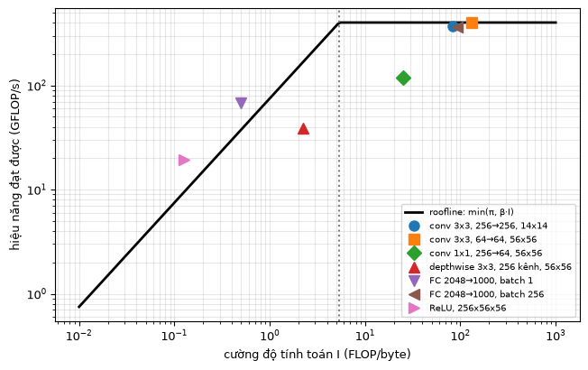

# Triển khai mô hình · Code

> Ghi chú của người biên soạn: trang này do người biên soạn viết thêm cho phần 6 của khoá: [tổng quan triển khai](dlnote/deploy_overview_vi), [độ phức tạp của CNN](dlnote/deploy_flops_vi), [hợp nhất Conv và BN](dlnote/deploy_fuse_vi), [ONNX](dlnote/deploy_onnx_vi), [TensorRT](dlnote/deploy_trt_vi), [chạy mẫu ncnn](dlnote/deploy_ncnn_sample_vi), [lớp Net của ncnn](dlnote/deploy_ncnn_net_vi) và [chip AI](dlnote/deploy_chips_vi). Mỗi mục kiểm tra bằng số một công thức hay một nhận xét của các bài đó.

## Cách dùng trang này

Các khối chạy lần lượt từ trên xuống và dùng chung biến, trong một thư mục tạm (các tệp `.onnx`, `.param`, `.bin` ghi vào đó). Cần `torch`, `torchvision`, `thop`, `torchinfo`, `onnx`, `onnxscript`, `onnxruntime`, `ncnn` và `pnnx` (đều cài bằng `pip`). Trừ mục 4 (TensorRT, cần GPU NVIDIA), mọi khối chạy trên CPU; cả trang mất khoảng hai phút. Số đo thời gian lấy trên CPU laptop Intel Core i5-1340P, 4 luồng; vì xung nhịp turbo thay đổi theo nhiệt độ, cùng một phép đo có thể chênh tới 30% giữa các lần chạy, nên chỉ nên đọc tỉ lệ và xu hướng. Trọng số ResNet-18 và ShuffleNet v2 tiền huấn luyện được tải về ở lần chạy đầu.

<!-- run -->
```python
import os, time, warnings, logging, contextlib, io
warnings.filterwarnings('ignore'); logging.disable(logging.WARNING)
import numpy as np
import torch, torch.nn as nn, torch.nn.functional as F
import torchvision
import matplotlib.pyplot as plt
import onnx, onnxruntime as ort, ncnn, thop, torchinfo
from skimage import data as skdata
torch.manual_seed(0); np.set_printoptions(precision=4, suppress=True)
torch.set_num_threads(4)
print("torch", torch.__version__, "| onnx", onnx.__version__, "| onnxruntime", ort.__version__,
      "| ncnn", ncnn.__version__, "| thop", thop.__version__, "| torchinfo", torchinfo.__version__)

def bench(fn, reps=20, rounds=7):
    """Lượt nhanh nhất trong `rounds` lượt, mỗi lượt chạy fn() reps lần; trả về ms mỗi lần.
    Lấy lượt nhanh nhất (thay vì trung bình) để bớt nhiễu từ các chương trình khác trên máy."""
    fn(); fn()
    ts = []
    for _ in range(rounds):
        t = time.perf_counter()
        for _ in range(reps): fn()
        ts.append((time.perf_counter() - t) / reps * 1e3)
    return float(np.min(ts))

def bench_pair(f0, f1, reps=10, rounds=9):
    """Đo xen kẽ hai hàm để nhiễu của máy ảnh hưởng đều lên cả hai."""
    f0(); f1(); a, b = [], []
    for _ in range(rounds):
        for fn, acc in ((f0, a), (f1, b)):
            t = time.perf_counter()
            for _ in range(reps): fn()
            acc.append((time.perf_counter() - t) / reps * 1e3)
    return float(np.min(a)), float(np.min(b))
```

<!-- output -->
```output
torch 2.14.0+cpu | onnx 1.17.0 | onnxruntime 1.30.0 | ncnn 1.0.20261020 | thop 2.2.2 | torchinfo 1.8.0
```
<!-- /output -->

## 1. Độ phức tạp của CNN

### 1.1 Công thức FLOPs, MACs và tham số của một tầng

<small class="viz-ref">Bài độ phức tạp: mục 1, 2</small>

<!-- run -->
```python
from torch.utils.flop_counter import FlopCounterMode
Ci, Co, K, H, W = 64, 128, 3, 56, 56
for bias in (False, True):
    conv = nn.Conv2d(Ci, Co, K, padding=1, bias=bias)
    x = torch.randn(1, Ci, H, W)
    macs_formula = Ci * K * K * H * W * Co
    flops_formula = (2 * Ci * K * K - (0 if bias else 1)) * H * W * Co
    with contextlib.redirect_stdout(io.StringIO()):
        macs_thop, params_thop = thop.profile(conv, inputs=(x,))
    with FlopCounterMode(display=False) as fc:
        conv(x)
    print(f"bias={bias!s:5}  công thức: MACs {macs_formula:,}  FLOPs {flops_formula:,}  tham số {Ci*K*K*Co + (Co if bias else 0):,}")
    print(f"             thop: MACs {int(macs_thop):,}  tham số {int(params_thop):,} | flop_counter: FLOPs {fc.get_total_flops():,}")

c = nn.Conv2d(3, 16, 5); bn = nn.BatchNorm2d(16); fcl = nn.Linear(2048, 1000)
print("conv 5x5x3x16 + bias:", sum(p.numel() for p in c.parameters()),
      "| BN(16): tham số học", sum(p.numel() for p in bn.parameters()), "+ buffer", sum(b.numel() for n_, b in bn.named_buffers() if n_ != 'num_batches_tracked'),
      "| Linear(2048, 1000):", sum(p.numel() for p in fcl.parameters()))
```

<!-- output -->
```output
bias=False  công thức: MACs 231,211,008  FLOPs 462,020,608  tham số 73,728
             thop: MACs 231,211,008  tham số 73,728 | flop_counter: FLOPs 462,422,016
bias=True   công thức: MACs 231,211,008  FLOPs 462,422,016  tham số 73,856
             thop: MACs 231,211,008  tham số 73,856 | flop_counter: FLOPs 462,422,016
conv 5x5x3x16 + bias: 1216 | BN(16): tham số học 32 + buffer 32 | Linear(2048, 1000): 2049000
```
<!-- /output -->

Công thức MACs khớp `thop` cả khi có và không có bias; `flop_counter` đếm FLOPs $= 2\times$MACs và bỏ qua phép cộng bias. BN có 32 tham số học cộng 32 buffer (running mean/var).

### 1.2 Ba công cụ đếm trên ResNet-50

<small class="viz-ref">Bài độ phức tạp: mục 3.4</small>

<!-- run -->
```python
r50 = torchvision.models.resnet50().eval(); x = torch.randn(1, 3, 224, 224)
s = torchinfo.summary(r50, (1, 3, 224, 224), verbose=0)
with contextlib.redirect_stdout(io.StringIO()):
    macs, params = thop.profile(r50, inputs=(x,))
with FlopCounterMode(display=False) as fc:
    r50(x)
print(f"torchinfo : tham số {s.total_params:,}, mult-adds {s.total_mult_adds/1e9:.3f} G")
print(f"thop      : tham số {int(params):,}, MACs {macs/1e9:.3f} G")
print(f"flop_counter: FLOPs {fc.get_total_flops()/1e9:.3f} G  (= {fc.get_total_flops()/2e9:.3f} G MACs)")
by_op = {str(k).split('.')[-1]: v for k, v in fc.get_flop_counts()['Global'].items()}
print("flop_counter theo toán tử (G):", {k: round(v / 1e9, 3) for k, v in by_op.items()})
```

<!-- output -->
```output
torchinfo : tham số 25,557,032, mult-adds 4.089 G
thop      : tham số 25,557,032, MACs 4.134 G
flop_counter: FLOPs 8.178 G  (= 4.089 G MACs)
flop_counter theo toán tử (G): {'convolution': 8.174, 'addmm': 0.004}
```
<!-- /output -->

`torchinfo` và `flop_counter` cùng cho 4,089 G MACs (chỉ tích chập và tầng FC); `thop` cho 4,134 G vì đếm thêm BN và pooling.

### 1.3 Bảng độ phức tạp và độ trễ của các backbone

<small class="viz-ref">Bài độ phức tạp: mục 3.4 (bảng thay cho ảnh của bản gốc)</small>

Đếm MACs bằng `FlopCounterMode` (chia 2), đo độ trễ batch 1 trên CPU này (4 luồng, trung vị):

<!-- run -->
```python
names = ["alexnet", "vgg16", "resnet18", "resnet50", "densenet121", "squeezenet1_1", "mobilenet_v2",
         "mobilenet_v3_large", "shufflenet_v2_x1_0", "efficientnet_b0", "regnet_y_400mf", "convnext_tiny"]
rows = []
x = torch.randn(1, 3, 224, 224)
for n in names:
    m = torchvision.models.get_model(n).eval()
    p = sum(t.numel() for t in m.parameters())
    with FlopCounterMode(display=False) as fc, torch.no_grad():
        m(x)
    with torch.no_grad():
        ms = bench(lambda: m(x), reps=5, rounds=5)
    rows.append((n, p / 1e6, fc.get_total_flops() / 2e9, ms))
print(f"{'mô hình':20s} {'tham số (M)':>11s} {'MACs (G)':>9s} {'trễ CPU (ms)':>12s} {'ms / GMAC':>10s}")
for n, p, g, ms in rows:
    print(f"{n:20s} {p:11.2f} {g:9.3f} {ms:12.1f} {ms/g:10.1f}")
```

<!-- output -->
```output
mô hình              tham số (M)  MACs (G) trễ CPU (ms)  ms / GMAC
alexnet                    61.10     0.714         12.6       17.7
vgg16                     138.36    15.470        121.6        7.9
resnet18                   11.69     1.814         25.8       14.2
resnet50                   25.56     4.089         46.3       11.3
densenet121                 7.98     2.834         49.0       17.3
squeezenet1_1               1.24     0.349         11.0       31.4
mobilenet_v2                3.50     0.301         12.3       40.7
mobilenet_v3_large          5.48     0.217          9.4       43.3
shufflenet_v2_x1_0          2.28     0.145          7.1       48.9
efficientnet_b0             5.29     0.386         16.7       43.3
regnet_y_400mf              4.34     0.402         10.4       25.8
convnext_tiny              28.59     4.456         58.7       13.2
```
<!-- /output -->

Cột cuối (thời gian cho mỗi GMAC) cho thấy các mạng nhẹ dùng phần cứng kém hiệu quả hơn nhiều: ShuffleNet v2 và MobileNet v3 tốn gấp 3–6 lần thời gian mỗi GMAC so với ResNet hay VGG.

### 1.4 Mô hình roofline trên CPU này

<small class="viz-ref">Bài độ phức tạp: lời nói đầu, mục 2.1, 4</small>

Đo hai thông số của "nền tảng tính toán": đỉnh tính toán $\pi$ bằng phép nhân hai ma trận 4096×4096 (hoặc tầng nhanh nhất nếu nó vượt), và băng thông bộ nhớ $\beta$ bằng phép chép một mảng lớn hơn bộ nhớ đệm. Rồi đo từng loại tầng và đặt chúng lên biểu đồ:

<!-- run -->
```python
A = torch.randn(4096, 4096); B = torch.randn(4096, 4096)
pi = 2 * 4096 ** 3 / (bench(lambda: A @ B, reps=2) / 1e3) / 1e9            # GFLOP/s
big = torch.empty(64 * 2**20 // 4); dst = torch.empty_like(big)               # 64 MiB
beta = 2 * big.numel() * 4 / (bench(lambda: dst.copy_(big), reps=10) / 1e3) / 1e9   # GB/s, đọc + ghi

def layer_point(name, layer, shape):
    x = torch.randn(*shape)
    with torch.no_grad():
        y = layer(x)
        with FlopCounterMode(display=False) as fc:
            layer(x)
        ms = bench(lambda: layer(x), reps=10)
    flops = fc.get_total_flops() or x.numel()                        # ReLU: 1 phép so sánh mỗi phần tử
    mac = 4 * (x.numel() + y.numel() + sum(p.numel() for p in layer.parameters()))   # byte, fp32
    return name, flops / mac, flops / (ms / 1e3) / 1e9, flops, mac

pts = [layer_point(*a) for a in [
    ("conv 3x3, 256→256, 14x14", nn.Conv2d(256, 256, 3, padding=1), (1, 256, 14, 14)),
    ("conv 3x3, 64→64, 56x56", nn.Conv2d(64, 64, 3, padding=1), (1, 64, 56, 56)),
    ("conv 1x1, 256→64, 56x56", nn.Conv2d(256, 64, 1), (1, 256, 56, 56)),
    ("depthwise 3x3, 256 kênh, 56x56", nn.Conv2d(256, 256, 3, padding=1, groups=256), (1, 256, 56, 56)),
    ("FC 2048→1000, batch 1", nn.Linear(2048, 1000), (1, 2048)),
    ("FC 2048→1000, batch 256", nn.Linear(2048, 1000), (256, 2048)),
    ("ReLU, 256x56x56", nn.ReLU(), (1, 256, 56, 56)),
]]
pi_mm = pi
pi = max(pi_mm, max(p[2] for p in pts))      # tích chập (oneDNN) có thể nhanh hơn phép nhân ma trận (MKL): lấy mức cao nhất đo được
print(f"nhân ma trận 4096x4096: {pi_mm:.0f} GFLOP/s; đỉnh đạt được cao nhất π ≈ {pi:.0f} GFLOP/s")
print(f"băng thông β ≈ {beta:.1f} GB/s, I_max = π/β ≈ {pi/beta:.1f} FLOP/byte")
I = np.logspace(-2, 3, 200)
plt.figure(figsize=(7.5, 4.5))
plt.loglog(I, np.minimum(pi, beta * I), 'k-', lw=2, label='roofline: min(π, β·I)')
for (n, i, perf, *_), mk in zip(pts, "osD^v<>"):
    plt.loglog(i, perf, mk, ms=8, label=f"{n}")
plt.axvline(pi / beta, ls=':', c='gray')
plt.xlabel('cường độ tính toán I (FLOP/byte)'); plt.ylabel('hiệu năng đạt được (GFLOP/s)')
plt.legend(fontsize=7, loc='lower right'); plt.grid(True, which='both', alpha=0.3); plt.show()
print(f"{'tầng':32s} {'I (FLOP/B)':>10s} {'đạt (GFLOP/s)':>13s} {'trần':>8s} {'% trần':>7s}")
for n, i, perf, f_, m_ in pts:
    roof = min(pi, beta * i)
    print(f"{n:32s} {i:10.2f} {perf:13.1f} {roof:8.0f} {perf/roof:7.0%}")
```

<!-- output -->
```output
nhân ma trận 4096x4096: 327 GFLOP/s; đỉnh đạt được cao nhất π ≈ 402 GFLOP/s
băng thông β ≈ 75.0 GB/s, I_max = π/β ≈ 5.4 FLOP/byte
tầng                             I (FLOP/B) đạt (GFLOP/s)     trần  % trần
conv 3x3, 256→256, 14x14              83.72         367.7      402     91%
conv 3x3, 64→64, 56x56               131.87         402.0      402    100%
conv 1x1, 256→64, 56x56               25.19         118.5      402     29%
depthwise 3x3, 256 kênh, 56x56         2.25          39.3      169     23%
FC 2048→1000, batch 1                  0.50          68.5       37    183%
FC 2048→1000, batch 256               92.65         366.3      402     91%
ReLU, 256x56x56                        0.12          19.3        9    205%
```

<div align=center></div>
<!-- /output -->

Tích chập 3×3 và FC với batch lớn nằm ở vùng compute-bound, đạt 90–100% đỉnh (tích chập 1×1 dao động mạnh giữa các lần chạy, từ khoảng 30% tới 80%). Tích chập depthwise nằm ở vùng memory-bound và chỉ đạt 25–40% trần của nó. FC batch 1 và ReLU vượt trần vì dữ liệu nằm trong cache, có băng thông cao hơn RAM mà ta đo.

### 1.5 Các định dạng số thực

<small class="viz-ref">Bài độ phức tạp: mục 3.2, 3.3</small>

<!-- run -->
```python
print(f"{'kiểu':16s} {'bit':>4s} {'max':>11s} {'min chuẩn':>11s} {'eps':>10s}")
for dt in [torch.float64, torch.float32, torch.float16, torch.bfloat16, torch.float8_e4m3fn, torch.float8_e5m2]:
    fi = torch.finfo(dt)
    print(f"{str(dt)[6:]:16s} {fi.bits:4d} {fi.max:11.4g} {fi.tiny:11.4g} {fi.eps:10.4g}")

v = torch.tensor([1 / 3, 70000.0, 1e-8, 1.0 + 2**-9, 257.0])
print("fp32:", v.tolist())
print("fp16:", v.half().float().tolist())
print("bf16:", v.bfloat16().float().tolist())

def bits(x, dt):
    i = torch.tensor([x], dtype=dt).view(torch.int16 if dt in (torch.float16, torch.bfloat16) else torch.int32).item()
    n = 16 if dt in (torch.float16, torch.bfloat16) else 32
    return format(i & (2**n - 1), f'0{n}b')
x = 3.140625 + 2**-7 + 2**-12      # phần bị bỏ lớn hơn nửa đơn vị cuối của bf16
b32, b16 = bits(x, torch.float32), bits(x, torch.bfloat16)
print("fp32 :", b32[0], b32[1:9], b32[9:])
print("bf16 :", b16[0], b16[1:9], b16[9:])
print("cắt 16 bit thấp của fp32 =", b32[:16], "| bf16 của PyTorch =", b16, "→ làm tròn, không cắt:", b32[:16] != b16)
```

<!-- output -->
```output
kiểu              bit         max   min chuẩn        eps
float64            64  1.798e+308  2.225e-308   2.22e-16
float32            32   3.403e+38   1.175e-38  1.192e-07
float16            16    6.55e+04   6.104e-05  0.0009766
bfloat16           16    3.39e+38   1.175e-38   0.007812
float8_e4m3fn       8         448     0.01562      0.125
float8_e5m2         8   5.734e+04   6.104e-05       0.25
fp32: [0.3333333432674408, 70000.0, 9.99999993922529e-09, 1.001953125, 257.0]
fp16: [0.333251953125, inf, 0.0, 1.001953125, 257.0]
bf16: [0.333984375, 70144.0, 1.0011717677116394e-08, 1.0, 256.0]
fp32 : 0 10000000 10010011000010000000000
bf16 : 0 10000000 1001010
cắt 16 bit thấp của fp32 = 0100000001001001 | bf16 của PyTorch = 0100000001001010 → làm tròn, không cắt: True
```
<!-- /output -->

FP16 tràn ở 70000 (thành `inf`) và mất hẳn $10^{-8}$; BF16 giữ được cả hai nhưng làm tròn 257 thành 256 và $1+2^{-9}$ thành 1. Dòng cuối cho thấy PyTorch làm tròn khi đổi sang BF16, không cắt bit.

## 2. Hợp nhất Conv và BN

<small class="viz-ref">Bài hợp nhất Conv và BN: mục 2, 3</small>

Cài công thức (2.3), (2.4) của bài, so với `torch.nn.utils.fusion.fuse_conv_bn_eval`:

<!-- run -->
```python
def fuse_conv_bn(conv, bn):
    """W' = γ/√(σ²+ε) · W ;  b' = γ/√(σ²+ε) · (b − μ) + β"""
    scale = bn.weight / torch.sqrt(bn.running_var + bn.eps)
    fused = nn.Conv2d(conv.in_channels, conv.out_channels, conv.kernel_size, conv.stride, conv.padding,
                      conv.dilation, conv.groups, bias=True)
    b = conv.bias if conv.bias is not None else torch.zeros(conv.out_channels)
    with torch.no_grad():
        fused.weight.copy_(conv.weight * scale.reshape(-1, 1, 1, 1))
        fused.bias.copy_((b - bn.running_mean) * scale + bn.bias)
    return fused

conv = nn.Conv2d(32, 64, 3, padding=1, bias=False); bn = nn.BatchNorm2d(64)
with torch.no_grad():                                   # thống kê và tham số BN "đã huấn luyện"
    bn.running_mean.uniform_(-1, 1); bn.running_var.uniform_(0.5, 2); bn.weight.uniform_(0.5, 1.5); bn.bias.uniform_(-0.5, 0.5)
conv.eval(); bn.eval()
x = torch.randn(2, 32, 28, 28)
with torch.no_grad():
    ref = bn(conv(x)); mine = fuse_conv_bn(conv, bn)(x)
    lib = torch.nn.utils.fusion.fuse_conv_bn_eval(conv, bn)(x)
print("sai khác lớn nhất: tự cài", (ref - mine).abs().max().item(), "| thư viện", (ref - lib).abs().max().item())
bn.train()
with torch.no_grad():
    print("nếu BN ở chế độ train (dùng thống kê của batch): sai khác", (bn(conv(x)) - mine).abs().max().item())
```

<!-- output -->
```output
sai khác lớn nhất: tự cài 4.5299530029296875e-06 | thư viện 4.0531158447265625e-06
nếu BN ở chế độ train (dùng thống kê của batch): sai khác 4.396882057189941
```
<!-- /output -->

Hợp nhất toàn bộ ResNet-18 và đo độ trễ trên CPU:

<!-- run -->
```python
import copy
def fuse_resnet(model):
    m = copy.deepcopy(model).eval()
    m.conv1 = fuse_conv_bn(m.conv1, m.bn1); m.bn1 = nn.Identity()
    for layer in [m.layer1, m.layer2, m.layer3, m.layer4]:
        for blk in layer:
            blk.conv1 = fuse_conv_bn(blk.conv1, blk.bn1); blk.bn1 = nn.Identity()
            blk.conv2 = fuse_conv_bn(blk.conv2, blk.bn2); blk.bn2 = nn.Identity()
            if blk.downsample is not None:
                blk.downsample = nn.Sequential(fuse_conv_bn(blk.downsample[0], blk.downsample[1]))
    return m

r18 = torchvision.models.resnet18(weights="IMAGENET1K_V1").eval()
r18f = fuse_resnet(r18)
x = torch.randn(1, 3, 224, 224)
with torch.no_grad():
    print("sai khác logit lớn nhất:", (r18(x) - r18f(x)).abs().max().item())
    n_bn = sum(isinstance(m, nn.BatchNorm2d) for m in r18.modules())
    for name, m in [("gốc", r18), ("đã hợp nhất", r18f)]:
        print(f"{name:12s}: {sum(isinstance(k, nn.BatchNorm2d) for k in m.modules()):2d} tầng BN, "
              f"{sum(p.numel() for p in m.parameters()):,} tham số")
    for bs, reps in ((1, 20), (8, 5)):
        xb = torch.randn(bs, 3, 224, 224)
        t0, t1 = bench_pair(lambda: r18(xb), lambda: r18f(xb), reps=reps, rounds=15)
        print(f"batch {bs:2d}: {t0:7.1f} ms → {t1:7.1f} ms, nhanh hơn {1 - t1/t0:.1%}")
```

<!-- output -->
```output
sai khác logit lớn nhất: 4.291534423828125e-06
gốc         : 20 tầng BN, 11,689,512 tham số
đã hợp nhất :  0 tầng BN, 11,684,712 tham số
batch  1:    18.6 ms →    18.5 ms, nhanh hơn 0.4%
batch  8:   171.2 ms →   160.6 ms, nhanh hơn 6.2%
```
<!-- /output -->

Hợp nhất cho kết quả khớp tới sai số làm tròn fp32. Về tốc độ, qua sáu lần chạy trang này, mô hình đã hợp nhất nhanh hơn 0–4% ở batch 1 và 5–14% ở batch 8 (đo xen kẽ hai mô hình để giảm nhiễu): có lợi nhưng nhỏ, cùng cỡ với nhiễu đo.

## 3. ONNX

### 3.1 Xuất mô hình và xem cấu trúc ModelProto

<small class="viz-ref">Bài ONNX: mục 2</small>

<!-- run -->
```python
from collections import Counter
x = torch.randn(1, 3, 224, 224)
with contextlib.redirect_stdout(io.StringIO()):
    prog = torch.onnx.export(r18, (x,), dynamo=True)                      # bộ xuất mặc định (torch.export)
    prog.save("r18_dynamo.onnx")
    torch.onnx.export(r18, (x,), "r18_legacy.onnx", dynamo=False, opset_version=17,
                      input_names=["input"], output_names=["output"])   # bộ xuất cũ (TorchScript)
for f in ["r18_dynamo.onnx", "r18_legacy.onnx"]:
    m = onnx.load(f); g = m.graph
    init_names = {t.name for t in g.initializer}
    print(f"{f}: {os.path.getsize(f)/2**20:.1f} MiB | ir_version {m.ir_version} | opset {[(o.domain or 'ai.onnx', o.version) for o in m.opset_import]}"
          f" | producer {m.producer_name} {m.producer_version}")
    print(f"   {len(g.node)} nút, {len(g.initializer)} initializer; input của graph: {[i.name for i in g.input]}"
          f" (trong đó {sum(i.name in init_names for i in g.input)} là trọng số)")
    print("   số nút theo loại:", dict(Counter(n.op_type for n in g.node)))
n0 = next(n for n in onnx.load("r18_legacy.onnx").graph.node if n.op_type == "Conv")
print("nút Conv đầu tiên:", n0.name, "| inputs", list(n0.input), "| outputs", list(n0.output))
print("   thuộc tính:", {a.name: onnx.helper.get_attribute_value(a) for a in n0.attribute})
```

<!-- output -->
```output
r18_dynamo.onnx: 44.7 MiB | ir_version 10 | opset [('ai.onnx', 20)] | producer pytorch 2.14.0+cpu
   49 nút, 44 initializer; input của graph: ['x'] (trong đó 0 là trọng số)
   số nút theo loại: {'Conv': 20, 'Relu': 17, 'MaxPool': 1, 'Add': 8, 'ReduceMean': 1, 'Reshape': 1, 'Gemm': 1}
r18_legacy.onnx: 44.6 MiB | ir_version 8 | opset [('ai.onnx', 17)] | producer pytorch 2.14.0
   49 nút, 42 initializer; input của graph: ['input'] (trong đó 0 là trọng số)
   số nút theo loại: {'Conv': 20, 'Relu': 17, 'MaxPool': 1, 'Add': 8, 'GlobalAveragePool': 1, 'Flatten': 1, 'Gemm': 1}
nút Conv đầu tiên: /conv1/Conv | inputs ['input', 'onnx::Conv_193', 'onnx::Conv_194'] | outputs ['/conv1/Conv_output_0']
   thuộc tính: {'dilations': [1, 1], 'group': 1, 'kernel_shape': [7, 7], 'pads': [3, 3, 3, 3], 'strides': [2, 2]}
```
<!-- /output -->

<!-- run -->
```python
with contextlib.redirect_stdout(io.StringIO()):
    torch.onnx.export(r18, (x,), "r18_keep.onnx", dynamo=False, opset_version=17, keep_initializers_as_inputs=True)
g = onnx.load("r18_keep.onnx").graph
print("keep_initializers_as_inputs=True: graph có", len(g.input), "input, gồm", len(g.initializer), "trọng số")
onnx.checker.check_model("r18_legacy.onnx")
inf = onnx.shape_inference.infer_shapes(onnx.load("r18_legacy.onnx"))
vi = {v.name: [d.dim_value for d in v.type.tensor_type.shape.dim] for v in inf.graph.value_info}
print("check_model: hợp lệ | shape inference điền", len(vi), "value_info, ví dụ", list(vi.items())[:2])
```

<!-- output -->
```output
keep_initializers_as_inputs=True: graph có 43 input, gồm 42 trọng số
check_model: hợp lệ | shape inference điền 48 value_info, ví dụ [('/conv1/Conv_output_0', [1, 64, 112, 112]), ('/relu/Relu_output_0', [1, 64, 112, 112])]
```
<!-- /output -->

Hai bộ xuất cho cùng số nút nhưng khác ở vài toán tử (`ReduceMean` thay `GlobalAveragePool`) và opset; cả hai đều không đưa trọng số vào `input` của graph trừ khi đặt `keep_initializers_as_inputs=True`.

### 3.2 Chạy bằng ONNX Runtime

<small class="viz-ref">Bài ONNX: lời nói đầu, mục 5</small>

<!-- run -->
```python
so = ort.SessionOptions(); so.intra_op_num_threads = 4
so.add_session_config_entry("session.intra_op.allow_spinning", "0")   # luồng ORT không chờ bận, khỏi tranh CPU với PyTorch khi đo xen kẽ
sess = ort.InferenceSession("r18_legacy.onnx", so, providers=["CPUExecutionProvider"])
print("provider:", sess.get_providers(), "| input", [(i.name, i.shape) for i in sess.get_inputs()])
xn = x.numpy()
with torch.no_grad():
    t_out = r18(x).numpy()
o_out = sess.run(None, {"input": xn})[0]
print("sai khác lớn nhất torch vs ORT:", np.abs(t_out - o_out).max())
with torch.no_grad():
    tp, to = bench_pair(lambda: r18(x), lambda: sess.run(None, {'input': xn}), reps=20, rounds=15)
    print(f"trễ batch 1: PyTorch {tp:.2f} ms | ORT {to:.2f} ms")
try:
    sess.run(None, {"input": np.random.randn(4, 3, 224, 224).astype(np.float32)})
except Exception as e:
    print("batch 4 với mô hình kích thước cố định:", type(e).__name__, "-", " ".join(str(e).split()).split("Got invalid dimensions")[-1].strip()[:110])
with contextlib.redirect_stdout(io.StringIO()):
    torch.onnx.export(r18, (x,), "r18_dyn.onnx", dynamo=False, opset_version=17, input_names=["input"],
                      output_names=["output"], dynamic_axes={"input": {0: "batch"}, "output": {0: "batch"}})
sd = ort.InferenceSession("r18_dyn.onnx", so)
print("dynamic_axes: input", sd.get_inputs()[0].shape, "→ batch 4 cho đầu ra", sd.run(None, {"input": np.random.randn(4, 3, 224, 224).astype(np.float32)})[0].shape)
```

<!-- output -->
```output
provider: ['CPUExecutionProvider'] | input [('input', [1, 3, 224, 224])]
sai khác lớn nhất torch vs ORT: 3.33786e-06
trễ batch 1: PyTorch 21.06 ms | ORT 12.83 ms
batch 4 với mô hình kích thước cố định: InvalidArgument - for input: input for the following indices index: 0 Got: 4 Expected: 1 Please fix either the inputs/outputs or
dynamic_axes: input ['batch', 3, 224, 224] → batch 4 cho đầu ra (4, 1000)
```
<!-- /output -->

ONNX Runtime khớp PyTorch tới $4\times10^{-6}$ và nhanh hơn PyTorch eager trên CPU. Mô hình xuất với kích thước cố định từ chối batch khác 1.

### 3.3 Các hàm tiện ích của gói `onnx`

<small class="viz-ref">Bài ONNX: mục 5.1–5.7</small>

<!-- run -->
```python
from onnx import numpy_helper, helper, TensorProto
arr = np.array([[1.0, 2.0, 3.0], [4.0, 5.0, 6.0]])
t = numpy_helper.from_array(arr, name="w")
print("TensorProto: dims", list(t.dims), "| data_type", TensorProto.DataType.Name(t.data_type), "| raw_data", len(t.raw_data), "byte")
print("khứ hồi về numpy bằng nhau:", np.array_equal(numpy_helper.to_array(t), arr))

# Ví dụ Pad của bản gốc
X = helper.make_tensor_value_info('X', TensorProto.FLOAT, [3, 2])
pads = helper.make_tensor_value_info('pads', TensorProto.FLOAT, [1, 4])
value = helper.make_tensor_value_info('value', onnx.AttributeProto.FLOAT, [1])
Y = helper.make_tensor_value_info('Y', TensorProto.FLOAT, [3, 4])
node = helper.make_node('Pad', ['X', 'pads', 'value'], ['Y'], mode='constant')
model = helper.make_model(helper.make_graph([node], 'test-model', [X, pads, value], [Y]), producer_name='onnx-example')
for step in ["check_model", "ORT"]:
    try:
        onnx.checker.check_model(model, full_check=True) if step == "check_model" else ort.InferenceSession(model.SerializeToString())
        print(f"bản gốc, {step}: qua")
    except Exception as e:
        print(f"bản gốc, {step}: lỗi -", str(e).strip().splitlines()[0][:110])

# Bản sửa: pads là int64 có 2·rank = 4 phần tử, value là vô hướng cùng kiểu với X
X = helper.make_tensor_value_info('X', TensorProto.FLOAT, [3, 2])
pads = helper.make_tensor_value_info('pads', TensorProto.INT64, [4])
value = helper.make_tensor_value_info('value', TensorProto.FLOAT, [])
Y = helper.make_tensor_value_info('Y', TensorProto.FLOAT, [3, 4])
node = helper.make_node('Pad', ['X', 'pads', 'value'], ['Y'], mode='constant')
model = helper.make_model(helper.make_graph([node], 'pad-model', [X, pads, value], [Y]),
                          producer_name='onnx-example', opset_imports=[helper.make_opsetid("", 18)])
onnx.checker.check_model(model, full_check=True)
out = ort.InferenceSession(model.SerializeToString()).run(None, {
    'X': np.arange(6, dtype=np.float32).reshape(3, 2), 'pads': np.array([0, 1, 0, 1]), 'value': np.array(9, dtype=np.float32)})[0]
print("bản sửa: qua check_model, ORT cho\n", out)
```

<!-- output -->
```output
TensorProto: dims [2, 3] | data_type DOUBLE | raw_data 48 byte
khứ hồi về numpy bằng nhau: True
bản gốc, check_model: lỗi - [ShapeInferenceError] (op_type:Pad): pads typestr: tensor(int64), has unsupported type: tensor(float)
bản gốc, ORT: lỗi - [ONNXRuntimeError] : 10 : INVALID_GRAPH : This is an invalid model. Type Error: Type 'tensor(float)' of input 
bản sửa: qua check_model, ORT cho
 [[9. 0. 1. 9.]
 [9. 2. 3. 9.]
 [9. 4. 5. 9.]]
```
<!-- /output -->

<!-- run -->
```python
from onnx.tools import update_model_dims
# Tách mô hình con: từ input tới đầu ra của layer1
g = onnx.load("r18_legacy.onnx").graph
cut = [n for n in g.node if n.op_type == "Relu" and "layer1.1" in n.name][-1].output[0]   # ReLU sau phép cộng
onnx.utils.extract_model("r18_legacy.onnx", "r18_part.onnx", ["input"], [cut])
part = onnx.load("r18_part.onnx")
feat = {}
h = r18.layer1.register_forward_hook(lambda m, i, o: feat.__setitem__('l1', o.detach()))
with torch.no_grad():
    r18(x)
h.remove()
o = ort.InferenceSession("r18_part.onnx").run(None, {"input": xn})[0]
print(f"mô hình con: {len(part.graph.node)} nút, đầu ra '{cut}' {o.shape}; sai khác với layer1 của PyTorch: {np.abs(o - feat['l1'].numpy()).max():.2e}")

# Đổi chiều input/output thành động
m = onnx.load("r18_legacy.onnx")
m2 = update_model_dims.update_inputs_outputs_dims(m, {"input": ["batch", 3, 224, 224]}, {"output": ["batch", 1000]})
onnx.checker.check_model(m2)
print("sau update_inputs_outputs_dims:", [d.dim_param or d.dim_value for d in m2.graph.input[0].type.tensor_type.shape.dim])

# Dữ liệu ngoài (external data)
onnx.save_model(onnx.load("r18_legacy.onnx"), "r18_ext.onnx", save_as_external_data=True,
                all_tensors_to_one_file=True, location="r18_ext.data", size_threshold=1024)
print(f"external data: r18_ext.onnx {os.path.getsize('r18_ext.onnx')/1024:.0f} KiB + r18_ext.data {os.path.getsize('r18_ext.data')/2**20:.1f} MiB;",
      "nạp lại và chạy:", ort.InferenceSession("r18_ext.onnx").run(None, {"input": xn})[0].shape)
```

<!-- output -->
```output
mô hình con: 13 nút, đầu ra '/layer1/layer1.1/relu_1/Relu_output_0' (1, 64, 56, 56); sai khác với layer1 của PyTorch: 4.41e-06
sau update_inputs_outputs_dims: ['batch', 3, 224, 224]
external data: r18_ext.onnx 15 KiB + r18_ext.data 44.6 MiB; nạp lại và chạy: (1, 1000)
```
<!-- /output -->

Ví dụ `Pad` của bản gốc qua được `check_model` thường nhưng bị `full_check` và ONNX Runtime từ chối vì `pads` phải là int64. Mô hình con tách bằng `extract_model` khớp đầu ra `layer1` của PyTorch.

## 4. TensorRT

<small class="viz-ref">Bài TensorRT: mục 2, 3, 5</small>

Khối dưới dựng engine TensorRT 10 từ tệp ONNX ở mục 3, ở fp32 và fp16, rồi so độ trễ với PyTorch trên GPU. Cần GPU NVIDIA và gói `tensorrt`.

<div class="gpu-pending">Khối này cần GPU NVIDIA nên chưa có kết quả; sẽ được chạy và điền khi chuyển sang máy có GPU.</div>

<!-- run gpu -->
```python
import tensorrt as trt
logger = trt.Logger(trt.Logger.WARNING)

def build_engine(onnx_path, fp16=False):
    builder = trt.Builder(logger)
    network = builder.create_network(0)                     # TRT 10: mạng luôn explicit batch
    parser = trt.OnnxParser(network, logger)
    with open(onnx_path, "rb") as f:
        assert parser.parse(f.read()), parser.get_error(0)
    config = builder.create_builder_config()
    config.set_memory_pool_limit(trt.MemoryPoolType.WORKSPACE, 1 << 30)
    if fp16:
        config.set_flag(trt.BuilderFlag.FP16)
    return builder.build_serialized_network(network, config)  # "plan": engine đã tuần tự hoá

dev = torch.device("cuda")
r18g = r18.to(dev).eval(); xg = x.to(dev)
with torch.no_grad():
    ref = r18g(xg)
for fp16 in (False, True):
    plan = build_engine("r18_legacy.onnx", fp16)
    engine = trt.Runtime(logger).deserialize_cuda_engine(plan)
    ctx = engine.create_execution_context()
    out = torch.empty(1, 1000, device=dev)
    ctx.set_tensor_address("input", xg.data_ptr()); ctx.set_tensor_address("output", out.data_ptr())
    stream = torch.cuda.current_stream().cuda_stream
    def run():
        ctx.execute_async_v3(stream); torch.cuda.synchronize()
    run()
    print(f"TensorRT {'fp16' if fp16 else 'fp32'}: plan {len(plan)/2**20:.1f} MiB, sai khác {(out - ref).abs().max().item():.2e}, trễ {bench(run, reps=50):.3f} ms")
def run_torch():
    with torch.no_grad():
        r18g(xg)
    torch.cuda.synchronize()
print(f"PyTorch eager fp32: trễ {bench(run_torch, reps=50):.3f} ms")
```

<!-- output -->
<div class="gpu-pending">Chưa có kết quả: khối này huấn luyện mô hình nên sẽ được chạy trên máy có GPU. Bạn có thể tự chạy code trên Colab hoặc máy của mình.</div>
<!-- /output -->

## 5. ncnn

### 5.1 Chuyển mô hình sang ncnn bằng pnnx và đọc tệp `.param`

<small class="viz-ref">Bài chạy mẫu ncnn: mục 3; bài lớp Net: mục 2</small>

<!-- run -->
```python
import pnnx
sn = torchvision.models.shufflenet_v2_x1_0(weights="IMAGENET1K_V1").eval()
xr = torch.rand(1, 3, 224, 224)
pnnx.export(sn, "shufflenet.pt", (xr,))                    # mặc định fp16=True: trọng số lưu ở fp16
pnnx.export(sn, "sn32.pt", (xr,), fp16=False)               # giữ trọng số fp32
print("các tệp pnnx sinh ra:", sorted(f for f in os.listdir('.') if f.startswith('shufflenet')))
print(f"shufflenet.ncnn.bin (fp16=True) {os.path.getsize('shufflenet.ncnn.bin')/2**20:.2f} MiB | sn32.ncnn.bin (fp16=False) {os.path.getsize('sn32.ncnn.bin')/2**20:.2f} MiB")
lines = open("shufflenet.ncnn.param").read().splitlines()
print(len(lines) - 2, "dòng tầng; đầu và cuối tệp .param:")
for l in lines[:4] + ["..."] + lines[-3:]:
    print(" ", " ".join(l.split()))
print("các loại tầng:", dict(Counter(l.split()[0] for l in lines[2:])))
```

<!-- output -->
```output
các tệp pnnx sinh ra: ['shufflenet.ncnn.bin', 'shufflenet.ncnn.param', 'shufflenet.pnnx.bin', 'shufflenet.pnnx.onnx', 'shufflenet.pnnx.param', 'shufflenet.pt', 'shufflenet_ncnn.py', 'shufflenet_pnnx.py']
shufflenet.ncnn.bin (fp16=True) 4.35 MiB | sn32.ncnn.bin (fp16=False) 8.66 MiB
108 dòng tầng; đầu và cuối tệp .param:
  7767517
  108 124
  Input in0 0 1 in0
  Convolution convrelu_0 1 1 in0 1 0=24 1=3 11=3 12=1 13=2 14=1 2=1 3=2 4=1 5=1 6=648 9=1
  ...
  Convolution convrelu_36 1 1 120 121 0=1024 1=1 11=1 12=1 13=1 14=0 2=1 3=1 4=0 5=1 6=475136 9=1
  Reduction mean_92 1 1 121 122 0=3 1=0 -23303=2,1,2 4=0 5=1
  InnerProduct linear_53 1 1 122 out0 0=1000 1=1 2=1024000
các loại tầng: {'Input': 1, 'Convolution': 37, 'Pooling': 1, 'Split': 3, 'ConvolutionDepthWise': 19, 'Concat': 16, 'ShuffleChannel': 16, 'Slice': 13, 'Reduction': 1, 'InnerProduct': 1}
```
<!-- /output -->

<!-- run -->
```python
def parse_param_line(s):
    """Bản Python của ParamDict::load_param: id >= 0 là giá trị đơn, id <= -23300 là mảng có id thật = -id - 23300."""
    out = {}
    for tok in s.split():
        k, v = tok.split("=")
        k = int(k)
        isf = lambda t: '.' in t or 'e' in t.lower()
        if k <= -23300:
            n, *vals = v.split(",")
            assert int(n) == len(vals)
            out[-k - 23300] = [float(t) if isf(t) else int(t) for t in vals]
        else:
            out[k] = float(v) if isf(v) else int(v)
    return out

print(parse_param_line("0=100 1=1.250000 -23303=5,0.1,0.2,0.4,0.8,1.0"))
conv_line = next(l for l in lines if l.startswith("Convolution"))
typ, name, nin, nout, *rest = conv_line.split()
blobs = rest[:int(nin) + int(nout)]
print(f"{typ} '{name}': vào {blobs[:int(nin)]}, ra {blobs[int(nin):]}, tham số {parse_param_line(' '.join(rest[int(nin)+int(nout):]))}")
print("  0=num_output, 1=kernel_w, 11=kernel_h, 2=dilation_w, 3=stride_w, 4=pad_left, 5=bias_term, 6=weight_data_size, 9=activation_type (1=ReLU)")
fc_line = [l for l in lines if l.split()[0] in ("InnerProduct", "Gemm")][-1].split()
print("tầng cuối:", fc_line[0], fc_line[1], "→ không có Softmax:", not any(l.startswith("Softmax") for l in lines))
```

<!-- output -->
```output
{0: 100, 1: 1.25, 3: [0.1, 0.2, 0.4, 0.8, 1.0]}
Convolution 'convrelu_0': vào ['in0'], ra ['1'], tham số {0: 24, 1: 3, 11: 3, 12: 1, 13: 2, 14: 1, 2: 1, 3: 2, 4: 1, 5: 1, 6: 648, 9: 1}
  0=num_output, 1=kernel_w, 11=kernel_h, 2=dilation_w, 3=stride_w, 4=pad_left, 5=bias_term, 6=weight_data_size, 9=activation_type (1=ReLU)
tầng cuối: InnerProduct linear_53 → không có Softmax: True
```
<!-- /output -->

Đọc dòng `Convolution` cho thấy tầng ReLU đã được pnnx gộp vào tích chập (`9=1`), và tầng cuối là `InnerProduct` không có Softmax, như nhận xét của bài.

### 5.2 Chạy bằng ncnn: Net, Extractor, Mat

<small class="viz-ref">Bài chạy mẫu ncnn: mục 3.1–3.3; bài lớp Net: mục 1</small>

<!-- run -->
```python
cat = skdata.chelsea()                                        # ảnh RGB 300x451
cats_names = torchvision.models.ShuffleNet_V2_X1_0_Weights.IMAGENET1K_V1.meta["categories"]
mean = [0.485 * 255, 0.456 * 255, 0.406 * 255]; norm = [1 / (0.229 * 255), 1 / (0.224 * 255), 1 / (0.225 * 255)]

def run_ncnn(fp16, base="sn32"):
    net = ncnn.Net()
    net.opt.use_fp16_storage = net.opt.use_fp16_arithmetic = net.opt.use_fp16_packed = fp16
    net.opt.num_threads = 4
    net.load_param(f"{base}.ncnn.param"); net.load_model(f"{base}.ncnn.bin")
    mat = ncnn.Mat.from_pixels_resize(cat, ncnn.Mat.PixelType.PIXEL_RGB, cat.shape[1], cat.shape[0], 224, 224)
    mat.substract_mean_normalize(mean, norm)
    ex = net.create_extractor(); ex.input("in0", mat)
    ret, out = ex.extract("out0")
    return net, mat, out

net, mat, out = run_ncnn(fp16=False)
print("ncnn.Mat vào: w, h, c =", mat.w, mat.h, mat.c, "| ra: w, h, c =", out.w, out.h, out.c, "| dims", out.dims)
logits_ncnn = np.array(out)
# cùng tiền xử lý cho PyTorch: lấy chính tensor ncnn đã chuẩn hoá
xin = torch.from_numpy(np.array(mat)).unsqueeze(0)
with torch.no_grad():
    logits_t = sn(xin)[0].numpy()
print(f"|logit| lớn nhất {np.abs(logits_t).max():.1f}; sai khác lớn nhất so với PyTorch:")
print("  trọng số fp32 (pnnx fp16=False):", np.abs(logits_ncnn - logits_t).max())
_, _, out_w16 = run_ncnn(fp16=False, base="shufflenet")
print("  trọng số fp16 (pnnx mặc định)  :", np.abs(np.array(out_w16) - logits_t).max())
p = torch.softmax(torch.from_numpy(logits_ncnn), 0)
top = p.topk(3)
for s, i in zip(top.values, top.indices):
    print(f"  {i.item()} = {s.item():.6f}  ({cats_names[i]})")
print("lớp 270, 279, 174 trong ImageNet:", [cats_names[i] for i in (270, 279, 174)])
```

<!-- output -->
```output
ncnn.Mat vào: w, h, c = 224 224 3 | ra: w, h, c = 1000 1 1 | dims 1
|logit| lớn nhất 17.5; sai khác lớn nhất so với PyTorch:
  trọng số fp32 (pnnx fp16=False): 1.4305115e-05
  trọng số fp16 (pnnx mặc định)  : 0.018342853
  285 = 0.992228  (Egyptian cat)
  281 = 0.003789  (tabby)
  282 = 0.003577  (tiger cat)
lớp 270, 279, 174 trong ImageNet: ['white wolf', 'Arctic fox', 'Norwegian elkhound']
```
<!-- /output -->

<!-- run -->
```python
net, _, _ = run_ncnn(fp16=False)
m_in = ncnn.Mat.from_pixels_resize(cat, ncnn.Mat.PixelType.PIXEL_RGB, cat.shape[1], cat.shape[0], 224, 224)
m_in.substract_mean_normalize(mean, norm)
def ncnn_once():
    ex = net.create_extractor(); ex.input("in0", m_in); ex.extract("out0")
with contextlib.redirect_stdout(io.StringIO()):
    torch.onnx.export(sn, (xin,), "shufflenet.onnx", dynamo=False, opset_version=17, input_names=["input"])
s_sn = ort.InferenceSession("shufflenet.onnx", so); xin_np = xin.numpy()
with torch.no_grad():
    t_pt = bench(lambda: sn(xin), reps=20)
print(f"ShuffleNet v2 x1.0, batch 1, 4 luồng: PyTorch {t_pt:.2f} ms | ONNX Runtime {bench(lambda: s_sn.run(None, {'input': xin_np})):.2f} ms"
      f" | ncnn {bench(ncnn_once):.2f} ms")
```

<!-- output -->
```output
ShuffleNet v2 x1.0, batch 1, 4 luồng: PyTorch 9.61 ms | ONNX Runtime 2.42 ms | ncnn 3.06 ms
```
<!-- /output -->

Với trọng số fp32, ncnn khớp PyTorch tới $10^{-5}$; trọng số fp16 (mặc định của pnnx) lệch khoảng 0,02 trên logit nhưng không đổi lớp dự đoán. Các chỉ số 270, 279, 174 của bài là sói trắng, cáo Bắc Cực và một giống chó, không phải "chó" như bản gốc kết luận. Trên CPU x86 này, ONNX Runtime và ncnn đều nhanh hơn PyTorch eager khoảng 3–4 lần với ShuffleNet v2.

## 6. Chip AI: kiểm tra số liệu TPU v4

<small class="viz-ref">Bài chip AI: mục 1</small>

<!-- run -->
```python
mxu_macs = 128 * 128                         # mảng tâm thu 128x128: 16384 phép nhân-cộng mỗi chu kỳ
clock = 1.05e9                               # xung nhịp TPU v4: 1050 MHz
chip = 2 * 4 * mxu_macs * 2 * clock          # 2 TensorCore x 4 MXU x 2 FLOP mỗi MAC
print(f"đỉnh mỗi chip = 2 x 4 x {mxu_macs} x 2 x {clock/1e9:.2f} GHz = {chip/1e12:.1f} TFLOPS (bản gốc: 275)")
print(f"đỉnh mỗi pod  = 4096 chip x {chip/1e12:.1f} TFLOPS = {4096*chip/1e18:.2f} EFLOPS (= {4096*chip:.3g} FLOP/s)")
print(f"I_max của chip = 275 TFLOPS / 1200 GB/s = {275e12/1200e9:.0f} FLOP/byte")
```

<!-- output -->
```output
đỉnh mỗi chip = 2 x 4 x 16384 x 2 x 1.05 GHz = 275.3 TFLOPS (bản gốc: 275)
đỉnh mỗi pod  = 4096 chip x 275.3 TFLOPS = 1.13 EFLOPS (= 1.13e+18 FLOP/s)
I_max của chip = 275 TFLOPS / 1200 GB/s = 229 FLOP/byte
```
<!-- /output -->
