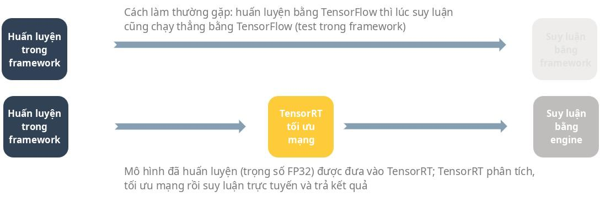

# Triển khai mô hình: tổng quan

> Ghi chú của người biên soạn: trang này dịch từ ghi chú *dl_note* của **Harley Zhang** ([bản gốc](https://github.com/harleyszhang/dl_note/blob/main/6-model_deploy/模型压缩部署概述.md), [kho mã](https://github.com/harleyszhang/dl_note), giấy phép [Apache-2.0](https://www.apache.org/licenses/LICENSE-2.0); phần dịch có chỉnh sửa). Số mục giữ như bản gốc. Chỗ bản gốc sai, thiếu hoặc đã lỗi thời được sửa ngay trong bài và ghi ở ô **Biên tập**. Các mục có chữ **Bổ sung** do người biên soạn viết thêm.

Phần 6 của khoá nói về đưa mô hình đã huấn luyện vào chạy thật: đo độ phức tạp, tối ưu đồ thị, chuyển định dạng (ONNX), và các engine suy luận (TensorRT cho GPU, ncnn cho CPU di động). Trang [Code](dlnote/deploy_code_vi) đi kèm chạy được mọi ví dụ trên CPU, trừ phần TensorRT.

**Lý thuyết:** [Ôn tập · 17.5.1 Các phương pháp tối ưu, tăng tốc mô hình](qa/ch17_vi?id=_1751-các-phương-pháp-tối-ưu-tăng-tốc-mô-hình) · [Ôn tập · 17.10.1 NCNN](qa/ch17_vi?id=_17101-ncnn)

## Các chỉ số hiệu năng của máy tính

- **Độ trễ** (latency): thời gian từ lúc bắt đầu tới lúc hoàn thành một thao tác, thường tính bằng micro giây (với suy luận mô hình thường là mili giây).
- **Băng thông** (bandwidth): lượng dữ liệu xử lý (truyền) được trong một đơn vị thời gian, thường tính bằng MB/s hay GB/s.
- **Thông lượng** (throughput): số thao tác hoàn thành trong một đơn vị thời gian. Trong tính toán khoa học, nơi dùng nhiều phép tính số thực, thường đo bằng GFLOPS (tỉ phép tính số thực mỗi giây); với suy luận mô hình, thường đo bằng số mẫu (ảnh, token) mỗi giây.

Tóm lại: **độ trễ đo thời gian hoàn thành một thao tác, còn thông lượng đo lượng thao tác làm được trong một đơn vị thời gian**. Hai chỉ số này hay mâu thuẫn: gộp nhiều mẫu thành batch lớn tăng thông lượng nhưng mỗi mẫu phải chờ lâu hơn.

## 1 Triển khai mô hình trực tuyến

Ngoài huấn luyện, nghiên cứu thuật toán, học sâu và thị giác máy tính còn hai hướng quan trọng: **nén mô hình** (tối ưu, lượng tử hoá; xem phần 5 của khoá) và **triển khai mô hình** (chuyển đổi mô hình, phát triển SDK phía sau…). Triển khai mô hình là đưa mô hình mà nhà nghiên cứu đã huấn luyện lên một nền tảng chip cụ thể ở **đầu cuối, biên hoặc đám mây** (end, edge, cloud), rồi phát triển ứng dụng cho nghiệp vụ cụ thể, chẳng hạn:

- đóng gói thành một SDK thuật toán, tích hợp vào ứng dụng hay dịch vụ;
- đóng gói thành dịch vụ web, cung cấp giao diện ra ngoài (qua HTTP(S), RPC…).

Các nền tảng triển khai hiện chia thành: **đám mây** (như `GPU` của NVIDIA), **thiết bị di động** (chip họ `ARM`) và các **thiết bị nhúng** khác (HiSilicon `3519`, Ambarella `CV22`, Horizon Robotics `X3`, NVIDIA `Jetson TX2`…). Với kỹ sư triển khai, chuyển và tối ưu mô hình, tối ưu và lượng tử hoá là phần có tính thách thức và kỹ thuật cao hơn; nhưng người mới thường bắt đầu bằng việc giải quyết các lỗi khiến mô hình không chạy được trên thiết bị: cài toán tử (`OP`) mới, sửa các thuộc tính không tương thích, sửa hình dạng trọng số không tương thích, học các framework suy luận của từng nền tảng chip… Với việc chuyển đổi mô hình, ngành công nghiệp chủ yếu dùng mô hình `Caffe` và `ONNX` làm định dạng trung gian.

> **Biên tập:** Danh sách chip trên là của khoảng 2021. Jetson TX2 đã được thay bằng dòng Jetson Orin; Caffe gần như không còn dùng làm định dạng trung gian, `ONNX` là chuẩn chung, bên cạnh các định dạng riêng như TorchScript/ExportedProgram (PyTorch), TFLite/LiteRT (TensorFlow) và GGUF (mô hình ngôn ngữ). Xem mục 4.

### 1.1 Quy trình phát triển một dự án học sâu

Ở trường đại học, một ứng dụng `demo` học sâu thường làm thế này: dùng framework `PyTorch/TensorFlow` huấn luyện mô hình, rồi dùng luôn framework đó để suy luận (`test`) kiểm tra chức năng. Trong công nghiệp thì không thể làm vậy, vì suy luận như thế rất chậm; thường phải dùng một framework chuyên tăng tốc suy luận (`inference`). Lấy `TensorRT`, framework suy luận cho GPU trên đám mây, làm ví dụ, quá trình huấn luyện và suy luận là: đưa mô hình đã huấn luyện (trọng số kiểu `FP32`) vào `TensorRT`, `TensorRT` phân tích, tối ưu, rồi suy luận trực tuyến và trả kết quả. Hình dưới so sánh hai cách:

Hình 1.1: Trên: huấn luyện và suy luận cùng một framework. Dưới: suy luận qua engine TensorRT.

Mô tả trên khá giản lược. Trong công nghiệp, quy trình lý tưởng gồm ba bước: **huấn luyện ngoại tuyến, nén mô hình và triển khai trực tuyến**, hai bước sau đan xen nhau:

1. **Huấn luyện ngoại tuyến**: không đòi hỏi thời gian thực, dữ liệu ngoại tuyến và ít cập nhật, `batchsize` lớn, tốn nhiều tài nguyên GPU.
    - thiết kế kiến trúc mạng;
    - chuẩn bị dữ liệu, tiền xử lý, `EDA` (phân tích khám phá dữ liệu)…;
    - huấn luyện bằng framework học sâu: tăng cường dữ liệu, chỉnh siêu tham số, chọn optimizer, điều chỉnh chiến lược huấn luyện (huấn luyện đa tỉ lệ), `TTA` (tăng cường lúc kiểm tra), tổ hợp mô hình…;
    - kiểm tra mô hình.

2. **Tối ưu và nén mô hình**: gồm tối ưu, chuyển đổi, lượng tử hoá và biên dịch mô hình. Nhiều bước đã được tích hợp trong các framework suy luận hiệu năng cao, và mỗi hãng chip cũng cung cấp chuỗi công cụ (toolchain) và thư viện suy luận riêng. Thực tế, mỗi nền tảng dùng một engine tăng tốc khác nhau: `GPU` dùng `TensorRT`, di động (`ARM`) dùng `ncnn/MNN`, còn các chip `NPU` như HiSilicon 3519, Horizon X3, Ambarella CV22 thì tối ưu (`optimizer`) và nén bằng toolchain của hãng.
    - **Tối ưu mô hình** (`Optimizer`): chủ yếu là tối ưu đồ thị tính toán. Phân tích đồ thị rồi áp một loạt **chiến lược tối ưu không phụ thuộc phần cứng** để giảm chi phí lúc chạy về mặt logic, như hợp nhất toán tử (hợp nhất `conv, bn, relu`), thay thế toán tử, gập hằng số (constant folding), loại bỏ biểu thức con chung…
    - **Chuyển đổi mô hình** (`Converter`): `PyTorch → Caffe`, `PyTorch → ONNX`, `ONNX → ncnn` hoặc định dạng của hãng NPU (rất nhiều "hố": phải chú ý tính tương thích toán tử giữa `PyTorch`, `ONNX` và `NPU`). `ONNX` thường làm định dạng trung gian giữa framework huấn luyện và framework suy luận.
    - **Lượng tử hoá mô hình** (`Quantizer`): chủ yếu là lượng tử hoá sau huấn luyện (post-training quantization, `PTQ`); trọng số và kích hoạt có thể dùng độ rộng bit khác nhau, như `w8a8` (nhanh nhất), `w8a16` (cân bằng tốc độ và độ chính xác). Xem [bài lượng tử hoá](dlnote/compress_quant_vi).
    - **Biên dịch mô hình** (biên dịch + sinh lệnh `NPU` + tối ưu bộ nhớ; `Compiler`): **mỗi nền tảng phần cứng có cách tối ưu biên dịch riêng**, khác với tối ưu ở mức mô hình (không phụ thuộc phần cứng) nói trên. Trên `GPU` có `kernel fusion` (hợp nhất kernel); còn trên `NPU`, toán tử được cài bằng lệnh nhị phân riêng, nên tối ưu biên dịch gồm tách lớp tích chập, sắp xếp lại dữ liệu trọng số, tinh chỉnh toán tử `NPU`…

3. **Triển khai mô hình / xuất SDK**: với ứng dụng video cần xuất SDK có giao diện chức năng. Đòi hỏi thời gian thực cao, dữ liệu trực tuyến và cập nhật liên tục, `batchsize` bằng 1. Chủ yếu gồm: tích hợp nhiều mô hình, tiền xử lý đầu vào, phát triển các mô-đun không phải học sâu, nối các mô-đun thành `pipeline`, cuối cùng xuất giao diện `C` (`SDK`).
    - **Suy luận trên bo mạch** (`Inference`, `C/C++`): mỗi chip `NPU`, mỗi công ty có framework suy luận khác nhau, nhưng quy trình suy luận gần giống nhau: tiền xử lý ảnh đầu vào, nạp và phân tích tệp mô hình, đưa dữ liệu ảnh vào và trọng số vào đúng địa chỉ, chạy suy luận, giải phóng tài nguyên. Phần này chủ yếu là học các framework triển khai, suy luận khác nhau.
    - **Phát triển ứng dụng pipeline**: trong dự án thực tế, suy luận mô hình chỉ là chức năng nền; còn phải tích hợp nhiều mô hình, tiền xử lý đầu vào, và phát triển các mô-đun không phải học sâu: phát hiện, theo vết (tracking), chọn khung hình, liên kết, các mô-đun nghiệp vụ…, rồi nối tất cả thành một `pipeline` để hoàn thành ứng dụng cấu trúc hoá video.
    - **Tích hợp SDK**: sau khi xong thuật toán cho pipeline nghiệp vụ, thường phải xuất `SDK` giao diện `C` cho phía nghiệp vụ (frontend, backend) gọi. Việc này gồm chuyển đổi giao diện `C/C++`, viết các ví dụ (sample) pipeline đa luồng, đa kênh, và rất nhiều kiểm thử đơn vị, hiệu năng, độ chính xác, độ ổn định.
    - **Suy luận trên bo mạch của nền tảng chip**: mỗi chip `NPU` có thư viện `SDK` khác nhau, nhưng quy trình chạy mô hình tương tự.

> Biên dịch tối ưu mô hình khác nhau theo nền tảng. Chẳng hạn khác biệt giữa `NPU` và `GPU` nằm ở phần biên dịch phía sau (backend): `GPU` sinh ra thư viện kernel (gọi hàm của `cuDNN`), còn `NPU` sinh ra lệnh nhị phân; phần tối ưu đồ thị phía trước (frontend) thì không khác về bản chất, gần như dùng chung.

Tóm lại, quy trình phát triển một dự án học sâu gồm ba bước: **huấn luyện ngoại tuyến**, **tối ưu và nén mô hình**, **triển khai mô hình / xuất SDK**, hai bước sau đan xen. Hai bước đầu làm trên `PC`, còn code của bước cuối chạy trên hệ thống chip `AI`.

Bản gốc kết thúc mục này bằng sơ đồ công việc của tác giả khi triển khai một mô hình thị sai (ước lượng độ sâu từ hai camera) lên chip HiSilicon `3519`, gồm bốn giai đoạn *tối ưu mô hình → chuyển đổi mô hình → biên dịch mô hình → suy luận trên thiết bị*:

1. **Bộ công cụ cho mạng thị sai**: suy luận PyTorch trên PC; công cụ đánh giá mô hình; công cụ so sánh độ tương đồng đầu ra từng tầng (giữa PyTorch và mô hình đã chuyển); công cụ phân tích log mô phỏng; công cụ trực quan hoá kết quả mô phỏng và kết quả trên bo mạch.
2. **Bộ công cụ chuyển đổi mô hình**: hiểu nguyên lý công cụ chuyển đổi; cập nhật công cụ để hỗ trợ các mạng ResNet mới; phân tích độ phức tạp và chuyển đổi mô hình (kèm đồ thị *tỉ lệ sử dụng MAC* theo độ thưa sau cắt tỉa kênh, giảm từ khoảng 0,42 ở độ thưa 20% xuống 0,33 ở độ thưa 50%).
3. **IDE Ruyi của HiSilicon**: làm quen công cụ và tài liệu; viết script biên dịch hàng loạt nhiều mô hình.
4. **Thư viện suy luận trên bo mạch**: hiểu logic chạy của code trên bo mạch (gồm phần NNIE và Runtime); cập nhật code xử lý tệp đầu vào để hỗ trợ một hoặc nhiều đầu vào.

> **Biên tập:** Sơ đồ gốc là một slide báo cáo công việc toàn chữ Trung; đã thay bằng danh sách trên. Chi tiết đáng chú ý trong slide: sau khi cắt tỉa kênh, tỉ lệ sử dụng tính toán (mục 1.1 của [bài độ phức tạp](dlnote/deploy_flops_vi)) *giảm*, tức mô hình nhỏ đi nhưng phần cứng chạy kém hiệu quả hơn; đó là lý do FLOPs giảm không đồng nghĩa với độ trễ giảm tương ứng.

### 1.2 Khác biệt giữa huấn luyện và suy luận

Để tối ưu và triển khai tốt, cần nắm khác biệt giữa suy luận (`Inference`) và huấn luyện (`Training`):

1. Trọng số cố định, chỉ có lan truyền xuôi (`Forward`), không cần lan truyền ngược, nên:
    - cấu trúc và trọng số cố định, có thể tối ưu đồ thị, như hợp nhất toán tử (xem [bài hợp nhất Conv và BN](dlnote/deploy_fuse_vi));
    - kích thước đầu vào, đầu ra cố định, có thể tối ưu bộ nhớ, như sắp xếp lại `feature map` và kernel; không phải giữ lại kích hoạt trung gian cho lan truyền ngược, nên bộ nhớ của các tầng có thể dùng lại.
2. `batch_size` nhỏ (như `1`), nên vấn đề chính là độ trễ (`latency`).
3. Có thể dùng độ chính xác thấp. Khi huấn luyện phải lan truyền ngược, mỗi lần cập nhật gradient rất nhỏ, nên cần độ chính xác tương đối cao như `FP32`. Khi suy luận, yêu cầu độ chính xác thấp hơn; nhiều bài báo cho thấy dùng kiểu độ chính xác thấp như `FP16` hay `INT8` để suy luận không làm mất nhiều độ chính xác.

> **Biên tập:** Bản gốc ghi "`in16` hoặc `int8`"; đã sửa thành `FP16` (int16 ít khi được dùng cho suy luận trên GPU). Ngày nay huấn luyện cũng thường dùng độ chính xác hỗn hợp (BF16/FP16, cả FP8 trên GPU Hopper, Blackwell), FP32 chỉ còn giữ cho bản sao trọng số chính và trạng thái optimizer.

## 2 Tối ưu framework suy luận trên CPU di động

Với kỹ sư `HPC` và phần mềm, tối ưu framework suy luận trên `CPU` di động có thể xét từ trên xuống:

1. **Tối ưu ở tầng thuật toán**: như dùng thuật toán Winograd để giảm số phép nhân về mặt toán học (chỉ hiệu quả với số kênh lớn);
2. **Tối ưu framework**: framework suy luận có thể dùng vùng nhớ chung (memory pool), đa luồng…;
3. **Tối ưu tầng phần cứng**: thích ứng với đặc điểm kiến trúc phần cứng, tối ưu `pipeline` và `cache`, sắp xếp lại dữ liệu trong bộ nhớ, tối ưu hợp ngữ `NEON`…

> **Biên tập:** Winograd F(2×2, 3×3) giảm số phép nhân của tích chập 3×3 xuống $16/36 \approx 0{,}44$ lần, F(4×4, 3×3) xuống $36/144 = 0{,}25$ lần (đổi lại nhiều phép cộng hơn và kém chính xác hơn với số nguyên). Nó chỉ áp dụng cho kernel nhỏ, stride 1, và có lợi khi số kênh đủ lớn để chi phí biến đổi đầu vào, đầu ra được chia đều. ncnn có các tuỳ chọn `use_winograd23/43/63_convolution` tương ứng.

## 3 Tổng kết cách lượng tử hoá trên các nền tảng phần cứng

| Hãng chip | Dòng chip | Cách hỗ trợ | Độ chính xác hỗ trợ | Cách lượng tử hoá | Công cụ lượng tử hoá |
| --- | --- | --- | --- | --- | --- |
| Huawei (HiSilicon) | 3519A, 3559A, 3516C… | Biên dịch cả mạng | int16, int8 | Lượng tử hoá phi tuyến (log) | nnie_mapper |
| Ambarella | CV22, CV25 | Biên dịch cả mạng | int8, int16 | Trọng số và kích hoạt chọn được độ rộng bit khác nhau, tự tìm chiến lược lượng tử hoá tốt nhất | Parsers của toolchain CNNGen |
| NVIDIA | Mọi GPU | Biên dịch cả mạng / CUDA C | fp32, fp16, int8, int4, int1 | `TensorRT`: đối xứng; kích hoạt hiệu chỉnh bằng KL divergence, trọng số per-channel hoặc per-tensor | `TensorRT` |
| Qualcomm | Mọi SoC | Biên dịch cả mạng | fp32, fp16, int8 | **Bất đối xứng theo min/max**, per-layer | AIMET |
| Rockchip | RV1108, RV1109, RV1126… | Biên dịch cả mạng | int16, int8 | Bất đối xứng, lượng tử hoá hỗn hợp | RKNN Toolkit2 |

`TensorRT` của NVIDIA lượng tử hoá trọng số (weights) theo `per-tensor` (còn gọi là per-layer) hoặc `per-channel`, bằng phương pháp **đối xứng theo giá trị tuyệt đối lớn nhất**; với kích hoạt (activations) chỉ hỗ trợ per-tensor, hiệu chỉnh bằng `KL divergence`.

> **Biên tập:** Hàng NVIDIA của bảng gốc ghi "bất đối xứng, KL divergence", mâu thuẫn với đoạn văn ngay dưới. TensorRT dùng lượng tử hoá **đối xứng** (điểm 0 bằng 0) cho cả trọng số lẫn kích hoạt; đã sửa trong bảng. Số liệu bảng là của khoảng 2021: TensorRT 10 có thêm FP8 (từ GPU Hopper) và FP4/NVFP4 (Blackwell), còn INT4 chủ yếu dùng cho trọng số của mô hình ngôn ngữ lớn (weight-only). Qualcomm hiện có thêm QNN/AI Hub, Rockchip có RKNN cho dòng RK3588. Thực nghiệm về hiệu chỉnh KL so với min/max xem [trang Code lượng tử hoá](dlnote/compress_quant_code_vi).

## 4 Bổ sung: hệ sinh thái triển khai năm 2026

Mục này do người biên soạn viết thêm.

| Nền tảng | Engine thường dùng | Định dạng vào |
| --- | --- | --- |
| GPU NVIDIA (đám mây, Jetson) | TensorRT 10, TensorRT-LLM; Triton Inference Server để phục vụ | ONNX, PyTorch (Torch-TensorRT) |
| CPU x86 / ARM máy chủ | ONNX Runtime, OpenVINO (Intel), PyTorch với `torch.compile` | ONNX, IR của OpenVINO |
| Di động Android / iOS | ncnn, MNN, LiteRT (TFLite cũ), ExecuTorch, Core ML (Apple) | ncnn param/bin (qua pnnx), `.pte`, `.mlpackage` |
| NPU nhúng (Rockchip, HiSilicon, Ambarella, Horizon…) | toolchain riêng của hãng | thường nhận ONNX |
| Mô hình ngôn ngữ lớn | vLLM, SGLang, TensorRT-LLM, llama.cpp (CPU/Apple/GPU) | safetensors, GGUF |
| Trình duyệt | ONNX Runtime Web, WebGPU | ONNX |

Vài xu hướng đáng chú ý:

- **Xuất từ PyTorch** chuyển sang `torch.export` (đồ thị ExportedProgram): bộ xuất ONNX mặc định từ PyTorch 2.9 dùng nó (`dynamo=True`), và ExecuTorch cũng xây trên nó. Bộ xuất TorchScript cũ vẫn có nhưng đã lỗi thời. Xem [bài ONNX](dlnote/deploy_onnx_vi).
- **pnnx** thay cho chuỗi PyTorch → ONNX → ncnn: chuyển thẳng mô hình PyTorch sang ncnn, ít lỗi toán tử hơn (trang Code dùng nó).
- **Trên CPU, engine chuyên dụng vẫn nhanh hơn nhiều**: trên máy chạy trang Code (CPU laptop x86, 4 luồng), ShuffleNet v2 mất 7–16 ms với PyTorch eager tuỳ lần chạy, nhưng chỉ khoảng 2,5–5 ms với ONNX Runtime hay ncnn.
- **Mô hình ngôn ngữ lớn** thay đổi trọng tâm: suy luận bị giới hạn bởi băng thông bộ nhớ (đọc toàn bộ trọng số cho mỗi token) chứ không phải tính toán, nên lượng tử hoá trọng số (INT4, FP8), KV cache, batching liên tục và giải mã suy đoán (speculative decoding) trở thành kỹ thuật chính; xem mô hình roofline ở [bài độ phức tạp](dlnote/deploy_flops_vi).

## Tài liệu tham khảo

1. *NVIDIA TensorRT và ghi chép thực chiến* (bản PPT, 《NVIDIA TensorRT 以及实战记录》).
2. Lavin, Gray. [Fast Algorithms for Convolutional Neural Networks](https://arxiv.org/abs/1509.09308) (Winograd). CVPR 2016.
3. [PyTorch: Export a model to ONNX](https://docs.pytorch.org/docs/stable/onnx_export.html)
4. [ncnn](https://github.com/Tencent/ncnn) và [pnnx](https://github.com/pnnx/pnnx)
