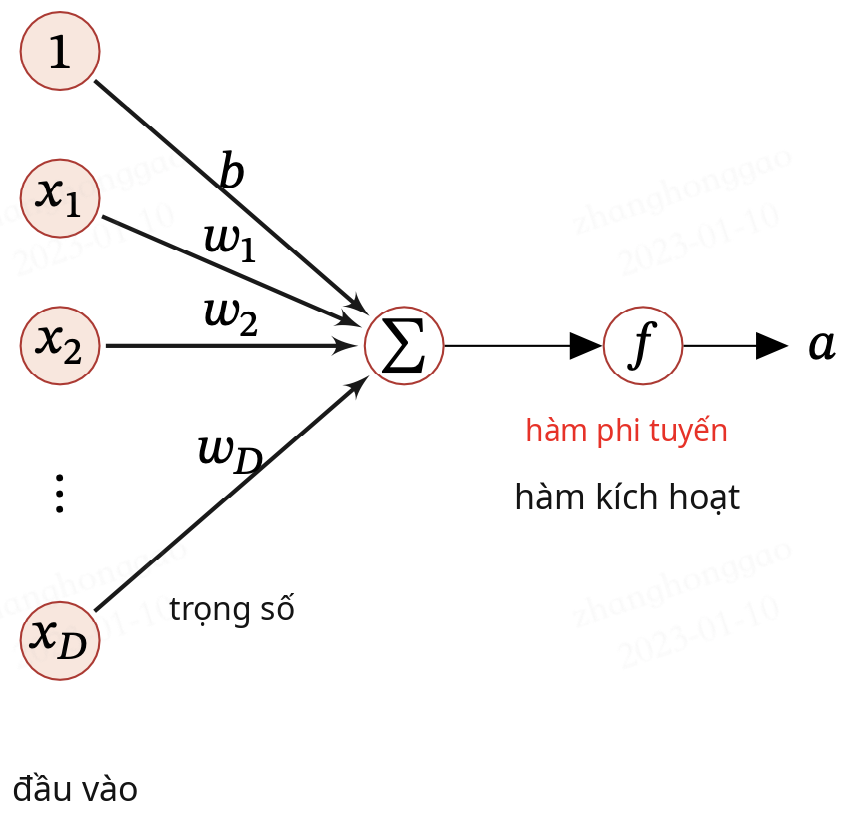
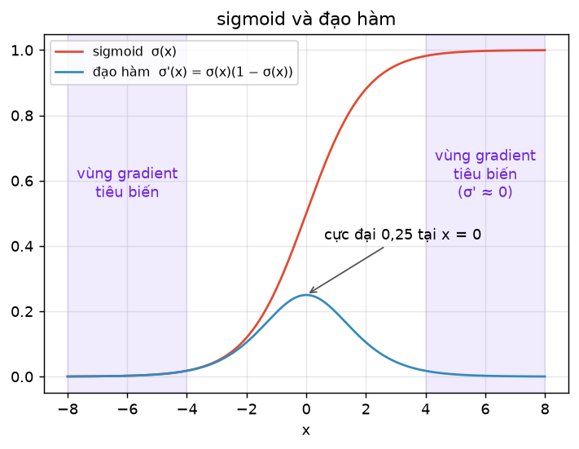
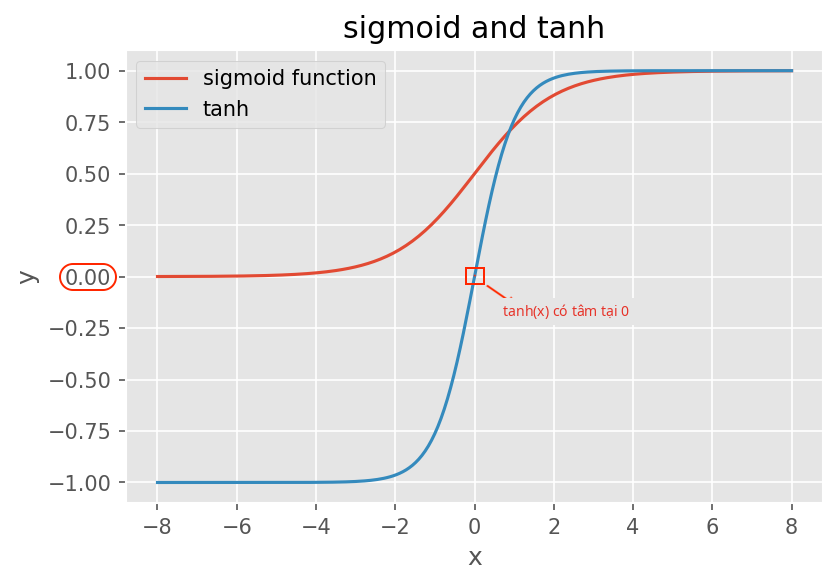
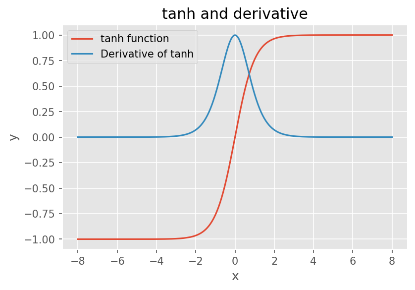
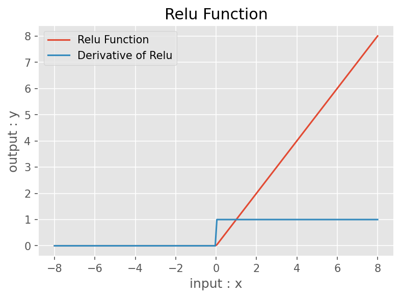
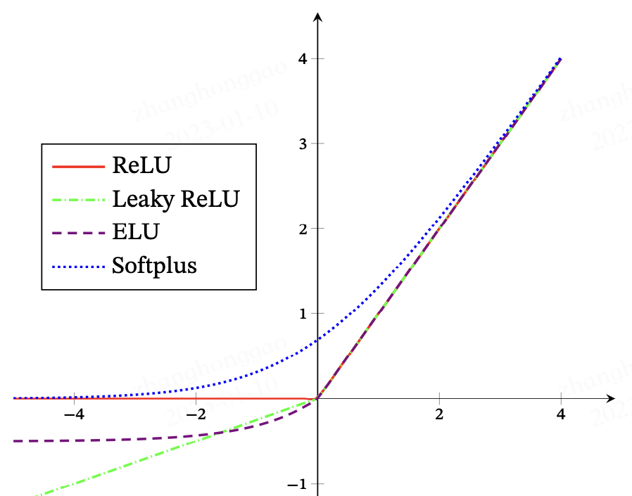
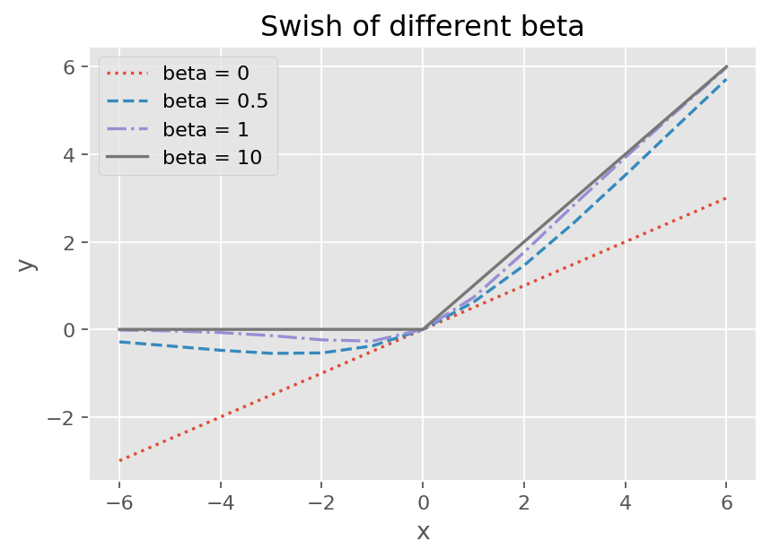
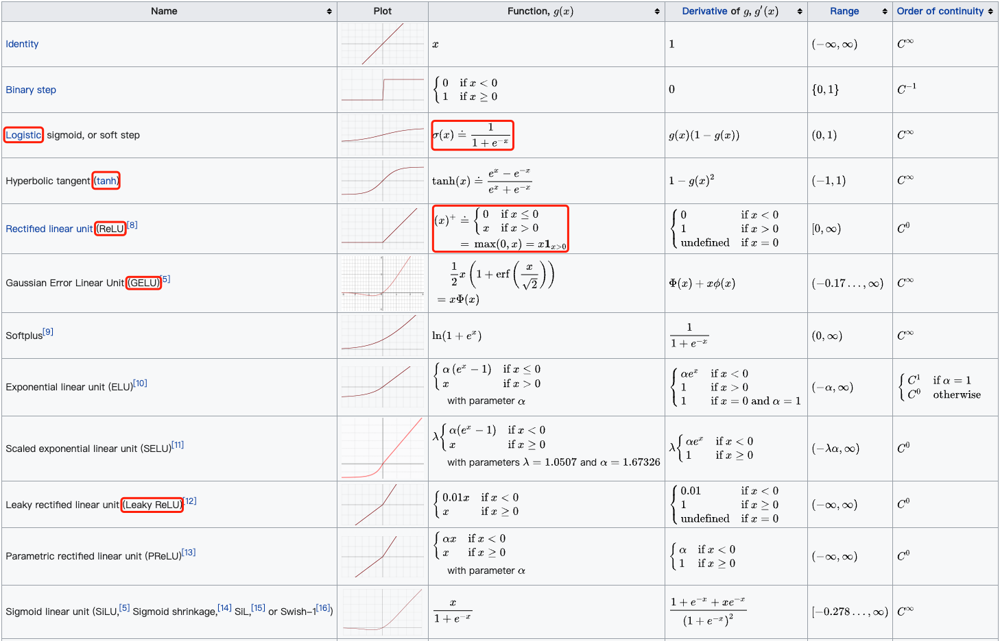

# Thành phần CNN: hàm kích hoạt

> Ghi chú của người biên soạn: trang này dịch từ ghi chú *dl_note* của **Harley Zhang** ([bản gốc](https://github.com/harleyszhang/dl_note/blob/main/2-deep_learning_basic/cnn基础部件-激活函数详解.md), [kho mã](https://github.com/harleyszhang/dl_note), giấy phép [Apache-2.0](https://www.apache.org/licenses/LICENSE-2.0); phần dịch có chỉnh sửa). Số mục giữ như bản gốc. Chỗ bản gốc sai, thiếu hoặc đã lỗi thời được sửa ngay trong bài và ghi ở ô **Biên tập**. Các mục có chữ **Bổ sung** do người biên soạn viết thêm.

Bài này phân tích vì sao mạng neuron cần hàm kích hoạt, giải thích nguyên lý của các hàm kích hoạt thường gặp, kèm công thức, code và hình minh hoạ. Trang [Code](dlnote/dl_basic_code_vi) đi kèm kiểm tra đạo hàm của mọi hàm trong bài bằng autograd và vẽ lại chúng trên lưới mịn.

<div class="qa-theory">

**Lý thuyết:** [Ôn tập · 3.4.2 Các hàm kích hoạt thường gặp và đồ thị](qa/ch03_vi?id=_342-các-hàm-kích-hoạt-thường-gặp-và-đồ-thị) · [Ôn tập · 3.4.5 Chọn hàm kích hoạt thế nào?](qa/ch03_vi?id=_345-chọn-hàm-kích-hoạt-thế-nào)

</div>

## 1 Tổng quan về hàm kích hoạt

### 1.1 Lời nói đầu

Neuron nhân tạo (artificial neuron), gọi tắt là neuron, là đơn vị cơ bản của mạng neuron. Nó mô phỏng cấu trúc và đặc tính của neuron sinh học: nhận một tập tín hiệu đầu vào và tạo ra đầu ra. Neuron sinh học nhận xung từ các neuron khác qua sợi nhánh, tổng hợp ở thân tế bào, và khi đủ mạnh thì phát xung qua sợi trục; neuron nhân tạo thay các bước này bằng tổng có trọng số $\sum_i w_ix_i+b$ rồi một hàm kích hoạt $f$.

> **Biên tập:** Bản gốc có một hình so sánh neuron sinh học và neuron nhân tạo, toàn bộ chú thích bằng tiếng Trung (từ sách *Mạng neuron và học sâu* của Khâu Tích Bằng). Hình được thay bằng câu mô tả ở trên; hình neuron nhân tạo ở mục 1.2 đã được dịch.

Từ góc nhìn học máy, mạng neuron là một **mô hình phi tuyến**: đơn vị cơ bản là neuron có hàm kích hoạt phi tuyến, và nhờ rất nhiều kết nối giữa các neuron, mạng nhiều tầng trở thành mô hình phi tuyến bậc cao. **Trọng số kết nối giữa các neuron là tham số cần học**, học được bằng **gradient descent** trong khuôn khổ học máy.

> Học sâu thường chỉ mô hình mạng neuron sâu, nói chung là mạng có từ ba tầng trở lên.

### 1.2 Định nghĩa hàm kích hoạt

Hàm kích hoạt (còn gọi là "ánh xạ phi tuyến") là thành phần không thể thiếu của mạng neuron tích chập sâu.

Giả sử một neuron nhận $D$ đầu vào $x_1, x_2,\dots, x_D$, ghép thành vector $\boldsymbol x = [x_1;x_2;\dots;x_D]$, và **đầu vào tổng** (net input) $z \in \mathbb{R}$ là tổng có trọng số của tín hiệu $\boldsymbol x$:

$$
z = \sum_{d=1}^{D} w_{d}x_{d} + b = \boldsymbol w^\top \boldsymbol x + b
$$

trong đó $\boldsymbol w = [w_1;w_2;\dots;w_D]\in \mathbb{R}^D$ là vector trọng số $D$ chiều và $b \in \mathbb{R}$ là độ lệch.

> **Biên tập:** Bản gốc gọi $\boldsymbol w$ là "ma trận trọng số" và $b$ là "vector độ lệch"; với một neuron, $\boldsymbol w$ là vector và $b$ là số vô hướng.

Công thức trên là một **phép biến đổi tuyến tính có độ lệch** (phép biến đổi affine), về bản chất vẫn là mô hình tuyến tính. Để thành mô hình phi tuyến, ta đặt một **hàm phi tuyến** $f$ (hàm kích hoạt) sau đầu vào tổng $z$:

$$a = f(z)$$

Một neuron điển hình có cấu trúc như sau:

<div align="center">

</div>

Nếu không có hàm kích hoạt (hoặc dùng hàm tuyến tính), xếp bao nhiêu tầng thì cả mạng vẫn chỉ là một phép biến đổi tuyến tính: $W_2(W_1\boldsymbol x+\boldsymbol b_1)+\boldsymbol b_2 = W\boldsymbol x+\boldsymbol b$.

### 1.3 Tính chất của hàm kích hoạt

Để tăng năng lực biểu diễn và năng lực học của mạng, hàm kích hoạt cần:

1. **Liên tục, khả vi (cho phép không khả vi tại một số ít điểm) và phi tuyến.** Hàm kích hoạt khả vi cho phép học tham số bằng các phương pháp tối ưu số.
2. Hàm kích hoạt và đạo hàm của nó **càng đơn giản càng tốt**, để tính nhanh.
3. **Miền giá trị của đạo hàm nằm trong khoảng hợp lý**, không quá lớn cũng không quá nhỏ, nếu không sẽ ảnh hưởng tới hiệu quả và độ ổn định của huấn luyện.

## 2 Họ sigmoid (hàm kích hoạt kiểu ép)

Họ sigmoid là các hàm có đồ thị hình chữ S, bão hoà ở cả hai đầu. Hay dùng nhất là hàm logistic và hàm tanh.

> Kiến thức toán liên quan: hàm $f(x)$ được gọi là **bão hoà trái** nếu đạo hàm $f'(x)\to 0$ khi $x \to -\infty$, và **bão hoà phải** nếu $f'(x)\to 0$ khi $x \to +\infty$. Thoả cả hai thì gọi là bão hoà hai đầu.

### 2.1 Hàm logistic (sigmoid)

Với đầu vào trên $\mathbb{R}$, hàm `sigmoid` biến nó thành giá trị trong khoảng $(0, 1)$. Vì vậy sigmoid thường được gọi là **hàm ép** (squashing function): ép mọi đầu vào trong $(-\infty, \infty)$ về một giá trị trong $(0, 1)$:

$$
\sigma(x) = \frac{1}{1 + \exp(-x)}
$$

Đạo hàm của nó:

$$
\frac{\mathrm{d} }{\mathrm{d} x}\sigma(x) = \frac{\exp(-x)}{(1+\exp(-x))^2} = \sigma(x)\big(1 - \sigma(x)\big)
$$

Đồ thị sigmoid và đạo hàm:

<div align="center">

</div>

Hàm sigmoid liên tục, trơn, đơn điệu tăng chặt, đối xứng tâm qua điểm $(0;\ 0{,}5)$, là một hàm ngưỡng rất tốt.

Khi đầu vào bằng 0, đạo hàm của sigmoid đạt giá trị lớn nhất là 0,25; đầu vào càng xa 0 về một phía, đạo hàm càng gần `0`, tức **khi đầu vào của sigmoid rất lớn hay rất nhỏ, gradient của nó tiêu biến**.

Hiện nay `sigmoid` ít dùng ở các tầng ẩn. Tính bão hoà mềm của nó khiến mạng sâu khó huấn luyện hiệu quả suốt hai ba thập niên; nay nó đã bị thay bởi các hàm đơn giản, dễ huấn luyện hơn như `ReLU`.

Khi muốn mô hình xuất ra xác suất cho bài toán nhị phân hay đa nhãn, **`sigmoid` dùng làm hàm kích hoạt của tầng cuối**. Bảng dưới tổng hợp hàm kích hoạt tầng cuối và hàm mất mát cho các loại bài toán hay gặp:

| Loại bài toán | Kích hoạt tầng cuối | Hàm mất mát (PyTorch) |
| --- | --- | --- |
| Phân loại nhị phân (binary) | `sigmoid` | `nn.BCEWithLogitsLoss()` trên logit; hoặc `torch.sigmoid` + `nn.BCELoss()` |
| Nhiều lớp, một nhãn (multiclass) | `softmax` | `nn.CrossEntropyLoss()` trên logit, không cần tự làm `softmax` |
| Nhiều lớp, nhiều nhãn (multilabel) | `sigmoid` | `nn.BCEWithLogitsLoss()` trên logit; hoặc `sigmoid` + `nn.BCELoss()` |

> `nn.BCEWithLogitsLoss()` tương đương `sigmoid` + `nn.BCELoss()` về mặt toán học, nhưng ổn định số hơn (gộp sigmoid và log thành một bước dùng thủ thuật log-sum-exp), nên là lựa chọn mặc định; trang Code của bài [hàm mất mát](dlnote/dl_loss_vi) cho thấy `BCELoss` sau sigmoid bị kẹp giá trị khi logit lớn.

### 2.2 Hàm tanh

`Tanh` (tang hyperbol) cũng thuộc họ sigmoid, có thể xem là sigmoid được kéo giãn và dịch:

$$
\tanh(x) = 2\sigma(2x) - 1 = \frac{2}{1 + e^{-2x}} - 1
$$

Dùng các công thức đạo hàm cơ bản, có (bỏ qua bước suy ra):

$$
\frac{\mathrm{d} }{\mathrm{d} x} \tanh(x) = 1 - \tanh^{2}(x)
$$

**Code cài đặt và vẽ hàm logistic và tanh** (chép về chạy được ngay):

```python
import numpy as np
import matplotlib.pyplot as plt

def sigmoid(x):
    """1 / (1 + exp(-x))"""
    return 1.0 / (1.0 + np.exp(-x))

def tanh(x):
    """2 * sigmoid(2x) - 1 = (e^x - e^-x) / (e^x + e^-x)"""
    return 2 * sigmoid(2 * x) - 1

def relu(x):
    return np.maximum(0.0, x)

def gradient_relu(x):
    """1 khi x > 0, 0 khi x < 0 (tại 0 quy ước bằng 0)"""
    return (x > 0).astype(float)

def gradient_sigmoid(x):
    """sigmoid(x) * (1 - sigmoid(x))"""
    a = sigmoid(x)
    return a * (1 - a)

def gradient_tanh(x):
    return 1 - tanh(x) ** 2

x = np.linspace(-8, 8, 400)          # lưới mịn để đường cong trơn
plt.figure(dpi=100)
plt.style.use('ggplot')
plt.plot(x, sigmoid(x), label='sigmoid')
plt.plot(x, tanh(x), label='tanh')
plt.xlabel("x"); plt.ylabel("y"); plt.title('sigmoid and tanh')
plt.legend()
plt.show()
```

> **Biên tập:** Code gốc tính trên danh sách số nguyên `range(-6, 7)` (13 điểm, đồ thị gãy khúc) và viết `relu`, `gradient_relu` bằng `max`, `if` trên số đơn, nên không áp được cho mảng NumPy. Bản trên dùng lưới 400 điểm và các phép toán vector hoá.

Đồ thị sigmoid và tanh:

<div align="center">

</div>

Đổi dữ liệu đưa vào `plt.plot`, ta cũng vẽ được tanh và đạo hàm của nó:

<div align="center">

</div>

Khi đầu vào rất lớn hay rất nhỏ, cả `sigmoid` lẫn `tanh` đều có **đầu ra gần như phẳng, gradient rất nhỏ, gần 0**, bất lợi cho cập nhật trọng số. Khác ở chỗ đầu ra của `tanh` nằm trong $(-1,1)$ và đối xứng qua 0 (**có tâm tại 0**): nếu đầu vào phân phối đối xứng quanh 0 thì đầu ra cũng có trung bình gần 0. Đầu ra có trung bình gần 0 giúp gradient của tầng sau không bị lệch về một dấu, nên trong nhiều ứng dụng `tanh` hoạt động tốt hơn `sigmoid`.

> **Biên tập:** Bản gốc viết tanh "có trung bình 0 nên trong lan truyền xuôi, trung bình của dữ liệu vào không thay đổi". Đây là cách nói không chính xác: tanh giữ trung bình 0 chỉ khi đầu vào đối xứng quanh 0; điều đúng là đầu ra **có tâm tại 0**, khác với sigmoid luôn dương.

**Ưu nhược điểm của `tanh`:**

- Có mọi ưu điểm của sigmoid, thêm đầu ra có tâm tại 0.
- Tính `exp` tốn kém; vẫn còn tiêu biến gradient.

Đạo hàm của tanh và logistic có dạng giống nhau:

- Đạo hàm lớn nhất tại 0: bằng 1 với tanh, bằng 0,25 với sigmoid.
- Đầu vào càng xa 0 về một phía, đạo hàm càng gần 0.

> **Biên tập:** Bản gốc viết "khi đầu vào gần 0, đạo hàm của cả hai gần giá trị lớn nhất là 1". Đạo hàm lớn nhất của sigmoid chỉ là 0,25 (mục 2.1); con số 1 chỉ đúng với tanh. Bản gốc còn đặt câu "đồ thị tanh và đạo hàm như sau" ở cuối mục mà không có hình theo sau (hình đã nằm ở trên), nên đã bỏ.

## 3 ReLU và các biến thể (hàm kích hoạt bán tuyến tính)

### 3.1 Hàm ReLU

`ReLU` (Rectified Linear Unit, đơn vị tuyến tính chỉnh lưu) là **hàm kích hoạt được dùng nhiều nhất** trong mạng neuron sâu. Nó giữ một cơ chế giống neuron sinh học kiểu hàm bậc thang: đầu vào vượt ngưỡng mới kích hoạt:

$$
\operatorname{ReLU}(x) = \max(0, x) = \begin{cases}
x & x\geq 0 \\
0 & x< 0
\end{cases}
$$

Hiểu nôm na, `ReLU` giữ phần dương và bỏ mọi phần âm. Lưu ý: dù không khả vi tại `0`, ReLU vẫn hoạt động tốt với thuật toán lan truyền ngược dựa trên gradient (tại 0 lấy đạo hàm quy ước là 0 hoặc 1).

1. **Ưu điểm:**

   - `ReLU` **tính rất đơn giản**.
   - **Có tính thưa tốt**: với đầu vào ngẫu nhiên quanh 0, khoảng 50% neuron được kích hoạt.
   - Đạo hàm bằng 1 khi $x > 0$, tức **không bão hoà ở phía dương**, phần nào làm dịu tiêu biến gradient và tăng tốc hội tụ của gradient descent.

   > Kiến thức sinh học liên quan: trong não người, tại một thời điểm chỉ khoảng 1% đến 4% neuron hoạt động.

2. **Nhược điểm:**

   - Đầu ra của ReLU không có tâm tại 0, đưa độ lệch dương vào tầng sau và **ảnh hưởng tới hiệu quả của gradient descent**.
   - Neuron ReLU dễ "chết" khi huấn luyện: nếu sau một lần cập nhật không tốt, đầu vào tổng của neuron âm với mọi mẫu huấn luyện, thì gradient của tham số neuron đó luôn bằng 0, và nó không bao giờ được kích hoạt lại. Hiện tượng này gọi là **ReLU chết** (dying ReLU).

> **Biên tập:** Bản gốc gọi tính chất "đạo hàm bằng 1 khi $x>0$" là "hàm bão hoà trái". ReLU đúng là bão hoà trái (đạo hàm bằng 0 khi $x<0$), nhưng tính chất giúp chống tiêu biến gradient là **không bão hoà phải**. Bản gốc cũng mô tả neuron chết là "tham số của neuron nhỏ hơn 0"; điều kiện đúng là **đầu vào tổng** $\boldsymbol w^\top\boldsymbol x+b$ âm với mọi mẫu.

Code ReLU:

```python
import numpy as np
# PyTorch: nn.ReLU() hoặc torch.relu
class ReLU:
    def func(self, x):
        return np.maximum(x, 0.0)

    def derivative(self, x):
        return (x > 0.0).astype(float)
```

> **Biên tập:** Hàm `derivative` của bản gốc duyệt `for x in a` với biến `a` chưa định nghĩa (báo `NameError`).

**ReLU và đạo hàm:**

<div align="center">

</div>

> Xem thêm bài báo gốc [Rectified Linear Units Improve Restricted Boltzmann Machines](https://www.cs.toronto.edu/~fritz/absps/reluICML.pdf).

### 3.2 Leaky ReLU, PReLU, ELU, Softplus

1. **`Leaky ReLU`**: để làm dịu hiện tượng neuron chết, người ta đổi phần $x < 0$ của ReLU thành $\gamma x$, với $\gamma$ là số dương nhỏ cỡ 0,01 hay 0,001. Hàm này gọi là **ReLU rò rỉ** (`Leaky ReLU`):

$$
\operatorname{LeakyReLU}(x) = \max(0, x) + \gamma \min(0, x)
= \begin{cases}
x & x\geq 0 \\
\gamma x & x< 0
\end{cases}
$$

> Xem bài báo gốc [Rectifier Nonlinearities Improve Neural Network Acoustic Models](https://www.semanticscholar.org/paper/Rectifier-Nonlinearities-Improve-Neural-Network-Maas/367f2c63a6f6a10b3b64b8729d601e69337ee3cc).

2. **`PReLU`**: để khỏi phải chọn **siêu tham số $\gamma$** của Leaky ReLU, người ta đề xuất ReLU tham số hoá (Parametric ReLU, `PReLU`): coi $\gamma$ là tham số học được cùng với cả mạng. Với neuron thứ $i$:

$$
\operatorname{PReLU}_i(x) = \max(0, x) + \gamma_{i} \min(0, x)
= \begin{cases}
x & x\geq 0 \\
\gamma_{i} x & x< 0
\end{cases}
$$

> Xem bài báo gốc [Delving Deep into Rectifiers: Surpassing Human-Level Performance on ImageNet Classification](https://arxiv.org/abs/1502.01852). Trong `nn.PReLU` của PyTorch, mặc định một $\gamma$ dùng chung cho cả tầng, hoặc một $\gamma$ cho mỗi kênh (`num_parameters=C`).

3. **`ELU`**: `ELU` (Exponential Linear Unit) của Clevert và cộng sự (ICLR 2016) dùng hàm mũ âm ở phần $x<0$. Đầu ra âm giúp trung bình kích hoạt gần 0 hơn ReLU, và phần âm bão hoà mềm về $-\gamma$ nên ít nhạy với nhiễu; bài báo gốc báo cáo huấn luyện nhanh hơn và chính xác hơn ReLU và các biến thể trên vài tập dữ liệu.

   Nhược điểm là **phép mũ làm tăng khối lượng tính**, nên suy luận với `ELU` chậm hơn `ReLU` và các biến thể. `ELU` định nghĩa:

$$
\operatorname{ELU}(x) = \max(0, x) + \min\big(0, \gamma(\exp(x) - 1)\big)
= \begin{cases}
x & x\geq 0 \\
\gamma(\exp(x) - 1) & x< 0
\end{cases}
$$

$\gamma \geq 0$ là siêu tham số, quyết định mức bão hoà khi $x \le 0$ và giúp đưa trung bình đầu ra về gần `0`.

> Xem bài báo gốc [Fast and Accurate Deep Network Learning by Exponential Linear Units (ELUs)](https://arxiv.org/abs/1511.07289).

> **Biên tập:** Bản gốc ghi công thức của PReLU và ELU đều là "Leaky ReLU(x)" (chép nhầm tên), và công thức ELU thiếu một dấu ngoặc đóng. Bản gốc cũng viết ELU "liên tục và khả vi mọi nơi nên không gặp bùng nổ hay tiêu biến gradient". ELU chỉ khả vi tại 0 khi $\gamma=1$, và bản thân hàm kích hoạt không loại bỏ được bùng nổ hay tiêu biến gradient (phụ thuộc cả trọng số và độ sâu); phần âm của ELU vẫn bão hoà.

4. **`Softplus`**: đạo hàm của Softplus đúng bằng hàm logistic. Softplus cũng có tính ức chế một phía và biên kích hoạt rộng như ReLU, nhưng không có tính kích hoạt thưa (đầu ra luôn dương). `Softplus` định nghĩa:

$$
\operatorname{Softplus}(x) = \log(1 + \exp(x))
$$

> Ai quan tâm có thể đọc [Deep Sparse Rectifier Neural Networks](http://proceedings.mlr.press/v15/glorot11a/glorot11a.pdf).

Lưu ý: **ReLU có rất nhiều biến thể, nhưng trong các mô hình CNN thực tế, dùng nhiều nhất vẫn là chính `ReLU`.**

ReLU, Leaky ReLU, ELU và Softplus:

<div align="center">

</div>

## 4 Hàm Swish

Hàm `Swish` [Ramachandran et al., 2017] là một hàm kích hoạt tự đóng mở cổng (self-gated):

$$
\operatorname{swish}(x) = x\,\sigma(\beta x)
$$

với $\sigma(\cdot)$ là hàm logistic, $\beta$ là tham số học được hoặc siêu tham số cố định. $\sigma(\cdot) \in (0, 1)$ có thể xem như một cổng mềm: khi $\sigma(\beta x)$ gần `1`, cổng "mở", đầu ra xấp xỉ chính $x$; khi $\sigma(\beta x)$ gần `0`, cổng "đóng", đầu ra xấp xỉ `0`.

Code Swish:

```python
import torch
import torch.nn as nn

class Swish(nn.Module):
    """Swish (Ramachandran et al., 2017, arXiv:1710.05941). Với beta = 1 chính là nn.SiLU."""
    def __init__(self, beta=1.0):
        super().__init__()
        self.beta = beta

    def forward(self, x):
        return x * torch.sigmoid(self.beta * x)
```

> **Biên tập:** Code gốc dẫn link `arXiv:1905.02244`, đó là bài MobileNetV3 (đề xuất **h-swish**, xấp xỉ Swish bằng ReLU6), không phải bài Swish. Code gốc cũng khai báo `forward` là `@staticmethod` với `beta` là tham số của `forward`, nên khi dùng như một lớp `nn.Module` không đặt được `beta`.

Dùng lại code vẽ ở trên, ta có đồ thị Swish:

<div align="center">

</div>

**Swish có thể xem là hàm nội suy phi tuyến giữa hàm tuyến tính và ReLU, mức độ do $\beta$ điều khiển**: $\beta=0$ cho $x/2$ (tuyến tính), $\beta\to\infty$ cho ReLU.

## 5 Tổng kết hàm kích hoạt

Các hàm kích hoạt hay dùng là `ReLU`, `sigmoid` và `tanh`. Code chuẩn tổng hợp (cài đặt trong PyTorch phức tạp hơn):

```python
import numpy as np

class Sigmoid:
    def func(self, x):
        return 1.0 / (1.0 + np.exp(-x))
    def derivative(self, x):
        s = self.func(x)
        return s * (1.0 - s)

class Tanh:
    def func(self, x):
        return np.tanh(x)
    def derivative(self, x):
        return 1.0 - np.tanh(x) ** 2

class ReLU:
    def func(self, x):
        return np.maximum(x, 0.0)
    def derivative(self, x):
        return (x > 0.0).astype(float)

class LeakyReLU:
    def __init__(self, alpha=0.2):
        self.alpha = alpha
    def func(self, x):
        return np.where(x > 0, x, self.alpha * x)
    def derivative(self, x):
        return np.where(x > 0, 1.0, self.alpha)

class Softplus:
    def func(self, x):
        return np.logaddexp(0.0, x)          # log(1 + e^x), không tràn số khi x lớn
    def derivative(self, x):
        return 1.0 / (1.0 + np.exp(-x))
```

> **Biên tập:** Trong code tổng kết của bản gốc, `LeakyReLU.func` và `Softplus.func` dùng biến `z` chưa định nghĩa, `LeakyReLU.derivative` dùng biến `a` chưa định nghĩa; `np.log(1 + np.exp(x))` tràn số khi $x$ lớn (với $x=1000$ cho `inf`), nên dùng `np.logaddexp`. Trang Code chạy bản đã sửa và so với autograd.

Bảng so sánh tính chất của một số hàm kích hoạt (từ Wikipedia):

<div align="center">

</div>

Hình 1: Tên hàm, đồ thị, công thức, đạo hàm, miền giá trị và bậc liên tục của các hàm kích hoạt thường gặp (nguồn: Wikipedia, mục *Activation function*).

Xem trực quan các hàm kích hoạt tại [Visualising Activation Functions in Neural Networks](https://dashee87.github.io/deep%20learning/visualising-activation-functions-in-neural-networks/).

## 6 Bổ sung: hàm kích hoạt trong mô hình hiện nay

Mục này do người biên soạn viết thêm.

- **GELU** (Hendrycks và Gimpel, 2016): $\operatorname{GELU}(x)=x\,\Phi(x)$ với $\Phi$ là hàm phân phối tích luỹ của $\mathcal N(0,1)$, hay dùng xấp xỉ $0{,}5x\big(1+\tanh[\sqrt{2/\pi}(x+0{,}044715x^3)]\big)$. Có dạng giống Swish với $\beta\approx1{,}702$. GELU là hàm kích hoạt mặc định của BERT, GPT-2/3, ViT.
- **SiLU** là tên khác của Swish với $\beta=1$ (`nn.SiLU`), dùng trong EfficientNet, YOLOv5–v8.
- **Hard-swish** (MobileNetV3): $x\cdot\operatorname{ReLU6}(x+3)/6$, xấp xỉ Swish chỉ bằng phép cộng, nhân và kẹp giá trị, nên chạy nhanh và lượng tử hoá dễ trên thiết bị di động.
- **Đơn vị có cổng (GLU) và SwiGLU** (Shazeer, 2020): tầng MLP của Transformer đổi từ $\operatorname{GELU}(xW_1)W_2$ thành $\big(\operatorname{SiLU}(xW_1)\odot xV\big)W_2$, tức nhân từng phần tử với một nhánh tuyến tính thứ hai làm "cổng". SwiGLU cho chất lượng tốt hơn với cùng số tham số và được dùng trong Llama, Qwen, Mistral, Gemma (Gemma dùng biến thể GeGLU).

Tóm lại, với CNN cho thị giác máy tính, ReLU vẫn là lựa chọn an toàn (nhanh, dễ lượng tử hoá); với Transformer, GELU và SwiGLU là chuẩn hiện nay.

## Tài liệu tham khảo

1. [Pytorch分类问题中的交叉熵损失函数使用](https://www.cnblogs.com/hmlovetech/p/14515622.html)
2. Ngụy Tú Tham (魏秀参). *Giải tích mạng neuron tích chập* (解析卷积神经网络), chương 8.
3. Khâu Tích Bằng (邱锡鹏). *Mạng neuron và học sâu* (神经网络与深度学习), chương 4.
4. [How to Choose an Activation Function for Deep Learning](https://machinelearningmastery.com/choose-an-activation-function-for-deep-learning/)
5. [深度学习中的激活函数汇总](http://spytensor.com/index.php/archives/23/)
6. [Visualising Activation Functions in Neural Networks](https://dashee87.github.io/deep%20learning/visualising-activation-functions-in-neural-networks/)
7. [AI-EDU: Hàm kích hoạt kiểu ép](https://microsoft.github.io/ai-edu/%E5%9F%BA%E7%A1%80%E6%95%99%E7%A8%8B/A2-%E7%A5%9E%E7%BB%8F%E7%BD%91%E7%BB%9C%E5%9F%BA%E6%9C%AC%E5%8E%9F%E7%90%86/%E7%AC%AC4%E6%AD%A5%20-%20%E9%9D%9E%E7%BA%BF%E6%80%A7%E5%9B%9E%E5%BD%92/08.1-%E6%8C%A4%E5%8E%8B%E5%9E%8B%E6%BF%80%E6%B4%BB%E5%87%BD%E6%95%B0.html)
8. https://github.com/borgwang/tinynn/blob/master/tinynn/core/layer.py
9. Ramachandran, Zoph, Le. [Searching for Activation Functions](https://arxiv.org/abs/1710.05941). 2017.
10. Hendrycks, Gimpel. [Gaussian Error Linear Units (GELUs)](https://arxiv.org/abs/1606.08415). 2016.
11. Shazeer. [GLU Variants Improve Transformer](https://arxiv.org/abs/2002.05202). 2020.
