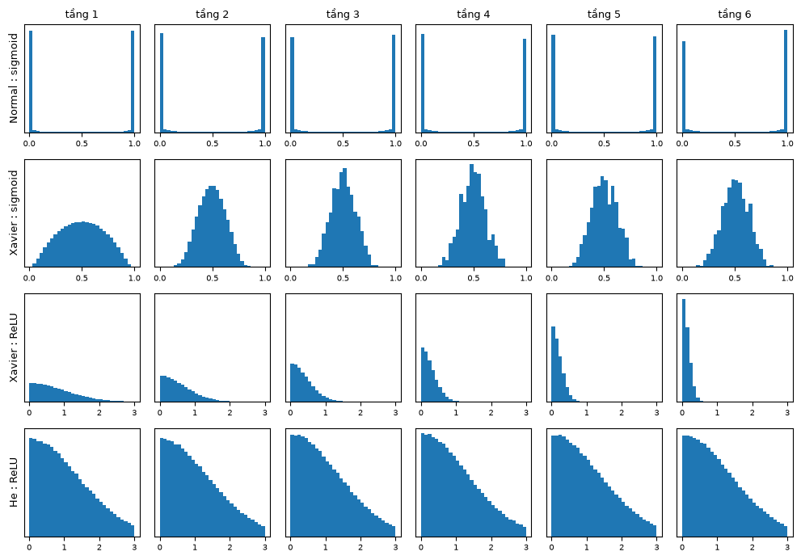
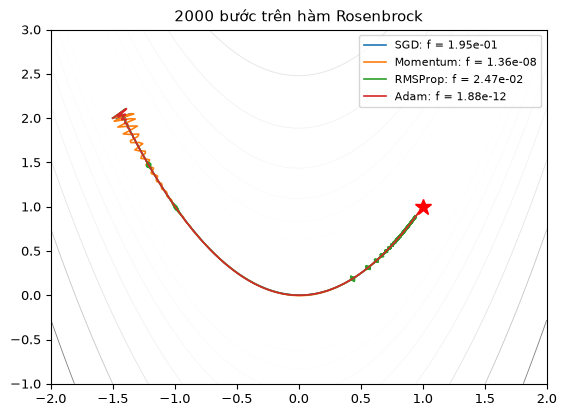

# Nền tảng học sâu · Code

> Ghi chú của người biên soạn: trang này do người biên soạn viết thêm cho phần 2 của khoá: [lớp tích chập](dlnote/dl_conv_vi), [Batch Normalization](dlnote/dl_bn_vi), [hàm kích hoạt](dlnote/dl_act_vi), [hàm mất mát](dlnote/dl_loss_vi), [khởi tạo tham số](dlnote/dl_init_vi), [lan truyền ngược và gradient descent](dlnote/dl_bp_vi), [thuật toán tối ưu](dlnote/dl_optim_vi) và [tổng hợp 40 câu hỏi](dlnote/dl_summary_vi). Mỗi mục kiểm tra bằng số một công thức hay một nhận xét của các bài đó.

## Cách dùng trang này

Các khối chạy lần lượt từ trên xuống và dùng chung biến. Cần `numpy`, `torch`, `matplotlib`. Mọi khối chạy trên CPU, cả trang mất khoảng nửa phút.

<!-- run -->
```python
import warnings
warnings.filterwarnings('ignore')
import numpy as np
import torch
import torch.nn as nn
import torch.nn.functional as F
import matplotlib.pyplot as plt
torch.manual_seed(0)
np.set_printoptions(precision=4, suppress=True)
print("torch", torch.__version__)
```

<!-- output -->
```output
torch 2.14.0+cpu
```
<!-- /output -->

## 1. Tích chập

<small class="viz-ref">Bài tích chập: mục 1.4, 1.5, 2.2, 2.3, 2.5</small>

`F.conv2d` của PyTorch là **tương quan chéo**. Tích chập theo định nghĩa toán học (lật kernel) bằng tương quan chéo với kernel xoay 180°:

<!-- run -->
```python
x = torch.randn(1, 1, 6, 6)
k = torch.randn(1, 1, 3, 3)

def conv_math(x, k):
    """Tích chập đúng định nghĩa (3): h(i,j) = Σ I(m,n) K(i-m, j-n), chỉ lấy các vị trí hợp lệ."""
    X, K = x[0, 0], k[0, 0]
    H, W = X.shape[0] - 2, X.shape[1] - 2
    out = torch.zeros(H, W)
    for i in range(H):
        for j in range(W):
            for m in range(3):
                for n in range(3):
                    out[i, j] += X[i + m, j + n] * K[2 - m, 2 - n]   # kernel bị lật
    return out

xcorr = F.conv2d(x, k)[0, 0]
print("conv2d == tích chập toán học?          ", torch.allclose(xcorr, conv_math(x, k)))
print("conv2d(rot180(k)) == tích chập toán học?", torch.allclose(F.conv2d(x, torch.rot90(k, 2, (2, 3)))[0, 0], conv_math(x, k)))
```

<!-- output -->
```output
conv2d == tích chập toán học?           False
conv2d(rot180(k)) == tích chập toán học? True
```
<!-- /output -->

Công thức kích thước đầu ra $N=\lfloor (W-F+2P)/S\rfloor+1$ (với dilation $D$: thay $F$ bằng $D(F-1)+1$) và công thức của tích chập chuyển vị, kiểm tra trên 2000 cấu hình ngẫu nhiên:

<!-- run -->
```python
rng = np.random.default_rng(0)
bad = 0
for _ in range(2000):
    W_, F_, S, P, D = rng.integers(8, 40), rng.integers(1, 7), rng.integers(1, 4), rng.integers(0, 3), rng.integers(1, 3)
    eff = D * (F_ - 1) + 1
    if eff > W_ + 2 * P:
        continue
    out = nn.Conv2d(1, 1, F_, stride=S, padding=P, dilation=D)(torch.zeros(1, 1, W_, W_)).shape[-1]
    bad += out != (W_ - eff + 2 * P) // S + 1
    outT = nn.ConvTranspose2d(1, 1, F_, stride=S, padding=P)(torch.zeros(1, 1, W_, W_)).shape[-1]
    bad += outT != (W_ - 1) * S - 2 * P + F_
print("số cấu hình sai công thức:", bad)
print("ví dụ bài: vào 2x2, kernel 4, stride 3 ->", nn.ConvTranspose2d(1, 1, 4, stride=3)(torch.zeros(1, 1, 2, 2)).shape[-2:])
print("Conv2d(16, 33, 3, stride=2) trên (20,16,50,100) ->", tuple(nn.Conv2d(16, 33, 3, stride=2)(torch.randn(20, 16, 50, 100)).shape))
print("MaxPool2d(3, 2, padding=1) trên (20,16,50,32) ->", tuple(nn.MaxPool2d(3, 2, padding=1)(torch.randn(20, 16, 50, 32)).shape))
```

<!-- output -->
```output
số cấu hình sai công thức: 0
ví dụ bài: vào 2x2, kernel 4, stride 3 -> torch.Size([7, 7])
Conv2d(16, 33, 3, stride=2) trên (20,16,50,100) -> (20, 33, 24, 49)
MaxPool2d(3, 2, padding=1) trên (20,16,50,32) -> (20, 16, 25, 16)
```
<!-- /output -->

Tích chập nhóm và depthwise: kích thước trọng số, số tham số, và lỗi khi số kênh không chia hết cho số nhóm:

<!-- run -->
```python
for g in [1, 2, 4, 32]:
    conv = nn.Conv2d(32, 64, 3, groups=g, bias=False)
    print(f"groups={g:2d}: weight {tuple(conv.weight.shape)}, {conv.weight.numel():6d} tham số (= 64·32·9/{g})")
conv = nn.Conv2d(10, 5, 3, groups=5)
print("ví dụ bài:", tuple(conv.weight.shape), tuple(conv(torch.randn(20, 10, 224, 224)).shape))
for args in [dict(in_channels=10, out_channels=5, kernel_size=3, groups=6),
             dict(in_channels=10, out_channels=6, kernel_size=3, groups=5),
             dict(in_channels=10, output_channels=5, kernel_size=3, groups=5)]:
    try:
        nn.Conv2d(**args)
    except (ValueError, TypeError) as e:
        print(f"{type(e).__name__}: {str(e)[:70]}")
```

<!-- output -->
```output
groups= 1: weight (64, 32, 3, 3),  18432 tham số (= 64·32·9/1)
groups= 2: weight (64, 16, 3, 3),   9216 tham số (= 64·32·9/2)
groups= 4: weight (64, 8, 3, 3),   4608 tham số (= 64·32·9/4)
groups=32: weight (64, 1, 3, 3),    576 tham số (= 64·32·9/32)
ví dụ bài: (5, 2, 3, 3) (20, 5, 222, 222)
ValueError: in_channels must be divisible by groups
ValueError: out_channels must be divisible by groups
TypeError: Conv2d.__init__() got an unexpected keyword argument 'output_channels'
```
<!-- /output -->

Dòng cuối là tham số `output_channels` trong code gốc của bài, báo `TypeError`. Cuối cùng, cài đặt lớp tích chập bằng vòng lặp (mục 2.5) so với `nn.Conv2d`:

<!-- run -->
```python
def conv_loops(inp, weight, bias):
    """inp đã được đệm; stride 1. Vòng lặp như mục 2.5 (bản dùng np.sum)."""
    n, c_in, h, w = inp.shape
    c_out, _, k, _ = weight.shape
    oh, ow = h - k + 1, w - k + 1
    out = np.zeros((n, c_out, oh, ow))
    for bs in range(n):
        for oc in range(c_out):
            for i in range(oh):
                for j in range(ow):
                    out[bs, oc, i, j] = np.sum(inp[bs, :, i:i + k, j:j + k] * weight[oc]) + bias[oc]
    return out

conv = nn.Conv2d(3, 8, 3, padding=1)
x = torch.randn(2, 3, 16, 16)
xp = np.pad(x.numpy(), ((0, 0), (0, 0), (1, 1), (1, 1)))
mine = conv_loops(xp, conv.weight.detach().numpy(), conv.bias.detach().numpy())
print("sai khác lớn nhất so với nn.Conv2d:", float(np.abs(mine - conv(x).detach().numpy()).max()))
```

<!-- output -->
```output
sai khác lớn nhất so với nn.Conv2d: 4.172325134277344e-07
```
<!-- /output -->

## 2. Batch Normalization

<small class="viz-ref">Bài BN: mục 3.1, 3.3</small>

Cài BN theo công thức của mục 3.1 và cập nhật trung bình trượt như PyTorch, rồi so với `nn.BatchNorm1d` cả ở chế độ huấn luyện và suy luận:

<!-- run -->
```python
class MyBN:
    def __init__(self, n, eps=1e-5, momentum=0.1):
        self.gamma, self.beta = torch.ones(n), torch.zeros(n)
        self.eps, self.momentum = eps, momentum
        self.running_mean, self.running_var = torch.zeros(n), torch.ones(n)
        self.training = True
    def __call__(self, x):
        if self.training:
            mu = x.mean(0)
            var = x.var(0, unbiased=False)                     # công thức: chia cho m
            m = x.shape[0]
            # PyTorch: momentum là trọng số của giá trị MỚI; trung bình trượt của phương sai không chệch (chia m-1)
            self.running_mean = (1 - self.momentum) * self.running_mean + self.momentum * mu
            self.running_var = (1 - self.momentum) * self.running_var + self.momentum * var * m / (m - 1)
        else:
            mu, var = self.running_mean, self.running_var
        return self.gamma * (x - mu) / torch.sqrt(var + self.eps) + self.beta

bn, mine = nn.BatchNorm1d(4), MyBN(4)
for step in range(20):
    xb = torch.randn(32, 4) * torch.tensor([1., 2., 5., 0.5]) + torch.tensor([3., -1., 0., 10.])
    y_ref, y_mine = bn(xb), mine(xb)
print("huấn luyện: khớp", torch.allclose(y_ref, y_mine, atol=1e-5))
print("running_mean:", bn.running_mean.numpy(), "| của mình:", mine.running_mean.numpy())
print("running_var :", bn.running_var.numpy(), "| của mình:", mine.running_var.numpy())
bn.eval(); mine.training = False
xt = torch.randn(5, 4)
print("suy luận : khớp", torch.allclose(bn(xt), mine(xt), atol=1e-5))
```

<!-- output -->
```output
huấn luyện: khớp True
running_mean: [ 2.6499 -0.9453  0.1633  8.7687] | của mình: [ 2.6499 -0.9453  0.1633  8.7687]
running_var : [ 1.0265  3.3571 23.7226  0.3338] | của mình: [ 1.0265  3.3571 23.7226  0.3338]
suy luận : khớp True
```
<!-- /output -->

Lúc suy luận BN chỉ là $z=ax+b$; với $a=\gamma/\sqrt{\sigma^2+\epsilon}$, $b=\beta-a\mu$ ta gộp được nó vào lớp tích chập đứng trước:

<!-- run -->
```python
conv = nn.Conv2d(3, 8, 3, padding=1)
bn2 = nn.BatchNorm2d(8)
with torch.no_grad():
    bn2.weight.uniform_(0.5, 2); bn2.bias.normal_(); bn2.running_mean.normal_(); bn2.running_var.uniform_(0.5, 2)
bn2.eval()
a = bn2.weight / torch.sqrt(bn2.running_var + bn2.eps)
b = bn2.bias - a * bn2.running_mean
fused = nn.Conv2d(3, 8, 3, padding=1)
with torch.no_grad():
    fused.weight.copy_(conv.weight * a[:, None, None, None])
    fused.bias.copy_(a * conv.bias + b)
x = torch.randn(2, 3, 16, 16)
print("conv → BN == conv đã gộp:", torch.allclose(bn2(conv(x)), fused(x), atol=1e-5))
```

<!-- output -->
```output
conv → BN == conv đã gộp: True
```
<!-- /output -->

Cái bẫy hay gặp nhất: quên `model.eval()`. Ở chế độ huấn luyện, BN chuẩn hoá theo chính batch đang đưa vào, nên kết quả của một mẫu phụ thuộc vào các mẫu khác trong batch, và batch 1 mẫu thì đầu ra bằng $\beta$:

<!-- run -->
```python
net = nn.Sequential(nn.Linear(4, 8), nn.BatchNorm1d(8), nn.ReLU(), nn.Linear(8, 1))
for _ in range(50):                                   # "huấn luyện" để BN có thống kê trượt
    net(torch.randn(64, 4))
sample = torch.randn(1, 4)
others1, others2 = torch.randn(7, 4), torch.randn(7, 4) + 3
with torch.no_grad():
    net.train()
    print("train(): cùng một mẫu, batch khác nhau ->", float(net(torch.cat([sample, others1]))[0]), float(net(torch.cat([sample, others2]))[0]))
    net.eval()
    print("eval() : cùng một mẫu, batch khác nhau ->", float(net(torch.cat([sample, others1]))[0]), float(net(torch.cat([sample, others2]))[0]))
    net.train()
    try:
        net(sample)
    except ValueError as e:
        print("train() với batch 1 mẫu:", str(e)[:80])
```

<!-- output -->
```output
train(): cùng một mẫu, batch khác nhau -> -0.1953306347131729 -0.02205999195575714
eval() : cùng một mẫu, batch khác nhau -> -0.15746217966079712 -0.15746217966079712
train() với batch 1 mẫu: Expected more than 1 value per channel when training, got input size torch.Size(
```
<!-- /output -->

## 3. Hàm kích hoạt

<small class="viz-ref">Bài hàm kích hoạt: mục 2–6</small>

So đạo hàm theo công thức trong bài với autograd, trên lưới từ $-6$ tới $6$ (bỏ điểm 0 vì ReLU không khả vi tại đó):

<!-- run -->
```python
x = torch.linspace(-6, 6, 1201, dtype=torch.float64)
x = x[x != 0].requires_grad_()
sig = torch.sigmoid
cases = {
    "sigmoid":  (sig,                              lambda x: sig(x) * (1 - sig(x))),
    "tanh":     (torch.tanh,                       lambda x: 1 - torch.tanh(x) ** 2),
    "relu":     (torch.relu,                       lambda x: (x > 0).double()),
    "leaky":    (lambda x: F.leaky_relu(x, 0.01),  lambda x: torch.where(x > 0, 1.0, 0.01)),
    "elu":      (F.elu,                            lambda x: torch.where(x > 0, 1.0, torch.exp(x))),
    "softplus": (F.softplus,                       lambda x: sig(x)),
    "swish":    (F.silu,                           lambda x: sig(x) + x * sig(x) * (1 - sig(x))),
}
for name, (f, df) in cases.items():
    g, = torch.autograd.grad(f(x).sum(), x)
    print(f"{name:<9} max |autograd - công thức| = {float((g - df(x.detach())).abs().max()):.1e}")
print("tanh(x) == 2·sigmoid(2x) − 1:", torch.allclose(torch.tanh(x), 2 * sig(2 * x) - 1))
xd = x.detach()
print("GELU vs x·σ(1.702x): sai khác lớn nhất", float((F.gelu(xd) - xd * sig(1.702 * xd)).abs().max()))
with np.errstate(over='ignore'):
    print("softplus(1000): np.log(1+np.exp(x)) =", np.log(1 + np.exp(1000.0)), "| np.logaddexp(0, x) =", np.logaddexp(0, 1000.0))
```

<!-- output -->
```output
sigmoid   max |autograd - công thức| = 0.0e+00
tanh      max |autograd - công thức| = 1.1e-16
relu      max |autograd - công thức| = 0.0e+00
leaky     max |autograd - công thức| = 2.2e-10
elu       max |autograd - công thức| = 1.1e-16
softplus  max |autograd - công thức| = 2.2e-16
swish     max |autograd - công thức| = 2.2e-16
tanh(x) == 2·sigmoid(2x) − 1: True
GELU vs x·σ(1.702x): sai khác lớn nhất 0.020334869266314483
softplus(1000): np.log(1+np.exp(x)) = inf | np.logaddexp(0, x) = 1000.0
```
<!-- /output -->

## 4. Hàm mất mát

<small class="viz-ref">Bài hàm mất mát: mục 2.1, 2.3, 2.4, 2.5</small>

Các con số của bài: entropy của $(0{,}7;0{,}2;0{,}1)$, mất mát của hai mô hình ở mục 2.3, và softmax của $[3, 1, -3]$:

<!-- run -->
```python
p = np.array([0.7, 0.2, 0.1])
print("H(p) =", -(p * np.log(p)).sum())
y = np.eye(3)[[2, 1, 0]]                                  # lợn, chó, mèo
m1 = np.array([[.3, .3, .4], [.3, .4, .3], [.1, .2, .7]])
m2 = np.array([[.1, .2, .7], [.1, .7, .2], [.3, .4, .3]])
for name, q in [("mô hình 1", m1), ("mô hình 2", m2)]:
    per = -(y * np.log(q)).sum(1)
    print(f"{name}: từng mẫu {per}, trung bình {per.mean():.4f}, độ chính xác {np.mean(q.argmax(1) == y.argmax(1)):.2f}")
z = torch.tensor([3., 1., -3.])
print("softmax([3,1,-3]) =", torch.softmax(z, 0).numpy())
```

<!-- output -->
```output
H(p) = 0.8018185525433372
mô hình 1: từng mẫu [0.9163 0.9163 2.3026], trung bình 1.3784, độ chính xác 0.67
mô hình 2: từng mẫu [0.3567 0.3567 1.204 ], trung bình 0.6391, độ chính xác 0.67
softmax([3,1,-3]) = [0.8789 0.1189 0.0022]
```
<!-- /output -->

`nn.CrossEntropyLoss` bằng `LogSoftmax` + `NLLLoss`, nhận cả nhãn là chỉ số lẫn nhãn mềm; gradient theo logit bằng $a-y$:

<!-- run -->
```python
logits = torch.randn(5, 4, requires_grad=True)
target = torch.tensor([0, 3, 1, 1, 2])
ce = F.cross_entropy(logits, target)
nll = F.nll_loss(F.log_softmax(logits, 1), target)
soft = F.cross_entropy(logits, F.one_hot(target, 4).float())
print(f"CE {ce.item():.5f} | LogSoftmax+NLL {nll.item():.5f} | nhãn one-hot dạng xác suất {soft.item():.5f}")
ce.backward()
print("grad == (softmax - onehot)/N:", torch.allclose(logits.grad, (torch.softmax(logits, 1) - F.one_hot(target, 4)).detach() / 5, atol=1e-6))
```

<!-- output -->
```output
CE 1.99207 | LogSoftmax+NLL 1.99207 | nhãn one-hot dạng xác suất 1.99207
grad == (softmax - onehot)/N: True
```
<!-- /output -->

Vì sao nên dùng `BCEWithLogitsLoss` thay cho `sigmoid` + `BCELoss`: khi logit lớn, $\sigma(z)$ làm tròn thành đúng 1.0 trong float32 và $\log(1-\sigma)$ thành $-\infty$; PyTorch kẹp log ở $-100$ nên mất mát bị chặn và gradient bằng 0:

<!-- run -->
```python
for zv in [5., 20., 40.]:
    z = torch.tensor([zv], requires_grad=True)
    y0 = torch.tensor([0.])                                 # nhãn 0 nhưng mô hình rất tự tin là 1
    l1 = F.binary_cross_entropy(torch.sigmoid(z), y0); g1, = torch.autograd.grad(l1, z)
    l2 = F.binary_cross_entropy_with_logits(z, y0);    g2, = torch.autograd.grad(l2, z)
    print(f"z={zv:4.0f}: sigmoid+BCELoss = {l1.item():8.3f} (grad {g1.item():.3f}) | BCEWithLogits = {l2.item():8.3f} (grad {g2.item():.3f})")
```

<!-- output -->
```output
z=   5: sigmoid+BCELoss =    5.007 (grad 0.993) | BCEWithLogits =    5.007 (grad 0.993)
z=  20: sigmoid+BCELoss =  100.000 (grad 0.000) | BCEWithLogits =   20.000 (grad 1.000)
z=  40: sigmoid+BCELoss =  100.000 (grad 0.000) | BCEWithLogits =   40.000 (grad 1.000)
```
<!-- /output -->

Mục 2.5: với đầu ra sigmoid, gradient theo logit của MSE là $(a-y)\sigma'(z)$, của cross-entropy là $a-y$. Khi mô hình sai rất nặng (nhãn 1, logit âm lớn):

<!-- run -->
```python
for zv in [-1., -4., -8.]:
    z = torch.tensor(zv, requires_grad=True)
    a = torch.sigmoid(z)
    g_mse, = torch.autograd.grad(0.5 * (a - 1) ** 2, z)
    g_ce, = torch.autograd.grad(F.binary_cross_entropy_with_logits(z, torch.tensor(1.)), z)
    print(f"z={zv:3.0f}, a={a.item():.4f}: |grad| MSE = {abs(g_mse.item()):.5f}   cross-entropy = {abs(g_ce.item()):.5f}")
```

<!-- output -->
```output
z= -1, a=0.2689: |grad| MSE = 0.14373   cross-entropy = 0.73106
z= -4, a=0.0180: |grad| MSE = 0.01735   cross-entropy = 0.98201
z= -8, a=0.0003: |grad| MSE = 0.00034   cross-entropy = 0.99966
```
<!-- /output -->

Mô hình càng sai, gradient MSE càng **nhỏ**; gradient cross-entropy thì gần 1.

## 5. Khởi tạo tham số

<small class="viz-ref">Bài khởi tạo: mục 2.1–2.5, 3</small>

Tái hiện bốn hình histogram của bài: mạng 6 tầng kết nối đầy đủ, mỗi tầng 784 neuron, đầu vào chuẩn tắc, vẽ histogram kích hoạt từng tầng:

<!-- run -->
```python
def activations(init, act, n=784, layers=6, batch=1000):
    torch.manual_seed(0)
    h = torch.randn(batch, n)
    out = []
    for _ in range(layers):
        W = torch.empty(n, n)
        {"normal": lambda w: nn.init.normal_(w, 0, 1),
         "xavier": lambda w: nn.init.xavier_normal_(w),
         "he": lambda w: nn.init.kaiming_normal_(w, nonlinearity='relu')}[init](W)
        h = act(h @ W.T)
        out.append(h.flatten().numpy())
    return out

configs = [("normal", torch.sigmoid, "Normal : sigmoid"), ("xavier", torch.sigmoid, "Xavier : sigmoid"),
           ("xavier", torch.relu, "Xavier : ReLU"), ("he", torch.relu, "He : ReLU")]
fig, axes = plt.subplots(4, 6, figsize=(10, 7), sharey='row')
for r, (init, act, title) in enumerate(configs):
    acts = activations(init, act)
    for l, a in enumerate(acts):
        ax = axes[r, l]
        ax.hist(a[a > 0] if act is torch.relu else a, bins=30, range=(0, 1) if act is torch.sigmoid else (0, 3))
        ax.set_yticks([]); ax.tick_params(labelsize=7)
        if r == 0: ax.set_title(f"tầng {l + 1}", fontsize=9)
    axes[r, 0].set_ylabel(title, fontsize=9)
    stds = [f"{a.std():.3f}" for a in acts]
    print(f"{title:<17} độ lệch chuẩn kích hoạt theo tầng: {stds}")
plt.tight_layout(); plt.show()
```

<!-- output -->
```output
Normal : sigmoid  độ lệch chuẩn kích hoạt theo tầng: ['0.486', '0.479', '0.478', '0.478', '0.479', '0.478']
Xavier : sigmoid  độ lệch chuẩn kích hoạt theo tầng: ['0.208', '0.128', '0.117', '0.116', '0.121', '0.124']
Xavier : ReLU     độ lệch chuẩn kích hoạt theo tầng: ['0.583', '0.408', '0.286', '0.198', '0.143', '0.103']
He : ReLU         độ lệch chuẩn kích hoạt theo tầng: ['0.825', '0.815', '0.808', '0.793', '0.809', '0.824']
```

<div align=center></div>
<!-- /output -->

Với ReLU chỉ vẽ phần dương (khoảng nửa số giá trị bằng đúng 0). Normal + sigmoid dồn về 0 và 1; Xavier + ReLU co dần về 0 qua các tầng (độ lệch chuẩn giảm khoảng $\sqrt2$ mỗi tầng); He + ReLU giữ độ lệch chuẩn gần như không đổi.

Khởi tạo mặc định của `nn.Linear` và hiện tượng đối xứng khi khởi tạo toàn 0:

<!-- run -->
```python
lin = nn.Linear(1000, 1000)
bound = 1 / np.sqrt(1000)
print(f"nn.Linear(1000, 1000): min {lin.weight.min():.4f}, max {lin.weight.max():.4f}, ±1/√1000 = ±{bound:.4f}")
print(f"phương sai {lin.weight.var():.2e}; lý thuyết 1/(3·n_in) = {1 / 3000:.2e}; He = 2/n_in = {2 / 1000:.2e}")

torch.manual_seed(0)
X = torch.randn(200, 1); Y = torch.sin(3 * X)
net = nn.Sequential(nn.Linear(1, 3), nn.Sigmoid(), nn.Linear(3, 1))
for p_ in net.parameters():
    nn.init.zeros_(p_)
opt = torch.optim.SGD(net.parameters(), lr=0.5)
for _ in range(500):
    opt.zero_grad(); loss = F.mse_loss(net(X), Y); loss.backward(); opt.step()
print("sau 500 bước từ khởi tạo 0, W1 =", net[0].weight.detach().flatten().numpy(), "W2 =", net[2].weight.detach().flatten().numpy())
```

<!-- output -->
```output
nn.Linear(1000, 1000): min -0.0316, max 0.0316, ±1/√1000 = ±0.0316
phương sai 3.33e-04; lý thuyết 1/(3·n_in) = 3.33e-04; He = 2/n_in = 2.00e-03
sau 500 bước từ khởi tạo 0, W1 = [0.3347 0.3347 0.3347] W2 = [0.2305 0.2305 0.2305]
```
<!-- /output -->

Ba neuron ẩn có trọng số giống hệt nhau, đúng như ví dụ trong bài.

## 6. Lan truyền ngược

<small class="viz-ref">Bài lan truyền ngược: mục 1.3</small>

Tự viết chiều ngược cho mạng hình 1 (2 đầu vào, 3 neuron ẩn sigmoid, 3 lớp softmax, cross-entropy) theo các công thức trong bài, so với autograd:

<!-- run -->
```python
torch.manual_seed(1)
X = torch.randn(8, 2); Y = F.one_hot(torch.randint(0, 3, (8,)), 3).float()
W1 = torch.randn(2, 3, requires_grad=True); B1 = torch.zeros(3, requires_grad=True)
W2 = torch.randn(3, 3, requires_grad=True); B2 = torch.zeros(3, requires_grad=True)

Z1 = X @ W1 + B1; A1 = torch.sigmoid(Z1); Z2 = A1 @ W2 + B2; A2 = torch.softmax(Z2, 1)
loss = -(Y * torch.log(A2)).sum(1).mean()
loss.backward()

with torch.no_grad():
    n = X.shape[0]
    dZ2 = (A2 - Y) / n                    # ∂L/∂Z2
    dW2 = A1.T @ dZ2; dB2 = dZ2.sum(0)
    dA1 = dZ2 @ W2.T
    dZ1 = dA1 * A1 * (1 - A1)             # đạo hàm sigmoid
    dW1 = X.T @ dZ1; dB1 = dZ1.sum(0)
for name, mine, ref in [("W1", dW1, W1.grad), ("B1", dB1, B1.grad), ("W2", dW2, W2.grad), ("B2", dB2, B2.grad)]:
    print(f"∂L/∂{name}: khớp autograd {torch.allclose(mine, ref, atol=1e-6)}")
```

<!-- output -->
```output
∂L/∂W1: khớp autograd True
∂L/∂B1: khớp autograd True
∂L/∂W2: khớp autograd True
∂L/∂B2: khớp autograd True
```
<!-- /output -->

Bộ nhớ của các kết quả trung gian mà autograd lưu lại để lan truyền ngược, đo bằng hook trên các tensor được lưu, tăng tuyến tính theo batch size; khi chỉ suy luận (`torch.no_grad()`) thì không lưu gì:

<!-- run -->
```python
cnn = nn.Sequential(nn.Conv2d(3, 32, 3, padding=1), nn.ReLU(), nn.Conv2d(32, 64, 3, padding=1), nn.ReLU(),
                    nn.MaxPool2d(2), nn.Flatten(), nn.Linear(64 * 16 * 16, 10))
def saved_bytes(bs, grad=True):
    total = [0]
    def pack(t):
        total[0] += t.numel() * t.element_size(); return t
    x = torch.randn(bs, 3, 32, 32)
    with torch.autograd.graph.saved_tensors_hooks(pack, lambda t: t):
        if grad:
            cnn(x)
        else:
            with torch.no_grad():
                cnn(x)
    return total[0] / 2**20
for bs in [8, 32, 128]:
    print(f"batch {bs:3d}: huấn luyện lưu {saved_bytes(bs):7.1f} MB | suy luận lưu {saved_bytes(bs, grad=False):.1f} MB")
```

<!-- output -->
```output
batch   8: huấn luyện lưu     8.3 MB | suy luận lưu 0.0 MB
batch  32: huấn luyện lưu    31.1 MB | suy luận lưu 0.0 MB
batch 128: huấn luyện lưu   122.2 MB | suy luận lưu 0.0 MB
```
<!-- /output -->

## 7. Thuật toán tối ưu

<small class="viz-ref">Bài thuật toán tối ưu: mục 1–2</small>

Cài từng thuật toán đúng theo công thức trong bài (theo quy ước của PyTorch, ghi chú ở mỗi dòng), cho chạy 50 bước song song với `torch.optim` trên cùng một hàm mất mát:

<!-- run -->
```python
def loss_fn(w):
    return ((w - torch.tensor([3.0, -2.0])) ** 2 * torch.tensor([1.0, 20.0])).sum() + torch.sin(w).sum()

def run_mine(name, steps=50, lr=0.01):
    w = torch.tensor([0.5, 0.5]); st = {}
    for t in range(1, steps + 1):
        wg = w.clone().requires_grad_(); g, = torch.autograd.grad(loss_fn(wg), wg)
        if name == "SGD":
            w = w - lr * g
        elif name == "Momentum":                     # v ← μv + g ; w ← w − lr·v (cách viết của PyTorch)
            st["v"] = 0.9 * st.get("v", 0) + g; w = w - lr * st["v"]
        elif name == "Nesterov":                     # dạng PyTorch: g_nes = g + μv
            st["v"] = 0.9 * st.get("v", 0) + g; w = w - lr * (g + 0.9 * st["v"])
        elif name == "AdaGrad":
            st["r"] = st.get("r", 0) + g * g; w = w - lr * g / (torch.sqrt(st["r"]) + 1e-10)
        elif name == "RMSProp":
            st["r"] = 0.99 * st.get("r", 0) + 0.01 * g * g; w = w - lr * g / (torch.sqrt(st["r"]) + 1e-8)
        elif name == "Adam":
            st["m"] = 0.9 * st.get("m", 0) + 0.1 * g; st["v"] = 0.999 * st.get("v", 0) + 0.001 * g * g
            mh = st["m"] / (1 - 0.9 ** t); vh = st["v"] / (1 - 0.999 ** t)
            w = w - lr * mh / (torch.sqrt(vh) + 1e-8)
    return w

def run_torch(name, steps=50, lr=0.01):
    w = torch.tensor([0.5, 0.5], requires_grad=True)
    opt = {"SGD": lambda: torch.optim.SGD([w], lr), "Momentum": lambda: torch.optim.SGD([w], lr, momentum=0.9),
           "Nesterov": lambda: torch.optim.SGD([w], lr, momentum=0.9, nesterov=True),
           "AdaGrad": lambda: torch.optim.Adagrad([w], lr), "RMSProp": lambda: torch.optim.RMSprop([w], lr),
           "Adam": lambda: torch.optim.Adam([w], lr)}[name]()
    for _ in range(steps):
        opt.zero_grad(); loss_fn(w).backward(); opt.step()
    return w.detach()

for name in ["SGD", "Momentum", "Nesterov", "AdaGrad", "RMSProp", "Adam"]:
    a, b = run_mine(name), run_torch(name)
    print(f"{name:<9} tự cài {a.numpy()} | torch.optim {b.numpy()} | khớp {torch.allclose(a, b, atol=1e-5)}")
```

<!-- output -->
```output
SGD       tự cài [ 2.0607 -1.9898] | torch.optim [ 2.0607 -1.9898] | khớp True
Momentum  tự cài [ 3.2819 -2.0878] | torch.optim [ 3.2819 -2.0878] | khớp True
Nesterov  tự cài [ 3.3601 -1.9898] | torch.optim [ 3.3601 -1.9898] | khớp True
AdaGrad   tự cài [0.6264 0.3737] | torch.optim [0.6264 0.3737] | khớp True
RMSProp   tự cài [ 1.7309 -0.6833] | torch.optim [ 1.7309 -0.6833] | khớp True
Adam      tự cài [0.9894 0.0128] | torch.optim [0.9894 0.0128] | khớp True
```
<!-- /output -->

Chạy các bộ tối ưu trên hàm Rosenbrock $f(x,y)=(1-x)^2+100(y-x^2)^2$, một thung lũng hẹp cong có cực tiểu tại $(1, 1)$, mỗi bộ với tốc độ học chọn tay cho ổn định:

<!-- run -->
```python
def rosen(w):
    return (1 - w[0]) ** 2 + 100 * (w[1] - w[0] ** 2) ** 2

settings = [("SGD", lambda p: torch.optim.SGD(p, 1e-3)), ("Momentum", lambda p: torch.optim.SGD(p, 1e-3, momentum=0.9)),
            ("RMSProp", lambda p: torch.optim.RMSprop(p, 1e-2)), ("Adam", lambda p: torch.optim.Adam(p, 5e-2))]
xs, ys = np.meshgrid(np.linspace(-2, 2, 200), np.linspace(-1, 3, 200))
fig, ax = plt.subplots(figsize=(6.4, 4.6))
ax.contour(xs, ys, (1 - xs) ** 2 + 100 * (ys - xs ** 2) ** 2, levels=np.logspace(-1, 3.5, 20), cmap='Greys', linewidths=0.6)
for name, make in settings:
    w = torch.tensor([-1.5, 2.0], requires_grad=True); opt = make([w]); path = [w.detach().numpy().copy()]
    for _ in range(2000):
        opt.zero_grad(); rosen(w).backward(); opt.step(); path.append(w.detach().numpy().copy())
    path = np.array(path)
    ax.plot(path[:, 0], path[:, 1], lw=1.2, label=f"{name}: f = {rosen(torch.tensor(path[-1])).item():.2e}")
ax.plot(1, 1, 'r*', ms=12); ax.legend(fontsize=8); ax.set_title("2000 bước trên hàm Rosenbrock")
plt.show()
```

<!-- output -->
<div align=center></div>
<!-- /output -->

Sau 2000 bước, SGD thuần mới đi được một đoạn dọc đáy thung lũng ($f\approx0{,}2$); momentum và Adam tới được cực tiểu ($f<10^{-7}$); RMSProp với tốc độ học cố định đến gần nhưng dao động quanh cực tiểu (các chấm xanh), đúng như nhận xét về tốc độ học cố định ở bài.

`state_dict()` của bộ tối ưu chứa trạng thái nội bộ của nó, không phải tham số mô hình:

<!-- run -->
```python
m = nn.Linear(2, 1); opt = torch.optim.Adam(m.parameters(), lr=1e-3)
m(torch.ones(4, 2)).sum().backward(); opt.step()
sd = opt.state_dict()
print("các khoá:", list(sd.keys()))
print("trạng thái của tham số 0:", {k: (tuple(v.shape) if torch.is_tensor(v) and v.dim() else v) for k, v in sd["state"][0].items()})
print("param_groups[0]:", {k: v for k, v in sd["param_groups"][0].items() if k in ("lr", "betas", "eps", "weight_decay", "params")})
```

<!-- output -->
```output
các khoá: ['state', 'param_groups']
trạng thái của tham số 0: {'step': tensor(1.), 'exp_avg': (1, 2), 'exp_avg_sq': (1, 2)}
param_groups[0]: {'lr': 0.001, 'betas': (0.9, 0.999), 'eps': 1e-08, 'weight_decay': 0, 'params': [0, 1]}
```
<!-- /output -->

## 8. Tổng hợp 40 câu: lan truyền ngược qua tích chập

<small class="viz-ref">Bài 40 câu: câu 35</small>

Kiểm tra công thức ở câu 35: với $Y=W\star X$ (bước trượt 1), $\partial L/\partial W = X\star\partial L/\partial Y$ và $\partial L/\partial X$ là tích chập "đầy đủ" của $\partial L/\partial Y$ với kernel xoay 180°:

<!-- run -->
```python
X = torch.randn(1, 1, 7, 7, requires_grad=True)
W = torch.randn(1, 1, 3, 3, requires_grad=True)
Y = F.conv2d(X, W)
G = torch.randn_like(Y)                               # ∂L/∂Y bất kỳ
(Y * G).sum().backward()
dW = F.conv2d(X.detach(), G)                          # tương quan chéo giữa X và ∂L/∂Y
dX = F.conv2d(F.pad(G, (2, 2, 2, 2)), torch.rot90(W.detach(), 2, (2, 3)))
print("∂L/∂W khớp:", torch.allclose(dW, W.grad, atol=1e-5), "| ∂L/∂X khớp:", torch.allclose(dX, X.grad, atol=1e-5))
```

<!-- output -->
```output
∂L/∂W khớp: True | ∂L/∂X khớp: True
```
<!-- /output -->

Đoạn code tính vùng tiếp nhận ở câu 8 (bản đã sửa) chạy ra đúng bảng kết quả trong bài; kiểm tra thêm bằng cách đo trực tiếp: lấy gradient của một điểm giữa bản đồ đặc trưng `conv5_3` của VGG16 (trọng số dương, không ReLU, không gộp max để gradient không bị chặn) theo ảnh vào, đếm số điểm ảnh khác 0:

<!-- run -->
```python
layers = []
for v in [64, 64, 'M', 128, 128, 'M', 256, 256, 256, 'M', 512, 512, 512, 'M', 512, 512, 512]:
    layers.append(nn.AvgPool2d(2) if v == 'M' else nn.Conv2d(1, 1, 3, padding=1, bias=False))
vgg_like = nn.Sequential(*layers)
for m_ in vgg_like:
    if isinstance(m_, nn.Conv2d):
        nn.init.constant_(m_.weight, 1.0)
x = torch.zeros(1, 1, 224, 224, requires_grad=True)
out = vgg_like(x)
out[0, 0, 7, 7].backward()
rows = (x.grad[0, 0].abs().sum(1) > 0).nonzero()
print("đầu ra conv5_3:", tuple(out.shape[-2:]), "| vùng tiếp nhận đo được:", int(rows.max() - rows.min() + 1), "điểm ảnh (bảng ở câu 8: 196)")
```

<!-- output -->
```output
đầu ra conv5_3: (14, 14) | vùng tiếp nhận đo được: 196 điểm ảnh (bảng ở câu 8: 196)
```
<!-- /output -->
