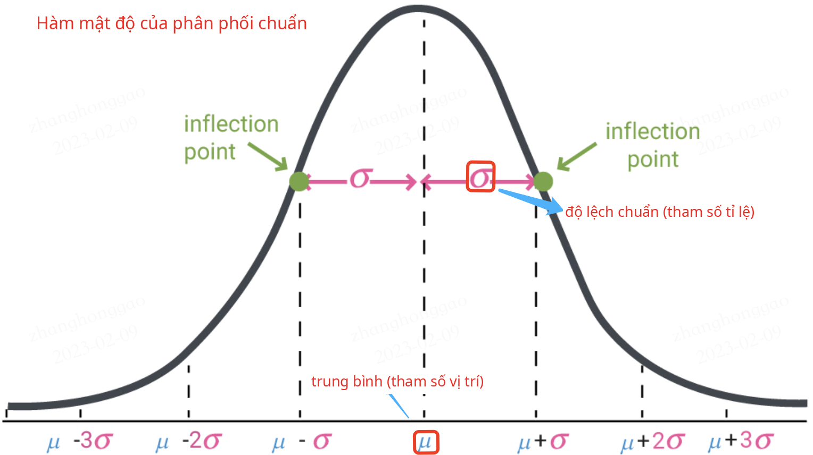
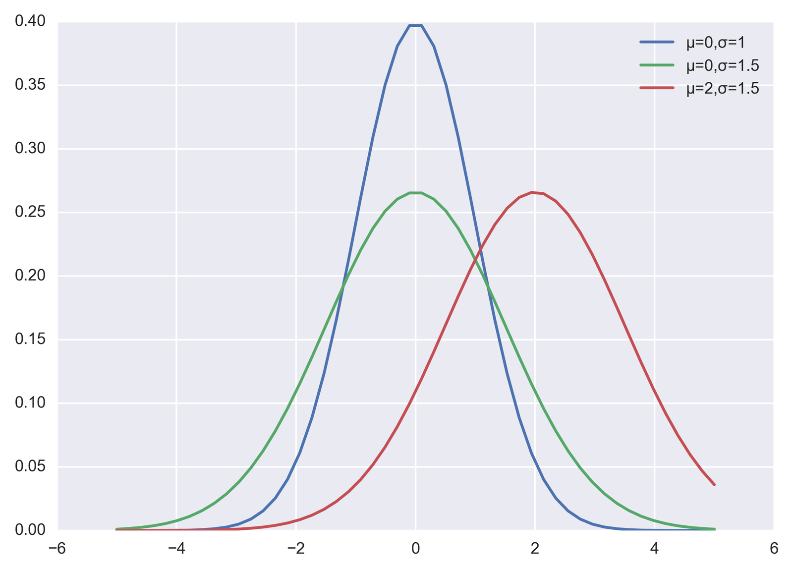
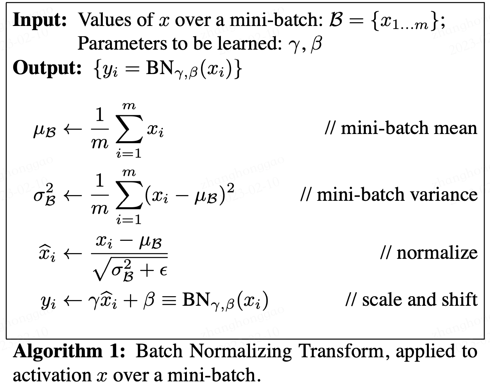
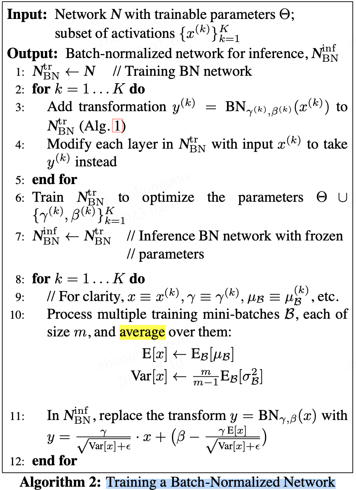
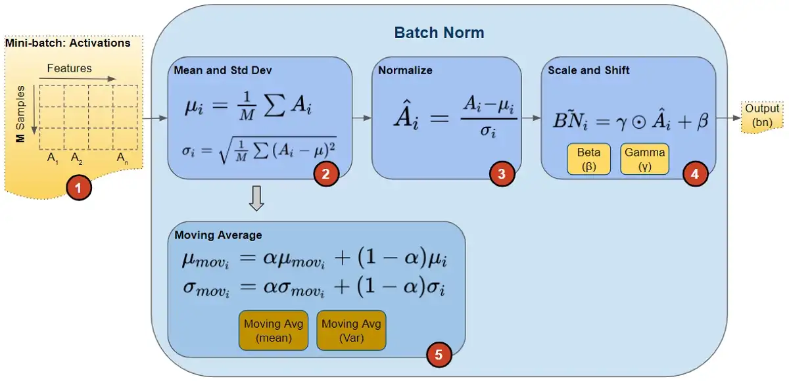
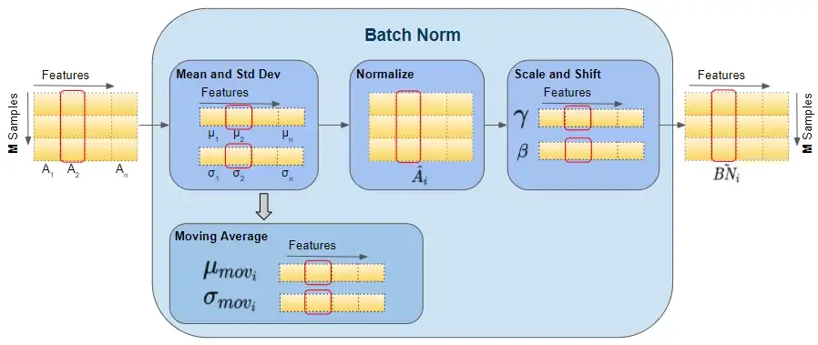
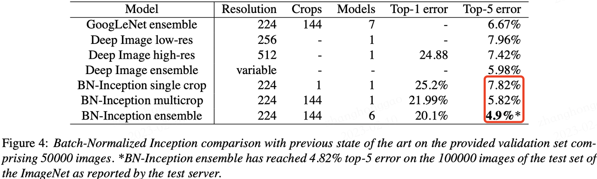
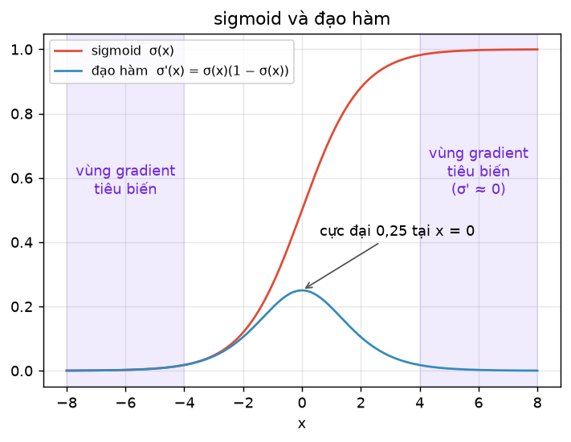

# Thành phần CNN: lớp Batch Normalization

> Ghi chú của người biên soạn: trang này dịch từ ghi chú *dl_note* của **Harley Zhang** ([bản gốc](https://github.com/harleyszhang/dl_note/blob/main/2-deep_learning_basic/cnn基础部件-BN层详解.md), [kho mã](https://github.com/harleyszhang/dl_note), giấy phép [Apache-2.0](https://www.apache.org/licenses/LICENSE-2.0); phần dịch có chỉnh sửa). Số mục giữ như bản gốc. Chỗ bản gốc sai, thiếu hoặc đã lỗi thời được sửa ngay trong bài và ghi ở ô **Biên tập**. Các mục có chữ **Bổ sung** do người biên soạn viết thêm.

Trang [Code](dlnote/dl_basic_code_vi) đi kèm cài đặt BN từ đầu và so với `nn.BatchNorm1d/2d` (cả lúc huấn luyện lẫn lúc suy luận), kiểm tra công thức "BN lúc suy luận là phép biến đổi tuyến tính", và cho thấy cái bẫy hay gặp nhất: quên chuyển sang `model.eval()`.

<div class="qa-theory">

**Lý thuyết:** [Ôn tập · 3.6.8 Batch Normalization là gì?](qa/ch03_vi?id=_368-batch-normalization-là-gì) · [Ôn tập · 3.6.11 So sánh batch normalization và group normalization](qa/ch03_vi?id=_3611-so-sánh-batch-normalization-và-group-normalization)

</div>

## 1 Nền tảng toán học

### 1.1 Hàm mật độ xác suất

Biến ngẫu nhiên (random variable) là biến có thể nhận các giá trị khác nhau một cách ngẫu nhiên, rời rạc hoặc liên tục. Để đơn giản, bài này dùng chữ hoa $X$ cho biến ngẫu nhiên và chữ thường $x$ cho giá trị nó nhận; ví dụ $x_1$ và $x_2$ đều là giá trị có thể của $X$. Biến ngẫu nhiên phải đi kèm một phân phối xác suất chỉ rõ khả năng của từng trạng thái.

Phân phối xác suất (probability distribution) mô tả khả năng một biến ngẫu nhiên hay một nhóm biến ngẫu nhiên nhận từng trạng thái có thể. Cách mô tả phụ thuộc vào biến rời rạc hay liên tục.

Với biến ngẫu nhiên liên tục, ta dùng **hàm mật độ xác suất** (probability density function, `PDF`) thay cho hàm khối xác suất để mô tả phân phối.

> Xem thêm chương 3 sách *Deep Learning* hoặc bài [Xác suất và lý thuyết thông tin](dlnote/math_prob_vi) của khoá này.

### 1.2 Phân phối chuẩn

> Một lý do để dùng phân phối chuẩn khi không biết phân phối thật của dữ liệu là: trong các phân phối có cùng phương sai, phân phối chuẩn có entropy lớn nhất, nên giả định này áp đặt ít cấu trúc nhất.

Phân phối hay dùng nhất trên số thực là phân phối chuẩn (normal distribution), còn gọi là phân phối Gauss (Gaussian distribution).

Nếu biến ngẫu nhiên $X$ có tham số vị trí $\mu$, tham số tỉ lệ $\sigma$ và hàm mật độ

$$
f(x)=\frac{1}{\sigma\sqrt{2 \pi} } e^{- \frac{(x-\mu)^2}{2\sigma^2}} \tag{1}
$$

thì $X$ gọi là biến ngẫu nhiên chuẩn, phân phối của nó là **phân phối chuẩn**, ký hiệu:

$$
X \sim \mathcal N(\mu,\sigma^2) \tag{2}
$$

Khi $\mu = 0$ và $\sigma = 1$ ta có phân phối chuẩn tắc:

$$
X \sim \mathcal N(0, 1) \tag{3}
$$

và hàm mật độ đơn giản thành:

$$
f(x)=\frac{1}{\sqrt{2 \pi}} e^{- \frac{x^2}{2}} \tag{4}
$$

Kỳ vọng $\mu$ của phân phối chuẩn bằng tham số vị trí, quyết định vị trí của phân phối; căn bậc hai của phương sai $\sigma^2$, tức độ lệch chuẩn $\sigma$, bằng tham số tỉ lệ, quyết định độ rộng. Đồ thị hàm mật độ có hình chuông, thường gọi là **đường cong hình chuông**:



Hình 1: Hai điểm uốn của đường cong nằm tại $\mu\pm\sigma$.

Có thể vẽ phân phối chuẩn bằng cách sinh số ngẫu nhiên với `np.random.normal` rồi vẽ đường ước lượng mật độ bằng hàm `kdeplot` của `seaborn`:

```python
import numpy as np
import matplotlib.pyplot as plt
import seaborn as sns
x1 = np.random.normal(0, 1, 10_000)
x2 = np.random.normal(0, 1.5, 10_000)
x3 = np.random.normal(2, 1.5, 10_000)

plt.figure(dpi=200)
sns.kdeplot(x1, label="μ=0, σ=1")
sns.kdeplot(x2, label="μ=0, σ=1.5")
sns.kdeplot(x3, label="μ=2, σ=1.5")
plt.legend()
plt.title("Normal distribution")
plt.show()
```

> **Biên tập:** Code gốc sinh `x3` với $\sigma=1{,}5$ nhưng ghi nhãn $\sigma=2{,}5$, và chỉ lấy 100 mẫu nên đường KDE lồi lõm, lệch xa đường lý thuyết (đỉnh của $\mathcal N(0,1)$ trong hình gốc là 0,33 thay vì 0,40). Đã sửa nhãn, tăng lên 10 000 mẫu, và bỏ hình kết quả cũ.

Cũng có thể tự cài đặt hàm mật độ:

```python
import numpy as np
import matplotlib.pyplot as plt

def nd_func(x, sigma, mu):
    """Hàm mật độ của phân phối chuẩn, theo công thức (1)."""
    a = -(x - mu) ** 2 / (2 * sigma * sigma)
    return np.exp(a) / (sigma * np.sqrt(2 * np.pi))

if __name__ == '__main__':
    plt.figure(dpi=200)
    plt.style.use('seaborn-v0_8-darkgrid')
    x = np.linspace(-5, 5, 200)
    for sigma, mu in [(1, 0), (1.5, 0), (1.5, 2)]:
        plt.plot(x, nd_func(x, sigma, mu), label=f"μ={mu}, σ={sigma}")
    plt.legend()
    plt.show()
```



> **Biên tập:** Code gốc định nghĩa hàm `nd_func` nhưng gọi `nd_fun` (báo `NameError`), thụt lề lẫn tab và dấu cách, và dùng style `'seaborn-darkgrid'` đã đổi tên thành `'seaborn-v0_8-darkgrid'` từ matplotlib 3.6. `np.linspace(-5, 5)` mặc định chỉ có 50 điểm nên đường cong hơi gãy (thấy rõ ở đường đỏ trong hình); dùng 200 điểm thì mượt.

## 2 Bối cảnh

Huấn luyện mạng neuron sâu khó vì phân phối đầu vào của mỗi lớp thay đổi trong quá trình huấn luyện, do tham số của các lớp trước thay đổi. Điều này buộc phải dùng tốc độ học thấp và khởi tạo tham số cẩn thận, làm chậm huấn luyện, và khiến các mô hình dùng hàm phi tuyến bão hoà rất khó huấn luyện.

Hiện tượng phân phối đầu vào của các lớp thay đổi này được gọi là **dịch chuyển hiệp biến nội bộ** (internal covariate shift, ICS), và BN được đề xuất để giải quyết nó.

### 2.1 Hiểu internal covariate shift

Trong quá trình huấn luyện mạng sâu, phân phối dữ liệu ở các lớp giữa thay đổi theo sự thay đổi của tham số; bài báo gọi quá trình này là **internal covariate shift**.

Vì sao phân phối ở các lớp giữa thay đổi?

Mỗi lớp của mạng có thể xem là một phép biến đổi tín hiệu đầu vào:

$$
Z = W X + B \tag{5}
$$

với $W$ và $B$ là tham số học được; công thức này bao cả lớp kết nối đầy đủ lẫn lớp tích chập.

Khi SGD cập nhật tham số, **phân phối của $Z$ liên tục thay đổi**, nên mỗi lớp phải liên tục thích nghi với phân phối mới; đó là internal covariate shift.

Cái khó của mạng sâu là đầu vào mỗi lớp chịu ảnh hưởng của tham số của mọi lớp phía trước, nên khi mạng sâu hơn, thay đổi nhỏ của tham số bị khuếch đại.

> **Biên tập:** Bản gốc bỏ qua hàm kích hoạt "vì hàm kích hoạt không đổi phân phối của đầu vào". Câu này sai: hàm kích hoạt phi tuyến đổi phân phối rất mạnh (ReLU biến mọi giá trị âm thành 0, sigmoid ép mọi giá trị vào $(0,1)$). Có thể tạm bỏ qua hàm kích hoạt chỉ để đơn giản hoá lập luận.

### 2.2 Vấn đề do internal covariate shift gây ra

1. Các lớp phải liên tục thích nghi với phân phối mới, **làm chậm việc học**.
2. Đầu vào dễ rơi vào vùng bão hoà của hàm phi tuyến, **làm chậm hội tụ**, và ảnh hưởng này tăng theo độ sâu.

   Khi mạng sâu hơn, đầu vào $x$ của các lớp sau có thể ngày càng lớn; nếu dùng hàm kích hoạt kiểu `Sigmoid`, đầu vào dễ rơi vào vùng bão hoà, gradient rất nhỏ thậm chí gần $0$, tham số cập nhật chậm và mạng hội tụ chậm.

Bão hoà và tiêu biến gradient đi kèm thường được xử lý bằng hàm kích hoạt ReLU ($\operatorname{ReLU}(x)=\max(x,0)$), cách khởi tạo tham số tốt hơn và tốc độ học nhỏ. Nhưng nếu giữ được phân phối đầu vào của các lớp phi tuyến ổn định hơn khi huấn luyện, bộ tối ưu sẽ ít bị kẹt ở vùng bão hoà và huấn luyện nhanh hơn.

### 2.3 Một số cách giảm internal covariate shift trước BN

1. **Làm trắng (whitening)**: biến đổi tuyến tính đầu vào để có trung bình 0, phương sai đơn vị và các thành phần không tương quan.

   Làm trắng **thay đổi phân phối ở mỗi lớp**, nên làm giảm năng lực biểu diễn của dữ liệu ở lớp đó: thông tin mà các lớp dưới học được bị phép làm trắng xoá mất. Ngoài ra chi phí tính làm trắng (cần ma trận hiệp phương sai và phân rã của nó) cao.

2. **Chuẩn hoá (normalization)**: đưa mỗi đặc trưng về trung bình 0, phương sai 1.

   Chuẩn hoá làm dịu ICS và giữ phân phối đầu vào các lớp ổn định, nhưng cũng làm mất năng lực biểu diễn (ví dụ, ép đầu vào sigmoid về quanh 0 khiến sigmoid gần như tuyến tính). BN giải quyết điểm này bằng hai tham số học được $\gamma,\beta$ ở mục 3.

## 3 Batch Normalization (BN)

### 3.1 Tính toán xuôi của BN

Thuật toán Batch Normalizing Transform trong bài báo như hình dưới; đầu vào là một minibatch $\mathcal B$ gồm $m$ mẫu.



Hình 2: Thuật toán 1 trong bài báo BN.

Viết rõ hơn: gọi $m$ là kích thước batch, $n$ là số đặc trưng. Khi huấn luyện, với mỗi `batch`, BN chuẩn hoá dữ liệu rồi biến đổi tuyến tính:

$$
\begin{aligned}
\mu_B &= \frac{1}{m}\sum_{i=1}^m x_i \\
\sigma^2_B &= \frac{1}{m} \sum_{i=1}^m (x_i-\mu_B)^2 \\
n_i &= \frac{x_i-\mu_B}{\sqrt{\sigma^2_B + \epsilon}} \\
z_i &= \gamma n_i + \beta = \frac{\gamma}{\sqrt{\sigma^2_B + \epsilon}}x_i + \left(\beta - \frac{\gamma\mu_{B}}{\sqrt{\sigma^2_B + \epsilon}}\right)
\end{aligned}
$$

Mọi phép nhân ở đây là nhân từng phần tử (`element-wise`), tính riêng cho từng đặc trưng. $\gamma,\beta$ là tham số học được; $\epsilon$ là một số nhỏ (thường `1e-5`) để tránh chia cho 0 khi $\sigma_B^2 = 0$. Các ký hiệu:

| Ký hiệu | Ý nghĩa | Kích thước |
| :-: | :-: | :-: |
| $X$ | ma trận dữ liệu vào | [m, n] |
| $x_i$ | mẫu thứ i | [1, n] |
| $N$ | dữ liệu sau chuẩn hoá | [m, n] |
| $n_i$ | một mẫu sau chuẩn hoá | [1, n] |
| $\mu_B$ | trung bình của batch | [1, n] |
| $\sigma^2_B$ | phương sai của batch | [1, n] |
| $m$ | số mẫu trong batch | [1] |
| $\gamma$ | tham số biến đổi tuyến tính (tỉ lệ) | [1, n] |
| $\beta$ | tham số biến đổi tuyến tính (dịch) | [1, n] |
| $Z$ | ma trận sau biến đổi tuyến tính | [m, n] |
| $z_i$ | một mẫu sau biến đổi tuyến tính | [1, n] |

> **Biên tập:** Bảng gốc ghi kích thước của $Z$ là [1, n]; đúng là [m, n] như $X$. Dòng $\delta$ ("sai số truyền ngược, [m, n]") của bảng gốc không xuất hiện trong công thức nào của bài nên đã bỏ.

Với tích chập, đầu vào có dạng $(N, C, H, W)$: mỗi **kênh** là một "đặc trưng", trung bình và phương sai được tính trên $N\times H\times W$ giá trị của kênh đó, và $\gamma,\beta$ có kích thước $C$ (`nn.BatchNorm2d`).

### 3.2 BN hoạt động thế nào

Thuật toán huấn luyện một mạng có lớp BN trong bài báo:



Hình 3: Thuật toán 2 trong bài báo BN: huấn luyện, rồi thay thống kê của batch bằng thống kê của toàn tập huấn luyện để suy luận.

Khi huấn luyện, mỗi lần ta đưa một minibatch vào mạng. Lớp BN tính xuôi như sau:



Hình 4: Bốn bước của lớp BN khi huấn luyện, cộng bước 5 là cập nhật trung bình trượt (nguồn: [Batch Norm Explained Visually](https://towardsdatascience.com/batch-norm-explained-visually-how-it-works-and-why-neural-networks-need-it-b18919692739)).

Cách ước lượng trung bình và phương sai cho lúc suy luận trong hình (bước 5) là **trung bình trượt có trọng số mũ** (EMA) của trung bình và phương sai các batch khi huấn luyện, phương pháp được giới thiệu trong khoá Deep Learning của Andrew Ng trên Coursera và là cách mọi framework đang dùng.

Khi huấn luyện, lớp BN chỉ cập nhật EMA này mà không dùng nó; EMA được lưu cùng trạng thái của lớp để dùng lúc suy luận.

Hình dưới cho thấy kích thước dữ liệu trong quá trình tính xuôi của BN; mỗi khung đỏ là một đặc trưng (một cột), mọi phép tính diễn ra riêng trên từng cột.



Hình 5: Trung bình, độ lệch chuẩn, $\gamma$, $\beta$ đều có một giá trị cho mỗi đặc trưng (nguồn như hình 4).

Khi lan truyền ngược, $\beta$ và $\gamma$ của lớp BN được cập nhật như các tham số khác. Gradient cũng đi qua $\mu_B$ và $\sigma_B^2$, vì hai đại lượng này phụ thuộc vào mọi mẫu trong batch.

### 3.3 Lớp BN lúc suy luận

Chữ "batch" trong Batch Normalization nghĩa là khi huấn luyện, BN tính trung bình và phương sai trên minibatch (ví dụ 32 mẫu). Nhưng lúc suy luận có thể chỉ có một mẫu. Khi huấn luyện, $\mu$, $\sigma^2$, $\gamma$, $\beta$ liên tục thay đổi; lúc suy luận, cả bốn giá trị đều cố định.

$\gamma,\beta$ có được sau huấn luyện. Còn trung bình và phương sai cho lúc suy luận lấy ở đâu?

Cách thứ nhất (bài báo gốc): dùng trung bình của các giá trị thu được khi huấn luyện:

$$
\begin{aligned}
\mathrm E[x] &= \mathrm E_{\mathcal B}[\mu_B] \\
\operatorname{Var}[x] &= \frac{m}{m-1}\, \mathrm E_{\mathcal B}[\sigma^2_B]
\end{aligned}
$$

Cách này lưu $\mu_B$ và $\sigma^2_B$ của các batch rồi lấy trung bình khi huấn luyện xong. Hệ số $\frac{m}{m-1}$ biến phương sai của batch (chia cho $m$) thành ước lượng không chệch.

Cách thứ hai: dùng trung bình trượt kiểu động lượng, cập nhật sau mỗi batch với hệ số $\alpha$ (ví dụ 0,9):

$$
\begin{aligned}
\mu_{\text{mov}} &\leftarrow \alpha \cdot \mu_{\text{mov}} + (1-\alpha) \cdot \mu_B \\
\sigma^2_{\text{mov}} &\leftarrow \alpha \cdot \sigma^2_{\text{mov}} + (1-\alpha) \cdot \sigma^2_B
\end{aligned}
$$

Lúc suy luận, dùng thẳng $\mu_{\text{mov}}$ và $\sigma^2_{\text{mov}}$ lưu trong tệp mô hình.

> **Biên tập:** Bản gốc (theo hình 4) lấy trung bình trượt của độ lệch chuẩn $\sigma$. `PyTorch` lấy trung bình trượt của **phương sai** (ước lượng không chệch, chia $m-1$), lưu ở bộ đệm `running_mean`, `running_var`. Lưu ý quy ước ngược: tham số `momentum=0.1` của `nn.BatchNorm` là trọng số của giá trị **mới**, tức tương ứng $\alpha = 0{,}9$ trong công thức trên.

Công thức BN (thuật toán 1) cũng viết được thành:

$$
z_i = \gamma n_i + \beta = \frac{\gamma}{\sqrt{\sigma^2 + \epsilon}}x_i + \left(\beta - \frac{\gamma\mu}{\sqrt{\sigma^2 + \epsilon}}\right) = a x_i + b
$$

Lúc suy luận $\mu$, $\sigma^2$, $\gamma$, $\beta$ đều cố định, nên **BN lúc suy luận chỉ là một phép biến đổi tuyến tính** với $a$, $b$ là hằng số. Vì vậy khi triển khai, lớp BN đứng sau một lớp tích chập được gộp thẳng vào trọng số của lớp tích chập đó (hợp nhất Conv + BN), không tốn thêm phép tính nào.

### 3.4 Thực nghiệm

Trên tập phân loại `ImageNet`, BN đạt kết quả tốt nhất thời đó (`SOTA`):



Hình 6: So sánh BN-Inception với các phương pháp tốt nhất trước đó trên tập kiểm định ImageNet (50 000 ảnh). Tổ hợp 6 mô hình BN-Inception đạt top-5 error 4,9% (4,82% trên tập kiểm tra), thấp hơn sai số ước tính của con người.

### 3.5 Tác dụng của lớp BN

Chuẩn hoá đầu vào của mỗi lớp **làm phân phối đầu vào các lớp ổn định hơn**. Cụ thể, BN có các tác dụng:

1. **Phân phối đầu vào của mỗi lớp tương đối ổn định, nên huấn luyện và hội tụ nhanh hơn.**
2. **Dùng được tốc độ học lớn hơn.** Ở mạng sâu truyền thống, tốc độ học quá cao có thể gây bùng nổ hay tiêu biến gradient, hoặc kẹt ở cực tiểu địa phương kém. BN giúp giải quyết các vấn đề này: chuẩn hoá kích hoạt trên toàn mạng ngăn thay đổi nhỏ của tham số bị khuếch đại khi lan qua mạng sâu. Ví dụ, nó giúp sigmoid dễ giữ ở vùng không bão hoà, điều rất quan trọng để huấn luyện mạng sigmoid sâu nhưng trước đó rất khó làm được.
3. **Huấn luyện được với hàm kích hoạt bão hoà (sigmoid, tanh...) và làm dịu tiêu biến gradient.** Không có BN, do "hiệu ứng tích luỹ" của mạng sâu, thay đổi ở các lớp thấp cộng dồn lên các lớp cao, đầu vào dễ rơi vào vùng bão hoà của sigmoid; BN kéo đầu vào của hàm kích hoạt về vùng không bão hoà. (Lớp BN thường đặt trước hàm kích hoạt.)
4. **Có tác dụng regularization nhẹ.** BN chuẩn hoá mỗi đặc trưng theo trung bình và phương sai của minibatch hiện tại; vì minibatch được chọn ngẫu nhiên, các ước lượng này cũng ngẫu nhiên, đưa thêm một ít nhiễu vào huấn luyện. Bài báo gốc thấy với BN có thể bỏ `Dropout` và `LRN` (Local Response Normalization) mà không giảm độ chính xác.
5. **Ít phụ thuộc vào cách khởi tạo tham số.** Trọng số khởi tạo ngẫu nhiên có giá trị bất thường làm méo gradient và kéo dài hội tụ; BN giúp hạn chế ảnh hưởng của các giá trị bất thường này.

> **Biên tập:** Bản gốc mở đầu mục này bằng câu "ổn định phân phối đầu vào nên giảm nguy cơ quá khớp", và ở điểm 4 viết BN "không còn cần dropout". Tác dụng regularization của BN có thật nhưng nhỏ, và giảm khi batch lớn; nhiều mạng hiện đại vẫn dùng dropout hay các kỹ thuật regularization khác cùng BN.

Vùng **tiêu biến gradient** của đạo hàm sigmoid:



Hình 7: Đạo hàm của sigmoid lớn nhất là 0,25 tại $x=0$ và gần như bằng 0 khi $|x|>4$. BN giữ đầu vào của sigmoid quanh vùng giữa, nơi đạo hàm còn đáng kể (hình vẽ lại; hình gốc có chú thích viết tay tiếng Trung).

## 4 Bổ sung: hiểu BN sau năm 2018 và các phép chuẩn hoá khác

Mục này do người biên soạn viết thêm.

**BN có thật sự giảm internal covariate shift?** Santurkar và cộng sự (NeurIPS 2018, *How Does Batch Normalization Help Optimization?*) đo trực tiếp và thấy BN **không** giảm đáng kể sự thay đổi phân phối giữa các bước; họ còn cố tình thêm nhiễu làm phân phối thay đổi sau lớp BN mà mạng vẫn huấn luyện tốt như thường. Giải thích họ đưa ra: BN làm **mặt mất mát trơn hơn** (gradient thay đổi ít hơn khi tham số thay đổi), nên bước gradient đáng tin hơn và dùng được tốc độ học lớn hơn. Các tác dụng thực tế ở mục 3.5 vẫn đúng; chỉ có lời giải thích bằng ICS trong bài báo gốc bị nghi ngờ.

**Điểm yếu của BN** đều đến từ việc phụ thuộc vào batch:

- batch nhỏ (ví dụ 1–2 ảnh mỗi GPU khi phát hiện vật thể, phân đoạn ảnh lớn) cho ước lượng trung bình và phương sai nhiễu, độ chính xác giảm rõ;
- hành vi khi huấn luyện và khi suy luận khác nhau: quên gọi `model.eval()` là lỗi rất hay gặp (trang Code minh hoạ);
- không hợp với dữ liệu chuỗi có độ dài thay đổi (NLP), vì thống kê theo batch trộn các vị trí đệm.

**Các phép chuẩn hoá khác** khác BN ở chỗ tính trung bình và phương sai trên những chiều nào (với tensor $(N, C, H, W)$):

| Phép chuẩn hoá | Tính thống kê trên | Dùng ở |
| --- | --- | --- |
| BatchNorm | $N, H, W$ (mỗi kênh) | CNN với batch đủ lớn |
| LayerNorm | $C, H, W$ (mỗi mẫu) | Transformer, RNN |
| InstanceNorm | $H, W$ (mỗi mẫu, mỗi kênh) | chuyển phong cách ảnh |
| GroupNorm | nhóm kênh, $H, W$ (mỗi mẫu) | phát hiện, phân đoạn với batch nhỏ |
| RMSNorm | như LayerNorm nhưng không trừ trung bình | phần lớn LLM hiện nay (Llama, Qwen) |

LayerNorm, GroupNorm và RMSNorm không phụ thuộc batch, nên hành vi lúc huấn luyện và suy luận giống hệt nhau; đổi lại chúng không gộp được vào lớp tích chập như BN.

## Tài liệu tham khảo

1. Ioffe, Szegedy. [Batch Normalization: Accelerating Deep Network Training by Reducing Internal Covariate Shift](https://arxiv.org/abs/1502.03167). ICML 2015.
2. [Wikipedia - Phân phối chuẩn](https://vi.wikipedia.org/wiki/Ph%C3%A2n_ph%E1%BB%91i_chu%E1%BA%A9n)
3. [Batch Norm Explained Visually — How it works, and why neural networks need it](https://towardsdatascience.com/batch-norm-explained-visually-how-it-works-and-why-neural-networks-need-it-b18919692739)
4. [AI-EDU 15.5 Nguyên lý của batch normalization](https://microsoft.github.io/ai-edu/%E5%9F%BA%E7%A1%80%E6%95%99%E7%A8%8B/A2-%E7%A5%9E%E7%BB%8F%E7%BD%91%E7%BB%9C%E5%9F%BA%E6%9C%AC%E5%8E%9F%E7%90%86/%E7%AC%AC7%E6%AD%A5%20-%20%E6%B7%B1%E5%BA%A6%E7%A5%9E%E7%BB%8F%E7%BD%91%E7%BB%9C/15.5-%E6%89%B9%E9%87%8F%E5%BD%92%E4%B8%80%E5%8C%96%E7%9A%84%E5%8E%9F%E7%90%86.html)
5. [Batch Normalization原理与实战](https://zhuanlan.zhihu.com/p/34879333)
6. Santurkar et al. [How Does Batch Normalization Help Optimization?](https://arxiv.org/abs/1805.11604). NeurIPS 2018.
7. Wu, He. [Group Normalization](https://arxiv.org/abs/1803.08494). ECCV 2018.
