# Thành phần CNN: lớp tích chập

> Ghi chú của người biên soạn: trang này dịch từ ghi chú *dl_note* của **Harley Zhang** ([bản gốc](https://github.com/harleyszhang/dl_note/blob/main/2-deep_learning_basic/cnn基础部件-卷积层详解.md), [kho mã](https://github.com/harleyszhang/dl_note), giấy phép [Apache-2.0](https://www.apache.org/licenses/LICENSE-2.0); phần dịch có chỉnh sửa). Số mục giữ như bản gốc. Chỗ bản gốc sai, thiếu hoặc đã lỗi thời được sửa ngay trong bài và ghi ở ô **Biên tập**. Các mục có chữ **Bổ sung** do người biên soạn viết thêm.

Trang [Code](dlnote/dl_basic_code_vi) đi kèm kiểm tra bằng số các điểm của bài: tích chập và tương quan chéo khác nhau đúng một phép xoay kernel 180°, công thức kích thước đầu ra, số tham số của tích chập nhóm và depthwise, và cài đặt lớp tích chập bằng vòng lặp so với `nn.Conv2d`.

<div class="qa-theory">

**Lý thuyết:** [Học sâu · Chương 7 Mạng Neuron Tích chập](dl/ch07_vi) · [Ôn tập · Chương 5 Mạng neuron tích chập (CNN)](qa/ch05_vi)

</div>

## Lời nói đầu

Trong mạng perceptron nhiều tầng gồm các lớp kết nối đầy đủ, ảnh được duỗi thành vector một chiều trước khi đưa vào mô hình, nên **thông tin cấu trúc không gian** của ảnh bị bỏ qua. Cách hợp lý hơn là tận dụng mối liên hệ giữa các điểm ảnh gần nhau, đưa thẳng ma trận hai chiều của ảnh vào mô hình để học.

Mạng neuron tích chập (convolutional neural network, `CNN`) là loại mạng mạnh, được thiết kế riêng để xử lý dữ liệu ảnh (ma trận nhiều chiều). Trước khi `Transformer` được áp dụng vào thị giác máy tính, các mô hình dựa trên CNN thống trị lĩnh vực này: gần như mọi nhiệm vụ như nhận dạng ảnh, phát hiện vật thể, phân đoạn ngữ nghĩa, phát hiện vật thể 3D, hiểu video đều dựa trên CNN.

Lớp cốt lõi của CNN là lớp tích chập, dùng phép toán tích chập (convolution), một loại phép toán tuyến tính đặc biệt. Ngoài ra, phép "tích chập" dùng trong CNN thường không hoàn toàn trùng với định nghĩa ở các lĩnh vực khác (như kỹ thuật hay toán thuần tuý).

## 1 Tích chập

Trước khi hiểu lớp tích chập, cần hiểu phép tích chập là gì.

Tích chập gắn chặt với [biến đổi Fourier](https://vi.wikipedia.org/wiki/Bi%E1%BA%BFn_%C4%91%E1%BB%95i_Fourier). Ví dụ, biến đổi Fourier của tích chập hai hàm bằng tích các biến đổi Fourier của chúng; tính chất này giúp đơn giản hoá nhiều bài toán trong giải tích Fourier.

### 1.1 Định nghĩa phép tích chập

Để định nghĩa tích chập, ta bắt đầu từ một ví dụ thực tế.

Giả sử ta dùng cảm biến laser để theo dõi vị trí một con tàu vũ trụ. Cảm biến cho một đầu ra $x(t)$, là vị trí của tàu tại thời điểm $t$. Cả $x$ và $t$ đều là **số thực**, nghĩa là có thể đọc vị trí tàu tại bất kỳ thời điểm nào.

Giả sử cảm biến bị nhiễu. Để ước lượng vị trí ít nhiễu hơn, ta lấy trung bình các phép đo. Rõ ràng các phép đo càng gần thời điểm hiện tại càng liên quan, nên ta dùng **trung bình có trọng số**, gán trọng số cao hơn cho phép đo gần đây. Dùng một hàm trọng số $w(a)$, với $a$ là khoảng thời gian từ lúc đo tới hiện tại. Áp phép trung bình có trọng số này cho mọi thời điểm, ta được một hàm ước lượng vị trí trơn hơn $s$:

$$s(t) = \int x(a)w(t-a )\,da$$

Phép toán này gọi là **tích chập** (`convolution`). Tổng quát hơn, tích chập được định nghĩa:

$$
\text{liên tục:}\quad h(x)=(f*g)(x) = \int_{-\infty}^{\infty} f(t)g(x-t)\,dt \tag{1}
$$

$$
\text{rời rạc:}\quad h(x) = (f*g)(x) = \sum^{\infty}_{t=-\infty} f(t)g(x-t) \tag{2}
$$

Có thể hiểu công thức như sau (xem $g(x-t)$ là hàm theo $t$):

1. Trước hết **lật** $g$: $g(t)\to g(-t)$, như gập đồ thị của $g$ từ phải sang trái qua trục tung. Đó là "chập" (卷, cuộn lại) trong tên gọi.
2. Rồi **dịch** hàm đã lật sang phải $x$ đơn vị, được $g(x-t)$; tại vị trí đó nhân từng cặp điểm tương ứng của hai hàm rồi cộng (tích phân) lại. Đó là "tích".

> **Biên tập:** Bản gốc viết "dịch $g(t)$ sang trái $x$ đơn vị". Với $x>0$, $g(x-t)=g(-(t-x))$ là $g(-t)$ dịch sang **phải** $x$ đơn vị.

### 1.2 Ý nghĩa của tích chập

Có thể hiểu thuật ngữ này như sau: **tích chập của hai hàm ($f*g$) về bản chất là lật một hàm, rồi trượt và chồng (cộng dồn)**. Với hàm liên tục, "chồng" là tích phân của tích hai hàm; với hàm rời rạc, đó là tổng có trọng số. Để đơn giản, gọi chung là chồng.

Toàn bộ phép tích chập là quá trình:

lật → trượt → chồng → trượt → chồng → trượt → chồng...

Dãy giá trị chồng được sau nhiều lần trượt tạo thành hàm tích chập.

> Các lần trượt ứng với sự thay đổi của $x$ trong công thức (1), (2).

> **Biên tập:** Bản gốc ghi các lần trượt ứng với sự thay đổi của $t$. Biến chạy khi trượt là $x$ (vị trí đầu ra); $t$ là biến lấy tích phân/tổng.

Vậy **ý nghĩa của tích chập** là gì? Có thể hiểu qua ứng dụng điển hình là xử lý ảnh:

1. Vì sao phải "lật"? Lật thực chất là áp một ràng buộc, chỉ định khi "nhân và cộng" thì lấy cái gì làm mốc. Trong phân tích không gian, nó chỉ định tích luỹ quanh vị trí nào.
2. Trong xử lý ảnh, kết quả tích chập là xét các điểm ảnh xung quanh mỗi điểm (thậm chí toàn ảnh), rồi lấy tổng có trọng số cho điểm hiện tại. Vì vậy "tích" mang nghĩa tổng thể, một kiểu "trộn": trộn hai hàm theo thời gian (phân tích tín hiệu) hoặc theo không gian (xử lý ảnh).

> Cách hiểu ý nghĩa tích chập lấy từ [một câu hỏi trên Zhihu](https://www.zhihu.com/question/22298352), có lược bớt và chỉnh sửa.

### 1.3 Hiểu tích chập qua ví dụ

Tích chập một chiều có các ví dụ kinh điển như "tung xúc xắc", ở đây không trình bày; ta hiểu qua ví dụ tích chập hai chiều trong xử lý ảnh.

Một ảnh số có thể biểu diễn bằng ma trận như dưới:

> Hình lấy từ bài viết của người dùng Zhihu Mã đồng học (马同学), [đường dẫn](https://www.zhihu.com/question/22298352).

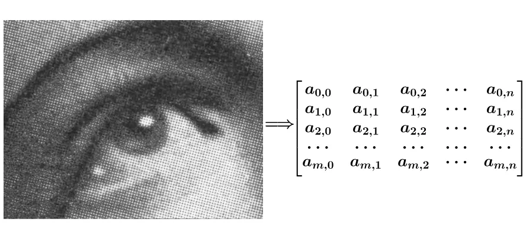

Kernel tích chập $g$ cũng biểu diễn bằng một ma trận, ví dụ:

$$
g = \begin{bmatrix}
b_{-1,-1} & b_{-1,0} & b_{-1,1} \\
b_{0,-1} & b_{0,0} & b_{0,1} \\
b_{1,-1} & b_{1,0} & b_{1,1}
\end{bmatrix}
$$

Theo định nghĩa, giá trị tích chập hai chiều tại điểm ảnh $(u, v)$ của ảnh kết quả là:

$$
(f * g)(u, v)=\sum_{i} \sum_{j} f(i, j)g(u-i, v-j)=\sum_{i} \sum_{j} a_{i,j} b_{u-i,v-j}
$$

Khai triển quá trình tính: trước hết lấy ma trận con của ảnh quanh $(u, v)$:

$$
f=\begin{bmatrix}
a_{u-1,v-1} & a_{u-1,v} & a_{u-1,v+1}\\
a_{u,v-1} & a_{u,v} & a_{u,v+1} \\
a_{u+1,v-1} & a_{u+1,v} & a_{u+1,v+1}
\end{bmatrix}
$$

Rồi **lật** kernel (hai cách, kết quả như nhau), ví dụ lật theo trục $x$ rồi lật theo trục $y$ (**tương đương xoay ma trận $g$ 180 độ**):

$$
\begin{aligned}
g &= \begin{bmatrix} b_{-1,-1} & b_{-1,0} & b_{-1,1}\\ b_{0,-1} & b_{0,0} & b_{0,1} \\ b_{1,-1} & b_{1,0} & b_{1,1} \end{bmatrix}
\Rightarrow \begin{bmatrix} b_{1,-1} & b_{1,0} & b_{1,1}\\ b_{0,-1} & b_{0,0} & b_{0,1} \\ b_{-1,-1} & b_{-1,0} & b_{-1,1} \end{bmatrix} \\
&\Rightarrow \begin{bmatrix} b_{1,1} & b_{1,0} & b_{1,-1}\\ b_{0,1} & b_{0,0} & b_{0,-1} \\ b_{-1,1} & b_{-1,0} & b_{-1,-1} \end{bmatrix} = g'
\end{aligned}
$$

Cuối cùng, giá trị tích chập là tổng các tích từng phần tử (tích trong Frobenius) của $f$ và $g'$:

$$
\begin{aligned}
(f * g)(u,v) &= a_{u-1,v-1} b_{1,1} + a_{u-1,v} b_{1,0} + a_{u-1,v+1} b_{1,-1} \\
&+ a_{u,v-1} b_{0,1} + a_{u,v} b_{0,0} + a_{u,v+1} b_{0,-1} \\
&+ a_{u+1,v-1} b_{-1,1} + a_{u+1,v} b_{-1,0} + a_{u+1,v+1} b_{-1,-1}
\end{aligned}
$$

Quá trình tính được minh hoạ bằng ảnh động dưới; chú ý ảnh động vẽ $g$ chứ không phải $g'$.

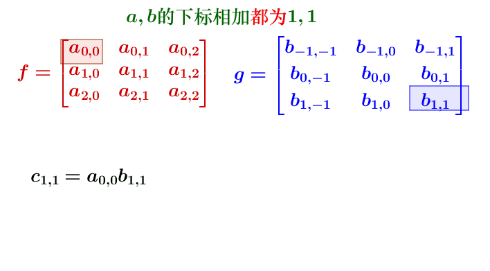

Công thức trên có một đặc điểm: trong mỗi tích $a\cdot b$, tổng chỉ số của hai thừa số luôn bằng $(u,v)$. Đó là ràng buộc của tổng có trọng số này, và là lý do phải lật $g$. Tính như trên khá rườm rà; trong thực tế ta lật kernel một lần rồi lấy thẳng **tổng các tích từng phần tử** là xong.

### 1.4 Tích chập ảnh (tích chập hai chiều)

Trong học máy và xử lý ảnh, công dụng chính của tích chập là **trượt một kernel (bộ lọc) trên ảnh (hay một bản đồ đặc trưng), qua phép tích chập thu được một tập đặc trưng mới**. Kết quả tích chập một ảnh gọi là bản đồ đặc trưng (`feature map`). Ký hiệu ma trận ảnh là $I$, kernel là $K$; giá trị tích chập tại điểm $(i,j)$ là:

$$
h(i,j) = (I*K)(i,j)=\sum_m \sum_n I(m,n)K(i-m,j-n) \tag{3}
$$

Công thức này nhất quán với công thức (2) của trường hợp một chiều. Do tích chập có tính giao hoán, ta có thể viết tương đương:

$$
h(i,j) = (K*I)(i,j)=\sum_m \sum_n I(i-m,j-n)K(m,n) \tag{4}
$$

Cách viết thứ hai thường dễ cài đặt hơn trong các thư viện học máy, vì miền giá trị hợp lệ của $m$ và $n$ (kích thước kernel) nhỏ.

Tính giao hoán xuất hiện vì ta đã lật kernel so với đầu vào (`flip`): khi $m$ tăng, chỉ số của đầu vào tăng còn chỉ số của kernel giảm. **Lý do duy nhất để lật kernel là có được tính giao hoán.** Tính giao hoán hữu ích khi chứng minh, nhưng không phải tính chất quan trọng trong mạng neuron. Thay vào đó, nhiều thư viện mạng neuron cài đặt **tương quan chéo** (`cross-correlation`): giống tích chập nhưng không lật kernel:

$$
h(i,j) = (I\star K)(i,j)=\sum_m \sum_n I(i+m,j+n)K(m,n) \tag{5}
$$

Tương quan chéo là hai dãy trượt và nhân nhau, không dãy nào bị lật. Tích chập cũng trượt và nhân, nhưng một dãy phải được lật trước.

> **Biên tập:** Bản gốc gọi tương quan chéo là "corresponding function"; tên đúng là *cross-correlation*. Bản gốc cũng dùng cùng ký hiệu $*$ cho cả (3) và (5); ở đây đổi (5) thành $\star$ để phân biệt, và viết (4) là $K*I$ cho khớp với cách hoán đổi.

### 1.5 Tương quan chéo và tích chập

Quan hệ giữa tương quan chéo và tích chập:

$$
Y = W\star X = \operatorname{rot180}(W) * X
$$

trong đó $\star$ là tương quan chéo, $*$ là tích chập, $\operatorname{rot180}(\cdot)$ là xoay 180 độ, $Y$ là ma trận đầu ra. Hai phép chỉ khác nhau ở việc kernel có bị lật hay không, nên tương quan chéo còn gọi là tích chập không lật.

> Tích chập rời rạc có thể xem là phép nhân ma trận, trong đó một số phần tử của ma trận bị buộc phải bằng nhau (ma trận Toeplitz).

Trong mạng neuron, tích chập dùng để trích đặc trưng; **lật hay không lật kernel không ảnh hưởng tới khả năng trích đặc trưng** (nhất là khi kernel là tham số học được: mạng chỉ việc học ra kernel đã lật), **nên tích chập và tương quan chéo tương đương về năng lực**. Thực tế, phép "tích chập" trong nhiều framework học sâu chính là tương quan chéo, để bớt một thao tác không cần thiết (lật kernel).

Tóm lại:

1. Phép tích chập ta cài đặt không phải tích chập theo nghĩa toán học gốc mà là "tích chập kỹ thuật", nhưng thường vẫn gọi tắt là tích chập.
2. Khi cài đặt, kernel không bị lật.

## 2 Lớp tích chập

> Trong xử lý ảnh truyền thống, **lọc không gian tuyến tính** về bản chất là lấy tổng các tích giữa ảnh $f$ và kernel bộ lọc $w$ (**tích chập**). Kernel là một ma trận; kích thước của nó xác định vùng lân cận được xét, còn các hệ số quyết định tính chất của bộ lọc (còn gọi là mặt nạ, cửa sổ lọc). Thiết kế hệ số khác nhau cho ra bộ lọc thông thấp (làm mờ) hay thông cao (làm sắc nét). Vì vậy có thể coi tích chập là dùng một bộ tham số đã thiết kế (kernel) để trích thông tin lân cận trong miền không gian của ảnh.

### 2.1 Định nghĩa lớp tích chập

Trong mạng kết nối đầy đủ, nếu lớp $l$ có $M_l$ neuron và lớp $l-1$ có $M_{l-1}$ neuron, thì có $M_{l}\times M_{l-1}$ kết nối, tức ma trận trọng số có $M_{l}\times M_{l-1}$ tham số. Khi $M_l$ và $M_{l-1}$ lớn, số tham số rất nhiều và huấn luyện kém hiệu quả.

Nếu dùng tích chập thay cho kết nối đầy đủ, đầu vào tổng $z^{(l)}$ của lớp $l$ là tích chập giữa kích hoạt $a^{(l-1)}$ của lớp $l-1$ và bộ lọc $w^{(l)}\in \mathbb{R}^K$:

$$
z^{(l)} = w^{(l)}\star a^{(l-1)} + b^{(l)}
$$

trong đó $b^{(l)}\in \mathbb{R}$ là độ lệch (bias) học được.

> Công thức trên cũng thường viết là $Z = W*A+b$.

Theo định nghĩa, lớp tích chập có hai tính chất rất quan trọng: kết nối cục bộ và chia sẻ trọng số.

#### 2.1.1 Kết nối cục bộ

**Kết nối cục bộ**: mỗi neuron của lớp tích chập (lớp $l$) chỉ nối với các neuron trong một cửa sổ cục bộ của lớp trước (lớp $l-1$), tạo thành mạng kết nối cục bộ. Có lẽ gọi là **tương tác thưa** thì trực quan hơn. Lớp truyền thống là kết nối đầy đủ: dùng phép nhân ma trận để nối đầu vào với đầu ra, mỗi tham số trong ma trận là độc lập và mô tả tương tác giữa một đơn vị vào với một đơn vị ra, nghĩa là mỗi đơn vị ra liên quan tới mọi đơn vị vào. Còn lớp tích chập dùng **ma trận kernel** để có tương tác thưa (còn gọi là kết nối thưa, trọng số thưa): mỗi đơn vị ra chỉ liên quan tới một số đơn vị vào nhất định.

> **Biên tập:** Bản gốc viết mỗi neuron của lớp $l$ nối với cửa sổ cục bộ của "lớp sau" ($l+1$). Theo chiều tính toán, đầu ra của lớp $l$ phụ thuộc vào cửa sổ cục bộ của lớp **trước** ($l-1$); hình dưới cũng vẽ theo chiều đó.

Hình dưới so sánh các đơn vị ra chịu ảnh hưởng của một đơn vị vào, ở lớp kết nối đầy đủ và lớp tích chập:

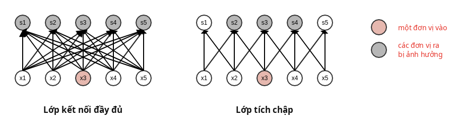

- Ở lớp kết nối đầy đủ, mỗi đơn vị vào ảnh hưởng tới mọi đơn vị ra.
- Ở lớp tích chập, mỗi đơn vị vào chỉ ảnh hưởng tới 3 đơn vị ra (khi kernel kích thước 3).

#### 2.1.2 Chia sẻ trọng số

**Chia sẻ trọng số**: trong lớp tích chập, cùng một kernel được áp lên các vùng khác nhau của đầu vào. Hình dưới so sánh tham số trọng số của lớp kết nối đầy đủ và lớp tích chập:

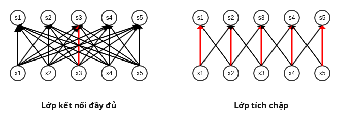

- Ở lớp kết nối đầy đủ: trọng số $w_{3,3}$ của kết nối $x_3\to s_3$ chỉ được dùng một lần.
- Ở lớp tích chập: trọng số trung tâm của kernel dùng cho $x_3\to s_3$ (mũi tên đỏ) được dùng chung cho mọi $x_i \to s_i$, $i = 1,2,4,5$.

So sánh trực quan lớp kết nối đầy đủ và lớp kết nối cục bộ:

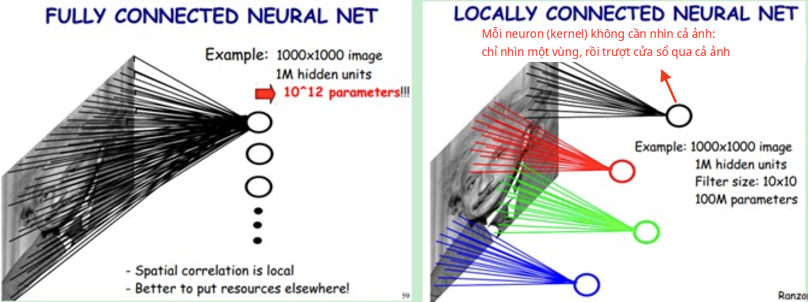

Hình 1: Với ảnh 1000×1000 và 1 triệu neuron ẩn, kết nối đầy đủ cần $10^{12}$ tham số; nếu mỗi neuron chỉ nhìn một vùng 10×10 thì còn $10^8$ (100 triệu). Lớp tích chập còn chia sẻ trọng số giữa các vị trí nên số tham số chỉ còn bằng kích thước kernel nhân số kernel (nguồn: bài giảng của Marc'Aurelio Ranzato).

Tóm lại: một bộ lọc (kernel 3 chiều) chỉ bắt được một loại đặc trưng cục bộ của đầu vào. Để tăng năng lực biểu diễn của mạng tích chập, mỗi lớp dùng nhiều bản đồ đặc trưng, tức tăng số bộ lọc, để trích đặc trưng ảnh tốt hơn.

### 2.2 Hiểu lớp tích chập

Ở phần 1, kích thước đầu ra của tích chập chỉ phụ thuộc vào kích thước đầu vào và kernel. Lớp tích chập trong mạng neuron, ngoài định nghĩa chuẩn, còn có bước trượt và đệm số 0 để tăng tính linh hoạt khi trích đặc trưng.

- Bước trượt (stride): khoảng cách mỗi lần kernel trượt.
- Đệm số 0 (zero padding): thêm phần tử (thường là 0) vào biên ảnh đầu vào.

Lớp tích chập: mỗi kernel trượt trên ma trận đầu vào và tính như sau:

1. Nhân từng phần tử của kernel với phần tử tương ứng của vùng con (receptive field) trong bản đồ đặc trưng đầu vào, rồi cộng lại.
2. Cộng thêm bias để được giá trị trong ma trận đầu ra.

Quá trình tính của lớp tích chập với đầu vào một kênh được minh hoạ ở hình 2:

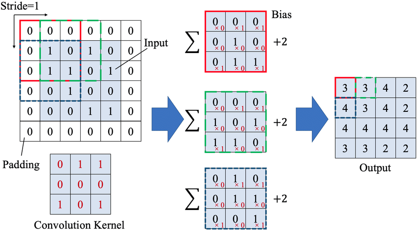

Hình 2: Đầu vào 4×4 được đệm thành 6×6, kernel 3×3, stride 1, bias 2, đầu ra 4×4 (nguồn: bài báo [Improvement of Damage Segmentation Based on Pixel-Level Data Balance Using VGG-Unet](https://www.researchgate.net/figure/Example-of-Convolutional-layer_fig2_348296106)).

Kích thước bản đồ đặc trưng đầu ra phụ thuộc vào kích thước đầu vào, số điểm đệm, kích thước kernel và stride. Trong `PyTorch`, kích thước đầu ra của `Conv2d` là:

$$N = \left\lfloor \frac{W-F+2P}{S} \right\rfloor+1$$

trong đó $\lfloor\cdot\rfloor$ là làm tròn xuống khi kết quả không nguyên, và:

+ đầu vào kích thước $W\times W$ (giả sử vuông);
+ bộ lọc kích thước $F\times F$;
+ stride $S$;
+ số điểm đệm mỗi bên $P$;
+ đầu ra kích thước $N\times N$.

Với dilation $D$ (khoảng cách giữa các phần tử kernel, mặc định 1), thay $F$ bằng kích thước hiệu dụng $D(F-1)+1$.

> **Biên tập:** Bản gốc đặt dấu làm tròn bao cả "+1" và ghi `Conv2d` có tham số mặc định `ceil_mode=False`. `nn.Conv2d` không có tham số `ceil_mode` (chỉ các lớp pooling có) và luôn làm tròn xuống. Dòng về dilation do người biên soạn thêm.

Hình 2 giải thích quá trình tính; hình 3 dưới giải thích quan hệ giữa năm khái niệm cốt lõi của lớp tích chập:

- Kênh đầu vào (input channel);
- Tập trọng số và bias;
- Bộ lọc (filter);
- Kernel;
- Bản đồ đặc trưng đầu ra (feature map).

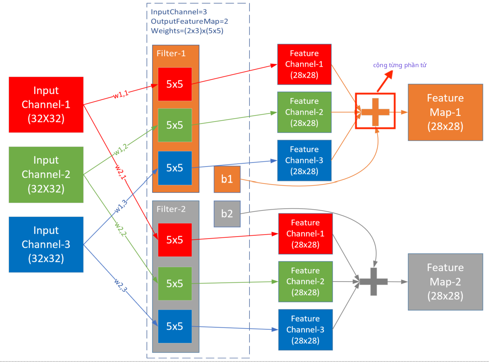

Hình 3: Đầu vào ba kênh qua hai bộ lọc. Mỗi bộ lọc có một kernel 5×5 cho mỗi kênh vào; ba kết quả được cộng từng phần tử rồi cộng bias, thành một bản đồ đặc trưng ra.

Trong ví dụ này, đầu vào là dữ liệu ba chiều $3\times 32 \times32$; qua lớp tích chập có trọng số kích thước $2\times 3\times 5\times 5$, đầu ra là ba chiều $2\times 28\times 28$. Số chiều không đổi, chỉ kích thước trong mỗi chiều thay đổi, thường là nhỏ đi.

Giả sử bộ lọc (kernel ba chiều) có kích thước $(c_{in}, k, k)$ và có $c_{out}$ bộ lọc, tức trọng số của lớp có kích thước $(c_{out}, c_{in}, k, k)$. Tích chập chuẩn có các **đặc điểm**:

1. Số bản đồ đặc trưng ra bằng số bộ lọc $c_{out}$: khi tham số của lớp đã cố định thì số bản đồ đặc trưng cũng cố định, không do lúc chạy quyết định;
2. Mỗi đầu ra có một bộ lọc tương ứng: trong hình, Feature Map-1 ứng với Filter-1;
3. **Mỗi bộ lọc có một kernel cho mỗi kênh vào**: trong hình là 3, ứng với ba kênh đỏ, lục, lam;
4. Mỗi bộ lọc chỉ có một bias: trong hình Filter-1 ứng với b1;
5. Kích thước kernel thường lẻ, như $1\times 1$, $3\times 3$.

**Lưu ý**, các điều trên mô tả **tích chập chuẩn**. Về sau còn có tích chập nhóm, tích chập tách được theo chiều sâu, tích chập giãn (dilated)... Xem bài [MobileNetv1](https://github.com/HarleysZhang/cv_note/blob/master/7-model_compression/%E8%BD%BB%E9%87%8F%E7%BA%A7%E7%BD%91%E7%BB%9C%E8%AE%BA%E6%96%87%E8%A7%A3%E6%9E%90/MobileNetv1%E8%AE%BA%E6%96%87%E8%AF%A6%E8%A7%A3.md) của tác giả và [tổng kết mạng nhẹ](dlnote/compress_light_vi).

### 2.3 Tích chập nhóm và tích chập depthwise

Khác với tích chập chuẩn (mỗi bộ lọc có một kernel cho **mỗi** kênh vào):

- **Tích chập nhóm** (group convolution): **chia các kênh vào thành $g$ nhóm**, **bộ lọc của mỗi nhóm chỉ tích chập với các bản đồ đặc trưng vào cùng nhóm**, cuối cùng nối các kênh ra của mọi nhóm lại.
- **Tích chập depthwise** (DW): mỗi bộ lọc chỉ có một kernel, ứng với một kênh vào; tức mỗi kênh vào được tích chập riêng với một kernel.

Trường hợp cực hạn của tích chập nhóm, khi số nhóm bằng số kênh vào, chính là tích chập `DW`:

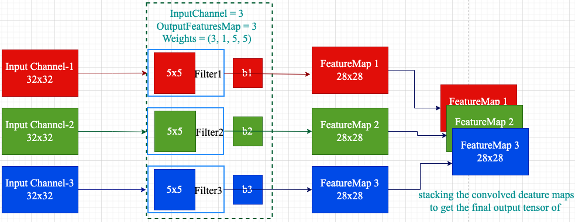

Hình 4: Tích chập depthwise: ba kênh vào, mỗi kênh một bộ lọc 5×5 riêng, trọng số kích thước $(3, 1, 5, 5)$; ba bản đồ đặc trưng ra được xếp chồng thành tensor đầu ra.

Số tham số (không tính bias) giảm theo số nhóm: tích chập chuẩn có $c_{out}\cdot c_{in}\cdot k^2$ tham số, tích chập $g$ nhóm có $c_{out}\cdot \frac{c_{in}}{g}\cdot k^2$, tức ít hơn $g$ lần; số phép nhân cộng cũng giảm $g$ lần.

`nn.Conv2d` của `PyTorch` hỗ trợ cả tích chập thường, tích chập nhóm và DW qua tham số `groups`. Lưu ý, với tích chập nhóm, **cả số kênh vào lẫn số kênh ra phải chia hết cho số nhóm**, nếu không sẽ báo lỗi:

```python
import torch
x = torch.randn(20, 10, 224, 224)                     # 10 kênh vào
conv3x3 = torch.nn.Conv2d(in_channels=10, out_channels=5, kernel_size=3, groups=5)
print(conv3x3.weight.shape)                          # torch.Size([5, 2, 3, 3])
print(conv3x3(x).shape)                              # torch.Size([20, 5, 222, 222])
```

Nếu đổi `groups=5` thành `groups=6`, hoặc `out_channels=5` thành `6`, sẽ báo lỗi:

```bash
ValueError: in_channels must be divisible by groups
ValueError: out_channels must be divisible by groups
```

> **Biên tập:** Code của bản gốc dùng tham số `output_channels`, không tồn tại trong `nn.Conv2d` (báo `TypeError`); tên đúng là `out_channels`. Kết quả in đã thêm vào chú thích (chạy thật ở trang Code).

### 2.4 API lớp tích chập

Lưu ý, trọng số của tích chập `2D` là tensor `4D`: số kênh ra, số kênh vào, chiều cao, chiều rộng. Với `PyTorch/Caffe`, dữ liệu vào ra có kích thước `(N, C, H, W)`, và trọng số có kích thước:

- tích chập thường: `(C_out, C_in, kernel_height, kernel_width)`;
- tích chập nhóm: `(C_out, C_in/g, kernel_height, kernel_width)`;
- tích chập `DW`: `(C_out, 1, kernel_height, kernel_width)`, với `C_out` là bội của `C_in` (thường bằng `C_in`).

API tích chập 2D của `PyTorch`:

```python
# trọng số có kích thước (out_channels, in_channels // groups, kernel_height, kernel_width)
class torch.nn.Conv2d(in_channels, out_channels, kernel_size, stride=1, padding=0,
                      dilation=1, groups=1, bias=True, padding_mode='zeros')
```

**Các tham số chính:**

+ `in_channels` (`int`): số kênh của tín hiệu vào.
+ `out_channels` (`int`): số kênh do tích chập tạo ra.
+ `kernel_size` (`int` hoặc `tuple`): kích thước kernel.
+ `stride` (`int` hoặc `tuple`, tuỳ chọn): bước trượt, mặc định `1`.
+ `padding` (`int`, `tuple` hoặc `'same'`/`'valid'`, tuỳ chọn): số lớp đệm mỗi cạnh, mặc định không đệm; `'same'` giữ nguyên kích thước (chỉ với stride 1).
+ `dilation` (`int` hoặc `tuple`, tuỳ chọn): khoảng cách giữa các phần tử kernel, mặc định `1`.
+ `groups` (`int`, tuỳ chọn): số nhóm chia kênh vào và kênh ra.
+ `bias` (`bool`, tuỳ chọn): nếu `True` thì thêm bias.

> **Biên tập:** Bản gốc giải thích `groups` là "số kết nối bị chặn từ kênh vào tới kênh ra" (dịch máy từ câu cũ "number of blocked connections" của tài liệu PyTorch); nghĩa đúng là số nhóm. Tên tham số `kerner_size` trong bản gốc là lỗi gõ của `kernel_size`.

**Ví dụ:**

```python
import torch
import torch.nn as nn
# kernel vuông, stride bằng nhau: chiều cao (50-3)/2+1 = 24.5, làm tròn xuống 24; chiều rộng (100-3)/2+1 = 49
m = nn.Conv2d(16, 33, 3, stride=2)
# kernel chữ nhật, stride khác nhau, có padding      → torch.Size([20, 33, 28, 100])
# m = nn.Conv2d(16, 33, (3, 5), stride=(2, 1), padding=(4, 2))
# thêm dilation                                         → torch.Size([20, 33, 26, 100])
# m = nn.Conv2d(16, 33, (3, 5), stride=(2, 1), padding=(4, 2), dilation=(3, 1))
x = torch.randn(20, 16, 50, 100)
print(m(x).shape)   # torch.Size([20, 33, 24, 49])
```

> **Biên tập:** Kết quả in ở bản gốc là `torch.Size([20, 16, 24, 49])`; số kênh ra phải là 33 (`out_channels`). Bản gốc còn bọc đầu vào bằng `autograd.Variable`, đã bị bỏ từ PyTorch 0.4: tensor dùng thẳng được.

### 2.5 Cài đặt lớp tích chập đơn giản

**Tham số của lớp tích chập** giống lớp kết nối đầy đủ: gồm trọng số `weights` và bias `bias`. Khác ở chỗ trọng số của lớp tích chập (`conv2d`) là tensor bốn chiều, còn của lớp kết nối đầy đủ là hai chiều.

Cài đặt bằng `numpy`, chưa tối ưu (đầu vào đã được đệm, stride 1):

```python
for bs in range(batch_size):
    for oc in range(output_channels):
        for oh in range(output_height):
            for ow in range(output_width):
                # nhân từng phần tử khối (C_in, k, k) của đầu vào với bộ lọc thứ oc rồi cộng lại
                output[bs, oc, oh, ow] = np.sum(input[bs, :, oh:oh + kernel_size, ow:ow + kernel_size]
                                                * weights[oc]) + bias[oc]
```

Không dùng hàm `numpy` thì cần nhiều vòng lặp hơn:

```python
for bs in range(batch_size):
    for oc in range(output_channels):
        for oh in range(output_height):
            for ow in range(output_width):
                acc = bias[oc]
                for ic in range(input_channels):
                    for kh in range(kernel_size):
                        for kw in range(kernel_size):
                            acc += input[bs, ic, oh + kh, ow + kw] * weights[oc, ic, kh, kw]
                output[bs, oc, oh, ow] = acc
```

> **Biên tập:** Bản gốc đánh số mục này là "4.5" (đúng ra là 2.5) và viết nhầm `output_weight` thay cho `output_width`. Đoạn vòng lặp thứ hai của bản gốc cộng bias vào `output[bs, oc, oh, ow]` **trước** khi vòng lặp định nghĩa `oh`, `ow`, nên báo `NameError`; ở trên đã sắp lại. Trang [Code](dlnote/dl_basic_code_vi) chạy bản cài đặt này và so với `nn.Conv2d`.

## 3 Mạng neuron tích chập

Mạng neuron tích chập thường gồm lớp tích chập, lớp gộp (pooling) và lớp kết nối đầy đủ.

### 3.1 Lớp gộp

Khi xử lý ảnh, ta thường muốn giảm dần độ phân giải không gian của biểu diễn ẩn và gom thông tin lại, để càng lên các tầng cao, vùng tiếp nhận (receptive field) của mỗi neuron càng lớn.

Lớp gộp (pooling layer), còn gọi là lớp lấy mẫu con (subsampling layer), có hai tác dụng: giảm độ nhạy của lớp tích chập với vị trí, và giảm kích thước không gian của biểu diễn (lấy mẫu xuống).

> **Biên tập:** Câu gốc "giảm độ nhạy với biểu diễn lấy mẫu xuống không gian" là dịch sai từ *Dive into Deep Learning*, câu gốc tiếng Anh: "alleviating the sensitivity of convolutional layers to location and of spatially downsampling representations", nghĩa là hai việc riêng: giảm độ nhạy với vị trí, **và** lấy mẫu xuống.

Giống lớp tích chập, lớp gộp có một cửa sổ kích thước cố định trượt trên mọi vùng của đầu vào theo bước trượt, và tính một đầu ra cho mỗi vị trí. Nhưng khác với tương quan chéo giữa đầu vào và kernel, **lớp gộp không có tham số**. Phép gộp là tất định: thường lấy giá trị lớn nhất hoặc trung bình của các phần tử trong cửa sổ, gọi là **gộp max** (max pooling) và **gộp trung bình** (average pooling). Gộp max với đầu vào một kênh:

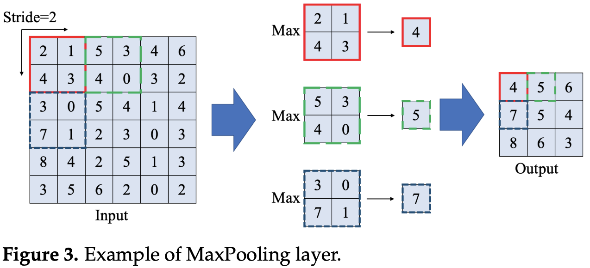

Hình 5: Gộp max cửa sổ 2×2, stride 2: đầu vào 6×6 thành đầu ra 3×3.

Cả hai trường hợp, giống tương quan chéo, cửa sổ gộp bắt đầu từ góc trên trái của tensor đầu vào, trượt từ trái sang phải, từ trên xuống dưới. Tại mỗi vị trí, nó tính giá trị lớn nhất hoặc trung bình của tensor con trong cửa sổ, tuỳ là gộp max hay gộp trung bình.

Ví dụ gộp max, lấy giá trị lớn nhất trong mỗi vùng:

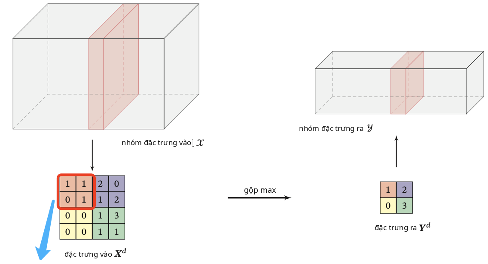

Hình 6: Gộp max trên một nhóm bản đồ đặc trưng: mỗi bản đồ $X^d$ được gộp riêng (cửa sổ 2×2, stride 2), vùng màu cam $\begin{bmatrix}1&1\\0&1\end{bmatrix}$ cho giá trị lớn nhất là 1 (hình từ *Mạng neuron và học sâu* của Khâu Tích Bằng).

Giống lớp tích chập, lớp gộp cũng có thể đổi padding và stride để được kích thước đầu ra mong muốn.

### 3.2 API lớp gộp

API lớp gộp của `PyTorch`:

```python
class torch.nn.MaxPool2d(kernel_size, stride=None, padding=0, dilation=1, return_indices=False, ceil_mode=False)
```

**Các tham số chính:**

+ `kernel_size` (`int` hoặc `tuple`): kích thước cửa sổ gộp max.
+ `stride` (`int` hoặc `tuple`, tuỳ chọn): bước trượt của cửa sổ, mặc định bằng `kernel_size`.
+ `padding` (`int` hoặc `tuple`, tuỳ chọn): **mặc định `0`, không đệm**; số lớp đệm mỗi cạnh (lớp gộp max đệm bằng $-\infty$, không phải 0).
+ `dilation`: khoảng cách giữa các phần tử trong cửa sổ.
+ `ceil_mode`: mặc định `False`, tức công thức kích thước đầu ra làm tròn xuống; nếu `True` thì làm tròn lên.

> Lớp gộp của `PyTorch` mặc định `ceil_mode=False`, còn `Caffe` chỉ cài đặt kiểu làm tròn lên. Đây là nguồn lệch kích thước hay gặp khi chuyển mô hình giữa hai framework.

**Ví dụ:**

```python
import torch
import torch.nn as nn
# cửa sổ vuông kích thước 3, stride 2
m = nn.MaxPool2d(kernel_size=3, stride=2, padding=1)
x = torch.randn(20, 16, 50, 32)
print(m(x).shape)  # torch.Size([20, 16, 25, 16])
```

## 4 Cấu trúc mạng neuron tích chập

Một mạng tích chập điển hình gồm các lớp tích chập, gộp và kết nối đầy đủ xếp xen kẽ:

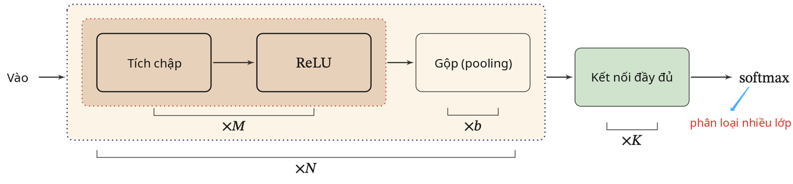

Hình 7: Cấu trúc thường gặp: $M$ lớp tích chập + ReLU, rồi $b$ lớp gộp (thường $b$ là 0 hoặc 1), lặp $N$ lần; tiếp theo $K$ lớp kết nối đầy đủ và softmax cho bài toán phân loại nhiều lớp (hình từ *Mạng neuron và học sâu* của Khâu Tích Bằng).

Một mạng CNN đơn giản cho chữ số viết tay:

> Tổng kết các mạng CNN kinh điển, xem bài [Tổng kết các backbone kinh điển](https://github.com/HarleysZhang/cv_note/blob/master/5-deep_learning/%E7%BB%8F%E5%85%B8backbone%E8%AF%A6%E8%A7%A3/%E7%BB%8F%E5%85%B8backbone%E6%80%BB%E7%BB%93.md) của tác giả.

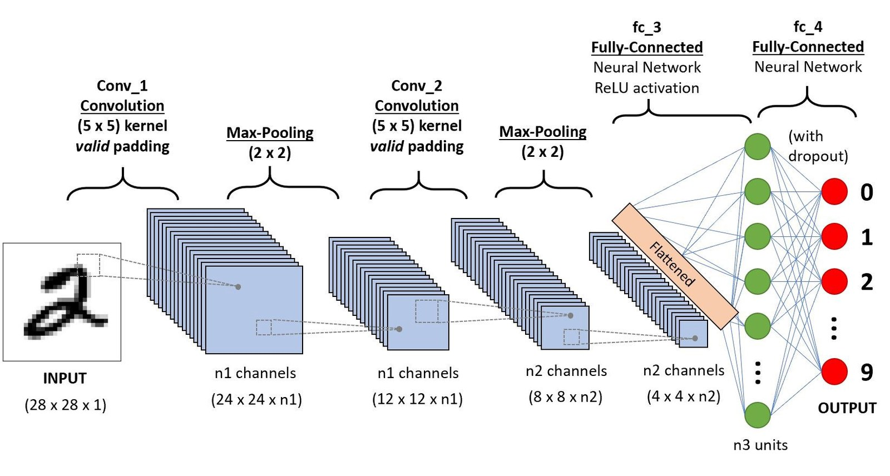

Hình 8: Ảnh 28×28 qua hai cặp tích chập 5×5 (không đệm) + gộp max 2×2, duỗi phẳng, rồi hai lớp kết nối đầy đủ cho 10 lớp chữ số.

Hiện nay, cấu trúc tổng thể của mạng tích chập có xu hướng dùng kernel nhỏ hơn (như $1 \times 1$ và $3 \times 3$) và mạng sâu hơn (trên 50 lớp). Ngoài ra, vì lớp tích chập ngày càng linh hoạt (cũng giảm được độ phân giải bằng stride), vai trò của lớp gộp ngày càng nhỏ, và mạng tích chập dần tiến tới mạng toàn tích chập.

Trang [CNN Explainer](https://poloclub.github.io/cnn-explainer/#article-convolution) trực quan hoá toàn bộ quá trình tính của một CNN ngay trên trình duyệt.

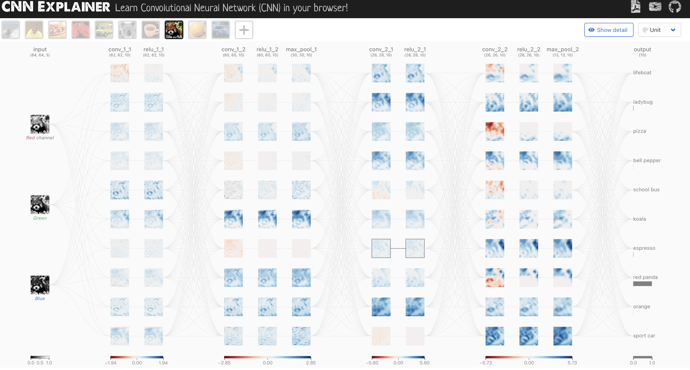

## 5 Bổ sung: tích chập sau năm 2020

Mục này do người biên soạn viết thêm.

- **Kernel lớn trở lại.** Xu hướng "kernel càng nhỏ càng tốt" ở trên đảo chiều khi ViT cho thấy vùng tiếp nhận lớn có lợi. ConvNeXt (2022) dùng tích chập depthwise 7×7, RepLKNet dùng tới 31×31; vì là depthwise nên chi phí tăng ít.
- **Tích chập depthwise + 1×1 là khối cơ bản**, không chỉ ở mạng nhẹ: ConvNeXt, các khối MBConv của EfficientNet đều theo dạng depthwise (trộn không gian) xen với 1×1 (trộn kênh), giống cách Transformer tách attention (trộn vị trí) và MLP (trộn kênh).
- **Tích chập trên phần cứng** được cài bằng cách đổi về nhân ma trận (im2col + GEMM), thuật toán Winograd cho kernel 3×3, hoặc FFT cho kernel lớn. Tích chập depthwise ít phép tính nhưng khó tận dụng phần cứng (tỉ lệ phép tính trên lượng dữ liệu đọc thấp), nên nhanh hơn ít hơn so với số FLOPs giảm; xem [tổng kết mạng nhẹ](dlnote/compress_light_vi).

## Tài liệu tham khảo

1. [AI EDU - 17.3 Nguyên lý lan truyền ngược của tích chập](https://microsoft.github.io/ai-edu/%E5%9F%BA%E7%A1%80%E6%95%99%E7%A8%8B/A2-%E7%A5%9E%E7%BB%8F%E7%BD%91%E7%BB%9C%E5%9F%BA%E6%9C%AC%E5%8E%9F%E7%90%86/%E7%AC%AC8%E6%AD%A5%20-%20%E5%8D%B7%E7%A7%AF%E7%A5%9E%E7%BB%8F%E7%BD%91%E7%BB%9C/17.3-%E5%8D%B7%E7%A7%AF%E7%9A%84%E5%8F%8D%E5%90%91%E4%BC%A0%E6%92%AD%E5%8E%9F%E7%90%86.html)
2. [Visualizing the Feature Maps and Filters by Convolutional Neural Networks](https://medium.com/dataseries/visualizing-the-feature-maps-and-filters-by-convolutional-neural-networks-e1462340518e)
3. Khâu Tích Bằng (邱锡鹏). *Mạng neuron và học sâu* (神经网络与深度学习), chương 5.
4. *Dive into Deep Learning*, chương 7; trên site: [Học sâu, chương 7](dl/ch07_vi).
5. https://www.zhihu.com/question/22298352
6. [卷积神经网络](https://www.huaxiaozhuan.com/%E6%B7%B1%E5%BA%A6%E5%AD%A6%E4%B9%A0/chapters/5_CNN.html)
7. Liu et al. *A ConvNet for the 2020s* (ConvNeXt). CVPR 2022. [arXiv:2201.03545](https://arxiv.org/abs/2201.03545).
