# Nền tảng học sâu: tổng hợp 40 câu hỏi

> Ghi chú của người biên soạn: trang này dịch từ ghi chú *dl_note* của **Harley Zhang** ([bản gốc](https://github.com/harleyszhang/dl_note/blob/main/2-deep_learning_basic/深度学习基础总结.md), [kho mã](https://github.com/harleyszhang/dl_note), giấy phép [Apache-2.0](https://www.apache.org/licenses/LICENSE-2.0); phần dịch có chỉnh sửa). Số mục giữ như bản gốc. Chỗ bản gốc sai, thiếu hoặc đã lỗi thời được sửa ngay trong bài và ghi ở ô **Biên tập**. Các mục có chữ **Bổ sung** do người biên soạn viết thêm.

Bài tổng hợp kiến thức học sâu theo dạng câu hỏi phỏng vấn, viết năm 2021 và bổ sung sau đó. Nhiều câu trùng với các bài riêng của phần này (tích chập, BN, hàm kích hoạt, hàm mất mát, khởi tạo, tối ưu); ở những chỗ đó có liên kết sang bài chi tiết. Hai mục dùng API đã lỗi thời (Keras ở câu 4–5, đồ thị tính toán TensorFlow 1 ở câu 18) được cập nhật trong ô **Biên tập**. Trang [Code](dlnote/dl_basic_code_vi) chạy lại đoạn code tính vùng tiếp nhận ở câu 8 và kiểm tra các công thức kích thước đầu ra ở câu 2.

<div class="qa-theory">

**Lý thuyết:** [Ôn tập · Chương 3 Nền tảng học sâu](qa/ch03_vi) · [Ôn tập · Chương 5 Mạng neuron tích chập (CNN)](qa/ch05_vi)

</div>

## 1 Bộ lọc và kernel

Khi chỉ có một kênh, "kernel" (`kernel`) tương đương "bộ lọc" (`filter`), hai khái niệm dùng thay nhau được. "Kernel" thường chỉ ma trận trọng số `2D`, còn "filter" chỉ cấu trúc `3D` gồm nhiều kernel xếp chồng. Với bộ lọc `2D` thì hai khái niệm là một. Nhưng với bộ lọc `3D`, như trong phần lớn phép tích chập của học sâu, bộ lọc chứa các kernel, mỗi kernel ứng với một kênh vào. **Mỗi kernel là riêng biệt, để nhấn mạnh các khía cạnh khác nhau của từng kênh vào.** Xem thêm mục 2.2 bài [Lớp tích chập](dlnote/dl_conv_vi).

## 2 Tính kích thước đầu ra của lớp tích chập và lớp gộp

> Dù là `TensorFlow`, `Keras`, `Caffe` hay `PyTorch`, giá trị mặc định của các tham số tích chập và gộp có thể khác nhau, nhưng công thức kích thước đầu ra là như nhau.

### 2.1 Thuật ngữ trong CNN

Các tham số chính của lớp tích chập:

+ kích thước kernel `Kernel` (trong `TensorFlow/Keras` cũng gọi là `filter`);
+ đệm `Padding`;
+ bước trượt `Stride`;
+ số kênh ra `Channels`.

### 2.2 Tính kích thước đầu ra (dạng đơn giản)

1. Trong `PyTorch`, kích thước của ảnh (`feature map`) sau `Conv2d` là $N = \left\lfloor \frac{W-F+2P}{S}\right\rfloor+1$, trong đó $\lfloor\cdot\rfloor$ là làm tròn xuống khi kết quả không nguyên (với `dilation = 1`):

   + ảnh vào kích thước `W×W` (giả sử vuông);
   + bộ lọc kích thước `F×F`;
   + bước trượt `S`;
   + số điểm đệm mỗi bên `P`;
   + bản đồ đặc trưng ra kích thước `N×N`.

2. Kích thước sau tích chập chuyển vị (còn gọi là "giải chập", deconvolution): `keras.layers.Conv2DTranspose`, `torch.nn.ConvTranspose2d`. Công thức: $\text{out} = (\text{in} - 1)s -2p + k$, hay viết khác $W = (N - 1)S - 2P + F$, suy ngược từ công thức của tích chập. Ở đây $\text{in}$ là kích thước vào, $k$ là kích thước kernel, $s$ là bước trượt, $p$ là số điểm đệm, $\text{out}$ là kích thước ra. (PyTorch còn cộng thêm `output_padding` và tính tới `dilation`: $\text{out}=(\text{in}-1)s-2p+d(k-1)+\text{output\_padding}+1$.)

   **Tích chập chuyển vị** thường dùng để khôi phục kích thước của `feature map`: trong trực quan hoá CNN, trong mạng `FCN` để phân loại từng điểm ảnh (`pixel classification`), và trong `GAN` để sinh ảnh từ đặc trưng. Ví dụ: vào `2x2`, kernel `4x4`, bước trượt `3`, không đệm, ra `7x7`, vì $(2 - 1) \times 3 + 4 = 7$.

3. Lớp gộp không đệm (với `PyTorch` là `padding = 0`, với `Keras/TensorFlow` là `padding="valid"`) cho kích thước $N=\lfloor(W-F)/S\rfloor+1$.

Tóm lại: với hàm tích chập và gộp của `PyTorch` và `TensorFlow`, tham số `padding` mặc định là `0`/`"valid"` (không đệm). Nhưng trong mạng thật, lớp tích chập thường có đệm (`same`), lớp gộp thường không (`valid`), và **kích thước đầu ra làm tròn xuống**. Lưu ý: với bước trượt `1`, `kernel` `3` + `padding` `1`, hay `kernel` `5` + `padding` `2`, đều giữ nguyên kích thước bản đồ đặc trưng.

> **Biên tập:** Bản gốc đặt dấu làm tròn bao cả "+1" và ghi `Conv2d` có tham số `ceil_mode=False`; `nn.Conv2d` không có tham số này (chỉ lớp gộp có), như đã ghi ở bài [Lớp tích chập](dlnote/dl_conv_vi).

> Lưu ý, mỗi framework có thể tính kích thước đầu ra hơi khác công thức trên. Công thức ở đây là bản đơn giản, đủ để làm bài phỏng vấn; framework thật có nhiều tham số hơn nên phức tạp hơn.

### 2.3 Hiệu ứng biên và đệm

Khi đặt lớp tích chập trong `Keras/TensorFlow`, có thể đặt `padding` là `"valid"` hoặc `"same"`. `"valid"` chỉ tính tích chập ở những vị trí kernel nằm trọn trong ảnh, không xử lý biên. `"same"` tự đệm số 0 quanh ảnh (cho kernel "đứng" được ở mép ảnh), tức tự chọn lượng đệm để đầu ra có cùng kích thước với đầu vào (khi bước trượt bằng 1). Từ PyTorch 1.9, `nn.Conv2d` cũng nhận `padding='same'` và `padding='valid'`.

### Tài liệu tham khảo

+ [CNN中的参数解释及计算](https://flat2010.github.io/2018/06/15/%E6%89%8B%E7%AE%97CNN%E4%B8%AD%E7%9A%84%E5%8F%82%E6%95%B0/)
+ [CNN基础知识——卷积（Convolution）、填充（Padding）、步长(Stride)](https://zhuanlan.zhihu.com/p/77471866)

## 3 Định dạng kích thước tensor của các framework

+ Tensor ảnh có hai quy ước: **kênh trước** (`channel-first`) và **kênh sau** (`channel-last`). Định dạng **tensor dữ liệu** của các framework phổ biến:
    + `PyTorch/Caffe`: (`N, C, H, W`);
    + `TensorFlow/Keras`: (`N, H, W, C`).
+ Ví dụ, lớp tích chập và gộp của `PyTorch` nhận đầu vào `(N, C, H, W)`, còn của `Keras` nhận `(N, H, W, C)`.

Lưu ý, `OpenCV` đọc ảnh trả về mảng dạng `(H, W, C)`. Với ảnh màu, đó là mảng nhiều kênh theo thứ tự **BGR** (không phải RGB), lưu trong bộ nhớ theo từng điểm ảnh: `B G R B G R ...` theo hàng. Vì vậy trước khi đưa ảnh OpenCV vào mô hình PyTorch thường phải đổi thứ tự kênh (`cv2.cvtColor(img, cv2.COLOR_BGR2RGB)`) và chuyển trục (`img.transpose(2, 0, 1)`).

> **Biên tập:** Bản gốc có hình minh hoạ cách OpenCV lưu ảnh trong bộ nhớ, nhưng tệp ảnh không có trong kho gốc; đã thay bằng mô tả ở trên. PyTorch cũng hỗ trợ bố cục bộ nhớ `channels_last` (`x.to(memory_format=torch.channels_last)`) mà vẫn giữ thứ tự chiều `(N, C, H, W)`, thường nhanh hơn cho tích chập trên GPU.

## 4 Hàm của lớp gộp trong PyTorch và Keras

> Lưu ý: với lớp tích chập và gộp của `PyTorch` và `Keras`, **tham số `padding` mặc định đều là không đệm** (`0` và `"valid"`).

### 4.1 torch.nn.MaxPool2d

```python
class torch.nn.MaxPool2d(kernel_size, stride=None, padding=0, dilation=1, return_indices=False, ceil_mode=False)
```

Lớp gộp hai chiều, đầu vào `(N, C, H_in, W_in)`, đầu ra `(N, C, H_out, W_out)`. Chiều rộng ra (chiều cao tương tự; khi `ceil_mode=True` thì làm tròn lên):

$$\left\lfloor \frac{W_{in} + 2 \times \text{padding}[1] - \text{dilation}[1] \times (\text{kernel\_size}[1] - 1) - 1}{\text{stride}[1]} + 1 \right\rfloor$$

**Các tham số chính**:

+ `kernel_size` (`int` hoặc `tuple`): kích thước cửa sổ gộp max.
+ `stride` (`int` hoặc `tuple`, tuỳ chọn): bước trượt của cửa sổ, mặc định bằng `kernel_size`.
+ `padding` (`int` hoặc `tuple`, tuỳ chọn): **mặc định `0`, không đệm**; số lớp đệm mỗi cạnh.
+ `dilation`: khoảng cách giữa các phần tử trong cửa sổ.
+ `ceil_mode`: mặc định `False`, tức công thức trên làm tròn xuống; nếu `True` thì làm tròn lên.

> Lớp gộp của `PyTorch` mặc định `ceil_mode=False`, còn `Caffe` chỉ cài đặt kiểu `ceil_mode=True`.

**Ví dụ:**

```python
import torch
import torch.nn as nn
m = nn.MaxPool2d(kernel_size=3, stride=2, padding=1)   # cửa sổ vuông 3, bước trượt 2
x = torch.randn(20, 16, 50, 32)
print(m(x).shape)  # torch.Size([20, 16, 25, 16])
```

> **Biên tập:** Bản gốc chỉ số `[0]` (chiều cao) trong công thức chiều rộng, và bọc đầu vào bằng `autograd.Variable`, đã bỏ từ PyTorch 0.4.

### 4.2 keras.layers.MaxPooling2D

```python
keras.layers.MaxPooling2D(pool_size=(2, 2), strides=None, padding="valid", data_format=None)
```

Gộp max cho dữ liệu không gian `2D`. Đầu vào mặc định là tensor `4D` kích thước `(batch_size, rows, cols, channels)`, tức `(N, H, W, C_in)`; đầu ra `(batch_size, pooled_rows, pooled_cols, channels)`.

+ `padding="valid"`: kích thước ra $N=\lfloor(W-F)/S\rfloor+1$.
+ `padding="same"`: kích thước ra $N = \lceil W/S\rceil$ (làm tròn lên).

**Các tham số chính:**

+ `pool_size`: số nguyên hoặc tuple 2 số nguyên, kích thước cửa sổ theo (dọc, ngang); `(2, 2)` giảm cả hai chiều đi một nửa. Một số nguyên thì dùng cho cả hai chiều.
+ `strides`: số nguyên, tuple 2 số nguyên hoặc `None`; bước trượt. `None` thì bằng `pool_size`.
+ `padding`: `"valid"` hoặc `"same"`.
+ `data_format`: `"channels_last"` (mặc định) hoặc `"channels_first"`; thứ tự các chiều của đầu vào. `channels_last` là `(batch, height, width, channels)`, `channels_first` là `(batch, channels, height, width)`. Mặc định lấy từ `image_data_format` trong tệp cấu hình `~/.keras/keras.json`; nếu chưa đặt thì là `"channels_last"`.

## 5 Hàm của lớp tích chập trong PyTorch và Keras

### 5.1 torch.nn.Conv2d

Trọng số của tích chập `2D` là tensor `4D`: số kênh ra, số kênh vào, cao, rộng. Với `PyTorch/Caffe`, dữ liệu vào ra có kích thước `(N, C, H, W)`, trọng số có kích thước:

- tích chập thường: `(C_out, C_in, kernel_height, kernel_width)`;
- tích chập nhóm: `(C_out, C_in/g, kernel_height, kernel_width)`;
- tích chập `DW`: `(C_out, 1, kernel_height, kernel_width)` (thường `C_out = C_in`).

API tích chập 2D của `PyTorch`:

```python
class torch.nn.Conv2d(in_channels, out_channels, kernel_size, stride=1, padding=0, dilation=1, groups=1, bias=True)
```

Tích chập hai chiều, đầu vào `(N, C_in, H, W)`, đầu ra `(N, C_out, H_out, W_out)`. Chiều rộng ra (chiều cao tương tự):

$$\left\lfloor \frac{W_{in} + 2 \times \text{padding}[1] - \text{dilation}[1] \times (\text{kernel\_size}[1] - 1) - 1}{\text{stride}[1]} + 1\right\rfloor$$

Các tham số `kernel_size`, `stride`, `padding`, `dilation` có hai dạng (`MaxPool2d` cũng vậy):

+ một `int`: dùng chung cho chiều cao và chiều rộng;
+ tuple hai `int`: số thứ nhất cho chiều cao, số thứ hai cho chiều rộng, nên chiều cao và chiều rộng ra phải tính riêng.

Ý nghĩa các tham số và ví dụ xem mục 2.4 bài [Lớp tích chập](dlnote/dl_conv_vi) (bản gốc chép nguyên đoạn đó, kể cả lỗi in sai số kênh ra `[20, 16, 24, 49]` thay cho `[20, 33, 24, 49]`).

### 5.2 keras.layers.Conv2D

```python
keras.layers.Conv2D(filters, kernel_size, strides=(1, 1), padding="valid", data_format=None,
                    dilation_rate=(1, 1), groups=1, activation=None, use_bias=True,
                    kernel_initializer="glorot_uniform", bias_initializer="zeros", ...)
```

Lớp tích chập `2D` (ví dụ tích chập không gian trên ảnh). Định dạng vào ra như lớp gộp: đầu vào `(N, H, W, C)`; trọng số `(K, K, C_in, C_out)`.

**Các tham số chính:**

+ `filters`: số nguyên, số chiều của không gian đầu ra (**tức số bộ lọc**).
+ `kernel_size`: số nguyên hoặc tuple/list 2 số nguyên, chiều cao và rộng của cửa sổ tích chập; một số nguyên thì dùng cho mọi chiều không gian.
+ `strides`: số nguyên hoặc tuple/list 2 số nguyên, bước trượt theo chiều cao và rộng. Bước trượt khác 1 không dùng cùng được với `dilation_rate` khác 1. Mặc định 1, tức trượt qua mọi điểm của ảnh (`feature map`).
+ `padding`: `"valid"` hoặc `"same"`, mặc định `"valid"`; `"same"` đệm biên để đầu ra cùng kích thước với đầu vào.
+ `data_format`: `"channels_last"` (mặc định) hoặc `"channels_first"`, như lớp gộp.
+ `dilation_rate`: số nguyên hoặc tuple/list 2 số nguyên, độ giãn của tích chập giãn (dilated convolution, atrous convolution).
+ `groups`: số nhóm cho tích chập nhóm (thêm từ TensorFlow 2.3).

### 5.3 Tóm tắt

`nn.Conv2d` của `PyTorch` không cần biết kích thước đầu vào `(H, W)` nhưng cần số kênh vào. `Keras` thì suy ra số kênh từ đầu vào; chỉ cần khai báo kích thước đầu vào một lần ở đầu mô hình.

> **Biên tập:** Câu 4–5 của bản gốc viết theo Keras 2 (gói `keras` độc lập, 2018–2021): chữ ký hàm có các tham số đã đổi tên hoặc bỏ, và khai báo kích thước vào bằng `input_shape=` ở tầng đầu. Keras 3 (2023) chạy được trên TensorFlow, JAX hoặc **PyTorch**; cách khai báo khuyến nghị là `keras.Input(shape=(128, 128, 3))` ở đầu mô hình thay cho `input_shape=` trong tầng. Phía PyTorch cũng có `nn.LazyConv2d`, tự suy ra `in_channels` ở lần chạy đầu tiên. Danh sách tham số ở trên đã cập nhật theo Keras 3.

## 6 Hồi quy softmax

Trong **bài toán phân loại**, dùng thẳng đầu ra của tầng cuối có hai vấn đề:

+ miền giá trị của đầu ra không xác định, khó hiểu trực quan ý nghĩa của chúng;
+ nhãn thật là giá trị rời rạc, khó đo sai số giữa nó và đầu ra có miền giá trị không xác định.

Hồi quy `softmax` giải quyết cả hai: **biến đầu ra thành phân phối xác suất với các giá trị dương và tổng bằng 1**:

$$
\operatorname{softmax}(\boldsymbol y)_{i} = y_{i}' = \frac{e^{y_i}}{\sum_{j=1}^{n}e^{y_j}}
$$

> **Biên tập:** Bản gốc không có tiêu đề mục 6 trong mã nguồn (dòng tiêu đề bị thụt một dấu cách nên không thành tiêu đề), dù mục lục có. Xem thêm mục 2.4.1 bài [Hàm mất mát](dlnote/dl_loss_vi).

## 7 Hàm mất mát cross-entropy

Cross-entropy đo khác biệt giữa hai phân phối xác suất, là hàm mất mát dùng rộng rãi cho bài toán phân loại, thường đi cùng hồi quy `softmax`:

$$L = -\sum_{c=1}^{M}y_{c}\log p_{c}\quad\text{hay}\quad H(p,q)=-\sum_x p(x)\log q(x)$$

- $p$: phân phối của đáp án đúng;
- $q$: phân phối dự đoán;
- $M$: số lớp;
- $y_{c}$: biến chỉ thị (`0` hoặc `1`), bằng `1` nếu lớp $c$ là lớp của mẫu, ngược lại bằng `0`;
- $p_{c}$: xác suất dự đoán mẫu thuộc lớp $c$.

> **Biên tập:** Bản gốc nói cross-entropy "mô tả khoảng cách giữa hai phân phối". Nó đo khác biệt nhưng không phải khoảng cách theo nghĩa toán học (không đối xứng, và $H(p,p)=H(p)\ne0$); xem bài [Hàm mất mát](dlnote/dl_loss_vi).

### 7.1 Vì sao cross-entropy dùng được làm hàm chi phí

Về mặt toán học: để phân phối của mô hình gần phân phối thật của dữ liệu, ta cực tiểu hoá KL divergence giữa phân phối dữ liệu huấn luyện và phân phối của mô hình. Phân phối của dữ liệu huấn luyện cố định, nên cực tiểu hoá KL divergence tương đương cực tiểu hoá cross-entropy, mà cross-entropy tính đơn giản hơn. Vì vậy học máy và học sâu thường dùng cross-entropy (`cross-entropy`) làm hàm mất mát cho phân loại.

### 7.2 Thuật toán tối ưu

`Adam`, `AdaGrad`, `RMSProp` là các thuật toán có tốc độ học thích nghi; xem bài [Thuật toán tối ưu](dlnote/dl_optim_vi).

## 8 Vùng tiếp nhận

Vùng tiếp nhận (`receptive field`) của một neuron là vùng ở tầng trước mà neuron đó "nhìn thấy"; cũng có thể định nghĩa là **vùng trên ảnh gốc mà một điểm trên bản đồ đặc trưng (`feature map`) của một tầng trong CNN ánh xạ tới**, như hình dưới:

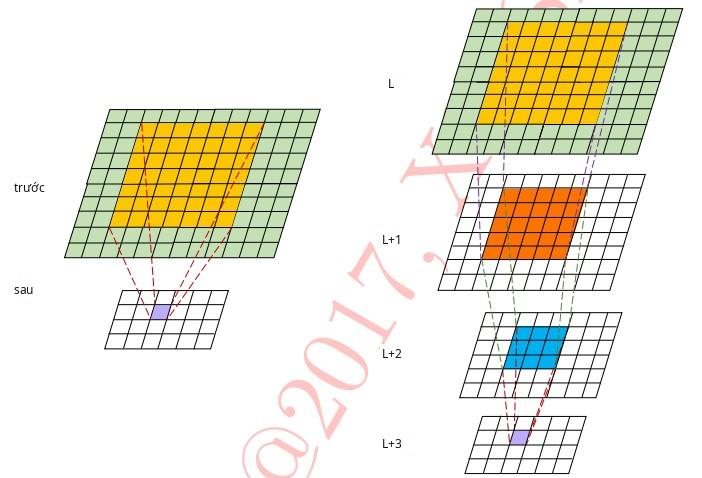

Hình 1: (a) Một lớp tích chập kernel 7×7, bước trượt 1: một neuron của tầng sau ứng với vùng 7×7 (màu vàng) của tầng trước. (b) Ba lớp tích chập 3×3, bước trượt 1 chồng lên nhau: neuron của tầng L+3 cũng có vùng tiếp nhận 7×7 trên tầng L (hình từ *Giải tích mạng neuron tích chập* của Ngụy Tú Tham).

Chồng nhiều kernel nhỏ (như `3×3`) cho vùng tiếp nhận bằng kernel lớn (như `7×7`). Dùng kernel nhỏ có hai lợi thế:

1. phải chồng nhiều tầng, nên mạng sâu hơn, tăng dung lượng (`model capacity`) và độ phức tạp (`model complexity`) của mô hình;
2. tăng dung lượng nhưng lại giảm số tham số.

> **Biên tập:** Bản gốc viết "vùng tiếp nhận trong CNN tăng theo hàm mũ". Với các lớp bước trượt 1 xếp chồng, vùng tiếp nhận chỉ tăng **tuyến tính** (mỗi lớp $k\times k$ thêm $k-1$), như ví dụ ba lớp 3×3 cho 7×7 ở trên. Nó tăng theo hàm mũ khi các lớp có bước trượt (hoặc độ giãn) lớn hơn 1, như các tầng gộp trong bảng ở mục 8.1 (bước nhảy của vùng tiếp nhận nhân đôi sau mỗi tầng gộp).

### 8.1 Tính kích thước vùng tiếp nhận

Khi tính vùng tiếp nhận, cần biết:

> Tham khảo [感受野（receptive file）计算](https://www.starlg.cn/blog/2017/06/13/Receptive-File/).

+ vùng tiếp nhận của điểm trên bản đồ đặc trưng của lớp tích chập đầu tiên bằng kích thước bộ lọc;
+ vùng tiếp nhận của lớp sâu hơn phụ thuộc vào kích thước bộ lọc và bước trượt của mọi lớp trước nó;
+ khi tính, bỏ qua ảnh hưởng của biên ảnh (đệm).

Có hai cách tính: từ dưới lên và từ trên xuống (`top to down`); ở đây chỉ trình bày cách sau. Với tích chập thường (không tính `padding`), công thức là:

$$F(i, j-1) = \big(F(i, j)-1\big)\times \text{stride}_j + \text{kernel\_size}_j$$

trong đó $F(i, j)$ là vùng tiếp nhận của tầng $i$ tính trên tầng $j$, nên công thức đi từ tầng trên xuống tầng dưới, bắt đầu với $F(i,i)=1$. Công thức này giống hệt công thức kích thước đầu ra của tích chập chuyển vị: tính vùng tiếp nhận chính là đảo ngược công thức kích thước `feature map`.

Code `Python` dưới tính kích thước đầu ra và vùng tiếp nhận của từng tầng trong `AlexNet`, `ZF-5` và `VGG16` (kích thước kernel và ảnh vào đã định sẵn):

```python
# [kích thước bộ lọc, bước trượt, đệm]
net_struct = {'alexnet': {'net': [[11,4,0],[3,2,0],[5,1,2],[3,2,0],[3,1,1],[3,1,1],[3,1,1],[3,2,0]],
                          'name': ['conv1','pool1','conv2','pool2','conv3','conv4','conv5','pool5']},
              'vgg16': {'net': [[3,1,1],[3,1,1],[2,2,0],[3,1,1],[3,1,1],[2,2,0],[3,1,1],[3,1,1],[3,1,1],
                                [2,2,0],[3,1,1],[3,1,1],[3,1,1],[2,2,0],[3,1,1],[3,1,1],[3,1,1],[2,2,0]],
                        'name': ['conv1_1','conv1_2','pool1','conv2_1','conv2_2','pool2','conv3_1','conv3_2',
                                 'conv3_3','pool3','conv4_1','conv4_2','conv4_3','pool4','conv5_1','conv5_2','conv5_3','pool5']},
              'zf-5': {'net': [[7,2,3],[3,2,1],[5,2,2],[3,2,1],[3,1,1],[3,1,1],[3,1,1]],
                       'name': ['conv1','pool1','conv2','pool2','conv3','conv4','conv5']}}

def out_from_in(isz, net, layernum):
    """Kích thước feature map ra của tầng layernum."""
    fsize, stride, pad = net[layernum]
    return (isz - fsize + 2 * pad) // stride + 1, stride

def in_from_out(net, layernum):
    """Vùng tiếp nhận của tầng thứ layernum (tính trên ảnh vào), đi ngược từ trên xuống."""
    rf = 1
    for layer in reversed(range(layernum)):
        fsize, stride, pad = net[layer]
        rf = (rf - 1) * stride + fsize
    return rf

if __name__ == '__main__':
    imsize = 224
    print("layer output sizes given image = %dx%d" % (imsize, imsize))
    for net in net_struct:
        feature_size = imsize
        print('************ net structure name is %s ************' % net)
        for i in range(len(net_struct[net]['net'])):
            feature_size, stride = out_from_in(feature_size, net_struct[net]['net'], i)
            rf = in_from_out(net_struct[net]['net'], i + 1)
            print("Layer Name = %s, Output size = %3d, Stride = %3d, RF size = %3d"
                  % (net_struct[net]['name'][i], feature_size, stride, rf))
```

**Kết quả:**

```shell
layer output sizes given image = 224x224
************ net structure name is alexnet ************
Layer Name = conv1, Output size =  54, Stride =   4, RF size =  11
Layer Name = pool1, Output size =  26, Stride =   2, RF size =  19
Layer Name = conv2, Output size =  26, Stride =   1, RF size =  51
Layer Name = pool2, Output size =  12, Stride =   2, RF size =  67
Layer Name = conv3, Output size =  12, Stride =   1, RF size =  99
Layer Name = conv4, Output size =  12, Stride =   1, RF size = 131
Layer Name = conv5, Output size =  12, Stride =   1, RF size = 163
Layer Name = pool5, Output size =   5, Stride =   2, RF size = 195
************ net structure name is vgg16 ************
Layer Name = conv1_1, Output size = 224, Stride =   1, RF size =   3
Layer Name = conv1_2, Output size = 224, Stride =   1, RF size =   5
Layer Name = pool1, Output size = 112, Stride =   2, RF size =   6
Layer Name = conv2_1, Output size = 112, Stride =   1, RF size =  10
Layer Name = conv2_2, Output size = 112, Stride =   1, RF size =  14
Layer Name = pool2, Output size =  56, Stride =   2, RF size =  16
Layer Name = conv3_1, Output size =  56, Stride =   1, RF size =  24
Layer Name = conv3_2, Output size =  56, Stride =   1, RF size =  32
Layer Name = conv3_3, Output size =  56, Stride =   1, RF size =  40
Layer Name = pool3, Output size =  28, Stride =   2, RF size =  44
Layer Name = conv4_1, Output size =  28, Stride =   1, RF size =  60
Layer Name = conv4_2, Output size =  28, Stride =   1, RF size =  76
Layer Name = conv4_3, Output size =  28, Stride =   1, RF size =  92
Layer Name = pool4, Output size =  14, Stride =   2, RF size = 100
Layer Name = conv5_1, Output size =  14, Stride =   1, RF size = 132
Layer Name = conv5_2, Output size =  14, Stride =   1, RF size = 164
Layer Name = conv5_3, Output size =  14, Stride =   1, RF size = 196
Layer Name = pool5, Output size =   7, Stride =   2, RF size = 212
************ net structure name is zf-5 ************
Layer Name = conv1, Output size = 112, Stride =   2, RF size =   7
Layer Name = pool1, Output size =  56, Stride =   2, RF size =  11
Layer Name = conv2, Output size =  28, Stride =   2, RF size =  27
Layer Name = pool2, Output size =  14, Stride =   2, RF size =  43
Layer Name = conv3, Output size =  14, Stride =   1, RF size =  75
Layer Name = conv4, Output size =  14, Stride =   1, RF size = 107
Layer Name = conv5, Output size =  14, Stride =   1, RF size = 139
```

Cột `Stride` là bước trượt của riêng tầng đó. Vùng tiếp nhận của các tầng cuối (195 với AlexNet, 212 với VGG16) đã gần bằng hay vượt kích thước ảnh 224.

> **Biên tập:** Code gốc dùng phép chia số thực `/` trong công thức kích thước nên in ra kích thước nhờ `%3d` cắt phần thập phân, và để lại biến `totstride` không dùng tới; ở trên đổi thành chia nguyên `//` (kết quả in không đổi). Trang Code chạy lại đoạn code này.

## 9 Tác dụng của tích chập và gộp

> Định nghĩa và quá trình tính của tích chập và gộp không khó hiểu, nhưng tác dụng của chúng không có một câu trả lời chuẩn; tác giả tổng hợp từ nhiều blog và sách của Ngụy Tú Tham.

Có thể tham khảo sách *Giải tích mạng neuron tích chập* của Ngụy Tú Tham. Tác dụng của tích chập (`convolution`):

1. Đặc điểm **cảm nhận cục bộ, chia sẻ tham số** giảm mạnh số tham số của mạng, giữ cho mạng thưa.
2. Qua tổ hợp các kernel và các phép toán tiếp theo trong mạng, tích chập thu được các loại đặc trưng khác nhau ở các vùng khác nhau của ảnh; các tầng gần đáy trích đặc trưng cục bộ, rất phổ quát, còn các tầng gần đỉnh trích đặc trưng ngữ nghĩa trừu tượng hơn.

Tác dụng của gộp (`pooling`):

1. **Bất biến đặc trưng** (feature invariance). Gộp khiến mô hình quan tâm việc một đặc trưng có xuất hiện hay không hơn là vị trí chính xác của nó; đây có thể xem là một tiên nghiệm rất mạnh, cho việc học đặc trưng một mức tự do nhất định, chấp nhận được những dịch chuyển nhỏ của đặc trưng.
2. **Giảm chiều đặc trưng.** Do tác dụng lấy mẫu xuống, một phần tử của kết quả gộp ứng với một vùng con (sub-region) của đầu vào, nên gộp là giảm chiều theo không gian (spatial dimension reduction), giúp mô hình trích được đặc trưng trên phạm vi rộng hơn. Đồng thời giảm kích thước đầu vào của tầng sau, nên giảm khối lượng tính và số tham số.
3. Phần nào **chống quá khớp** (overfitting), dễ tối ưu hơn.

### Tài liệu tham khảo

Ngụy Tú Tham (魏秀参). *Giải tích mạng neuron tích chập* (解析卷积神经网络).

## 10 Khác biệt giữa lớp tích chập và lớp kết nối đầy đủ

+ Lớp tích chập học **mẫu cục bộ** (với ảnh, đó là các mẫu tìm thấy trong các cửa sổ 2D nhỏ của ảnh vào).
+ Lớp kết nối đầy đủ học **mẫu toàn cục** (mẫu liên quan tới mọi điểm ảnh).

## 11 Chia sẻ trọng số trong CNN

Trước hết, **chia sẻ trọng số là chia sẻ bộ lọc**: tham số của bộ lọc cố định, dùng cùng một bộ lọc quét qua toàn ảnh, trích một loại đặc trưng và được một `feature map`. Trong mạng tích chập, học được một bộ lọc là nắm được một loại đặc trưng; bộ lọc trượt trên ảnh để trích đặc trưng, nên đặc trưng đó (ví dụ đường ngang) được thu ở mọi vùng của ảnh.

## 12 Đặc điểm cấu trúc của CNN

CNN điển hình cho phân loại gồm chủ yếu **lớp tích chập + hàm kích hoạt + lớp gộp**, cuối cùng là lớp kết nối đầy đủ cho đầu ra. Lớp tích chập trích đặc trưng cục bộ của ảnh; lớp gộp giảm mạnh kích thước (giảm chiều) của biểu diễn; lớp kết nối đầy đủ giống mạng neuron truyền thống, cho ra kết quả mong muốn.

`CNN` có các đặc điểm: kết nối cục bộ, chia sẻ trọng số, gộp (nói đơn giản là lấy mẫu xuống) và cấu trúc nhiều tầng.

+ Kết nối cục bộ cho phép mạng trích đặc trưng cục bộ của dữ liệu.
+ Chia sẻ trọng số giảm mạnh độ khó huấn luyện; mỗi bộ lọc chỉ trích một loại đặc trưng, được tích chập trên toàn ảnh (hay chuỗi âm thanh, văn bản).
+ Gộp cùng cấu trúc nhiều tầng giảm chiều dữ liệu, tổ hợp các đặc trưng cục bộ tầng thấp thành đặc trưng tầng cao hơn để biểu diễn toàn ảnh.
+ Mẫu mà CNN học được có tính bất biến với phép dịch (`translation invariant`), và CNN học được cấu trúc phân cấp không gian của các mẫu.

> **Biên tập:** Bản gốc nói lớp gộp "giảm mạnh số tham số"; lớp gộp không có tham số, nó giảm kích thước không gian của biểu diễn (nên giảm khối lượng tính và số tham số của lớp kết nối đầy đủ phía sau). Nói chính xác, tích chập có tính **đẳng biến** với phép dịch (dịch ảnh vào thì bản đồ đặc trưng dịch theo); tính **bất biến** đến từ gộp và các tầng gộp toàn cục ở cuối mạng, và chỉ gần đúng.

### Tài liệu tham khảo

[(二)计算机视觉四大基本任务(分类、定位、检测、分割)](https://zhuanlan.zhihu.com/p/31727402)

## 13 Tính phân cấp của đặc trưng sâu

Tích chập thu được các loại đặc trưng khác nhau ở các vùng ảnh, còn gộp và các phép tương tự tổng hợp, trừu tượng hoá các đặc trưng đó. Khi chồng nhiều lớp tích chập và gộp, đặc trưng sâu của các tầng chuyển dần từ đặc trưng tổng quát (cạnh, kết cấu) sang biểu diễn ngữ nghĩa cấp cao (thân, đầu...).

## 14 Dữ liệu nào không hợp với học sâu

+ Tập dữ liệu quá nhỏ: khi thiếu mẫu, học sâu không có ưu thế rõ so với các thuật toán học máy khác.
+ Dữ liệu không có tính tương quan cục bộ. Học sâu hiện làm tốt nhất ở ảnh, âm thanh, ngôn ngữ tự nhiên; điểm chung của các lĩnh vực này là tương quan cục bộ: điểm ảnh tạo thành vật thể, âm vị tạo thành từ, từ tạo thành câu; xáo trộn các thành phần thì ý nghĩa thay đổi. Dữ liệu không có tương quan cục bộ như vậy không hợp với học sâu. Ví dụ: dự đoán sức khoẻ một người từ tuổi, nghề nghiệp, thu nhập, hoàn cảnh gia đình...; xáo trộn thứ tự các thuộc tính này không ảnh hưởng kết quả.

> Với dữ liệu dạng bảng như ví dụ trên, các mô hình cây tăng cường (XGBoost, LightGBM, CatBoost) đến nay vẫn thường ngang hoặc tốt hơn mạng neuron (Grinsztajn et al., 2022); xem [cây quyết định](ml/tree_vi) trong khoá Học máy.

## 15 Nguyên nhân gây tiêu biến gradient

+ Khi huấn luyện mạng neuron, ta thay đổi trọng số để đầu ra của mạng gần nhãn nhất có thể, tức giảm sai số. Huấn luyện thường dùng thuật toán BP: tính hàm mất mát giữa đầu ra và nhãn, rồi tính gradient theo từng neuron để cập nhật trọng số.
+ Tiêu biến gradient làm trọng số cập nhật chậm, huấn luyện khó hơn. Một nguyên nhân là nhiều hàm kích hoạt ép đầu ra vào một khoảng nhỏ; trên phần lớn miền xác định ở hai đầu, gradient gần bằng 0, khiến việc học dừng lại.

## 16 Quá khớp và dưới khớp

### 16.1 Xử lý quá khớp thế nào

Quá khớp là khi mô hình quá phức tạp, "ghi nhớ" được cả phần nhiễu ngẫu nhiên trong dữ liệu huấn luyện mà bỏ quên xu hướng chung. **Biểu hiện của mô hình quá khớp: mất mát trên dữ liệu huấn luyện nhỏ, độ chính xác cao; nhưng trên dữ liệu kiểm tra mất mát lớn, độ chính xác thấp.** Cách giải quyết:

+ `tăng cường dữ liệu`, tăng độ đa dạng của dữ liệu;
+ chiến lược regularization: phạt chuẩn tham số (parameter norm penalty), `regularization L1, L2`;
+ `dropout`;
+ kết hợp mô hình, như bagging và các phương pháp ensemble khác;
+ `BN` (batch normalization);
+ dừng sớm (early stopping).

### 16.2 Nhận biết mô hình học sâu bị quá khớp

1. Chia dữ liệu huấn luyện thành tập huấn luyện và tập kiểm định, ví dụ `80%` và `20%` (hai tập không được giao nhau). Khi huấn luyện, cứ sau một số `epoch` so chỉ số trên tập kiểm định với tập huấn luyện; nếu chúng lệch nhau và chỉ số kiểm định xấu đi, mô hình đang quá khớp.
2. Dùng đường cong học (`learning curve`) để nhận biết; xem [blog này](https://blog.csdn.net/aliceyangxi1987/article/details/73598857).

### 16.3 Xử lý dưới khớp thế nào

Dưới khớp (`underfitting`) thể hiện ở việc mất mát trên chính tập huấn luyện vẫn cao. Có nhiều nguyên nhân; với trường hợp mạng không đủ năng lực khớp, có thể:

+ tăng năng lực của mô hình: thêm tầng, thêm neuron hay kênh;
+ chọn cách khởi tạo trọng số tốt: ví dụ khởi tạo He (`he_normal`); các framework đều có sẵn nhiều cách khởi tạo;
+ dùng hàm kích hoạt phù hợp: lớp tích chập thường dùng `ReLU`; tầng hồi tiếp của mạng hồi tiếp thường dùng `tanh`;
+ chọn bộ tối ưu và tốc độ học phù hợp; giảm regularization nếu đang dùng quá mạnh.

> **Biên tập:** Bản gốc định nghĩa dưới khớp là "mô hình không hội tụ" và ghi "`SGD` chậm nhưng sẽ đạt tối ưu". Mô hình có thể hội tụ (mất mát ngừng giảm) mà vẫn dưới khớp, nếu dung lượng không đủ; còn SGD không có đảm bảo đạt tối ưu toàn cục với bài toán không lồi. Đã thêm cách quan trọng nhất là tăng dung lượng mô hình.

### 16.4 Nhận biết mô hình dưới khớp

Dấu hiệu của mạng dưới khớp: đã huấn luyện **đủ lâu** mà `loss` vẫn rất lớn, thậm chí không khác giá trị ban đầu là bao, độ chính xác thấp, trên tập kiểm tra cũng vậy. Theo kinh nghiệm của tác giả, nguyên nhân thường là:

+ mạng không đủ năng lực khớp;
+ cấu hình mạng có vấn đề;
+ cấu hình dữ liệu có vấn đề;
+ cách huấn luyện sai (người mới hay gặp, nguyên nhân muôn hình vạn trạng).

## 17 Khác biệt giữa L1 và L2

Chuẩn L1 (`L1 norm`) của một vector là tổng trị tuyệt đối các phần tử. Ví dụ vector $A=[1, -1, 3]$ có chuẩn L1 là $|1|+|-1|+|3|=5$. Tóm tắt:

+ chuẩn L1: tổng trị tuyệt đối các phần tử của $x$;
+ chuẩn L2: căn bậc hai của tổng bình phương các phần tử, còn gọi là chuẩn Euclid (với ma trận, chuẩn tương ứng là chuẩn Frobenius);
+ chuẩn Lp: căn bậc $p$ của tổng các trị tuyệt đối mũ $p$.

Regularization L1 (khi dùng cho hồi quy tuyến tính gọi là Lasso) thêm chuẩn L1 của trọng số vào hàm chi phí; nghiệm tối ưu thường **thưa** (nhiều trọng số đúng bằng 0), nên có tác dụng chọn đặc trưng. Regularization L2 (Ridge, weight decay) làm mọi trọng số nhỏ đi nhưng hiếm khi bằng 0. Cả hai đều giảm quá khớp.

> **Biên tập:** Bản gốc gọi chuẩn L1 là "toán tử quy tắc thưa (Lasso regularization)" và viết "trong học SVM, chuẩn L1 thực chất là một quá trình giải tối ưu hàm chi phí", một câu không có nghĩa rõ ràng (chép từ một blog). Chuẩn L2 của vector không phải chuẩn Frobenius (đó là chuẩn của ma trận). Đoạn trên viết lại; giải thích vì sao L1 cho nghiệm thưa (qua tiên nghiệm Laplace) ở mục 5.6.1 bài [Nguyên lý cơ bản của học máy](dlnote/math_ml_vi).

## 18 Đồ thị tính toán

`TensorFlow` biểu diễn tính toán dưới dạng **đồ thị tính toán** (còn gọi là đồ thị luồng dữ liệu), một đồ thị có hướng: mỗi phép tính là một nút, các cạnh giữa các nút mô tả quan hệ phụ thuộc giữa các phép tính.

> **Biên tập:** Câu trả lời gốc mô tả TensorFlow 1.x: viết code là dựng một **đồ thị tĩnh**, rồi chạy nó trong `tf.Session`. Từ TensorFlow 2.0 (2019), mặc định là **thực thi tức thời** (eager execution): mỗi dòng code chạy ngay như NumPy, giống PyTorch; muốn có đồ thị (để tối ưu và xuất mô hình) thì bọc hàm bằng `@tf.function`, TensorFlow sẽ dò vết (trace) để dựng đồ thị. PyTorch đi theo hướng ngược lại: mặc định eager, và `torch.compile` (PyTorch 2.0) bắt đồ thị từ code Python để tối ưu. Trong cả hai, khi huấn luyện, autograd vẫn ghi lại một đồ thị tính toán động trong lúc chạy chiều xuôi để làm lan truyền ngược (bài [Lan truyền ngược](dlnote/dl_bp_vi)).

## 19 Tác dụng của BN

Chuẩn hoá cả ở các tầng giữa của mạng để huấn luyện tốt hơn, đó là Batch Normalization (BN). Chi tiết ở bài [Lớp Batch Normalization](dlnote/dl_bn_vi).

1. **Dùng được tốc độ học cao hơn.** Nếu thang đo (`scale`) của các tầng khác nhau thì thực ra mỗi tầng cần tốc độ học khác nhau; các chiều trong cùng một tầng cũng có thể cần tốc độ học khác nhau. Thường phải dùng tốc độ học nhỏ nhất trong số đó mới đảm bảo mất mát giảm. BN giữ thang đo của mọi tầng, mọi chiều như nhau, nên dùng thẳng được tốc độ học cao hơn.
2. **Bỏ hoặc giảm `dropout`.** Bài báo BN dùng dropout 10%, 5% và 0% cho các mô hình cuối, so với 40–50% trước đó, và huấn luyện nhanh hơn nhiều.
3. **Giảm hệ số weight decay L2.** Bài báo giảm hệ số này 5 lần khi có BN.
4. **Thay lớp Local Response Normalization (LRN).** Đã có một phép chuẩn hoá thì LRN không còn cần thiết; vả lại LRN thực tế cũng không hiệu quả mấy.
5. **BN điều chỉnh phân phối dữ liệu**: không xét hàm kích hoạt, nó chuẩn hoá đầu ra mỗi tầng về trung bình 0, phương sai 1 (trước khi co giãn bằng $\gamma,\beta$), giữ gradient ở mức hợp lý, giúp giải quyết vấn đề gradient khi lan truyền ngược. Phần lớn tài liệu giải thích như vậy, ví dụ bài báo BN gốc cho rằng BN làm dịu internal covariate shift (ICS); về sau giải thích này bị nghi ngờ (xem mục 4 bài BN).

> **Biên tập:** Ở điểm 2, bản gốc giải thích "quá khớp thường xảy ra ở biên dữ liệu, nếu khởi tạo trọng số đã nằm bên trong dữ liệu thì quá khớp được giảm"; ở điểm 3, "cực tiểu địa phương ở biên thường có vài trọng số lớn". Hai lời giải thích này (từ một blog đọc bài báo năm 2015) không có trong bài báo BN và không có cơ sở rõ ràng; đã bỏ, giữ phần số liệu là những gì bài báo làm.

Khác biệt của BN khi huấn luyện và suy luận xem [Batch Normalization详解](https://www.cnblogs.com/shine-lee/p/11989612.html) hoặc mục 3.3 bài BN.

## 20 Tiêu biến và bùng nổ gradient là gì

+ Tiêu biến gradient: khi huấn luyện, gradient truyền qua các tầng theo quy tắc chuỗi trong thuật toán `BP` nhỏ dần qua mỗi tầng, cuối cùng gần bằng 0, khiến một số tầng gần như không được huấn luyện.
+ Bùng nổ gradient: ngược lại, gradient lớn dần qua mỗi tầng, tiến tới vô cùng, khiến một số tầng không hội tụ.

> Khi lan truyền ngược phải lấy đạo hàm của hàm kích hoạt (nhân với trọng số); nếu tích các thừa số đó lớn hơn 1, gradient tăng theo hàm mũ khi số tầng tăng: bùng nổ gradient. Nếu nhỏ hơn 1, gradient giảm theo hàm mũ: tiêu biến gradient.

### Nguyên nhân

**Tiêu biến và bùng nổ gradient chủ yếu do khởi tạo tham số không hợp lý và chọn hàm kích hoạt không hợp lý.** Gốc rễ nằm ở cơ chế lan truyền ngược, một "khiếm khuyết bẩm sinh": khi huấn luyện mô hình nhiều tầng, thường gặp vấn đề tiêu biến gradient (gradient vanishing problem) và bùng nổ gradient (gradient exploding problem).

**Gradient trong mạng sâu bất ổn vì gradient ở các tầng trước là tích của các thừa số từ mọi tầng phía sau.** Khi có quá nhiều tầng, bất ổn là bản chất. Nếu các thừa số nhỏ, các tầng trước nhận gradient nhỏ hơn các tầng sau nên học chậm hơn: tiêu biến gradient. Nếu các thừa số lớn: bùng nổ gradient.

> **Biên tập:** Bản gốc viết "khi mạng có nhiều tầng, tiêu biến và bùng nổ gradient là không tránh khỏi". Với các kỹ thuật ở mục dưới (khởi tạo hợp lý, chuẩn hoá, kết nối tắt), mạng hàng trăm tầng (ResNet-152, Transformer 100+ tầng) vẫn huấn luyện ổn định; nên hiểu là "có xu hướng xảy ra nếu không xử lý".

### Cách giải quyết

Các cách hay dùng:

+ mô hình tiền huấn luyện + tinh chỉnh;
+ cắt gradient (gradient clipping) + regularization;
+ hàm kích hoạt `ReLU`, `LeakyReLU`...;
+ chuẩn hoá theo batch `BN`;
+ khởi tạo theo số đầu vào, đầu ra như `Xavier`, He;
+ kết nối tắt (residual) trong `CNN`;
+ cấu trúc `LSTM` (với mạng hồi tiếp).

## 21 Hiểu mạng neuron hồi tiếp (RNN)

Mạng neuron hồi tiếp (recurrent neural network, RNN) chủ yếu dùng cho nhận dạng giọng nói, mô hình ngôn ngữ, dịch máy, phân tích chuỗi thời gian...

**Trong các ứng dụng kinh điển, mạng tích chập chia sẻ tham số giữa các vị trí không gian, còn mạng hồi tiếp chia sẻ tham số giữa các thời điểm, nhờ vậy xử lý được chuỗi dài tuỳ ý với số tham số hữu hạn.**

`RNN` có thể xem là cùng một cấu trúc mạng được sao chép nhiều lần theo thời gian; cấu trúc được sao chép gọi là thân vòng lặp, và thiết kế thân vòng lặp là then chốt để RNN giải bài toán thực tế. Đầu vào của RNN gồm hai phần: trạng thái ở thời điểm trước và mẫu đầu vào ở thời điểm hiện tại.

> Từ khoảng 2018, Transformer đã thay RNN ở phần lớn bài toán ngôn ngữ và giọng nói, vì tính song song được trên cả chuỗi khi huấn luyện; RNN (và các mô hình không gian trạng thái như Mamba, có dạng hồi tiếp) vẫn được nghiên cứu vì chi phí suy luận không tăng theo độ dài ngữ cảnh.

## 22 Mô hình không hội tụ khi huấn luyện có nghĩa là mô hình vô dụng? Nguyên nhân?

Không hẳn. Có nhiều nguyên nhân khiến mô hình không hội tụ, hay gặp là:

+ không chuẩn hoá dữ liệu;
+ không kiểm tra kết quả: cả kết quả tiền xử lý lẫn kết quả huấn luyện, kiểm tra cuối cùng;
+ quên tiền xử lý dữ liệu;
+ quên dùng regularization;
+ batch size quá lớn;
+ tốc độ học không đúng;
+ hàm kích hoạt ở tầng cuối không đúng (ví dụ thêm softmax trước `nn.CrossEntropyLoss`);
+ mạng có gradient hỏng, ví dụ ReLU có gradient 0 với giá trị âm, nên khi lan truyền ngược gradient 0 không truyền được;
+ khởi tạo tham số sai;
+ mạng quá sâu, hoặc số neuron ẩn không hợp lý;
+ xem thêm [My Neural Network isn't working! What should I do?](http://theorangeduck.com/page/neural-network-not-working).

Một mẹo kiểm tra nhanh: cho mô hình học thuộc một batch nhỏ (vài chục mẫu). Nếu không đưa được mất mát trên batch đó về gần 0, lỗi nằm ở code hay cấu hình, không phải ở dữ liệu hay dung lượng mô hình.

## 23 Lợi ích của việc VGG dùng hai lớp tích chập 3×3

1. **Giảm số tham số.** Hai lớp 3×3 có ít tham số hơn một lớp 5×5, chỉ bằng $2\times3\times3/(5\times5)=0{,}72$ lần, mà tác dụng tương đương: hai lớp 3×3 nối tiếp có vùng tiếp nhận 5×5 như một lớp 5×5, tức một điểm ảnh liên hệ với vùng 5×5 xung quanh. Coi hình dưới như ảnh động thì dễ thấy hai lớp 3×3 chồng nhau (không có gộp) có vùng tiếp nhận hiệu dụng 5×5.

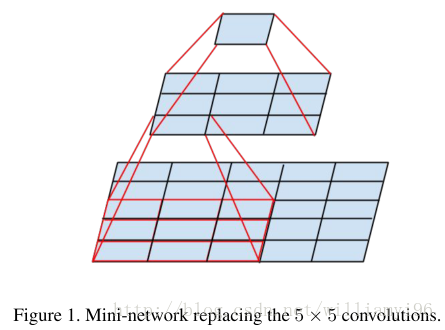

Hình 2: Một mạng nhỏ thay cho tích chập 5×5: hai lớp 3×3 nối tiếp (hình 1 trong bài báo Inception-v3).

2. **Nhiều phép biến đổi phi tuyến hơn.** Hai lớp 3×3 có nhiều phép phi tuyến hơn một lớp 5×5 (dùng được hai lần ReLU thay vì một), nên mạng học đặc trưng tốt hơn.

***Giải thích trong bài báo VGG***: ba lớp như vậy có vùng tiếp nhận hiệu dụng 7×7. Vậy ta được gì khi thay một lớp 7×7 bằng ba lớp 3×3? Thứ nhất, dùng ba lớp chỉnh lưu phi tuyến thay vì một, khiến hàm quyết định phân biệt tốt hơn. Thứ hai, giảm số tham số: nếu đầu vào và đầu ra của khối ba lớp 3×3 đều có $C$ kênh, khối này có $3\times(3^2C^2) = 27C^2$ trọng số; còn một lớp 7×7 cần $7^2C^2 = 49C^2$ tham số, nhiều hơn 81%. Có thể xem đây là áp regularization lên bộ lọc 7×7, buộc nó phân rã thành các bộ lọc 3×3 (có phi tuyến xen giữa).

> **Biên tập:** Bản gốc viết số tham số là $27C$ và $49C$; bài báo VGG viết $27C^2$ và $49C^2$ (mỗi bộ lọc có $C$ kênh vào và có $C$ bộ lọc). Tỉ lệ 81% không đổi.

**Câu trả lời này tham khảo sách *TensorFlow thực chiến*, trang 110; nhiều câu trả lời trên mạng không đầy đủ.**

### 23.1 Tác dụng chính của tích chập 1×1

+ **Giảm chiều** (dimensionality reduction): ví dụ một ảnh $500\times500$ có độ sâu 100 kênh, qua 20 bộ lọc 1×1 thì kết quả là $500\times500\times20$; giảm số kênh nên giảm tính toán cho lớp sau (như trong khối bottleneck của ResNet, Inception).
+ **Thêm phi tuyến**: lớp tích chập đi kèm hàm kích hoạt, nên tích chập 1×1 thêm một phép kích hoạt phi tuyến trên biểu diễn của tầng trước, tăng năng lực biểu diễn của mạng.
+ **Trộn thông tin giữa các kênh**: tích chập 1×1 là một lớp kết nối đầy đủ áp tại từng vị trí, nên tổ hợp tuyến tính các kênh; trong mạng depthwise separable, nó đảm nhiệm việc trộn kênh.

## 24 ReLU tốt hơn sigmoid ở đâu?

Hàm `Sigmoid`: $\sigma (x)=\frac{1}{1+\exp(-x)}$

Hàm ReLU:

$$f(x) = \max(x, 0) =
\begin{cases}
x,  & x \geq 0 \\
0, & x < 0
\end{cases}$$

Đầu ra của ReLU hoặc là 0, hoặc là chính đầu vào. Công thức đơn giản nhưng hiệu quả hơn. Có nhiều cách giải thích, từ ví dụ code tới phân tích toán học; một câu trả lời khá trực quan:

1. `ReLU` tính đơn giản, giảm nhiều khối lượng tính: sigmoid phải tính hàm mũ (và một phép chia) ở chiều xuôi; ReLU chỉ là một phép so sánh, đạo hàm là 0 hoặc 1.
2. **Tránh tiêu biến gradient.** Với mạng sâu, sigmoid dễ gây tiêu biến gradient khi lan truyền ngược (ở vùng bão hoà, hàm biến đổi quá chậm, đạo hàm tiến về 0, làm mất thông tin), nên không huấn luyện được mạng sâu.
3. Có thể giảm quá khớp: ReLU cho đầu ra 0 ở một phần neuron, làm mạng thưa và giảm sự phụ thuộc lẫn nhau giữa các tham số.
4. So với họ sigmoid, `ReLU` giúp stochastic gradient descent hội tụ nhanh hơn (bài báo AlexNet: mạng ReLU đạt sai số huấn luyện 25% trên CIFAR-10 nhanh gấp 6 lần mạng tanh).

> **Biên tập:** Bản gốc viết "khi lan truyền ngược tính gradient có phép chia nên tốn tính toán". Đạo hàm của sigmoid là $\sigma(1-\sigma)$, không có phép chia; phần tốn kém là hàm mũ ở chiều xuôi. Điểm 3 là một giả thuyết hay được nhắc, không phải kết quả đã chứng minh. Chi tiết ở bài [Hàm kích hoạt](dlnote/dl_act_vi).

### Liên kết tham khảo

[ReLU为什么比Sigmoid效果好](https://www.twblogs.net/a/5c2dd30fbd9eee35b21c4337/zh-cn)

## 25 Hiểu chia sẻ trọng số trong mạng neuron

Thuật ngữ chia sẻ trọng số gắn với các mạng tích chập của LeCun (LeNet). Với CNN, khi tích chập một ảnh, ta dùng chung tham số của một kernel. Ví dụ kernel $3\times3\times1$ có 9 tham số được dùng chung cho cả ảnh, không đổi theo vị trí trong ảnh. Nói thẳng hơn: dùng một kernel, không đổi trọng số của nó, để xử lý toàn bộ ảnh (tất nhiên mỗi lớp của CNN có nhiều kernel; nói một kernel chỉ để dễ giải thích).

### Tài liệu tham khảo

[如何理解CNN中的权值共享](https://blog.csdn.net/chaipp0607/article/details/73650759)

## 26 Hiểu fine-tuning; vì sao chỉ tinh chỉnh vài tầng cuối?

Lợi ích của mô hình tiền huấn luyện là dùng trọng số của mô hình SOTA đã huấn luyện để trích đặc trưng, tiết kiệm thời gian huấn luyện và chỉnh tham số.

Vì sao chỉ tinh chỉnh vài tầng cuối:

1. Các tầng gần đáy của CNN (thêm vào mô hình trước) mã hoá đặc trưng tổng quát, dùng lại được; các tầng gần đỉnh (thêm vào sau) mã hoá đặc trưng chuyên biệt hơn. Tinh chỉnh các đặc trưng chuyên biệt này hữu ích hơn, vì cần thay chúng bằng đặc trưng hữu ích cho tập dữ liệu mới.
2. Càng nhiều tham số được huấn luyện, nguy cơ quá khớp càng lớn. Nhiều mô hình SOTA có hơn chục triệu tham số; huấn luyện chừng ấy tham số trên tập dữ liệu không lớn dễ quá khớp, trừ khi dữ liệu lớn cỡ ImageNet.

> Khi dữ liệu mới đủ nhiều, tinh chỉnh toàn bộ mạng (với tốc độ học nhỏ hơn cho các tầng đầu) thường cho kết quả tốt nhất. Với mô hình ngôn ngữ lớn, cách phổ biến hiện nay là đóng băng toàn bộ trọng số gốc và chỉ học các ma trận hạng thấp thêm vào (LoRA).

### Tài liệu tham khảo

François Chollet. *Deep Learning with Python* (bản tiếng Trung), trang 127.

## 27 Dropout là gì?

+ Dropout chống quá khớp. Nói đơn giản: khi lan truyền xuôi, **cho kích hoạt của mỗi neuron ngừng hoạt động (bằng 0) với xác suất $p$**, khiến mô hình tổng quát hoá tốt hơn vì không phụ thuộc vào một số đặc trưng cục bộ nhất định.
+ Hiệu quả của `dropout` giống `bagging`: huấn luyện ngầm rất nhiều mạng con dùng chung trọng số rồi lấy trung bình (bagging giảm phương sai, còn boosting giảm độ chệch).
+ Dropout làm thời gian huấn luyện dài hơn; khi dự đoán không dùng dropout, nhớ tắt nó (`model.eval()`).

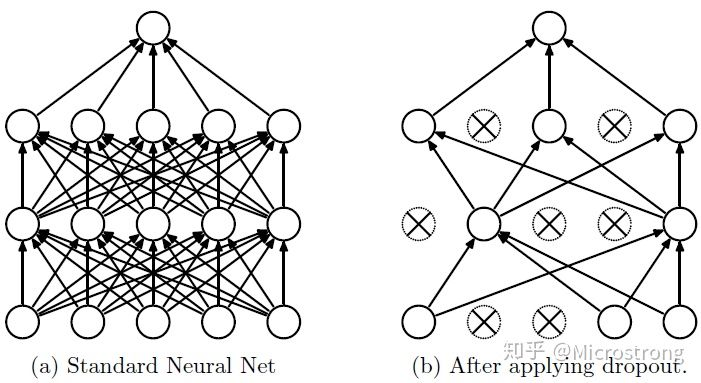

Hình 3: (a) Mạng chuẩn; (b) sau khi áp dropout, một số neuron (dấu ×) bị tạm bỏ (bài báo Dropout, hình 1).

### 27.1 Quy trình của dropout

Với một mạng chuẩn, quy trình bình thường là: đưa $x$ qua mạng theo chiều xuôi, rồi lan truyền ngược sai số để quyết định cập nhật tham số. Dùng dropout thì quy trình thành:

1. Tạm bỏ ngẫu nhiên một nửa số neuron ẩn (đặt kích hoạt của chúng bằng 0), giữ nguyên neuron vào và ra;
2. Đưa $x$ qua mạng đã sửa theo chiều xuôi, rồi lan truyền ngược mất mát qua mạng đã sửa. Sau khi xử lý xong một minibatch, cập nhật tham số $(w, b)$ của các neuron không bị bỏ theo SGD;
3. Lặp lại:

+ khôi phục các neuron bị bỏ (tham số của chúng giữ nguyên, không được cập nhật ở bước vừa rồi; neuron không bị bỏ đã được cập nhật);
+ chọn ngẫu nhiên một tập con một nửa số neuron ẩn để tạm bỏ;
+ với minibatch tiếp theo, lan truyền xuôi rồi lan truyền ngược và cập nhật $(w, b)$ theo SGD (chỉ phần tham số không bị bỏ được cập nhật).

### 27.2 Dropout trong mạng neuron

1. Khi huấn luyện

Mỗi đơn vị của mạng phải thêm một bước ngẫu nhiên. So sánh mạng chuẩn và mạng có dropout:

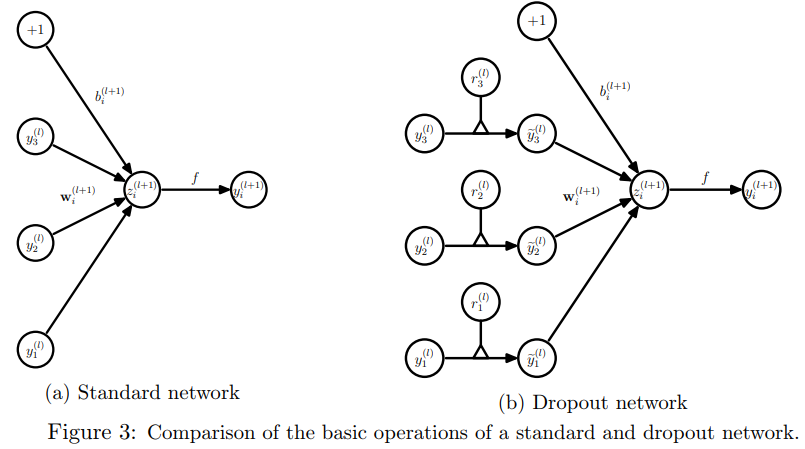

Hình 4: (a) Mạng chuẩn; (b) mạng có dropout: mỗi đầu vào $y_i^{(l)}$ được nhân với một biến Bernoulli $r_i^{(l)}$ (bằng 1 với xác suất giữ, bằng 0 nếu bị bỏ) trước khi vào neuron (bài báo Dropout, hình 3).

2. Khi kiểm tra

Khi dự đoán, đầu vào giữ nguyên, nhưng trọng số của mỗi đơn vị được nhân với **xác suất giữ** $p$.

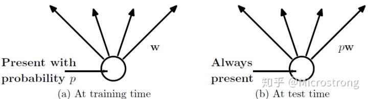

Hình 5: (a) Khi huấn luyện, mỗi đơn vị có mặt với xác suất $p$; (b) khi kiểm tra, đơn vị luôn có mặt và trọng số được nhân với $p$, để đầu ra kỳ vọng bằng lúc huấn luyện (bài báo Dropout, hình 2).

> **Biên tập:** Bản gốc dùng cùng ký hiệu $p$ với hai nghĩa ngược nhau: ở đầu mục là xác suất **bị bỏ**, ở mục kiểm tra (theo bài báo gốc) là xác suất **được giữ**. Trong `nn.Dropout(p)` của PyTorch, $p$ là xác suất **bỏ**, và PyTorch dùng **inverted dropout**: khi huấn luyện chia đầu ra cho $1-p$, nên khi suy luận không phải nhân gì cả.

### 27.3 Chọn xác suất dropout

Bài báo gốc dùng xác suất **giữ** 0,8 cho tầng vào và 0,5 cho tầng ẩn, nhưng có thể chọn trong một khoảng ("All dropout nets use p = 0.5 for hidden units and p = 0.8 for input units", với $p$ là xác suất giữ). Theo quy ước của PyTorch thì là `nn.Dropout(0.2)` cho đầu vào và `nn.Dropout(0.5)` cho tầng ẩn. Các mô hình hiện nay thường dùng dropout nhỏ hơn (0,1 với Transformer, 0 với nhiều LLM lớn).

### Tài liệu tham khảo

1. Srivastava et al. [Dropout: A Simple Way to Prevent Neural Networks from Overfitting](https://jmlr.org/papers/v15/srivastava14a.html). JMLR 2014.
2. [深度学习中Dropout原理解析](https://zhuanlan.zhihu.com/p/38200980)

## 28 Nguyên lý thuật toán HOG

**Đặc trưng histogram hướng gradient (Histogram of Oriented Gradients, HOG)** là bộ mô tả đặc trưng dùng để phát hiện vật thể trong thị giác máy tính và xử lý ảnh. Nó tạo đặc trưng bằng cách tính và thống kê histogram hướng gradient trên các vùng cục bộ của ảnh. Trước khi học sâu thành công, HOG kết hợp bộ phân loại SVM được dùng rộng rãi trong nhận dạng ảnh, đặc biệt thành công với phát hiện người đi bộ (Dalal và Triggs, 2005).

### Nguyên lý

Ý tưởng cốt lõi của `HOG`: hình dạng của vật thể cục bộ có thể được mô tả bằng phân phối của gradient cường độ sáng hay hướng cạnh. Chia ảnh thành các vùng nhỏ liên thông (gọi là cell); mỗi `cell` tạo một histogram hướng gradient của các điểm ảnh trong nó; ghép các histogram này lại thành bộ mô tả (của vật thể cần phát hiện).

Để tăng độ chính xác, các histogram cục bộ được chuẩn hoá độ tương phản theo một vùng lớn hơn (gọi là block): tính một thước đo cường độ trên block rồi dùng nó chuẩn hoá mọi cell trong block. Việc chuẩn hoá này giúp bất biến tốt hơn với ánh sáng và bóng đổ. So với các bộ mô tả khác, HOG giữ được tính bất biến với các biến đổi hình học và quang học (trừ khi hướng của vật thay đổi). Vì vậy bộ mô tả HOG đặc biệt hợp với phát hiện người.

Trích đặc trưng HOG từ một ảnh:

1. chuyển ảnh xám (coi ảnh là hàm ba chiều theo x, y và cường độ);
2. chia thành các `cell` nhỏ (thường 8×8 điểm ảnh);
3. tính gradient (độ lớn và hướng) của từng điểm ảnh trong mỗi cell;
4. thống kê histogram hướng gradient của mỗi cell (thường 9 khoảng hướng, có trọng số theo độ lớn gradient), được bộ mô tả của cell.

> **Biên tập:** Bản gốc ghi cell kích thước "2×2". Trong HOG chuẩn, cell là 8×8 điểm ảnh, còn **block** gồm 2×2 cell (16×16 điểm ảnh) và các block chồng lên nhau.

### Các bước phát hiện bằng HOG

1. Cửa sổ phát hiện (ví dụ 64×128 điểm ảnh với người đi bộ).
2. Chuẩn hoá ảnh (chuẩn hoá màu, gamma).
3. Tính gradient.
4. Với mỗi cell, chiếu gradient vào histogram hướng có trọng số.
5. Chuẩn hoá độ tương phản các cell trong mỗi block (các block chồng nhau).
6. Ghép histogram của mọi block thành một vector đặc trưng HOG lớn, đưa vào bộ phân loại (SVM).

> **Biên tập:** Bản gốc dán ảnh sơ đồ các bước bằng tiếng Trung; đã gõ lại thành danh sách trên.

**Tóm tắt**: chuẩn hoá không gian màu → tính gradient → histogram hướng gradient → chuẩn hoá histogram trên các block chồng nhau → đặc trưng HOG.

### Tài liệu tham khảo

[HOG特征检测－简述](https://blog.csdn.net/liyuqian199695/article/details/53835989)

## 29 Hàm kích hoạt

### 29.1 Tác dụng

+ **Phi tuyến hoá.** Hàm kích hoạt tăng năng lực biểu diễn của mạng (đưa vào yếu tố phi tuyến); không có nó, chồng nhiều tầng tuyến tính vẫn chỉ là một ánh xạ tuyến tính, không tạo được hàm phức tạp. Đưa đầu ra của mỗi neuron qua một hàm phi tuyến thì cả mạng không còn tuyến tính nữa; hàm phi tuyến đó là hàm kích hoạt.
+ Hàm kích hoạt biến không gian đặc trưng hiện tại sang một không gian khác qua một ánh xạ **phi tuyến**, để dữ liệu dễ phân loại hơn.
+ Hàm kích hoạt rất quan trọng để mô hình học và biểu diễn các hàm phi tuyến phức tạp.

### 29.2 Các hàm kích hoạt thường gặp

Hàm kích hoạt còn gọi là hàm ánh xạ phi tuyến; hay gặp nhất là `ReLU`, `sigmoid`, `tanh`:

+ ReLU: $f(x)=\max(x,0)$
+ sigmoid: $f(x)=\frac{1}{1+e^{-x}}$
+ tanh: $f(x)=\frac{1-e^{-2x}}{1+e^{-2x}}=\frac{2}{1+e^{-2x}}-1 = 2\operatorname{sigmoid}(2x)-1$

> **Biên tập:** Ở mục 29.1 bản gốc viết hàm kích hoạt biến đổi không gian "qua một ánh xạ **tuyến tính**", mâu thuẫn với chính ý trước đó; đúng là phi tuyến. Công thức tanh của bản gốc có tử số $1+e^{-2x}$ (khi đó phân số luôn bằng 1); đúng là $1-e^{-2x}$.

### 29.3 Đồ thị hàm kích hoạt và gradient

1. `Sigmoid` dùng được ở tầng ra của bài toán phân loại: đầu ra bị ép vào khoảng `0` đến `1` (trùng miền giá trị của xác suất), đó là lý do sigmoid được ưa chuộng cho phân loại.

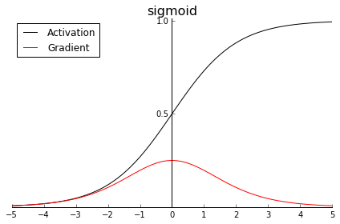

2. `tanh(x)` được đề xuất trên nền sigmoid để giải quyết vấn đề trung bình (đầu ra có tâm tại 0). Hình dạng giống sigmoid nhưng ép đầu vào về khoảng $(-1, 1)$. Gradient của nó có đỉnh cao hơn nhiều, 1,0 (cũng tại $x=0$), nhưng giảm nhanh hơn: khi $|x|$ đạt 3 thì đã gần 0. Đây là nguồn gốc của tiêu biến gradient (vanishing gradients), làm việc huấn luyện chậm lại.

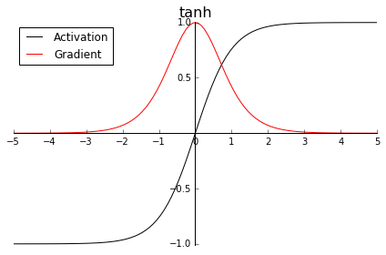

3. `ReLU` xử lý được tiêu biến gradient thường gặp ở sigmoid và tanh, và là hàm kích hoạt tính gradient nhanh nhất. Nhưng ReLU có khiếm khuyết: khi $x < 0$, gradient bằng 0. Nghĩa là những đáp ứng tích chập đã thành âm sẽ không còn ảnh hưởng tới việc huấn luyện nữa; hiện tượng này gọi là "vùng chết".

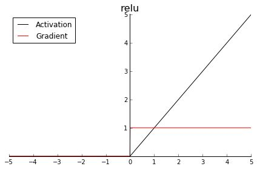

> **Biên tập:** Bản gốc viết "khi $x<0$, gradient bằng $y$", "đáp ứng nhỏ hơn $y$" (lỗi chép: phải là 0). Chi tiết hơn ở bài [Hàm kích hoạt](dlnote/dl_act_vi).

## 30 Lớp tích chập và lớp gộp khác nhau thế nào

1. **Lớp tích chập có tham số, lớp gộp không có tham số.**
2. **Lớp tích chập (thường) thay đổi độ sâu** (số kênh) của biểu diễn; lớp gộp không đổi số kênh, nhưng có thể thu nhỏ kích thước không gian.

## 31 Tính số tham số của lớp tích chập và lớp gộp

Xem bài [Phân tích độ phức tạp của CNN](https://github.com/harleyszhang/dl_note/blob/main/6-model_deploy/%E5%8D%B7%E7%A7%AF%E7%A5%9E%E7%BB%8F%E7%BD%91%E7%BB%9C%E5%A4%8D%E6%9D%82%E5%BA%A6%E5%88%86%E6%9E%90.md) (phần triển khai mô hình của khoá này). Tóm tắt: lớp tích chập có $C_{out}\times\frac{C_{in}}{g}\times k_h\times k_w$ trọng số cộng $C_{out}$ bias; lớp gộp có 0 tham số.

> **Biên tập:** Liên kết của bản gốc trỏ tới một tệp cùng thư mục không tồn tại; bài đó nằm ở thư mục `6-model_deploy`. Công thức tóm tắt do người biên soạn thêm.

## 32 Vì sao mạng neuron dùng hàm mất mát cross-entropy

Cross-entropy (`cross entropy`) là một trong những cách hay dùng để đánh giá một vector đầu ra gần vector mong muốn đến đâu; nó đo khác biệt giữa hai phân phối xác suất, và là hàm mất mát dùng rộng rãi cho phân loại. Với hai phân phối `p` và `q`, cross-entropy khi dùng `q` để biểu diễn `p` là $H(p,q)=-\sum_x p(x)\log q(x)$. Lý do sâu hơn (cực tiểu hoá cross-entropy là ước lượng hợp lý cực đại; gradient $a-y$ không bị triệt tiêu như MSE sau sigmoid) ở mục 2.5 bài [Hàm mất mát](dlnote/dl_loss_vi).

## 33 Có những cách tăng cường dữ liệu nào

Các cách tăng cường dữ liệu hay dùng:

+ Lật: `Fliplr`, `Flipud`. Khác với xoay 180 độ, đây là lật như soi gương; hay dùng lật ngang và lật dọc.
+ Xoay: `rotate`. Xoay theo hoặc ngược chiều kim đồng hồ; xoay góc không phải bội của 90 độ (như 45 độ) sẽ làm hụt hoặc tràn các góc ảnh, phải đệm hoặc cắt.
+ Co giãn: `zoom`. Ảnh có thể phóng to hoặc thu nhỏ.
+ Cắt: `crop`, thường là cắt ngẫu nhiên: chọn ngẫu nhiên một phần ảnh, cắt ra, rồi đưa về kích thước gốc. Về bản chất, crop là bỏ phần thông tin không cần, giữ phần cần.
+ Dịch: `translation`. Dịch ảnh theo trục x, y hay cả hai. Khi dịch cần giả định về nền (ví dụ màu đen) cho phần ảnh bị trống. Vì vật thể có thể xuất hiện ở bất kỳ vị trí nào, dịch là cách tăng cường rất hữu ích.
+ Biến đổi affine: `Affine`, gồm dịch, xoay, co giãn và trượt (`shear`).
+ Thêm nhiễu: quá khớp thường xảy ra khi mạng học các đặc trưng tần số cao; thêm nhiễu ngẫu nhiên giúp hạn chế học các đặc trưng đó (ví dụ nhiễu Gauss cộng thêm).
+ Tăng giảm độ sáng, độ tương phản: các phép tăng cường về màu sắc.
+ Làm sắc nét: `Sharpen`; ngược lại là làm mờ (`GaussianBlur`).

> **Biên tập:** Bản gốc nêu tên hàm của thư viện `imgaug` (`Scale`, `GaussianBlur`, `Sharpen`) và gọi `GaussianBlur` là "thêm nhiễu"; làm mờ Gauss không phải thêm nhiễu (`AdditiveGaussianNoise` mới là thêm nhiễu). `imgaug` đã ngừng phát triển từ 2020; nay nên dùng `torchvision.transforms.v2` hoặc `Albumentations`, cùng các cách tăng cường mạnh hơn như Mixup, CutMix, RandAugment (xem bài tăng cường dữ liệu ở phần 4 của khoá).

### 33.1 Tăng cường offline và online khác nhau thế nào?

Tăng cường dữ liệu có hai loại: **offline** và **online**.

1. Offline: xử lý thẳng tập dữ liệu trên đĩa và lưu các tệp đã tăng cường. Số mẫu thành hệ số tăng cường × số mẫu gốc; thường dùng khi tập dữ liệu rất nhỏ.
2. Online: tăng cường mỗi batch ngay sau khi lấy ra (xoay, dịch, lật...). Vì một số tập dữ liệu không chịu nổi việc tăng số mẫu theo cấp số nhân, cách này hay dùng cho tập lớn; các framework học máy đều hỗ trợ, và có thể chạy trên GPU. Online cũng cho mỗi epoch một biến thể ngẫu nhiên khác của cùng ảnh, nên đa dạng hơn offline.

### Tài liệu tham khảo

[深度学习中的数据增强](https://blog.csdn.net/zhelong3205/article/details/81810743)

## 34 Thay RoI Pooling bằng RoI Align: hiệu quả và nguyên lý

Thay `RoI Pooling` bằng `RoI Align` trong `Faster R-CNN` cải thiện kết quả (Mask R-CNN báo cáo tăng vài điểm AP với phân đoạn thể hiện, và AP cao hơn rõ ở ngưỡng IoU chặt).

### Nguyên lý RoI Pooling

Các vùng `RoI` do `RPN` sinh ra có toạ độ theo ảnh vào (mỗi vùng một kích thước khác nhau). Để dùng chung trọng số cho các tầng phía sau, phải chiếu các `RoI` này lên bản đồ đặc trưng và đưa về kích thước cố định. Quá trình RoI Pooling:

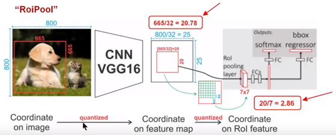

Hình 6: RoI Pooling làm tròn toạ độ hai lần: khi chiếu khung từ ảnh lên bản đồ đặc trưng, và khi chia khung thành lưới 7×7.

**Cụ thể:**

1. Mạng tích chập là `VGG16`, giả sử `feat_stride=32` (bản đồ đặc trưng nhỏ hơn ảnh gốc 32 lần); ảnh gốc $800\times 800$, bản đồ đặc trưng cuối $25\times 25$.
2. Giả sử có một vùng đề xuất (`region proposal`) kích thước $665\times 665$ trên ảnh gốc; chiếu lên bản đồ đặc trưng được $665/32=20{,}78$, tức $20{,}78\times 20{,}78$. Code làm tròn số này, đó là **lần lượng tử hoá thứ nhất**: vùng trên bản đồ đặc trưng thành $20\times20$.
3. Giả sử `pooled_w=7`, `pooled_h=7`, tức sau pooling được bản đồ $7\times 7$. Chia vùng $20\times 20$ thành 49 ô bằng nhau, mỗi ô $20/7=2{,}86$; **lượng tử hoá lần hai**: mỗi ô thành $2\times 2$.
4. Trong mỗi ô $2\times 2$ lấy giá trị lớn nhất làm "đại diện"; 49 ô cho 49 giá trị, thành bản đồ $7\times 7$.

Như vậy, sau **hai lần lượng tử hoá (làm tròn số thực)**, vùng mà RoI Pooling thật sự đọc lệch khỏi vùng đề xuất: lần một làm mất $0{,}78$ ô đặc trưng (khoảng 25 điểm ảnh trên ảnh gốc), lần hai khiến 49 ô $2\times2$ chỉ phủ $14\times14$ trong vùng $20\times20$. Với bước trượt 32, mỗi ô lệch tương ứng hàng chục điểm ảnh trên ảnh gốc, ảnh hưởng tới hồi quy định vị ở phía sau. Vì vậy có phương án thay thế: `RoI Align`.

> **Biên tập:** Câu tổng kết của bản gốc ("vùng $20\times20$ bị lệch thành kích thước $7\times7$") không đúng ý; viết lại như trên. Ngoài ra Faster R-CNN với VGG16 thực ra lấy đặc trưng ở `conv5_3`, bước trượt 16 (không qua `pool5`); ví dụ dùng 32 theo bài blog được trích, kết luận không đổi.

### Nguyên lý RoI Align

Hình minh hoạ RoI Align:

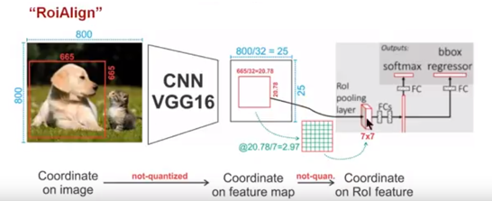

Hình 7: RoI Align giữ nguyên toạ độ số thực ở cả hai bước.

`RoI Align` được đề xuất trong `Mask R-CNN`, để chiếu vùng đề xuất (`region proposal`) thành bản đồ đặc trưng kích thước cố định mà không làm tròn:

1. Mạng tích chập `VGG16`, `feat_stride=32`; ảnh gốc $800\times 800$, bản đồ đặc trưng cuối $25\times 25$.
2. Vùng đề xuất $665\times 665$ trên ảnh gốc; chiếu lên bản đồ đặc trưng được $665/32=20{,}78$, tức $20{,}78\times 20{,}78$; không làm tròn như `RoI Pooling` mà giữ số thực.
3. Với `pooled_w=7`, `pooled_h=7`, chia vùng $20{,}78\times 20{,}78$ thành 49 ô bằng nhau, mỗi ô $20{,}78/7=2{,}97$, tức $2{,}97\times 2{,}97$.
4. Giả sử dùng 4 điểm lấy mẫu: chia mỗi ô $2{,}97\times 2{,}97$ thành bốn phần, lấy điểm giữa mỗi phần; giá trị tại điểm đó (toạ độ thực) tính bằng nội suy song tuyến từ bốn điểm lưới gần nhất, được bốn giá trị:

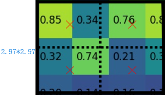

Hình 8: Bốn điểm lấy mẫu (dấu × đỏ) trong một ô $2{,}97\times2{,}97$; giá trị tại mỗi điểm được nội suy song tuyến từ các ô đặc trưng xung quanh.

Cuối cùng lấy giá trị lớn nhất (hoặc trung bình, như cài đặt của Mask R-CNN và `torchvision.ops.roi_align`) của bốn điểm làm giá trị của ô; 49 ô cho bản đồ $7\times 7$.

### Tổng kết RoI Pooling và RoI Align

Hiểu nguyên lý hai cách, có thể chọn tuỳ dự án: với vật thể lớn, hai cách khác nhau không nhiều; với ảnh có nhiều vật thể nhỏ, nên chọn `RoI Align` vì chính xác hơn. Các thư viện phát hiện vật thể hiện nay đều mặc định dùng RoI Align.

### Tài liệu tham khảo

[RoIPooling、RoIAlign笔记](https://www.cnblogs.com/wangyong/p/8523814.html)

## 35 Suy ra lan truyền ngược trong CNN

+ [四张图彻底搞懂CNN反向传播算法（通俗易懂）](https://zhuanlan.zhihu.com/p/81675803)
+ [反向传播算法推导过程（非常详细）](https://zhuanlan.zhihu.com/p/79657669)

Tóm tắt: với $Y = W\star X$ (tương quan chéo, bước trượt 1), gradient theo trọng số là tương quan chéo giữa đầu vào và gradient đầu ra, $\frac{\partial L}{\partial W}=X\star\frac{\partial L}{\partial Y}$; gradient theo đầu vào là tích chập "đầy đủ" (đệm $k-1$) của gradient đầu ra với kernel đã xoay 180°, $\frac{\partial L}{\partial X}=\frac{\partial L}{\partial Y}\star_{\text{full}}\operatorname{rot180}(W)$. Gradient đi qua lớp gộp max chỉ chảy về vị trí đạt giá trị lớn nhất; qua gộp trung bình thì chia đều cho cả cửa sổ. Trang Code kiểm tra hai công thức tích chập bằng autograd.

## 36 Công thức Focal Loss

Để xử lý mất cân bằng giữa mẫu dương và mẫu âm, ta thường thêm hệ số $\alpha$ vào cross-entropy:

$$
\text{CE} = \begin{cases}
-\alpha \log p, & y=1\\
-(1-\alpha)\log(1-p), & y=0
\end{cases}
$$

$\alpha$ cân bằng mẫu dương và âm, nhưng không giúp gì cho mất cân bằng giữa mẫu dễ và mẫu khó. Vì vậy có `Focal Loss`:

$$
\text{FL} = \begin{cases}
-\alpha (1-p)^\gamma \log p, & y=1\\
-(1-\alpha) p^\gamma \log(1-p), & y=0
\end{cases}
$$

Thực nghiệm cho thấy $\gamma = 2$, $\alpha = 0{,}25$ tốt nhất.

+ `Focal loss` giải quyết thành công vấn đề trong phát hiện vật thể một giai đoạn: **vùng mẫu dương và âm mất cân bằng rất nặng**, khiến `loss` bị chi phối bởi số lượng lớn mẫu âm (dễ).
+ Theo bài báo, `RetinaNet` đạt độ chính xác cao hơn chủ yếu nhờ đổi hàm mất mát, không phải nhờ kiến trúc mạng (dù nó cũng dùng FPN).

> Để ý $\alpha=0{,}25$ lại **giảm** trọng số mẫu dương (vốn ít hơn): khi đã có số hạng $(1-p)^\gamma$ giảm mạnh mất mát của các mẫu âm dễ, bài báo thấy cần cân lại một chút theo hướng ngược.

## 37 Trả lời nhanh

### 37.1 Vì sao Faster R-CNN, Mask R-CNN cần RoI Pooling, RoI Align?

Vì các tầng kết nối đầy đủ phía sau cần đầu vào **kích thước cố định**, trong khi các vùng đề xuất có kích thước khác nhau. Sau khi mọi `RoI` được pooling thành bản đồ $512\times7\times7$ và duỗi thành vector một chiều, ta dùng được trọng số tiền huấn luyện của hai tầng kết nối đầy đủ đầu tiên trong `VGG16` (vốn nhận đầu vào $512\times7\times7$) để khởi tạo, và mọi RoI dùng chung các tầng này.

> **Biên tập:** Bản gốc trả lời "để hai tầng kết nối đầy đủ dùng chung trọng số của các tầng tích chập". Lý do gốc là kích thước cố định cho tầng kết nối đầy đủ; việc dùng chung bản đồ đặc trưng của mạng tích chập cho mọi RoI là lý do của thiết kế Fast R-CNN nói chung.

### 37.2 Công thức softmax

$$\operatorname{softmax}(\boldsymbol y)_{i} = \frac{e^{y_{i}}}{\sum_{j=1}^{n}e^{y_j}}$$

### 37.3 Các cách lấy mẫu lên

Lấy mẫu lên (upsampling) có thể chia thành ba loại:

1. Dựa trên nội suy: láng giềng gần nhất (`nearest`), song tuyến (`bilinear`), song lập phương (`bicubic`)..., các phương pháp xử lý ảnh truyền thống.
2. Dựa trên học sâu: tích chập chuyển vị (còn gọi là giải chập, `ConvTranspose2d`), pixel shuffle (sub-pixel convolution)...
3. `Unpooling`: điền số 0 hay sao chép giá trị (MaxUnpool đặt giá trị về đúng vị trí đã lấy max khi gộp).

> Chất lượng: láng giềng gần nhất < song tuyến < song lập phương. Tốc độ: láng giềng gần nhất > song tuyến > song lập phương.

### 37.4 Biết và đã dùng framework học sâu nào trên di động?

Câu trả lời của tác giả (2021): nổi tiếng có TensorFlow Lite, MACE của Xiaomi, ncnn của Tencent, khi đó chưa dùng cái nào.

> **Biên tập:** Cập nhật 2026: TensorFlow Lite đổi tên thành **LiteRT**; MACE ngừng phát triển; các lựa chọn phổ biến khác gồm **ncnn**, **MNN** (Alibaba), **ExecuTorch** (PyTorch), **ONNX Runtime Mobile**, **Core ML** (Apple), Paddle Lite, và llama.cpp/MLC cho mô hình ngôn ngữ. Phần triển khai mô hình của khoá có hai bài phân tích mã nguồn ncnn.

### 37.5 Làm sao tăng khả năng tổng quát hoá của mạng

Giống các cách chống quá khớp (câu 16.1), thêm kết hợp mô hình (ensemble).

### 37.6 Trong BN, vì sao phải thêm gamma và beta, bỏ có được không?

Bước co giãn và dịch (`scale and shift`) cuối cùng cho phép BN, vốn được "cố ý" thêm vào để huấn luyện tốt hơn, có khả năng khôi phục lại đầu vào ban đầu (với $\gamma=\sqrt{\sigma^2+\epsilon}$, $\beta=\mu$), tức không làm giảm năng lực biểu diễn. Bỏ đi vẫn chạy được, nhưng có thể giảm năng lực biểu diễn: ví dụ đầu vào của sigmoid luôn bị ép quanh 0, nơi sigmoid gần tuyến tính.

> **Biên tập:** Bản gốc trả lời gọn "bỏ cũng được". Thực tế có bỏ (`nn.BatchNorm2d(affine=False)`), nhưng thường chỉ khi ngay sau BN là một tầng tuyến tính có thể tự học lại phép co giãn và dịch đó.

### 37.7 Vai trò của tập kiểm định và tập kiểm tra

+ Tập kiểm định dùng trong quá trình huấn luyện để kiểm tra mô hình, **từ đó chọn siêu tham số phù hợp**;
+ Tập kiểm tra dùng sau khi huấn luyện xong, **để đánh giá khả năng tổng quát hoá**; không được dùng để chọn siêu tham số.

## 38 Hiểu và dùng kiểm định chéo

Bản gốc dẫn bài Zhihu [N折交叉验证的作用（如何使用交叉验证）](https://zhuanlan.zhihu.com/p/113623623) và hẹn "bổ sung cách hiểu sau". Tóm tắt do người biên soạn viết: kiểm định chéo $k$-fold chia dữ liệu thành $k$ phần, lần lượt dùng mỗi phần làm tập kiểm định và $k-1$ phần còn lại để huấn luyện, rồi lấy trung bình $k$ kết quả. Tác dụng: (1) ước lượng sai số tổng quát hoá ổn định hơn khi dữ liệu ít, vì mọi mẫu đều được dùng để kiểm định đúng một lần; (2) chọn siêu tham số hay so sánh mô hình dựa trên ước lượng đó; (3) độ lệch chuẩn giữa các fold cho biết kết quả dao động bao nhiêu. Giá phải trả là huấn luyện $k$ lần, nên trong học sâu với dữ liệu lớn thường chỉ dùng một tập kiểm định cố định. Thuật toán và giả mã ở mục 5.3.2 bài [Nguyên lý cơ bản của học máy](dlnote/math_ml_vi).

## 39 Nguyên lý NMS và IoU

NMS (non-maximum suppression, triệt tiêu không cực đại), đúng như tên gọi, là loại bỏ các phần tử không phải cực đại. Trong phát hiện vật thể, khi giải mã đầu ra của mô hình thường có rất nhiều khung dự đoán, nhiều khung trùng lặp cùng định vị một vật thể; NMS dùng để loại các khung trùng lặp đó, giữ lại khung thật. Quá trình NMS dùng IoU, một thước đo mức trùng khớp giữa hai khung: trùng khớp càng nhiều, IoU càng cao. IoU là diện tích phần giao của hai vùng chia cho diện tích phần hợp, tức giao trên hợp.

Trong NMS, trước hết sắp xếp các khung theo độ tin cậy; lấy khung có độ tin cậy cao nhất, tính IoU với các khung còn lại; khung nào có IoU lớn hơn một ngưỡng thì coi như cùng vật thể và bị loại (khung có độ tin cậy thấp hơn bị bỏ). Lặp lại với khung có độ tin cậy cao nhất trong số còn lại, cho tới khi xét hết. NMS thường làm riêng cho từng lớp. Trong `torchvision` có sẵn `torchvision.ops.nms` và `batched_nms`; các bộ phát hiện kiểu DETR, YOLOv10 được thiết kế để không cần NMS.

## 40 Đánh giá tầm quan trọng của kênh trọng số

Trong CNN và mô hình ngôn ngữ lớn (LLM), kênh (channel, hay chiều embedding) là thành phần cơ bản của bản đồ đặc trưng và tensor `Embedding`; đánh giá tầm quan trọng của kênh giúp cắt tỉa và tối ưu mô hình. Các cách hay dùng:

- Cắt tỉa theo chuẩn `L1`: tính chuẩn L1 của trọng số mỗi kênh, sắp xếp và cắt các kênh có chuẩn L1 nhỏ.
- Cắt tỉa theo chuẩn `L2`: tương tự, dùng chuẩn L2 của trọng số mỗi kênh.
- Cắt tỉa theo trị tuyệt đối của trọng số: so trị tuyệt đối trọng số rồi cắt phần nhỏ (áp cho từng trọng số thì là cắt tỉa không cấu trúc; áp cho kênh thì quy về chuẩn L1 hay giá trị lớn nhất của kênh).

Ngoài ra, các cách đánh giá **tầm quan trọng của trọng số** gồm: độ lớn (trị tuyệt đối), chuẩn L1 và chuẩn L2 của vector trọng số. Các tiêu chí dựa trên dữ liệu (như hệ số $\gamma$ của BN, hay tích của độ lớn trọng số với độ lớn kích hoạt như Wanda dùng cho LLM) thường tốt hơn chỉ nhìn trọng số. Chi tiết ở bài [Thuật toán cắt tỉa](dlnote/compress_prune_vi).

## Tài liệu tham khảo

1. [《Batch Normalization Accelerating Deep Network Training by Reducing Internal Covariate Shift》阅读笔记与实现](https://blog.csdn.net/happynear/article/details/44238541)
2. [详解机器学习中的梯度消失、爆炸原因及其解决方法](https://blog.csdn.net/qq_25737169/article/details/78847691)
3. [N折交叉验证的作用（如何使用交叉验证）](https://zhuanlan.zhihu.com/p/113623623)
4. [5分钟理解Focal Loss与GHM——解决样本不平衡利器](https://zhuanlan.zhihu.com/p/80594704)
5. [深度学习CV岗位面试问题总结（目标检测篇）](https://blog.csdn.net/qq_39056987/article/details/112104199)
6. Grinsztajn, Oyallon, Varoquaux. [Why do tree-based models still outperform deep learning on tabular data?](https://arxiv.org/abs/2207.08815) NeurIPS 2022.
