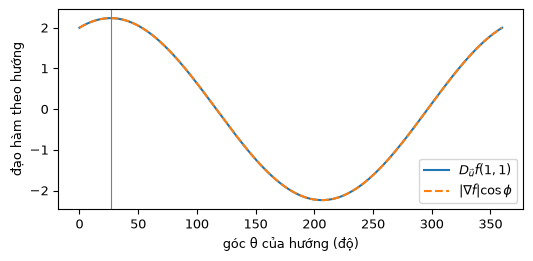
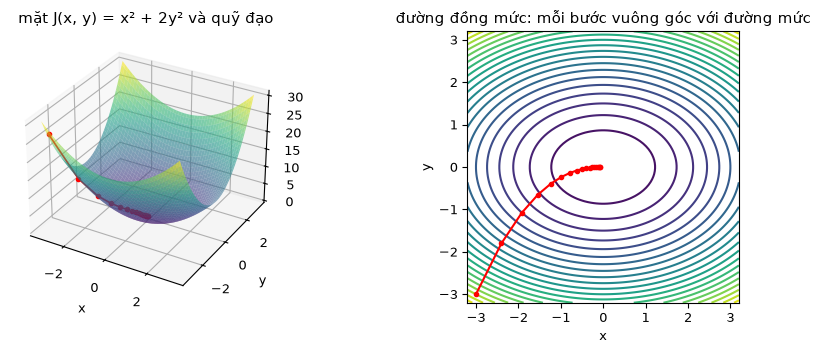
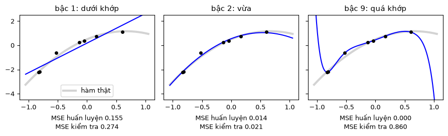
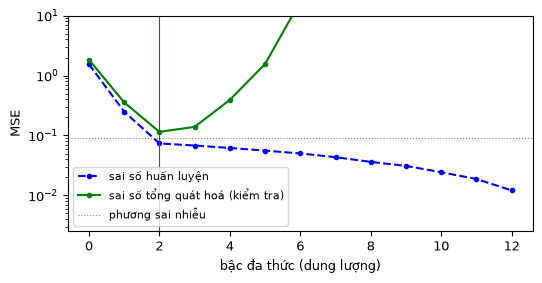
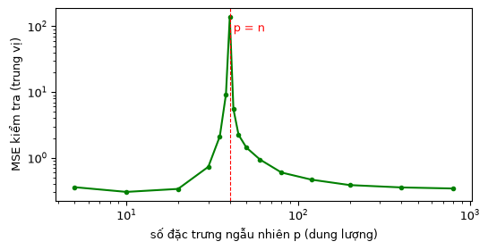

# Nền tảng toán và học máy · Code

> Ghi chú của người biên soạn: trang này do người biên soạn viết thêm cho ba bài [Nền tảng toán của gradient descent](dlnote/math_grad_vi), [Xác suất và lý thuyết thông tin](dlnote/math_prob_vi) và [Nguyên lý cơ bản của học máy](dlnote/math_ml_vi). Mỗi mục kiểm tra một công thức hay một nhận xét của các bài đó bằng số. Mục 2 sửa và chạy lại script `gd_double_variable.py` trong thư mục `src/python` của kho dl_note.

## Cách dùng trang này

Các khối chạy lần lượt từ trên xuống và dùng chung biến. Cần `numpy`, `matplotlib`, `torch`. Mọi khối chạy trên CPU trong vài giây.

## 1. Đạo hàm theo hướng

<small class="viz-ref">Bài gradient: đạo hàm theo hướng, gradient</small>

Lấy hàm của hình 2, $f(x,y)=x^2+y^2/2$ tại $P=(1,1)$. Ta tính đạo hàm theo hướng bằng định nghĩa giới hạn (sai phân với $t$ nhỏ) và so với công thức $\nabla f\cdot\vec u$, rồi quét mọi góc $\theta$ để xem hướng nào cho đạo hàm lớn nhất.

<!-- run -->
```python
import numpy as np
import matplotlib.pyplot as plt
np.set_printoptions(precision=4, suppress=True)

f = lambda x, y: x**2 + y**2 / 2
grad = lambda x, y: np.array([2 * x, y])
a, b = 1.0, 1.0

def dir_deriv(f, a, b, theta, t=1e-6):
    # định nghĩa: [f(a + t cosθ, b + t sinθ) - f(a, b)] / t với t → 0 (dùng sai phân trung tâm)
    return (f(a + t*np.cos(theta), b + t*np.sin(theta)) - f(a - t*np.cos(theta), b - t*np.sin(theta))) / (2*t)

theta = np.pi / 4
u = np.array([np.cos(theta), np.sin(theta)])
print(f"theo giới hạn : {dir_deriv(f, a, b, theta):.4f}")
print(f"∇f·u          : {grad(a, b) @ u:.4f}   (GeoGebra ở hình 2: 2,12)")

thetas = np.linspace(0, 2*np.pi, 721)
D = np.array([dir_deriv(f, a, b, th) for th in thetas])
g = grad(a, b)
best = thetas[D.argmax()]
print(f"góc cho đạo hàm lớn nhất : {np.degrees(best):.1f}°")
print(f"góc của gradient (2, 1)  : {np.degrees(np.arctan2(g[1], g[0])):.1f}°")
print(f"đạo hàm lớn nhất = {D.max():.4f},  |∇f| = {np.linalg.norm(g):.4f}")
print(f"đạo hàm nhỏ nhất = {D.min():.4f}  (= -|∇f|)")

fig, ax = plt.subplots(figsize=(6, 2.6))
ax.plot(np.degrees(thetas), D, label=r"$D_{\vec u}f(1,1)$")
ax.plot(np.degrees(thetas), np.linalg.norm(g) * np.cos(thetas - np.arctan2(g[1], g[0])), '--',
        label=r"$|\nabla f|\cos\phi$")
ax.axvline(np.degrees(best), color='gray', lw=0.8)
ax.set_xlabel("góc θ của hướng (độ)"); ax.set_ylabel("đạo hàm theo hướng")
ax.legend(); plt.show()
```

<!-- output -->
```output
theo giới hạn : 2.1213
∇f·u          : 2.1213   (GeoGebra ở hình 2: 2,12)
góc cho đạo hàm lớn nhất : 26.5°
góc của gradient (2, 1)  : 26.6°
đạo hàm lớn nhất = 2.2361,  |∇f| = 2.2361
đạo hàm nhỏ nhất = -2.2361  (= -|∇f|)
```

<div align=center></div>
<!-- /output -->

Đường liền (tính bằng giới hạn) và đường đứt ($|\nabla f|\cos\phi$) trùng nhau. Cực đại nằm đúng ở góc của gradient, bằng độ dài gradient $\sqrt5\approx2{,}236$.

Ô Biên tập của bài nói công thức $\nabla f\cdot\vec u$ cần hàm khả vi. Hàm $f(x,y)=x^2y/(x^2+y^2)$ (với $f(0,0)=0$) có cả hai đạo hàm riêng tại gốc bằng 0, nên "gradient" là $(0,0)$, nhưng đạo hàm theo hướng không bằng 0:

<!-- run -->
```python
def h(x, y):
    r2 = x**2 + y**2
    return 0.0 if r2 == 0 else x**2 * y / r2

def one_sided(f, a, b, theta, t=1e-7):
    return (f(a + t*np.cos(theta), b + t*np.sin(theta)) - f(a, b)) / t

print("đạo hàm riêng tại gốc:", one_sided(h, 0, 0, 0), one_sided(h, 0, 0, np.pi/2))
for deg in [0, 30, 45, 60, 90]:
    th = np.radians(deg)
    print(f"θ = {deg:2d}°:  theo giới hạn = {one_sided(h, 0, 0, th):.4f},  "
          f"∇f·u = 0,  cos²θ·sinθ = {np.cos(th)**2 * np.sin(th):.4f}")
```

<!-- output -->
```output
đạo hàm riêng tại gốc: 0.0 3.749399456654644e-33
θ =  0°:  theo giới hạn = 0.0000,  ∇f·u = 0,  cos²θ·sinθ = 0.0000
θ = 30°:  theo giới hạn = 0.3750,  ∇f·u = 0,  cos²θ·sinθ = 0.3750
θ = 45°:  theo giới hạn = 0.3536,  ∇f·u = 0,  cos²θ·sinθ = 0.3536
θ = 60°:  theo giới hạn = 0.2165,  ∇f·u = 0,  cos²θ·sinθ = 0.2165
θ = 90°:  theo giới hạn = 0.0000,  ∇f·u = 0,  cos²θ·sinθ = 0.0000
```
<!-- /output -->

## 2. Gradient descent hai biến

<small class="viz-ref">Bài gradient: tổng kết; bài nguyên lý: mục 5.9</small>

Script `gd_double_variable.py` của kho dl_note (lấy từ AI-EDU của Microsoft, giấy phép MIT) chạy gradient descent trên $J(x,y)=x^2+2y^2$ từ điểm $(-3,-3)$ với tốc độ học $\eta=0{,}1$. Bản gốc có hai lỗi:

- hàm vẽ mặt cong dùng $x^2+4y^2$, không phải hàm $J=x^2+2y^2$ đang tối ưu, nên quỹ đạo không nằm trên mặt vẽ;
- `Axes3D(fig)` không còn tự gắn vào hình từ matplotlib 3.6, nên hình hiện ra trống. Ở đây dùng `fig.add_subplot(projection='3d')`.

<!-- run -->
```python
def J(x, y):
    return x**2 + 2 * y**2

def dJ(theta):
    x, y = theta
    return np.array([2 * x, 4 * y])

theta = np.array([-3.0, -3.0])
eta, eps = 0.1, 5e-3          # tốc độ học; dừng khi J < eps
path = []
for i in range(50):
    z = J(*theta)
    path.append((*theta, z))
    if i < 5 or z < eps:
        print(f"{i:2d}: x={theta[0]: .4f}  y={theta[1]: .4f}  J={z:.5f}  ∇J={dJ(theta)}")
    if z < eps:
        break
    theta = theta - eta * dJ(theta)
path = np.array(path)
print(f"dừng sau {len(path) - 1} bước")

u = np.linspace(-3.2, 3.2, 100)
X, Y = np.meshgrid(u, u)
fig = plt.figure(figsize=(9, 3.6))
ax = fig.add_subplot(1, 2, 1, projection='3d')
ax.plot_surface(X, Y, J(X, Y), cmap='viridis', alpha=0.6)   # đúng hàm J đang tối ưu
ax.plot(path[:, 0], path[:, 1], path[:, 2], 'r.-', lw=1.2)
ax.set_xlabel('x'); ax.set_ylabel('y'); ax.set_title('mặt J(x, y) = x² + 2y² và quỹ đạo')
ax2 = fig.add_subplot(1, 2, 2)
ax2.contour(X, Y, J(X, Y), levels=20, cmap='viridis')
ax2.plot(path[:, 0], path[:, 1], 'r.-')
ax2.set_aspect('equal'); ax2.set_xlabel('x'); ax2.set_ylabel('y')
ax2.set_title('đường đồng mức: mỗi bước vuông góc với đường mức')
plt.tight_layout(); plt.show()
```

<!-- output -->
```output
 0: x=-3.0000  y=-3.0000  J=27.00000  ∇J=[ -6. -12.]
 1: x=-2.4000  y=-1.8000  J=12.24000  ∇J=[-4.8 -7.2]
 2: x=-1.9200  y=-1.0800  J=6.01920  ∇J=[-3.84 -4.32]
 3: x=-1.5360  y=-0.6480  J=3.19910  ∇J=[-3.072 -2.592]
 4: x=-1.2288  y=-0.3888  J=1.81228  ∇J=[-2.4576 -1.5552]
17: x=-0.0676  y=-0.0005  J=0.00456  ∇J=[-0.1351 -0.002 ]
dừng sau 17 bước
```

<div align=center></div>
<!-- /output -->

Theo $y$ hàm cong gấp đôi theo $x$, nên mỗi bước $y$ co lại theo hệ số $1-4\eta=0{,}6$ còn $x$ chỉ co theo $1-2\eta=0{,}8$: quỹ đạo về trục $x$ trước rồi mới trượt dọc theo nó. Nếu $\eta>0{,}5$ thì $\lvert1-4\eta\rvert>1$ và $y$ phân kỳ, dù $x$ vẫn hội tụ; đúng $\eta=0{,}5$ thì $y$ nhảy qua lại giữa $\pm3$ mãi:

<!-- run -->
```python
for eta_try in [0.1, 0.45, 0.5, 0.55]:
    th = np.array([-3.0, -3.0])
    for _ in range(30):
        th = th - eta_try * dJ(th)
    print(f"η = {eta_try:<4}: sau 30 bước (x, y) = ({th[0]: .2e}, {th[1]: .2e})")
```

<!-- output -->
```output
η = 0.1 : sau 30 bước (x, y) = (-3.71e-03, -6.63e-07)
η = 0.45: sau 30 bước (x, y) = (-3.00e-30, -3.71e-03)
η = 0.5 : sau 30 bước (x, y) = ( 0.00e+00, -3.00e+00)
η = 0.55: sau 30 bước (x, y) = (-3.00e-30, -7.12e+02)
```
<!-- /output -->

## 3. Kỳ vọng và phương sai của các phân phối

<small class="viz-ref">Bài xác suất: mục 3.8, 3.9</small>

Lấy 400 nghìn mẫu từ mỗi phân phối trong bảng ở mục 3.9 rồi so trung bình, phương sai mẫu với công thức. NumPy tham số hoá phân phối mũ bằng $\beta=1/\lambda$ và phân phối hình học theo số lần thử $k\ge1$, khớp với bảng.

<!-- run -->
```python
rng = np.random.default_rng(0)
N = 400_000
n, p, lam, mu, sig, a_, b_, gam = 10, 0.3, 2.0, 1.0, 2.0, -1.0, 3.0, 0.5
rows = [
    ("Bernoulli",   rng.binomial(1, p, N),           p,          p*(1-p)),
    ("Nhị thức",    rng.binomial(n, p, N),           n*p,        n*p*(1-p)),
    ("Hình học",    rng.geometric(p, N),             1/p,        (1-p)/p**2),
    ("Poisson",     rng.poisson(lam, N),             lam,        lam),
    ("Chuẩn",       rng.normal(mu, sig, N),          mu,         sig**2),
    ("Đều",         rng.uniform(a_, b_, N),          (a_+b_)/2,  (b_-a_)**2/12),
    ("Mũ",          rng.exponential(1/lam, N),       1/lam,      1/lam**2),
    ("Laplace",     rng.laplace(mu, gam, N),         mu,         2*gam**2),
]
print(f"{'phân phối':<10} {'TB mẫu':>8} {'E công thức':>11} {'PS mẫu':>8} {'Var công thức':>13}")
for name, s, m_, v_ in rows:
    print(f"{name:<10} {s.mean():8.4f} {m_:11.4f} {s.var():8.4f} {v_:13.4f}")
```

<!-- output -->
```output
phân phối    TB mẫu E công thức   PS mẫu Var công thức
Bernoulli    0.3003      0.3000   0.2101        0.2100
Nhị thức     3.0045      3.0000   2.1066        2.1000
Hình học     3.3360      3.3333   7.7844        7.7778
Poisson      2.0012      2.0000   1.9949        2.0000
Chuẩn        0.9970      1.0000   4.0005        4.0000
Đều          0.9974      1.0000   1.3320        1.3333
Mũ           0.5003      0.5000   0.2505        0.2500
Laplace      1.0009      1.0000   0.4984        0.5000
```
<!-- /output -->

Hiệp phương sai bằng 0 không suy ra độc lập (mục 3.8.4), và tính chất 5 của phương sai cần độc lập (mục 3.8.3):

<!-- run -->
```python
x = rng.normal(size=N)
y = x**2                                   # phụ thuộc hoàn toàn vào x
print(f"Cov(X, X²)      = {np.cov(x, y)[0, 1]: .4f}   (≈ 0 dù Y là hàm của X)")
print(f"P(Y > 1)        = {(y > 1).mean():.4f}")
print(f"P(Y > 1 | |X|>1) = {(y[np.abs(x) > 1] > 1).mean():.4f}   (≠ P(Y>1): không độc lập)")

z = rng.normal(size=N)
print(f"Var(X+Z), X⊥Z   = {np.var(x + z):.4f}   (Var X + Var Z = 2)")
print(f"Var(X+X)        = {np.var(x + x):.4f}   (= 4 Var X, vì Cov(X, X) = 1)")
```

<!-- output -->
```output
Cov(X, X²)      = -0.0016   (≈ 0 dù Y là hàm của X)
P(Y > 1)        = 0.3162
P(Y > 1 | |X|>1) = 1.0000   (≠ P(Y>1): không độc lập)
Var(X+Z), X⊥Z   = 1.9952   (Var X + Var Z = 2)
Var(X+X)        = 3.9919   (= 4 Var X, vì Cov(X, X) = 1)
```
<!-- /output -->

## 4. Hàm sigmoid

<small class="viz-ref">Bài xác suất: mục 3.10</small>

<!-- run -->
```python
import torch
xs = torch.linspace(-10, 10, 2001, requires_grad=True)
s = torch.sigmoid(xs)
s.sum().backward()                          # autograd cho dσ/dx tại từng điểm
xd = xs.detach()
print("max |σ'(x) - σ(x)(1-σ(x))| =", float((xs.grad - s * (1 - s)).abs().max()))
print("max |1 - σ(x) - σ(-x)|      =", float((1 - torch.sigmoid(xd) - torch.sigmoid(-xd)).abs().max()))
print(f"σ'(0) = {float(xs.grad[1000]):.4f} (lớn nhất);  σ'(±5) = {float(xs.grad[1500]):.4f};  σ'(±10) = {float(xs.grad[-1]):.2e}")
print("tích của 10 đạo hàm σ'(0) liên tiếp:", 0.25**10)
```

<!-- output -->
```output
max |σ'(x) - σ(x)(1-σ(x))| = 0.0
max |1 - σ(x) - σ(-x)|      = 8.460483513772488e-08
σ'(0) = 0.2500 (lớn nhất);  σ'(±5) = 0.0066;  σ'(±10) = 4.54e-05
tích của 10 đạo hàm σ'(0) liên tiếp: 9.5367431640625e-07
```
<!-- /output -->

Dù ở điểm tốt nhất ($x=0$), mỗi lớp sigmoid nhân gradient với tối đa $0{,}25$; qua 10 lớp còn chưa tới một phần triệu. Đây là lý do mạng sâu chuyển sang ReLU.

## 5. Entropy, KL divergence và cross-entropy

<small class="viz-ref">Bài xác suất: mục 3.13</small>

<!-- run -->
```python
import torch.nn.functional as F

P = np.array([0.7, 0.2, 0.1])               # phân phối "thật" (vd. nhãn mềm)
Q = np.array([0.5, 0.3, 0.2])               # dự đoán của mô hình
H = lambda p: -(p * np.log(p)).sum()
KL = lambda p, q: (p * np.log(p / q)).sum()
CE = lambda p, q: -(p * np.log(q)).sum()

print(f"H(P)          = {H(P):.4f} nat = {H(P) / np.log(2):.4f} bit")
print(f"KL(P||Q)      = {KL(P, Q):.4f}")
print(f"KL(Q||P)      = {KL(Q, P):.4f}   (không đối xứng)")
print(f"H(P, Q)       = {CE(P, Q):.4f}")
print(f"H(P) + KL     = {H(P) + KL(P, Q):.4f}   (= H(P, Q))")

logits = torch.log(torch.tensor(Q)).unsqueeze(0)
print(f"F.cross_entropy với nhãn mềm P = {float(F.cross_entropy(logits, torch.tensor(P).unsqueeze(0))):.4f}")
print(f"F.kl_div(log Q, P)            = {float(F.kl_div(logits, torch.tensor(P).unsqueeze(0), reduction='batchmean')):.4f}")
print(f"entropy cực đại trên 3 giá trị (phân phối đều) = ln 3 = {np.log(3):.4f}")
```

<!-- output -->
```output
H(P)          = 0.8018 nat = 1.1568 bit
KL(P||Q)      = 0.0851
KL(Q||P)      = 0.0920   (không đối xứng)
H(P, Q)       = 0.8869
H(P) + KL     = 0.8869   (= H(P, Q))
F.cross_entropy với nhãn mềm P = 0.8869
F.kl_div(log Q, P)            = 0.0851
entropy cực đại trên 3 giá trị (phân phối đều) = ln 3 = 1.0986
```
<!-- /output -->

Cực tiểu hoá cross-entropy theo $Q$ (với $P$ cố định) cho cùng nghiệm với cực tiểu hoá KL, vì hai hàm chỉ lệch nhau hằng số $H(P)$. Ta tối ưu $Q=\operatorname{softmax}(\boldsymbol z)$ bằng gradient descent theo cả hai mục tiêu:

<!-- run -->
```python
Pt = torch.tensor(P)
for name, loss_fn in [("cross-entropy", lambda q: -(Pt * q.log()).sum()),
                      ("KL(P||Q)",      lambda q: (Pt * (Pt / q).log()).sum())]:
    zlog = torch.zeros(3, dtype=torch.float64, requires_grad=True)
    opt = torch.optim.SGD([zlog], lr=1.0)
    for _ in range(500):
        opt.zero_grad(); loss = loss_fn(torch.softmax(zlog, 0)); loss.backward(); opt.step()
    print(f"{name:<14} → Q = {torch.softmax(zlog, 0).detach().numpy()},  mất mát cuối = {loss.item():.4f}")
```

<!-- output -->
```output
cross-entropy  → Q = [0.7 0.2 0.1],  mất mát cuối = 0.8018
KL(P||Q)       → Q = [0.7 0.2 0.1],  mất mát cuối = -0.0000
```
<!-- /output -->

Cả hai đưa $Q$ về đúng $P$; mất mát cuối của cross-entropy là $H(P)=0{,}8018$, của KL là 0.

## 6. Dung lượng, quá khớp và dưới khớp (hình 5.2, 5.3)

<small class="viz-ref">Bài nguyên lý: mục 5.2</small>

Tạo lại thí nghiệm của hình 5.2: vài điểm lấy từ một hàm bậc hai có nhiễu, khớp bằng đa thức bậc 1, 2 và 9. Đa thức bậc 9 với ít hơn 10 điểm là hệ thiếu điều kiện; `np.linalg.lstsq` trả về nghiệm chuẩn nhỏ nhất, tương ứng với giả nghịch đảo Moore-Penrose như trong chú thích hình.

<!-- run -->
```python
rng = np.random.default_rng(3)
true_f = lambda x: -1.5 * x**2 + 2 * x + 0.5
x_tr = np.sort(rng.uniform(-1, 1, 7))
y_tr = true_f(x_tr) + rng.normal(0, 0.1, x_tr.size)
x_te = rng.uniform(-1, 1, 500)
y_te = true_f(x_te) + rng.normal(0, 0.1, x_te.size)

def design(x, deg):
    return np.vander(x, deg + 1, increasing=True)

def fit(deg, x=x_tr, y=y_tr):
    return np.linalg.lstsq(design(x, deg), y, rcond=None)[0]   # nghiệm chuẩn nhỏ nhất (pinv)

grid = np.linspace(-1.05, 1.05, 400)
fig, axes = plt.subplots(1, 3, figsize=(9, 2.8), sharey=True)
for ax, deg, title in zip(axes, [1, 2, 9], ["bậc 1: dưới khớp", "bậc 2: vừa", "bậc 9: quá khớp"]):
    w = fit(deg)
    mse_tr = np.mean((design(x_tr, deg) @ w - y_tr)**2)
    mse_te = np.mean((design(x_te, deg) @ w - y_te)**2)
    ax.plot(grid, true_f(grid), color='lightgray', lw=3, label='hàm thật')
    ax.plot(grid, design(grid, deg) @ w, 'b')
    ax.plot(x_tr, y_tr, 'ko', ms=4)
    ax.set_ylim(-4.5, 2.5); ax.set_title(title)
    ax.set_xlabel(f"MSE huấn luyện {mse_tr:.3f}\nMSE kiểm tra {mse_te:.3f}")
    print(f"bậc {deg}: MSE huấn luyện = {mse_tr:.4f}, MSE kiểm tra = {mse_te:.4f}")
axes[0].legend(loc='lower center'); plt.tight_layout(); plt.show()
```

<!-- output -->
```output
bậc 1: MSE huấn luyện = 0.1551, MSE kiểm tra = 0.2742
bậc 2: MSE huấn luyện = 0.0143, MSE kiểm tra = 0.0210
bậc 9: MSE huấn luyện = 0.0000, MSE kiểm tra = 0.8599
```

<div align=center></div>
<!-- /output -->

Quét bậc đa thức từ 0 tới 12 với 15 điểm huấn luyện, lấy trung bình 200 lần lặp với dữ liệu mới, ta được đường cong chữ U của hình 5.3 (tập kiểm tra có cùng mức nhiễu $\sigma=0{,}3$; đường chấm là phương sai nhiễu $0{,}09$, mức sai số kiểm tra không mô hình nào xuống thấp hơn được):

<!-- run -->
```python
degs = range(0, 13)
tr_err, te_err = np.zeros(len(degs)), np.zeros(len(degs))
R, noise = 200, 0.3
x_te2 = rng.uniform(-1, 1, 2000)
for r in range(R):
    xr = rng.uniform(-1, 1, 15); yr = true_f(xr) + rng.normal(0, noise, 15)
    y_te2 = true_f(x_te2) + rng.normal(0, noise, x_te2.size)   # cùng mức nhiễu với tập huấn luyện
    for k, deg in enumerate(degs):
        w = fit(deg, xr, yr)
        tr_err[k] += np.mean((design(xr, deg) @ w - yr)**2) / R
        te_err[k] += np.mean((design(x_te2, deg) @ w - y_te2)**2) / R
fig, ax = plt.subplots(figsize=(6, 2.8))
ax.semilogy(degs, tr_err, 'b--o', ms=3, label='sai số huấn luyện')
ax.semilogy(degs, te_err, 'g-o', ms=3, label='sai số tổng quát hoá (kiểm tra)')
ax.axhline(noise**2, color='gray', lw=0.8, ls=':', label='phương sai nhiễu')
ax.axvline(degs[int(te_err.argmin())], color='r', lw=0.8)
ax.set_ylim(top=10)
ax.set_xlabel('bậc đa thức (dung lượng)'); ax.set_ylabel('MSE'); ax.legend(loc='lower left', fontsize=8); plt.show()
print("bậc có sai số kiểm tra nhỏ nhất:", degs[int(te_err.argmin())])
```

<!-- output -->
```output
bậc có sai số kiểm tra nhỏ nhất: 2
```

<div align=center></div>
<!-- /output -->

## 7. Giảm kép

<small class="viz-ref">Bài nguyên lý: mục 5.2, Bổ sung</small>

Đường chữ U không phải toàn bộ câu chuyện. Hồi quy trên $p$ đặc trưng ngẫu nhiên $\operatorname{ReLU}(\boldsymbol v_j^\top \boldsymbol x)$ với $n=40$ mẫu, giải bằng nghiệm chuẩn nhỏ nhất: sai số kiểm tra tăng vọt quanh $p=n$ (ngưỡng nội suy, mô hình vừa đủ để khớp hết mẫu huấn luyện) rồi **giảm tiếp** khi $p\gg n$.

<!-- run -->
```python
rng = np.random.default_rng(1)
n, d, n_te = 40, 5, 2000
w_true = rng.normal(size=d)
target = lambda X: np.sin(X @ w_true)
ps = [5, 10, 20, 30, 35, 38, 40, 42, 45, 50, 60, 80, 120, 200, 400, 800]
te = np.zeros(len(ps)); R = 30
for r in range(R):
    Xtr = rng.normal(size=(n, d)); ytr = target(Xtr) + rng.normal(0, 0.1, n)
    Xte = rng.normal(size=(n_te, d)); yte = target(Xte)
    V = rng.normal(size=(d, max(ps))) / np.sqrt(d)
    for k, p_ in enumerate(ps):
        Ftr = np.maximum(Xtr @ V[:, :p_], 0); Fte = np.maximum(Xte @ V[:, :p_], 0)
        w = np.linalg.pinv(Ftr) @ ytr                 # nghiệm chuẩn nhỏ nhất
        te[k] += np.median((Fte @ w - yte)**2) / R
fig, ax = plt.subplots(figsize=(6, 2.8))
ax.loglog(ps, te, 'g-o', ms=3)
ax.axvline(n, color='r', lw=0.8, ls='--'); ax.text(n * 1.05, te.max() * 0.6, 'p = n', color='r')
ax.set_xlabel('số đặc trưng ngẫu nhiên p (dung lượng)'); ax.set_ylabel('MSE kiểm tra (trung vị)')
plt.show()
for p_, e in zip(ps, te):
    print(f"p = {p_:4d}: MSE kiểm tra = {e:.4f}")
```

<!-- output -->
```output
p =    5: MSE kiểm tra = 0.3587
p =   10: MSE kiểm tra = 0.3044
p =   20: MSE kiểm tra = 0.3378
p =   30: MSE kiểm tra = 0.7327
p =   35: MSE kiểm tra = 2.1302
p =   38: MSE kiểm tra = 9.2413
p =   40: MSE kiểm tra = 138.9415
p =   42: MSE kiểm tra = 5.5207
p =   45: MSE kiểm tra = 2.2410
p =   50: MSE kiểm tra = 1.4339
p =   60: MSE kiểm tra = 0.9435
p =   80: MSE kiểm tra = 0.5994
p =  120: MSE kiểm tra = 0.4663
p =  200: MSE kiểm tra = 0.3863
p =  400: MSE kiểm tra = 0.3559
p =  800: MSE kiểm tra = 0.3427
```

<div align=center></div>
<!-- /output -->

Đỉnh nằm đúng ở $p=n=40$, nơi ma trận đặc trưng vuông và gần suy biến nên nghiệm nội suy có chuẩn rất lớn. Sau đỉnh, sai số giảm đều tới $0{,}34$ ở $p=800$, gần bằng mô hình nhỏ tốt nhất ($0{,}30$ ở $p=10$). Trong thí nghiệm nhỏ này nhánh giảm thứ hai chưa vượt được mô hình nhỏ tốt nhất; với mạng neuron thật và nhiều dữ liệu, Nakkiran và cộng sự thấy nhánh thứ hai thường xuống thấp hơn.

<!-- output -->
```output
p =    5: MSE kiểm tra = 0.3587
p =   10: MSE kiểm tra = 0.3044
p =   20: MSE kiểm tra = 0.3378
p =   30: MSE kiểm tra = 0.7327
p =   35: MSE kiểm tra = 2.1302
p =   38: MSE kiểm tra = 9.2413
p =   40: MSE kiểm tra = 138.9415
p =   42: MSE kiểm tra = 5.5207
p =   45: MSE kiểm tra = 2.2410
p =   50: MSE kiểm tra = 1.4339
p =   60: MSE kiểm tra = 0.9435
p =   80: MSE kiểm tra = 0.5994
p =  120: MSE kiểm tra = 0.4663
p =  200: MSE kiểm tra = 0.3863
p =  400: MSE kiểm tra = 0.3559
p =  800: MSE kiểm tra = 0.3427
```

<div align=center></div>
<!-- /output -->

## 8. Độ chệch của ước lượng phương sai

<small class="viz-ref">Bài nguyên lý: mục 5.4</small>

Với $m$ mẫu từ $\mathcal N(0, \sigma^2=4)$, lặp 200 nghìn lần để ước lượng kỳ vọng của hai ước lượng phương sai, và độ lệch chuẩn của trung bình mẫu.

<!-- run -->
```python
rng = np.random.default_rng(0)
sigma2 = 4.0
print(f"{'m':>4} {'E[σ̂² chia m]':>14} {'(m-1)/m·σ²':>12} {'E[σ̃² chia m-1]':>16} {'std(μ̂)':>9} {'σ/√m':>7}")
for m in [2, 5, 10, 50]:
    S = rng.normal(0, np.sqrt(sigma2), size=(200_000, m))
    v_biased = S.var(axis=1, ddof=0)
    v_unbiased = S.var(axis=1, ddof=1)
    print(f"{m:4d} {v_biased.mean():14.4f} {(m-1)/m*sigma2:12.4f} {v_unbiased.mean():16.4f} "
          f"{S.mean(axis=1).std():9.4f} {np.sqrt(sigma2/m):7.4f}")
print("np.var mặc định ddof =", 0, "; torch.var mặc định unbiased:",
      float(torch.tensor([1., 2., 3., 4.]).var()), "vs np.var:", np.var([1., 2., 3., 4.]))
```

<!-- output -->
```output
   m  E[σ̂² chia m]   (m-1)/m·σ²  E[σ̃² chia m-1]   std(μ̂)    σ/√m
   2         2.0129       2.0000           4.0257    1.4136  1.4142
   5         3.1949       3.2000           3.9937    0.8930  0.8944
  10         3.5965       3.6000           3.9962    0.6336  0.6325
  50         3.9182       3.9200           3.9982    0.2826  0.2828
np.var mặc định ddof = 0 ; torch.var mặc định unbiased: 1.6666666269302368 vs np.var: 1.25
```
<!-- /output -->

## 9. Gradient của minibatch là ước lượng không chệch

<small class="viz-ref">Bài nguyên lý: mục 5.9, công thức (5.97), (5.98)</small>

Với hồi quy tuyến tính trên $m=10\,000$ mẫu, ta so gradient đầy đủ (5.97) với trung bình của nhiều gradient minibatch (5.98), và xem độ lệch chuẩn của ước lượng giảm theo $1/\sqrt{m'}$.

<!-- run -->
```python
rng = np.random.default_rng(0)
m, d = 10_000, 3
X = rng.normal(size=(m, d)); y = X @ np.array([1.0, -2.0, 0.5]) + rng.normal(0, 0.5, m)
w = np.zeros(d)
grad_full = 2 / m * X.T @ (X @ w - y)                      # (5.97) với L = bình phương sai số

def grad_mb(bs):
    idx = rng.choice(m, bs, replace=False)
    Xb, yb = X[idx], y[idx]
    return 2 / bs * Xb.T @ (Xb @ w - yb)                   # (5.98)

print("gradient đầy đủ        :", grad_full)
for bs in [8, 32, 128, 512]:
    G = np.array([grad_mb(bs) for _ in range(5000)])
    print(f"m' = {bs:3d}: trung bình = {G.mean(0)},  std thành phần 1 = {G[:, 0].std():.3f}")
```

<!-- output -->
```output
gradient đầy đủ        : [-2.0562  3.9079 -1.0202]
m' =   8: trung bình = [-2.0527  3.9098 -1.0211],  std thành phần 1 = 1.767
m' =  32: trung bình = [-2.0618  3.8941 -1.011 ],  std thành phần 1 = 0.889
m' = 128: trung bình = [-2.0535  3.9088 -1.0173],  std thành phần 1 = 0.445
m' = 512: trung bình = [-2.0544  3.904  -1.0192],  std thành phần 1 = 0.215
```
<!-- /output -->

Trung bình của các gradient minibatch khớp gradient đầy đủ ở mọi kích thước batch; độ lệch chuẩn giảm khoảng một nửa mỗi khi batch tăng bốn lần. Mỗi bước SGD chỉ tốn $O(m')$ thay vì $O(m)$, và nhiễu của bước đi giảm khi tăng $m'$.

## Tóm tắt

- Đạo hàm theo hướng tính bằng giới hạn khớp với $\nabla f\cdot\vec u$ và lớn nhất theo hướng gradient, nhưng chỉ khi hàm khả vi; ví dụ $x^2y/(x^2+y^2)$ cho thấy chỉ có đạo hàm riêng là chưa đủ.
- Script gradient descent của bản gốc vẽ sai mặt cong ($x^2+4y^2$ thay vì $x^2+2y^2$); với $J=x^2+2y^2$, tốc độ học phải nhỏ hơn $0{,}5$ để không phân kỳ theo trục $y$.
- Kỳ vọng, phương sai trong bảng 3.9 (sau khi sửa) khớp với mô phỏng; hiệp phương sai bằng 0 không suy ra độc lập.
- Cross-entropy và KL cho cùng nghiệm khi tối ưu theo $Q$; chúng chỉ khác nhau hằng số $H(P)$.
- Đường cong chữ U của sai số tổng quát hoá hiện rõ khi tăng bậc đa thức, nhưng với hồi quy đặc trưng ngẫu nhiên, sai số lại giảm sau ngưỡng nội suy $p=n$ (giảm kép).
- Phương sai mẫu chia $m$ bị chệch $-\sigma^2/m$; NumPy và PyTorch chọn mặc định khác nhau.
