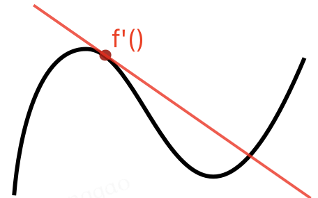
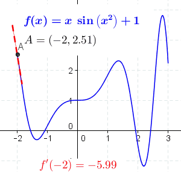
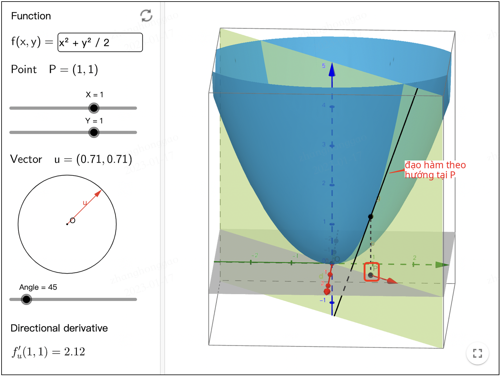

# Nền tảng toán của gradient descent

> Ghi chú của người biên soạn: trang này dịch từ ghi chú *dl_note* của **Harley Zhang** ([bản gốc](https://github.com/harleyszhang/dl_note/blob/main/1-math_ml_basic/随机梯度下降法的数学基础.md), [kho mã](https://github.com/harleyszhang/dl_note), giấy phép [Apache-2.0](https://www.apache.org/licenses/LICENSE-2.0); phần dịch có chỉnh sửa). Số mục giữ như bản gốc. Chỗ bản gốc sai, thiếu hoặc đã lỗi thời được sửa ngay trong bài và ghi ở ô **Biên tập**. Các mục có chữ **Bổ sung** do người biên soạn viết thêm.

Trang [Code](dlnote/math_code_vi) đi kèm kiểm tra bằng số các công thức của bài: đạo hàm theo hướng tính bằng giới hạn so với tích vô hướng $\nabla f\cdot\vec u$, hướng của gradient là hướng tăng nhanh nhất, và chạy lại ví dụ gradient descent hai biến của bản gốc.

**Lý thuyết:** [Học máy · Chương 12 Gradient descent](ml/ch12_vi) · [Toán · Chương 2 Giải tích ma trận](math/ch02_vi)

> Gradient là khái niệm cơ bản của giải tích, cũng là công cụ toán học mà học máy hay dùng để giải bài toán tối ưu (thuật toán gradient descent). Vì vậy cần hiểu từ đầu gradient từ đâu ra và có ý nghĩa gì. Bài này bắt đầu từ đạo hàm, lần lượt trình bày định nghĩa, ý nghĩa và công thức của đạo hàm, đạo hàm riêng, đạo hàm theo hướng và gradient, giúp người mới học hiểu sâu hơn công thức của stochastic gradient descent ở các bài sau. Phần lớn nội dung tổng hợp từ Wikipedia và các bài blog, kèm cách hiểu của tác giả.

## Đạo hàm

Đạo hàm (`derivative`) là một khái niệm của giải tích. Đạo hàm của một hàm số tại một điểm là **tốc độ biến thiên** của hàm số quanh điểm đó. Bản chất của đạo hàm là xấp xỉ tuyến tính cục bộ hàm số thông qua khái niệm giới hạn. Khi biến của hàm $f$ tại điểm $x_0$ có một số gia $h$, nếu giới hạn của tỉ số giữa số gia của giá trị hàm và số gia $h$ khi $h$ tiến tới 0 tồn tại, thì giới hạn đó được gọi là đạo hàm của $f$ tại $x_0$, ký hiệu $f'(x_0)$, $\frac{\mathrm{d}f}{\mathrm{d}x}(x_0)$ hoặc $\frac{\mathrm{d}f}{\mathrm{d}x}\big\vert_{x=x_0}$.

Đạo hàm là tính chất cục bộ của hàm số. Không phải hàm nào cũng có đạo hàm, và một hàm cũng không nhất thiết có đạo hàm tại mọi điểm. Nếu đạo hàm tại một điểm tồn tại thì ta nói hàm khả vi tại điểm đó, ngược lại là không khả vi. Nếu biến và giá trị của hàm đều là số thực, thì đạo hàm tại một điểm chính là hệ số góc của tiếp tuyến với đường cong tại điểm đó.

Hình 1: Đồ thị của một hàm giá trị thực. Đạo hàm của hàm tại một điểm bằng hệ số góc của tiếp tuyến với đồ thị tại điểm đó.

Với hàm khả vi $f$, ánh xạ $x \mapsto f'(x)$ cũng là một hàm số, gọi là hàm đạo hàm của $f$. Hình động dưới đây minh hoạ đạo hàm tại từng vị trí:

Định nghĩa tổng quát của đạo hàm như sau. Nếu hàm thực $f$ xác định trong một lân cận của điểm $a$, và giới hạn sau (để ý biểu thức này không xác định tại chính $a$)

$$
\lim _{x\to a}\frac {f(x)-f(a)}{x-a}
$$

tồn tại, thì ta nói $f$ khả vi tại $a$ và gọi giới hạn đó là đạo hàm của $f$ tại $a$, ký hiệu $f'(a)$.

> **Biên tập:** Bản gốc viết "lĩnh vực" (领域) của điểm $a$; đúng là "lân cận" (邻域).

## Công thức đạo hàm của các hàm sơ cấp thường gặp

> **Biên tập:** Bản gốc dán ảnh chụp một trang giáo trình giải tích tiếng Trung. Nội dung ảnh được gõ lại dưới đây.

**1. Đạo hàm của hằng số và các hàm sơ cấp cơ bản**

| Hàm | Đạo hàm | Hàm | Đạo hàm |
| --- | --- | --- | --- |
| $C$ (hằng số) | $0$ | $x^{\mu}$ | $\mu x^{\mu-1}$ |
| $\sin x$ | $\cos x$ | $\cos x$ | $-\sin x$ |
| $\tan x$ | $\sec^2 x$ | $\cot x$ | $-\csc^2 x$ |
| $\sec x$ | $\sec x\tan x$ | $\csc x$ | $-\csc x\cot x$ |
| $a^x$ $(a>0, a\neq 1)$ | $a^x\ln a$ | $e^x$ | $e^x$ |
| $\log_a x$ $(a>0, a\neq 1)$ | $\dfrac{1}{x\ln a}$ | $\ln x$ | $\dfrac{1}{x}$ |
| $\arcsin x$ | $\dfrac{1}{\sqrt{1-x^2}}$ | $\arccos x$ | $-\dfrac{1}{\sqrt{1-x^2}}$ |
| $\arctan x$ | $\dfrac{1}{1+x^2}$ | $\operatorname{arccot} x$ | $-\dfrac{1}{1+x^2}$ |

**2. Đạo hàm của tổng, hiệu, tích, thương.** Cho $u=u(x)$, $v=v(x)$ khả vi, thì

$$
(u\pm v)'=u'\pm v',\qquad (Cu)'=Cu'\ (C \text{ là hằng số}),\qquad (uv)'=u'v+uv',\qquad \left(\frac{u}{v}\right)'=\frac{u'v-uv'}{v^2}\ (v\neq 0).
$$

**3. Đạo hàm của hàm ngược.** Nếu $x=f(y)$ đơn điệu, khả vi trên khoảng $I_y$ và $f'(y)\neq 0$, thì hàm ngược $y=f^{-1}(x)$ cũng khả vi trên $I_x=f(I_y)$ và

$$
\left[f^{-1}(x)\right]'=\frac{1}{f'(y)}\quad\text{hay}\quad \frac{\mathrm{d}y}{\mathrm{d}x}=\frac{1}{\ \frac{\mathrm{d}x}{\mathrm{d}y}\ }.
$$

**4. Đạo hàm của hàm hợp (quy tắc chuỗi).** Cho $y=f(u)$, $u=g(x)$, $f$ và $g$ đều khả vi, thì hàm hợp $y=f[g(x)]$ có đạo hàm

$$
\frac{\mathrm{d}y}{\mathrm{d}x}=\frac{\mathrm{d}y}{\mathrm{d}u}\cdot\frac{\mathrm{d}u}{\mathrm{d}x}\quad\text{hay}\quad y'(x)=f'(u)\cdot g'(x).
$$

Quy tắc chuỗi là nền của thuật toán lan truyền ngược (backpropagation).

## Đạo hàm riêng

> Vai trò và giá trị của đạo hàm riêng được thừa nhận rộng rãi trong giải tích vector, hình học vi phân và học máy.

Đạo hàm là tốc độ biến thiên (hệ số góc) của hàm một biến. Đạo hàm cũng là một hàm số, có thể hiểu là quan hệ giữa tốc độ biến thiên của hàm và vị trí.

Vậy với hàm nhiều biến thì sao? Câu trả lời là **đạo hàm riêng**, định nghĩa là **tốc độ biến thiên của hàm nhiều biến dọc theo một trục toạ độ**.

Đạo hàm riêng là đạo hàm khi hàm nhiều biến "thoái hoá" thành hàm một biến, nghĩa là cố định giá trị các biến khác, chỉ giữ lại một biến. Lần lượt giữ lại từng biến thì hàm $N$ biến có $N$ đạo hàm riêng.

Nếu mỗi biến ứng với một trục toạ độ, có thể hiểu đạo hàm riêng là đạo hàm (hệ số góc tiếp tuyến) của hàm tại mỗi vị trí theo hướng trục của biến đó.

Trong toán học, đạo hàm riêng (`partial derivative`) của một hàm **nhiều biến** là đạo hàm **theo một biến trong khi giữ các biến khác không đổi**. Đạo hàm riêng của $f$ theo biến $x$ ký hiệu là $f_x$ hoặc $\frac{\partial f}{\partial x}$. Ký hiệu $\partial$ là biến thể của ký hiệu đạo hàm toàn phần $d$.

> **Biên tập:** Bản gốc ký hiệu đạo hàm riêng theo $x$ là $f'(x)$. Ký hiệu này dễ lẫn với đạo hàm của hàm một biến; ký hiệu thường dùng là $f_x$ hoặc $\partial f/\partial x$ (bài này dùng $f_x$ ở các mục sau).

Ví dụ, cho hàm nhiều biến

$$z = f(x, y) = x^2 + xy + y^2$$

Coi $y$ là hằng số rồi lấy đạo hàm, ta được **đạo hàm riêng của $f$ theo $x$**:

$$\frac {\partial f}{\partial x} = 2x + y$$

Tương tự, đạo hàm riêng của $f$ theo $y$:

$$\frac {\partial f}{\partial y} = x + 2y$$

## Đạo hàm theo hướng

Đạo hàm và đạo hàm riêng ở trên đều **xét tốc độ biến thiên theo chiều dương của trục toạ độ**. Khi xét tốc độ biến thiên của hàm theo một hướng bất kỳ, ta có định nghĩa đạo hàm theo hướng: **đạo hàm của hàm tại một điểm khi tiến tới điểm đó theo một hướng nào đó**.

Hiểu đơn giản: ta không chỉ muốn biết tốc độ biến thiên theo chiều dương các trục (đạo hàm riêng), mà còn muốn tính tốc độ biến thiên theo những hướng cụ thể khác (đạo hàm theo hướng). Như hình dưới, đạo hàm theo hướng mũi tên đỏ tại điểm $P$ là hệ số góc của tiếp tuyến màu đen. Hình lấy từ [Directional Derivative](https://www.geogebra.org/m/Bx8nFMNc).

Hình 2: Hàm $f(x,y)=x^2+y^2/2$, điểm $P=(1,1)$, hướng $\vec u=(0{,}71;\ 0{,}71)$ (góc $45^\circ$). GeoGebra cho đạo hàm theo hướng $2{,}12$, đúng bằng $\nabla f(1,1)\cdot\vec u=(2,\ 1)\cdot(0{,}71;\ 0{,}71)$ theo công thức ở dưới.

Định nghĩa đạo hàm theo hướng như sau (theo bài [直观理解梯度，以及偏导数、方向导数和法向量等](https://www.cnblogs.com/shine-lee/p/11715033.html); bản gốc dán ảnh chụp, ở đây gõ lại).

Đạo hàm theo hướng là đạo hàm của hàm theo một hướng nào đó. Cụ thể, lấy một điểm $(a,b)$ trên mặt phẳng $xy$ và vector đơn vị $\vec u=(\cos\theta,\sin\theta)$. Trên mặt cong $z=f(x,y)$, xuất phát từ điểm $(a,b,f(a,b))$ đi $t$ đơn vị độ dài theo hướng $\vec u$, giá trị hàm là $F(t)=f(a+t\cos\theta,\ b+t\sin\theta)$. Đạo hàm theo hướng $\vec u$ tại $(a,b)$ là

$$
\begin{aligned}
D_{\vec u}f(a,b) &= \frac{\mathrm{d}}{\mathrm{d}t}f(a+t\cos\theta,\ b+t\sin\theta)\Big\vert_{t=0} \\
&= \lim_{t\to 0}\frac{f(a+t\cos\theta,\ b+t\sin\theta)-f(a,b)}{t} \\
&= \lim_{t\to 0}\frac{f(a+t\cos\theta,\ b+t\sin\theta)-f(a,\ b+t\sin\theta)}{t}+\lim_{t\to 0}\frac{f(a,\ b+t\sin\theta)-f(a,b)}{t} \\
&= \frac{\partial f}{\partial x}(a,b)\frac{\mathrm{d}x}{\mathrm{d}t}+\frac{\partial f}{\partial y}(a,b)\frac{\mathrm{d}y}{\mathrm{d}t} \\
&= f_x(a,b)\cos\theta+f_y(a,b)\sin\theta \\
&= \big(f_x(a,b),\ f_y(a,b)\big)\cdot(\cos\theta,\ \sin\theta).
\end{aligned}
$$

Phép biến đổi trên dùng quy tắc chuỗi, trong đó $f_x(a,b)$ và $f_y(a,b)$ là các đạo hàm riêng của hàm tại $(a,b)$. Từ đó suy ra: tại điểm này, **đạo hàm theo một hướng bất kỳ là tổ hợp tuyến tính của các đạo hàm riêng, với hệ số là vector đơn vị của hướng đó**. Khi hướng trùng với chiều dương của một trục toạ độ, đạo hàm theo hướng chính là đạo hàm riêng. Nói cách khác, **đạo hàm riêng là đạo hàm theo hướng các trục toạ độ, còn đạo hàm theo các hướng khác là tổ hợp của các đạo hàm riêng**.

Viết dưới dạng vector, **vector tạo bởi các đạo hàm riêng** $\nabla f(a,b)=\big(f_x(a,b), f_y(a,b)\big)$ được gọi là **gradient**.

> **Biên tập:** Bước tách giới hạn thành hai đạo hàm riêng ở dòng thứ ba sang thứ tư không đúng với mọi hàm có đạo hàm riêng: nó cần $f$ **khả vi** tại $(a,b)$ (ví dụ đủ điều kiện là các đạo hàm riêng liên tục quanh điểm đó). Hàm $f(x,y)=\dfrac{x^2y}{x^2+y^2}$ (với $f(0,0)=0$) có $f_x(0,0)=f_y(0,0)=0$, nhưng đạo hàm theo hướng $\theta=45^\circ$ tại gốc bằng $\cos^2\theta\sin\theta\approx 0{,}354 \neq 0$. Trang Code kiểm tra ví dụ này bằng số.

## Gradient

Trong giải tích vector, gradient (`gradient`) là sự tổng quát hoá của đạo hàm cho hàm nhiều biến. Đạo hàm của hàm một biến thông thường là hàm vô hướng, còn gradient của hàm nhiều biến là hàm **giá trị vector**.

Giống như đạo hàm của hàm một biến là hệ số góc tiếp tuyến của đồ thị, nếu gradient của hàm nhiều biến tại điểm $P$ khác vector không, thì hướng của nó là hướng hàm tăng nhanh nhất tại $P$, còn độ lớn của nó là **tốc độ tăng** theo hướng đó.

Gradient ký hiệu là $\nabla f$ hoặc $\operatorname{grad} f$; với hàm hai biến nó là $\left(\frac{\partial f(x,y)}{\partial x}, \frac{\partial f(x,y)}{\partial y}\right)$. Gradient là khái niệm cơ bản của giải tích, và là công cụ toán mà học máy hay dùng để giải bài toán tối ưu (thuật toán gradient descent). Dùng công thức đạo hàm theo hướng ở trên, đạo hàm theo hướng $\theta$ tại điểm $(a,b)$ trên mặt phẳng $xy$ và ý nghĩa của nó như sau (bản gốc là ảnh chụp, ở đây gõ lại):

$$
\begin{aligned}
D_{\vec u}f(a,b) &= \big(f_x(a,b),\ f_y(a,b)\big)\cdot(\cos\theta,\ \sin\theta) \\
&= \big\lvert\big(f_x(a,b),\ f_y(a,b)\big)\big\rvert\cdot\lvert\vec u\rvert\cdot\cos\phi \\
&= \lvert\nabla f(a,b)\rvert\cdot\cos\phi
\end{aligned}
$$

trong đó $\phi$ là góc giữa $\nabla f(a,b)$ và $\vec u$ (và $\lvert\vec u\rvert=1$). Rõ ràng khi $\phi=0$, tức $\vec u$ **cùng hướng** với gradient $\nabla f(a,b)$, **đạo hàm theo hướng đạt giá trị lớn nhất, bằng độ dài của gradient** $\lvert\nabla f(a,b)\rvert$. Khi $\phi=\pi$, tức $\vec u$ **ngược hướng** với gradient, **đạo hàm theo hướng đạt giá trị nhỏ nhất, bằng số đối của độ dài gradient**. Ngoài ra, theo công thức trên, khi $\phi<\frac{\pi}{2}$ đạo hàm theo hướng dương, tức giá trị hàm tăng theo hướng $\vec u$; khi $\phi>\frac{\pi}{2}$ đạo hàm theo hướng âm, tức giá trị hàm giảm theo hướng đó.

Có thể hiểu **ý nghĩa của gradient** qua hai ví dụ sau:

1. Giả sử nhiệt độ tại mọi điểm trong một căn phòng cho bởi trường vô hướng $\phi$, tức nhiệt độ tại điểm $(x,y,z)$ là $\phi(x,y,z)$, và nhiệt độ không đổi theo thời gian. Khi đó tại mỗi điểm, gradient chỉ ra hướng nóng lên nhanh nhất, còn độ lớn của gradient là tốc độ thay đổi nhiệt độ theo hướng đó.
2. Xét một ngọn núi có hàm độ cao $H$, độ cao tại điểm $(x,y)$ là $H(x,y)$. Gradient tại $(x,y)$ là hướng dốc nhất tại điểm đó, và độ lớn của gradient cho biết dốc đến mức nào.

Tóm tắt ý nghĩa hình học của gradient:

- **Hướng của gradient** tại vị trí hiện tại là hướng có đạo hàm theo hướng lớn nhất, cũng là hướng hàm tăng nhanh nhất; hướng ngược lại là hướng giảm nhanh nhất.
- **Độ dài (chuẩn) của gradient** tại vị trí hiện tại là giá trị lớn nhất của đạo hàm theo hướng.

Đó là lý do gradient descent cập nhật tham số theo hướng $-\nabla f$: $\boldsymbol\theta \leftarrow \boldsymbol\theta - \eta\nabla f(\boldsymbol\theta)$, với $\eta$ là tốc độ học.

## Tổng kết

- Đạo hàm theo hướng là đạo hàm theo từng hướng.
- Vector gồm các đạo hàm riêng là gradient.
- Khi hàm khả vi (ví dụ các đạo hàm riêng liên tục), đạo hàm theo mọi hướng tính được bằng $\nabla f\cdot\vec u$.
- **Hướng của gradient là hướng có đạo hàm theo hướng lớn nhất**, độ dài gradient là giá trị lớn nhất đó.

> **Biên tập:** Bản gốc viết "đạo hàm riêng liên tục thì mới tồn tại gradient". Vector gradient chỉ cần các đạo hàm riêng tồn tại là định nghĩa được; tính liên tục của đạo hàm riêng là điều kiện **đủ** để hàm khả vi, và khả vi mới là điều kiện để công thức $D_{\vec u}f=\nabla f\cdot\vec u$ và các kết luận "hướng tăng nhanh nhất" đúng (xem ví dụ phản chứng ở mục đạo hàm theo hướng).

## Tài liệu tham khảo

1. [Wikipedia - Đạo hàm riêng (tiếng Trung)](https://zh.m.wikipedia.org/zh-hans/%E5%81%8F%E5%AF%BC%E6%95%B0)
2. [直观理解梯度，以及偏导数、方向导数和法向量等](https://www.cnblogs.com/shine-lee/p/11715033.html)
3. [AI-EDU: 09.4 神经网络非线性回归的实现](https://microsoft.github.io/ai-edu/%E5%9F%BA%E7%A1%80%E6%95%99%E7%A8%8B/A2-%E7%A5%9E%E7%BB%8F%E7%BD%91%E7%BB%9C%E5%9F%BA%E6%9C%AC%E5%8E%9F%E7%90%86/%E7%AC%AC4%E6%AD%A5%20-%20%E9%9D%9E%E7%BA%BF%E6%80%A7%E5%9B%9E%E5%BD%92/09.4-%E7%A5%9E%E7%BB%8F%E7%BD%91%E7%BB%9C%E9%9D%9E%E7%BA%BF%E6%80%A7%E5%9B%9E%E5%BD%92%E7%9A%84%E5%AE%9E%E7%8E%B0.html)
4. [如何理解梯度下降法？](https://mp.weixin.qq.com/s/SlTV6lbPnauf36bZLXglCw)
