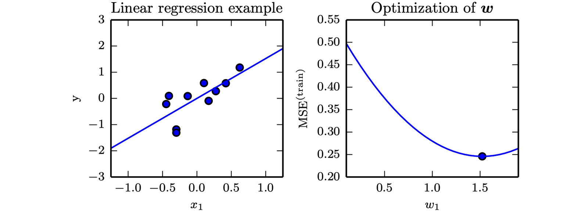
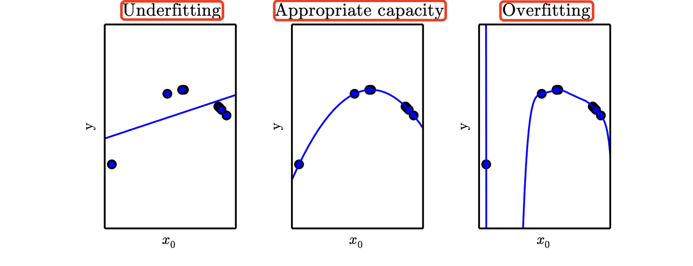
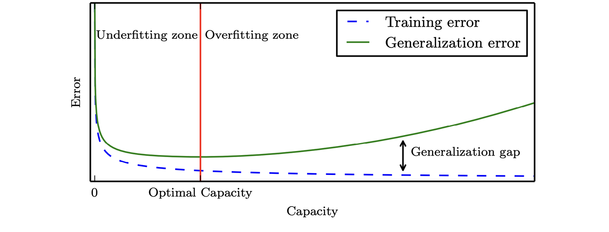
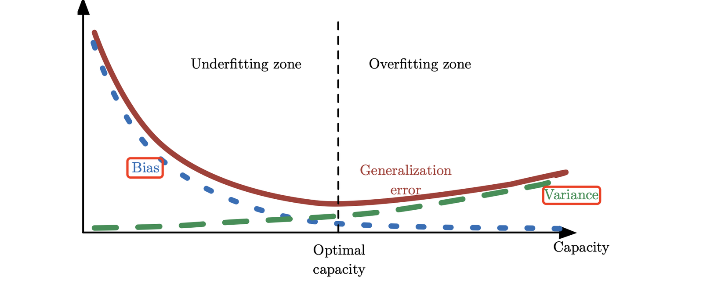

# Nền tảng học sâu: Nguyên lý cơ bản của học máy

> Ghi chú của người biên soạn: trang này dịch từ ghi chú *dl_note* của **Harley Zhang** ([bản gốc](https://github.com/harleyszhang/dl_note/blob/main/1-math_ml_basic/深度学习基础-机器学习基本原理.md), [kho mã](https://github.com/harleyszhang/dl_note), giấy phép [Apache-2.0](https://www.apache.org/licenses/LICENSE-2.0); phần dịch có chỉnh sửa). Số mục giữ như bản gốc. Chỗ bản gốc sai, thiếu hoặc đã lỗi thời được sửa ngay trong bài và ghi ở ô **Biên tập**. Các mục có chữ **Bổ sung** do người biên soạn viết thêm.

Trang [Code](dlnote/math_code_vi) đi kèm chạy lại các thí nghiệm nhỏ của bài: hình 5.2 (khớp bậc 1, 2, 9), đường cong sai số theo dung lượng, độ chệch của hai ước lượng phương sai, và gradient descent theo minibatch.

<div class="qa-theory">

**Lý thuyết:** [Học máy · Chương 5 Các khái niệm cơ bản](ml/ch05_vi) · [Học máy · Chương 8 Overfitting](ml/ch08_vi) · [Toán · Chương 4 Ước lượng tham số mô hình](math/ch04_vi)

</div>

> Phần lớn bài này dựa trên chương 5 "Cơ bản về học máy" của sách *Deep Learning* (Goodfellow, Bengio, Courville), trích các ý quan trọng và thêm phần tổng kết, cách hiểu của tác giả về một số khái niệm và nguyên lý. Có thể đọc như tài liệu bổ trợ cho sách, hoặc để xem nhanh các nguyên lý cơ bản của học máy. Số mục 5.x theo số mục của chương sách.

## Lời nói đầu

**Học sâu là một nhánh cụ thể của học máy.** Muốn hiểu kỹ học sâu, phải hiểu sâu các nguyên lý cơ bản của học máy.

Phần lớn thuật toán học máy có **siêu tham số** (phải **đặt bằng tay**, bên ngoài thuật toán học). **Về bản chất, học máy là thống kê ứng dụng**, nhấn mạnh việc dùng máy tính để **ước lượng thống kê** các hàm phức tạp, và ít nhấn mạnh việc chứng minh khoảng tin cậy quanh các hàm đó. Vì vậy ta sẽ bàn hai cách tiếp cận chính của thống kê: **ước lượng theo trường phái tần suất và suy luận Bayes**. Đồng thời, phần lớn thuật toán học máy chia thành hai loại **học có giám sát** và **học không giám sát**; bài này giới thiệu định nghĩa hai loại và cho ví dụ thuật toán của mỗi loại.

Chương sách còn trình bày cách ghép các thành phần (thuật toán tối ưu, hàm chi phí, mô hình, tập dữ liệu) để xây một thuật toán học máy. Cuối chương, mục 5.11 mô tả các yếu tố hạn chế khả năng tổng quát hoá của học máy truyền thống; chính những thách thức đó thúc đẩy sự phát triển của các thuật toán học sâu.

> **Biên tập:** Bản gốc nhắc tới "mục 5.11" nhưng không có mục này (bài dừng ở 5.10). Mục 5.11 ở cuối trang do người biên soạn viết, tóm tắt mục tương ứng của sách.

> Phần lớn thuật toán học sâu được giải bằng stochastic gradient descent.

## 5.1 Thuật toán học

Thuật toán học máy là thuật toán có thể học từ dữ liệu. "Học" ở đây nghĩa là: "Một chương trình máy tính được gọi là học từ kinh nghiệm $E$ đối với một lớp nhiệm vụ $T$ và thước đo hiệu năng $P$, nếu hiệu năng của nó ở nhiệm vụ $T$, đo bằng $P$, được cải thiện nhờ kinh nghiệm $E$." (`Mitchell`, `1997`)

> Kinh nghiệm $E$, nhiệm vụ $T$ và thước đo hiệu năng $P$ có phạm vi định nghĩa rất rộng, bài này không giải thích chi tiết.

### 5.1.1 Nhiệm vụ $T$

Theo định nghĩa tương đối chặt của "nhiệm vụ", bản thân quá trình học không phải là nhiệm vụ. Học là cách ta có được khả năng hoàn thành nhiệm vụ. Học máy có thể giải nhiều loại nhiệm vụ; một số nhiệm vụ rất phổ biến:

1. **Phân loại**: chương trình cần chỉ ra đầu vào thuộc lớp nào trong $k$ lớp, ví dụ phân loại ảnh nhị phân, đa lớp một nhãn, đa lớp nhiều nhãn.
2. **Hồi quy**: chương trình cần dự đoán một giá trị số cho đầu vào. Để giải nhiệm vụ này, thuật toán học cần đưa ra hàm $f : \mathbb{R}^n \to \mathbb{R}$. Ngoài khác biệt ở dạng kết quả trả về, loại bài toán này rất giống phân loại.
3. **Dịch máy**.
4. **Đầu ra có cấu trúc**.
5. **Phát hiện bất thường**.
6. **Tổng hợp và lấy mẫu**.
7. **Khử nhiễu**.
8. **Ước lượng mật độ hoặc ước lượng hàm khối xác suất**.
9. **Phân loại với đầu vào bị thiếu**.
10. **Phiên âm** (chuyển dữ liệu phi cấu trúc như ảnh chữ viết, âm thanh thành văn bản).
11. **Điền giá trị thiếu**.

### 5.1.2 Thước đo hiệu năng $P$

Để đánh giá khả năng của thuật toán học máy, ta phải thiết kế **thước đo định lượng** hiệu năng của nó, tức chỉ số độ chính xác của thuật toán. Thường thì thước đo hiệu năng $P$ gắn với nhiệm vụ $T$ mà hệ thống đang làm.

> Có thể hiểu là mỗi nhiệm vụ có thước đo hiệu năng riêng.

Với các nhiệm vụ như phân loại, phân loại với đầu vào bị thiếu và phiên âm, ta thường đo **độ chính xác** (`accuracy`) của mô hình, tức tỉ lệ mẫu mà mô hình cho kết quả đúng. Cũng có thể dùng **tỉ lệ lỗi** (`error rate`), tức tỉ lệ mẫu mà mô hình cho kết quả sai, để có cùng thông tin.

Ta dùng dữ liệu của **tập kiểm tra** (`test set`) để đánh giá hiệu năng hệ thống, tách riêng với tập huấn luyện dùng để huấn luyện hệ thống.

Cần lưu ý, chọn thước đo hiệu năng tưởng như đơn giản và khách quan, nhưng chọn được một thước đo phản ánh đúng hành vi mong muốn của hệ thống thường rất khó.

### 5.1.3 Kinh nghiệm $E$

Theo loại kinh nghiệm trong quá trình học, thuật toán học máy có thể chia đại khái thành hai loại:

- Thuật toán **không giám sát** (`unsupervised`).
- Thuật toán **có giám sát** (`supervised`).

**Thuật toán học không giám sát** (`unsupervised learning algorithm`) học trên tập dữ liệu có nhiều đặc trưng, rồi học ra các tính chất cấu trúc hữu ích của tập dữ liệu đó. Trong học sâu, ta thường muốn học toàn bộ phân phối xác suất sinh ra tập dữ liệu, một cách tường minh (như ước lượng mật độ) hoặc ngầm định (như tổng hợp hay khử nhiễu). Còn một số nhiệm vụ học không giám sát khác, như phân cụm: chia tập dữ liệu thành các nhóm mẫu giống nhau.

**Thuật toán học có giám sát** (`supervised learning algorithm`) cũng học trên tập dữ liệu có nhiều đặc trưng, nhưng khác học không giám sát ở chỗ **mỗi mẫu trong tập dữ liệu có một nhãn** (`label`) hay mục tiêu (`target`). Ví dụ, tập dữ liệu `Iris` ghi rõ mỗi mẫu hoa diên vĩ thuộc loài nào. Thuật toán học có giám sát nghiên cứu tập `Iris` để học cách phân mẫu vào ba loài dựa trên các số đo.

Trong **học bán giám sát**, một phần mẫu có mục tiêu giám sát, phần còn lại thì không. Trong học đa thể hiện (multi-instance learning), cả một tập mẫu được gắn nhãn là có hay không chứa mẫu của một lớp, còn từng mẫu riêng lẻ trong tập thì không có nhãn.

Nói đại khái, học không giám sát quan sát nhiều mẫu của vector ngẫu nhiên $\boldsymbol x$ và cố học (tường minh hay ngầm định) phân phối $p(\boldsymbol x)$ hoặc một số tính chất thú vị của nó; còn học có giám sát quan sát vector ngẫu nhiên $\boldsymbol x$ cùng giá trị hay vector $\boldsymbol y$ đi kèm, rồi học dự đoán $\boldsymbol y$ từ $\boldsymbol x$, thường là ước lượng $p(\boldsymbol y\vert \boldsymbol x)$. Thuật ngữ học có giám sát (`supervised learning`) xuất phát từ góc nhìn: người hướng dẫn hay giáo viên đưa mục tiêu $\boldsymbol y$ cho hệ thống học máy, chỉ cho nó phải làm gì. Trong học không giám sát không có người hướng dẫn, thuật toán phải tự hiểu dữ liệu mà không có chỉ dẫn.

Học không giám sát và học có giám sát không phải các thuật ngữ được định nghĩa chặt chẽ; ranh giới giữa chúng thường mờ. Nhiều kỹ thuật học máy dùng được cho cả hai.

Dù không phải hai khái niệm hình thức tách rời hoàn toàn, chúng giúp phân loại thô các bài toán gặp phải khi nghiên cứu thuật toán học máy. Theo truyền thống, người ta gọi hồi quy, phân loại và đầu ra có cấu trúc là học có giám sát, còn ước lượng mật độ phục vụ các nhiệm vụ khác thường gọi là học không giám sát.

Cách biểu diễn tập dữ liệu thường dùng là **ma trận thiết kế** (`design matrix`): mỗi hàng là một mẫu, mỗi cột là một đặc trưng.

### 5.1.4 Ví dụ: hồi quy tuyến tính

Ta đã định nghĩa thuật toán học máy là thuật toán cải thiện hiệu năng của chương trình ở một nhiệm vụ nhờ kinh nghiệm. Định nghĩa này hơi trừu tượng. Để cụ thể hơn, ta xem một ví dụ học máy đơn giản: **hồi quy tuyến tính** (`linear regression`).

Đúng như tên gọi, **hồi quy tuyến tính giải bài toán hồi quy**. Nói cách khác, mục tiêu là xây một hệ thống nhận vector $\boldsymbol x \in \mathbb{R}^n$ làm đầu vào và dự đoán một số vô hướng $y \in \mathbb{R}$ làm đầu ra. Với hồi quy tuyến tính, đầu ra là hàm tuyến tính của đầu vào. Gọi $\hat{y}$ là giá trị mô hình dự đoán, ta định nghĩa đầu ra là

$$\hat{y} = \boldsymbol w^{\top}\boldsymbol x \tag{5.3}$$

trong đó $\boldsymbol w \in \mathbb{R}^{n}$ là vector **tham số** (`parameter`).

> **Biên tập:** Bản gốc viết đầu vào $x \in \mathbb{R}$; đúng là vector $\boldsymbol x\in\mathbb{R}^n$ (cùng số chiều với $\boldsymbol w$).

Tham số là các giá trị điều khiển hành vi của hệ thống. Ở đây $w_i$ là hệ số nhân với đặc trưng $x_i$ rồi cộng tất cả lại. Có thể xem $\boldsymbol w$ là tập **trọng số** (weight) quyết định mỗi đặc trưng ảnh hưởng tới dự đoán thế nào.

Từ mô tả trên, ta định nghĩa được nhiệm vụ $T$: dự đoán $y$ từ $\boldsymbol x$ bằng cách xuất ra $\hat{y} = \boldsymbol w^{\top}\boldsymbol x$.

Ta dùng **tập kiểm tra** (`test set`) để đánh giá mô hình, ký hiệu ma trận thiết kế của đầu vào là $\boldsymbol X^{(\text{test})}$ và vector mục tiêu hồi quy là $\boldsymbol y^{(\text{test})}$.

Một thước đo hiệu năng hay dùng cho **nhiệm vụ hồi quy** là **sai số bình phương trung bình** (`mean squared error`) của mô hình trên tập kiểm tra. Nếu $\hat{\boldsymbol y}^{(\text{test})}$ là dự đoán của mô hình trên tập kiểm tra, thì sai số bình phương trung bình là:

$$\text{MSE}_{\text{test}} = \frac{1}{m} \sum_{i}\left(\hat{\boldsymbol y}^{(\text{test})}-\boldsymbol y^{(\text{test})}\right)_{i}^{2} \tag{5.4}$$

Trực quan, khi $\hat{\boldsymbol y}^{(\text{test})} = \boldsymbol y^{(\text{test})}$ thì sai số bằng 0.

Hình 5.1 là một ví dụ dùng hồi quy tuyến tính.



Hình 5.1: Một bài toán hồi quy tuyến tính, tập huấn luyện gồm mười điểm dữ liệu, mỗi điểm có một đặc trưng. Vì chỉ có một đặc trưng, vector trọng số $\boldsymbol w$ chỉ có một tham số cần học là $w_1$. (Trái) Hồi quy tuyến tính học $w_1$ sao cho đường thẳng $y=w_1x$ đi gần mọi điểm huấn luyện nhất có thể. (Phải) Điểm được đánh dấu là giá trị $w_1$ tìm được bằng phương trình chuẩn; nó cực tiểu hoá sai số bình phương trung bình trên tập huấn luyện.

## 5.2 Dung lượng, quá khớp và dưới khớp

Thách thức chính của học máy là thuật toán phải hoạt động tốt trên tập kiểm tra (các đầu vào mới chưa từng thấy), chứ không chỉ trên tập huấn luyện; tức sai số huấn luyện nhỏ và khoảng cách giữa sai số huấn luyện và sai số tổng quát hoá cũng nhỏ. Khả năng hoạt động tốt trên đầu vào chưa từng thấy gọi là **khả năng tổng quát hoá** (generalization).

Hai thách thức chính của thuật toán học máy là **dưới khớp** (`underfitting`) và **quá khớp** (`overfitting`):

- Dưới khớp là khi mô hình không đạt được sai số đủ thấp trên tập huấn luyện.
- Quá khớp là khi khoảng cách giữa sai số huấn luyện và sai số kiểm tra quá lớn.

Bằng cách điều chỉnh **dung lượng** (`capacity`) của mô hình, ta có thể kiểm soát mô hình nghiêng về quá khớp hay dưới khớp. Nói đơn giản, **dung lượng của mô hình là khả năng khớp nhiều loại hàm khác nhau**. Mô hình dung lượng thấp có thể khó khớp tập huấn luyện; mô hình dung lượng cao có thể quá khớp vì ghi nhớ những tính chất của tập huấn luyện không đúng với tập kiểm tra.

Một cách kiểm soát dung lượng của thuật toán là chọn **không gian giả thuyết** (`hypothesis space`), tức **tập các hàm mà thuật toán học được phép chọn làm lời giải**. Ví dụ, không gian giả thuyết của hồi quy tuyến tính là tập mọi hàm tuyến tính của đầu vào. Ta có thể mở rộng hồi quy tuyến tính để không gian giả thuyết chứa cả đa thức, không chỉ hàm tuyến tính; làm vậy là tăng dung lượng của mô hình.

> Lưu ý, hiệu quả của thuật toán học không chỉ phụ thuộc nhiều vào số hàm trong không gian giả thuyết, mà còn vào dạng cụ thể của các hàm đó.

Thuật toán học máy thường hoạt động tốt nhất khi dung lượng của nó phù hợp với độ phức tạp của nhiệm vụ và lượng dữ liệu huấn luyện. Mô hình dung lượng không đủ không giải được nhiệm vụ phức tạp. Mô hình dung lượng cao giải được nhiệm vụ phức tạp, nhưng khi dung lượng vượt quá mức nhiệm vụ cần thì có thể quá khớp.

Hình 5.2 minh hoạ nguyên lý trên: so sánh bộ dự đoán tuyến tính, bậc hai và bậc 9 khi khớp một hàm bậc hai thật.



Hình 5.2: Ba mô hình khớp cùng một tập huấn luyện. Dữ liệu huấn luyện được tạo bằng cách lấy $x$ ngẫu nhiên rồi tính $y$ bằng một hàm bậc hai. (Trái) Hàm tuyến tính khớp dữ liệu bị dưới khớp: nó không bắt được độ cong của dữ liệu. (Giữa) Hàm bậc hai khớp dữ liệu và tổng quát hoá tốt tới các điểm chưa thấy; không bị quá khớp hay dưới khớp rõ rệt. (Phải) **Đa thức bậc 9 khớp dữ liệu bị quá khớp.** Ở đây dùng giả nghịch đảo Moore-Penrose để giải phương trình chuẩn bị thiếu điều kiện (nhiều nghiệm). Nghiệm thu được đi qua đúng mọi điểm huấn luyện, nhưng không học được cấu trúc đúng: nó có một thung lũng sâu giữa hai điểm dữ liệu mà hàm thật không có, và tăng vọt ở bên trái dữ liệu trong khi hàm thật giảm ở vùng đó.

Một ý tưởng sớm để tăng khả năng tổng quát hoá là nguyên tắc **dao cạo Occam**: trong các giả thuyết giải thích được dữ liệu như nhau, chọn giả thuyết "đơn giản nhất".

Lý thuyết học thống kê cho nhiều cách định lượng dung lượng mô hình. Nổi tiếng nhất là **chiều Vapnik-Chervonenkis** (`VC dimension`), đo dung lượng của bộ phân loại nhị phân. Chiều VC là số $m$ lớn nhất sao cho **tồn tại** một tập $m$ điểm $\boldsymbol x$ khác nhau mà bộ phân loại có thể gán **mọi** cách gán nhãn nhị phân cho chúng (gọi là "phá vỡ", shatter tập đó).

> **Biên tập:** Bản gốc định nghĩa chiều VC là "số mẫu huấn luyện lớn nhất mà bộ phân loại phân loại được", dễ hiểu nhầm. Hai chỗ quan trọng: chỉ cần **tồn tại** một cách đặt $m$ điểm (không phải mọi cách), và với cách đặt đó bộ phân loại phải tách được **mọi** $2^m$ cách gán nhãn. Ví dụ, bộ phân loại tuyến tính trong $\mathbb R^2$ có chiều VC bằng 3.

Vì định lượng được dung lượng mô hình, lý thuyết học thống kê đưa ra được các dự đoán định lượng. Kết quả quan trọng nhất của nó nói rằng: cận trên của khoảng cách giữa sai số huấn luyện và sai số tổng quát hoá tăng khi dung lượng mô hình tăng, nhưng giảm khi số mẫu huấn luyện tăng (`Vapnik and Chervonenkis, 1971`; `Vapnik, 1982`; `Blumer et al., 1989`; `Vapnik, 1995`). Các cận này là chứng minh lý thuyết rằng thuật toán học máy có thể hoạt động hiệu quả, nhưng chúng **hiếm khi được áp dụng cho các thuật toán học sâu trong thực tế**. Một phần vì các cận quá lỏng, phần khác vì **rất khó xác định dung lượng của thuật toán học sâu**. Việc xác định dung lượng của mô hình học sâu đặc biệt khó vì dung lượng hiệu dụng bị giới hạn bởi khả năng của thuật toán tối ưu, và ta hiểu biết lý thuyết rất ít về các **bài toán tối ưu không lồi** rất phổ biến trong học sâu.

Dù hàm đơn giản hơn dễ tổng quát hoá hơn (khoảng cách giữa sai số huấn luyện và kiểm tra nhỏ), ta vẫn phải chọn một giả thuyết đủ phức tạp để đạt sai số huấn luyện thấp. Thường thì khi dung lượng tăng, sai số huấn luyện giảm cho đến khi tiệm cận giá trị nhỏ nhất có thể (giả sử thước đo sai số có giá trị nhỏ nhất). Thường thì **sai số tổng quát hoá là một hàm hình chữ U theo dung lượng mô hình**, như hình 5.3.



Hình 5.3: Quan hệ điển hình giữa dung lượng và sai số. Sai số huấn luyện và sai số kiểm tra biểu hiện rất khác nhau. Ở đầu bên trái, cả sai số huấn luyện và sai số tổng quát hoá đều cao; đó là **vùng dưới khớp** (underfitting regime). Khi tăng dung lượng, sai số huấn luyện giảm, nhưng khoảng cách giữa sai số huấn luyện và sai số tổng quát hoá tăng dần. Cuối cùng, mức tăng của khoảng cách vượt mức giảm của sai số huấn luyện, và ta vào **vùng quá khớp** (overfitting regime), nơi dung lượng quá lớn, vượt **dung lượng tối ưu** (optimal capacity).

> **Bổ sung:** Với mạng neuron rất lớn, đường cong chữ U này không còn là toàn bộ câu chuyện. Belkin và cộng sự (2019) và Nakkiran và cộng sự (2019, *Deep Double Descent*) quan sát thấy hiện tượng **giảm kép**: khi dung lượng vượt qua ngưỡng vừa đủ để khớp hoàn toàn tập huấn luyện (ngưỡng nội suy), sai số kiểm tra tăng lên đỉnh rồi lại **giảm tiếp**. Đây là một lý do các mô hình quá tham số hoá (số tham số lớn hơn số mẫu nhiều lần) vẫn tổng quát hoá tốt. Trang Code tái hiện hiện tượng này với hồi quy trên đặc trưng ngẫu nhiên.

### 5.2.1 Định lý không có bữa trưa miễn phí

**Định lý không có bữa trưa miễn phí** của học máy (`Wolpert, 1996`) nói rằng: lấy trung bình trên mọi phân phối sinh dữ liệu có thể, mọi thuật toán phân loại có cùng tỉ lệ lỗi khi phân loại các điểm chưa từng quan sát. Nói cách khác, theo một nghĩa nào đó, **không có thuật toán học máy nào tốt hơn mọi thuật toán khác một cách phổ quát**.

Kết luận này nghe thật buồn, nhưng may mắn là nó chỉ đúng khi ta xét **mọi phân phối sinh dữ liệu có thể**. Nếu đưa ra giả định về loại phân phối xác suất gặp trong ứng dụng thực tế, ta có thể **thiết kế thuật toán học hoạt động tốt trên các phân phối đó**.

Điều này có nghĩa mục tiêu của nghiên cứu học máy **không phải tìm một thuật toán học phổ quát hay thuật toán tốt nhất tuyệt đối**. Thay vào đó, mục tiêu là hiểu những phân phối nào liên quan tới "thế giới thực" mà tác tử AI trải nghiệm, và **thuật toán học nào hoạt động tốt nhất trên các phân phối sinh dữ liệu ta quan tâm**.

**Tổng kết**: định lý không có bữa trưa miễn phí nói rõ không có thuật toán học tốt nhất, ngụ ý rằng ta phải thiết kế thuật toán học máy hoạt động tốt cho từng nhiệm vụ cụ thể.

### 5.2.2 Regularization

Regularization (chính quy hoá) là mọi cách **sửa đổi thuật toán học nhằm giảm sai số tổng quát hoá chứ không phải sai số huấn luyện**.

**Regularization là một tư tưởng (chiến lược)**, một trong những vấn đề trung tâm của học máy, tầm quan trọng chỉ có tối ưu hoá sánh được.

Thường ta regularize mô hình bằng cách thêm **thông tin bổ sung** (còn gọi là số hạng phạt hay số hạng regularization) vào **hàm mất mát gốc**; hàm mất mát mới có dạng **hàm mất mát gốc + số hạng phạt**. Số hạng phạt thường ràng buộc tham số trọng số, ví dụ bằng chuẩn L1/L2:

- L1: $\lambda \lVert \boldsymbol w \rVert_{1}=\lambda\sum_j\lvert w_j\rvert$, tức tổng trị tuyệt đối các phần tử.
- L2: $\lambda \lVert \boldsymbol w \rVert_{2}^{2}=\lambda\sum_j w_j^2$, tức tổng bình phương các phần tử.

> **Biên tập:** Bản gốc viết số hạng L2 là $\lambda\lVert x\rVert_2$ và giải thích là "tổng bình phương các trị tuyệt đối". Chuẩn $\lVert\boldsymbol w\rVert_2$ là **căn bậc hai** của tổng bình phương; số hạng phạt L2 thường dùng là bình phương của chuẩn, $\lambda\lVert\boldsymbol w\rVert_2^2$, như ở trên và ở hai công thức dưới. Biến cũng đổi từ $x$ thành $\boldsymbol w$ vì số hạng phạt tác động lên trọng số.

Nếu số hạng regularization là $\Omega(\boldsymbol w) = \boldsymbol w^{\top}\boldsymbol w$ thì gọi là **suy giảm trọng số** (weight decay).

Với stochastic gradient descent chuẩn, regularization weight decay và regularization L2 có hiệu quả như nhau. Vì vậy một số framework học sâu cài weight decay bằng regularization L2. Hàm mất mát sau khi thêm số hạng regularization như sau.

Với hàm mất mát bình phương trung bình:

$$J(\boldsymbol w,b)=\frac{1}{2m}\sum_{i=1}^m (z_i-y_i)^2 + \frac{\lambda}{2m}\sum_{j=1}^n{w_j^2}$$

Với hàm mất mát cross-entropy:

$$J(\boldsymbol w,b)= -\frac{1}{m} \sum_{i=1}^m \left[y_i \ln a_i + (1-y_i) \ln (1-a_i)\right]+ \frac{\lambda}{2m}\sum_{j=1}^n{w_j^2}$$

trong đó $J(\boldsymbol w, b)$ là hàm mất mát cuối cùng, $\boldsymbol w$ là trọng số, $z_i$ và $a_i$ là đầu ra của mô hình cho mẫu $i$ (đầu ra tuyến tính và xác suất sau sigmoid). $\lambda$ là siêu tham số của số hạng regularization, phải đặt trước, **điều khiển mức độ ưu tiên trọng số nhỏ**. Khi $\lambda = 0$ ta không có ưu tiên nào. $\lambda$ càng lớn thì trọng số càng nhỏ. Cực tiểu hoá $J(\boldsymbol w)$ dẫn tới chọn trọng số **cân bằng giữa khớp dữ liệu huấn luyện và trọng số nhỏ**.

> Lưu ý, với các phương pháp tối ưu phức tạp hơn (như Adam), regularization weight decay và regularization L2 **không** tương đương [Loshchilov & Hutter, 2017]. Đó là lý do có AdamW: tách weight decay ra khỏi gradient, trừ thẳng $\eta\lambda\boldsymbol w$ vào trọng số thay vì cộng $\lambda\boldsymbol w$ vào gradient rồi để Adam chia cho căn của mô-men bậc hai. AdamW hiện là bộ tối ưu mặc định khi huấn luyện Transformer.

**Giống như không có thuật toán học tốt nhất ở mục trên, cũng không có dạng regularization tốt nhất.** Ta phải chọn dạng regularization hợp với nhiệm vụ cần giải.

Vậy **vì sao regularization L2 chống được quá khớp**?

Cách hiểu của tác giả: ta thường mặc định tham số mô hình càng nhỏ thì mô hình càng đơn giản, và mô hình càng đơn giản thì càng khó quá khớp. Trong quá trình khớp, regularization L2 có xu hướng làm trọng số nhỏ nhất có thể, tức cuối cùng tạo ra một mô hình mà mọi tham số đều khá nhỏ.

Có [bài viết](https://zhuanlan.zhihu.com/p/41631717) trực quan hoá phân phối trọng số sau khi thêm regularization L1/L2, và kết luận rằng L1/L2 thực sự đẩy trọng số về phía `0`, tức làm trọng số nhỏ nhất có thể; nhưng L1 đẩy nhanh, L2 chậm hơn, phải sau khoảng 30 epoch thì L2 mới có phân phối nhọn nổi bật giống L1.

Một cách hiểu khác (xem mục 5.6.1): regularization L2 tương ứng với việc đặt tiên nghiệm Gauss lên trọng số, còn L1 tương ứng với tiên nghiệm Laplace. Tiên nghiệm Laplace có đỉnh nhọn tại 0, nên L1 cho nhiều trọng số đúng bằng 0 (nghiệm thưa), còn L2 chỉ làm trọng số nhỏ đi mà hiếm khi bằng 0.

## 5.3 Siêu tham số và tập kiểm định

**Giá trị của siêu tham số không do bản thân thuật toán học học ra, mà do người định nghĩa thuật toán chỉ định bằng tay.**

### 5.3.1 Vai trò của tập kiểm định

Thường dùng `80%` dữ liệu huấn luyện để huấn luyện và `20%` để kiểm định. Tập kiểm định dùng để ước lượng sai số tổng quát hoá trong hoặc sau huấn luyện, từ đó **điều chỉnh siêu tham số**. Tập kiểm định phải tách từ dữ liệu huấn luyện, không được lấy từ tập kiểm tra: nếu dùng tập kiểm tra để chọn siêu tham số thì sai số trên tập kiểm tra không còn là ước lượng không chệch của sai số tổng quát hoá.

### 5.3.2 Kiểm định chéo

Một **tập kiểm tra nhỏ** nghĩa là ước lượng sai số kiểm tra trung bình có độ không chắc chắn thống kê lớn, khiến khó kết luận thuật toán A tốt hơn thuật toán B trên một nhiệm vụ. Cách giải quyết là **lặp lại huấn luyện và kiểm tra** trên các tập con khác nhau được **lấy mẫu ngẫu nhiên hoặc chia ra** từ dữ liệu gốc. Phổ biến nhất là kiểm định chéo $k$-fold: chia tập dữ liệu thành $k$ tập con không giao nhau; sai số kiểm tra ước lượng bằng trung bình sai số sau $k$ lần tính. Ở lần thứ $i$, tập con thứ $i$ làm tập kiểm tra, phần dữ liệu còn lại làm tập huấn luyện. Thuật toán như sau.

> Kiểm định chéo k-fold phần nào giải quyết được vấn đề ước lượng sai số kiểm tra không chắc chắn trên tập dữ liệu nhỏ, nhưng cái giá là tăng khối lượng tính toán ($k$ lần huấn luyện).

> **Biên tập:** Bản gốc dán ảnh chụp thuật toán 5.1 của sách bản tiếng Trung; gõ lại dưới dạng giả mã.

```text
Thuật toán 5.1  KFoldXV(D, A, L, k)
Input:  D        # tập dữ liệu, phần tử là z^(i)
        A        # thuật toán học: nhận một tập dữ liệu, trả về hàm đã học
        L        # hàm mất mát: (f, z) ↦ số thực
        k        # số fold
Output: e        # vector mất mát của từng mẫu khi nó nằm trong fold kiểm tra

chia D thành k tập con rời nhau D_1, ..., D_k có hợp bằng D
for i = 1 to k do
    f_i ← A(D \ D_i)
    for each z^(j) in D_i do
        e_j ← L(f_i, z^(j))
    end for
end for
return e
```

## 5.4 Ước lượng, độ chệch và phương sai

Thống kê cho ta nhiều công cụ để đạt mục tiêu của học máy: không chỉ giải nhiệm vụ trên tập huấn luyện, mà còn tổng quát hoá. Các khái niệm cơ bản như ước lượng tham số, độ chệch và phương sai rất hữu ích để mô tả chặt chẽ tổng quát hoá, dưới khớp và quá khớp.

### 5.4.1 Ước lượng điểm

Ước lượng điểm cố đưa ra một dự đoán "tốt nhất" duy nhất cho một đại lượng quan tâm. Nói chung đại lượng quan tâm có thể là một tham số hoặc một vector tham số, ví dụ trọng số trong hồi quy tuyến tính ở mục 5.1.4, nhưng cũng có thể là cả một hàm.

Để phân biệt ước lượng với giá trị thật, ta quen ký hiệu ước lượng điểm của tham số $\theta$ là $\hat{\theta}$.

Cho $\boldsymbol x^{(1)}, \dots, \boldsymbol x^{(m)}$ là $m$ điểm dữ liệu độc lập cùng phân phối (i.i.d.). **Bộ ước lượng điểm** (point estimator) hay **thống kê** (statistic) là hàm bất kỳ của dữ liệu này:

$$
\hat{\theta}_m =g(\boldsymbol x^{(1)},\dots,\boldsymbol x^{(m)}). \tag{5.19}
$$

### 5.4.2 Độ chệch

Độ chệch của một ước lượng định nghĩa là:

$$
\operatorname{bias}(\hat{\theta}_m) = \mathbb E(\hat{\theta}_m) - \theta, \tag{5.20}
$$

trong đó kỳ vọng lấy trên dữ liệu (xem như mẫu lấy từ một biến ngẫu nhiên), và $\theta$ là giá trị thật của tham số dùng để định nghĩa phân phối sinh dữ liệu. Nếu $\operatorname{bias}(\hat{\theta}_m) = 0$ thì ước lượng $\hat{\theta}_m$ được gọi là **không chệch** (unbiased), nghĩa là $\mathbb E(\hat{\theta}_m) = \theta$.

> **Biên tập:** Bản gốc đánh số công thức độ chệch là (5.19), trùng số với công thức ước lượng điểm; trong sách nó là (5.20). Bản gốc cũng viết "$\hat\theta$ là giá trị thật của $\theta$"; đúng là $\theta$ là giá trị thật, còn $\hat\theta_m$ là ước lượng.

**Ví dụ (bổ sung theo sách).** Với $m$ mẫu i.i.d. từ $\mathcal N(\mu,\sigma^2)$:

- Trung bình mẫu $\hat\mu_m=\frac1m\sum_i x^{(i)}$ không chệch: $\mathbb E[\hat\mu_m]=\mu$.
- Phương sai mẫu chia cho $m$, $\hat\sigma_m^2=\frac1m\sum_i\big(x^{(i)}-\hat\mu_m\big)^2$, **bị chệch**: $\mathbb E[\hat\sigma_m^2]=\frac{m-1}{m}\sigma^2$, tức độ chệch là $-\sigma^2/m$.
- Chia cho $m-1$ thay vì $m$ thì được ước lượng không chệch $\tilde\sigma_m^2=\frac{1}{m-1}\sum_i\big(x^{(i)}-\hat\mu_m\big)^2$.

Trang Code kiểm tra hai kết quả này bằng mô phỏng.

### 5.4.3 Phương sai và độ lệch chuẩn

Phương sai của ước lượng ký hiệu là $\operatorname{Var}(\hat{\theta})$, căn bậc hai của nó gọi là **sai số chuẩn** (standard error), ký hiệu $\operatorname{SE}(\hat\theta)$. Phương sai cho biết ước lượng thay đổi bao nhiêu khi ta lấy mẫu lại tập dữ liệu một cách độc lập từ cùng phân phối.

Ví dụ quan trọng: sai số chuẩn của trung bình mẫu là

$$\operatorname{SE}(\hat\mu_m)=\sqrt{\operatorname{Var}\Big[\frac1m\sum_{i=1}^m x^{(i)}\Big]}=\frac{\sigma}{\sqrt m}.$$

Trong học máy, công thức này dùng để báo cáo khoảng tin cậy 95% của sai số kiểm tra: $\hat\mu_m\pm 1{,}96\,\operatorname{SE}(\hat\mu_m)$. Nó cũng cho thấy vì sao một tập kiểm tra nhỏ (mục 5.3.2) cho ước lượng kém tin cậy: muốn giảm sai số chuẩn một nửa thì cần gấp bốn lần số mẫu.

> **Biên tập:** Bản gốc chỉ có một câu ở mục này và ký hiệu phương sai của ước lượng là $\sigma^2$ (dễ lẫn với phương sai của dữ liệu). Phần sai số chuẩn của trung bình và khoảng tin cậy được thêm theo mục 5.4.3 của sách.

### 5.4.4 Đánh đổi độ chệch và phương sai để cực tiểu hoá sai số bình phương trung bình

Độ chệch và phương sai đo hai nguồn sai số khác nhau của một ước lượng. Độ chệch đo độ lệch kỳ vọng so với hàm hoặc tham số thật. Còn phương sai đo độ lệch so với giá trị kỳ vọng của ước lượng mà một cách lấy mẫu dữ liệu cụ thể có thể gây ra.

Hai đại lượng kết hợp trong sai số bình phương trung bình của ước lượng:

$$\operatorname{MSE}=\mathbb E\big[(\hat\theta_m-\theta)^2\big]=\operatorname{bias}(\hat\theta_m)^2+\operatorname{Var}(\hat\theta_m).$$

**Quan hệ giữa độ chệch và phương sai gắn chặt với các khái niệm dung lượng, dưới khớp và quá khớp của học máy.** Khi đo sai số tổng quát hoá bằng MSE (cả độ chệch và phương sai đều là thành phần có nghĩa của sai số tổng quát hoá), tăng dung lượng thường làm tăng phương sai và giảm độ chệch. Như hình 5.6, ta lại thấy đường cong chữ U của sai số tổng quát hoá theo dung lượng.



Hình 5.6: Khi dung lượng tăng (trục $x$), độ chệch (đường chấm) có xu hướng giảm, còn phương sai (đường gạch) có xu hướng tăng, tạo thành một đường chữ U khác cho sai số tổng quát hoá (đường đậm). Nếu thay đổi dung lượng dọc trục này, sẽ thấy dung lượng tối ưu: dung lượng nhỏ hơn mức tối ưu thì dưới khớp, lớn hơn thì quá khớp. Quan hệ này tương tự quan hệ giữa dung lượng, dưới khớp và quá khớp ở mục 5.2 và hình 5.3.

## 5.5 Ước lượng hợp lý cực đại

Thay vì đoán một hàm nào đó có thể là ước lượng tốt rồi phân tích độ chệch và phương sai của nó, ta muốn có nguyên tắc để suy ra những hàm cụ thể là ước lượng tốt cho các mô hình khác nhau. Ước lượng hợp lý cực đại (maximum likelihood estimation, MLE) là nguyên tắc thường dùng nhất.

### 5.5.1 Bổ sung: công thức và quan hệ với hàm mất mát

Bản gốc dừng ở câu trên. Phần này do người biên soạn viết theo mục 5.5 của sách.

Cho tập $m$ mẫu $\mathbb X=\{\boldsymbol x^{(1)},\dots,\boldsymbol x^{(m)}\}$ lấy i.i.d. từ phân phối thật $p_{\text{data}}$, và một họ mô hình $p_{\text{model}}(\boldsymbol x;\boldsymbol\theta)$. Ước lượng hợp lý cực đại là

$$
\boldsymbol\theta_{\text{ML}}=\arg\max_{\boldsymbol\theta}\prod_{i=1}^m p_{\text{model}}(\boldsymbol x^{(i)};\boldsymbol\theta)=\arg\max_{\boldsymbol\theta}\sum_{i=1}^m\log p_{\text{model}}(\boldsymbol x^{(i)};\boldsymbol\theta).
$$

Lấy log để đổi tích thành tổng (tránh tràn số dưới khi nhân nhiều xác suất nhỏ) mà không đổi điểm cực đại. Chia cho $m$, ta được kỳ vọng theo phân phối thực nghiệm $\hat p_{\text{data}}$:

$$
\boldsymbol\theta_{\text{ML}}=\arg\max_{\boldsymbol\theta}\mathbb E_{\mathbf x\sim\hat p_{\text{data}}}\log p_{\text{model}}(\boldsymbol x;\boldsymbol\theta)=\arg\min_{\boldsymbol\theta}D_{KL}\big(\hat p_{\text{data}}\parallel p_{\text{model}}\big).
$$

Nghĩa là MLE làm phân phối mô hình gần phân phối thực nghiệm nhất theo KL divergence, cũng là cực tiểu hoá cross-entropy giữa hai phân phối (xem mục 3.13 bài [Xác suất và lý thuyết thông tin](dlnote/math_prob_vi)). Từ đây suy ra các hàm mất mát quen thuộc:

- **Phân loại**: mô hình cho $p(y\mid\boldsymbol x;\boldsymbol\theta)$ bằng softmax, MLE chính là cực tiểu hoá **cross-entropy**.
- **Hồi quy**: giả sử $p(y\mid\boldsymbol x)=\mathcal N\big(y;\hat y(\boldsymbol x;\boldsymbol w),\sigma^2\big)$ với $\sigma$ cố định, thì log-likelihood là $-m\log\sigma-\frac m2\log(2\pi)-\sum_i\frac{\lVert\hat y^{(i)}-y^{(i)}\rVert^2}{2\sigma^2}$; cực đại hoá nó theo $\boldsymbol w$ đúng bằng cực tiểu hoá **MSE**.

Dưới một số điều kiện (mô hình chứa phân phối thật, tham số định danh được), MLE **nhất quán**: hội tụ về tham số thật khi $m\to\infty$, và có hiệu quả thống kê tốt nhất trong các ước lượng nhất quán khi $m$ lớn.

## 5.6 Thống kê Bayes

Đến đây ta đã mô tả **thống kê tần suất** (frequentist statistics) và cách tiếp cận ước lượng một giá trị $\theta$ duy nhất rồi dựa vào ước lượng đó để đưa ra mọi dự đoán. Một cách khác là xét mọi giá trị có thể của $\theta$ khi dự đoán. Cách sau thuộc phạm vi **thống kê Bayes** (Bayesian statistics).

Như đã bàn ở mục 5.4.1, góc nhìn tần suất coi tham số thật $\theta$ là một giá trị cố định chưa biết, còn ước lượng điểm $\hat{\theta}$ là biến ngẫu nhiên vì nó là hàm của tập dữ liệu (xem như ngẫu nhiên).

Góc nhìn Bayes hoàn toàn khác. Trường phái Bayes dùng xác suất để biểu diễn mức độ chắc chắn của trạng thái tri thức. Tập dữ liệu quan sát được trực tiếp nên không ngẫu nhiên. Ngược lại, tham số thật $\theta$ chưa biết hoặc không chắc chắn, nên được biểu diễn bằng biến ngẫu nhiên.

Trước khi thấy dữ liệu, hiểu biết về $\theta$ được biểu diễn bằng **phân phối tiên nghiệm** $p(\theta)$. Sau khi thấy dữ liệu, cập nhật bằng định lý Bayes:

$$p(\theta\mid\boldsymbol x^{(1)},\dots,\boldsymbol x^{(m)})=\frac{p(\boldsymbol x^{(1)},\dots,\boldsymbol x^{(m)}\mid\theta)\,p(\theta)}{p(\boldsymbol x^{(1)},\dots,\boldsymbol x^{(m)})}.$$

### 5.6.1 Bổ sung: ước lượng MAP và regularization

Phần này do người biên soạn viết theo mục 5.6.1 của sách.

Tính trọn phân phối hậu nghiệm thường quá tốn kém với mô hình lớn. Một cách dung hoà là lấy **ước lượng hậu nghiệm cực đại** (maximum a posteriori, MAP), tức điểm có mật độ hậu nghiệm cao nhất:

$$\boldsymbol\theta_{\text{MAP}}=\arg\max_{\boldsymbol\theta}p(\boldsymbol\theta\mid\boldsymbol x)=\arg\max_{\boldsymbol\theta}\big[\log p(\boldsymbol x\mid\boldsymbol\theta)+\log p(\boldsymbol\theta)\big].$$

Số hạng đầu là log-likelihood như MLE; số hạng thứ hai đến từ tiên nghiệm, đóng vai trò số hạng regularization:

- Tiên nghiệm Gauss $\mathcal N(\boldsymbol w;\mathbf 0,\frac1\lambda\boldsymbol I)$ cho $\log p(\boldsymbol w)=-\frac\lambda2\boldsymbol w^\top\boldsymbol w+\text{hằng số}$, tức **regularization L2 / weight decay** ở mục 5.2.2.
- Tiên nghiệm Laplace cho $\log p(\boldsymbol w)=-\lambda\lVert\boldsymbol w\rVert_1+\text{hằng số}$, tức **regularization L1**.

Như vậy regularization có thể hiểu là "đưa tri thức tiên nghiệm vào ước lượng": khi ít dữ liệu, tiên nghiệm kéo trọng số về gần 0 để giảm phương sai, đổi lại chịu thêm một chút độ chệch.

## 5.7 Thuật toán học có giám sát

Nhắc lại mục 5.1.3: nói đơn giản, thuật toán học có giám sát nhận một tập huấn luyện gồm đầu vào $\boldsymbol x$ và đầu ra $\boldsymbol y$, rồi học cách liên kết đầu vào với đầu ra. Trong nhiều trường hợp, đầu ra $\boldsymbol y$ khó thu thập tự động và phải do một "người giám sát" cung cấp, nhưng ngay cả khi mục tiêu của tập huấn luyện được thu thập tự động, thuật ngữ này vẫn dùng.

Sách điểm qua các thuật toán học có giám sát tiêu biểu: hồi quy logistic (học xác suất bằng sigmoid của hàm tuyến tính), máy vector hỗ trợ và thủ thuật kernel, $k$ láng giềng gần nhất, cây quyết định. Các khoá [Học máy](ml/README_vi) trên site trình bày chi tiết từng thuật toán.

## 5.8 Thuật toán học không giám sát

Nhắc lại mục 5.1.3: thuật toán không giám sát chỉ xử lý "đặc trưng", không dùng tín hiệu giám sát. Phân biệt giữa thuật toán có giám sát và không giám sát không có định nghĩa chặt chẽ, vì không có phép thử khách quan để phân biệt một giá trị là đặc trưng hay là mục tiêu do người giám sát cung cấp. Nói đơn giản, phần lớn nỗ lực học không giám sát là trích thông tin từ phân phối của các mẫu không cần chú thích của con người. Thuật ngữ này thường gắn với ước lượng mật độ, học cách lấy mẫu từ phân phối, học cách khử nhiễu từ phân phối, tìm đa tạp của phân phối dữ liệu, hoặc phân cụm các mẫu liên quan trong dữ liệu.

### 5.8.1 Giảm chiều bằng PCA

`PCA` (Principal Component Analysis, phân tích thành phần chính) là một thuật toán học không giám sát học cách biểu diễn dữ liệu, thường dùng để giảm chiều dữ liệu nhiều chiều và trích các thành phần đặc trưng chính.

Có thể suy ra PCA theo hai hướng: **khả năng tách biệt cực đại** và **tái tạo gần nhất**. Hướng thứ nhất yêu cầu phương sai của dữ liệu sau khi chiếu lên siêu phẳng là lớn nhất; hướng thứ hai yêu cầu tổng bình phương khoảng cách từ các điểm tới siêu phẳng chiếu (sai số tái tạo) là nhỏ nhất. Hai hướng cho cùng một nghiệm: các vector riêng ứng với trị riêng lớn nhất của ma trận hiệp phương sai.

> **Biên tập:** Bản gốc mô tả điều kiện là "phương sai sau khi phân chia lớn nhất" và "khoảng cách từ điểm tới mặt phẳng phân chia nhỏ nhất". PCA không phân chia dữ liệu; đúng là phương sai **sau khi chiếu** và khoảng cách tới **siêu phẳng chiếu**.

### 5.8.2 Phân cụm $k$-means

Một thuật toán học biểu diễn đơn giản khác là phân cụm $k$-means. Thuật toán $k$-means chia tập huấn luyện thành $k$ cụm gồm các mẫu gần nhau. Vì vậy có thể xem thuật toán cung cấp vector mã hoá one-hot $k$ chiều $\boldsymbol h$ để biểu diễn đầu vào $\boldsymbol x$: khi $\boldsymbol x$ thuộc cụm $i$ thì $h_i = 1$, các phần tử khác của $\boldsymbol h$ bằng 0.

Phân cụm $k$-means khởi tạo $k$ tâm khác nhau $\{\boldsymbol\mu^{(1)}, \dots, \boldsymbol\mu^{(k)}\}$, rồi luân phiên hai bước sau cho tới khi hội tụ:

1. Bước một: gán mỗi mẫu huấn luyện vào cụm $i$ của tâm gần nhất $\boldsymbol\mu^{(i)}$.
2. Bước hai: cập nhật mỗi tâm $\boldsymbol\mu^{(i)}$ thành trung bình của mọi mẫu huấn luyện $\boldsymbol x^{(j)}$ trong cụm $i$.

Một vấn đề của phân cụm là **bản thân bài toán phân cụm là bài toán đặt không chỉnh** (ill-posed). Nghĩa là không có một tiêu chuẩn duy nhất để đo việc phân cụm dữ liệu khớp với thế giới thực tới đâu. Ta có thể đo các tính chất của cụm, như trung bình khoảng cách Euclid từ các phần tử tới tâm cụm, để biết việc tái tạo dữ liệu huấn luyện từ phép gán cụm tốt đến đâu. Nhưng ta không biết các tính chất của cụm có tương ứng tốt với tính chất của thế giới thực hay không. Hơn nữa, có thể có nhiều cách phân cụm khác nhau, mỗi cách tương ứng tốt với một thuộc tính nào đó của thế giới thực. Ta có thể mong tìm được cách phân cụm gắn với một đặc trưng, nhưng lại nhận được một cách phân cụm khác cũng hợp lý mà không liên quan tới nhiệm vụ.

Ví dụ, giả sử ta chạy hai thuật toán phân cụm trên tập dữ liệu gồm ảnh xe tải đỏ, ô tô đỏ, xe tải xám và ô tô xám. Nếu mỗi thuật toán chia thành hai cụm, có thể một thuật toán chia theo ô tô và xe tải, thuật toán kia chia theo màu đỏ và xám. Giả sử chạy thêm một thuật toán thứ ba tự chọn số cụm; nó có thể chia thành bốn cụm: xe tải đỏ, ô tô đỏ, xe tải xám, ô tô xám. Cách phân cụm mới này ít nhất nắm được thông tin về cả hai thuộc tính, nhưng mất thông tin về độ giống nhau. Ô tô đỏ và ô tô xám nằm ở hai cụm khác nhau, cũng như ô tô đỏ và xe tải xám ở hai cụm khác nhau. Thuật toán phân cụm không cho biết ô tô xám giống ô tô đỏ hơn là xe tải xám giống ô tô đỏ; ta chỉ biết chúng khác nhau. Đây là lý do học sâu ưa **biểu diễn phân tán** (mỗi mẫu được mô tả bằng nhiều thuộc tính cùng lúc, như vector "màu" và "loại xe") hơn là biểu diễn one-hot của phân cụm.

## 5.9 Stochastic gradient descent

Gần như mọi thuật toán học sâu đều dùng một thuật toán tối ưu rất quan trọng: **stochastic gradient descent** (`SGD`, hạ gradient ngẫu nhiên).

Một vấn đề lặp lại trong học máy là: tổng quát hoá tốt cần tập huấn luyện lớn, nhưng tập huấn luyện lớn thì chi phí tính toán cũng lớn.

Hàm chi phí của thuật toán học máy thường phân tích được thành tổng các hàm chi phí của từng mẫu. Ví dụ, negative log-likelihood có điều kiện của dữ liệu huấn luyện có thể viết là

$$J(\boldsymbol\theta)=\mathbb E_{\mathbf x,\mathrm y\sim\hat p_{\text{data}}}L(\boldsymbol x,y,\boldsymbol\theta)=\frac1m\sum_{i=1}^m L\big(\boldsymbol x^{(i)},y^{(i)},\boldsymbol\theta\big), \tag{5.96}$$

trong đó $L$ là mất mát trên từng mẫu, $L(\boldsymbol x,y,\boldsymbol\theta)=-\log p(y\mid\boldsymbol x;\boldsymbol\theta)$. Với các hàm chi phí cộng dồn như vậy, gradient descent cần tính

$$\nabla_{\boldsymbol\theta}J(\boldsymbol\theta)=\frac1m\sum_{i=1}^m\nabla_{\boldsymbol\theta}L\big(\boldsymbol x^{(i)},y^{(i)},\boldsymbol\theta\big). \tag{5.97}$$

Chi phí tính toán của phép này là $O(m)$. Khi tập huấn luyện lên tới hàng tỉ mẫu, tính một bước gradient sẽ tốn rất nhiều thời gian.

> **Biên tập:** Bản gốc dán hai ảnh chụp sách bản tiếng Trung (có chú thích tay bằng tiếng Trung) cho các công thức (5.96)–(5.99); đã gõ lại.

Cốt lõi của stochastic gradient descent là: **gradient là một kỳ vọng**, và kỳ vọng có thể ước lượng xấp xỉ bằng một tập mẫu nhỏ. Cụ thể, ở mỗi bước thuật toán, ta lấy đều từ tập huấn luyện một **minibatch** $\mathbb B=\{\boldsymbol x^{(1)},\dots,\boldsymbol x^{(m')}\}$. Kích thước minibatch $m'$ thường là một số tương đối nhỏ, hay chọn dạng $2^n$ (tuỳ bộ nhớ GPU). Quan trọng là khi kích thước tập huấn luyện $m$ tăng, $m'$ thường giữ cố định. Ta có thể khớp hàng tỉ mẫu, nhưng mỗi lần cập nhật chỉ dùng vài trăm mẫu.

Ước lượng của gradient là

$$\boldsymbol g=\frac{1}{m'}\nabla_{\boldsymbol\theta}\sum_{i=1}^{m'}L\big(\boldsymbol x^{(i)},y^{(i)},\boldsymbol\theta\big), \tag{5.98}$$

tính từ các mẫu của minibatch $\mathbb B$. Sau đó stochastic gradient descent đi xuống theo gradient ước lượng:

$$\boldsymbol\theta\leftarrow\boldsymbol\theta-\epsilon\boldsymbol g, \tag{5.99}$$

trong đó $\epsilon$ là tốc độ học.

> **Biên tập:** Bản gốc nói kích thước minibatch "thường là $2^n$ (tuỳ GPU GPU)". Lũy thừa của 2 là quy ước để khớp với cách chia luồng trên phần cứng, không bắt buộc; điều thực sự giới hạn $m'$ là bộ nhớ GPU và ảnh hưởng của batch size tới tổng quát hoá.

Gradient descent từng bị xem là chậm hoặc không đáng tin. Trước đây, áp dụng gradient descent cho bài toán tối ưu không lồi bị coi là liều lĩnh hoặc thiếu nguyên tắc. Ngày nay ta biết gradient descent cho kết quả tốt khi huấn luyện mạng neuron sâu. Thuật toán tối ưu không đảm bảo tới được cực tiểu địa phương trong thời gian hợp lý, nhưng thường tìm được nhanh một giá trị rất nhỏ của hàm chi phí, đủ để hữu ích.

Ngoài học sâu, stochastic gradient descent có nhiều ứng dụng quan trọng khác. Nó là cách chính để huấn luyện các mô hình tuyến tính lớn trên dữ liệu quy mô lớn. Với mô hình kích thước cố định, chi phí mỗi bước cập nhật SGD không phụ thuộc vào kích thước tập huấn luyện $m$. Trong thực tế, khi tập huấn luyện lớn lên ta thường dùng mô hình lớn hơn, nhưng điều đó không bắt buộc. Số bước cập nhật cần để hội tụ thường tăng theo kích thước tập huấn luyện. Tuy vậy, khi $m$ tiến tới vô cùng, mô hình sẽ hội tụ tới sai số kiểm tra tốt nhất có thể trước khi SGD lấy mẫu hết mọi mẫu trong tập huấn luyện. Tăng $m$ thêm nữa không kéo dài thời gian để đạt sai số kiểm tra tốt nhất có thể. Từ góc độ này, có thể coi chi phí tiệm cận của việc huấn luyện mô hình bằng SGD là $O(1)$ theo $m$.

## 5.10 Xây dựng pipeline thuật toán học máy

Gần như mọi thuật toán học sâu đều có thể mô tả bằng một công thức khá đơn giản (`pipeline`), ghép bốn thành phần:

1. Một tập dữ liệu cụ thể.
2. Một hàm chi phí.
3. Một quy trình tối ưu.
4. Một mô hình (mạng neuron).

Thay từng thành phần một cách độc lập là ta có được rất nhiều thuật toán khác nhau. Ví dụ hồi quy tuyến tính là: dữ liệu $(\boldsymbol X,\boldsymbol y)$, hàm chi phí $-\mathbb E\log p_{\text{model}}(y\mid\boldsymbol x)$ (tức MSE) cộng weight decay, mô hình $p_{\text{model}}(y\mid\boldsymbol x)=\mathcal N(y;\boldsymbol x^\top\boldsymbol w+b,1)$, và quy trình tối ưu là giải phương trình chuẩn (hoặc SGD).

## 5.11 Bổ sung: những thách thức thúc đẩy học sâu

Mục này do người biên soạn viết, tóm tắt mục 5.11 của sách (bản gốc nhắc tới nhưng không viết).

Các thuật toán học máy truyền thống ở các mục trên làm tốt nhiều việc, nhưng không giải được những bài toán trung tâm của AI như nhận dạng giọng nói hay nhận dạng vật thể. Sách nêu ba lý do:

- **Lời nguyền số chiều.** Số cấu hình có thể của $n$ biến tăng theo hàm mũ của $n$. Với dữ liệu nhiều chiều, phần lớn các ô của không gian không có mẫu huấn luyện nào, nên các phương pháp dựa trên "nhìn mẫu huấn luyện gần nhất" không biết nên dự đoán gì ở đó.
- **Tiên nghiệm cục bộ và độ trơn.** Các thuật toán truyền thống (như $k$-NN, kernel cục bộ, cây quyết định) chủ yếu dựa vào giả định hàm cần học trơn, tức thay đổi ít trong một vùng nhỏ. Với giả định này, muốn phân biệt $O(k)$ vùng thì cần cỡ $O(k)$ mẫu. Học sâu đưa thêm giả định dữ liệu sinh ra từ **tổ hợp nhiều nhân tố theo nhiều tầng**, cho phép biểu diễn $O(2^k)$ vùng với $O(k)$ mẫu.
- **Học đa tạp.** Dữ liệu thật (ảnh, âm thanh, văn bản) tập trung gần các đa tạp ít chiều trong không gian đầu vào nhiều chiều: ảnh nhiễu ngẫu nhiên gần như không bao giờ trông giống một khuôn mặt. Học sâu học các toạ độ trên đa tạp đó thay vì làm việc trực tiếp trên không gian đầu vào.

## Tài liệu tham khảo

- Goodfellow, Bengio, Courville. *Deep Learning*, chương 5. MIT Press, 2016. [Bản online](https://www.deeplearningbook.org/contents/ml.html).
- [【机器学习】降维——PCA（非常详细）](https://zhuanlan.zhihu.com/p/77151308)
- [更好地理解正则化：可视化模型权重分布](https://zhuanlan.zhihu.com/p/41631717)
- Loshchilov, Hutter. *Decoupled Weight Decay Regularization*. ICLR 2019. [arXiv:1711.05101](https://arxiv.org/abs/1711.05101).
- Nakkiran et al. *Deep Double Descent: Where Bigger Models and More Data Hurt*. ICLR 2020. [arXiv:1912.02292](https://arxiv.org/abs/1912.02292).
