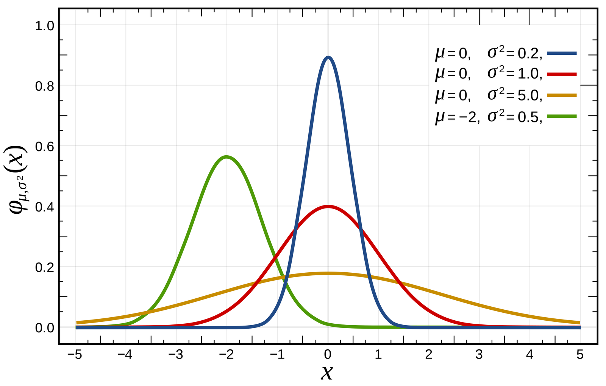
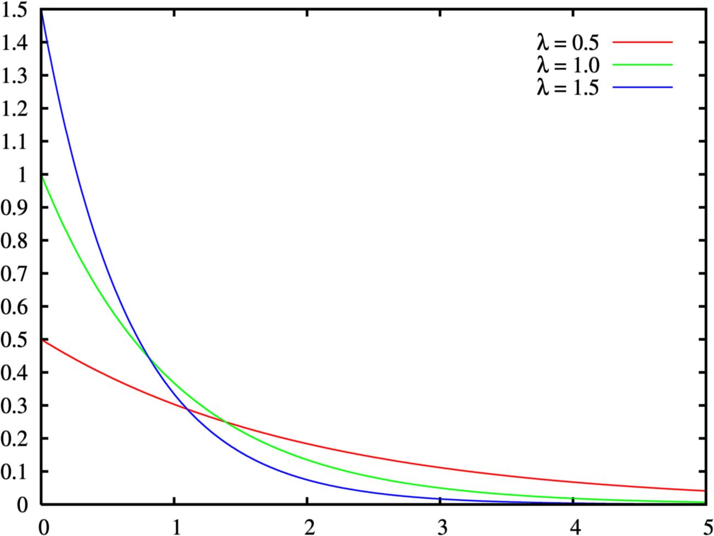
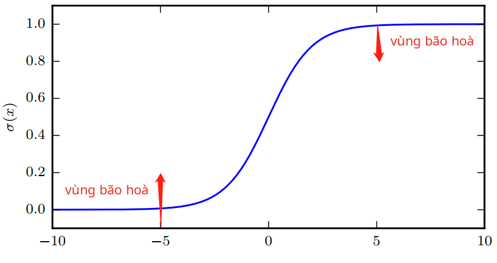

# Toán cho học sâu: Xác suất và lý thuyết thông tin

> Ghi chú của người biên soạn: trang này dịch từ ghi chú *dl_note* của **Harley Zhang** ([bản gốc](https://github.com/harleyszhang/dl_note/blob/main/1-math_ml_basic/深度学习数学基础-概率与信息论.md), [kho mã](https://github.com/harleyszhang/dl_note), giấy phép [Apache-2.0](https://www.apache.org/licenses/LICENSE-2.0); phần dịch có chỉnh sửa). Số mục giữ như bản gốc. Chỗ bản gốc sai, thiếu hoặc đã lỗi thời được sửa ngay trong bài và ghi ở ô **Biên tập**. Các mục có chữ **Bổ sung** do người biên soạn viết thêm.

Trang [Code](dlnote/math_code_vi) đi kèm kiểm tra bằng số các công thức của bài: kỳ vọng và phương sai của các phân phối trong bảng 3.9, tính chất của sigmoid, entropy, KL divergence và cross-entropy.

**Lý thuyết:** [Toán · Chương 3 Ôn tập Xác suất](math/ch03_vi) · [Toán · Chương 4 Ước lượng tham số mô hình](math/ch04_vi)

> Phần lớn nội dung bài này lấy từ chương 3 "Xác suất và lý thuyết thông tin" của sách *Deep Learning* (Goodfellow, Bengio, Courville; bản tiếng Trung gọi là "sách hoa"). Số mục 3.x theo số mục của chương sách.

## Lời nói đầu

### Định nghĩa môn xác suất

Lý thuyết xác suất là **khung toán học để biểu diễn các phát biểu không chắc chắn**. Nó không chỉ cho cách định lượng sự không chắc chắn, mà còn cho các tiên đề để suy ra những **phát biểu** (`statement`) không chắc chắn mới. Kiến thức xác suất được dùng rộng rãi trong học máy và học sâu, là nền tảng để học hai môn này.

### Ứng dụng của xác suất và lý thuyết thông tin trong trí tuệ nhân tạo

Trong trí tuệ nhân tạo, xác suất có hai công dụng chính.

- Thứ nhất, các quy luật xác suất cho biết hệ thống `AI` nên suy luận thế nào; dựa vào đó ta thiết kế thuật toán để tính hoặc ước lượng các biểu thức suy ra từ lý thuyết xác suất.
- Thứ hai, có thể dùng xác suất và thống kê để phân tích về mặt lý thuyết hành vi của hệ thống `AI` ta đề xuất.

Lý thuyết xác suất cho phép ta **đưa ra phát biểu và suy luận** khi có sự không chắc chắn, còn lý thuyết thông tin cho phép ta định lượng mức độ không chắc chắn trong một phân phối xác suất.

## 3.1 Vì sao cần dùng xác suất

Vì học máy luôn phải **xử lý các đại lượng không chắc chắn**, đôi khi còn phải xử lý các đại lượng ngẫu nhiên (không tất định), và sự không chắc chắn, ngẫu nhiên này có thể đến từ nhiều nguồn. Lập luận dùng xác suất để định lượng sự không chắc chắn bắt nguồn từ công trình của Pearl (1988) vào thập niên 1980.

Sự không chắc chắn có ba nguồn:

1. Tính ngẫu nhiên vốn có của hệ thống được mô hình hoá.
2. Quan sát không đầy đủ.
3. Mô hình hoá không đầy đủ: dùng mô hình buộc phải bỏ đi một phần thông tin quan sát được.

## 3.2 Biến ngẫu nhiên

**Biến ngẫu nhiên** (`random variable`) là biến có thể nhận các giá trị khác nhau một cách ngẫu nhiên; nó có thể rời rạc hoặc liên tục.

Biến ngẫu nhiên rời rạc có hữu hạn hoặc vô hạn đếm được trạng thái. Các trạng thái này không nhất thiết là số nguyên; chúng có thể chỉ là các trạng thái được đặt tên mà không có giá trị số. Biến ngẫu nhiên liên tục nhận giá trị thực. Lưu ý, biến ngẫu nhiên chỉ là mô tả các trạng thái có thể; nó phải đi kèm một phân phối xác suất chỉ rõ khả năng của từng trạng thái.

Sách thường dùng chữ thường kiểu chữ đứng (`plain typeface`) để ký hiệu chính biến ngẫu nhiên, và chữ thường kiểu nghiêng để ký hiệu giá trị mà nó nhận. Ví dụ, $x_1$ và $x_2$ đều là giá trị có thể của **biến ngẫu nhiên** $\textrm{x}$. Với biến giá trị vector, ta viết biến ngẫu nhiên là $\mathbf{x}$, và một giá trị có thể của nó là $\boldsymbol{x}$.

> **Biên tập:** Bản gốc viết giá trị được ký hiệu bằng "chữ viết tay" (手写体). Sách gốc tiếng Anh dùng *italic* (chữ nghiêng), như $x$ so với $\textrm{x}$.

> Wikipedia tiếng Trung dùng $X$ cho biến ngẫu nhiên và $f_{X}(x)$ cho hàm mật độ xác suất; ghi chú này dùng lẫn cả hai cách ở các mục khác nhau.

## 3.3 Phân phối xác suất

**Phân phối xác suất** (`probability distribution`) mô tả khả năng một biến ngẫu nhiên hay một nhóm biến ngẫu nhiên nhận từng trạng thái có thể.

Theo nghĩa hẹp, nó là **hàm phân phối xác suất của biến ngẫu nhiên**. Các biến ngẫu nhiên có cùng hàm phân phối thì cùng phân phối. Biến rời rạc và biến liên tục **mô tả phân phối xác suất theo cách khác nhau**.

### 3.3.1 Biến rời rạc và hàm khối xác suất

**Phân phối của biến rời rạc được mô tả bằng hàm khối xác suất** (`probability mass function`, `PMF`). Ta thường dùng chữ hoa $P$ cho hàm khối xác suất, và viết $\textrm{x} \sim P(\textrm{x})$ để **chỉ biến ngẫu nhiên $\textrm{x}$ tuân theo phân phối đó**.

> **Biên tập:** Bản gốc ghi PMF "còn gọi là hàm mật độ xác suất". Hai khái niệm khác nhau: PMF cho xác suất của từng giá trị rời rạc (luôn $\le 1$), còn hàm mật độ (PDF, mục 3.3.2) dành cho biến liên tục và có thể lớn hơn 1.

Thường mỗi biến ngẫu nhiên có một hàm khối xác suất riêng, nhưng hàm khối xác suất cũng có thể tác động đồng thời lên nhiều biến; phân phối của nhiều biến như vậy gọi là **phân phối đồng thời** (`joint probability distribution`). $P(\textrm{x} = x, \textrm{y} = y)$ là xác suất để $\textrm{x} = x$ và $\textrm{y} = y$ cùng xảy ra, đôi khi viết gọn là $P(x, y)$.

Hàm $P$ là `PMF` của biến ngẫu nhiên $\textrm{x}$ phải thoả mãn:

+ Miền xác định của $P$ phải là tập mọi trạng thái có thể của $\textrm{x}$.
+ $\forall x \in \textrm{x},\ 0 \leq P(x)\leq 1$. Sự kiện không thể xảy ra có xác suất `0`, sự kiện chắc chắn xảy ra có xác suất `1`.
+ $\sum_{x \in \textrm{x}}P(x)=1$: tính **chuẩn hoá** (`normalized`).

**Các họ phân phối rời rạc thường gặp**:

+ Phân phối Bernoulli.
+ Phân phối nhị thức: tiền đề để dùng phân phối nhị thức là các lần thử độc lập với cùng xác suất thành công (ví dụ rút mẫu có hoàn lại), và mỗi lần chỉ có hai kết quả, như bi đen hay bi đỏ, hàng tốt hay hàng lỗi.
+ Phân phối hình học.
+ Phân phối `Poisson`: là dạng giới hạn của phân phối nhị thức (khi $n\to\infty$, $p\to 0$, $np=\lambda$ cố định).
+ Phân phối đều rời rạc: biến ngẫu nhiên $\textrm{x}$ phân phối đều (`uniform distribution`) trên $k$ trạng thái có `PMF` là $P(\textrm{x}=x_{i}) = \frac{1}{k}$, và $\sum_{i}P(\textrm{x} = x_{i}) = \sum_{i}\frac{1}{k} = \frac{k}{k} = 1$.

### 3.3.2 Biến liên tục và hàm mật độ xác suất

**Phân phối của biến ngẫu nhiên liên tục được mô tả bằng hàm mật độ xác suất** (`probability density function`, `PDF`).

Ta thường dùng chữ thường $p$ cho `PDF` của biến ngẫu nhiên $\textrm{x}$; nó phải thoả mãn:

+ Miền xác định của $p$ phải là tập mọi trạng thái có thể của $\textrm{x}$.
+ $\forall x \in \textrm{x},\ p(x)\geq 0$. Lưu ý, không đòi hỏi $p(x)\leq 1$.
+ $\int p(x)\,dx=1$.

Hàm mật độ $p(x)$ không trực tiếp cho xác suất của một trạng thái cụ thể; nó cho xác suất rơi vào một vùng vô cùng nhỏ có thể tích $\delta x$ là $p(x)\delta x$.

Vì vậy, ta có thể lấy tích phân hàm mật độ để được khối xác suất thật của một tập điểm. Cụ thể, xác suất $x$ rơi vào tập $\mathbb{S}$ bằng tích phân của $p(x)$ trên tập đó. Với một biến, xác suất $x$ rơi vào đoạn $[a,b]$ là $\int_{[a,b]}p(x)\,dx$.

**Các họ phân phối liên tục thường gặp**:

+ Phân phối đều.
+ **Phân phối chuẩn**: hàm mật độ có đồ thị hình chuông đối xứng, nên còn gọi là đường cong hình chuông, với $\mu$ là trung bình và $\sigma$ là độ lệch chuẩn. Phân phối chuẩn là một phân phối lý tưởng.
  $$f(x)=\frac {1}{\sigma \sqrt {2\pi }}\exp\left(-\frac {1}{2}\left(\frac {x-\mu }{\sigma }\right)^{2}\right)$$
+ Phân phối Gamma.
+ Phân phối mũ.

## 3.4 Xác suất biên

> Xác suất biên có vẻ ít được dùng trực tiếp, ở đây chỉ cần hiểu định nghĩa và khái niệm. Cách giải thích dễ hiểu dưới đây lấy từ [数学篇 - 概率之联合概率、条件概率、边缘概率和贝叶斯法则(笔记)](https://alili.tech/archive/haz1cu03hf/).

Đôi khi ta biết phân phối đồng thời của một nhóm biến, nhưng muốn biết phân phối của một tập con của chúng. Phân phối xác định trên tập con như vậy gọi là **phân phối biên** (`marginal probability distribution`).

Với các biến rời rạc $\textrm{x}$ và $\textrm{y}$, biết $P(\textrm{x}, \textrm{y})$ thì tính được xác suất biên $P(\textrm{x})$ theo **quy tắc tổng** (`sum rule`):

$$\forall x \in \textrm{x},\ P(\textrm{x}=x)=\sum_{y}P(\textrm{x}=x, \textrm{y}=y)$$

Tên gọi "xác suất biên" xuất phát từ cách tính bằng tay. Khi viết các giá trị $P(x,y)$ thành một lưới, mỗi hàng ứng với một giá trị $x$, mỗi cột ứng với một giá trị $y$, thì cộng từng hàng là việc tự nhiên, rồi ghi tổng $P(x)$ ở lề giấy bên phải hàng đó.

Với biến liên tục, thay tổng bằng tích phân:

$$p(x) = \int p(x,y)\,dy$$

## 3.5 Xác suất có điều kiện

**Xác suất có điều kiện** (`conditional probability`) **là xác suất sự kiện A xảy ra khi biết sự kiện B đã xảy ra**, ký hiệu $P(A\vert B)$.

Cho $A$ và $B$ là hai sự kiện trong không gian mẫu $\Omega$, với $P(B) > 0$. Xác suất có điều kiện của $A$ khi $B$ đã xảy ra là:

$$P(A\vert B)=\frac {P(A\cap B)}{P(B)}$$

> Định nghĩa xác suất có điều kiện trong sách *Deep Learning* (biểu thức khác nhưng ý nghĩa như nhau; định nghĩa của Wikipedia dễ hiểu tên gọi hơn, còn công thức của sách mang tính toán học hơn):
>
> Ký hiệu xác suất có điều kiện để $\textrm{y} = y$ khi biết $\textrm{x} = x$ là $P(\textrm{y} = y\vert\textrm{x} = x)$, tính bằng công thức:
> $$P(\textrm{y}=y\vert\textrm{x}=x)=\frac{P(\textrm{y}=y, \textrm{x}=x)}{P(\textrm{x}=x)}$$
> Xác suất có điều kiện chỉ được định nghĩa khi $P(\textrm{x}=x) > 0$, tức không thể tính xác suất có điều kiện với điều kiện là một sự kiện không bao giờ xảy ra.

> **Biên tập:** Bản gốc viết điều kiện là $P(\textrm{x}=x)\geq 0$; đúng là $> 0$ (khi bằng 0 thì phép chia không xác định, khớp với câu giải thích ngay sau).

### 3.5.1 Quy tắc chuỗi của xác suất có điều kiện

Mọi phân phối đồng thời của nhiều biến ngẫu nhiên đều có thể phân tích thành tích của các xác suất có điều kiện, mỗi thừa số chỉ có một biến. Quy tắc này gọi là **quy tắc chuỗi** (`chain rule`) của xác suất:

$$
\begin{aligned}
P(a,b,c) &= P(a\vert b,c)P(b,c) \\
P(b,c) &= P(b\vert c)P(c) \\
P(a,b,c) &= P(a\vert b,c)P(b\vert c)P(c)
\end{aligned}
$$

Dạng tổng quát: $P(\textrm{x}^{(1)},\dots,\textrm{x}^{(n)})=P(\textrm{x}^{(1)})\prod_{i=2}^{n}P(\textrm{x}^{(i)}\vert\textrm{x}^{(1)},\dots,\textrm{x}^{(i-1)})$. Các mô hình ngôn ngữ tự hồi quy (như GPT) dùng chính phân tích này: xác suất cả câu bằng tích xác suất của từng token khi biết các token trước.

> **Biên tập:** Dòng cuối bản gốc viết $P(s\vert b,c)$, lỗi gõ của $P(a\vert b,c)$.

### 3.6 Độc lập và độc lập có điều kiện

Hai biến ngẫu nhiên $\textrm{x}$ và $\textrm{y}$ được gọi là **độc lập** (`independent`) nếu phân phối của chúng viết được thành tích của hai thừa số, một thừa số chỉ chứa $\textrm{x}$ và thừa số kia chỉ chứa $\textrm{y}$:

$$\forall x \in \textrm{x},\ y \in \textrm{y},\quad p(\textrm{x}=x, \textrm{y}=y)=p(\textrm{x}=x)\cdot p(\textrm{y}=y)$$

Xác suất để hai biến độc lập cùng xảy ra bằng tích xác suất của từng biến.

Nếu phân phối có điều kiện của $\textrm{x}$ và $\textrm{y}$ viết được thành tích như trên với mọi giá trị của $\textrm{z}$, thì hai biến $\textrm{x}$ và $\textrm{y}$ **độc lập có điều kiện** (`conditionally independent`) khi biết biến ngẫu nhiên $\textrm{z}$:

$$\forall x \in \textrm{x},\ y \in \textrm{y},\ z \in \textrm{z},\quad p(\textrm{x}=x, \textrm{y}=y\vert \textrm{z}=z)= p(\textrm{x}=x\vert \textrm{z}=z)\cdot p(\textrm{y}=y\vert \textrm{z}=z)$$

> **Biên tập:** Công thức bản gốc viết thiếu tập ở "$\forall x \in ,$" và dùng "$z \in \textrm{z}$" ở vị trí điều kiện; điều kiện đúng là $\textrm{z}=z$ (biết giá trị cụ thể của $\textrm{z}$), như ở trên.

Có thể dùng ký hiệu gọn: $\textrm{x}\perp\textrm{y}$ nghĩa là $\textrm{x}$ và $\textrm{y}$ độc lập, $\textrm{x}\perp\textrm{y}\mid\textrm{z}$ nghĩa là $\textrm{x}$ và $\textrm{y}$ độc lập có điều kiện khi biết $\textrm{z}$.

## 3.7 Tóm tắt xác suất có điều kiện, đồng thời và biên

1. **Xác suất có điều kiện** (`conditional probability`) **là xác suất sự kiện A xảy ra khi biết sự kiện B đã xảy ra**, ký hiệu $P(A\vert B)$, đọc là "xác suất của A khi B đã xảy ra".
2. Xác suất đồng thời là xác suất hai sự kiện cùng xảy ra. Xác suất đồng thời của `A` và `B` ký hiệu là $P(A\cap B)$, $P(A,B)$ hoặc $P(AB)$.
3. Xác suất chỉ liên quan tới một biến ngẫu nhiên gọi là xác suất biên.

## 3.8 Kỳ vọng, phương sai và hiệp phương sai

> Để dễ hiểu, định nghĩa toán học của kỳ vọng và phương sai trong mục này chủ yếu theo Wikipedia tiếng Trung.

Trong một phân phối xác suất, kỳ vọng và phương sai (hay độ lệch chuẩn) là các đặc trưng quan trọng; kỳ vọng, kỳ vọng toán học, giá trị trung bình là cùng một nghĩa. Phương sai trong thống kê (phương sai mẫu) là trung bình bình phương độ lệch của từng giá trị mẫu so với trung bình mẫu; ý nghĩa của nó khác với phương sai của một phân phối xác suất.

### 3.8.1 Kỳ vọng

Trong xác suất và thống kê, kỳ vọng (hay kỳ vọng toán học, trong vật lý gọi là giá trị kỳ vọng) của một biến ngẫu nhiên rời rạc là **tổng của mỗi kết quả có thể nhân với xác suất của nó**. Nói cách khác, kỳ vọng là kết quả trung bình khi lặp lại phép thử ngẫu nhiên nhiều lần trong cùng điều kiện, cũng có thể hiểu là **trung bình có trọng số của các giá trị đầu ra**.

#### Định nghĩa toán học của kỳ vọng

Nếu $X$ là biến ngẫu nhiên trên không gian xác suất $(\Omega ,F,P)$, thì kỳ vọng $\operatorname{E}(X)$ của nó định nghĩa là:

$$\operatorname {E}(X)=\int_{\Omega }X \,{d}P$$

**Không phải biến ngẫu nhiên nào cũng có kỳ vọng, vì đôi khi tích phân trên không tồn tại** (ví dụ phân phối Cauchy). **Hai biến ngẫu nhiên có cùng phân phối thì có cùng kỳ vọng.**

1. Nếu $X$ là **biến ngẫu nhiên rời rạc** với các giá trị $x_{1},x_{2},\ldots$ và xác suất tương ứng $p_{1},p_{2},\ldots$ (tổng xác suất bằng `1`), và chuỗi $\sum_{i}p_{i}x_{i}$ hội tụ tuyệt đối, thì kỳ vọng $\operatorname {E}(X)$ là tổng của chuỗi đó:

$$\operatorname {E}(X)=\sum_{i}p_{i}x_{i}$$

2. Nếu $X$ là **biến ngẫu nhiên liên tục** có hàm mật độ $f(x)$, và tích phân $\int _{-\infty }^{\infty }xf(x)\,\mathrm {d} x$ hội tụ tuyệt đối, thì kỳ vọng của $X$ là:

$$\operatorname {E} (X)=\int _{-\infty }^{\infty }xf(x)\,\mathrm {d} x$$

Dù dành cho biến liên tục, cách tính này giống hệt với biến rời rạc; vì giá trị đầu ra liên tục nên **chỉ cần đổi tổng thành tích phân**.

**Kỳ vọng $\operatorname{E}$ là hàm tuyến tính**:

$$\operatorname {E}(aX+bY)=a\operatorname {E}(X)+b\operatorname {E}(Y)$$

trong đó $X$ và $Y$ là **hai biến ngẫu nhiên trên cùng một không gian xác suất** (độc lập hay không đều được), $a$ và $b$ là số thực bất kỳ.

> **Biên tập:** Bản gốc chép từ Wikipedia bị lặp ký hiệu ("$x_{1},x_{2},\ldots x_{1},x_{2},\ldots$", "$p_{1},p_{2},\ldots p_{1},p_{2},\ldots$"); đã bỏ phần lặp.

> Định nghĩa kỳ vọng trong sách *Deep Learning* (biểu thức khác nhưng ý nghĩa như nhau):
>
> 1. Kỳ vọng của hàm $f(x)$ theo phân phối $P(x)$ là giá trị trung bình của $f$ khi $x$ được lấy từ $P$. Với biến rời rạc, kỳ vọng tính bằng **tổng**:
> $$\mathbb{E}_{\textrm{x}\sim P}[f(x)] = \sum_{x} P(x)f(x)$$
> 2. Với biến liên tục, tính bằng **tích phân**:
> $$\mathbb {E}_{\textrm{x}\sim p}[f(x)] = \int p(x)f(x)\,dx$$

#### Ứng dụng của kỳ vọng

1. Trong **thống kê**, để ước lượng kỳ vọng của một biến, cách hay dùng là đo lặp lại biến đó nhiều lần rồi lấy trung bình các số đo.
2. Trong **phân phối xác suất**, kỳ vọng và phương sai (hay độ lệch chuẩn) là các đặc trưng quan trọng của phân phối.

#### Định nghĩa trung bình tổng thể

Nói chung, một tổng thể hữu hạn có $N$ phần tử với giá trị $x_{i}$ có trung bình tổng thể:

$$\mu = \frac{1}{N}\sum_{i=1}^N x_{i}$$

### 3.8.2 Phương sai

Trong xác suất và thống kê, phương sai (`variance`) mô tả **độ phân tán của một biến ngẫu nhiên, tức biến đó cách kỳ vọng của nó bao xa**; nó là kỳ vọng của bình phương độ lệch giữa biến ngẫu nhiên và trung bình tổng thể (hoặc trung bình mẫu).

Phương sai là bình phương của độ lệch chuẩn, là mô-men trung tâm bậc hai của phân phối, và cũng là hiệp phương sai của biến ngẫu nhiên với chính nó. Các ký hiệu thường dùng là $\sigma^2$, $s^2$, $\operatorname {Var} (X)$, $V(X)$ và $\mathbb {V} (X)$.

Ưu điểm của phương sai so với các thước đo phân tán khác (như độ lệch tuyệt đối trung bình) là dễ biến đổi đại số hơn; nhược điểm là đơn vị của nó khác đơn vị của biến ngẫu nhiên, còn độ lệch chuẩn thì cùng đơn vị. Vì vậy sau khi tính xong người ta thường dùng độ lệch chuẩn để đo độ phân tán.

> Căn bậc hai dương của phương sai gọi là độ lệch chuẩn của biến ngẫu nhiên.

Có hai khái niệm khác nhau đều gọi là "phương sai". Một là phương sai của phân phối xác suất lý thuyết như trên. Hai là đặc trưng của một tập quan sát, gồm **phương sai tổng thể** (mọi quan sát có thể) và **phương sai mẫu** (một tập con của tổng thể).

#### Định nghĩa toán học của phương sai

Cho $X$ là biến ngẫu nhiên có phân phối $F$, và $\operatorname{E}[X]$ là kỳ vọng của $X$ (trung bình $\mu=\operatorname{E}[X]$). **Phương sai** của $X$ (hay của phân phối $F$) là **kỳ vọng của bình phương độ lệch**:

$$\operatorname{Var}(X) = \operatorname{E}\left[(X - \mu)^2\right] = \operatorname{E}\left[(X - \operatorname{E}[X])^2\right]$$

> **Biên tập:** Bản gốc viết vế trái là $\operatorname{E}(X)$ và đặt bình phương ra ngoài ngoặc: $\operatorname{E}[(X-\mu)]^2$. Biểu thức đó bằng $0$ (vì $\operatorname{E}[X-\mu]=0$). Đúng là $\operatorname{Var}(X)=\operatorname{E}[(X-\mu)^2]$.

Khai triển biểu thức phương sai:

$$
\begin{aligned}
\operatorname{Var}(X) &=\operatorname{E} \left[(X-\operatorname {E} [X])^{2}\right] \\
&=\operatorname{E} \left[X^{2}-2X\operatorname {E} [X]+\operatorname{E}[X]^{2}\right] \\
&=\operatorname{E} \left[X^{2}\right]-2\operatorname{E}[X]\operatorname{E}[X]+\operatorname{E}[X]^{2} \\
&=\operatorname{E} \left[X^{2}\right]-\operatorname{E}[X]^{2}
\end{aligned}
$$

Nghĩa là phương sai của $X$ bằng trung bình của bình phương $X$ trừ bình phương của trung bình $X$.

#### Định nghĩa phương sai tổng thể

Nói chung, một tổng thể hữu hạn có $N$ phần tử với giá trị $x_{i}$ có phương sai tổng thể:

$$\sigma^{2} = \frac {1}{N}\sum _{i=1}^{N}\left(x_{i}-\mu \right)^{2}$$

Còn **phương sai mẫu** không chệch tính từ $n$ quan sát chia cho $n-1$: $s^2=\frac{1}{n-1}\sum_{i=1}^{n}(x_i-\bar x)^2$ (lý do xem mục 5.4 của bài [Nguyên lý cơ bản của học máy](dlnote/math_ml_vi)). Trong NumPy, `np.var(x)` mặc định chia cho $n$ (`ddof=0`), còn `torch.var(x)` mặc định chia cho $n-1$.

> Định nghĩa phương sai trong sách *Deep Learning*: **phương sai** (`variance`) đo mức chênh lệch của giá trị hàm của biến ngẫu nhiên $\textrm{x}$ khi ta lấy mẫu $x$ theo phân phối của nó; nói cách khác, phương sai của một biến ngẫu nhiên mô tả độ phân tán, tức biến đó cách kỳ vọng bao xa:
> $$\operatorname{Var}(f(x)) = \mathbb{E}\left[(f(x) - \mathbb{E}[f(x)])^2\right]$$

### 3.8.3 Tính chất của kỳ vọng và phương sai

> **Biên tập:** Bản gốc dán hai ảnh chụp từ một bài Zhihu, gõ lại dưới đây. Bài đó ký hiệu phương sai là $D(X)$ (cách viết của giáo trình Trung Quốc), ở đây đổi thành $\operatorname{Var}(X)$ cho thống nhất.

**Tính chất của kỳ vọng** ($c$ là hằng số):

1. $\operatorname{E}(c)=c$.
2. $\operatorname{E}(cX)=c\operatorname{E}(X)$.
3. $\operatorname{E}(X+Y)=\operatorname{E}(X)+\operatorname{E}(Y)$.
4. $\operatorname{E}(X-Y)=\operatorname{E}(X)-\operatorname{E}(Y)$.
5. Nếu $X$, $Y$ độc lập thì $\operatorname{E}(XY)=\operatorname{E}(X)\operatorname{E}(Y)$.

**Tính chất của phương sai** ($a$, $c$ là hằng số):

1. $\operatorname{Var}(c)=0$.
2. $\operatorname{Var}(cX)=c^2\operatorname{Var}(X)$.
3. $\operatorname{Var}(X+a)=\operatorname{Var}(X)$.
4. $\operatorname{Var}(cX+a)=c^2\operatorname{Var}(X)$.
5. Nếu $X$, $Y$ độc lập thì $\operatorname{Var}(X\pm Y)=\operatorname{Var}(X)+\operatorname{Var}(Y)$. Tổng quát (không cần độc lập): $\operatorname{Var}(X\pm Y)=\operatorname{Var}(X)+\operatorname{Var}(Y)\pm 2\operatorname{Cov}(X,Y)$.

> Nguồn: bài Zhihu [【AP统计】期望E(X)与方差Var(X)](https://zhuanlan.zhihu.com/p/64859161).

Tính chất 5 của phương sai giải thích vì sao các phương pháp khởi tạo trọng số (Xavier, He) chia phương sai cho số đầu vào: tổng của $n$ số hạng độc lập có phương sai gấp $n$ lần.

### 3.8.4 Hiệp phương sai

Hiệp phương sai (`Covariance`) dùng trong xác suất và thống kê để **đo mức độ biến thiên cùng nhau của hai biến ngẫu nhiên**.

#### Định nghĩa toán học của hiệp phương sai

Hiệp phương sai giữa hai biến ngẫu nhiên thực $X$ và $Y$ có mô-men bậc hai hữu hạn, với kỳ vọng lần lượt là $\operatorname E(X)=\mu$ và $\operatorname E(Y)=\nu$, định nghĩa là:

$$\operatorname {Cov} (X,Y)=\operatorname {E} \big((X-\mu )(Y-\nu )\big)=\operatorname {E} (X Y)-\mu \nu$$

Hiệp phương sai thể hiện sai lệch chung của hai biến, khác với phương sai chỉ thể hiện sai lệch của một biến.

Trị tuyệt đối của hiệp phương sai lớn nghĩa là giá trị các biến thay đổi nhiều và đồng thời cách xa trung bình của chúng. Nếu hiệp phương sai dương, hai biến có xu hướng cùng nhận giá trị tương đối lớn. Nếu hiệp phương sai âm, khi một biến có xu hướng nhận giá trị tương đối lớn thì biến kia có xu hướng nhận giá trị tương đối nhỏ, và ngược lại. Các thước đo khác như **hệ số tương quan** (`correlation`) chuẩn hoá đóng góp của từng biến, để chỉ đo mức tương quan mà không bị ảnh hưởng bởi thang đo của từng biến: $\rho_{XY}=\dfrac{\operatorname{Cov}(X,Y)}{\sigma_X\sigma_Y}\in[-1,1]$.

Hai biến độc lập thì hiệp phương sai bằng 0, nhưng hiệp phương sai bằng 0 **không** suy ra độc lập: ví dụ $X\sim\mathcal N(0,1)$ và $Y=X^2$ có $\operatorname{Cov}(X,Y)=\operatorname E(X^3)=0$ dù $Y$ hoàn toàn phụ thuộc $X$ (trang Code kiểm tra bằng số).

## 3.9 Các phân phối xác suất thường gặp

Bảng dưới liệt kê kỳ vọng và phương sai của một số phân phối hay dùng.

> **Biên tập:** Bản gốc dán ảnh chụp bảng từ Wikipedia tiếng Trung, gõ lại dưới đây. Thêm dòng Bernoulli và Laplace (hai phân phối có mục riêng ngay sau), và ghi rõ miền xác định $x\ge 0$ của phân phối mũ (ảnh gốc không ghi). Phân phối hình học ở đây là số lần thử tới lần thành công đầu tiên, $k=1,2,\dots$

| Phân phối | Hàm khối / mật độ xác suất | Kỳ vọng | Phương sai |
| --- | --- | --- | --- |
| Bernoulli | $P(X=k)=p^k(1-p)^{1-k},\ k\in\{0,1\}$ | $p$ | $p(1-p)$ |
| Nhị thức | $P(X=k)=\dbinom{n}{k}p^{k}(1-p)^{n-k}$ | $np$ | $np(1-p)$ |
| Hình học | $P(X=k)=(1-p)^{k-1}p$ | $\dfrac{1}{p}$ | $\dfrac{1-p}{p^2}$ |
| Poisson | $P(X=k)=\dfrac{e^{-\lambda}\lambda^k}{k!}$ | $\lambda$ | $\lambda$ |
| Chuẩn | $f(x\mid\mu,\sigma^2)=\dfrac{1}{\sqrt{2\pi\sigma^2}}e^{-\frac{(x-\mu)^2}{2\sigma^2}}$ | $\mu$ | $\sigma^2$ |
| Đều liên tục | $f(x\mid a,b)=\dfrac{1}{b-a}$ với $a\le x\le b$, bằng 0 ngoài đoạn | $\dfrac{a+b}{2}$ | $\dfrac{(b-a)^2}{12}$ |
| Mũ | $f(x\mid\lambda)=\lambda e^{-\lambda x}$ với $x\ge 0$ | $\dfrac{1}{\lambda}$ | $\dfrac{1}{\lambda^2}$ |
| Laplace | $f(x\mid\mu,\gamma)=\dfrac{1}{2\gamma}e^{-\frac{\lvert x-\mu\rvert}{\gamma}}$ | $\mu$ | $2\gamma^2$ |

### 3.9.1 Phân phối Bernoulli

**Phân phối Bernoulli** (`Bernoulli distribution`), còn gọi là phân phối hai điểm hay phân phối `0-1`, là một phân phối rời rạc, đặt theo tên nhà khoa học Thuỵ Sĩ Jacob Bernoulli. Nếu phép thử Bernoulli thành công thì biến ngẫu nhiên Bernoulli nhận giá trị `1`; nếu thất bại thì nhận `0`. Gọi xác suất thành công là $p$ với $0\leq p\leq 1$, xác suất thất bại là $q = 1-p$. Phân phối có các tính chất:

1. **Hàm khối xác suất**:

$$
f_{X}(x) = p^{x}(1-p)^{1-x} = \begin{cases}
p & \text{nếu } x = 1 \\
1-p & \text{nếu } x = 0
\end{cases}
$$

2. **Kỳ vọng**:

$$\operatorname {E} [X] = \sum_{x\in\{0,1\}} x\,f_X(x) = 0\cdot(1-p) + 1\cdot p = p$$

3. **Phương sai**:

$$
\begin{aligned}
\operatorname{Var}[X] &= \sum_{x\in\{0,1\}} (x-\operatorname {E} [X])^2f_{X}(x) \\
&= (0-p)^2(1-p) + (1-p)^2p \\
&= p(1-p) \\
&= pq
\end{aligned}
$$

> **Biên tập:** Bản gốc viết lẫn $P$ hoa và $p$ thường trong cùng phép tính phương sai, và tổng kỳ vọng ghi chỉ số $x_i$ nhưng hàm $f_X(x)$; đã viết lại thống nhất.

### 3.9.2 Phân phối Multinoulli

Phân phối `Multinoulli` (còn gọi là **phân phối phân loại**, `categorical distribution`) là phân phối rời rạc mô tả kết quả của một biến ngẫu nhiên nhận một trong $k$ loại, với xác suất của từng loại được chỉ định riêng, trong đó $k$ hữu hạn. Phân phối được tham số hoá bởi vector $\boldsymbol p\in[0,1]^{k}$ với $\sum_i p_i=1$; đầu ra softmax của mạng phân loại chính là tham số của một phân phối Multinoulli.

> **Biên tập:** Bản gốc gọi Multinoulli là "phân phối đa thức" (多项式分布). Phân phối đa thức (`multinomial`) là số lần xuất hiện của từng loại sau $n$ lần thử; Multinoulli là trường hợp $n=1$ của nó, giống như Bernoulli là trường hợp $n=1$ của nhị thức.

### 3.9.3 Phân phối Gauss

> Có nhiều cách mô tả một biến ngẫu nhiên. Cách trực quan nhất là **hàm mật độ xác suất**, cho biết mỗi giá trị của biến có khả năng xảy ra đến mức nào.

Phân phối Gauss (`Gaussian distribution`, còn gọi là phân phối chuẩn, `Normal distribution`) là một phân phối **liên tục** rất phổ biến. Nó rất quan trọng trong thống kê, thường dùng trong khoa học tự nhiên và xã hội để biểu diễn một biến ngẫu nhiên chưa biết.

Nếu biến ngẫu nhiên $X$ tuân theo phân phối chuẩn với tham số vị trí $\mu$ và tham số tỉ lệ $\sigma$, ta viết:

$$X \sim \mathcal N(\mu,\sigma^2)$$

và **hàm mật độ xác suất** của nó là

$$f(x;\mu, \sigma) = \frac {1}{\sigma \sqrt {2\pi }}\;e^{-\frac {\left(x-\mu \right)^{2}}{2\sigma ^{2}}}$$

Kỳ vọng $\mu$ của phân phối chuẩn bằng tham số vị trí, quyết định **vị trí** của phân phối; căn bậc hai của phương sai $\sigma^2$, tức độ lệch chuẩn $\sigma$, bằng tham số tỉ lệ, quyết định **độ rộng** của phân phối.

Đồ thị hàm mật độ của phân phối chuẩn có hình chuông, nên còn gọi là đường cong hình chuông. **Phân phối chuẩn tắc** là phân phối chuẩn với $\mu = 0$ và $\sigma ^{2} = 1$ (đường màu đỏ trong hình dưới).

Hình 1: Hàm mật độ của phân phối chuẩn với bốn bộ tham số; đường đỏ là phân phối chuẩn tắc (nguồn: Wikipedia).

Trong nhiều ứng dụng, chọn phân phối chuẩn là lựa chọn khôn ngoan. Khi thiếu hiểu biết tiên nghiệm về dạng của một phân phối trên số thực, phân phối chuẩn là lựa chọn mặc định tốt, vì hai lý do:

1. Thứ nhất, nhiều phân phối ta muốn mô hình hoá thực tế khá gần phân phối chuẩn (định lý giới hạn trung tâm: tổng của nhiều biến độc lập xấp xỉ phân phối chuẩn).
2. Thứ hai, trong mọi phân phối trên số thực có cùng phương sai, phân phối chuẩn có độ không chắc chắn (entropy) **lớn nhất**. Vì vậy có thể xem phân phối chuẩn là phân phối đưa ít tri thức tiên nghiệm nhất vào mô hình.

### 3.9.4 Phân phối mũ và phân phối Laplace

Trong xác suất và thống kê, **phân phối mũ** (`Exponential distribution`) là phân phối liên tục có một điểm gãy nhọn (`sharp point`) tại $x = 0$; nó dùng hàm chỉ thị (`indicator function`) $\mathbf 1_{x\geq0}$ để xác suất bằng 0 khi $x$ âm. Phân phối mũ là trường hợp riêng của **phân phối Gamma** với tham số hình dạng $\alpha = 1$.

Phân phối mũ có thể dùng để biểu diễn khoảng thời gian giữa các sự kiện ngẫu nhiên độc lập, ví dụ khoảng thời gian giữa hai hành khách vào sân bay, hay giữa hai cuộc gọi tới tổng đài.

Nếu biến ngẫu nhiên $X$ tuân theo phân phối mũ với tham số $\lambda$ hoặc $\beta$, ta viết $X\sim {\text{Exp}}(\lambda )$ hoặc $X\sim {\text{Exp}}(\beta )$. Hai cách viết cùng nghĩa, chỉ là $\lambda$ và $\beta$ nghịch đảo của nhau. **Hàm mật độ của phân phối mũ** là:

$$
f(x;{\color{red}\lambda })=\begin{cases}{\color{red}\lambda }e^{-{\color{red}\lambda }x}, & x\geq 0,\\ 0, & x<0.\end{cases}
$$

**Đồ thị hàm mật độ của phân phối mũ** như dưới.

Hình 2: Hàm mật độ của phân phối mũ với vài giá trị $\lambda$ (nguồn: Wikipedia).

**Phân phối Laplace.** Bản gốc chỉ có tên phân phối Laplace trong tiêu đề mục. Theo sách *Deep Learning*, đây là phân phối cho phép đặt một đỉnh nhọn của khối xác suất tại một điểm $\mu$ bất kỳ:

$$
\operatorname{Laplace}(x;\mu,\gamma)=\frac{1}{2\gamma}\exp\left(-\frac{\lvert x-\mu\rvert}{\gamma}\right)
$$

Nó giống hai phân phối mũ ghép đối xứng quanh $\mu$, có kỳ vọng $\mu$ và phương sai $2\gamma^2$. So với phân phối chuẩn cùng phương sai, Laplace có đỉnh nhọn hơn và đuôi dày hơn. Trong học máy, phân phối Laplace xuất hiện ở hai chỗ: hàm mất mát L1 (MAE) tương ứng với giả định nhiễu Laplace, giống như MSE tương ứng với nhiễu Gauss; và đặt tiên nghiệm Laplace lên trọng số thì ước lượng MAP chính là regularization L1 (xem mục 5.6 bài [Nguyên lý cơ bản của học máy](dlnote/math_ml_vi)).

> **Biên tập:** Bản gốc gọi điểm $x=0$ là "điểm biên" (边界点); sách gốc tiếng Anh viết *sharp point*, tức điểm mà mật độ nhảy từ 0 lên $\lambda$. Đoạn về phân phối Laplace do người biên soạn viết theo mục 3.9.4 của sách.

## 3.10 Tính chất hữu ích của các hàm thường gặp

Một số hàm thường xuất hiện trong các phân phối xác suất của học sâu, ví dụ hàm `logistic sigmoid`:

$$\sigma(x) = \frac{1}{1+\exp(-x)}$$

Hàm `logistic sigmoid` thường dùng để sinh tham số $p$ của phân phối Bernoulli, vì miền giá trị $(0, 1)$ của nó nằm trong miền hợp lệ của $p$. Hình 3.3 dưới vẽ hàm `sigmoid`. Có thể thấy khi đầu vào có trị tuyệt đối rất lớn (dương hay âm), hàm `sigmoid` bị **bão hoà** (`saturate`), nghĩa là hàm trở nên **rất phẳng** và **không nhạy** với thay đổi nhỏ của đầu vào.

Hình 3.3: Hàm logistic sigmoid; hai đầu là vùng bão hoà (hình 3.3 của sách *Deep Learning*).

Một số tính chất của hàm `sigmoid` sẽ hữu ích khi học thuật toán lan truyền ngược (`BP`) sau này, cần nhớ:

$$
\begin{aligned}
\sigma(x) &= \frac{\exp(x)}{\exp(x)+\exp(0)} \\
\frac{d}{dx}\sigma(x) &= \sigma(x)(1 - \sigma(x)) \\
1 - \sigma(x) &= \sigma(-x)
\end{aligned}
$$

Tính chất thứ hai cho thấy đạo hàm của sigmoid lớn nhất bằng $0{,}25$ (tại $x=0$) và tiến về 0 ở vùng bão hoà: đây là một nguyên nhân gây tiêu biến gradient trong mạng sâu dùng sigmoid.

## 3.11 Định lý Bayes

> Mục này chỉ giới thiệu khái niệm và công thức cơ bản; muốn hiểu đầy đủ và sâu hơn nên đọc sách *Machine Learning* (Chu Chí Hoa).

Định lý Bayes (`Bayes' theorem`) là một định lý của xác suất, mô tả **xác suất xảy ra một sự kiện khi đã biết một số điều kiện**. Ví dụ, nếu biết một vấn đề sức khoẻ có liên quan tới tuổi thọ, định lý Bayes cho phép dựa vào tuổi của một người để tính chính xác hơn xác suất người đó mắc vấn đề sức khoẻ ấy.

Thường thì xác suất của sự kiện A khi biết B đã xảy ra khác với xác suất của B khi biết A đã xảy ra. Nhưng hai đại lượng này có quan hệ xác định, và định lý Bayes phát biểu quan hệ đó. Một công dụng của công thức Bayes là suy ra xác suất thứ tư từ ba xác suất đã biết. Định lý Bayes gắn với xác suất có điều kiện và phân phối biên của biến ngẫu nhiên.

Là một nguyên lý tổng quát, định lý Bayes đúng với mọi cách diễn giải xác suất. Ứng dụng chính của nó là suy luận Bayes, một phương pháp suy luận của thống kê suy diễn. Định lý mang tên Thomas Bayes.

> Nguồn: [Wikipedia tiếng Trung - Định lý Bayes](https://zh.wikipedia.org/wiki/%E8%B4%9D%E5%8F%B6%E6%96%AF%E5%AE%9A%E7%90%86)

### 3.11.1 Công thức định lý Bayes

Định lý Bayes là định lý về xác suất có điều kiện của hai sự kiện ngẫu nhiên A và B:

$$P(A\mid B)=\frac {P(A)P(B\mid A)}{P(B)}$$

trong đó A và B là các sự kiện ngẫu nhiên và $P(B)$ khác 0. $P(A\mid B)$ là xác suất A xảy ra khi biết B đã xảy ra.

Mỗi thành phần trong định lý Bayes có tên gọi quen dùng:

- $P(A\mid B)$ là **xác suất có điều kiện** của A khi biết B, còn gọi là **xác suất hậu nghiệm** (posterior) của A.
- $P(A)$ là **xác suất tiên nghiệm** (prior) của A, không xét tới bất kỳ yếu tố nào về B.
- $P(B\mid A)$ là xác suất có điều kiện của B khi biết A; khi xem như hàm của A (với B cố định) nó được gọi là **hợp lý** (likelihood) của A, $P(B\mid A)=L(A\mid B)$.
- $P(B)$ là xác suất biên của B, còn gọi là **bằng chứng** (evidence); nó đóng vai trò hằng số chuẩn hoá.

> **Biên tập:** Bản gốc (chép Wikipedia tiếng Trung bản cũ) gọi $P(B\mid A)$ là "xác suất hậu nghiệm của B" và $P(B)$ là "xác suất tiên nghiệm của B". Trong suy luận Bayes, nơi A là giả thuyết và B là dữ liệu, cách gọi chuẩn là: $P(B\mid A)$ là likelihood, $P(B)$ là evidence (xác suất biên của dữ liệu).

### 3.11.2 Định lý Bayes với hàm mật độ

Định lý Bayes cũng áp dụng cho phân phối xác suất; quan hệ giữa định lý Bayes và mật độ xác suất được thiết lập bằng cách lấy giới hạn:

$$P(\textrm{x}\vert\textrm{y}) = \frac{P(\textrm{x})P(\textrm{y}\vert\textrm{x})}{P(\textrm{y})}$$

Để ý $P(\textrm{y})$ xuất hiện trong công thức trên; nó thường được tính bằng $P(\textrm{y}) = \sum_{x} P(\textrm{y}\vert x)P(x)$, nên ta không cần biết trước $P(\textrm{y})$.

> Định nghĩa quan hệ giữa định lý Bayes và mật độ xác suất theo Wikipedia tiếng Trung:
> $$f(x\vert y)=\frac {f(x,y)}{f(y)}=\frac {f(y\vert x)\,f(x)}{f(y)}$$

## 3.12 Chi tiết kỹ thuật của biến liên tục

Muốn hiểu sâu biến ngẫu nhiên liên tục và hàm mật độ xác suất cần đến **lý thuyết độ đo** (`measure theory`), một nhánh toán học dùng để mở rộng lý thuyết xác suất; lý thuyết độ đo nằm ngoài phạm vi bài này. Sách *Deep Learning* có giới thiệu ngắn về lý thuyết độ đo, ghi chú này không chép lại, ai quan tâm có thể đọc sách.

## 3.13 Lý thuyết thông tin: entropy tương đối và cross-entropy

Lý thuyết thông tin là một nhánh của toán ứng dụng, điện tử và khoa học máy tính, ban đầu dùng cho truyền thông vô tuyến. Trong học sâu, ta chủ yếu dùng một số ý tưởng then chốt của lý thuyết thông tin để **đặc trưng hoá** (`characterize`) phân phối xác suất hoặc **định lượng độ giống nhau giữa các phân phối**.

Ý tưởng cơ bản của lý thuyết thông tin là: một sự kiện khó xảy ra mà lại xảy ra thì mang nhiều thông tin hơn một sự kiện rất dễ xảy ra.

Định nghĩa **lượng tin riêng** (`self-information`) của sự kiện $\textrm{x} = x$ là

$$
I(x) = -\log P(x)
$$

Trong bài này, $\log$ luôn là logarit tự nhiên, cơ số $e$. Vì vậy đơn vị của $I(x)$ là **nat**. Một nat là lượng tin nhận được khi quan sát một sự kiện có xác suất $\frac{1}{e}$. Tài liệu khác có thể dùng logarit cơ số 2, đơn vị là **bit** hay shannon; lượng tin đo bằng bit chỉ là bội hằng số của lượng tin đo bằng nat ($1\text{ nat}=\frac{1}{\ln 2}\approx 1{,}443$ bit).

Lượng tin riêng chỉ xét một kết quả. Ta có thể dùng **entropy Shannon** (`Shannon entropy`) để định lượng tổng độ không chắc chắn của cả một phân phối:

$$H(P) = H(\textrm{x}) = \mathbb{E}_{\textrm{x}\sim P}[I(x)] = -\mathbb{E}_{\textrm{x}\sim P}[\log P(x)]$$

Nói cách khác, entropy Shannon của một phân phối là kỳ vọng lượng tin sinh ra bởi các sự kiện tuân theo phân phối đó.

Nếu cùng một biến ngẫu nhiên $\textrm{x}$ có hai phân phối riêng $P(\textrm{x})$ và $Q(\textrm{x})$, ta có thể dùng **KL divergence** (`Kullback-Leibler divergence`, còn gọi là **entropy tương đối**) để **đo khác biệt giữa hai phân phối**:

$$D_{KL}(P\parallel Q) = \mathbb{E}_{\textrm{x}\sim P}\left[\log \frac{P(x)}{Q(x)}\right] = \mathbb{E}_{\textrm{x}\sim P}[\log P(x) - \log Q(x)]$$

KL divergence có nhiều tính chất hữu ích, quan trọng nhất là nó không âm. KL divergence bằng 0 khi và chỉ khi $P$ và $Q$ là cùng một phân phối (với biến rời rạc), hoặc bằng nhau "hầu khắp nơi" (với biến liên tục).

Một đại lượng gắn chặt với KL divergence là **cross-entropy** $H(P, Q) = H(P) + D_{KL}(P\parallel Q)$, tính bằng:

$$H(P, Q)  = -\mathbb{E}_{\textrm{x}\sim P}\log Q(x)$$

So với KL divergence, nó thiếu số hạng bên trái là entropy $H(P)$. Vì $H(P)$ không phụ thuộc $Q$, **cực tiểu hoá cross-entropy theo $Q$ tương đương với cực tiểu hoá KL divergence**. Đó là lý do hàm mất mát phân loại dùng cross-entropy: $P$ là phân phối nhãn (cố định), $Q$ là dự đoán của mô hình.

> **Biên tập:** Bản gốc viết "cực tiểu hoá KL divergence chính là cực tiểu hoá cross-entropy" mà không nói điều kiện. Hai việc chỉ tương đương khi tối ưu theo $Q$ với $P$ cố định; nếu tối ưu theo $P$ (như trong một số bài toán biến phân) thì số hạng $H(P)$ thay đổi và hai mục tiêu khác nhau.

> Cách viết ở trên dựa trên **kỳ vọng toán học** đã học. Phụ lục C sách *Machine Learning* (Chu Chí Hoa) có cách viết trực quan hơn:
> $$KL(P\parallel Q) = \int_{-\infty }^{+\infty} p(x)\log \frac{p(x)}{q(x)}\, dx$$
> trong đó $p(x)$ và $q(x)$ lần lượt là hàm mật độ của $P$ và $Q$. Ở đây giả sử cả hai phân phối đều liên tục; với phân phối rời rạc, chỉ cần thay tích phân bằng tổng trên mọi giá trị rời rạc.
>
> KL divergence không âm nhưng không đối xứng ($D_{KL}(P\parallel Q)\neq D_{KL}(Q\parallel P)$ nói chung). Khai triển công thức trên:
> $$KL(P\parallel Q) = \int_{-\infty }^{+\infty}p(x)\log p(x)\,dx - \int_{-\infty }^{+\infty}p(x) \log q(x)\,dx = -H(P) + H(P,Q)$$
> $$H(P,Q) = -\mathbb{E}_{\textrm{x}\sim P} \log Q(x) = - \int_{-\infty }^{+\infty} p(x) \log q(x)\,dx$$
> trong đó $H(P)$ là entropy (`entropy`), $H(P,Q)$ là cross-entropy (`cross entropy`).
>
> Trong lý thuyết thông tin, entropy $H(P)$ (tính bằng bit, tức log cơ số 2) là số bit trung bình tối thiểu để mã hoá các giá trị lấy từ $P$, còn cross-entropy $H(P,Q)$ là số bit trung bình cần dùng khi mã hoá các giá trị lấy từ $P$ bằng bộ mã tối ưu cho $Q$. Vì vậy KL divergence là số "bit thừa" khi dùng mã của $Q$ cho dữ liệu từ $P$; rõ ràng số bit thừa không âm, và bằng `0` khi và chỉ khi $P=Q$.

> **Biên tập:** Trong đoạn trích trên, bản gốc thiếu dấu trừ ở công thức cross-entropy ($H(P,Q)=\mathbb E\log Q(x)$), viết "byte" (字节) thay cho "bit", và viết "biến duyệt ngẫu nhiên" (随机遍历) thay cho "biến ngẫu nhiên" (随机变量); đã sửa cả ba.

## 3.14 Mô hình xác suất có cấu trúc

Bản gốc bỏ qua mục này ("略"). Tóm tắt ngắn theo sách (do người biên soạn viết):

Phân phối đồng thời của nhiều biến thường có quá nhiều tham số để biểu diễn trực tiếp (với $n$ biến nhị phân cần $2^n-1$ số). Nhưng mỗi biến thường chỉ tương tác trực tiếp với vài biến khác, nên có thể dùng quy tắc chuỗi (mục 3.5.1) và độc lập có điều kiện (mục 3.6) để tách phân phối thành tích các thừa số nhỏ. Biểu diễn sự phân tách đó bằng đồ thị ta có **mô hình xác suất có cấu trúc**, hay **mô hình đồ thị**:

- **Mô hình có hướng** (mạng Bayes): mỗi nút có một phân phối có điều kiện theo các nút cha, $p(\mathbf x)=\prod_i p\big(x_i\mid \mathrm{Pa}(x_i)\big)$.
- **Mô hình vô hướng** (trường Markov): phân phối tỉ lệ với tích các hàm thế (không âm) trên các clique của đồ thị, $p(\mathbf x)=\frac{1}{Z}\prod_{\mathcal C}\phi^{(\mathcal C)}(\mathbf x^{(\mathcal C)})$, với $Z$ là hằng số chuẩn hoá.

Ví dụ: với chuỗi Markov $a\to b\to c$, $p(a,b,c)=p(a)\,p(b\mid a)\,p(c\mid b)$; nếu mỗi biến có $k$ giá trị thì số tham số giảm từ $k^3-1$ xuống $(k-1)+2k(k-1)$. Có hướng hay vô hướng là cách *mô tả* phân phối, không phải tính chất của bản thân phân phối: cùng một phân phối có thể mô tả theo cả hai cách.

## Tài liệu tham khảo

+ [Wikipedia tiếng Trung - Phương sai](https://zh.m.wikipedia.org/zh-hans/%E6%96%B9%E5%B7%AE)
+ Goodfellow, Bengio, Courville. *Deep Learning*, chương 3. MIT Press, 2016. [Bản online](https://www.deeplearningbook.org/contents/prob.html).
+ Chu Chí Hoa (周志华). *Machine Learning* (机器学习), phụ lục C.
