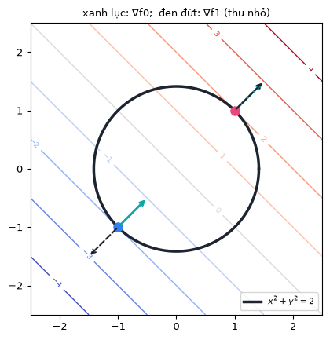

# Phụ lục A · Code

> Ghi chú của người biên soạn: trang này do người biên soạn viết thêm, không có trong sách gốc. Trang giải lại hai ví dụ của [Phụ lục A](math/appendix_a_vi) theo ba cách: giải hệ điều kiện Lagrange bằng SymPy, tối ưu có ràng buộc bằng `scipy.optimize`, và (cho Ví dụ 2) bằng trị riêng với NumPy. Ví dụ 2 cho thấy một chỗ cần đính chính trong sách.

## Cách dùng trang này

Các khối chạy lần lượt từ trên xuống và dùng chung biến. Cần `numpy`, `scipy`, `sympy`, `matplotlib`.

## 1. Ví dụ 1: cực trị của $x + y$ trên đường tròn $x^2 + y^2 = 2$

<small class="viz-ref">Công thức (A.1)–(A.4)</small>

SymPy giải trực tiếp hệ (A.4), tức $\nabla_{x, y, \lambda}\mathcal{L} = \mathbf{0}$:

<!-- run -->
```python
import numpy as np
import matplotlib.pyplot as plt
import sympy as sp

x, y, lam = sp.symbols("x y lambda", real=True)
L = x + y + lam * (x ** 2 + y ** 2 - 2)
sols = sp.solve([sp.diff(L, v) for v in (x, y, lam)], [x, y, lam], dict=True)
for s in sols:
    print(f"(x, y) = ({s[x]}, {s[y]}), lambda = {s[lam]}, f0 = {s[x] + s[y]}")
```

<!-- output -->
```output
(x, y) = (1, 1), lambda = -1/2, f0 = 2
(x, y) = (-1, -1), lambda = 1/2, f0 = -2
```
<!-- /output -->

Hai nghiệm khớp với sách: giá trị lớn nhất 2 tại $(1, 1)$, nhỏ nhất $-2$ tại $(-1, -1)$. Ý nghĩa hình học của điều kiện (A.2), $\nabla f_0 = -\lambda\nabla f_1$: tại điểm cực trị, gradient của hàm mục tiêu song song với gradient của ràng buộc, tức đường đồng mức của $f_0$ tiếp xúc với đường ràng buộc.

<!-- run -->
```python
t = np.linspace(0, 2 * np.pi, 400)
fig, ax = plt.subplots(figsize=(4.6, 4.4))
g = np.linspace(-2.5, 2.5, 200); Xg, Yg = np.meshgrid(g, g)
cs = ax.contour(Xg, Yg, Xg + Yg, levels=np.arange(-4, 5), cmap="coolwarm", linewidths=1)
ax.clabel(cs, fontsize=7)
ax.plot(np.sqrt(2) * np.cos(t), np.sqrt(2) * np.sin(t), color="#1d2430", lw=2.5, label="$x^2 + y^2 = 2$")
for (px, py), c in [((1, 1), "#e8487f"), ((-1, -1), "#2f80f5")]:
    ax.plot(px, py, "o", color=c, ms=8)
    ax.annotate("", xy=(px + 0.5, py + 0.5), xytext=(px, py), arrowprops=dict(arrowstyle="->", color="#0ea5a4", lw=2))   # grad f0 = (1, 1)
    ax.annotate("", xy=(px + 0.5 * px, py + 0.5 * py), xytext=(px, py), arrowprops=dict(arrowstyle="->", color="#1d2430", lw=1.5, ls="--"))
ax.set_aspect("equal"); ax.set_title("xanh lục: ∇f0;  đen đứt: ∇f1 (thu nhỏ)", fontsize=9); ax.legend(fontsize=8, loc="lower right")
fig.tight_layout()
```

<!-- output -->
<div align=center></div>
<!-- /output -->

Tại $(1, 1)$ hai mũi tên cùng hướng; tại $(-1, -1)$ chúng ngược hướng. Cả hai trường hợp đều thoả mãn "song song", nên điều kiện Lagrange cho cả cực đại lẫn cực tiểu; phải thay vào $f_0$ để biết điểm nào là gì.

## 2. Cùng bài toán, giải bằng `scipy.optimize`

<!-- run -->
```python
from scipy.optimize import minimize

cons = {"type": "eq", "fun": lambda v: v[0] ** 2 + v[1] ** 2 - 2}
for sign, name in [(1, "nhỏ nhất"), (-1, "lớn nhất")]:
    r = minimize(lambda v: sign * (v[0] + v[1]), x0=[0.5, -0.3], constraints=[cons], method="SLSQP")
    print(f"giá trị {name}: f0 = {sign * r.fun:+.6f} tại {r.x.round(6)}")
```

<!-- output -->
```output
giá trị nhỏ nhất: f0 = -2.000000 tại [-1.000007 -0.999993]
giá trị lớn nhất: f0 = +2.000000 tại [1. 1.]
```
<!-- /output -->

## 3. Ví dụ 2: chuẩn $\ell_2$ của ma trận

<small class="viz-ref">Công thức (A.5)–(A.11)</small>

Lời giải của sách đi tới $\mathbf{A}^T\mathbf{A}\mathbf{x} = \lambda\mathbf{x}$ và $\mathbf{x}^T\mathbf{A}^T\mathbf{A}\mathbf{x} = \lambda$ (A.10). Lưu ý rằng $\mathbf{x}^T\mathbf{A}^T\mathbf{A}\mathbf{x} = \|\mathbf{A}\mathbf{x}\|_2^2$ là **bình phương** của chuẩn. Kiểm tra bằng số:

<!-- run -->
```python
rng = np.random.default_rng(0)
A = rng.standard_normal((4, 3))
lam_max = np.linalg.eigvalsh(A.T @ A).max()
sv = np.linalg.svd(A, compute_uv=False)

# Tìm max ||A x|| / ||x|| bằng tối ưu trên mặt cầu đơn vị
best = max(-minimize(lambda v: -np.linalg.norm(A @ v), rng.standard_normal(3),
                     constraints=[{"type": "eq", "fun": lambda v: v @ v - 1}], method="SLSQP").fun for _ in range(10))
print(f"max ||Ax||_2 / ||x||_2 (tối ưu bằng số):  {best:.6f}")
print(f"np.linalg.norm(A, 2):                       {np.linalg.norm(A, 2):.6f}")
print(f"giá trị suy biến lớn nhất (SVD):            {sv.max():.6f}")
print(f"trị riêng lớn nhất của A^T A:               {lam_max:.6f}")
print(f"căn bậc hai của trị riêng lớn nhất:         {np.sqrt(lam_max):.6f}")
print("\ngiá trị suy biến:", sv.round(6), "\ncăn của các trị riêng của A^T A:", np.sqrt(np.sort(np.linalg.eigvalsh(A.T @ A))[::-1]).round(6))
```

<!-- output -->
```output
max ||Ax||_2 / ||x||_2 (tối ưu bằng số):  2.233497
np.linalg.norm(A, 2):                       2.233497
giá trị suy biến lớn nhất (SVD):            2.233497
trị riêng lớn nhất của A^T A:               4.988509
căn bậc hai của trị riêng lớn nhất:         2.233497

giá trị suy biến: [2.233497 0.924972 0.334825] 
căn của các trị riêng của A^T A: [2.233497 0.924972 0.334825]
```
<!-- /output -->

Chuẩn $\ell_2$ của ma trận là **căn bậc hai** của trị riêng lớn nhất của $\mathbf{A}^T\mathbf{A}$: $\|\mathbf{A}\|_2 = \sqrt{\lambda_{\max}(\mathbf{A}^T\mathbf{A})} = \sigma_{\max}(\mathbf{A})$. Tương tự, giá trị suy biến của $\mathbf{A}$ là căn bậc hai của các trị riêng của $\mathbf{A}^T\mathbf{A}$, không phải chính các trị riêng đó. Kết luận cuối của sách ("chuẩn $\ell_2$ của một ma trận là giá trị suy biến lớn nhất của ma trận đó") vẫn đúng; chỉ hai câu trung gian thiếu dấu căn. Giá trị suy biến được bàn kỹ ở [chương 20](ml/ch20_vi).
